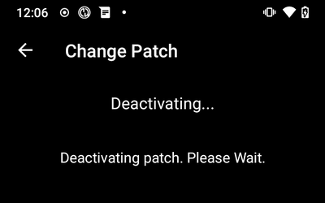
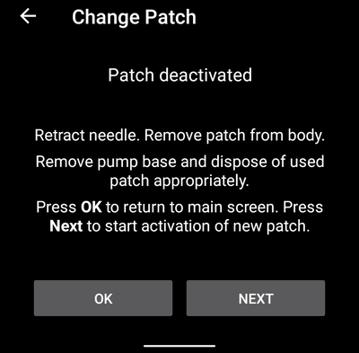
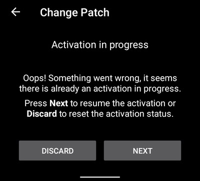

(medtrum-nano-300u)=
# Medtrum Nano 200U / 300U

Ці інструкції описують налаштування інсулінової помпи Medtrum.

```{contents} Table of contents
:depth: 1
:local: true
```

## Можливості помпи з AAPS
* Підтримуються всі функції петлі (SMB, TBR тощо)
* Автоматичний перехід на літній/зимовий час і зміна часового поясу
* Подовжений болюс драйвер AAPS не підтримує

## Вимоги до обладнання та програмного забезпечення
* **Сумісні бази помпи та патчі з резервуаром Medtrum**
    - Зараз підтримуються:
        - Medtrum TouchCare Nano 200U з базами помпи ref: **MD0201** і **MD8201**.
        - Medtrum TouchCare 300U з базою помпи ref: **MD8301**.
        - Якщо у вас модель, яка не підтримується, і ви готові передати обладнання або допомогти з тестуванням, напишіть нам у Discord [тут](https://discordapp.com/channels/629952586895851530/1076120802476441641).
* **AAPS зібрано і встановлено** за інструкціями [Збірка APK](../SettingUpAaps/BuildingAaps.md).
* **Сумісний телефон Android** з Bluetooth BLE
    - Дивіться [Примітки до випуску](../Maintenance/ReleaseNotes.md) AAPS

## Перш ніж почати

**БЕЗПЕКА ПЕРЕДУСІМ** Не виконуйте цей процес там, де ви не зможете виправити помилку (запасні патчі, інсулін і пристрої для керування помпою обов'язкові).

**PDM і застосунок Medtrum не працюватимуть із патчем, який активовано в AAPS.** Раніше ви, можливо, надсилали команди на помпу з PDM або застосунку Medtrum. З міркувань безпеки активований патч можна використовувати лише з тим пристроєм або застосунком, яким його активовано.

*Це НЕ означає, що PDM треба викинути. Радимо зберігати його в надійному місці як запасний на випадок надзвичайної ситуації, наприклад якщо ви загубите телефон або AAPS працюватиме неправильно.*

**Помпа не припиняє подавати інсулін, коли вона не підключена до AAPS** Стандартні базальні швидкості запрограмовано на помпі відповідно до поточного активного профілю. Поки AAPS працює, він надсилає команди тимчасового базалу, які тривають не довше 120 хвилин. Якщо з якоїсь причини помпа не отримує нових команд (наприклад, зв'язок втрачено через велику відстань між помпою і телефоном), після завершення тимчасового базалу помпа повертається до стандартної базальної швидкості, запрограмованої на помпі.

**Профіль AAPS не підтримує базальні проміжки по 30 хвилин** Якщо ви новачок в AAPS і вперше налаштовуєте базальний профіль, зверніть увагу: базальні швидкості, що починаються о пів на годину, не підтримуються. Вам треба налаштувати базальний профіль так, щоб кожна швидкість починалася на початку години. Наприклад, якщо у вас базальна швидкість 1,1 Од, яка починається о 09:30 і триває 2 години до 11:30, це не працюватиме. Вам треба змінити цю базальну швидкість 1,1 Од на проміжок 9:00–11:00 або 10:00–12:00. Хоча сама помпа Medtrum підтримує кроки базального профілю по 30 хв, алгоритми AAPS зараз не можуть їх враховувати.

**Базальні швидкості 0 Од/год у профілі в AAPS НЕ підтримуються** Хоча помпа Medtrum підтримує нульову базальну швидкість, AAPS використовує кратні значення базальної швидкості профілю для автоматичних дій і тому не може працювати з нульовою базальною швидкістю. Мінімальна базальна швидкість у профілі — 0,05 Од/год.

Тимчасову нульову базальну швидкість можна отримати функцією «Від’єднати помпу» або поєднанням «Вимкнути петлю»/тимчасовий базал чи «Призупинити петлю»/тимчасовий базал.

## Setup

```{caution}
Коли ви активуєте патч в **AAPS**, ви **ОБОВ'ЯЗКОВО** маєте вимкнути всі інші пристрої, які можуть зв'язуватися з базою помпи Medtrum, наприклад активний PDM або застосунок Medtrum.
```

### Крок 1: Виберіть помпу Medtrum

#### Варіант 1: нові встановлення

Якщо ви встановлюєте **AAPS** уперше, **Майстер налаштування** проведе вас через налаштування. Виберіть **Medtrum**, коли дійдете до кроку **Помпа**.

Якщо ви не впевнені, можна також вибрати **Віртуальна помпа**, а **Medtrum** вибрати пізніше, після налаштування **AAPS** (дивіться варіант 2).


#### Варіант 2: екран «Конфігурація»

Якщо AAPS уже встановлено, помпу **Medtrum** можна вибрати в [Конфігурація > Помпа](#Config-Builder-pump):

Відкрийте **меню** (☰) зліва вгорі, натисніть **Конфігурація** > **Помпа** і виберіть картку **Medtrum**. Одночасно може бути активна лише одна помпа.


Коли її вибрано, на картці **Medtrum** є дві кнопки: **Налаштування** і **Відкрити плагін**:


**Відкрити плагін** (або **Керувати → Помпа**) відкриває екран помпи Medtrum. На ньому ви замінюєте патчі та бачите стан помпи. Поки патч не активовано, екран виглядає так:


(medtrum-step-2)=
### Крок 2: Змініть налаштування Medtrum

Натисніть **Налаштування** на картці **Medtrum** у **Конфігурація** > **Помпа**. Також можна натиснути значок шестерні в правому верхньому куті екрана помпи Medtrum. Відкриються **Налаштування помпи Medtrum**:


```{note}
Налаштування **Серійний номер** більше немає. **AAPS** знаходить вашу базу помпи скануванням Bluetooth, коли ви вперше активуєте патч (дивіться [Крок 3](#medtrum-activate-patch)), і запам'ятовує її серійний номер. Щоб використовувати іншу базу помпи, дивіться [Розпарувати](#medtrum-unpair).
```

#### Налаштування сигналів

***Типово: Звук.***

Це налаштування змінює спосіб, яким помпа повідомляє вас про попередження або помилку.

- **Звук**: патч подає звуковий сигнал під час тривог і попереджень.
- **Без звуку**: патч не повідомляє вас про тривоги й попередження.

Примітка: у беззвучному режимі **AAPS** усе одно подає сигнал тривоги, залежно від налаштувань гучності телефону. Якщо ви не відреагуєте на тривогу, патч зрештою подасть звуковий сигнал.

#### Сповіщення про попередження помпи

***Типово: увімкнено.***

Це налаштування змінює спосіб, яким **AAPS** показує сповіщення про некритичні попередження помпи. Якщо ввімкнено, телефон показує сповіщення, коли виникає попередження помпи, зокрема:
- Низький заряд батареї
- Низький рівень резервуара (20 Од)
- Термін дії патча скоро закінчиться

Радимо залишити це ввімкненим, якщо сигнали помпи встановлено на **Без звуку**. В обох випадках ці попередження також показано на екрані помпи Medtrum у рядку [Активні тривоги](#medtrum-active-alarms).

(medtrum-patch-expiration)=
#### Термін дії патча

***Типово: увімкнено.***

Це налаштування змінює поведінку патча. Якщо ввімкнено, термін дії патча закінчується через 3 дні, і патч подає звукове попередження, якщо у вас увімкнено звук. Через 3 дні й 8 годин патч перестає працювати.

Якщо це налаштування вимкнено, патч не попереджає вас, перш ніж зупинитися. З новою прошивкою бази помпи патч працює щонайбільше 5 днів.

#### Попередження про закінчення терміну помпи [год]

***Типово: 72 години.***

Це налаштування змінює час попередження про закінчення терміну дії. Коли ввімкнено [Термін дії патча](#medtrum-patch-expiration), **AAPS** показує сповіщення через указану кількість годин після активації.

#### Максимум інсуліну на годину [Од]

***Типово: 25 Од.***

Це налаштування задає максимальну кількість інсуліну, яку можна подати за одну годину. Якщо цю межу перевищено, патч призупиняє подачу і подає сигнал тривоги. Тривогу можна скинути кнопкою **Скинути тривоги** на екрані помпи, дивіться [Скинути тривоги](#nano-reset-alarms).

Встановіть розумне значення відповідно до вашої потреби в інсуліні.

#### Максимум інсуліну на добу [Од]

***Типово: 80 Од.***

Це налаштування задає максимальну кількість інсуліну, яку можна подати за одну добу. Якщо цю межу перевищено, патч призупиняє подачу і подає сигнал тривоги. Тривогу можна скинути кнопкою **Скинути тривоги** на екрані помпи, дивіться [Скинути тривоги](#nano-reset-alarms).

Встановіть розумне значення відповідно до вашої потреби в інсуліні.

#### Сканувати при помилці зʼєднання

***Типово: вимкнено.***

Розташовано в **Додаткові налаштування**.

Вмикайте це, лише якщо у вас є проблеми зі з'єднанням. Якщо ввімкнено, драйвер знову шукає помпу, перш ніж спробувати перепідключитися до неї. Переконайтеся, що дозвіл на місцезнаходження для **AAPS** встановлено на «Дозволити завжди».

### Крок 2b: Налаштування сигналів AAPS

Ці налаштування не належать до драйвера Medtrum. Відкрийте їх значком **Налаштування** (шестерня) у правому верхньому куті головного екрана. Докладніше дивіться в розділі [Налаштування](../SettingUpAaps/Preferences.md).

#### BT Watchdog

Відкрийте **Налаштування** > **Помпа**:


**BT Watchdog** вимикає Bluetooth телефону на одну секунду, якщо **AAPS** не може підключитися до помпи. Це може допомогти на деяких телефонах, де Bluetooth зависає.

Увімкніть це налаштування, якщо у вас часто бувають проблеми зі з'єднанням з помпою.

#### Local alerts

Відкрийте **Налаштування** > **Локальні сповіщення**:


##### Сигнал, якщо помпа недоступна

***Типово: увімкнено.***

Коли драйвер Medtrum увімкнено, це налаштування завжди ввімкнене. Воно подає сигнал, коли помпа недоступна. Таке може статися, коли помпа поза зоною досяжності або не відповідає через несправний патч чи базу помпи, наприклад коли між базою помпи і патчем потрапила вода.

З міркувань безпеки це налаштування не можна вимкнути.

##### Поріг недоступності помпи

***Типово: 30 хв.***

Це налаштування задає, скільки часу **AAPS** чекає, перш ніж повідомити вас, що помпа недоступна.

Під час використання помпи Medtrum це налаштування можна змінити, але з міркувань безпеки радимо залишити 30 хвилин.

(medtrum-activate-patch)=
### Крок 3: Активуйте патч

**Перш ніж продовжити:**
- Підготуйте базу помпи Medtrum і новий патч із резервуаром.
- Вимкніть інші пристрої, які можуть зв'язуватися з помпою Medtrum (PDM і застосунок Medtrum).
- Бажано, щоб **AAPS** був налаштований і [профіль активовано](../DailyLifeWithAaps/ProfileSwitch-ProfilePercentage.md). Якщо активного профілю немає, активація починається з кроку **Потрібен профіль**, де ви вибираєте профіль для активації.

#### Почніть активацію

Відкрийте [екран помпи Medtrum](#nano-overview) (**Керувати → Помпа**) і натисніть **Замінити патч**. Якщо ви налаштували [захист налаштувань](#Preferences-protection), спочатку треба ввести пароль або PIN-код.

Якщо патч уже активний, вас попросять спочатку деактивувати його, дивіться [Деактивувати патч](#nano-deactivate-patch).

Активація — це покроковий майстер. Виконуйте вказівки на екрані, щоб заповнити й активувати новий патч. Натисніть **Скасувати** на будь-якому кроці, щоб зупинитися.

```{important}
Наклеюйте патч на тіло і вводьте канюлю лише тоді, коли про це скаже майстер (після завершення підготовки).
```

Перші кроки залежать від ваших налаштувань:

1. **Потрібен профіль**: лише якщо немає активного профілю. Виберіть профіль, який треба застосувати, і продовжте.
2. **Знайти помпу**: лише вперше або після того, як ви використали [Розпарувати](#medtrum-unpair). Під'єднайте базу помпи до нового патча, щоб її увімкнути. **AAPS** шукає бази помпи Medtrum поблизу (їхні назви починаються з `MT`). Натисніть на свою в списку. **AAPS** зберігає її серійний номер і одразу переходить до заповнення патча.

   

3. **Активувати патч**: лише коли **AAPS** уже знає вашу базу помпи. На екрані написано: «Немає активного патча. Натисніть **Далі**, щоб почати активацію.» Переконайтеся, що база помпи ще **не** під'єднана до патча, і натисніть **Далі**.


#### Під'єднайте й заповніть патч


Під'єднайте базу помпи до патча, видаліть залишки повітря і заповніть патч інсуліном. Для активації потрібно щонайменше 70 Од. На екрані показано рівень у резервуарі. Поки що не прикріплюйте патч до тіла.

Коли патч виявлено й заповнено, з'являється кнопка **Далі**. Натисніть її.

#### Вибрати інсулін

Цей крок з'являється, лише якщо в **AAPS** налаштовано більше одного інсуліну. Виберіть інсулін, яким ви заповнюєте патч. Після активації **AAPS** виконує перемикання профілю з цим інсуліном.

#### Підготовка патча


**Не** знімайте запобіжник. Натисніть кнопку голки на патчі наполовину, потім натисніть **Далі**, щоб почати підготовку.


Зачекайте, доки завершиться підготовка.


Коли підготовку завершено, натисніть **Далі**, щоб продовжити.

#### Чергування місць введення

Цей крок з'являється, лише якщо ви керуєте місцями введення помпи через [Чергування місць введення](#Aapsscreens-site-rotation) (налаштування **Керувати заміною місць введення помпи**). Виберіть, куди на тілі ви наклеюєте патч, або пропустіть цей крок.

#### Прикріпити патч


Очистьте шкіру і зніміть захисні плівки. Зніміть запобіжник, прикріпіть патч до тіла і натисніть кнопку голки, щоб ввести канюлю.

Натисніть **Далі**, щоб активувати патч.

#### Активувати патч


**AAPS** активує помпу і встановлює початкову базальну швидкість. Будь ласка, зачекайте. Коли активацію завершено, з'являється такий екран:


```{admonition} Older screenshot
:class: note
Окрім **Знайти помпу**, наведені вище знімки екрана активації зроблено в старішій версії **AAPS**, тому в **AAPS** 4 вони можуть виглядати інакше.
```

На ньому показано, скільки одиниць залишилося в патчі. Натисніть **OK**, щоб повернутися на екран помпи.

```{tip}
Після нової активації [експортуйте налаштування](../Maintenance/ExportImportSettings.md). Так ви зможете пізніше відновити цю сесію патча, наприклад на новому телефоні.
```

(nano-deactivate-patch)=

### Деактивувати патч

Щоб деактивувати активний патч, відкрийте [екран помпи Medtrum](#nano-overview) (**Керувати → Помпа**) і натисніть **Замінити патч**.


Вас попросять підтвердити, що ви хочете деактивувати поточний патч. **Цю дію не можна скасувати.** Натисніть **Далі**, щоб деактивувати, або **Скасувати**, щоб повернутися на екран помпи.



Якщо **AAPS** не може деактивувати патч (наприклад, тому що базу помпи вже від'єднано від патча), натисніть **Відкинути**, щоб забути поточну сесію патча. Після цього можна активувати новий патч.



Коли деактивацію завершено, витягніть голку і зніміть патч із тіла. Від'єднайте базу помпи і утилізуйте використаний патч. Натисніть **OK**, щоб повернутися на екран помпи, або **Далі**, щоб почати активацію нового патча.

(nano-resume-interrupted-activation)=

### Продовження перерваної активації

Якщо активацію патча перервано, наприклад тому що розрядився телефон, її можна продовжити. Відкрийте [екран помпи Medtrum](#nano-overview) (**Керувати → Помпа**) і натисніть **Замінити патч**.



Натисніть **Далі**, щоб продовжити активацію. Натисніть **Відкинути**, щоб скинути стан активації і активувати новий патч.


```{admonition} Older screenshot
:class: note
Знімки екрана в розділах **Деактивувати патч** і **Продовження перерваної активації** зроблено в старішій версії **AAPS**, тому в **AAPS** 4 вони можуть виглядати інакше.
```

Драйвер читає стан активації з помпи. Якщо це вдається, майстер продовжує з того кроку, на якому зупинився.

(nano-overview)=

## Екран помпи

Екран помпи Medtrum (**Керувати → Помпа**) показує поточний стан патча Medtrum. На ньому також є кнопки, щоб замінити патч, скинути тривоги та оновити стан. Банер угорі показує важливі стани, наприклад **Патч не активовано** або **Помпу призупинено**.


На екрані можуть бути такі рядки. Деякі рядки з'являються, лише коли мають значення.

- **Останнє підключення**: скільки часу тому **AAPS** востаннє підключався до помпи.
- **Останній болюс**: останній поданий болюс.
- **Акумулятор**: поточна напруга батареї патча.
- **Резервуар**: поточний рівень у резервуарі.
- **Серійний номер**: серійний номер вашої бази помпи.
- **Стан помпи**: поточний стан помпи. Наприклад, **Активний** (патч активовано, і він працює нормально) або **Зупинено** (патч не активовано).
- **Базова базальна швидкість**: базальна швидкість з вашого профілю, яка діє зараз.
- **Тимч. базал**: тимчасова базальна швидкість, якщо вона зараз діє.
- **Активний болюс**: болюс, який подається саме зараз.
- **Активні тривоги**: дивіться [нижче](#medtrum-active-alarms).
- **Тип помпи**: модель вашої бази помпи.
- **Версія прошивки**: версія прошивки бази помпи.
- **Номер патча**: порядковий номер активованого патча. Він збільшується на одиницю щоразу, коли ви активуєте новий патч.
- **Активація**: дата й час активації патча і скільки часу минуло відтоді.
- **Патч діє до**: дата й час, коли закінчується термін дії патча. Показує **Не ввімкнено**, якщо [Термін дії патча](#medtrum-patch-expiration) вимкнено.

(medtrum-active-alarms)=
### Активні тривоги

У цьому рядку показано всі тривоги, які активні зараз, наприклад низький рівень резервуара або закінчення терміну дії патча.

### Оновити

Ця кнопка оновлює стан патча. Вона доступна, лише коли патч активний і **AAPS** саме в цей момент не підключений до помпи.

### Замінити патч

Ця кнопка запускає майстер заміни патча. Докладніше дивіться в розділі [Активувати патч](#medtrum-activate-patch).

(medtrum-unpair)=
### Розпарувати

Ця кнопка з'являється, лише коли **AAPS** знає базу помпи. Вона видаляє збережений серійний номер бази помпи і розриває з'єднання. Наступного разу, коли ви активуватимете патч, **AAPS** знову шукатиме базу помпи (крок **Знайти помпу**). Використовуйте це, якщо переходите на іншу базу помпи. Робіть це, лише коли немає активного патча.

(nano-reset-alarms)=

### Скинути тривоги

Кнопка **Скинути тривоги** з'являється на екрані помпи лише тоді, коли патч сам призупинив подачу, наприклад після тривоги про добовий максимум інсуліну. Натисніть її, щоб скинути тривоги і відновити подачу інсуліну.


```{admonition} Older screenshot
:class: note
Знімок екрана вище зроблено в старішій версії **AAPS**. В **AAPS** 4 екран помпи виглядає інакше, але кнопка **Скинути тривоги** працює так само.
```

## Заміна телефону, експорт/імпорт налаштувань

Коли ви переходите на новий телефон, зробіть таке:
* [Експортуйте налаштування](../Maintenance/ExportImportSettings.md) на старому телефоні.
* Перенесіть файл налаштувань зі старого телефону на новий та імпортуйте його в **AAPS**. На екрані імпорту позначте **Також замінити налаштування помпи**, інакше сесію патча не буде перенесено на новий телефон.

Імпортований файл налаштувань має бути з тієї сесії патча, яку ви зараз використовуєте, інакше патч не підключиться (дивіться [Безтрубкові помпи](#ExportImportSettings-tubeless-pumps)).

Після імпорту налаштувань драйвер синхронізує історію з помпою. Це може тривати деякий час, залежно від віку файлу налаштувань. Хід синхронізації («Синхронізація записів, залишилось ...») показано на головному екрані:


(medtrum-nano-troubleshooting)=

## Усунення несправностей

### Проблеми зі з'єднанням

Якщо у вас тайм-аути з'єднання або інші проблеми зі з'єднанням:
- У налаштуваннях Android для застосунку **AAPS** встановіть дозвіл на місцезнаходження на «Дозволити завжди».
- Спробуйте ввімкнути **Сканувати при помилці зʼєднання** (налаштування Medtrum > **Додаткові налаштування**) і **BT Watchdog** (**Налаштування** > **Помпа**), дивіться [Крок 2](#medtrum-step-2).

### Проблеми з Bluetooth
Про відомі проблеми з Bluetooth-з’єднанням, обриви зв’язку з помпою/Pod, а також проблеми з активацією та підключенням див. [Усунення проблем з Bluetooth](../GettingHelp/BluetoothTroubleshooting.md)

### Активацію перервано

Якщо активацію перервано, наприклад через розряджений телефон або збій телефону, її можна продовжити. Натисніть **Замінити патч** на екрані помпи і виконайте кроки з розділу [Продовження перерваної активації](#nano-resume-interrupted-activation).

### Як запобігти несправностям патча

Патч може видавати різні помилки. Щоб помилки виникали рідше:
- Переконайтеся, що база помпи щільно сидить у патчі і не видно жодних щілин.
- Під час заповнення патча не тисніть на поршень надто сильно. Не заповнюйте патч більше максимуму для вашої моделі.

## Де отримати допомогу

Уся розробка драйвера Medtrum виконується спільнотою на **волонтерських** засадах. Просимо пам'ятати про це і перед тим, як звертатися по допомогу, дотримуватися таких правил:

-  **Рівень 0:** Прочитайте відповідний розділ цієї документації, щоб зрозуміти, як має працювати функція, з якою у вас проблеми.
-  **Рівень 1:** Якщо у вас і далі є проблеми, які не вдається вирішити за допомогою цього документа, перейдіть на канал *#Medtrum* у **Discord** за [цим запрошенням](https://discord.gg/4fQUWHZ4Mw).
-  **Рівень 2:** Пошукайте серед наявних звернень, чи про вашу проблему вже повідомлено: [Issues](https://github.com/nightscout/AAPS/issues) якщо так, підтвердьте її, прокоментуйте або додайте інформацію про свою проблему. Якщо ні, створіть [нове звернення](https://github.com/nightscout/AndroidAPS/issues) і додайте [ваші файли журналів](../GettingHelp/AccessingLogFiles.md).
-  **Будьте терплячі: більшість учасників нашої спільноти — доброзичливі волонтери, і розв’язання проблем часто потребує часу й терпіння як від користувачів, так і від розробників.**