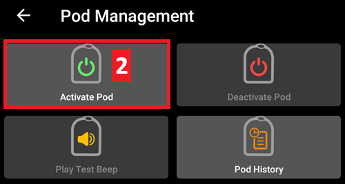
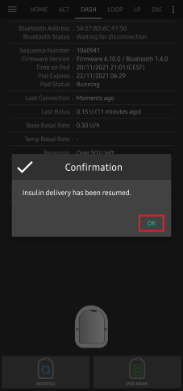
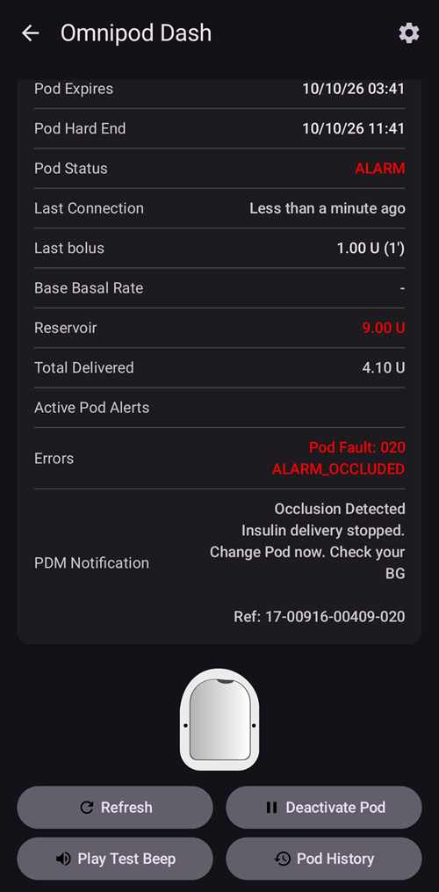

# Omnipod DASH

Ці інструкції стосуються налаштування помпи покоління **Omnipod DASH** **(НЕ Omnipod Eros)**. Драйвер DASH — перевірений спосіб використовувати петлю з Omnipod.

```{contents} Table of contents
:depth: 1
:local: true
```

## Характеристики Omnipod DASH

Основні характеристики **Omnipod DASH** («DASH»):

- Pod DASH можна впізнати за **синьою кришечкою голки** (у старішого Pod EROS кришечка прозора). В іншому Pod однакові за фізичними розмірами.
- DASH не потребує BLE-з’єднання чи пристрою-мосту (НЕ потрібні RileyLink, OrangeLink чи EmaLink).
- Bluetooth-з’єднання DASH використовується лише під час надсилання команди (наприклад, болюсу) і розривається одразу після неї.
- **AAPS** чекатиме, поки Pod стане доступним, щоб надіслати команди.
- Під час активації Pod **AAPS** знайде новий Pod DASH і підключиться до нього.
- Очікувана відстань від телефону: 5–10 метрів (у кожного по-різному).

(omnipod-dash-constraints)=

## Відомі обмеження/проблеми AAPS з Omnipod DASH
- Загальна порада — використовувати **AAPS** на Android 14 або 16. Спільнота повідомляє про багато [проблем](https://github.com/nightscout/AndroidAPS/issues/3471) з Android 15. Однак якщо у вас Android 15, найімовірніше, доведеться увімкнути **Звʼязування Bluetooth (bonding)** (у розділі **Додаткові налаштування** в [налаштуваннях Dash](#omnipod-dash-advanced-settings)), щоб успішно активувати та використовувати Pod; докладніше про налаштування bonding див. [Усунення несправностей](../GettingHelp/GeneralTroubleshooting.md).
- Перехід на літній/зимовий час і зміна часового поясу не застосовуються автоматично. Після зміни часу Pod потрібно оновити вручну: натисніть **Оновити** на екрані помпи DASH, потім натисніть **Встановити час** (показується, коли часові пояси Pod і телефону відрізняються) або виконайте **Перемикання профілю** (див. [Зміна часового поясу для Omnipod Dash](#timezone-traveling-with-pumps)).
- Dash підтримує базал лише з кроком 0,05 Од/год. Якщо ви спробуєте встановити базал з кроком 0,01 у своєму **профілі AAPS**, AAPS не попередить вас, хоча Pod округлить швидкість до кроку 0,05. Якщо відкрити **Історію Pod** на екрані помпи DASH, там буде видно, що встановлено базал 0,05. Це також означає, що найменша базальна швидкість, яку DASH дозволяє в **AAPS**, — 0,05 Од/год.
- Файл налаштувань містить активний сеанс Pod. Експортуйте налаштування після кожної активації Pod і прочитайте розділ [Експорт та імпорт налаштувань](#omnipod-dash-export-import), перш ніж імпортувати налаштування.
- Під час встановлення нового базального профілю DASH призупиняє введення, перш ніж встановити новий базальний **профіль**. Якщо зв’язок перерветься або станеться помилка, базальний профіль не запуститься знову автоматично. Докладніше див. розділ [Відновлення введення інсуліну](#omnipod-dash-resuming-insulin-delivery).
- Якщо попередження налаштовані і термін дії Pod скоро закінчиться, Pod подаватиме звукові сигнали, доки ви не вимкнете звук попереджень; докладніше див. [Вимкнення звуку попереджень Pod](#omnipod-dash-silencing-pod-alerts).
- Є кілька відомих проблем з Bluetooth, які можуть заважати активації Pod. Відому проблему та способи її розв’язання див. в розділі [Проблеми, пов’язані з Bluetooth](../GettingHelp/BluetoothTroubleshooting.md).

(hardware-software-requirements)=

(omnipod-dash-hardware-software-requirements)=
## Вимоги до обладнання та програмного забезпечення

- Omnipod DASH можна впізнати за синьою кришечкою голки.


- **Сумісний телефон Android** з Bluetooth Low Energy (BLE) (докладніше див. [Телефони](../Getting-Started/Phones.md)); крім того, наведена нижче інформація допоможе врахувати інші важливі моменти для успішної активації та використання DASH на сумісному телефоні:
    -  Драйвер Omnipod Dash в **AAPS** підключається до Pod DASH через Bluetooth.  
      **AAPS** автоматично встановлює нове Bluetooth-з’єднання з Pod щоразу, коли треба надіслати команду (наприклад, болюс), а після надсилання команди з’єднання одразу розривається.
       - **NOTE:**
         - Bluetooth-з’єднання можуть переривати або порушувати інші пристрої Bluetooth, підключені до телефону з **AAPS**, наприклад навушники тощо. На деяких моделях телефонів такі пристрої можуть спричиняти помилки з’єднання або проблеми з активацією Pod. Коли обираєте телефон для Omnipod DASH, варто переглянути список [перевірених конфігурацій обладнання](https://docs.google.com/spreadsheets/u/1/d/e/2PACX-1vScCNaIguEZVTVFAgpv1kXHdsHl3fs6xT6RB2Z1CeVJ561AvvqGwxMhlmSHk4J056gMCAQE02sAWJvT/pubhtml?gid=683363241&single=true), щоб знайти відомі робочі поєднання.
         - Є кілька відомих проблем з Bluetooth, які можуть заважати активації Pod (поради щодо інших проблем з Bluetooth див. в розділі [Усунення несправностей](#troubleshooting)), зокрема в розділі [Проблеми, пов’язані з Bluetooth](#omnipod-dash-bluetooth-related-issues).
    - На телефоні має бути **Android 12 або новіший**, а **AAPS** має бути зібраний і встановлений за інструкціями [**Збірка AAPS**](../SettingUpAaps/BuildingAaps.md). Завжди використовуйте останню випущену версію.
- Підтримуваний [**пристрій безперервного моніторингу глюкози (CGM)**](../Getting-Started/CompatiblesCgms.md)

Нижче пояснено, як розпочати новий сеанс Pod за допомогою **AAPS**. Дочекайтеся, поки термін дії вашого поточного Pod майже закінчиться, бо новий Pod потрібно буде активувати через **AAPS**. Деактивований Pod не можна використати чи активувати знову: деактивація остаточна.

## Перш ніж почати

Переконайтеся, що ви прочитали й зрозуміли весь цей посібник, розділ **Перш ніж почати**, а також **[Обмеження та проблеми Omnipod і AAPS](#omnipod-dash-constraints)**, щоб не натрапити на відому проблему.

### **БЕЗПЕКА ПЕРЕДУСІМ** — **НЕ** намагайтеся вперше підключати **AAPS** до Pod, якщо у вас немає під рукою всього переліченого нижче:
1. Запасні Pod (3 або більше)
2. Запасний інсулін і засоби для ін’єкцій (MDI)
3. Справний Omnipod PDM (на випадок, якщо **AAPS** не працюватиме)
4. Обов’язково потрібен підтримуваний телефон! (Див. [Вимоги до обладнання та програм](#hardware-software-requirements))
5. Правильна версія AAPS, зібрана та встановлена

### Ваш Omnipod Dash PDM стане непотрібним після того, як драйвер Dash в AAPS активує ваш Pod.
- До використання **AAPS** ви або ваш доглядач керували Pod через Omnipod PDM (або в деяких регіонах через застосунок на телефоні), щоб надсилати команди на DASH (наприклад, болюс).
- DASH підтримує з’єднання лише з одним пристроєм Bluetooth (наприклад, PDM або телефоном) для керування та надсилання команд.
- Пристрій, який успішно активував Pod, з цього моменту єдиний може зв’язуватися з цим Pod. Це означає, що коли ви активуєте DASH телефоном Android через **AAPS**, **ви більше не зможете використовувати свій PDM з цим Pod!** Поки цей Pod активний, драйвер Dash в **AAPS** на вашому телефоні Android — новий PDM для вашого Pod.
- **НЕ викидайте свій PDM!** Рекомендуємо зберігати його як запасний і для надзвичайних ситуацій, наприклад якщо ви загубите телефон або **AAPS** працюватиме неправильно.

### Ваш Pod **НЕ ПРИПИНИТЬ** вводити інсулін, коли він не підключений до AAPS.
Під час активації в Pod програмуються стандартні базальні швидкості з поточного активного [**профілю**](../SettingUpAaps/YourAapsProfile.md).  
Поки **AAPS** працює, він надсилає команди зміни базальної швидкості, які діють максимум 120 хвилин.  
Якщо з якоїсь причини Pod не отримує нових команд (наприклад, зв’язок втрачено через відстань між Pod ➜ телефоном), Pod автоматично повертається до стандартних базальних швидкостей з вашого [**профілю**](../SettingUpAaps/YourAapsProfile.md).

### Профілі AAPS не підтримують 30-хвилинні проміжки базальної швидкості
Якщо ви новачок в **AAPS** і вперше налаштовуєте базальний [**профіль**](../SettingUpAaps/YourAapsProfile.md), пам’ятайте, що базальні швидкості, які починаються о пів на годину, не підтримуються. Наприклад, якщо у вашому Omnipod PDM є базальна швидкість 1,1 Од, яка починається о 09:30 і триває 2 години до 11:30, точно відтворити такий базальний **профіль** в **AAPS** неможливо.  
Цю базальну швидкість 1,1 Од потрібно перенести на проміжок 9:00–11:00 або 10:00–12:00. Хоча саме обладнання DASH підтримує 30-хвилинні проміжки базального **профілю**, **AAPS** цю функцію НЕ підтримує.

### Базальні швидкості 0 Од/год у профілі НЕ підтримуються в AAPS
Хоча DASH підтримує нульову базальну швидкість, **AAPS** використовує кратні значення базальної швидкості з **профілю** користувача для автоматичної терапії; з нульовою базальною швидкістю він працювати не може.  
Натомість тимчасової нульової базальної швидкості можна досягти функцією «Від’єднати помпу» або поєднанням «Вимкнути петлю»/тимчасового базалу чи «Призупинити петлю»/тимчасового базалу.  
**ПРИМІТКА:** Найменша базальна швидкість, яку DASH дозволяє в **AAPS**, — 0,05 Од/год.

## Вибір Dash в AAPS

Вибрати драйвер Omnipod DASH в **AAPS** можна **двома** способами:

### Варіант 1: нові встановлення

Коли ви вперше встановлюєте **AAPS**, **Майстер налаштування** проведе вас через основні функції та вимоги до встановлення **AAPS**. Коли дійдете до кроку **Помпа**, виберіть **Omnipod Dash**.


Якщо ви ще не впевнені, можна поки що вибрати **Віртуальна помпа**, а **Omnipod Dash** вибрати пізніше, після налаштування **AAPS** (див. варіант 2).

(omnipod-dash-option-2-config-builder)=
### Варіант 2: екран «Конфігурація»

У вже наявному встановленні помпу **Omnipod Dash** можна вибрати на екрані **Конфігурація**:

1. Відкрийте **меню** (☰) у верхньому лівому куті головного екрана і виберіть **Конфігурація**.
2. Торкніться **Помпа** і виберіть перемикач **Omnipod Dash** (*«Інтеграція помпи для Omnipod Dash (нова модель з Bluetooth та синьою кришечкою голки).»*).

3. Коли її вибрано, на картці **Omnipod Dash** з’являються дві кнопки:
   - **Налаштування** відкриває [налаштування Dash](#omnipod-dash-settings).
   - **Відкрити плагін** відкриває [екран помпи DASH](#omnipod-dash-tab).

   

### Перевірка вибору драйвера Omnipod

Щоб перевірити, що вибрано **Omnipod Dash**, відкрийте **Керувати** (нижня навігація головного екрана) і торкніться **Помпа**. Відкриється екран помпи DASH, як показано в наступному розділі.

(omnipod-dash-tab)=

## The DASH pump screen

На екрані помпи DASH ви керуєте своїми Pod: активуєте та деактивуєте їх, оновлюєте статус Pod, вимикаєте звук попереджень і переглядаєте історію Pod. Відкрийте його через **Керувати** > **Помпа** або кнопкою **Відкрити плагін** на картці **Omnipod Dash** у **Конфігурація** > **Помпа**.

Так виглядає екран без активного Pod:


А так виглядає екран з активним Pod:


Значок **Налаштування** (шестерня) у верхньому правому куті відкриває [налаштування Dash](#omnipod-dash-settings).

***ПРИМІТКА:** Якщо поле на екрані помпи показує (невизначено), натисніть **Оновити**, щоб оновити статус Pod.*

### Поля

- **Адреса Bluetooth:** Bluetooth-адреса Pod.

- **Якість з'єднання:** Наскільки надійно **AAPS** підключається до Pod; показується як *успішні з’єднання / усі спроби з’єднання :: частка успішних*, наприклад `412/420 :: 98.10 %`. Після понад 50 успішних з’єднань значення стає жовтим, якщо воно нижче 90 %, і червоним, якщо нижче 70 %. Низьке значення вказує на проблему з Bluetooth (див. [Проблеми, пов’язані з Bluetooth](#omnipod-dash-bluetooth-related-issues)).

- **Статус введення:** Необроблений статус введення, який повідомляє Pod. Це поле показується лише у збірках з режимом інженера.

- **Унікальний ID:** Унікальний ID, який **AAPS** присвоїв Pod під час активації.

- **Номер LOT:** Номер виробничої партії Pod.

- **Порядковий номер:** Порядковий номер Pod.

- **Версія прошивки:** Версії прошивки та Bluetooth у Pod.

- **Час на Pod:** Поточний час на Pod разом з його часовим поясом. Текст стає червоним, коли часовий пояс Pod відрізняється від часового поясу телефону, і жовтим, коли час Pod відрізняється більш ніж на 10 хвилин.

- **Pod діє до:** Дата й час, коли закінчується термін дії Pod (72 години після активації). Текст стає жовтим за останні 4 години до цього часу. Червоним він не стає ніколи, бо Pod продовжує вводити інсулін і після цього.

- **Остаточна зупинка Pod:** Кінець додаткового періоду Pod (8 годин після **Pod діє до**, тобто максимальний строк роботи Pod — 80 годин). Текст стає жовтим, коли починається додатковий період (у момент **Pod діє до**), і червоним за останні 4 години до остаточної зупинки. Під час додаткового періоду також показується час, що залишився, наприклад *(залишилось 17 хв)*. У момент остаточної зупинки Pod припиняє вводити інсулін, і його потрібно замінити.

- **Статус Pod:** Стан Pod: **Немає активного Pod**, **Триває налаштування**, **Активний**, **Призупинено** або, після помилки Pod, **ALARM**.

- **Останнє з'єднання:** Скільки часу минуло відтоді, як **AAPS** востаннє зв’язувався з Pod.

  - *Щойно* — менше 10 секунд тому.

  - *Менше хвилини тому* — від 10 до 60 секунд тому.

  - *XX хвилин тому* — понад 1 хвилину тому (а через годину — *X годин та XX хвилин тому*).

- **Останній болюс:** Кількість останнього болюсу, надісланого на Pod, і скільки часу тому його введено. Непідтверджений болюс позначається як (невизначено).

- **Базова базальна швидкість:** Базальна швидкість, запрограмована на поточний час у вашому базальному **профілі**.

- **Тимчасовий базал:** Тимчасова базальна швидкість (TBR), яка зараз діє, з часом початку та тривалістю. Це поле показується лише тоді, коли діє TBR.

- **Резервуар:** Показує *Залишилось понад 50 Од*, коли в резервуарі залишилося понад 50 одиниць. Нижче 50 одиниць показується точна кількість. Значення стає червоним нижче 20 одиниць.

- **Всього введено:** Загальна кількість інсуліну, введеного з резервуара. Сюди входить і інсулін, використаний для заповнення (prime).

- **Активні попередження Pod:** Попередження, які зараз активні на Pod, наприклад *Термін дії Pod скоро закінчиться* або *Низький рівень резервуара*.

- **Помилки:** Помилка Pod, якщо Pod вийшов з ладу; показується червоним як *Помилка Pod:* з кодом і назвою помилки, наприклад *Помилка Pod: 020 ALARM_OCCLUDED*. Попередні помилки та докладнішу інформацію дивіться в [Історії Pod](#omnipod-dash-view-pod-history) і в файлах журналу. Див. [Збої Pod](#omnipod-dash-pod-failures).

- **Сповіщення PDM:** Показується лише після помилки Pod. Воно показує помилку так, як її показав би Omnipod PDM: заголовок (наприклад, *Виявлено оклюзію*, *Порожній резервуар* або *Термін дії Pod минув*), що сталося (наприклад, *Введення інсуліну зупинено. Замініть Pod зараз.*) і код *Ref:*.

### Кнопки

Кнопки внизу екрана помпи змінюються залежно від стану Pod. Показуються лише ті кнопки, які мають сенс у цей момент.

- **Оновити:** Запитує в Pod його поточний статус.
  - *Використовуйте її, щоб оновити статус Pod і очистити поля, які показують (невизначено).*
  - *Докладніше див. розділ [Усунення несправностей](#omnipod-dash-troubleshooting) нижче.*

- **Вимкнути звук попереджень:** Зупиняє звукові сигнали попереджень Pod (наприклад, про закінчення терміну дії або низький рівень резервуара). Показується лише тоді, коли на Pod є активне попередження. Див. [Вимкнення звуку попереджень Pod](#omnipod-dash-silencing-pod-alerts).

- **Відновити введення:** Відновлює введення інсуліну на призупиненому Pod. Показується лише тоді, коли введення призупинено. Див. [Відновлення введення інсуліну](#omnipod-dash-resuming-insulin-delivery).

- **Встановити час:** Переводить Pod на часовий пояс вашого телефону, повторно надсилаючи ваш базальний **профіль**. Показується лише тоді, коли часовий пояс Pod відрізняється від часового поясу вашого телефону.

- [**Активувати Pod**](#omnipod-dash-activate-pod): підготовлює й активує новий Pod. Показується, коли немає активного Pod.

- [**Деактивувати Pod**](#omnipod-dash-deactivate-pod): деактивує активний Pod. Показується, щойно Pod спарено з **AAPS**, а також коли активація зупинилася на півдорозі (наприклад, через збій Pod під час активації). **AAPS** просить вас підтвердити, перш ніж деактивувати Pod.

- **Програти тестовий сигнал:** Pod подає один тестовий звуковий сигнал.

- [**Історія Pod**](#omnipod-dash-view-pod-history): показує історію дій активного Pod.

- **Викинути Pod:** Видаляє незавершений Pod з **AAPS**. Показується лише тоді, коли активація Pod зупинилася на півдорозі. **AAPS** просить вас підтвердити. Після цього **AAPS** більше не може зв’язатися з цим Pod: зніміть його з тіла.


```{admonition} Older screenshot
:class: note
Знімок екрана вище зроблено в старішій версії **AAPS**, де було окреме меню **Керування Pod**. В **AAPS** 4 усі ці дії, зокрема **Активувати Pod**, **Деактивувати Pod**, **Програти тестовий сигнал** та **Історія Pod**, — це кнопки з текстовими підписами прямо на екрані помпи.
```

(omnipod-dash-activate-pod)=

## Активувати Pod

1. Відкрийте екран помпи DASH (**Керувати** > **Помпа**) і натисніть **Активувати Pod**. Відкриється майстер активації.

   

   ```{admonition} Older screenshot
   :class: note
   Знімок екрана вище зроблено в старішій версії **AAPS**. В **AAPS** 4 **Активувати Pod** — це кнопка прямо на екрані помпи DASH, а не в меню **Керування Pod**.
   ```

   Якщо ви ще ніколи не активували **профіль** в **AAPS**, майстер спочатку показує крок **Потрібен профіль**: виберіть профіль, який буде застосовано під час активації, і продовжте.

2. Показується крок **Заповнення Pod**. Заповніть новий Pod інсуліном, якого вистачить на 3 дні, — **щонайменше 80 Од**. Дочекайтеся двох звукових сигналів від Pod: вони означають, що заповнено мінімальну кількість 80 Од. Повністю спорожніть шприц для заповнення, навіть після двох сигналів. Поки що не знімайте кришечку голки Pod.

   ***ПРИМІТКА:** Коли розраховуєте кількість інсуліну на 3 дні, пам’ятайте, що на підготовку (prime) Pod іде приблизно 3–10 Од.*

   

   

   Переконайтеся, що новий Pod і телефон з **AAPS** розташовані близько один до одного, і натисніть **Далі**.

3. Якщо в **AAPS** ви використовуєте більше ніж один інсулін, показується крок **Вибрати інсулін**. Він показує інсулін з позначкою **Зараз активний**. Якщо ви заповнили Pod іншим інсуліном, натисніть **Змінити** і виберіть його. Після завершення активації **AAPS** виконує **Перемикання профілю** з цим інсуліном. Натисніть **Далі**.

   

4. На кроці **Ініціалізація Pod** **AAPS** спарюється з новим Pod і підготовлює (prime) його. Ви почуєте клацання, а потім серію цокань, поки Pod підготовлюється. Коли це успішно завершиться, з’явиться кнопка **Далі**. Натисніть **Далі**.

       

   ***ПРИМІТКА**: Якщо з’явиться повідомлення про помилку, наприклад _Помилка сканування_ або _'Could not find an available pod for activation'_ (не вдалося знайти доступний Pod для активації) — таке буває, — не панікуйте. Натисніть **Повторити**. У більшості випадків активація після цього успішно продовжується.*

   

   Якщо Pod вийшов з ладу (наприклад, тому що перевищено час його активації), замість **Повторити** показується **Деактивувати Pod**. Скористайтеся нею і почніть заново з новим Pod.

   Якщо натиснути **Скасувати** до завершення активації, **AAPS** попросить підтвердити, що ви хочете вийти. Натисніть **OK**, щоб вийти з майстра, або **Скасувати**, щоб залишитися.

   

5. Якщо ви ведете в **AAPS** чергування місць введення помпи (**Керувати заміною місць введення помпи** в налаштуваннях [Чергування місць введення](#Aapsscreens-site-rotation)), показується крок **Місце введення**. Виберіть на схемі тіла місце, куди ви прикріпите Pod, і натисніть **Далі** або натисніть **Пропустити**.

   

6. Далі підготуйте місце інфузії для нового Pod. Вимийте руки, щоб уникнути ризику інфекції. Очистіть місце інфузії водою з милом або спиртовою серветкою і дайте шкірі повністю висохнути на повітрі, перш ніж продовжити. Якщо клейка основа подразнює шкіру, спробуйте захисну серветку або захисний спрей.

   На кроці **Прикріплення Pod** зніміть з Pod синю пластикову кришечку голки. Якщо з Pod виступає канюля чи щось інше або він виглядає незвично, **ЗУПИНІТЬСЯ**: натисніть **Скасувати** і почніть заново з новим Pod. Якщо все виглядає **OK**, зніміть білу паперову підкладку з клейкої основи і приклейте Pod на вибране місце на тілі.

   Коли закінчите, натисніть **Далі**.

   

7. З’явиться вікно підтвердження: *Після натискання OK канюля буде вставлена.* **Натискайте OK, ЛИШЕ якщо ви готові вставити канюлю!**

   

8. На кроці **Вставка канюлі** **AAPS** встановлює ваш базальний графік, і Pod вводить канюлю. Це може зайняти деякий час (максимум 1–2 хвилини). **Будьте терплячі!**

   ***ПРИМІТКА:** Добре взяти шкіру в складку біля місця введення канюлі, перш ніж канюлю буде вставлено. Так голка входить плавно, і менша ймовірність оклюзій (закупорок).*

       

9. Коли канюлю успішно вставлено, з’являється кнопка **Далі**. Натисніть **Далі**.

   

10. Показується крок **Pod активовано**. Перевірте, чи канюлю вставлено правильно, і замініть Pod, якщо вважаєте, що ні.

    Натисніть **Завершити**.

    Вітаємо! Ви розпочали новий сеанс Pod.

    

11. Ви знову на екрані помпи DASH. Тепер він показує інформацію про ваш активний Pod, зокрема поточну базальну швидкість, рівень резервуара, введений інсулін, помилки та попередження Pod. **Активувати Pod** замінюється на **Деактивувати Pod**: ви не можете активувати інший Pod, поки не деактивуєте активний.

    ***ПРИМІТКА:** Докладніше про показану інформацію див. [Екран помпи DASH](#omnipod-dash-tab).*

    

    ***ПРИМІТКА:** Добра практика — експортувати налаштування ПІСЛЯ активації Pod. Експортуйте налаштування після кожної заміни Pod і раз на місяць. Скопіюйте файл експортованих налаштувань у хмарне сховище (наприклад, Google Drive) або кудись поза телефоном на випадок, якщо ви його загубите (див. [**Експорт налаштувань**](../Maintenance/ExportImportSettings.md)).*

Якщо попередня активація зупинилася після підготовки Pod, натискання **Активувати Pod** продовжує з кроку **Прикріплення Pod**.

(omnipod-dash-deactivate-pod)=

## Деактивувати Pod

За звичайних умов Pod працює три дні (72 години), плюс додатковий період 8 годин після попередження про закінчення терміну дії: всього 80 годин.

Щоб деактивувати Pod (бо закінчився його термін дії або він вийшов з ладу):

1. Відкрийте екран помпи DASH (**Керувати** > **Помпа**) і натисніть **Деактивувати Pod**.

   

2. На кроці **Деактивація Pod** натисніть **Далі**. З’являється запитання *Деактивований Pod не можна використати знову. Деактивувати цей Pod зараз?* Натисніть **OK**, щоб почати деактивацію Pod, або **Скасувати**, щоб залишити його. Деактивація призупиняє все введення інсуліну, і її не можна скасувати.

   

3. Поки **AAPS** деактивує Pod, показується крок **Деактивація Pod**. Pod подає звуковий сигнал, щоб підтвердити успішну деактивацію.

   

   ```{admonition} Older screenshot
   :class: note
   Знімок екрана вище зроблено в старішій версії **AAPS**. В **AAPS** 4 майстер показує свій прогрес рядком точок угорі, а не смугою прогресу.
   ```

   Коли деактивацію успішно завершено, з’являється кнопка **Далі**. Натисніть **Далі**.

   

   Якщо деактивація не вдається, показується повідомлення про помилку і кнопка **Викинути Pod**. Перш ніж нею скористатися, прочитайте розділ [Викидання Pod](#omnipod-dash-discard-pod) нижче. Також можна натиснути **Скасувати** і спробувати **Деактивувати Pod** ще раз пізніше.

4. Показується крок **Pod деактивовано**. Зніміть Pod з тіла і натисніть **Завершити**.

   

5. Ви знову на екрані помпи DASH. Перевірте, що поле **Статус Pod** показує **Немає активного Pod** і що знову показується кнопка **Активувати Pod**.

   

(omnipod-dash-discard-pod)=

### Викидання Pod

Викидайте Pod, лише коли весь зв’язок з ним постійно не вдається. Якщо **AAPS** ще може зв’язатися з Pod, скористайтеся натомість **Деактивувати Pod**.

- **AAPS** просить вас підтвердити, перш ніж викинути Pod.
- Після цього **AAPS** більше не може зв’язатися з цим Pod.
- **Введення інсуліну НЕ призупинено**, бо Pod не було правильно деактивовано. **Зніміть Pod з тіла!**
- Крок **Pod викинуто** підтверджує, що стан Pod скинуто. Натисніть **Завершити**. Тепер можна активувати новий Pod.

(omnipod-dash-resuming-insulin-delivery)=

## Відновлення введення інсуліну

**ПРИМІТКА**: Під час **перемикання профілю**, як і з PDM, **AAPS** має призупинити введення на Pod, перш ніж встановити новий базальний **профіль**. Якщо зв’язок перерветься між командами призупинення та відновлення, введення може залишитися призупиненим. Докладніше див. [**Введення призупинено**](#omnipod-dash-delivery-suspended) у розділі усунення несправностей.

Коли введення інсуліну призупинено, потрібно дати Pod команду відновити введення інсуліну. Коли команду успішно виконано, Pod знову вводить інсулін з базальною швидкістю на поточний час з вашого активного базального **профілю**. Pod знову приймає команди болюсу, **TBR** та **SMB**.

1. Відкрийте екран помпи DASH і перевірте, що поле **Статус Pod** показує **Призупинено**. Натисніть **Відновити введення**, щоб дати Pod команду відновити звичайне введення інсуліну.

   

2. Коли команда вдалася, поле **Статус Pod** показує **Активний**, а кнопка **Відновити введення** зникає.

   

   

   ```{admonition} Older screenshot
   :class: note
   Знімки екрана вище зроблено в старішій версії **AAPS**, яка показувала вікно підтвердження. В **AAPS** 4 ви перевіряєте результат на екрані помпи DASH: поле **Статус Pod** показує **Активний**, а кнопки **Відновити введення** більше немає.
   ```

   Якщо команда не вдається, **AAPS** показує вікно з попередженням, яке починається з *Не вдалося відновити введення*. Натисніть **Оновити** і спробуйте ще раз.

   

(omnipod-dash-silencing-pod-alerts)=

## Вимкнення звуку попереджень Pod

У цьому розділі пояснено, як зупинити звукові сигнали Pod, коли його строк роботи добігає кінця. Коли починаються ці сигнали, залежить від налаштувань **Попередження** (див. [Налаштування Dash](#omnipod-dash-settings)):

- **Нагадування за скільки годин до закінчення терміну (72 години):** за скільки годин до закінчення 72-годинного терміну дії Pod починає подавати сигнали.
- **Попередження за скільки годин до вимкнення (80 годин):** за скільки годин до вимкнення на 80-й годині Pod знову подає сигнали.

Максимальний строк роботи Pod — 80 годин (3 дні 8 годин). Однак виробник Pod рекомендує не перевищувати 72 години (3 дні).

***ПРИМІТКА**: Кнопка **Вимкнути звук попереджень** показується на екрані помпи DASH лише тоді, коли на Pod є активне попередження, наприклад про закінчення терміну дії або низький рівень резервуара. Якщо кнопки **Вимкнути звук попереджень** немає, але ви чуєте сигнали Pod, натисніть **Оновити**.*

1. Коли настає час нагадування, Pod подає звукові сигнали, щоб повідомити, що його термін дії скоро закінчиться і його потрібно замінити. На екрані помпи DASH поле **Pod діє до (1)** показує точний час, коли закінчиться термін дії Pod (72 години після активації). Текст стає жовтим за 4 години до цього часу. Після цього **Остаточна зупинка Pod** стає жовтим і показує час, що залишився до того, як Pod припинить вводити інсулін. Поле **Активні попередження Pod (2)** показує **Термін дії Pod скоро закінчиться**, і з’являється кнопка **Вимкнути звук попереджень (3)**.

   

2. Натисніть **Вимкнути звук попереджень**. **AAPS** надсилає на Pod команду зупинити сигнали про закінчення терміну дії.

   

   ```{admonition} Older screenshot
   :class: note
   Знімок екрана вище зроблено в старішій версії **AAPS**, де цей екран був вкладкою **DASH**. В **AAPS** 4 кнопка **Вимкнути звук попереджень** розташована на екрані помпи DASH (**Керувати** > **Помпа**).
   ```

3. Коли звук попереджень вимкнено, попередження більше не показується в полі **Активні попередження Pod**, кнопка **Вимкнути звук попереджень** зникає, а Pod припиняє сигнали про закінчення терміну дії.

   

   ```{admonition} Older screenshot
   :class: note
   Знімок екрана вище зроблено в старішій версії **AAPS**, яка показувала вікно підтвердження. В **AAPS** 4 ви перевіряєте результат на екрані помпи DASH: попередження зникло з поля **Активні попередження Pod**.
   ```

   Якщо команда не вдається, **AAPS** показує вікно з попередженням, яке починається з *Не вдалося вимкнути звук попереджень*. Натисніть **Оновити** і спробуйте ще раз.

Попередження про низький рівень резервуара працює так само. Коли кількість інсуліну в Pod падає до значення **Кількість одиниць**, заданого в налаштуваннях **Попередження**, Pod подає звукові сигнали. Поле **Резервуар** показує залишок, поле **Активні попередження Pod** показує **Низький рівень резервуара**, і з’являється кнопка **Вимкнути звук попереджень**. Натисніть **Вимкнути звук попереджень**, щоб зупинити сигнали, і сплануйте наступну заміну Pod.


(omnipod-dash-view-pod-history)=

## Перегляд історії Pod

У цьому розділі пояснено, як переглянути історію вашого активного Pod і відфільтрувати її за типом дії. Історія Pod показує команди, надіслані на ваш активний Pod, та їх результати за весь його трьохденний (72–80 годин) строк роботи.

Вона корисна, щоб перевірити болюси, TBR і базальні команди, надіслані на Pod. Інші категорії допомагають в усуненні несправностей і показують послідовність подій, які призвели до збою.

**ПРИМІТКА:** **Невизначеною може бути лише остання команда**. Нові команди *не надсилаються*, доки **остання «невизначена» команда не стане «підтвердженою» або «спростованою»**. Щоб «виправити» невизначену команду, натисніть **Оновити** на екрані помпи DASH.

1. Відкрийте екран помпи DASH і натисніть **Історія Pod**.

   

   ```{admonition} Older screenshot
   :class: note
   Знімок екрана вище зроблено в старішій версії **AAPS**. В **AAPS** 4 **Історія Pod** — це кнопка прямо на екрані помпи DASH, а не в меню **Керування Pod**.
   ```

2. Екран **Історія Pod** відкривається з вибраним фільтром **Усе**. Він показує кожну команду з її часом і результатом, від найновіших, згруповані за днями. Кнопками фільтрів угорі (наприклад, **Болюси** або **Базальні**) можна показати лише один тип команд. Натисніть стрілку «Назад», щоб повернутися на екран помпи DASH.

    

   ```{admonition} Older screenshot
   :class: note
   Другий знімок екрана вище зроблено в старішій версії **AAPS**, де тип команди вибирали зі списку **Тип**. В **AAPS** 4 ви використовуєте кнопки фільтрів, показані на першому знімку екрана.
   ```

   Для болюсів після кількості вказано тип болюсу, якщо це не звичайний болюс, наприклад *0,05 Од (SMB)* або *0,05 Од (Корекція базалу)*. Корекція базалу — це дуже малий болюс (один імпульс Pod, 0,05 Од), який драйвер надсилає сам; ви його не запитували.

   ```{admonition} Why basal corrections happen
   :class: note
   Pod вводить базальний інсулін імпульсами по 0,05 Од, за внутрішнім годинником. Щоразу, коли змінюється базальна швидкість (наприклад, коли петля встановлює новий **TBR**), Pod перезапускає цей годинник, і імпульс, до якого він відлічував, втрачається. Оскільки петля часто змінює базальну швидкість, особливо вночі, Pod може зрештою ввести менше базального інсуліну, ніж очікувалося.

   **AAPS** порівнює базальний інсулін, який Pod повідомляє як введений, з тим, що мало бути введено. Коли нестача досягає половини імпульсу або більше, драйвер вводить один додатковий імпульс як корекцію базалу, щоб ви все одно отримали базальний інсулін, якого вимагають ваш профіль і петля. Корекція не надсилається, поки Pod призупинено або поки діє нульовий **TBR**.
   ```

(omnipod-dash-settings)=

## Налаштування Dash

Відкрити налаштування драйвера Dash можна двома способами:

- Натисніть значок **Налаштування** (шестерня) у верхньому правому куті [екрана помпи DASH](#omnipod-dash-tab).
- Відкрийте **меню** (☰) у верхньому лівому куті головного екрана і виберіть **Конфігурація** > **Помпа**. На картці **Omnipod Dash** натисніть **Налаштування**.

Налаштування згруповані в чотири розділи, які можна розгорнути: **Сигнали підтвердження**, **Попередження**, **Сповіщення** та **Додаткові налаштування**. Торкніться розділу, щоб відкрити його:


Більшість налаштувань — це перемикачі увімк./вимк.

### Сигнали підтвердження


Звукові сигнали Pod для підтвердження введення та змін болюсу, базалу, SMB і TBR.

**Сигнали болюсу увімкнено:**    Pod подає звуковий сигнал, коли вводиться болюс. Увімкнено за замовчуванням.

**Сигнали базалу увімкнено:**    Pod подає звуковий сигнал, коли встановлюється нова базальна швидкість або коли активну базальну швидкість скасовано чи змінено. Вимкнено за замовчуванням.

**Сигнали SMB увімкнено:**  Pod подає звуковий сигнал, коли вводиться SMB. Увімкнено за замовчуванням.

**Сигнали TBR увімкнено:**  Pod подає звуковий сигнал, коли TBR встановлено або скасовано. Вимкнено за замовчуванням.

### Попередження


```{admonition} Older screenshot
:class: note
Знімок екрана вище зроблено в старішій версії **AAPS**. В **AAPS** 4 ці налаштування розташовані в розділі **Попередження**, який можна розгорнути.
```

Попередження Pod про закінчення терміну дії, вимкнення та низький рівень резервуара. Якщо змінити ці налаштування, коли Pod активний, **AAPS** надсилає нові налаштування попереджень на Pod.

***ПРИМІТКА:** Сповіщення **AAPS** ЗАВЖДИ показується для будь-якого попередження, щойно **AAPS** зв’язався з Pod після того, як спрацювало попередження. Закриття сповіщення НЕ зупиняє попередження Pod. Щоб зупинити попередження, відкрийте екран помпи DASH і натисніть **Вимкнути звук попереджень**.*

**Нагадування про закінчення терміну увімкнено:**    Коли увімкнено, Pod подає звукові сигнали, коли настає час нагадування. Увімкнено за замовчуванням.

**Нагадування за скільки годин до закінчення терміну (72 години):** За скільки годин до закінчення 72-годинного терміну дії Pod починається нагадування (від 1 до 24 годин; за замовчуванням 4).

**Попередження про закінчення терміну увімкнено:**   Коли увімкнено, Pod подає звукові сигнали, коли настає час попередження, і ще раз за 1 годину до вимкнення. Увімкнено за замовчуванням.

**Попередження за скільки годин до вимкнення (80 годин):**  За скільки годин до вимкнення Pod на 80-й годині починається попередження (від 1 до 8 годин; за замовчуванням 8).

**Попередження про низький рівень резервуара увімкнено:**    Pod попереджає вас, коли кількість інсуліну в резервуарі падає до значення **Кількість одиниць**. Увімкнено за замовчуванням.

**Кількість одиниць:**    Кількість одиниць, за якої спрацьовує попередження про низький рівень резервуара (від 5 до 50 Од; за замовчуванням 20).

### Сповіщення


Виберіть, чи **AAPS** відтворює звук разом зі своїми сповіщеннями, коли невідомо, чи було введено TBR, SMB або болюс, і коли введення призупинено.

***ПРИМІТКА:** Це лише сповіщення на телефоні; сам Pod не подає звукових сигналів.*

**Звук сповіщень про невизначений TBR увімкнено:**  Відтворює звук разом зі сповіщенням, коли **AAPS** не знає напевно, чи встановлено TBR.

**Звук сповіщень про невизначений SMB увімкнено:**  Відтворює звук разом зі сповіщенням, коли **AAPS** не знає напевно, чи введено SMB.

**Звук сповіщень про невизначений болюс увімкнено:**    Відтворює звук разом зі сповіщенням, коли **AAPS** не знає напевно, чи введено болюс.

**Звук для сповіщення про призупинення введення увімкнено:**     Відтворює звук разом зі сповіщенням, коли введення інсуліну призупинено.

(omnipod-dash-advanced-settings)=

### Advanced Settings


**Звʼязування Bluetooth (bonding):**  Звʼязує Pod з телефоном через Bluetooth. Пробуйте це лише тоді, коли Pod не може тримати стабільне з’єднання, наприклад на Android 15 (див. [Відомі обмеження/проблеми AAPS з Omnipod DASH](#omnipod-dash-constraints)). Коли це увімкнено, телефон показує запити на спарювання, які ви маєте прийняти. Залиште вимкненим, якщо Pod підключається нормально. На Android нижче 15 це не діє. Вимкнено за замовчуванням.

## Вік інсуліну та канюлі

[Рядок стану](#screens-sensor-level-battery) на головному екрані показує вік вашого інсуліну та канюлі. З Omnipod це працює трохи інакше, ніж з помпами з трубкою.

**AAPS** автоматично записує заміну канюлі та заміну інсуліну щоразу, коли ви активуєте Pod. Через це вік **Інсулін** і **Канюля** скидається до нуля після кожної заміни Pod. Вам не потрібно записувати їх самостійно через **Підготовка/Заповнення**. Причина в тому, що Pod вводить канюлю прямо в шкіру там, де його прикріплено: Omnipod не використовує трубку.

Вік **Батарея помпи** не показується: батарея і резервуар для інсуліну вбудовані в кожен Pod, і батарея завжди працює довше, ніж сам Pod (максимум 80 годин).


```{admonition} Older screenshot
:class: note
Знімок екрана вище зроблено в старішій версії **AAPS**, де ці значення віку показувалися в розділі **Careportal** вкладки **Дії**. В **AAPS** 4 вони показуються в рядку стану на головному екрані.
```

### Рівень

**Рівень інсуліну**

Показаний рівень інсуліну — це кількість, яку повідомляє Pod. Однак Pod повідомляє фактичний рівень резервуара лише тоді, коли там менше 50 одиниць. До того показується *Залишилось понад 50 Од*. Повідомлена кількість неточна: коли Pod повідомляє «порожньо», у більшості випадків у резервуарі ще залишається кілька одиниць інсуліну.

Екран помпи DASH показує рівень так:

  * **Залишилось понад 50 Од** — Pod повідомляє, що в резервуарі понад 50 одиниць.
  * **Нижче 50 одиниць** — точна кількість інсуліну, що залишилась у резервуарі, як її повідомляє Pod.

Додаткова примітка:
  * **SMS** — у відповідях SMS повертає значення або 50+U, якщо понад 50 одиниць.
  * **Nightscout** — вивантажує в Nightscout значення 50, якщо понад 50 одиниць (версії 14.07 і старіші). Новіші версії показують значення 50+, якщо понад 50 одиниць.

(omnipod-dash-troubleshooting)=

## Усунення несправностей

У цьому розділі описано поширені відомі проблеми та їх розв’язання під час використання Omnipod DASH з AAPS. У документації є також розділ [Усунення несправностей](../GettingHelp/GeneralTroubleshooting.md); перегляньте його, бо він охоплює теми, важливі й для деяких проблем з Pod.

---

(omnipod-dash-bluetooth-related-issues)=

## Проблеми, пов’язані з Bluetooth

Про відомі проблеми з Bluetooth-з’єднанням, обриви зв’язку з помпою/Pod, а також проблеми з активацією та підключенням див. [Проблеми, пов’язані з Bluetooth](../GettingHelp/BluetoothTroubleshooting.md)

---

(omnipod-dash-delivery-suspended)=

### Введення призупинено

  - Кнопки призупинення більше немає. Якщо ви хочете «призупинити» Pod, можна встановити нульовий **TBR** на x хвилин.
  - Під час **перемикання профілю** DASH має призупинити введення, перш ніж встановити новий базальний **профіль**. Якщо зв’язок перерветься між цими двома командами, введення може залишитися призупиненим. Коли це стається:
     - Інсулін не вводиться зовсім, це стосується базалу, SMB, ручних болюсів тощо.
     - Може з’явитися сповіщення, що одну з команд не підтверджено: це залежить від того, коли стався збій.
     - **AAPS** намагатиметься встановити новий базальний профіль кожні 15 хвилин.
     - **AAPS** кожні 15 хвилин показуватиме сповіщення, що введення призупинено, якщо введення все ще призупинене (не вдалося відновити введення).
     - Кнопка [**Відновити введення**](#omnipod-dash-resuming-insulin-delivery) показується на екрані помпи DASH, якщо ви хочете відновити введення вручну.
     - Якщо **AAPS** не вдається самостійно відновити введення (так буває, якщо Pod недоступний, звук вимкнено тощо), Pod почне подавати 4 звукові сигнали щохвилини протягом 3 хвилин, а потім повторюватиме це кожні 15 хвилин, якщо введення залишається призупиненим довше ніж 20 хвилин.
  - Для непідтверджених команд натисніть **Оновити** на екрані помпи DASH, щоб підтвердити або спростувати їх.

*****ПРИМІТКА:** Коли ви чуєте звукові сигнали від Pod, не думайте, що введення продовжиться, не перевіривши телефон: введення може залишитися призупиненим, ***тож обов’язково перевірте!******

---
(omnipod-dash-pod-failures)=

### Збої Pod

- Pod іноді виходять з ладу з різних причин, зокрема через апаратні проблеми самого Pod.
- Краще не звертатися до Insulet щодо підтримки чи заміни, бо AAPS не є схваленим способом використання Pod.
- Список кодів помилок [**можна знайти тут**](https://github.com/openaps/openomni/wiki/Fault-event-codes), він допоможе визначити причину.

Коли Pod виходить з ладу, він припиняє вводити інсулін і безперервно подає звуковий сигнал. **AAPS** показує на головному екрані сповіщення з кодом і назвою помилки та кодом *Ref:*, наприклад *Помилка Pod: 020 ALARM_OCCLUDED*. Натисніть **Закрити**, щоб закрити сповіщення. Це не зупиняє звукові сигнали Pod.


На екрані помпи DASH поле **Статус Pod** показує **ALARM**, поле **Помилки** показує помилку Pod, а поле **Сповіщення PDM** пояснює її, наприклад *Виявлено оклюзію. Введення інсуліну зупинено. Замініть Pod зараз. Перевірте рівень ГК*.



Pod, що вийшов з ладу, не можна використати знову. Перевірте рівень глюкози крові, потім [деактивуйте Pod](#omnipod-dash-deactivate-pod) і активуйте новий.

---
### Як запобігти збоям Pod з помилкою 49

Цей збій пов’язаний з неправильним станом Pod для команди або з помилкою під час команди введення інсуліну. Це коли драйвер і Pod не погоджуються щодо фактичного стану. Тоді Pod (завдяки вбудованому захисту) реагує невідновною помилкою з кодом 49 (0x31), і виходить так званий «screamer»: довгий дратівливий звуковий сигнал, який можна зупинити, лише проколовши отвір у відповідному місці на звороті Pod. Точну причину «збою Pod 49» часто важко відстежити. У ситуаціях, коли є підозра, що може статися такий збій (наприклад, після збоїв застосунку, під час роботи версії для розробників або після повторного встановлення).

---

### Попередження «Помпа недоступна»

Якщо протягом заданого часу не вдається встановити зв’язок з Pod, з’являється попередження «Помпа недоступна». Попередження «Помпа недоступна» можна налаштувати: натисніть значок **Налаштування** (шестерня) у верхньому правому куті головного екрана, потім виберіть **Локальні сповіщення** ➜ **Поріг недоступності помпи**. Рекомендоване значення — попередження через **120** хвилин.

---
(omnipod-dash-export-import)=
### Експорт та імпорт налаштувань

Експорт налаштувань **AAPS** дає змогу відновити всі ваші налаштування та завдання, наприклад після повторного встановлення **AAPS** або на новому телефоні. **Експортуйте налаштування одразу після кожної активації Pod** і скопіюйте файл у надійне місце поза телефоном (наприклад, на Google Drive), щоб можна було відновити й активний Pod. Див. [Створення та відновлення резервних копій](#ExportImportSettings-Settings-Export).

```{admonition} Importing settings can end your active Pod
:class: warning
На телефоні, який уже працює з цим Pod, залиште **Також замінити налаштування помпи** без позначки: сеанс Pod зберігається, а імпортуються лише інші налаштування. Ставте позначку лише на новому телефоні і з файлом, експортованим під час роботи Pod, який ви носите зараз. Див. [Безтрубкові помпи](#ExportImportSettings-tubeless-pumps).
```

Якщо імпортовані налаштування містять Pod, який уже не активний, див. наступний розділ.

---
### Імпорт налаштувань, що містять стан неактивного Pod

Якщо імпортувати налаштування з даними Pod, який уже не активний, AAPS спробує з ним підключитися, і це, звісно, не вдасться. У такій ситуації не можна активувати новий Pod.

Щоб видалити старий сеанс Pod:
1. На екрані помпи DASH натисніть **Деактивувати Pod**. Найімовірніше, деактивація не вдасться.
2. Коли вона не вдасться, натисніть **Викинути Pod** і підтвердьте (див. [Викидання Pod](#omnipod-dash-discard-pod)).
3. Коли старий Pod видалено, можна активувати новий Pod.

### Загальна помилка: java.lang.IllegalStateException: Trying to set a Bluetooth Address to ***, but it is already set to ***.

Якщо ви отримуєте цю помилку, коли намагаєтеся ініціалізувати новий Pod, **AAPS** не може продовжити, бо в конфігурації ще збережені налаштування старого Pod.


Таке буває після відновлення з резервної копії або якщо деактивація Pod не вдалася.

Щоб розв’язати це, натисніть **Скасувати** і вийдіть з активації. На екрані помпи DASH натисніть **Викинути Pod**, якщо ця кнопка показується. Інакше натисніть **Деактивувати Pod**, а коли деактивація не вдасться, натисніть **Викинути Pod** (див. [Викидання Pod](#omnipod-dash-discard-pod)).

Тепер ви маєте змогу активувати новий Pod.

---
### Повторне встановлення AAPS

Коли ви видаляєте **AAPS**, ви втрачаєте всі свої налаштування, завдання та поточний сеанс Pod. **Щоб відновити їх, переконайтеся, що у вас є свіжий файл експортованих налаштувань!**

Якщо у вас активний Pod, використовуйте експорт, зроблений під час поточного сеансу Pod (див. [Експорт та імпорт налаштувань](#omnipod-dash-export-import)).

1. Експортуйте налаштування і збережіть копію в надійному місці (наприклад, на Google Drive).
2. Видаліть **AAPS** і перезапустіть телефон.
3. Встановіть нову версію **AAPS**.
4. Імпортуйте свої налаштування.
5. Перевірте всі налаштування (за бажанням знову імпортуйте налаштування).
6. Активуйте новий Pod.
7. Коли все готово: експортуйте поточні налаштування.

---
### Оновлення AAPS до новішої версії

У більшості випадків видаляти застосунок не потрібно. Можна встановити нову версію «поверх» старої: просто запустіть встановлення нової версії. Це можна зробити й під час активного сеансу Pod.

1. Експортуйте свої налаштування.
2. Встановіть нову версію **AAPS**.
3. Перевірте, чи встановлення пройшло успішно
4. ВІДНОВІТЬ введення на Pod або активуйте новий Pod.
5. Коли все готово: експортуйте поточні налаштування.

---
### Попередження драйвера Omnipod

Драйвер Omnipod Dash показує на **головному екрані** різні власні попередження; більшість із них інформаційні, і їх можна закрити, а деякі вимагають від користувача дії, щоб усунути причину попередження.

Нижче наведено короткий огляд основних попереджень, які ви можете побачити:

- *Помилка Pod: XXX NAME*, а потім *Ref: ...*: Pod вийшов з ладу і припинив вводити інсулін. Замініть Pod. Див. [Збої Pod](#omnipod-dash-pod-failures).
- *Немає активного Pod*: сеанс Pod не знайдено. Це сповіщення з’являтиметься знову, доки ви не активуєте новий Pod. Щойно Pod активовано, воно зникає автоматично.
- *Введення інсуліну призупинено*: Pod призупинив введення інсуліну. Див. [Відновлення введення інсуліну](#omnipod-dash-resuming-insulin-delivery).
- *Встановлення базального профілю могло не вдатися. Введення може бути призупинено! Будь ласка, оновіть статус Pod вручну на вкладці Omnipod та відновіть введення при необхідності.* Можливо, не вдалося встановити базальний **профіль** на Pod. Натисніть **Оновити** на екрані помпи DASH (у повідомленні досі написано «вкладка Omnipod») і натисніть **Відновити введення**, якщо ця кнопка показується.
- *Не вдалося перевірити, чи SMB (X Од) було введено. Оновіть статус Pod, щоб підтвердити або спростувати цю команду.* **AAPS** не зміг підтвердити, що **SMB** введено. Натисніть **Оновити** на екрані помпи DASH і перевірте поле **Останній болюс**.
- *Статус введення болюсу невизначений. Оновіть статус Pod, щоб підтвердити або спростувати.* Те саме для звичайного болюсу: натисніть **Оновити** на екрані помпи DASH.
- *Часовий пояс Pod відрізняється від часового поясу телефону. Базальна швидкість неправильна. Виконайте перемикання профілю, щоб виправити* Див. примітку про літній час і часові пояси в розділі [Відомі обмеження/проблеми AAPS з Omnipod DASH](#omnipod-dash-constraints).

(omnipod-dash-where-to-get-help-for-dash)=

## Де отримати допомогу

Усю розробку для DASH виконує спільнота на **волонтерських** засадах; пам’ятайте про це і дотримуйтеся таких порад, перш ніж просити допомоги:

-  **Рівень 0:** Прочитайте відповідний розділ цієї документації, щоб зрозуміти, як має працювати функція, з якою у вас проблеми.
-  **Рівень 1:** Якщо проблеми залишилися і ви не можете розв’язати їх за допомогою цього документа, перейдіть на канал *#AAPS* у **Discord** за [цим посиланням-запрошенням](https://discord.gg/4fQUWHZ4Mw). Є також багато груп у Facebook та інших місцях, де можна запитати (див. [**Де отримати допомогу?**](../GettingHelp/WhereCanIGetHelp.md))
-  **Рівень 2:** Пошукайте серед наявних звернень, чи про вашу проблему вже не повідомили, на сторінці [Issues](https://github.com/nightscout/AndroidAPS/issues) якщо таке звернення є, підтвердьте/прокоментуйте його або додайте інформацію про свою проблему. Якщо ні, створіть [нове звернення](https://github.com/nightscout/AndroidAPS/issues) і додайте [ваші файли журналів](../GettingHelp/AccessingLogFiles.md).
-  **Будьте терплячі: більшість учасників нашої спільноти — доброзичливі волонтери, і розв’язання проблем часто потребує часу й терпіння як від користувачів, так і від розробників.**

Коли просите допомоги, підготуйте таку інформацію, щоб учасники спільноти могли допомогти з вашими конкретними питаннями та проблемами:
- Марка та модель телефону Android
- Версія Android (наприклад, 15 або 16)
  - Чи оновлювали ви нещодавно версію Android?
- Версія **AAPS**, яку ви використовуєте
- Простий опис проблеми, з урахуванням, зокрема, таких моментів
   - Чи працювало це раніше?
   - Коли це працювало, а коли ні?
   - Чи змінювали ви конфігурацію або налаштування профілю?
   - Ви спарювали новий пристрій Bluetooth?
   - Чи оновлювали або встановлювали ви новий застосунок?
   - Як довго все працювало, перш ніж перестало?
