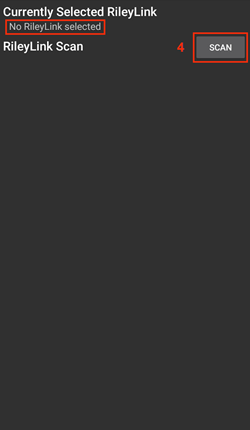
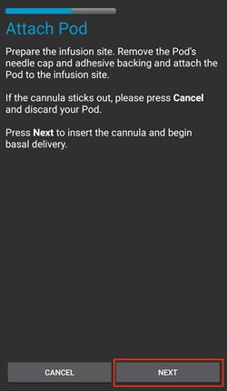
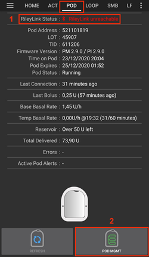
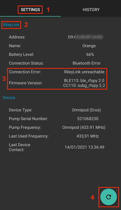
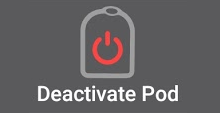
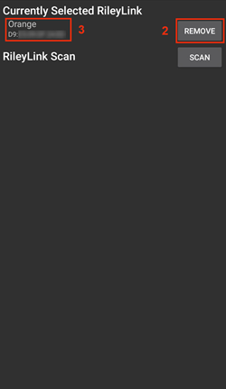

# Omnipod Eros

These instructions are for configuring the Omnipod Eros generation pump (**NOT Omnipod Dash**).

```{admonition} Omnipod Eros is being phased out
:class: note

The [Omnipod System](https://www.omnipod.com/current-podders/resources/omnipod-system) (the original Omnipod, comprising both the Personal Diabetes Manager (PDM) and the Pod) is being discontinued, and the end date varies by country. For example, it will no longer be available in Canada after 30 June 2026. If you rely on the Eros pump, plan ahead for a transition to a supported pump.
```

**Ця програма є частиною саморобної (DIY) системи штучної підшлункової залози. Це не готовий продукт: ВИ маєте прочитати, вивчити та зрозуміти систему, зокрема те, як нею користуватися. Лише ви відповідаєте за те, що робите з цією системою.**

```{contents} Table of contents
:depth: 1
:local: true
```

## Вимоги до обладнання та програмного забезпечення

- **Пристрій зв’язку з Pod**

> Компонент, який передає зв’язок від вашого телефона з AAPS до Pod покоління Eros.
> 
> > -   [Сайт OrangeLink](https://getrileylink.org/product/orangelink)
> > -  [RileyLink 433 МГц](https://getrileylink.org/product/rileylink433)
> > -   [Сайт Emalink](https://github.com/sks01/EmaLink) - [Контакти](mailto:getemalink@gmail.com)
> > -   DiaLink - [Контакти](mailto:Boshetyn@ukr.net)
> > -   [Сайт LoopLink](https://www.getlooplink.org/) - [Контакти](https://jameswedding.substack.com/) - не перевірено

-   **Мобільний телефон**

> Компонент, на якому працює AAPS і який надсилає команди керування на пристрій зв’язку з Pod.
> 
> > - Supported [Android phone](#Phones-list-of-tested-phones) with **AAPS** and related components set up.

-   **Пристрій для введення інсуліну**

> Компонент, який виконує команди від пристрою зв’язку з Pod, що надходять із вашого телефона з AAPS.
> 
> > - Новий Pod Omnipod (покоління Eros - **НЕ DASH**)

These instructions assume that you are starting a new pod session. If this is not the case, please be patient and start this process at your next pod change.

In this page, **RileyLink** means any of the pod communication devices listed above.

## Перш ніж почати

**БЕЗПЕКА ПОНАД УСЕ** - не починайте цей процес там, де ви не зможете виправити помилку (запасні Pod, інсулін, заряджений RileyLink і телефон обов’язкові).

**Ваш Omnipod PDM більше не працюватиме після того, як драйвер Omnipod в AAPS активує ваш Pod**. Раніше ви надсилали команди на свій Pod Omnipod Eros за допомогою Omnipod PDM. Pod Omnipod Eros дозволяє зв’язок лише з одним пристроєм. Пристрій, який успішно активував Pod, надалі єдиний може з ним зв’язуватися. Це означає, що коли ви активуєте Pod Omnipod Eros за допомогою RileyLink через драйвер Omnipod в AAPS, **ви більше не зможете використовувати PDM з цим Pod**. Тепер вашим PDM є драйвер Omnipod в AAPS разом із RileyLink. *Це НЕ означає, що PDM треба викинути. Рекомендуємо зберігати його як запасний пристрій і для екстрених випадків, коли AAPS працює неправильно.*

**Only one RileyLink at a time can communicate with a pod.** **AAPS** remembers one paired RileyLink. If you pair a different one, it replaces the previous one.

**Ваш Pod не вимкнеться, коли RileyLink поза зоною зв’язку.** Коли RileyLink поза зоною зв’язку або сигнал до активного Pod заблоковано, Pod продовжує вводити базальний інсулін. Під час активації Pod у новий Pod записується базальний профіль, заданий в AAPS. Якщо зв’язок із Pod втрачено, він повертається до цього базального профілю. Ви не зможете надсилати нові команди, доки RileyLink не повернеться в зону зв’язку і знову не встановить з’єднання.

**Базальні профілі з кроком 30 хв НЕ підтримуються в AAPS.** Якщо ви новачок в AAPS і вперше налаштовуєте базальний профіль, зверніть увагу: базальні швидкості, що починаються о пів години, не підтримуються, і вам треба змінити базальний профіль так, щоб кожна швидкість починалася на початку години. Наприклад, якщо у вас є базальна швидкість 1,1 Од, яка починається о 09:30 і триває 2 години до 11:30, це не працюватиме.  Вам треба змінити цю базальну швидкість 1,1 Од на проміжок 9:00–11:00 або 10:00–12:00.  Хоча саме обладнання Omnipod підтримує кроки базального профілю по 30 хв, алгоритми AAPS зараз не можуть їх враховувати.

## Увімкнення драйвера Omnipod в AAPS

Увімкнути драйвер Omnipod в AAPS можна **двома способами**:

### Варіант 1: Майстер налаштування

After installing a new version of AAPS, the **Setup Wizard** starts automatically. If you have already exported your settings from a previous installation, you can import them in the wizard. For new installations, continue below.

Go through the [Setup Wizard](../SettingUpAaps/SetupWizard.md) until you reach the **Pump** step, then select **Omnipod Eros** (the description reads "Pump integration for Omnipod Eros").


The Setup Wizard does not pair your RileyLink. After finishing the wizard, open the Omnipod pump screen and pair it as described in the [RileyLink Setup section](#OmnipodEros-rileylink-setup).

**АБО**

### Варіант 2: екран «Конфігурація»

Open the top-left **menu** (☰) > **Configuration** > **Pump** and select the **radio button** of **Omnipod Eros**.

Once it is selected, the **Omnipod Eros** card shows two buttons, **Settings** and **Open plugin**:


**Settings** opens the settings of the Omnipod driver (see [Omnipod Settings](#OmnipodEros-omnipod-settings)):


**Open plugin** opens the Omnipod pump screen. You can also open it at any time from the main screen with **Manage** > **Pump**. This page calls it the **Omnipod pump screen**. Before a RileyLink is paired and a pod is activated, it looks like this:


### Перевірка вибору драйвера Omnipod

To verify that you have enabled the Omnipod driver, open **Manage** > **Pump** from the main screen. You should see the **Omnipod Eros** pump screen shown above. If you have not paired a RileyLink yet, **RileyLink Status** shows **Not Started** and **Pod Status** shows **No Active Pod**.

## Налаштування Omnipod

All pod and RileyLink functions are buttons on the [Omnipod pump screen](#OmnipodEros-omnipod-pod-tab) (**Manage** > **Pump**). Some buttons only appear in certain situations, for example when a pod is active.

>  Оновити зв’язок із Pod і статус Pod
> 
>  Керування Pod (активувати, деактивувати, програти тестовий сигнал, статистика RileyLink та історія Pod)

```{admonition} Older screenshot
:class: note
The screenshots above are from an earlier **AAPS** version. In **AAPS** 4 there is no **POD MGMT** button or Pod Management menu: **Refresh** and all pod management actions are buttons on the Omnipod pump screen.
```

(OmnipodEros-rileylink-setup)=

### Налаштування RileyLink

If you have already paired your RileyLink, continue to the [Activating a Pod section](#OmnipodEros-activating-a-pod) below.

*Note: A good visual indicator that the RileyLink is not connected is that the treatment buttons (QuickLaunch toolbar) on the main screen will be missing. Так само буває протягом приблизно перших 30 секунд після запуску AAPS, поки він підключається до RileyLink.*

1. Make sure that your RileyLink is fully charged and powered on.

2. Place the RileyLink [close to your phone](#OmnipodEros-optimal-omnipod-and-rileylink-positioning) (~30 cm away or less).

3. Open the Omnipod pump screen (**Manage** > **Pump**) and press **Pair RileyLink**.

4. The **Pair RileyLink** screen starts scanning for Bluetooth devices right away. Tap your RileyLink in the list of found devices.

   

5. When **RileyLink paired successfully** is shown with the name and address of your device, press **OK**.

6. Back on the Omnipod pump screen, check that **RileyLink Status** changes to **Connected**. **Pod Status** should show **No Active Pod**. If the RileyLink does not connect, press **Reset RileyLink**, or restart **AAPS**.

 

 


```{admonition} Older screenshot
:class: note
The six screenshots above (after step 6) are from an earlier **AAPS** version. In **AAPS** 4 you pair the RileyLink with the **Pair RileyLink** button on the Omnipod pump screen instead of **RileyLink Configuration** in the Omnipod settings, and scanning starts automatically.
```

```{note}
To switch to another RileyLink (for example a backup device), press **Pair RileyLink** again and select the new device. It replaces the one paired before. You do not need to remove the old device first.
```

(OmnipodEros-activating-a-pod)=

### Активація Pod

Before you can activate a pod, make sure your RileyLink is paired and **RileyLink Status** shows **Connected**. The **Activate Pod** button stays disabled until the RileyLink is ready.

*НАГАДУВАННЯ: з міркувань безпеки зв’язок із Pod під час спарювання для активації працює лише на малій відстані. До спарювання радіосигнал Pod слабший, а після спарювання Pod працює з повною потужністю сигналу. During these procedures, make sure that your pod is* [within close proximity](#OmnipodEros-optimal-omnipod-and-rileylink-positioning) *(~30 cm away or less) but not on top of or right next to the RileyLink.*

01. Open the Omnipod pump screen (**Manage** > **Pump**) and press **Activate Pod**.

    If you have never activated a profile, a **Profile required** step appears first. Select the profile to apply on activation.

    >   
    > 
    > ```{admonition} Older screenshot
    >     :class: note
    >     The screenshots above are from an earlier **AAPS** version. In **AAPS** 4 **Activate Pod** is a button on the Omnipod pump screen instead of in the **POD MGMT** menu.
    > ```

02. З’являється екран **Заповнення Pod**. Fill a new pod with enough insulin for 3 days and listen for two beeps. They mean that the minimum amount of 80 units has been filled. Повністю спорожніть шприц для заповнення, навіть після двох сигналів. Коли рахуєте загальну кількість інсуліну на 3 дні, врахуйте, що підготовка Pod використає 12–15 Од. Поки що не знімайте кришечку голки Pod.

    > 
    > 
    > Ensure the new pod and RileyLink are within close proximity of each other (~30cm or less) and press **Next**.

03. **Select Insulin** (only shown if you have more than one insulin configured): select the insulin you are filling the pod with and press **Next**. A profile switch with this insulin is applied after activation.

04. На екрані **Ініціалізація Pod** почнеться підготовка Pod (ви почуєте клацання, а потім серію тікань, поки Pod себе готує). Якщо RileyLink знаходиться поза зоною зв’язку з Pod, що активується, ви отримаєте повідомлення про помилку **Немає відповіді від Pod**. If this occurs, [move the RileyLink closer](#OmnipodEros-optimal-omnipod-and-rileylink-positioning) (~30 cm away or less) to but not on top of or right next to the Pod and press **Retry**.

    >  

05. When priming is successful, a green checkmark is shown and the **Next** button becomes enabled. Натисніть **Далі**.

    > 

06. **Site location** (only shown if **Manage pump site rotation** is enabled in [Site Rotation](#Aapsscreens-site-rotation)): select where you place the pod on your body and press **Next**.

07. The **Attach Pod** screen is displayed. Prepare the infusion site of the new pod. Remove the pod's plastic needle cap and white paper backing from the adhesive and apply the pod to your chosen site on your body. If the cannula sticks out, press **Cancel** and discard the pod. Коли закінчите, натисніть **Далі**.

    > 

08. A confirmation dialog appears: "When you press OK, the cannula will be inserted". **ONLY press OK if you are ready to deploy the cannula**.

    > 

09. On the **Insert Cannula** screen, it may take some time before the Omnipod responds and inserts the cannula (1-2 minutes maximum), so be patient.

    > Якщо RileyLink знаходиться поза зоною зв’язку з Pod, що активується, ви отримаєте повідомлення про помилку **Немає відповіді від Pod**. If this occurs, move the RileyLink closer (~30 cm away or less) to but not on top of or right next to the Pod and press **Retry**.
    > 
    > Якщо RileyLink поза зоною Bluetooth або не має активного з’єднання з телефоном, ви отримаєте повідомлення про помилку **Немає відповіді від RileyLink**. If this occurs, move the RileyLink closer to the phone and press **Retry**.
    > 
    > *ПРИМІТКА: перед введенням канюлі добре захопити шкіру пальцями біля місця введення канюлі. Так голка входить плавно, і менше ризик оклюзій.*
    > 
    > 
    > 
    >  

10. Після успішного введення канюлі з’являється зелена галочка, і кнопка **Далі** стає активною. Натисніть **Далі**.

    > 

11. The **Pod Activated** screen is displayed. Check that the cannula has been inserted correctly, and change your pod if you think it has not. Натисніть **Завершити**. Вітаємо! Ви почали новий сеанс активного Pod.

    >  
    > 
    > ```{admonition} Older screenshot
    >     :class: note
    >     The screenshots in steps 2 to 11 are from an earlier **AAPS** version and may look different in **AAPS** 4. The **Select Insulin** and **Site location** steps are not pictured.
    > ```

12. You are returned to the Omnipod pump screen. The **Activate Pod** button is replaced by **Deactivate Pod**, because you cannot activate another pod without deactivating the active one first.

    The pump screen now shows information about your active pod, including the current basal rate, reservoir level, insulin delivered, pod errors and alerts. For more details, see the [Omnipod pump screen](#OmnipodEros-omnipod-pod-tab) section.

     

    ```{admonition} Older screenshot
    :class: note
    The screenshots above are from an earlier **AAPS** version. In **AAPS** 4 there is no Pod Management menu: you return directly to the Omnipod pump screen, where **Deactivate Pod** replaces **Activate Pod**.
    ```

```{note}
If activation was interrupted after priming (for example the app was closed), press **Activate Pod** again. The wizard continues from the cannula insertion steps.
```

### Деактивація Pod

У звичайних умовах Pod працює три дні (72 години) і ще 8 годин після попередження про закінчення терміну, тобто загалом 80 годин.

Щоб деактивувати Pod (через закінчення терміну або через збій Pod):

1. Open the Omnipod pump screen (**Manage** > **Pump**) and press **Deactivate Pod**.

   >   
   > 
   > ```{admonition} Older screenshot
   >    :class: note
   >    The screenshots above are from an earlier **AAPS** version. In **AAPS** 4 **Deactivate Pod** is a button on the Omnipod pump screen instead of in the **POD MGMT** menu.
   > ```

2. On the **Deactivate Pod** screen, first make sure the RileyLink is in close proximity to the pod but not on top of or right next to the pod. Then press **Next**. З’являється запитання *Деактивований Pod не можна використати знову. Деактивувати цей Pod зараз?* Натисніть **OK**, щоб почати деактивацію Pod, або **Скасувати**, щоб залишити його. Деактивація призупиняє все введення інсуліну, і її не можна скасувати.

   > 

3. The **Deactivating Pod** screen appears, and you will receive a confirmation beep from the pod that deactivation was successful.

   > 
   > 
   > **IF deactivation fails** and you do not receive a confirmation beep, you may receive a **No response from RileyLink** or **No response from Pod** message. Press **Retry** to attempt deactivation again. If deactivation keeps failing, press **Discard Pod** and confirm. **AAPS** then forgets the pod. Insulin delivery has **not** been suspended, so remove the pod from your body. If your pod has a screaming alarm, you may need to silence it manually (using a pin or a paperclip), because **Discard Pod** does not silence it.
   > 
   > >   

4. A green checkmark appears when deactivation is successful. Press **Next** to display the **Pod Deactivated** screen. Тепер ви можете зняти Pod, бо активний сеанс деактивовано.

   > 

5. Press **Finish** to return to the Omnipod pump screen.

   >  
   > 
   > ```{admonition} Older screenshot
   >    :class: note
   >    The screenshots in steps 2 to 5 are from an earlier **AAPS** version and may look different in **AAPS** 4.
   > ```

6. On the Omnipod pump screen, check that **RileyLink Status** shows **Connected** and **Pod Status** shows **No Active Pod**.

   >    
   > 
   > ```{admonition} Older screenshot
   >    :class: note
   >    The screenshots above are from an earlier **AAPS** version. In **AAPS** 4 **Finish** returns you directly to the Omnipod pump screen; there is no Pod Management menu or **Omnipod (POD)** tab.
   > ```

### Призупинення та відновлення введення інсуліну

The process below shows you how to suspend and resume insulin delivery.

*NOTE - if you do not see a **Suspend** button*, it is hidden by default. Enable **Show Suspend Delivery button in Omnipod tab** in the [Omnipod settings](#OmnipodEros-omnipod-settings) under **Other**.

#### Призупинення введення інсуліну

Ця команда переводить активний Pod у стан призупинення. У стані призупинення Pod більше не вводить інсулін. Ця команда повторює функцію призупинення, яку оригінальний Omnipod PDM надсилає на активний Pod.

1. Open the Omnipod pump screen (**Manage** > **Pump**) and press **Suspend**. The suspend command is sent through the RileyLink to the active pod.

2. When the pod has suspended all insulin delivery, **Pod Status** shows **Suspended** and the **Suspend** button is replaced by **Resume Delivery**.

   >  
   > 
   > 
   > 
   >  
   > 
   > ```{admonition} Older screenshot
   >    :class: note
   >    The screenshots above are from an earlier **AAPS** version. In **AAPS** 4 these steps take place on the Omnipod pump screen instead of the **Omnipod (POD)** tab, and the result is shown in **Pod Status**.
   > ```

If the command fails, a **Warning** dialog shows "Failed to suspend delivery" with the reason. Check the RileyLink connection and try again.

#### Відновлення введення інсуліну

Ця команда дає активному, зараз призупиненому Pod вказівку відновити введення інсуліну. Після успішного виконання команди Pod знову вводить інсулін як звичайно, з поточною базальною швидкістю з активного базального профілю для поточного часу. Pod знову приймає команди для болюсу, TBR і SMB.

1. Open the Omnipod pump screen and check that **Pod Status** shows **Suspended**. Press **Resume Delivery**.

2. When the command succeeds, **Pod Status** shows **Running** again and the **Resume Delivery** button disappears (the **Suspend** button is shown again if you have enabled it).

   >  
   > 
   > 
   > 
   >  
   > 
   > ```{admonition} Older screenshot
   >    :class: note
   >    The screenshots above are from an earlier **AAPS** version. In **AAPS** 4 these steps take place on the Omnipod pump screen instead of the **Omnipod (POD)** tab, and the result is shown in **Pod Status**.
   > ```

If the command fails, a **Warning** dialog shows "Failed to resume delivery" with the reason. Check the RileyLink connection and try again.

### Вимкнення звуку попереджень Pod

*NOTE - The **Silence Alerts** button is only shown on the Omnipod pump screen while the pod has an active alert (for example the pod expiration or low reservoir alert), and only if **Automatically silence Pod alerts** is disabled.*

The process below shows you how to silence pod beeps that start when the pod reaches the warning time before it expires. This warning time is set with **Alert at hours before shutdown (80 Hours)** in the Omnipod **Alerts** settings. Максимальний строк роботи Pod - 80 годин (3 дні 8 годин), але Insulet рекомендує не перевищувати межу 72 години (3 дні).

*NOTE - If you have enabled **Automatically silence Pod alerts** in the Omnipod **Alerts** settings, **AAPS** silences the alert automatically at the next communication with the pod, and you do NOT need to do it manually.*

1. When the warning time is reached, the pod beeps to tell you that it will soon expire and needs to be changed. On the Omnipod pump screen, **Pod Expires** shows the exact time the pod expires (72 hours after activation); it turns **yellow** 4 hours before. **Pod Hard End** shows when the pod stops delivering insulin. **Active Pod Alerts** shows **Pod will expire soon**, and the **Silence Alerts** button appears. **AAPS** also shows a notification about the upcoming pod expiration.

   >   
   > 
   > ```{admonition} Older screenshot
   >    :class: note
   >    The screenshots above are from an earlier **AAPS** version. In **AAPS** 4 the **ACK ALERTS** button is called **Silence Alerts** and is on the Omnipod pump screen.
   > ```

2. Натисніть **Вимкнути звук попереджень**. The RileyLink sends the command to the pod to stop the expiration warning beeps.

   >  
   > 
   > ```{admonition} Older screenshot
   >    :class: note
   >    Знімок екрана вище зроблено в старішій версії **AAPS**. In **AAPS** 4 the button is called **Silence Alerts**.
   > ```

3. When the alerts are silenced, the pod beeps twice. **Active Pod Alerts** no longer shows the warning, the **Silence Alerts** button disappears and the pod stops its expiration warning beeps.

   >  
   > 
   > ```{admonition} Older screenshot
   >    :class: note
   >    Знімок екрана вище зроблено в старішій версії **AAPS**. In **AAPS** 4 the result is shown on the Omnipod pump screen: the warning disappears from **Active Pod Alerts**.
   > ```

If the command fails (for example the RileyLink is out of range of the pod), a **Warning** dialog shows "Failed to silence alerts" with the reason. Move the RileyLink closer to the pod and try again.


```{admonition} Older screenshot
:class: note
Знімок екрана вище зроблено в старішій версії **AAPS**. In **AAPS** 4 the **Warning** dialog shows "Failed to silence alerts" with the reason.
```

(OmnipodEros-view-pod-history)=

### Перегляд історії Pod

У цьому розділі показано, як переглянути історію активного Pod і відфільтрувати її за різними категоріями дій. Інструмент історії Pod показує дії, надіслані на ваш активний Pod, і їх результати за весь трьохденний (72–80 годин) строк його роботи.

Ця функція допомагає перевірити болюси, TBR і зміни базалу, які були надіслані, якщо ви не впевнені, чи вони виконалися. Інші категорії загалом корисні для пошуку проблем і для визначення порядку подій, що передували збою.

*ПРИМІТКА:* **Невизначені** команди з’являються в історії Pod, але через їх природу ви не можете бути впевнені в їх точності.

1. Open the Omnipod pump screen (**Manage** > **Pump**) and press **Pod History**.

   >   
   > 
   > ```{admonition} Older screenshot
   >    :class: note
   >    The screenshots above are from an earlier **AAPS** version. In **AAPS** 4 **Pod History** is a button on the Omnipod pump screen instead of in the **POD MGMT** menu.
   > ```

2. The **Pod History** screen lists all pod actions and their results, newest first, grouped by day. By default **All** is selected. Tap one of the filter buttons at the top to show only one category. Use the back arrow at the top left to return to the Omnipod pump screen.

   > 

   >  
   > 
   > ```{admonition} Older screenshot
   >    :class: note
   >    The second screenshot is from an earlier **AAPS** version and may look different in **AAPS** 4.
   > ```

### Перегляд налаштувань та історії RileyLink

The **RileyLink Stats** screen shows the settings of your RileyLink and active pod, and the communication history of both. It has two tabs: **Settings** and **History**.

The **RileyLink Stats** button is hidden by default. To show it on the Omnipod pump screen, enable **Show RileyLink Stats button in Pod Management menu** in the [Omnipod settings](#OmnipodEros-omnipod-settings) under **Other**.

#### Ручне відновлення Bluetooth-з’єднання з пристроєм зв’язку з Pod

If your pod communication device was out of Bluetooth range of your phone for a while, **RileyLink Status** may report **RileyLink unreachable** on the Omnipod pump screen. **AAPS** normally reconnects by itself when the device is back in range. If it does not:

1. Make sure the RileyLink is powered on, charged and close to your phone.

2. On the Omnipod pump screen, press **Reset RileyLink**. A message confirms **RileyLink configuration reset**. See the [Reset RileyLink notes](#OmnipodEros-reset-rileylink-config-notes) below.

3. Якщо **Bluetooth-з’єднання** не відновлюється, спробуйте вручну **вимкнути** і знову **увімкнути** Bluetooth на телефоні.

4. If it still does not reconnect, press **Pair RileyLink** and select your RileyLink again.

5. After a successful reconnection, **RileyLink Status** shows **Connected**. You can also check **Connection Status** on the **Settings** tab of the **RileyLink Stats** screen. Вітаємо, ви знову підключили налаштований пристрій зв’язку з Pod до AAPS!

 




```{admonition} Older screenshot
:class: note
The screenshots above are from an earlier **AAPS** version. In **AAPS** 4 you reconnect with **Reset RileyLink** or **Pair RileyLink** on the Omnipod pump screen instead of the refresh button on the RileyLink Settings screen.
```

#### Налаштування пристрою зв’язку з Pod та активного Pod

This screen shows information and status for both the currently paired pod communication device and the currently active Omnipod Eros pod. The information refreshes automatically.

1. Open the Omnipod pump screen (**Manage** > **Pump**) and press **RileyLink Stats**. The **Settings** tab shows your currently paired **RileyLink** and the active pod (**Device**).

   >   
   > 
   > ```{admonition} Older screenshot
   >    :class: note
   >    The screenshots above are from an earlier **AAPS** version. In **AAPS** 4 **RileyLink Stats** is a button on the Omnipod pump screen instead of in the **POD MGMT** menu.
   > ```

   > 

##### RileyLink fields

> - **Address:** MAC address of the paired pod communication device.
> - **Name:** Bluetooth name of the paired pod communication device.
> - **Battery Level:** The current battery level of the connected pod communication device. Only shown when **Show battery level reported by OrangeLink/EmaLink/DiaLink** is enabled.
> - **Статус з’єднання**: поточний стан Bluetooth-з’єднання між пристроєм зв’язку з Pod і телефоном з AAPS.
> - **Connection Error:** If there is an error with the pod communication device Bluetooth connection, details are displayed here.
> - **Версія прошивки:** поточна версія прошивки підключеного пристрою зв’язку з Pod.

##### Device fields - With an Active Pod

> - **Device Type:** The type of device communicating with the pod communication device (Omnipod (Eros)).
> - **Configured Device Model:** The model of the device configured to communicate with the pod communication device.
> - **Connected Device Model:** The model of the device currently communicating with the pod communication device.
> - **Pump Serial Number:** Serial number of the currently activated pod.
> - **Pump Frequency:** Radio frequency used to communicate with the pod.
> - **Last Used Frequency:** Last known radio frequency the pod used to communicate with the pod communication device.
> - **Останній зв’язок із пристроєм:** дата й час останнього зв’язку Pod із пристроєм зв’язку з Pod.

(omnipod-eros-rileylink-and-active-pod-history)=
#### Історія RileyLink та активного Pod

This tab lists, newest first, each state or action of the RileyLink or the currently connected pod. The history is only available for the currently active pod. After a pod change, this history is erased and only events from the newly activated pod are recorded and shown.

1. Open the Omnipod pump screen (**Manage** > **Pump**), press **RileyLink Stats** and then tap the **History** tab.

   >   
   > 
   > ```{admonition} Older screenshot
   >    :class: note
   >    The screenshots above are from an earlier **AAPS** version. In **AAPS** 4 **RileyLink Stats** is a button on the Omnipod pump screen instead of in the **POD MGMT** menu.
   > ```

   > 

##### Поля

Each entry shows:

> - **Device:** The device to which the action or state refers.
> - **Time:** The time of the event.
> - **State or Action:** The state of the device or the action it performed.

(OmnipodEros-omnipod-pod-tab)=

## Omnipod pump screen

Below is an explanation of the status fields and buttons on the **Omnipod pump screen** (**Manage** > **Pump**, or **Configuration** > **Pump** > **Open plugin**).

The gear icon at the top right opens the [Omnipod settings](#OmnipodEros-omnipod-settings).

*NOTE: If any status field shows (uncertain), press **Refresh** to refresh the pod status and clear it.*


```{admonition} Older screenshot
:class: note
The screenshot above is from an earlier **AAPS** version, where this screen was the **Omnipod (POD)** tab. In **AAPS** 4 it is the Omnipod pump screen, and some field names and buttons differ.
```

### Поля

- **RileyLink Status:** Displays the current connection status of the RileyLink. Errors are shown in red.

- *Not Started* - no RileyLink is paired yet, or the connection has not started.
- *RileyLink unreachable* - pod communication device is either not within Bluetooth range of the phone, powered off or has a failure preventing Bluetooth communication.
- *RileyLink ready* - pod communication device is powered on and actively initializing the Bluetooth connection.
- *Підключено* - пристрій зв’язку з Pod увімкнений, підключений і може обмінюватися даними через Bluetooth.

- **Unique ID:** Displays the address of the active pod.

- **LOT Number:** Displays the LOT number of the active pod.

- **Sequence Number:** Displays the serial number (TID) of the pod.

- **Версія прошивки:** показує версію прошивки активного Pod.

- **Час на Pod:** показує поточний час на активному Pod. It is highlighted when it differs from the phone time by more than 5 minutes.

- **Pod Expires:** Displays the date and time when the active pod will expire. Текст стає жовтим за останні 4 години до цього часу. Червоним він не стає ніколи, бо Pod продовжує вводити інсулін і після цього.

- **Pod Hard End:** Displays the end of the pod's grace period (8 hours after **Pod Expires**, for a maximum pod life of 80 hours). Текст стає жовтим, коли починається додатковий період (у момент **Pod діє до**), і червоним за останні 4 години до остаточної зупинки. Під час додаткового періоду також показується час, що залишився, наприклад *(залишилось 17 хв)*. У момент остаточної зупинки Pod припиняє вводити інсулін, і його потрібно замінити.

- **Pod Status:** Displays the status of the active pod (for example **No Active Pod**, **Running** or **Suspended**).

- **Last Connection:** Displays the last time communication with the active pod was achieved. The text turns red when the [pump unreachable threshold](#OmnipodEros-troubleshooting) is exceeded.

- *Щойно* - менше 20 секунд тому.
- *Менше хвилини тому* - більше 20 секунд, але менше 60 секунд тому.
- *1 хвилину тому* - більше 60 секунд, але менше 120 секунд (2 хв)
- *XX хвилин тому* - більше 2 хвилин тому, де XX - кількість хвилин

- **Last Bolus:** Displays the dosage of the last bolus sent to the active pod and how long ago it was issued in parenthesis.

- **Base Basal Rate:** Displays the basal rate programmed for the current time from the basal rate profile.

- **Temp Basal Rate:** Only shown while a Temporary Basal Rate is running. Displays it in the following format:

- Одиниці / год @ час, коли TBR було задано (хвилин минуло / загальна тривалість TBR у хвилинах)
- *Приклад:* 0.00U/h @18:25 ( 90/120 minutes)

- **Reservoir:** Displays **Over 50 U left** when more than 50 units are left in the reservoir. Below this value the approximate number of units is displayed. The text turns red below the low reservoir threshold set in the [Alerts settings](#OmnipodEros-omnipod-settings).

- **Total Delivered:** Displays the total number of units of insulin delivered from the reservoir. *Це приблизне значення, бо підготовка та заповнення Pod не є точним процесом.*

- **Active Pod Alerts:** Reserved for currently running alerts on the active pod. Зазвичай використовується, коли минуло понад 72 години роботи Pod і Pod подає власні звукові сигнали.

- **Errors:** Displays the last error encountered (shown in red). Review the [Pod history](#OmnipodEros-view-pod-history), [RileyLink history](#omnipod-eros-rileylink-and-active-pod-history) and log files for past errors and more detailed information.

### Кнопки

The buttons at the bottom of the pump screen change depending on the situation. Buttons that cannot be used right now are greyed out, for example while the RileyLink is not connected.

**Pod status buttons** (shown when a pod is active):

- **Refresh:** Sends a refresh command to the active pod to update its status. Use it to refresh the pod status and clear status fields that contain the text (uncertain). See the [Troubleshooting section](#OmnipodEros-troubleshooting) below for additional information.

  

  ```{admonition} Older screenshot
  :class: note
  The screenshot above is from an earlier **AAPS** version. In **AAPS** 4 this is a text button named **Refresh** on the Omnipod pump screen.
  ```

- **Silence Alerts:** Silences the pod expiration and low reservoir beeps and notifications. Only shown when the pod has an active alert and **Automatically silence Pod alerts** is disabled. After the alerts are silenced, the button disappears.

  

  ```{admonition} Older screenshot
  :class: note
  The screenshot above is from an earlier **AAPS** version. In **AAPS** 4 this button is called **Silence Alerts**.
  ```

- **Set time:** Updates the time on the pod with the current time on your phone. Only shown when the time on the pod differs from the phone time by more than 5 minutes.

  

  ```{admonition} Older screenshot
  :class: note
  The screenshot above is from an earlier **AAPS** version. In **AAPS** 4 this is a text button named **Set time** on the Omnipod pump screen.
  ```

- **Suspend:** Suspends insulin delivery on the active pod. Only shown if enabled in the settings (**Show Suspend Delivery button in Omnipod tab**).

  

  ```{admonition} Older screenshot
  :class: note
  The screenshot above is from an earlier **AAPS** version. In **AAPS** 4 this is a text button named **Suspend** on the Omnipod pump screen.
  ```

- **Resume Delivery:** Resumes insulin delivery on the currently suspended, active pod. Only shown while the pod is suspended.

  

  ```{admonition} Older screenshot
  :class: note
  The screenshot above is from an earlier **AAPS** version. In **AAPS** 4 this is a text button named **Resume Delivery** on the Omnipod pump screen.
  ```

**Pod and RileyLink management buttons:**


```{admonition} Older screenshot
:class: note
Знімок екрана вище зроблено в старішій версії **AAPS**. In **AAPS** 4 there is no Pod Management menu: these actions are buttons directly on the Omnipod pump screen.
```

- **Activate Pod:** Primes and activates a new pod. Показується, коли немає активного Pod. It is enabled only when the RileyLink is connected.

  

  ```{admonition} Older screenshot
  :class: note
  The screenshot above is from an earlier **AAPS** version. In **AAPS** 4 **Activate Pod** is a button on the Omnipod pump screen instead of in the Pod Management menu.
  ```

- **Deactivate Pod:** Deactivates the currently active pod. Shown as soon as a pod is paired, also when an activation stopped part-way (for example because the pod failed during activation). It is enabled only when the RileyLink is connected. **AAPS** просить вас підтвердити, перш ніж деактивувати Pod.

- Використовуйте цю команду, щоб деактивувати Pod, який безперервно пищить (помилка 49).
- If deactivation fails, the deactivation wizard offers a **Discard Pod** option.

  

  ```{admonition} Older screenshot
  :class: note
  The screenshot above is from an earlier **AAPS** version. In **AAPS** 4 **Deactivate Pod** is a button on the Omnipod pump screen instead of in the Pod Management menu.
  ```

- **Play Test Beep:** Plays a single test beep on the pod when pressed. Shown when a pod is paired.

  

  ```{admonition} Older screenshot
  :class: note
  The screenshot above is from an earlier **AAPS** version. In **AAPS** 4 **Play Test Beep** is a button on the Omnipod pump screen instead of in the Pod Management menu.
  ```

- **Pod History:** Displays the active pod activity history. See [View Pod History](#OmnipodEros-view-pod-history).

  

  ```{admonition} Older screenshot
  :class: note
  The screenshot above is from an earlier **AAPS** version. In **AAPS** 4 **Pod History** is a button on the Omnipod pump screen instead of in the Pod Management menu.
  ```

- **Pair RileyLink:** Scans for your pod communication device and pairs it. See [RileyLink Setup](#OmnipodEros-rileylink-setup).

- **RileyLink Stats:** Opens the RileyLink Stats screen with two tabs. Only shown if enabled in the settings (**Show RileyLink Stats button in Pod Management menu**).

- **Налаштування** - показує дані про налаштування RileyLink та активного Pod
- **Історія** - показує історію зв’язку RileyLink і Pod

  

  ```{admonition} Older screenshot
  :class: note
  The screenshot above is from an earlier **AAPS** version. In **AAPS** 4 **RileyLink Stats** is a button on the Omnipod pump screen instead of in the Pod Management menu.
  ```

- **Reset RileyLink:** Resets the configuration of the currently connected pod communication device. When communication is started, specific data is sent to and set in the RileyLink:

- Memory Registers are set
- Communication Protocols are set
- Tuned Radio Frequency is set
  > 
  > See [additional notes](#OmnipodEros-reset-rileylink-config-notes) below.

  

  ```{admonition} Older screenshot
  :class: note
  The screenshot above is from an earlier **AAPS** version. In **AAPS** 4 this button is called **Reset RileyLink** and is on the Omnipod pump screen.
  ```

- **Discard Pod:** Discards the pod state of an unresponsive pod, after a confirmation. Only shown when a pod has been started but not fully paired, as proper deactivation is no longer possible:

- **Pod спарено не повністю**, тому він не виконує команди деактивації.
- A **pod is stuck** during the pairing process between steps.
- **Pod взагалі не спарюється.**
  > 
  > After you discard a pod, **AAPS** can no longer communicate with it. Remove the pod from your body.

  

  ```{admonition} Older screenshot
  :class: note
  The screenshot above is from an earlier **AAPS** version. In **AAPS** 4 **Discard Pod** is a button on the Omnipod pump screen instead of in the Pod Management menu.
  ```

(OmnipodEros-reset-rileylink-config-notes)=

#### *Reset RileyLink Notes*

- Головне призначення цієї функції - коли активний пристрій зв’язку з Pod не відповідає і зв’язок «завис».
- If the pod communication device is turned off and then back on, press **Reset RileyLink** so that these communication parameters are set again in the pod communication device.
- Якщо цього НЕ зробити, то після вимкнення та увімкнення пристрою зв’язку з Pod доведеться перезапустити AAPS.
- This button **DOES NOT** need to be pressed when switching between different pod communication devices.

(OmnipodEros-omnipod-settings)=

## Налаштування Omnipod

To open the Omnipod driver settings, either:

- press the gear icon at the top right of the Omnipod pump screen (**Manage** > **Pump**), or
- open the top-left **menu** (☰) > **Configuration** > **Pump** and press **Settings** on the **Omnipod Eros** card.


```{admonition} Older screenshot
:class: note
Знімок екрана вище зроблено в старішій версії **AAPS**. In **AAPS** 4 you open the settings with **Settings** on the **Omnipod Eros** card or the gear icon on the Omnipod pump screen, instead of the settings gear in **Configuration** or the 3-dot menu.
```

The settings are grouped as listed below. Tap a group to expand it. Most entries are switches you can enable or disable:


*ПРИМІТКА: зірочка (\*) означає, що налаштування за замовчуванням увімкнене.*

### RileyLink

Settings for the pod communication device. You pair the device itself with the **Pair RileyLink** button on the pump screen (see [RileyLink Setup](#OmnipodEros-rileylink-setup)).

- **Use Scanning:** Scans before connecting to the OrangeLink. This can improve connections. It can also be used with other RileyLink clones if needed.

- **Show battery level reported by OrangeLink/EmaLink/DiaLink:** Reports the actual battery level of the OrangeLink/EmaLink/DiaLink. Усім користувачам OrangeLink/EmaLink/DiaLink **наполегливо рекомендуємо** увімкнути це налаштування.

- НЕ працює з оригінальним RileyLink.
- Може не працювати з альтернативами RileyLink.
- Увімкнено - показує поточний рівень заряду батареї для пристроїв зв’язку з Pod, які це підтримують.
- Вимкнено - показує значення n/a.

- **Enable battery change logging in Actions:** Only available when the battery reporting setting above is enabled. Some pod communication devices can use regular batteries that you can change. With this setting enabled, you can record a **Pump Battery Change** [careportal entry](#aaps-screens-careportal) to note the change and reset the battery age.

### Сигнали підтвердження

Pod подає звукові сигнали підтвердження під час введення та зміни болюсу, базалу, SMB і TBR.

- **\*Сигнали болюсу увімкнено:** увімкнути або вимкнути сигнали підтвердження під час введення болюсу.
- **Basal beeps enabled:** Enable or disable confirmation beeps when a new basal rate is set, active basal rate is canceled or current basal rate is changed.
- **\*Сигнали SMB увімкнено:** увімкнути або вимкнути сигнали підтвердження під час введення SMB.
- **Сигнали TBR увімкнено:** увімкнути або вимкнути сигнали підтвердження, коли TBR задано або скасовано.

### Попередження

Подає попередження AAPS і оголошення Nightscout про закінчення терміну Pod, його вимкнення та низький рівень резервуара за заданим порогом в одиницях.

*Зверніть увагу: сповіщення AAPS з’являється ЗАВЖДИ для будь-якого попередження після першого зв’язку з Pod з моменту, коли попередження спрацювало. Dismissing the notification will NOT silence the alert UNLESS **Automatically silence Pod alerts** is enabled. To silence the alert MANUALLY, open the Omnipod pump screen and press **Silence Alerts**.*

- **\*Expiration reminder enabled:** When enabled, the pod beeps when the time set below is reached.
- **Alert at hours before shutdown (80 Hours):** The number of hours before the pod shuts down (80 hours after activation) at which the expiration reminder is triggered (1 to 8 hours, default 8).
- **\*Попередження про низький рівень резервуара увімкнено:** увімкнути або вимкнути попередження, коли в Pod залишається менше одиниць, ніж задано в полі «Кількість одиниць».
- **Number of units:** The number of units at which to trigger the pod low reservoir alert (5 to 50, default 20).
- **Automatically silence Pod alerts:** When enabled, a notification is still issued, but the alert is silenced automatically at the next communication with the pod after the alert started.

### Сповіщення

Подає сповіщення AAPS і звукові сигнали телефона, коли невідомо, чи TBR, SMB або болюс були виконані успішно.

*ПРИМІТКА: це лише сповіщення, Pod не подає звукових сигналів.*

- **\*Sound for uncertain TBR notifications enabled:** Enable or disable this setting to trigger an audible alert and visual notification when AAPS is uncertain if a TBR was successfully set.
- **\*Звук сповіщень про невизначений SMB увімкнено:** увімкніть або вимкніть це налаштування, щоб отримувати звуковий сигнал і сповіщення на екрані, коли AAPS не впевнений, що SMB було успішно введено.
- **\*Звук сповіщень про невизначений болюс увімкнено:** увімкніть або вимкніть це налаштування, щоб отримувати звуковий сигнал і сповіщення на екрані, коли AAPS не впевнений, що болюс було успішно введено.

### Other

Розширені налаштування для пошуку помилок.

- **Show Suspend Delivery button in Omnipod tab:** Hide or display the **Suspend** button on the Omnipod pump screen.
- **Show Pulse Log button in Pod Management menu:** This setting is still listed, but the current version of the pump screen has no **Pulse Log** button.

- **Show RileyLink Stats button in Pod Management menu:** Hide or display the **RileyLink Stats** button on the Omnipod pump screen.
- **\*DST/Time zone detection enabled:** Allows time zone changes to be automatically detected if the phone is used in an area where DST is observed.

### Заміна або видалення активного пристрою зв’язку з Pod (RileyLink)

With many alternative models to the original RileyLink available (such as OrangeLink or EmaLink), or the need to have multiple or backup versions of the same pod communication device, you may need to switch to another device.

To switch, open the Omnipod pump screen (**Manage** > **Pump**), press **Pair RileyLink** and select the new device, as described in [RileyLink Setup](#OmnipodEros-rileylink-setup). The new device replaces the previously paired one.

 


 

```{admonition} Older screenshot
:class: note
The screenshots above are from an earlier **AAPS** version. In **AAPS** 4 you add a device with **Pair RileyLink** on the Omnipod pump screen instead of **RileyLink Configuration** in the Omnipod settings, and scanning starts automatically.
```

There is no separate button to remove a paired device. If you stop using a RileyLink, simply pair the new one when you need it.





```{admonition} Older screenshot
:class: note
The screenshots above are from an earlier **AAPS** version. In **AAPS** 4 there is no **Remove** button: pairing a new RileyLink replaces the previous one.
```

## Status row and careportal

There are a few items that are specific to how the Omnipod pod differs from tube based pumps, especially after applying a new pod.

The **insulin** and **cannula** ages in the [status row](#screens-sensor-level-battery) of the main screen are **reset** to 0 days and 0 hours **after each pod change**. Так зроблено через те, як побудована і працює помпа Omnipod. **Батарея помпи** та **резервуар інсуліну** знаходяться всередині кожного Pod. Pod вводить канюлю прямо в шкіру в місці, де закріплений Pod, тому помпи Omnipod не використовують звичайну трубку. *Тому після заміни Pod вік кожного з цих компонентів автоматично скидається до нуля.* **Вік батареї помпи** не показується, бо батарея в Pod завжди працює довше, ніж сам Pod (максимум 80 годин).


```{admonition} Older screenshot
:class: note
The screenshot above is from an earlier **AAPS** version, where these ages were shown in the **Careportal** section of the **Actions (ACT)** tab. In **AAPS** 4 they are shown in the status row of the main screen.
```

### Рівні

**Рівень інсуліну**

Кількість інсуліну в Pod Omnipod Eros показується неточно. This is because it is not known exactly how much insulin was put in the pod, only that when the 2 beeps are triggered while filling the pod at least 80 units have been filled. Pod вміщує максимум 200 Од. Priming can also introduce variance as it is not an exact process. З урахуванням обох цих факторів драйвер Omnipod показує найкраще наближене значення інсуліну, що залишився в резервуарі.

> - **Понад 50 Од** - показує значення 50+U, коли в резервуарі зараз більше 50 Од.
> - **Менше 50 Од** - показує приблизне розраховане значення інсуліну, що залишився в резервуарі.
> - **SMS** - у відповідях SMS повертає значення або 50+U
> - **Nightscout** - вивантажує в Nightscout значення 50, коли в резервуарі понад 50 Од (версія 14.07 і старіші).  Новіші версії показують значення 50+, коли в резервуарі понад 50 Од.

**Рівень заряду батареї**

Показ рівня заряду батареї - це налаштування, яке можна увімкнути, щоб отримувати поточний рівень заряду батареї пристроїв зв’язку з Pod, таких як OrangeLink, EmaLink або DiaLink.  Обладнання RileyLink не може повідомляти рівень заряду своєї батареї.  Рівень заряду батареї оновлюється після кожного зв’язку з Pod, тому під час заряджання ви можете не побачити рівномірного зростання.  Ручне оновлення покаже поточний рівень заряду батареї.  Коли підтримуваний пристрій зв’язку з Pod відключено, показується значення 0%.

> - **Обладнання RileyLink НЕ може повідомляти рівень заряду батареї**
> - **Щоб показувати рівень заряду батареї, у налаштуваннях Omnipod ОБОВ’ЯЗКОВО має бути увімкнено «Показувати рівень заряду, який повідомляє OrangeLink/EmaLink/DiaLink»**
> - **Показ рівня заряду батареї працює ЛИШЕ для пристроїв OrangeLink, EmaLink і DiaLink**
> - **Показ рівня заряду батареї МОЖЕ працювати для інших пристроїв (крім RileyLink)**
> - **SMS** - повертає поточний рівень заряду батареї у відповіді, якщо є справжнє значення; значення n/a не повертається
> - **Nightscout** - рівень заряду батареї передається, якщо є справжнє значення; значення n/a не передається

(OmnipodEros-troubleshooting)=

## Усунення несправностей

### Збої Pod

Pod іноді виходять з ладу з різних причин, зокрема через апаратні проблеми самого Pod. Краще не повідомляти про це в Insulet, бо AAPS не є схваленим способом використання. Список кодів помилок, який допоможе визначити причину, можна знайти [тут](https://github.com/openaps/openomni/wiki/Fault-event-codes).

### Як запобігти збоям Pod з помилкою 49

Цей збій пов’язаний з неправильним станом Pod для команди або з помилкою під час команди введення інсуліну. We recommend that you set Nightscout synchronization to *upload only*: keep all the "Receive ... from NS" options disabled in the synchronization settings of the Nightscout client (see [Nightscout](../SettingUpAaps/Nightscout.md)) to prevent possible failures.

### Попередження «Помпа недоступна»

We recommend setting pump unreachable alerts to **120 minutes**. Press the **Settings** (gear) icon at the top right of the main screen, select **Local alerts** > **Pump unreachable threshold** and set it to **120**.

(OmnipodEros-import-settings-from-previous-aaps)=
### Імпорт налаштувань із попередньої версії AAPS

```{admonition} Importing settings can end your active Pod
:class: warning
На телефоні, який уже працює з цим Pod, залиште **Також замінити налаштування помпи** без позначки: сеанс Pod зберігається, а імпортуються лише інші налаштування. Tick it only with a file exported during the Pod you are wearing now. Див. [Безтрубкові помпи](#ExportImportSettings-tubeless-pumps).
```

The safest way to reinstall **AAPS** is between two Pods:

1. Деактивуйте сеанс Pod. Переконайтеся, що у вас немає активного сеансу Pod.
2. Експортуйте налаштування і збережіть копію в надійному місці.
3. Видаліть попередню версію AAPS і перезапустіть телефон.
4. Встановіть нову версію AAPS і переконайтеся, що у вас немає активного сеансу Pod.
5. Імпортуйте налаштування та активуйте новий Pod.

### Попередження драйвера Omnipod

Please note that the Omnipod driver presents a variety of unique alerts on the **main screen**, most of them are informational and can be dismissed while some provide the user with an action to take to resolve the cause of the triggered alert. Нижче наведено короткий огляд основних попереджень, які ви можете побачити:

#### Немає активного Pod

No active Pod session detected. This alert can temporarily be dismissed by pressing **SNOOZE** but it will keep triggering as long as a new pod has not been activated. Once activated this alert is automatically silenced.

#### Pod suspended

Informational alert that Pod has been suspended.

#### Setting basal profile failed. Delivery might be suspended! Please manually refresh the Pod status from the Omnipod tab and resume delivery if needed.

Informational alert that the Pod basal profile setting has failed. Open the Omnipod pump screen and press **Refresh**, then **Resume Delivery** if needed.

#### Unable to verify whether SMB bolus succeeded. If you are sure that the Bolus didn't succeed, you should manually delete the SMB entry from Treatments.

Alert that the SMB bolus success could not be verified. Check the **Last Bolus** field on the Omnipod pump screen to see if the SMB succeeded. If it did not, remove the entry from the treatments.

#### Uncertain if "task bolus/TBR/SMB" completed, please manually verify if it was successful.

Due to the way that the RileyLink and Omnipod communicate, situations can occur where it is *uncertain* if a command was successfully processed. The need to inform the user of this uncertainty was necessary.

Below are a few examples of when an uncertain notification can occur.

- **Boluses** - Uncertain boluses cannot be automatically verified. The notification will remain until the next bolus but a manual pod refresh will clear the message. *By default alerts beeps are enabled for this notification type as the user will manually need to verify them.*
- **TBRs, Pod Statuses, Profile Switches, Time Changes** - a manual pod refresh will clear the message.
- **Pod Time Deviation -** When the time on the pod and the time on your phone differ too much, it is difficult for the AAPS loop to function and make accurate predictions and dosage recommendations. If the time difference between the pod and the phone is more than 5 minutes, a **Set time** button appears on the Omnipod pump screen. Press **Set time** to synchronize the time on the pod with the time on the phone. If **Pod Status** shows **Suspended** afterwards, press **Resume Delivery** to continue normal pod operations.

## Best Practices

(OmnipodEros-optimal-omnipod-and-rileylink-positioning)=

### Optimal Omnipod and RileyLink Positioning

The antenna used on the RileyLink to communicate with an Omnipod pod is a 433 MHz helical spiral antenna. Due to its construction properties it radiates an omni directional signal like a three dimensional doughnut with the z-axis representing the vertical standing antenna. This means that there are optimal positions for the RileyLink to be placed, especially during pod activation and deactivation routines.


> *(Fig 1. Graphical plot of helical spiral antenna in an omnidirectional pattern*)

Because of both safety and security concerns, pod *activation* has to be done at a range *closer (~30 cm away or less)* than other operations such as giving a bolus, setting a TBR or simply refreshing the pod status. Due to the nature of the signal transmission from the RileyLink antenna it is NOT recommended to place the pod directly on top of or right next to the RileyLink.

The image below shows the optimal way to position the RileyLink during pod activation and deactivation procedures. The pod may activate in other positions but you will have the most success using the position in the image below.

*Note: If after optimally positioning the pod and RileyLink communication fails, this may be due to a low battery which decreases the transmission range of the RileyLink antenna. To avoid this issue make sure the RileyLink is properly charged or connected directly to a charging cable during this process.*


## Де отримати допомогу

All of the development work for the Omnipod driver is done by the community on a volunteer basis; we ask that you please be considerate and use the following guidelines when requesting assistance:

- **Рівень 0:** Прочитайте відповідний розділ цієї документації, щоб зрозуміти, як має працювати функція, з якою у вас проблеми.
- **Level 1:** If you are still encountering problems that you are not able to resolve by using this document, then please go to the *#androidaps* channel on **Discord** by using [this invite link](https://discord.gg/4fQUWHZ4Mw).
- **Level 2:** Search existing issues to see if your issue has already been reported; if not, please create a new [issue](https://github.com/nightscout/AndroidAPS/issues) and attach your [log files](../GettingHelp/AccessingLogFiles.md).
- **Будьте терплячі: більшість учасників нашої спільноти — доброзичливі волонтери, і розв’язання проблем часто потребує часу й терпіння як від користувачів, так і від розробників.**
