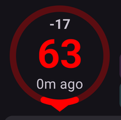
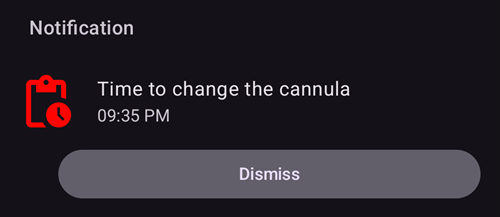
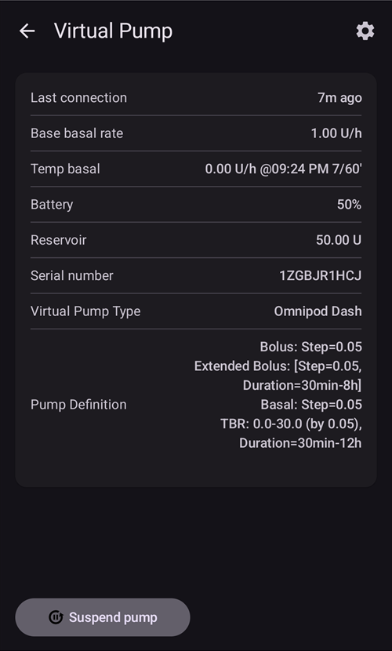

# Екрани AAPS

```{contents}
:backlinks: entry
:depth: 2
```

(the-homescreen)= (AapsScreens-the-homescreen)=

## Головний екран


Це перший екран, який ви побачите, коли відкриєте **AAPS**. На ньому є більшість інформації, потрібної вам щодня.

### Розділ A — Верхня панель

* **Меню** (☰) зліва відкриває бічну панель навігації з пунктами **Історія терапії**, **Перегляд історії**, **Статистика**, **Помічник профілю**, **Обслуговування**, **Майстер налаштування**, **Конфігурація** та іншими.
* **Рядок пошуку** знаходить налаштування, діалоги і документацію — просто почніть вводити текст (дивіться [Глобальний пошук](../DailyLifeWithAaps/GlobalSearch.md)).
* Значок **Налаштування** (шестерня) справа відкриває всі [налаштування](../SettingUpAaps/Preferences.md).

(aaps-screens-profile--target)=

### Розділ B — Блок статусу

#### Поточна глюкоза крові

Останнє значення глюкози крові з вашого CGM показано у великому колі зліва, разом з різницею від попереднього значення (дельта) і віком значення.

Колір значення ГК показує його стан відносно заданого [діапазону](#Preferences-range-for-visualization).

* зелений = у діапазоні
* червоний = нижче діапазону
* жовтий = вище діапазону

  

(loop-status)= (AapsScreens-loop-status)=

#### Статус петлі


Поруч із колом ГК значок показує робочий режим петлі (на малюнку згори донизу):

1. Зелене коло = [закрита петля](#KeyAapsFeatures-ClosedLoop), петля працює
2. Фіолетове коло з пунктирною лінією = [зупинка базалу при низькому ГК (LGS)](#KeyAapsFeatures-LGS)
3. Синє коло з пунктирною лінією = [відкрита петля](#KeyAapsFeatures-OpenLoop)
4. Червоне коло з хрестиком = петлю вимкнено (не працює постійно)
5. Червоний значок паузи = петлю призупинено (тимчасово, але базальний інсулін вводиться) — залишок часу показано поруч зі значком
6. Сіре коло з вилкою = помпу від’єднано (тимчасово інсулін зовсім не вводиться) — залишок часу показано поруч зі значком

Натисніть значок, щоб відкрити діалог петлі. Вміст діалогу залежить від поточного стану:

* Поки петля **працює** (закрита, відкрита або LGS), ви можете змінити робочий режим (Закрита петля, Зупинка базалу при низькому ГК, Відкрита петля або Вимкнути петлю), **призупинити** петлю або **від’єднати** помпу на вибрану тривалість.
* Поки петля **вимкнена**, ви можете знову увімкнути її, вибравши робочий режим, або від’єднати помпу.
* Поки петля **призупинена**, ви можете її **відновити**, від’єднати помпу або вибрати нову тривалість у пункті **Призупинити петлю**, щоб продовжити призупинення.
* Поки помпа **від’єднана**, ви можете **знову під’єднати** помпу або вибрати нову тривалість у пункті **Від’єднати помпу**, щоб продовжити від’єднання.

Коли ви продовжуєте призупинення або від’єднання, нова тривалість **рахується від цього моменту**: вона замінює залишок часу, а не додається до нього. Спочатку відновлювати петлю або під’єднувати помпу не потрібно.

Діалог, коли петля працює в режимі закритої петлі:


Діалог, коли петлю призупинено, з кнопкою **Відновити** і тривалостями для продовження призупинення:


Діалог, коли помпу від’єднано, з кнопкою **Знову під’єднати помпу** і тривалостями для продовження від’єднання:


Діалог у режимі зупинки базалу при низькому ГК, у відкритій петлі і коли петлю вимкнено відрізняється лише робочими режимами, які він пропонує:


Так виглядає головний екран у кожному режимі. Кольорова смуга вгорі графіка змінюється в момент перемикання.

Зупинка базалу при низькому ГК:


Відкрита петля:


Петлю вимкнено:


Петлю призупинено — залишок часу показано поруч зі значком:


Помпу від’єднано — залишок часу показано поруч зі значком. Кнопки терапії залишаються на панелі швидкого запуску, тож ви все ще можете записати інсулін, введений шприц-ручкою, або вуглеводи:


Після кожного вибору потрібне підтвердження.

```{admonition} Тривога: помпа не прийняла нульовий тимчасовий базал :class: warning Поки помпа від’єднана, **AAPS** тримає на помпі нульовий тимчасовий базал і встановлює його знову, якщо його немає. Якщо це не вдається і через 10 хвилин, **AAPS** подає термінову тривогу: *«Помпа не прийняла нульовий тимчасовий базал. Вона може й далі вводити базальний інсулін. Перевірте помпу.»* Тривога повторюється кожні 15 хвилин, поки нульовий тимчасовий базал не буде встановлено або поки не закінчиться від’єднання. Якщо ви її бачите, перевірте помпу: вона може вводити базальний інсулін, хоча **AAPS** показує її як від’єднану.

    <br />Примітка: доступні режими залежать від вашого прогресу в [Завданнях](../SettingUpAaps/CompletingTheObjectives.md) — Закрита петля і LGS стають доступними, лише коли ви їх виконаєте.
    
    (aaps-screens-bg-warning-sign)=
    #### Попереджувальний знак ГК
    
    Якщо **AAPS** виявляє проблему зі значеннями ГК, які отримує, на нижній панелі головного екрана з’являється ярлик вашого джерела ГК (з його назвою, наприклад **xDrip+ ГК**) з червоним значком попередження. Торкніться його, щоб відкрити [екран джерела ГК](#aaps-screens-bg-source).
    
    ##### Дубльовані дані ГК
    
    Червоний знак попередження означає, що вам потрібно діяти негайно: ви отримуєте **дубльовані дані ГК**, і через це петля не може правильно працювати. **AAPS** не може надійно розрахувати тренд ГК з дубльованих значень, тому припиняє корекції.
    
    Якщо ваша петля була закрита, **AAPS** перемикає її в режим [Зупинка базалу при низькому ГК (LGS)](#KeyAapsFeatures-LGS): значок петлі стає фіолетовим.
    
      
    
    Натисніть значок петлі: картка **Обмеження** вгорі пояснює причину: "BgQualityCheck: Режим LGS через подвоєні значення в джерелі ГК".
    
      
    
    ```{admonition} Ваша петля працює в режимі зупинки базалу при низькому ГК
    :class: note
    Петля продовжує працювати, але лише для захисту від гіпо: **AAPS** все ще може знижувати або зупиняти ваш базал, але не дасть жодного коригувального інсуліну, поки ви не розв’яжете цю проблему!
    

Вам потрібно з’ясувати, чому ви отримуєте дубльовані значення ГК:

* Чи увімкнено Dexcom bridge на вашому сайті Nightscout? Вимкніть bridge: відкрийте панель адміністрування вашого Nightscout, змініть змінну "enable" і видаліть з неї частину "bridge". (Для heroku [деталі можна знайти тут](https://nightscout.github.io/troubleshoot/troubleshoot/#heroku).)
* Чи кілька джерел вивантажують ваші значення ГК у Nightscout? Якщо ви використовуєте застосунок BYODA, увімкніть вивантаження в **AAPS**, але не вмикайте його в xDrip, якщо ви його використовуєте.
* Чи є у вас послідовники, які отримують ваші значення ГК, але також знову вивантажують їх на ваш сайт Nightscout?
* Крайній захід: у [налаштуваннях NSClient](#Preferences-nsclient) виберіть налаштування синхронізації і вимкніть параметр «Отримувати дані CGM з NS».

Щоб одразу прибрати попередження і знову дозволити петлі робити корекції, видаліть дубльовані записи на екрані джерела ГК: торкніться ярлика на нижній панелі. Дубльоване значення виділено червоним. Довго натисніть на значення, щоб почати вибір, позначте дублікати і торкніться значка кошика вгорі справа.


Але якщо дублікатів багато, може бути простіше

* [зробити резервну копію налаштувань](../Maintenance/ExportImportSettings.md),
* скинути базу даних у меню обслуговування і
* знову [імпортувати налаштування](../Maintenance/ExportImportSettings.md)

    {admonition} Самі поверніться до закритої петлі
    :class: important
    **AAPS** не повертається до режиму **Закрита петля** сам, коли дублікати видалено. Натисніть значок петлі на головному екрані і знову виберіть **Закрита петля**.

##### Пласкі дані ГК

З деякими джерелами ГК (Libre 1, AiDEX, Glutec, Medtronic і джерела, які не повідомляють тип свого сенсора) **AAPS** також перевіряє значення, що не змінюються: якщо ваша ГК змінилася менше ніж на 2 мг/дл (0,1 ммоль/л) за 45 хвилин, дані вважаються неправильними. Тоді ярлик джерела ГК показує червоний значок пласкої лінії, а петля зупиняє будь-який високий тимчасовий базал і не дає коригувального інсуліну, поки значення знову не почнуть змінюватися. Перевірте ваш сенсор і застосунок, який надсилає значення.

##### Нерегулярні дані ГК

Коли значення надходять з нерегулярними інтервалами або деяких бракує, **AAPS** перераховує 5-хвилинні значення з тих, які має. Так буває, наприклад, після заміни сенсора або з сенсорами Libre, час яких зсувається на хвилину-дві кожні кілька годин. Петля продовжує працювати, і вам нічого не потрібно робити. **AAPS** 4 більше не показує для цього жовтий знак попередження.

#### Поточний профіль

Поточний профіль показано поруч зі значком зірки.

Торкніться назви профілю, щоб відкрити [екран профілю](#aaps-screens-profile). Там ви можете переглянути деталі профілю і [перемикатися між різними профілями](../DailyLifeWithAaps/ProfileSwitch-ProfilePercentage.md).

Щоб **змінити відсоток профілю** (і його тривалість), торкніться назви профілю, а потім торкніться круглої кнопки **▶** (Активувати) внизу справа на екрані профілю. В **AAPS** 3.x цей екран відкривався довгим натисканням на назву профілю; в **AAPS** 4 довге натискання нічого не робить. Крок за кроком: [Зміна відсотка профілю](#ProfileSwitch-change-percentage).


1. Звичайний вигляд при стандартній активації профілю.
2. Перемикання профілю з відсотком 90 % і залишком тривалості 9 хвилин — назва профілю стає жовтою, поки діє тимчасове перемикання профілю.
3. Перемикання профілю зі зсувом часу на 1 годину і залишком тривалості 9 хвилин.

#### Ціль


Поточна цільова глюкоза крові показана під назвою профілю.

Коротко натисніть на ціль, щоб відкрити екран **[Тимчасова ціль](../DailyLifeWithAaps/TempTargets.md)**.

1. Звичайний вигляд: цільовий діапазон, заданий у вашому профілі.
2. Якщо встановлено тимчасову ціль, ціль стає жовтою/помаранчевою зі значком використаного шаблону, а залишок часу в хвилинах показано в дужках.

(AapsScreens-visualization-of-dynamic-target-adjustment)=

#### Показ динамічної зміни цілі

Якщо ви використовуєте [алгоритм SMB](#Config-Builder-aps) і функцію [Autosens](#Open-APS-features-autosens), **AAPS** може динамічно змінювати вашу ціль залежно від чутливості.

Увімкніть один або обидва з цих параметрів у [налаштуваннях OpenAPS SMB](#Preferences-openaps-smb-settings):

* «Чутливість підвищує ціль» і/або
* «Резистентність знижує ціль»

Якщо **AAPS** виявляє резистентність або чутливість, ціль змінюється порівняно з профілем, а показана ціль змінює колір, щоб показати цю зміну.

(aaps-screens-iob-cob-basal-sens)=

#### IOB, COB, базал і чутливість


1. **Шприц**: активний інсулін (IOB) — кількість інсуліну, що ще діє у вашому організмі  
    Активний інсулін дорівнював би нулю, якби працював лише ваш стандартний базал і не залишалося інсуліну від попередніх болюсів. 
    * IOB може бути від’ємним, якщо нещодавно були періоди зниженого базалу.
    * Натисніть на чип, щоб побачити розподіл на болюсний і базальний інсулін (перший діалог на малюнку — тут з від’ємним IOB після періоду зниженого базалу)
2. **Зерно**: [активні вуглеводи (COB)](../DailyLifeWithAaps/CobCalculation.md) — ще не засвоєні вуглеводи, які ви з’їли раніше
3. Бірюзова кнопка справа показує **поточну подачу базалу**: пряма лінія, коли діє базал профілю, і змінений значок, коли діє тимчасовий базал
4. **Рядок відсотка** показує поточну чутливість ([Autosens](#Open-APS-features-autosens) / [DynamicISF](../DailyLifeWithAaps/DynamicISF.md)). Коли петля змінює ваш ISF, рядок також показує ISF профілю, стрілку і ISF, який петля використовує зараз, наприклад "80% 2.0 ↗ 2.5". Натисніть на нього, щоб побачити значення Autosens і ефективний ISF (другий діалог на малюнку). Якщо петля працює з іншим значенням, ніж останній результат Autosens (наприклад, тому що тимчасова ціль змінює вашу чутливість), діалог також показує це значення як **Autosens в алгоритмі**. Коли Autosens вимкнено, петля залишає ISF вашого профілю, і ефективний ISF не показується.

Діалог IOB, який відкривається натисканням на чип IOB:


Натисніть бірюзову кнопку, щоб побачити тимчасовий базал, який діє зараз, коли він почався і скільки часу вже діє:


(aaps-screens-carbs-required)=

#### Потрібні вуглеводи


Пропозиції вуглеводів з’являються, коли еталонний алгоритм виявляє, що потрібні вуглеводи.

Це той випадок, коли алгоритм oref вважає, що не зможе врятувати вас нульовим тимчасовим базалом, і для виправлення вам потрібні вуглеводи.

Сповіщення про вуглеводи значно складніші, ніж сповіщення калькулятора болюса. Ви можете побачити пропозицію вуглеводів, навіть коли калькулятор болюса не показує відсутніх вуглеводів.

Сповіщення про потрібні вуглеводи за бажанням можна надсилати в Nightscout. Тоді буде показано й розіслано оголошення.

### Розділ C — Рядок статусу


Рядок статусу дає візуальне попередження про

* Вік канюлі
* Вік інсуліну (скільки днів використовується резервуар) і рівень у резервуарі (одиниці)
* Вік сенсора
* Вік і рівень батареї помпи (%)

Якщо перевищено поріг попередження, значення показуються жовтим.

Якщо перевищено критичний поріг, значення показуються червоним.

Пороги можна змінити через маленький значок **Налаштування**, який видно, коли рядок статусу **розгорнуто** (шеврон справа) — дивіться [Покажчики статусу](#Preferences-status-lights).

У розгорнутій панелі статусу в кінці деяких рядків також є кнопка, щоб записати заміну, яка скидає відповідний вік: **Додати** в рядку **Сенсор** записує встановлення сенсора. Якщо ваша помпа це підтримує, **Підготовка/Заповнення** з’являється в рядках **Канюля** (або **Patch-помпа**) та **Інсулін**, а **Додати** — в рядку **Батарея помпи**.


Залежно від вашої помпи, у вас можуть бути не всі ці значки.

(screens-sensor-level-battery)=

#### Рівень сенсора (батарея)

Працює для CGM з додатковим передавачем, наприклад MiaoMiao 2. (Технічно сенсор має надсилати інформацію про рівень батареї в xDrip.)

Пороги можна задати в [Покажчиках статусу](#Preferences-status-lights).

(aaps-screens-main-graph)=

### Розділ D — Головний графік


Графік показує вашу глюкозу крові (ГК), отриману з вашого монітора глюкози (CGM).

Використовуйте прокручування і масштабування двома пальцями на графіку, щоб змінити видимий проміжок часу.

Зелена зона показує ваш цільовий діапазон.

Ця інформація також показана на цьому графіку:

* Ручні болюси: синій трикутник трохи вище кривої ГК, що вказує вниз на значення в цей момент, з кількістю інсуліну
* Записи вуглеводів: помаранчевий трикутник трохи нижче кривої ГК, що вказує вгору на значення, з кількістю вуглеводів. Прийом їжі, введений разом з болюсом, виглядає як одна позначка, розділена значенням ГК.
* Трикутники бувають трьох розмірів (малий, середній, великий) залежно від кількості порівняно з найбільшою за день. Якщо в цей час немає значення ГК (пропуск сенсора), трикутник малюється внизу графіка.
* Перевірки ГК і калібрування: малюються на рівні власного виміряного значення, тож ви можете порівняти їх з кривою сенсора
* Ціль, задана в профілі або змінена тимчасовою ціллю: зелена лінія
* Перемикання профілю: значки зірок угорі графіка
* Статус петлі: кольорова смуга вгорі графіка, коли [робочий режим](#AapsScreens-loop-status) відрізняється від закритої петлі: синя = відкрита петля, фіолетова = LGS, червона = петлю вимкнено, жовта = петлю призупинено, сіра = помпу від’єднано, помаранчева = суперболюс (на знімку екрана: фіолетова, потім жовта). Історія цих змін наведена в розділі [Робочий режим](#AapsScreens-running-mode)
* [SMB](#Open-APS-features-super-micro-bolus-smb) не малюються на графіку ГК (там був би один кожні кілька хвилин): вони показані на [графіку IOB](#aaps-screens-iob).

Торкніться **перевірки ГК** на графіку, щоб побачити її значення і примітку, якщо ви її написали.

(aaps-screens-graph-press-and-hold)=

#### Перегляд значень у певний момент часу

**Натисніть і утримуйте** графік ГК якусь мить, щоб побачити значення для одного вимірювання. Крапка позначає найближче значення, пунктирна лінія малюється в цей момент часу на всіх графіках, а спливне вікно вгорі графіка показує:

* час і значення ГК
* IOB, COB (лише якщо більше 0 г) і базал у цей момент — значок базалу показує, чи діяв тимчасовий базал, як на головному екрані
* будь-який болюс, SMB або вуглеводи в цей момент, з такими самими трикутниками, як на графіках

Тримайте палець на екрані і ведіть ним вліво або вправо, щоб переходити від одного значення до наступного. На кожному значенні ви відчуваєте легку вібрацію, а графік не прокручується, поки ви це робите. Спливне вікно залишається ще 2 секунди після того, як ви приберете палець.

Так само це працює на [додаткових графіках](#aaps-screens-additional-graphs) під графіком ГК (IOB, COB...): натисніть і утримуйте будь-який з них.


(AapsScreens-activate-optional-information)=

#### Увімкнення додаткової інформації

Натисніть значок **олівця** у верхньому правому куті графіка, щоб відкрити налаштування графіка:


* **Висота графіка** змінює висоту графіка.
* **ACT** накладає криву активності інсуліну: суцільна жовто-зелена лінія <span style="background:#141218;color:#D3F166;padding:0 0.3em;border:1px solid #141218;border-radius:4px">━━━━</span> (не плутайте з пунктирним жовтим прогнозом UAM)
* **ПРОГН** накладає [лінії прогнозу](#aaps-screens-prediction-lines) (дивіться нижче)

(aaps-screens-prediction-lines)=

#### Лінії прогнозу

Коли **ПРОГН** увімкнено, AAPS малює свої прогнози **пунктирними лініями** праворуч від лінії «зараз». Кожен прогноз має свій колір. Темна тема використовує світліші відтінки тих самих кольорів, а лінія всередині зеленого цільового діапазону може виглядати трохи зеленішою.

| Лінія                        | Світла тема                                                                                                                       | Темна тема                                                                                                                         | Що вона прогнозує                            |
| ---------------------------- | --------------------------------------------------------------------------------------------------------------------------------- | ---------------------------------------------------------------------------------------------------------------------------------- | -------------------------------------------- |
| **IOB** (синя)               | <span style="background:#FFFFFF;color:#1E88E5;padding:0 0.3em;border:1px solid #CCCCCC;border-radius:4px">●●●●</span>             | <span style="background:#141218;color:#64B5F6;padding:0 0.3em;border:1px solid #141218;border-radius:4px">●●●●</span>              | лише інсулін                                 |
| **COB** (помаранчева)        | <span style="background:#FFFFFF;color:#FB8C00;padding:0 0.3em;border:1px solid #CCCCCC;border-radius:4px">●●●●</span>             | <span style="background:#141218;color:#FFB74D;padding:0 0.3em;border:1px solid #141218;border-radius:4px">●●●●</span>              | активні вуглеводи                            |
| **UAM** (жовта)              | <span style="background:#FFFFFF;color:#C9BD60;padding:0 0.3em;border:1px solid #CCCCCC;border-radius:4px">●●●●</span>             | <span style="background:#141218;color:#E6D39A;padding:0 0.3em;border:1px solid #141218;border-radius:4px">●●●●</span>              | неоголошений прийом їжі                      |
| **ZT** (блакитна)            | <span style="background:#FFFFFF;color:#00D2D2;padding:0 0.3em;border:1px solid #CCCCCC;border-radius:4px">●●●●</span>             | <span style="background:#141218;color:#4DD4D4;padding:0 0.3em;border:1px solid #141218;border-radius:4px">●●●●</span>              | нульовий тимчасовий базал (інсулін зупинено) |
| **aCOB** (блідо-помаранчева) | <span style="background:#FFFFFF;color:rgba(251,140,0,0.5);padding:0 0.3em;border:1px solid #CCCCCC;border-radius:4px">●●●●</span> | <span style="background:#141218;color:rgba(255,183,77,0.5);padding:0 0.3em;border:1px solid #141218;border-radius:4px">●●●●</span> | лише старіший алгоритм AMA                   |

Коли два прогнози дають однакові значення, їхні крапки накладаються, і ви бачите лише один з кольорів (наприклад, UAM поверх IOB, коли ГК стабільна).

* Лінія **COB** (помаранчева): [активні вуглеводи](CobCalculation) (помаранчевий колір використовується в усьому AAPS для COB і вуглеводів)
    
    Ця лінія прогнозу показує, куди піде ваша ГК (а не самі COB!) за поточних налаштувань **Профілю**, якщо відхилення через засвоєння вуглеводів залишаться незмінними. Ця лінія з’являється, лише якщо є відомі COB.

* Лінія **IOB** (синя): активний інсулін (синій колір використовується в усьому AAPS для IOB та інсуліну)
    
    Ця лінія прогнозу показує, що буде лише під дією інсуліну. Наприклад, якщо ви ввели інсулін, а потім не з’їли жодних вуглеводів.

* Лінія **ZT** (блакитна): нульовий тимчасовий базал (прогноз ГК, якби було встановлено тимчасовий базал 0 %)
    
    Ця лінія прогнозу показує, як змінилася б траєкторія ГК, якби помпа зупинила все введення інсуліну (TBR 0 %). Лінія закінчується, коли піднімається вище вашої цілі.
    
    *Ця лінія з’являється, лише коли використовується алгоритм [SMB](#Config-Builder-aps).*

* Лінія **UAM** (жовта): [неоголошений прийом їжі](#SensitivityDetectionAndCob-sensitivity-oref1)
    
    Неоголошений прийом їжі означає, що виявлено значне підвищення рівня глюкози через їжу, адреналін або інші впливи. Лінія прогнозу схожа на **помаранчеву лінію COB**, але припускає, що відхилення зменшуватимуться з постійною швидкістю (продовжуючи поточну швидкість зменшення).
    
    *Ця лінія з’являється, лише коли використовується алгоритм [SMB](#Config-Builder-aps), у налаштуваннях OpenAPS SMB увімкнено **Увімкнути UAM**, а ГК зростає більше, ніж можна пояснити лише інсуліном.*

* Лінія **aCOB** (бліда, напівпрозора помаранчева): прискорене засвоєння вуглеводів
    
    Схожа на COB, але припускає постійну швидкість засвоєння вуглеводів 10 мг/дл/5 хв (-0,555 ммоль/л/5 хв). Застаріле і має обмежену користь.
    
    *Ця лінія з’являється, лише коли використовується старіший алгоритм [AMA](#Config-Builder-aps).*

Зазвичай ваша реальна крива глюкози опиняється посередині між цими лініями або близько до тієї, чиї припущення найкраще відповідають вашій ситуації.

(aaps-screens-how-predictions-become-a-dosing-decision)=

#### Як AAPS перетворює прогнози на рішення про дозування

AAPS дозує інсулін не лише за вашою поточною ГК — у кожному циклі петлі (приблизно кожні 5 хвилин) він розглядає всі лінії прогнозу вище разом і визначає найбезпечнішу дію.

Головне правило — **безпека понад усе**: якщо *будь-яка* лінія прогнозу в будь-якому проміжку часу опускається нижче вашого нижнього порогу безпеки, AAPS встановлює нульовий тимчасовий базал (тимчасовий базал 0 %) і не дає більше інсуліну, навіть якщо ваша поточна ГК висока. Лише коли всі лінії прогнозу залишаються вище цього порогу, AAPS розглядає можливість дати більше інсуліну.

Коли давати більше інсуліну безпечно, AAPS дивиться, де за об’єднаними прогнозами ГК зрештою опиниться (**кінцева ГК**), і визначає, скільки корекції потрібно, щоб повернути цю кінцеву ГК до цілі — як підвищений тимчасовий базал або (якщо увімкнено алгоритм oref1/[SMB](#Open-APS-features-super-micro-bolus-smb)) як невеликий негайний болюс. Якщо ГК зараз висока, але вже сама достатньо знижується, AAPS почекає або навіть може знизити базал, замість того щоб додати інсулін, який лише зробив би пізніше гіпо ще глибшим.

Приклади цієї логіки рішень з реальними знімками екрана дивіться в [сценаріях дозування в посібнику для лікарів](#clinicianguide-dosing-scenarios) — вони написані для лікарів, але стосуються будь-якого користувача AAPS.

*Повний технічний опис того, як розраховуються ці прогнози і рішення про дозування, дивіться в [документації OpenAPS про determine-basal](https://openaps.readthedocs.io/en/latest/docs/While%20You%20Wait%20For%20Gear/Understand-determine-basal.html).*

#### Базали

**Суцільна синя** лінія показує подачу базалу вашою помпою і відображає фактичне введення з часом.

**Пунктирна синя** лінія показує, яким був би базал без тимчасових змін базалу (TBR).

Коли подається стандартний базал, площа під кривою показана темно-синім. Коли базал тимчасово змінено (збільшено або зменшено), площа під кривою показана світло-синім.

#### Активність

**Тонка жовта** лінія показує активність інсуліну.

Вона базується на очікуваному зниженні ГК від інсуліну у вашому організмі, якби не було інших чинників (наприклад, вуглеводів).

(AapsScreens-section-g-additional-graphs)= (aaps-screens-additional-graphs)=

### Розділ E — Додаткові графіки

Під головним графіком можна увімкнути додаткові графіки. У [простому режимі](#preferences-simple-mode) додаткові графіки задані заздалегідь, і їх не можна змінити. Вимкніть **Простий режим**, якщо хочете самі налаштувати додаткові графіки.

Додаткові графіки рухаються разом з головним графіком: коли ви прокручуєте або масштабуєте графік ГК, вони рухаються разом з ним. Перетягування вбік на додатковому графіку також прокручує всі графіки. Вони не мають власних позначок часу — дивіться час на графіку ГК.

Щоб налаштувати додатковий графік, натисніть значок **олівця** у його верхньому правому куті:


Виберіть чипи, які відповідають даним, що ви хочете бачити на цьому графіку; кнопка **Видалити** видаляє графік.

Щоб створити ще один графік, натисніть **Додати графік** під останнім графіком і так само виберіть його чипи:


Новий графік додається під іншими — тут другий додатковий графік з **SENS%** і **ВІДХ**:


Більшості користувачів підходить така конфігурація додаткових графіків:

* Графік 1 з IOB, COB і зміною чутливості
* Графік 2 з відхиленнями і BGI.

#### Абсолютний інсулін (ABS)

Активний інсулін, включно з болюсами **і базалом**.

(aaps-screens-iob)=

#### Активний інсулін (IOB)

Показує активний інсулін (= інсулін, що ще діє у вашому організмі). Він включає інсулін з болюсів і тимчасового базалу (**але не включає базал, заданий у вашому профілі**).

Якби протягом часу DIA не було [SMB](#Open-APS-features-super-micro-bolus-smb), болюсів і TBR, це значення дорівнювало б нулю.

SMB показані на цьому графіку синіми трикутниками трьох розмірів залежно від кількості порівняно з найбільшим SMB за день.

IOB може бути від’ємним, якщо у вас немає залишку болюса і довгий час діє нульовий або низький тимчасовий базал.

Зменшення залежить від ваших [налаштувань DIA і типу інсуліну](#Config-Builder-insulin-dia).

#### Активні вуглеводи (COB)

Показує активні вуглеводи (= вуглеводи у вашому організмі, які ще не засвоїлися).

Зменшення залежить від [відхилень, які виявляє алгоритм](../DailyLifeWithAaps/CobCalculation.md).

Якщо алгоритм виявить, що вуглеводи засвоюються швидше, ніж очікувалося, буде введено інсулін, і IOB зросте (більше чи менше, залежно від ваших налаштувань безпеки).

#### Зміна чутливості (SENS%)

Показує чутливість, яку виявив [Autosens](#Open-APS-features-autosens).

Чутливість — це розрахунок чутливості до інсуліну, яка змінюється через фізичні навантаження, гормони тощо.

Зверніть увагу: щоб визначення чутливості/[Autosens](#Open-APS-features-autosens) автоматично змінювало кількість введеного інсуліну, ви маєте бути на [Завданні 8](#objectives-objective8). Поки ви не досягли цього завдання, лінія на графіку показується лише для інформації.

### Змінна чутливість (VSENS)

Показує чутливість, розраховану [DynamicISF](../DailyLifeWithAaps/DynamicISF.md). Заповнюється, лише якщо ви використовуєте цю функцію.

(screen-heart-rate-steps)=

#### Пульс (ЧСС) і кроки

Ці дані можуть бути доступні, якщо ви використовуєте [смарт-годинник Wear](../WearOS/WearOsSmartwatch.md). Увімкніть їх у застосунку **AAPS** Wear і надайте дозвіл на дані про здоров’я.

#### Відхилення (ВІДХ)

* **Сірі** стовпчики показують відхилення через вуглеводи.
* **Зелені** стовпчики показують, що ГК вища, ніж очікував алгоритм. Зелені стовпчики використовуються для збільшення резистентності в [Autosens](#Open-APS-features-autosens).
* **Червоні** стовпчики показують, що ГК нижча, ніж очікував алгоритм. Червоні стовпчики використовуються для збільшення чутливості в [Autosens](#Open-APS-features-autosens).
* **Жовті** стовпчики показують відхилення через UAM.
* **Чорні** стовпчики показують малі відхилення, які не враховуються для чутливості

#### Вплив на глюкозу крові (-BGI)

Ця лінія показує, наскільки ГК «мала б» зрости або знизитися лише через активність інсуліну.


Цю лінію добре показувати разом зі стовпчиками відхилень. Вони мають однакову шкалу, але вона відрізняється від шкали інших додаткових даних, тому краще показувати їх на окремому графіку, як показано вище. Порівняння лінії BGI і стовпчиків відхилень — ще один спосіб зрозуміти, як змінюється **ГК**. Тут у момент, позначений **1**, стовпчики відхилень значно вище лінії BGI: ГК зростає більше, ніж можна пояснити лише активністю інсуліну (наприклад, після вуглеводів). У момент, позначений **2**, стовпчики відхилень нижче нуля (червоні): ГК нижча, ніж очікував алгоритм.

### Розділ F — Панель швидкого запуску


Плаваюча панель унизу екрана містить ваші дії **[швидкого запуску](../DailyLifeWithAaps/QuickLaunch.md)**. Маленька **шестерня** відкриває налаштування швидкого запуску, де ви вибираєте, які кнопки показувати (терапія, записи Careportal, дії CGM, екрани панелі **Керувати**, кнопки [Швидкого майстра](../DailyLifeWithAaps/QuickWizards.md), [Сцени](../DailyLifeWithAaps/Scenes.md) тощо).

Типова конфігурація показана вище: **Інсулін**, **Вуглеводи** і **Калькулятор болюса**.

Поки помпа **від’єднана**, кнопки терапії залишаються на панелі, наприклад щоб записати інсулін, введений шприц-ручкою (дивіться [Інсулін](#aaps-screens-buttons-insulin) нижче). Ці самі дії також доступні на [панелі «Терапія»](#aaps-screens-treatments-sheet) нижньої навігації.

(aaps-screens-buttons-insulin)=

#### Інсулін


Щоб ввести певну кількість інсуліну без [калькулятора болюса](#aaps-screens-bolus-wizard).

Увімкнувши **Запустити ТЦ «Очікуваний прийом їжі»**, ви можете автоматично запустити вашу [тимчасову ціль «Очікуваний прийом їжі»](#TempTargets-eating-soon-temp-target).

Якщо ви не хочете вводити болюс через помпу, а лише записати кількість інсуліну (наприклад, інсулін, введений шприц-ручкою), увімкніть «**Болюс буде лише записаний**». Додатковий рядок **Час**, встановлений на **Зараз**, дає змогу записати ін’єкцію інсуліну, зроблену раніше: змінюйте його кнопками **-** / **+** або торкніться шеврона, щоб ввести хвилини чи вибрати дату і час.

 

Ви можете використовувати кнопки **+0.5 / +1.0 / +2.0**, щоб швидко збільшити кількість інсуліну. Значення кроків можна змінити в [налаштуваннях калькулятора болюса](#Preferences-deliver-this-part-of-bolus-wizard-result).

Діалог інсуліну можна використовувати й тоді, коли помпу призупинено або від’єднано, наприклад щоб записати інсулін, введений шприц-ручкою. У цьому випадку «**Болюс буде лише записаний**» увімкнено примусово (показано червоним), і з’являються додаткові поля, щоб вибрати тип інсуліну і зсув **Час** для ін’єкції, зробленої раніше:


#### Вуглеводи


Щоб записати вуглеводи без болюса.

Деякі [заздалегідь задані тимчасові цілі](#TempTargets-hypo-temp-target) (Гіпо, Очікуваний прийом їжі, Активність) можна запустити прямо перемикачами вгорі.

**Час прийому вуглеводів**: коли ви будете їсти / їли вуглеводи.

**Тривалість**: використовується для [«подовжених вуглеводів»](ExtendedCarbs). Цей рядок згорнуто, щоб ви помилково не ввели в нього грами: змінюйте значення кнопками **-** / **+** або торкніться шеврона, щоб відкрити рядок і ввести значення.

Ви можете використовувати кнопки **+5 / +10 / +20**, щоб швидко збільшити кількість вуглеводів.

#### Швидкий майстер

Легко вводьте кількість вуглеводів і задавайте основу розрахунку однією заздалегідь налаштованою кнопкою.

Деталі налаштовуються в [Швидкому майстрі](../DailyLifeWithAaps/QuickWizards.md).

(aaps-screens-treatments-sheet)=

### Розділ G — Нижня навігація

Нижня панель навігації дає доступ до:

* **Терапія** — панель швидких дій з вашими діями терапії:
    
    

* **Сцени** — показується, лише якщо у вас є щонайменше одна [сцена](../DailyLifeWithAaps/Scenes.md) або правило з розділу **Автоматизація**, позначене як **Дія користувача**. Відкриває панель, з якої їх можна запустити; значок показує, скільки з них можна запустити зараз. **Олівець** угорі панелі відкриває **Керувати → Сцени**.

* **Керувати** — центр для всього, чим ви керуєте в **AAPS**: Профіль, Налаштування інсуліну, Тимчасова ціль, Швидкий майстер, Сцени, Автоматизація, Їжа, Чергування місць введення, Помпа та Авторизовані клієнти. Під ними є дії з пристроями і базалом, наприклад Встановлення сенсора і Тимчасовий базал. Деякі пункти з’являються, лише якщо вони стосуються вашої системи — наприклад, Підготовка/Заповнення і заміна батареї залежать від вашої помпи, а Тимчасовий базал, Подовжений болюс і записи Careportal приховано в [простому режимі](#preferences-simple-mode):
    
    

* **Завдання** — ваш прогрес у [Завданнях](../SettingUpAaps/CompletingTheObjectives.md); значок показує, скільки з них виконано. Цей пункт зникає, коли всі завдання виконано, і його немає в **AAPSClient**.

(aaps-screens-notifications)=

#### Сповіщення

Над нижньою панеллю справа може з’явитися **бульбашка сповіщень**. Вона збирає активні сповіщення **AAPS**; маленьке число показує, скільки їх. Її колір відповідає найважливішому з них: червоний для термінового повідомлення, зелений для простої інформації.


Торкніться бульбашки, щоб відкрити панель **Сповіщення**. Кожне повідомлення показує час, коли воно з’явилося. Натисніть **Закрити** під повідомленням, щоб прибрати його; деякі повідомлення мають замість цього іншу кнопку, яка веде до налаштування, що потребує вашої уваги.




(bolus-wizard)= (aaps-screens-bolus-wizard)=

## Калькулятор болюса


Коли ви хочете зробити болюс на їжу, зазвичай ви робите його саме тут.

### Розділ I

Заголовок **Розрахунок** показує розрахований болюс. Якщо активного інсуліну вже більше, ніж розрахований болюс, буде показано лише кількість вуглеводів, які ще потрібні.

Калькулятор болюса можна використовувати за будь-якої поточної **ГК**, також коли вона занадто висока або занадто низька. Якщо **ГК** вища за ціль, до болюса на їжу додається корекція. Якщо **ГК** нижча за ціль, болюс зменшується, і якщо активного інсуліну вже більше, ніж потрібно, калькулятор замість інсуліну показує, скільки вуглеводів ще потрібно.

Ряд значків під заголовком показує, які вхідні дані входять у розрахунок (ГК, тренд, IOB, тимчасова ціль, COB). Натискання на значок вмикає / вимикає цей пункт у розрахунку; значок **(i)** показує детальні числа розрахунку.

#### Комбінації COB та IOB і що вони означають

* З міркувань безпеки вхідні дані IOB не можна вимкнути, коли увімкнено COB, бо інакше є ризик забагато інсуліну, адже **AAPS** не враховує вже введений інсулін.
* Якщо ви вмикаєте COB та IOB, будуть враховані незасвоєні вуглеводи, ще не покриті інсуліном, і весь інсулін, введений як TBR або SMB.
* Якщо ви вмикаєте IOB без COB, **AAPS** враховує вже введений інсулін, але не зіставляє його з вуглеводами, які ще мають засвоїтися. Це призводить до повідомлення про «відсутні вуглеводи».
* Якщо ви робите болюс на **додаткову їжу** невдовзі після болюса на їжу (наприклад, додатковий десерт), може бути корисно **вимкнути всі вхідні дані**. Так додаються лише нові вуглеводи, бо основний прийом їжі не обов’язково вже засвоївся, тож одразу після болюса на їжу IOB не буде точно відповідати COB.
* З міркувань безпеки **тимчасова ціль** входить у розрахунок, лише якщо ви вручну увімкнете її вхідні дані.

(AapsScreens-section-j)=

### Розділ J — Поля введення

У полі **Вуглеводи** ви вводите свою оцінку кількості вуглеводів **у грамах**, на яку хочете зробити болюс; кнопки **+** під ним швидко додають вуглеводи. **AAPS** працює лише з грамами: якщо ви рахуєте в хлібних одиницях або обмінах (*наприклад* обміни "CHO" DAFNE), перед введенням переведіть їх у грами. Дивіться [примітку про хлібні одиниці](#your-aaps-profile-insulin-to-carbs-ratio) на сторінці профілю.

#### Тип вуглеводів: хліб, торт або піца

Під полем **Вуглеводи** кнопки **Хліб**, **Торт** і **Піца** повідомляють **AAPS**, як швидко засвоюється їжа. З кнопками **Торт** і **Піца** болюс покриває зараз лише частину вуглеводів, а решта додається пізніше як eCarbs. Відсотки і час дивіться в розділі [Тип вуглеводів: хліб, торт або піца](#AapsScreens-carbs-type) на сторінці «Подовжені вуглеводи».

Рядок **Корекція** потрібен, якщо ви з якоїсь причини хочете змінити кінцеву дозу.

Завжди відкрите лише поле **Вуглеводи**. Інші рядки (**Корекція**, **Час прийому вуглеводів**, **ГК** і **Використати відсоток**) згорнуті: вони показують своє значення з кнопками **-** / **+**, тож ви можете змінювати його малими кроками. Торкніться шеврона, щоб відкрити рядок і ввести значення, і торкніться його знову, щоб закрити рядок. Так ви не введете помилково грами в поле **Корекція**.


Торкніться будь-де в рядку **Профіль**, щоб відкрити список ваших профілів, а потім торкніться назви, щоб використати цей профіль для цього розрахунку.


Поле **Час прийому вуглеводів** призначене для попереднього болюса: так ви повідомляєте системі, що вуглеводи надійдуть із затримкою. У це поле можна ввести від’ємне число, якщо ви робите болюс на вуглеводи, з’їдені раніше.

**Встановити нагадування** (нагадування про їжу): коли введено час прийому вуглеводів у майбутньому, з’являється перемикач «**Встановити нагадування**», щоб у вказаний час вам нагадали з’їсти вуглеводи, які ви ввели в **AAPS**:


Нагадування звучить як тривога **AAPS**. Воно не створює таймер у застосунку годинника на вашому телефоні і також працює, коли болюс введено з **AAPSClient**, а **AAPS** працював у фоновому режимі.

Поле **ГК** зазвичай уже заповнене останнім значенням з вашого CGM. Якщо у вас немає працюючого CGM, поле буде порожнім. Коли значення свіже, рядок **ГК** залишається згорнутим.

Кнопка результату внизу показує запропонований болюс; після її натискання потрібне підтвердження, перш ніж буде введено будь-який інсулін.

Корисно знати:

* Якщо розрахований болюс більший за ваш **[Максимальний болюс](#Preferences-maximum-bolus)**, його зменшують до максимального болюса, а в підтвердженні показується попередження «Застосовано обмеження болюса». [Швидкий майстер](../DailyLifeWithAaps/QuickWizards.md) натомість відхиляється.
* Коли болюс лише записується (наприклад, поки помпу від’єднано), попередження «**Болюс буде лише записаний**» залишається вгорі діалогу, також коли ви прокручуєте.
* Болюс, який ви вводите вручну, має пріоритет над [SMB](#Open-APS-features-super-micro-bolus-smb), який чекає на введення: SMB скасовується, і петля розраховує знову. Якщо SMB вводиться саме зараз, ваш болюс відхиляється з повідомленням «Зараз вводиться SMB. Спробуйте ще раз, коли введення завершиться.» Інсулін не вводиться, а вуглеводи, введені з цим болюсом, не зберігаються: зачекайте трохи і введіть їх знову.

(AapsScreens-wrong-cob-detection)=

#### Неправильне визначення COB


Якщо ви бачите попередження вище після використання калькулятора болюса, **AAPS** виявив, що розраховане значення COB може бути неправильним. Тож якщо ви хочете зробити ще один болюс після попереднього прийому їжі з COB, остерігайтеся передозування!

Докладніше дивіться підказки на [сторінці розрахунку COB](#CobCalculation-detection-of-wrong-cob-values).

Шукаєте вкладку **Дії** з **AAPS** 3.x? Її функції перенесено на головний екран, на панель **Керувати** і на панель швидкого запуску: дивіться [Куди поділася вкладка «Дії»?](#screens-action-tab).

(aaps-screens-careportal)=

## Записи Careportal

Вік і рівні, показані в [рядку статусу](#screens-sensor-level-battery) (сенсор, інсулін, канюля, батарея помпи), базуються на записах Careportal: **Підготовка/Заповнення** (записує заміну місця введення і картриджа з інсуліном), **Встановлення сенсора** і **Заміна батареї помпи**.

Ви можете записати їх з розгорнутої панелі статусу на головному екрані, з панелі **Керувати** або кнопками [швидкого запуску](../DailyLifeWithAaps/QuickLaunch.md).

**Підготовка/Заповнення** записує заміну місця введення помпи і/або заміну картриджа з інсуліном і може ввести кількість для заповнення:


**Встановлення сенсора** і **Заміна батареї помпи** запитують лише час події:


 Записи тренування, оголошення, питання і примітки відповідають Careportal у Nightscout і є особливими видами приміток.

На панелі **Керувати** прокрутіть униз і натисніть **Careportal**, щоб показати ці записи: **Контроль ГК**, **Примітка**, **Тренування**, **Питання** і **Оголошення**.


**Контроль ГК**, **Питання** і **Оголошення** дають змогу ввести значення глюкози (з глюкометра, сенсора або іншого джерела), примітку і час події. У діалогах **Питання** та **Оголошення** рядок глюкози згорнуто, і поруч зі значенням показано тип вимірювача: якщо ви змінюєте значення, тип змінюється з **Сенсор** на **Глюкометр**.


**Примітка** і **Тренування** дають змогу ввести тривалість (згорнутий рядок: використовуйте **-** / **+** або торкніться шеврона, щоб ввести її), примітку і час події:


У всіх цих діалогах (**Підготовка/Заповнення**, **Встановлення сенсора**, **Заміна батареї помпи** і записи Careportal) час події задається тим самим рядком **Час**, що й у [діалозі інсуліну](#aaps-screens-buttons-insulin) і калькуляторі болюса: використовуйте **-** / **+**, щоб зсувати час кроками по 5 хвилин (до одного тижня назад і до 12 годин уперед), або торкніться шеврона, щоб вибрати будь-яку дату і час.

## Чергування місць введення

**Керувати → Чергування місць введення** записує на схемі тіла, де було встановлено кожну канюлю і кожен сенсор, щоб ви могли чергувати місця: дивіться [Чергування місць введення](#Aapsscreens-site-rotation) на сторінці «Помпи і канюлі».

**TDD** (загальна добова доза) і практичне правило співвідношення базал/болюс пояснено разом з [вкладкою «Інсулін» у Статистиці](#reviewing-tdd).

(AapsScreens-insulin-profile)=

## Інсулін


**Керувати → Налаштування інсуліну** показує ваші конфігурації інсуліну і дає змогу керувати ними. Кожна конфігурація показана на картці з її **часом піку** і **[DIA](#Config-Builder-insulin-dia)**; та, що використовується, позначена **АКТИВНИЙ**. Під карткою ви бачите криву активності. Ви можете змінити назву, пік і DIA будь-якої конфігурації, крім активної: щоб змінити інсулін, який ви використовуєте, [додайте нову конфігурацію і активуйте її](#Config-Builder-insulin-change-active).

Дивіться [Тривалість дії інсуліну](#Config-Builder-insulin-dia), щоб дізнатися більше про те, що це таке і як її задати.

## Статус помпи



**Керувати → Помпа** (або **Конфігурація → Помпа → Відкрити плагін**) показує статус вашої помпи: останнє з’єднання, базову базальну швидкість, батарею, резервуар...

* Показана інформація залежить від моделі вашої помпи.
* Докладніше дивіться на [сторінці помп](../Getting-Started/CompatiblePumps.md).

## Петля, AMA / SMB

**Конфігурація → Петля → Відкрити плагін** (і **Конфігурація → APS → Відкрити плагін**) показують деталі розрахунків алгоритму і чому **AAPS** діє саме так: останній запуск, отриманий запит і обмеження. Екран **Петля** показує лише обмеження, які справді обмежили введений тимчасовий базал або SMB (і чому закрита петля не дозволена, якщо це так); екран **APS** показує всі обмеження, які входили в розрахунок.

Розрахунки виконуються щоразу, коли система отримує нове значення від CGM.

Докладніше дивіться [розділ APS на сторінці Конфігурації](#Config-Builder-aps).

(aaps-screens-profile)=

## Профіль


**Керувати → Профіль** (або дотик до назви профілю на головному екрані) відкриває екран профілю: ваші профілі як карусель карток, які можна гортати, з кнопками, щоб додати, редагувати, клонувати, видалити і **активувати** профіль.

Профіль містить інформацію про ваші індивідуальні налаштування діабету. Докладніше дивіться на сторінці **[Профіль](../SettingUpAaps/YourAapsProfile.md)**.

## Автоматизація


**Керувати → Автоматизація** показує ваші правила автоматизації. Дивіться окрему сторінку [тут](../DailyLifeWithAaps/Automations.md).

## NSClient


**Конфігурація → Звʼязок → NSClientV3 → Відкрити плагін** показує статус з’єднання з вашим сайтом Nightscout: URL, статус websocket, чергу і журнал синхронізації.

Налаштування можна змінити в [налаштуваннях NSClient](#Preferences-nsclient).

Щодо усунення проблем дивіться цю [сторінку](../GettingHelp/TroubleshootingNsClient.md).

(aaps-screens-bg-source)=

## Джерело ГК — xDrip, BYODA...


**Конфігурація → Джерело ГК → Відкрити плагін** показує історію значень CGM і дає змогу видалити значення у разі збою (наприклад, компресійне зниження) або дубльованих значень.

## Історія терапії

Відкрийте **меню** (☰) і виберіть **Історія терапії**, щоб переглянути, перевірити і виправити все, що записав **AAPS**: вуглеводи і болюси, тимчасові базали, тимчасові цілі, перемикання профілю, записи Careportal, зміни режиму петлі і дії користувача. Дивіться [Історія терапії](#aaps-screens-treatments) на сторінці «Перегляд ваших даних».

## Перегляд історії


Відкрийте **меню** (☰) і виберіть **Перегляд історії**.

Дає змогу повернутися назад в історії **AAPS**. Дивіться окрему сторінку [Перегляд ваших даних > Перегляд історії](../Maintenance/Reviewing.md).

(aaps-screens-statistics)=

## Статистика


Відкрийте **меню** (☰) і виберіть **Статистика**.

Показує статистику про вашу загальну добову дозу, час у діапазоні, ваш профіль глюкози протягом доби (AGP) і ваш циклічний шаблон інсуліну на чотирьох вкладках. Дивіться окрему сторінку [Перегляд ваших даних > Статистика](#reviewing-statistics).

(aaps-screens-profile-helper)=

## Profile Helper

Відкрийте **меню** (☰) і виберіть **Помічник профілю**.


Помічник профілю дає змогу порівнювати профілі і створювати початкові профілі для дітей. Дивіться [Ваш профіль AAPS](../SettingUpAaps/YourAapsProfile.md) — розділи [Створення профілю з нуля для дитини](#your-aaps-profile-profile-from-scratch-for-a-kid) і [Порівняння двох профілів](#your-aaps-profile-compare-profiles).

(aaps-screens-widgets)=

## Віджети головного екрана

**AAPS** має п’ять віджетів, які можна додати на головний екран телефона, щоб бачити дані без відкриття застосунку. Дивіться окрему сторінку [Віджети головного екрана](../DailyLifeWithAaps/Widgets.md).

