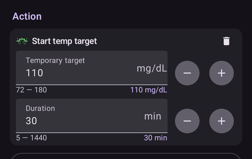
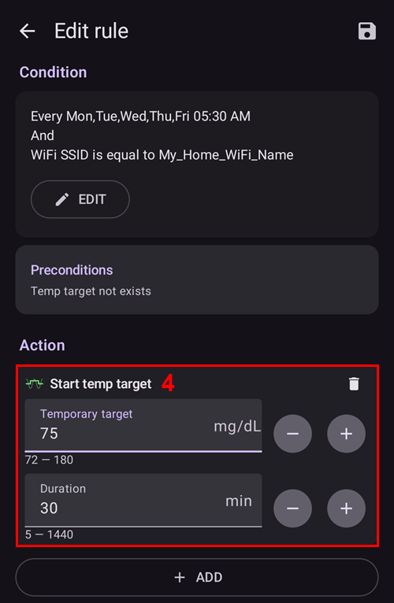
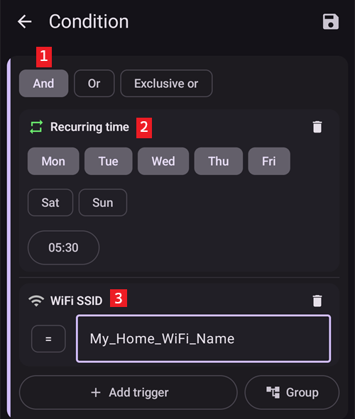

# Автоматизація

```{contents} In this page
:backlinks: entry
:depth: 2
```

## Що таке автоматизація?

«**Автоматизація**» - це функція, яка може автоматично виконувати завдання в AAPS.

Автоматизація виконує певні дії на основі однієї або кількох умов чи тригерів. Тригерами можуть бути нерегулярні події, наприклад низький або високий рівень глюкози крові (ГК) або певна кількість від'ємного активного інсуліну (IOB). Автоматизація може також обробляти повторювані події, наприклад їжу або тренування в певний час доби, або спрацьовувати, коли користувач перебуває на певній відстані від GPS-розташування чи в зоні мережі Wi-Fi з певним SSID. Автоматизація може робити резервні копії налаштувань AAPS за розкладом або під час кожної заміни Pod.

Правила автоматизації створюються і змінюються на екрані **Автоматизація** (**Керувати → Автоматизація**). Кожне правило має дві властивості:

- Одна або кілька умов або «тригерів», які запускають дію.

    Наприклад, певний розклад часу, подія або значення параметра в AAPS

- Одна або кілька дій, які потрібно виконати.

    Such as an alarm or setting a profile percentage or exporting the AAPS settings on Pod change.


Варіантів автоматизації дуже багато, і користувачам варто вивчити їх у застосунку AAPS, у розділі «Автоматизація». Приклади автоматизації від інших користувачів можна також знайти в групах користувачів AAPS у [**Facebook**](https://www.facebook.com/groups/AndroidAPSUsers) та [**Discord**](https://discord.gg/4fQUWHZ4Mw).

## Чим може допомогти автоматизація

1. **Автоматизація повторюваних завдань:** Запрограмовані дії виконуються автоматично, без участі користувача.

1. **Менше втоми від рішень:** Головна користь **автоматизації** в тому, що користувачу не потрібно вручну втручатися в роботу **AAPS**. За даними [дослідження](https://www.ncbi.nlm.nih.gov/pmc/articles/PMC6286423/#ref4), люди з діабетом 1 типу щодня мають приймати в середньому 180 додаткових рішень. **Автоматизація** може зменшити розумове навантаження, і користувач матиме більше сил для інших сторін життя.

1. **Можливо, кращий контроль глікемії:** наприклад, **автоматизація** допомагає завжди встановлювати **тимчасові цілі**, коли вони потрібні, навіть у дуже зайняті дні або коли ви щось забуваєте. Наприклад, якщо в дитини з діабетом у школі заняття спортом у вівторок о 10:00 і в четвер о 14:00, і за 30 хвилин до заняття потрібна висока тимчасова ціль («ТЦ»), то **тимчасову ціль** можна вмикати за допомогою **автоматизації**.

1. **AAPS можна дуже гнучко налаштувати**, щоб він був більш або менш агресивним у певних ситуаціях, як хоче користувач. Наприклад, тимчасово зменшити % **профілю** на заданий час, якщо посеред ночі з'являється від'ємний **IOB**. Це ознака того, що поточний **профіль** може бути занадто сильним.

Приклад нижче показує, як **автоматизація** може прибрати зайві кроки.

Користувач займається спортом щоранку о 6:00: він має не забути вручну встановити в AAPS «Тимчасову ціль - Активність» о 5:00, перед тренуванням.


Користувач налаштував **автоматизацію**, яка о 5:00 запускає «Тимчасову ціль - Активність», щоб його **ГК** та **IOB** були оптимальними для тренування о 6:00:


## Що важливо врахувати перед початком роботи з автоматизацією

1. Перш ніж налаштовувати деякі правила автоматизації, ви повинні мати достатньо добрий контроль **ГК** з **AAPS**. Автоматизацію не слід використовувати для компенсації неоптимальних налаштувань базалу, **ISF** або **CR** (докладніше нижче). Не налаштовуйте автоматичне **перемикання профілю** для компенсації підйомів **ГК** через, _наприклад_, їжу. З ними краще впоратися іншими способами (SMB тощо).

1. Як і будь-яка техніка, **CGM**, **помпи** і телефони можуть працювати несправно: технічні проблеми або помилки сенсора можуть порушити дії **автоматизації**, і може знадобитися ручне втручання.

1. **Потреби в автоматизації, найімовірніше, змінюватимуться разом зі зміною розпорядку дня**. Коли змінюються періоди роботи / навчання / відпустки, поставте собі нагадування в календарі, щоб перевірити, які правила **автоматизації** зараз активні (їх легко вмикати та вимикати). Наприклад, якщо ви їдете у відпустку і вам більше не потрібна автоматизація для шкільного спорту чи щоденних тренувань, або потрібно змінити час.

1. Правила **автоматизації** можуть конфліктувати між собою. Добре уважно перевіряти будь-які нові налаштування **автоматизації** в безпечних умовах і розуміти, чому **автоматизація** спрацювала або не спрацювала так, як ви очікували.

1. Якщо ви використовуєте Autosens, намагайтеся використовувати **тимчасові цілі** замість **перемикання профілю**. **Тимчасові цілі** не скидають Autosens до 0. **Перемикання профілю** скидає Autosens.

1. Більшість правил **автоматизації** слід налаштовувати лише на **обмежений час**. Після цього **AAPS** може знову оцінити ситуацію і, якщо потрібно і умова все ще виконується, повторити **автоматизацію**. Наприклад, «запустити тимчасову ціль 7,0 ммоль/л на 30 хв» або «запустити **профіль** 110 % на 10 хв» _та_ «запустити тимчасову ціль 5,0 ммоль/л на 10 хв». Якщо за допомогою **автоматизації** робити постійні зміни (наприклад, сильніший % профілю), є ризик гіпоглікемії.

## Коли можна почати використовувати автоматизацію?

**Автоматизацію** можна почати використовувати в **завданні 10**.

## Де в AAPS знаходиться автоматизація?

Відкрийте **Керувати** на нижній панелі навігації головного екрана і виберіть **Автоматизація**.

## Як налаштувати автоматизацію?

Щоб налаштувати **автоматизацію**, натисніть кнопку **+** на екрані «Автоматизація» і створіть «правило»:


* дайте «правилу» назву (Назва завдання);
* натисніть «**РЕД**» під **Умова**. На екрані **Умова** виберіть, як поєднуються тригери (**Та**, **Або**, **Виключне або**), і натисніть «**Додати тригер**»:


* додайте щонайменше один тригер:


* натисніть «**ДОД**» під **Дія** і виберіть одну дію:


* збережіть правило кнопкою **Зберегти** і переконайтеся, що позначку ліворуч від назви правила «поставлено», щоб увімкнути **автоматизацію**:


Щоб вимкнути правило **автоматизації**, зніміть позначку ліворуч від назви **автоматизації**. Приклад нижче показує **автоматизацію** увімкнену («з позначкою») або вимкнену («без позначки»):


Під час налаштування **автоматизації** її можна спочатку перевірити: увімкніть варіант «сповіщення» в розділі «Дії». Тоді **AAPS** спочатку показує сповіщення замість того, щоб справді автоматично виконувати дію. Коли ви переконаєтеся, що сповіщення з'являється в правильний час / за правильних умов, можна змінити правило **автоматизації** і замінити «Сповіщення» на «Дію».


```{admonition} Important note
:class: note

**Автоматизація** працює навіть тоді, коли петлю вимкнено!
```


## Коли перевіряються правила

**AAPS** перевіряє всі правила **автоматизації** щоразу після обробки нового значення глюкози, тому правила оцінюються з тією ж частотою, що й ваш CGM, також коли екран телефону вимкнено. Правила також перевіряються, коли телефон починає заряджатися, коли змінюється мережа або розташування і коли підключається пристрій Bluetooth. Одночасно виконується лише одна перевірка, тому правило, дії якого тривають довше (наприклад, команда помпі), не може виконатися двічі.

## Обмеження безпеки

Для **автоматизації** встановлено обмеження безпеки:

* **Тимчасова ціль**, яку встановлює **автоматизація**, має бути від 72 до 180 мг/дл (або від 4 до 10 ммоль/л).
* **Відсоток профілю** має бути від 50 % до 130 %.
* There is a 5 minute time limit between executions of **Automation** (and first execution).

## Правильне використання від'ємних значень

```{admonition} Warning
:class: warning

Будьте обережні, коли вибираєте від'ємне значення в **автоматизації**
```

Будьте обережні, коли вибираєте «від'ємне значення» в «Умові», наприклад «менше ніж», в **автоматизації**. Наприклад:


**Приклад 1:** Якщо створити умову **«менше ніж»** «-0,1 ммоль/л» (або «-2 мг/дл»), то вона:

Запускає **автоматизацію** для будь-якого числа, яке **строго менше** ніж -0,1 (-2). Це числа -0,2, -0,3, -0,4 (-4, -6, -8) і так далі. Пам'ятайте, що саме число -0,1 (-2) **не входить** у цю умову. (Умова «дорівнює або менше ніж -0,1 ммоль/л (-2 мг/дл)» _включала б_ -0,1 ммоль/л або -2 мг/дл).

**Приклад 2:** Якщо створити умову «більше ніж» -0,1 ммоль/л (-2 мг/дл), то вона:

Запускає **автоматизацію** для будь-якого числа, яке **більше ніж** -0,1 ммоль/л (-2 мг/дл). Це числа 0, 0,2, 0,4 ммоль/л (0, 4, 8 мг/дл) і будь-яке інше додатне число.

Обираючи ці умови та значення, важливо уважно продумати, що саме має робити ваша **автоматизація**.

(automations-automation-triggers)=
## Тригери автоматизації


Прокрутіть вниз, щоб побачити решту списку:


Користувач може вибрати різні «тригери». Тригери - це умови, які мають виконуватися, щоб автоматизація спрацювала. Цей список неповний:

**Тригер:** поєднання умов

**Варіанти:**

Кілька умов можна поєднати за допомогою
* «Та»
* «Або»
* «Виключне або» (це означає, що дія (дії) відбудеться, якщо виконується одна - і лише одна - з умов)

**Тригер:** час або повторюваний час

**Варіанти:**

* час = одноразова подія в певний час
* повторюваний час = те, що відбувається регулярно (наприклад, раз на тиждень, кожного робочого дня тощо)

**Тригер:** розташування

**Варіанти:**

* у [Налаштування > Автоматизація](#preferences-maintenance-settings) користувач може вибрати потрібну службу розташування.

**Тригер:** служба розташування

**Варіанти:**

* Використовувати пасивне розташування: **AAPS** отримує розташування лише тоді, коли його запитують інші застосунки.
* Використовувати мережеве розташування: розташування вашої мережі Wi-Fi.
* Використовувати GPS-розташування (Увага! Це може дуже швидко розряджати батарею!)

**Тригери**: дані помпи та сенсора

* Тригер «Вік канюлі»: доступний для всіх помп
* Тригер «Вік інсуліну»: доступний для помп, які це підтримують
* Тригер «Вік батареї помпи»: доступний для помп, які це підтримують
* Тригер «Вік сенсора»: доступний завжди
* Тригер «Активація Pod»: доступний для патч-помп

Зверніть увагу: для всіх тригерів віку порівняння «дорівнює» навряд чи спрацює, тому в такому разі для створення діапазону потрібні два тригери

* Тригер «Рівень резервуара»: доступний для всіх помп. Порівняння "NOT\_AVAILABLE" для цього тригера не працює, бо в **AAPS** це значення завжди заповнене
* Тригер «Рівень батареї помпи»: доступний для помп, які це підтримують. Порівняння "NOT\_AVAILABLE" для цього тригера не працює, бо в **AAPS** це значення завжди заповнене

(automations-automation-action)=
## Дія


Прокрутіть вниз, щоб побачити решту списку:


**Дії:** запустити **тимчасову ціль**

**Варіанти:**

* **ГК** має бути від 72 мг/дл до 180 мг/дл (від 4 ммоль/л до 10 ммоль/л)
* **ТЦ** працює, лише якщо немає попередньої тимчасової цілі — **AAPS** автоматично додає до правила рядок «**Передумови: Тимчасова ціль відсутня**»

**Дії:** скасувати **тимчасову ціль**

**Варіанти:**

немає

**Дії:** **Відсоток профілю**

**Варіанти:**

* **Профіль** має бути від 50 % до 130 %
* працює, лише якщо попередній відсоток 100 %

**Actions:** **Change smoothing** (in the **Loop & insulin** group)

**Варіанти:**

* select the [smoothing method](../CompatibleCgms/SmoothingBloodGlucoseData.md) to switch to. The list is the same as under **Configuration** > **Smoothing**, and the action does exactly what a change there does: the new method is saved, synced to paired clients, and the BG data is smoothed again right away.
* виконується, лише якщо цей метод згладжування ще не активний — **AAPS** автоматично додає до правила рядок «**Передумови: Згладжування … не активне**». Якщо вибране згладжування вже активне, правило мовчки пропускається.
* Example: a new sensor is often noisy during its first day. Two rules with the **Sensor age** trigger give stronger filtering while the sensor settles, and lag-free smoothing after that:
  * **Sensor age** less than 24 h: **Change smoothing** to **Unscented Kalman Filter**
  * **Sensor age** more than 24 h: **Change smoothing** to **Average smoothing**

**Дії:** **Примітка** (у групі **Сповіщення** у списку)

**Варіанти:**

* виберіть подію для запису: **Примітка**, **Тренування**, **Питання**, **Оголошення** або **Заміна канюлі**, і, за бажанням, примітку. Назва дії змінюється на вибрану подію.
* **Тривалість**: використовується для **Примітка**, **Тренування** і **Заміна канюлі**. **Питання** та **Оголошення** не мають тривалості: натомість вони записують вашу поточну ГК.
* **Заміна канюлі** скидає вік канюлі, так само як ручний запис заміни канюлі. Приклад: деякі помпи (наприклад, Combo) самі записують заміну резервуара, але не заміну канюлі. Якщо ви завжди міняєте їх разом, правило з **Вік інсуліну** менше 1 години та **Вік канюлі** більше 24 годин може записати заміну канюлі за вас.

 

**Actions:** **Send SMS to all numbers** (in the **Alerts** group)

**Варіанти:**

* введіть текст повідомлення. Воно надсилається на всі номери телефонів, дозволені в налаштуваннях [SMS Комунікатор](../RemoteFeatures/SMSCommands.md). Плагін SMS Комунікатор має бути ввімкнений.

**Дії:** **Змінити профіль на** (у групі **Профіль**)

**Варіанти:**

* виберіть **профіль**, який потрібно активувати. Він активується на 100 %, без зсуву часу. Якщо цей профіль уже активний, дія нічого не робить.

**Дії:** **Увімкнути/вимкнути SMB** (у групі **Петля та інсулін**)

**Варіанти:**

* виберіть **Увімк.** або **Вимк.** Це змінює налаштування **Увімкнути SMB** в OpenAPS SMB точно так само, як якщо б ви змінили його в **Налаштуваннях**, і зміна діє, доки ви або інше правило не змінить її назад.

**Actions:** **Run Autotune** (in the **Loop & insulin** group)

**Варіанти:**

* виберіть профіль для налаштування і кількість днів: див. [Запуск Autotune за правилом автоматизації](#autotune-run-autotune-with-an-automation-rule).

**Дії:** **Зупинити обробку** (у групі **Петля та інсулін**)

**Варіанти:**

* немає. While the conditions of a rule with this action are true, **AAPS** does not check the rules below it in the list. As soon as its conditions are false again, the rules below are checked as usual. Додайте її до правила, яке має мати перевагу над правилами нижче (див. [порядок правил автоматизації](#Automations-the-order-of-the-automations-in-the-list-matters)).

**Дії:** **Запустити сцену**, **Увімкнути сцену**, **Вимкнути сцену** (у групі **Сцени**)

**Варіанти:**

* виберіть [сцену](Scenes.md), яку потрібно запустити, увімкнути або вимкнути.

Після додавання «Дії» потрібно змінити значення за замовчуванням на потрібне число: натисніть на значення і змініть його.



(Automations-the-order-of-the-automations-in-the-list-matters)=
## Порядок правил **автоматизації** у списку має значення
 **AAPS** виконує створені правила в порядку пріоритету, починаючи згори списку **автоматизації**. For example, if the ‘Low’ **Automation** is the most important **Automation**, above all other rules, then this **Automation** should appear at the top of the user’s **Automation** list as demonstrated below:


Щоб змінити пріоритет правил **автоматизації**, натисніть і утримуйте ручку **=** праворуч від правила. Reorder the **Automations** by moving the rules up or down.


## Як видалити правила автоматизації

Щоб видалити правило **автоматизації**, натисніть на значок кошика.


## Приклади автоматизації

Нижче наведено приклади **автоматизації**. Further discussion on **Automations** and how users have individualised their **Automation** can be found in Facebook discussions groups or on Discord. Не повторюйте наведені нижче приклади, якщо добре не розумієте, як працюватиме **автоматизація**.

(automations-low-glucose-temp-target)=
### Тимчасова ціль при низькій глюкозі

Ця **автоматизація** автоматично запускає **тимчасову ціль**, коли **ГК** падає нижче певного порогу — тут, коли глюкоза менше 70 мг/дл, запускається ціль 110 мг/дл на 30 хвилин:


### Тимчасова ціль на обід (з «Розташуванням»)


Цю **автоматизацію** створено для користувача, який обідає на роботі приблизно в той самий час кожного робочого дня. Вона спрацьовує лише тоді, коли користувач перебуває в заданому «розташуванні».  Отже, якщо одного дня користувач не на роботі, ця **автоматизація** не спрацює.

Ця **автоматизація** о 13:00 встановлює низьку **тимчасову ціль** (Очікуваний прийом їжі), щоб довести ГК до 90 мг/дл (або 5 ммоль/л) перед обідом.

«Тригер» розташування має назву, позицію (натисніть **Вибрати на карті** або використайте поточне розташування) і радіус у метрах. Він спрацьовує, коли ви всередині (або поза) зоною:


Через поєднання «Та» **автоматизація** спрацьовує лише у «вибраний час» і лише тоді, коли користувач перебуває у вибраному розташуванні.

**Автоматизація** не спрацює в цьому місці в інший час, а також у цей час поза радіусом 50 метрів навколо вибраної позиції.

### Автоматизація за розташуванням Wi-Fi SSID

Wi-Fi SSID - добрий спосіб запускати **автоматизацію**, коли ви в зоні певної мережі Wi-Fi (порівняно з GPS): він досить точний, менше розряджає батарею і працює в закритих приміщеннях, де GPS та інші служби розташування можуть бути недоступні.

Here is another example of setting up a **Temp Target** for work days only before breakfast (1).


The **Automation** will trigger at 05:30am only on Monday-Friday (2)  
and while being connected to a home Wi-Fi network (3).


Потім вона встановить **тимчасову ціль** 75 мг/дл на 30 хвилин (4). Одна з переваг використання розташування в тому, що правило не спрацює, якщо користувач, наприклад, поїхав у відпустку.


Прокрутіть униз, щоб побачити дію: **тимчасова ціль** 75 мг/дл на 30 хвилин (4).



Ось знімок екрана з тригерами **автоматизації**:

1) Під головним «ТА» (щоб правило спрацювало, мають виконуватися обидві умови) 1) Повторюваний час = Пн,Вт,Ср,Чт,Пт о 5:30  
1) Wi-Fi SSID = My_Home_WiFi_Name



(automating-preference-settings-export)=

## Автоматизація експорту налаштувань

### Фоновий експорт: за розкладом (щодня)

Знімки екрана з тригерами автоматизації:

1) Умова: Повторюваний час = Пн,Вт,Ср,Чт,Пт о 8:00 1) Дія: Експорт налаштувань (у полі «Текст у терапії» введіть «Щодня»)


Примітка: виконання експорту записується в Careportal

### Фоновий експорт: активація Pod (лише для патч-помп)

Знімки екрана з тригерами автоматизації:

1) Умова: Активація Pod 1) Дія: Експорт налаштувань (у полі «Текст у терапії» введіть «Активація Pod: експорт налаштувань»)


Примітка: виконання експорту записується в Careportal. Примітка: автоматизація **взагалі** не спрацює, якщо ви раніше жодного разу не робили експорт налаштувань вручну. Див. [Налаштування → Обслуговування](#preferences-maintenance-settings), щоб правильно ввімкнути фоновий експорт налаштувань.


## Журнал автоматизації

**AAPS** показує журнал останніх подій **автоматизації** внизу екрана **Автоматизація**, під правилами. За ним можна перевірити, чи спрацювали ваші правила тоді, коли ви очікували.

У прикладі нижче правило **Low glucose temp target** (1) (див. [Тимчасова ціль при низькій глюкозі](#automations-low-glucose-temp-target) вище) увімкнено. Журнал (2) показує, що о 03:09 PM глюкоза впала нижче 70 мг/дл і правило спрацювало:
* дія була "Start temp target: 110mg/dL@30 min": **тимчасова ціль** 110 мг/дл на 30 хвилин;
* **OK** у кінці означає, що дію успішно виконано.


(automations-troubleshooting)=

## Усунення несправностей

* Проблема: __AAPS не запускає мої правила автоматизації?__

Перевірте, що позначку ліворуч від назви **автоматизації** «поставлено», тобто правило ввімкнене:


* Проблема: __Мої правила автоматизації спрацьовують у неправильному порядку.__

Перевірте порядок пріоритету ваших правил, як описано вище.

* Проблема: __Умова показує «Невідомий тригер … – ніколи не спрацьовує».__

Правило містить тригер, який ця версія **AAPS** не може прочитати, наприклад, після повернення до старішої версії або після імпорту налаштувань з новішої. Такий тригер ніколи не спрацьовує, тому правило не виконується. Його зберігають без змін, щоб новіша версія могла його використати. Змініть правило і замініть тригер, або оновіть **AAPS**.

## Альтернативи автоматизації

Досвідчені користувачі можуть автоматизувати завдання й іншими способами: за допомогою IFTTT або стороннього Android-застосунку Automate. 
