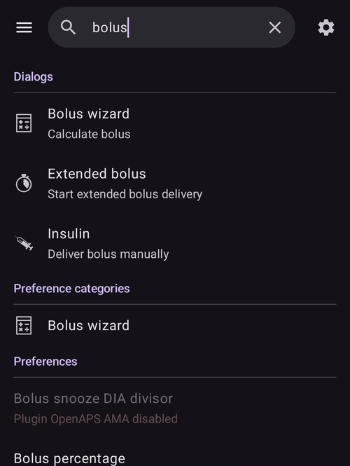

(global-search)=
# Глобальний пошук

**AAPS** v4 має поле **глобального пошуку** вгорі головного екрана. Введіть слово, і пошук одразу перегляне весь застосунок — плагіни, діалоги, екрани налаштувань, окремі налаштування — а якщо ви онлайн, то й **документацію AndroidAPS**. Це найшвидший спосіб перейти до налаштування чи екрана, не пам'ятаючи, де воно розташоване.

```{contents} Table of contents
:depth: 2
:local: true
```

---

## Як відкрити пошук

Натисніть поле **🔍 Пошук** вгорі екрана **Огляд** (поруч із меню ☰). Почніть вводити текст — результати з'являються під час введення (після короткої паузи), згруповані за категоріями:



Очистіть поле кнопкою **✕** або закрийте пошук кнопкою **Назад** пристрою.

---

## Пошук англійською *або* вашою мовою

Це варто знати: пошук порівнює запит **і** з текстом **вибраною мовою**, **і** з оригінальним текстом **англійською**.

- Якщо ваш застосунок, наприклад, німецькою чи чеською, ви можете ввести **перекладене** слово **або** **англійське** слово — обидва знайдуть налаштування.
- Найвище стоїть збіг у **перекладеній** назві, далі в **англійській** назві, потім у перекладених та англійських **описах**.
- Пошук ігнорує **наголоси/діакритичні знаки** (тож *ů* збігається з *u*, *é* — з *e*) і **не враховує регістр**.

Тому посібник чи допис на форумі англійською все одно приведе вас до потрібного налаштування, навіть якщо на телефоні все перекладено.

---

## Що охоплює пошук

Результати згруповано в такі категорії:

- **Плагіни** — усі плагіни, видимі у вашій збірці (ті самі, що перелічені в розділі [Конфігурація](../SettingUpAaps/ConfigBuilder.md)). Кожен рядок плагіна має свій **перемикач увімкнення**, тож ви можете вмикати або вимикати плагін прямо з результатів — натискання рядка вимкненого плагіна (який можна перемикати) вмикає його.
- **Діалоги** — екрани терапії/дій і керування (Калькулятор болюса, Інсулін, Подовжений болюс, Калібрування, Тимчасова ціль, Профіль, …). Екрани, які не стосуються вашої збірки, не показуються (наприклад, *Спарувати з основним пристроєм* на основному телефоні, *Авторизовані клієнти* на клієнті).
- **Категорії налаштувань** — **екрани** налаштувань і підекрани, як вбудовані (Загальне, Вигляд, Захист, Сповіщення, Обслуговування, …), так і від плагінів, а також невеликі групи налаштувань, що відкриваються з діалогів (кнопки заповнення, кроки кнопок інсуліну/вуглеводів, пороги покажчиків статусу, налаштування калькулятора, …).
- **Налаштування** — кожне **окреме налаштування**, яке має назву. Вони відфільтровані за вашою збіркою/режимом, тож ви бачите лише ті налаштування, які справді діють (APS / NSClient / керування помпою).
- **Документація** — сторінки з онлайн-**документації AndroidAPS** (див. нижче).

```{admonition} Settings that belong to a disabled plugin
:class: note
Налаштування, плагін якого зараз **вимкнено**, все одно показується — **сірим** і без можливості натиснути — з приміткою *«Плагін … вимкнено»*, тож ви бачите, що налаштування існує і який плагін треба увімкнути, щоб до нього дістатися.


```

---

## Результати з документації (онлайн)

Поки працює локальний пошук, **AAPS** паралельно надсилає запит до офіційної **документації AndroidAPS** (розміщеної на ReadTheDocs). Знайдені сторінки з'являються в групі **Документація** внизу, кожна зі значком 📖, назвою розділу і коротким уривком:


- Якщо документацію перекладено мовою вашого застосунку, **AAPS** шукає одночасно в перекладених і в англійських сторінках. Спочатку йдуть сторінки вашою мовою, потім англійські сторінки, яких ще не було знайдено.
- Натискання результату з документації відкриває цю сторінку у вашому **браузері**.
- Пошук у документації потребує **інтернету** — коли ви офлайн, замість результатів ви бачите примітку *«Для пошуку в документації потрібне підключення до інтернету»*, а локальні результати (у застосунку) і далі працюють як звичайно.

---

## Як відкрити результат

Натисніть результат, щоб одразу перейти до нього:

- **Плагін** → відкриває цей плагін.
- **Діалог** → відкриває цей екран або діалог.
- **Категорія налаштувань** → відкриває цей екран налаштувань.
- **Налаштування** → відкриває налаштування **на його місці** (переходить до нього на його екрані).
- **Документація** → відкриває сторінку у вашому браузері.

Відкриття налаштувань і захищених дій і далі враховує ваш **[захист](../SettingUpAaps/ConfigBuilder.md)** (PIN/пароль) — так само, як якби ви перейшли туди вручну. Після дії з результатом ви можете натиснути **Назад**, щоб повернутися до результатів пошуку.

---

## Швидкі команди для досвідчених

Два спеціальні запити показують цілу категорію одразу:

- `%PLUGINS%` — показати **усі** плагіни.
- `%DIALOGS%` — показати **усі** діалоги/екрани дій.

---

```{admonition} The index stays current
:class: note
Індекс пошуку створюється під час першого пошуку і потім залишається готовим. Він автоматично створюється заново, коли ви **вмикаєте/вимикаєте плагін** або **змінюєте мову застосунку**, тож результати завжди відповідають вашій поточній конфігурації.
```

---


<!-- =====================================================================
     Screenshots captured from a real master device (query "bolus"):
       - search_results.png        (categorized local results: Dialogs / Preference categories / Preferences)
       - search_disabled_plugin.png (greyed-out preference from a disabled plugin)
       - search_documentation.png   (online ReadTheDocs results with 📖 icon + snippets)
     Maintainers: relocate page + images and fix cross-links as needed.
     ===================================================================== -->
