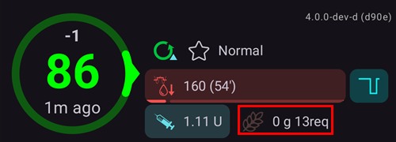

# Основні функції AAPS

## Режим петлі

Статус петлі показано на головному екрані одним із значків нижче.

**AAPS** має кілька режимів петлі: закрита петля (1), зупинка базалу при низькому ГК (LGS - 2) і відкрита петля (3).

Як вибрати режим петлі і що означають інші значки на зображенні (4–6), читайте в розділі [Екрани AAPS > Головний екран > Статус петлі](#AapsScreens-loop-status).

(KeyAapsFeatures-OpenLoop)=

### Відкрита петля

**AAPS** постійно оцінює всі доступні дані (IOB, COB, ГК...) і пропонує, як за потреби скоригувати терапію (тимчасові базали).

Пропозиції не виконуються автоматично (як у закритій петлі). Користувач має сам виконати пропозиції: вручну на помпі (якщо використовується віртуальна помпа) або кнопкою, якщо **AAPS** під’єднано до справжньої помпи.

Коли **AAPS** має пропозицію, у нижній навігації головного екрана з’являється пункт **Петля** зі значком-лічильником. Натисніть його, щоб прочитати пропозицію («Прийняти новий тимчасовий базал») зі швидкістю, тривалістю і причиною, а потім натисніть **Виконати**, щоб її виконати:

Пропозиція дійсна лише кілька хвилин. Якщо їй більше приблизно 9 хвилин, або якщо тим часом петлю було призупинено чи помпу від’єднано, **AAPS** відхиляє її і нічого не надсилає на помпу (*«Ця пропозиція застаріла. На помпу нічого не надіслано. Дочекайтеся наступної.»*). Дочекайтеся наступної пропозиції.

Цей режим потрібен, щоб познайомитися з роботою **AAPS**, або якщо ви використовуєте непідтримувану помпу. Ви будете у відкритій петлі до кінця **[Завдання 5](#objectives-objective5)**, незалежно від того, що виберете тут.

(KeyAapsFeatures-LGS)=

### Зупинка базалу при низькому ГК (LGS)

У цьому режимі [maxIOB](#Open-APS-features-maximum-total-iob-openaps-cant-go-over) встановлено на нуль.

Це означає, що коли глюкоза крові падає, **AAPS** може зменшити для вас базал. Але коли глюкоза крові росте, автоматичної корекції не буде. Ваші базальні швидкості залишаються такими, як задано в поточному **Профілі**. Лише якщо IOB від’ємний (після попередньої зупинки базалу при низькому ГК), буде подано додатковий інсулін, щоб знизити **ГК**.

Цей режим доступний починаючи із **[Завдання 6](#objectives-objective6)**.

Крім вашого власного вибору, **AAPS** може перейти в цей режим і сам: поки ви виконуєте **[Завдання 6](#objectives-objective6)**, і щоразу, коли виявляє дубльовані значення ГК (дивіться [знак попередження ГК](#aaps-screens-bg-warning-sign)).

(KeyAapsFeatures-ClosedLoop)=

### Закрита петля

**AAPS** постійно оцінює всі доступні дані (IOB, COB, ГК...) і за потреби автоматично коригує терапію (*тобто* без вашого подальшого втручання), щоб досягти заданого [цільового діапазону або значення](#profile-glucose-targets) (подання болюсу, тимчасовий базал, зупинка інсуліну, щоб уникнути гіпо, тощо).

Закрита петля працює в межах численних лімітів безпеки, які можна налаштувати індивідуально.

Закрита петля можлива, лише якщо ви на **[Завданні 7](#objectives-objective7)** або вище і використовуєте підтримувану помпу.

(autosens)= (Open-APS-features-autosens)=

## Autosens

- Autosens — це алгоритм, який аналізує відхилення глюкози крові (позитивні/негативні/нейтральні).
- Він намагається визначити, наскільки ви чутливі або резистентні, на основі цих відхилень.
- Реалізація oref в **OpenAPS** працює з поєднанням даних за 24 і 8 годин. Вона використовує той із них, який показує більшу чутливість.
- Користувачі, які раніше працювали з oref1, можуть помітити, що система менш динамічно реагує на зміни, бо чутливість береться або за 24, або за 8 годин.
- Заміна канюлі або зміна профілю повертає коефіцієнт Autosens до 100 % (перемикання профілю з відсотком і тривалістю не скидає autosens).
- Autosens коригує ваш базал і ISF (тобто робить те саме, що й зсув профілю).
- Якщо ви довго і безперервно їсте вуглеводи, Autosens у цей час працює менш ефективно, бо вуглеводи виключаються з розрахунку дельти **ГК**.
- Відхилення перетворюються на **коефіцієнт чутливості** (у відсотках): коефіцієнт нижче 100 % означає, що AAPS вважає вас чутливішими до інсуліну, ніж передбачає ваш **Профіль** (тому він знижує фактичний базал і підвищує значення ISF), а коефіцієнт вище 100 % означає, що ви резистентніші (тому він підвищує базал і знижує значення ISF).
- За замовчуванням цей коефіцієнт тримається між 0,7 (70 %, більша чутливість) і 1,2 (120 %, більша резистентність), щоб серія незвичайних даних не відвела ваше дозування надто далеко від вашого **Профілю**. Ці межі можна змінити в додаткових налаштуваннях визначення чутливості.
- Autosens і [Autotune](../AdvancedOptions/Autotune.md) вирішують ту саму проблему в різних часових масштабах: Autosens щохвилини трохи коригує ваше *поточне* дозування на основі останніх 8–24 год, а Autotune повільно змінює сам ваш *Профіль* на основі історії за тижні. Використовувати обидва — це нормально й очікувано: вони доповнюють, а не дублюють одне одного.

*Повний технічний опис алгоритму autosens дивіться в [документації OpenAPS про Autosens](https://openaps.readthedocs.io/en/latest/docs/Customize-Iterate/autosens.html).*

(Open-APS-features-super-micro-bolus-smb)=

## Супермікроболюс (SMB)

**SMB**, скорочення від **Super micro bolus** (супермікроболюс), — це функція OpenAPS, яка з’явилася у 2018 році в алгоритмі Oref1. На відміну від **AMA**, **SMB** керує рівнем глюкози не тимчасовими базалами, а переважно **малими супермікроболюсами**. У ситуації, коли **AMA** додав би 1,0 Од інсуліну через тимчасовий базал, **SMB** подає кілька супермікроболюсів малими кроками з **інтервалом 5 хвилин**, наприклад 0,4 Од, 0,3 Од, 0,2 Од і 0,1 Од. Водночас (з міркувань безпеки) фактичну швидкість базалу на певний час встановлюють на 0 Од/год, щоб запобігти передозуванню (**«нульовий тимчасовий базал», zero-temping**). Так система може коригувати глюкозу крові швидше, ніж за допомогою підвищеного тимчасового базалу в **AMA**.

Завдяки SMB для їжі лише з «повільними» вуглеводами може бути достатньо повідомити системі заплановану кількість вуглеводів, а решту залишити **AAPS**. Однак це може призвести до вищих пікових значень після їжі, бо болюс перед їжею неможливий. Або ви можете ввести (за потреби заздалегідь) **стартовий болюс**, який покриває вуглеводи **лише частково** (наприклад, 2/3 оціненої кількості), а решту інсуліну залишити для **SMB**.

SMB показано на [графіку IOB](#aaps-screens-iob) синіми трикутниками. [Натисніть і утримуйте](#aaps-screens-graph-press-and-hold) графік на трикутнику, щоб побачити, скільки інсуліну було подано, або скористайтеся [історією терапії](#aaps-screens-treatments).

Функції **SMB** містять кілька механізмів безпеки:

1. **Найбільша окрема доза SMB**  
  Найбільша окрема доза SMB може бути лише найменшим із таких значень:
  
        * значення, що відповідає поточній базальній швидкості (з урахуванням autosens) за час, заданий у «Макс. хвилин базалу для обмеження SMB», наприклад кількість базалу на наступні 30 хвилин, або
        * половина кількості інсуліну, яка зараз потрібна, або
        * залишок вашого значення maxIOB у налаштуваннях.
      

2. **Низькі тимчасові базали**  
  Низькі тимчасові базали («low temps») або тимчасові базали 0 Од/год («zero-temps») у **SMB** вмикаються частіше. Так задумано з міркувань безпеки, і це не має негативних наслідків, якщо **Профіль** налаштовано правильно. На головному графіку крива IOB (тонка жовта лінія) інформативніша, ніж хід тимчасових базалів.

3. **Неоголошені прийоми їжі**  
  Додаткові розрахунки для прогнозу глюкози, наприклад за допомогою **UAM** (un-announced meals, неоголошені прийоми їжі). Навіть без ручного введення вуглеводів **UAM** може сам виявити значне зростання глюкози через їжу, адреналін або інші впливи і спробувати скоригувати його за допомогою **SMB**. Для безпеки це працює і навпаки: SMB може зупинитися раніше, якщо глюкоза несподівано швидко падає. Тому UAM завжди має бути увімкнено разом із SMB.

SMB не вирішує сам, що потрібен інсулін: він спирається на ті самі поєднані прогнози ГК (кінцева ГК, zero-temp, COB, UAM), описані в розділі [Як AAPS перетворює прогнози на рішення про дозування](#aaps-screens-how-predictions-become-a-dosing-decision). SMB і нульовий тимчасовий базал — це просто два інструменти, якими AAPS виконує це рішення.

**Щоб використовувати SMB, ви повинні розпочати [завдання 9](#objectives-objective9).**

Дивіться також [документацію OpenAPS про oref1/SMB](https://openaps.readthedocs.io/en/latest/docs/Customize-Iterate/oref1.html#understanding-super-micro-bolus-smb) для повного технічного опису або [інформацію Тіма про SMB](https://www.diabettech.com/artificial-pancreas/understanding-smb-and-oref1/) — огляд від спільноти.

Налаштування OpenAPS SMB описано нижче.

(Open-APS-features-max-u-h-a-temp-basal-can-be-set-to)=

### Максимальна швидкість базалу

Цей параметр безпеки визначає максимальну швидкість тимчасового базалу, яку може подавати інсулінова помпа. Його також називають **max-basal**.

Значення вимірюється в одиницях на годину (Од/год). Радимо встановити тут розумне значення. Добра рекомендація для цього параметра:

**MAX-BASAL = НАЙВИЩА БАЗАЛЬНА ШВИДКІСТЬ x 4**

Наприклад, якщо найвища базальна швидкість у вашому профілі 0,5 Од/год, ви можете помножити її на 4 і отримати значення 2 Од/год.

**AAPS** обмежує це значення «жорстким лімітом» відповідно до [Налаштування > Безпека > Вік пацієнта](#preferences-patient-type). Жорсткі ліміти такі:

- Дитина: 2
- Підліток: 5
- Дорослий: 10
- Дорослий з резистентністю до інсуліну: 12
- Вагітність: 25

*Дивіться також [огляд жорстко заданих лімітів](#Open-APS-features-overview-of-hard-coded-limits).*

(Open-APS-features-maximum-total-iob-openaps-cant-go-over)=

### Max IOB for SMB

Це значення визначає максимальний **активний інсулін (IOB)** (базальний і болюсний IOB), нижче якого **AAPS** залишається в режимі закритої петлі. Його також називають **maxIOB**.

Якщо поточний IOB (наприклад, після болюсу на їжу) вищий за задане значення, петля не вводить інсулін, доки IOB не опуститься нижче цього ліміту.

Добрий початок для цього параметра:

      maxIOB = середній болюс на їжу + 3x максимальний добовий базал
    

Будьте обережні й терплячі, коли змінюєте **max-IOB**. Він різний для кожного і також може залежати від середньої загальної добової дози (TDD).

**AAPS** обмежує це значення «жорстким лімітом» відповідно до [Налаштування > Безпека > Вік пацієнта](#preferences-patient-type). Жорсткі ліміти такі:

- Дитина: 7
- Підліток: 13
- Дорослий: 22
- Дорослий з резистентністю до інсуліну: 30
- Вагітність: 70

*Дивіться також [огляд жорстко заданих лімітів](#Open-APS-features-overview-of-hard-coded-limits).*

Примітка: при використанні **SMB** значення **max-IOB** розраховується інакше, ніж в AMA. В **AMA** maxIOB — це параметр безпеки для базального **IOB**, а в режимі SMB він включає також болюсний IOB.

### Використовувати динамічну чутливість

Це функція [DynamicISF](../DailyLifeWithAaps/DynamicISF.md). Коли її увімкнено, з’являються нові налаштування. Налаштування пояснено на сторінці [DynamicISF](#dyn-isf-preferences).

### Використовувати Autosens

Це функція [Autosens](#Open-APS-features-autosens). Якщо ви використовуєте DynamicISF, Autosens використовувати не можна, бо це два різні алгоритми, які змінюють ту саму змінну (чутливість).

Autosens аналізує відхилення глюкози крові (позитивні/негативні/нейтральні). Він намагається визначити, наскільки ви чутливі або резистентні, на основі цих відхилень і коригує базальну швидкість та ISF.

Коли її увімкнено, з’являються нові налаштування.

#### Чутливість підвищує ціль

Якщо цей параметр увімкнено, визначення чутливості (autosens) може підвищити ціль, коли виявлено чутливість (нижче 100 %). У цьому разі ваша ціль підвищується на відсоток виявленої чутливості.

Якщо ціль змінено через визначення чутливості, на головному екрані вона показується на зеленому тлі.

Цей параметр доступний, коли увімкнено «Використовувати динамічну чутливість» або «Використовувати Autosens».

#### Резистентність знижує ціль

Якщо цей параметр увімкнено, визначення чутливості (autosens) може знизити ціль, коли виявлено резистентність (вище 100 %). У цьому разі ваша ціль знижується на відсоток виявленої резистентності.

Цей параметр доступний, коли увімкнено «Використовувати динамічну чутливість» або «Використовувати Autosens».

### Увімкнути SMB

Увімкніть це, щоб використовувати функцію SMB. Якщо вимкнено, **SMB** не подаються.

Коли її увімкнено, з’являються нові налаштування.

(Open-APS-features-enable-smb-with-high-temp-targets)=

#### Увімкнути SMB з високою тимчасовою ціллю

Якщо цей параметр увімкнено, **SMB** подаються навіть тоді, коли користувач вибрав високу **Тимчасову ціль** (тобто 100 мг/дл або 5,6 ммоль/л і вище, незалежно від цілі в **Профілі**). Вмикайте його обережно: **SMB** можуть стати надто агресивними, якщо ваші налаштування погано підібрані або якщо ваш **Профіль** часто змінюється (наприклад, у дітей).

Коли цей параметр вимкнено, висока **Тимчасова ціль** вимикає **SMB**. Наприклад, якщо цей параметр вимкнено, **SMB** можна вимкнути, встановивши **Тимчасову ціль** 100 мг/дл або 5,6 ммоль/л і вище. Цей параметр також вимикає **SMB** незалежно від того, яка інша умова намагається увімкнути SMB, — крім низької **Тимчасової цілі**, наприклад **Очікуваний прийом їжі** (або будь-якої **Тимчасової цілі** 98 мг/дл або 5,4 ммоль/л і нижче), з якою **SMB** ще можуть подаватися, щоб наблизити **ГК** до цілі.

Цей параметр сам по собі не вмикає **SMB**. При високій тимчасовій цілі **SMB** подається, лише якщо це дозволяє також один з інших параметрів нижче (наприклад, **Увімкнути SMB завжди** або **Увімкнути SMB з COB**).

(Open-APS-features-enable-smb-always)=

#### Увімкнути SMB завжди

Якщо цей параметр увімкнено, SMB увімкнено завжди (незалежно від COB, тимчасових цілей або болюсів). Якщо цей параметр увімкнено, інші параметри увімкнення нижче не діють. Однак якщо **Увімкнути SMB з високою тимчасовою ціллю** вимкнено і встановлено високу тимчасову ціль, SMB вимикаються.

Цей параметр доступний лише тоді, коли **AAPS** визначає, що ви використовуєте [надійне джерело ГК](#GettingStarted-TrustedBGSource) з розширеною фільтрацією. FreeStyle Libre 1 не вважається надійним джерелом, бо при збої сенсора він може без кінця повторювати старі дані ГК.

Через зашумлені дані **AAPS** може вважати, що ГК росте дуже швидко, і подавати непотрібні SMB. Більше про шум і згладжування даних читайте [тут](../CompatibleCgms/SmoothingBloodGlucoseData.md).

#### Увімкнути SMB з COB

Якщо цей параметр увімкнено, SMB увімкнено, коли COB більше 0.

Цей параметр не показується, якщо увімкнено «Увімкнути SMB завжди».

#### Увімкнути SMB з низькою тимчасовою ціллю

Якщо цей параметр увімкнено, SMB увімкнено, коли встановлено тимчасову ціль (очікуваний прийом їжі, активність, гіпо, власна). Якщо цей параметр увімкнено, а **Увімкнути SMB з високою тимчасовою ціллю** вимкнено, SMB увімкнено при низькій тимчасовій цілі (98 мг/дл або 5,4 ммоль/л і нижче), але вимкнено при високій тимчасовій цілі.

Цей параметр не показується, якщо увімкнено «Увімкнути SMB завжди».

#### Увімкнути SMB після вуглеводів

Якщо увімкнено, SMB працює 6 год після введення вуглеводів, навіть якщо COB уже дорівнює 0.

З міркувань безпеки цей параметр доступний лише тоді, коли **AAPS** визначає, що ви використовуєте надійне джерело ГК. Він не показується, якщо увімкнено «Увімкнути SMB завжди».

Цей параметр доступний лише тоді, коли **AAPS** визначає, що ви використовуєте [надійне джерело ГК,](#GettingStarted-TrustedBGSource) з розширеною фільтрацією. FreeStyle Libre 1 не вважається надійним джерелом, бо при збої сенсора він може без кінця повторювати старі дані ГК.

Через зашумлені дані **AAPS** може вважати, що ГК росте дуже швидко, і подавати непотрібні SMB. Більше про шум і згладжування даних читайте [тут](../CompatibleCgms/SmoothingBloodGlucoseData.md).  
Цей параметр не показується, якщо увімкнено «Увімкнути SMB завжди».

#### Інтервал SMB

Ця функція обмежує частоту SMB. Це значення визначає мінімальний час між SMB. Зверніть увагу: петля запускається щоразу, коли надходить значення глюкози (зазвичай кожні 5 хвилин). Subtract 2 minutes to give loop additional time to complete. Наприклад, якщо ви хочете, щоб SMB подавався при кожному запуску петлі, встановіть 3 хвилини.

Значення за замовчуванням: 3 хв.

(Open-APS-features-max-minutes-of-basal-to-limit-smb-to)=

#### Макс. хвилин базалу для обмеження SMB

Це важливий параметр безпеки. Це значення визначає, скільки SMB можна подати залежно від кількості базального інсуліну за певний час, коли його покривають COB.

Більше значення робить SMB агресивнішим. Почніть зі значення за замовчуванням 30 хвилин. Набравшись досвіду, збільшуйте значення кроками по 15 хвилин і спостерігайте за результатом протягом кількох прийомів їжі.

Не рекомендуємо встановлювати значення вище 90 хвилин, бо тоді алгоритм може не встигнути впоратися з падінням ГК за допомогою базалу 0 Од/год («zero-temp»). Також налаштуйте сигнали, особливо поки ви ще тестуєте нові налаштування: вони заздалегідь попередять вас про гіпо.

Значення за замовчуванням: 30 хв.

#### UAM: макс. хвилин базалу для обмеження SMB

Цей параметр дозволяє налаштувати силу SMB під час UAM, коли вуглеводів уже немає.

Значення за замовчуванням: таке саме, як **Макс. хвилин базалу для обмеження SMB**.

This setting is only visible if "Enable SMB" and "Enable UAM" are switched on.

(enable-uam)=

### Увімкнути UAM

Коли цей параметр увімкнено, алгоритм SMB може розпізнавати неоголошені прийоми їжі. Це корисно, якщо ви забули повідомити **AAPS** про вуглеводи, неправильно оцінили вуглеводи і введена кількість неправильна, або якщо їжа з великою кількістю жирів і білків діє довше, ніж очікувалося. Без жодного введення вуглеводів UAM може розпізнати швидке зростання глюкози через вуглеводи, адреналін тощо і намагається скоригувати його за допомогою SMB. Це працює і навпаки: якщо глюкоза швидко падає, він може раніше зупинити SMB.

**Тому UAM завжди слід вмикати, якщо ви використовуєте SMB.**

(key-aaps-features-minimal-carbs-required-for-suggestion)=

### Поріг потреби у вуглеводах

Мінімальна кількість грамів вуглеводів, при якій показується пропозиція з’їсти вуглеводи. Додаткові вуглеводи будуть запропоновані, коли алгоритм визначить, що вони потрібні. У цьому разі ви отримаєте сповіщення, яке можна відкласти на 5, 15 або 30 хвилин.

Сповіщення про потрібні вуглеводи за бажанням можна надсилати в Nightscout. Тоді буде показано й розіслано оголошення.

У будь-якому разі потрібні вуглеводи показуються в розділі COB на головному екрані.

### Додаткові налаштування

Повний довідник параметрів (зокрема тих, що тут не описано) дивіться в [документації OpenAPS про налаштування та параметри безпеки](https://openaps.readthedocs.io/en/latest/docs/While%20You%20Wait%20For%20Gear/preferences-and-safety-settings.html).

**Always use short average delta instead of simple delta** If you enable this feature, **AAPS** uses the short average delta/blood glucose from the last 15 minutes, which is usually the average of the last three values. Це допомагає **AAPS** працювати стабільніше із зашумленими джерелами даних, як-от xDrip і Libre.

**Безпечний множник макс. добового базалу** Це важливий ліміт безпеки. Значення за замовчуванням (яке навряд чи доведеться змінювати) — 3. Це означає, що **AAPS** ніколи не зможе встановити тимчасовий базал, більший за 3x найвищої погодинної базальної швидкості, запрограмованої в помпі та/або профілі користувача. Приклад: якщо ваша найвища базальна швидкість 1,0 Од/год, а безпечний множник макс. добового базалу 3, то **AAPS** може встановити тимчасовий базал не більше 3,0 Од/год (= 3 x 1,0 Од/год).

Значення за замовчуванням: 3 (не змінюйте, якщо це справді не потрібно і ви не знаєте, що робите)

**Безпечний множник поточного базалу** Це ще один важливий ліміт безпеки. Значення за замовчуванням (яке теж навряд чи доведеться змінювати) — 4. Це означає, що **AAPS** ніколи не зможе встановити тимчасовий базал, більший за 4x поточної погодинної базальної швидкості, запрограмованої в помпі та/або профілі користувача.

Значення за замовчуванням: 4 (не змінюйте, якщо це справді не потрібно і ви не знаєте, що робите)

* * *

(Open-APS-features-auto-isf)=

## Auto ISF

**Auto ISF** — це **експериментальний** алгоритм для досвідчених користувачів. Він побудований на OpenAPS SMB і додає правила, які роблять фактор чутливості до інсуліну (ISF) сильнішим або слабшим залежно від поведінки вашої глюкози.

Це функція для розробки: її можна увімкнути лише у [збірці розробки (dev)](../AdvancedOptions/DevBranch.md) з увімкненим **Режимом інженера**. У звичайній збірці випуску вона примусово вимкнена, тому її не видно в **Конфігурація → APS**. Виконання [Завдань](../SettingUpAaps/CompletingTheObjectives.md) її не відкриває.

Після її вибору її **Налаштування** містять налаштування OpenAPS SMB і групу **Налаштування AutoISF**:

- **Увімкнути AutoISF**: вмикає коригування ISF. Без цього алгоритм працює як OpenAPS SMB.
- **AutoISF мін.** і **AutoISF макс.**: наскільки слабким і наскільки сильним може стати ISF, так само як ліміти Autosens. Зі значенням за замовчуванням 1,0 цей ефект вимкнено.
- **Ваги**: кожна вага керує одним правилом, а значення за замовчуванням 0,0 вимикає це правило. 
  - коли ріст глюкози **прискорюється**, ISF посилюється (більше інсуліну);
  - коли ріст глюкози **сповільнюється**, ISF послаблюється (менше інсуліну);
  - коли глюкоза **нижче цілі**, ISF послаблюється;
  - коли глюкоза **вище цілі**, ISF посилюється;
  - вага **після їжі** і вага **тривалості** діють після їжі і тоді, коли глюкоза довго залишається високою.
- **Коефіцієнт подачі SMB** (з мінімумом, максимумом і діапазоном ГК): яку частку потрібного інсуліну можна подати як SMB.
- **SMB max range extension**: by what factor the usual SMB size limit ([max minutes of basal](#Open-APS-features-max-minutes-of-basal-to-limit-smb-to), 30 minutes by default) may be exceeded. Значення за замовчуванням 1 нічого не змінює; можна до 5. Збільшуйте це експериментальне значення повільно й обережно.
- **Поріг IOB у відсотках**: відсоток max IOB, вище якого SMB вимикаються.

    {admonition} Лише для досвідчених користувачів
    :class: danger
    Зі значеннями за замовчуванням Auto ISF нічого не змінює. Кожне значення, яке ви підвищуєте, робить **AAPS** агресивнішим. Змінюйте одне значення за раз, малими кроками, і спостерігайте за результатом кілька днів. Будьте вкрай обережні з **AutoISF макс.** вище 2,5.

(Open-APS-features-advanced-meal-assist-ama)=

## Advanced Meal Assist (AMA)

AMA, скорочення від «advanced meal assist» (розширена допомога при їжі), — це функція OpenAPS з 2017 року (oref0). OpenAPS Advanced Meal Assist (AMA) дозволяє системі швидше встановити підвищений тимчасовий базал після болюсу на їжу, якщо ви надійно вводите вуглеводи.

Більше інформації дивіться в [документації OpenAPS](https://newer-docs.readthedocs.io/en/latest/docs/walkthrough/phase-4/advanced-features.html#advanced-meal-assist-or-ama).

### Максимальна швидкість базалу (OpenAPS «max-basal»)

Цей параметр безпеки не дає **AAPS** встановити небезпечно високу базальну швидкість і обмежує тимчасовий базал до x Од/год. Радимо встановити тут розумне значення. Добра рекомендація: візьміть найвищу базальну швидкість у вашому профілі і помножте її на 4, щонайменше на 3. Наприклад, якщо найвища базальна швидкість у вашому профілі 1,0 Од/год, ви можете помножити її на 4, отримати 4 Од/год і встановити 4 як параметр безпеки.

Довільне значення вибрати не можна: з міркувань безпеки існує «жорсткий ліміт», який залежить від віку пацієнта. «Жорсткий ліміт» для maxIOB в AMA нижчий, ніж в SMB. Для дітей це значення найменше, а для дорослих з резистентністю до інсуліну — найбільше.

Жорстко задані параметри в **AAPS**:

- Дитина: 2
- Підліток: 5
- Дорослий: 10
- Дорослий з резистентністю до інсуліну: 12
- Вагітність: 25

*Дивіться також [огляд жорстко заданих лімітів](#Open-APS-features-overview-of-hard-coded-limits).*

### Max IOB for AMA

This parameter limits the maximum of basal IOB where **AAPS** still works. Якщо IOB вищий, AAPS не подає додатковий базальний інсулін, доки базальний IOB не опуститься нижче ліміту.

The default value is 2, but you should raise this parameter slowly to see how much it affects you and which value fits best. It is different for everyone and also depends on the average total daily dose (TDD). For safety reason, there is a limit, which depends on the patient age. «Жорсткий ліміт» для maxIOB в AMA нижчий, ніж в SMB.

- Дитина: 3
- Підліток: 5
- Дорослий: 7
- Дорослий з резистентністю до інсуліну: 12
- Вагітність: 25

*Дивіться також [огляд жорстко заданих лімітів](#Open-APS-features-overview-of-hard-coded-limits).*

### Використовувати Autosens (AMA)

Тут ви можете вибрати, чи хочете використовувати [визначення чутливості](../DailyLifeWithAaps/SensitivityDetectionAndCob.md) autosens.

### Autosens змінює цілі

Якщо цей параметр увімкнено, autosens може коригувати також цілі (крім базалу та ISF). Так **AAPS** працює більш або менш «агресивно». Із цим фактичної цілі можна досягти швидше.

### Додаткові налаштування

- Зазвичай вам не потрібно змінювати налаштування в цьому діалозі!
- Якщо ви все ж хочете їх змінити, переконайтеся, що розумієте, що робите: дивіться повний довідник параметрів у [документації OpenAPS про налаштування та параметри безпеки](https://openaps.readthedocs.io/en/latest/docs/While%20You%20Wait%20For%20Gear/preferences-and-safety-settings.html).

**Always use short average delta instead of simple delta** If you enable this feature, **AAPS** uses the short average delta/blood glucose from the last 15 minutes, which is usually the average of the last three values. Це допомагає **AAPS** працювати стабільніше із зашумленими джерелами даних, як-от xDrip і Libre.

**Безпечний множник макс. добового базалу** Це важливий ліміт безпеки. Значення за замовчуванням (яке навряд чи доведеться змінювати) — 3. Це означає, що **AAPS** ніколи не зможе встановити тимчасовий базал, більший за 3x найвищої погодинної базальної швидкості, запрограмованої в помпі користувача. Приклад: якщо ваша найвища базальна швидкість 1,0 Од/год, а безпечний множник макс. добового базалу 3, то **AAPS** може встановити тимчасовий базал не більше 3,0 Од/год (= 3 x 1,0 Од/год).

Значення за замовчуванням: 3 (не змінюйте, якщо це справді не потрібно і ви не знаєте, що робите)

**Безпечний множник поточного базалу** Це ще один важливий ліміт безпеки. Значення за замовчуванням (яке теж навряд чи доведеться змінювати) — 4. Це означає, що **AAPS** ніколи не зможе встановити тимчасовий базал, більший за 4x поточної погодинної базальної швидкості, запрограмованої в помпі користувача.

Значення за замовчуванням: 4 (не змінюйте, якщо це справді не потрібно і ви не знаєте, що робите)

**Дільник DIA для паузи після болюсу** Функція «пауза після болюсу» діє після болюсу на їжу. **AAPS** не встановлює низькі тимчасові базали після їжі протягом часу, що дорівнює DIA, поділеному на параметр «пауза після болюсу». Значення за замовчуванням — 2. Це означає, що при DIA 5 год «пауза після болюсу» триває 5 год : 2 = 2,5 год.

Значення за замовчуванням: 2

* * *

(Open-APS-features-overview-of-hard-coded-limits)=

## Огляд жорстко заданих лімітів

|            | Дитина | Підліток | Дорослий | Дорослий з резистентністю до інсуліну | Вагітність |
| ---------- | ------ | -------- | -------- | ------------------------------------- | ---------- |
| MAXBOLUS   | 5      | 10       | 17       | 25                                    | 60         |
| MINDIA     | 5      | 5        | 5        | 5                                     | 5          |
| MAXDIA     | 9      | 9        | 9        | 9                                     | 10         |
| MINIC      | 2      | 2        | 2        | 2                                     | 0.3        |
| MAXIC      | 100    | 100      | 100      | 100                                   | 100        |
| MAXIOB_AMA | 3      | 5        | 7        | 12                                    | 25         |
| MAXIOB_SMB | 7      | 13       | 22       | 30                                    | 70         |
| MAXBASAL   | 2      | 5        | 10       | 12                                    | 25         |