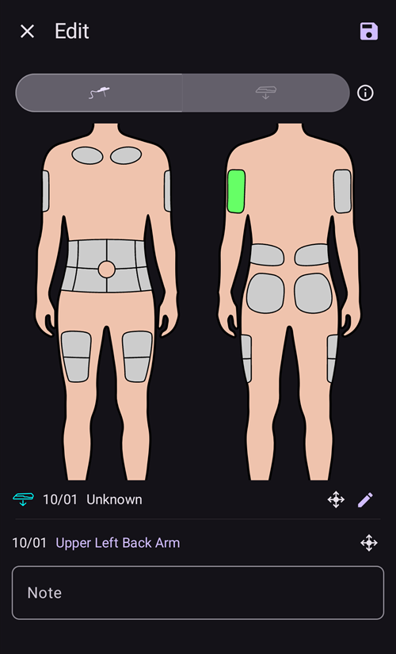

# Помпи та канюлі

## Changing infusion sets: insulin reservoirs and cannulas

The procedure described below is for tubed pumps only and does not apply to patch pumps like Omnipod, Medtrum Nano, Accu-Chek Solo etc. Цю процедуру іноді називають «заміною набору»: «повна» заміна набору включає резервуар з інсуліном і канюлю, а «часткова» – лише заміну канюлі.

Патч-помпи заповнюються та готуються самі у власному майстрі активації, а їхня канюля вже в тілі. **AAPS** не пропонує для них підготовку: **Підготовка/Заповнення** не показано ні в меню **Керувати**, ні на панелі швидкого запуску. Див. сторінку вашої помпи в розділі [Сумісні помпи](../Getting-Started/CompatiblePumps.md).

Фізичну заміну картриджа/резервуара не можна зробити через **AAPS**, її потрібно виконувати безпосередньо на помпі. Після заміни її потрібно вручну записати в **AAPS**.

(pumps-cannulas-changing-reservoir-and-cannula)=
### Guide for changing both the pump reservoir and cannula

1. В **AAPS** від’єднайте помпу: натисніть на [значок петлі](#AapsScreens-loop-status) на головному екрані та виберіть **Від’єднати помпу** на 1 годину. Значок зміниться на сіру вилку: це означає, що помпу від’єднано.

2. Physically change the insulin reservoir: physically disconnect your pump from the body, and change the reservoir/cartridge and cannula as per manufacturer's instructions.

3. Prime/fill the tubing and cannula: this can be done directly on the pump. Be sure to eliminate any bubbles in the tubing.

4. Attach the new cannula to the body. Once the cannula is inserted and the needle is removed, the attached cannula now has a small air gap which also needs to be primed. Щоб записати це в **AAPS** і підготувати місце: відкрийте **Підготовка/Заповнення** (на розгорнутій панелі стану на головному екрані, в меню **Керувати** або як кнопку [швидкого запуску](QuickLaunch.md)) і позначте **Запис заміни канюлі помпи** та/або **Запис заміни картриджа інсуліну**, щоб записати заміну. Тепер натисніть на стандартну кількість інсуліну для підготовки канюлі (зазвичай близько 0,3 Од, але перевірте, чи це значення правильне для вашої канюлі) і виберіть **OK**. Прочитайте підсумкове повідомлення та підтвердіть підготовку, натиснувши **OK**.

   


5. Знову під’єднайте помпу в **AAPS**: натисніть на значок сірої вилки й виберіть **Знову під’єднати помпу**, щоб петля працювала далі.

### Useful information concerning insulin/cannula changes

* Запис заміни канюлі скидає Autosens до 100 %. Він також скидає відповідні індикатори стану та вік канюлі/інсуліну на головному екрані **AAPS**.

* Стандартні кількості для підготовки можна задати або змінити в налаштуваннях **Підготовка/Заповнення** – введіть «prime» у рядок пошуку на головному екрані, щоб їх відкрити (див. [Налаштування](../SettingUpAaps/Preferences.md)). See your instruction booklet in your cannula box for how many units (depending on needle length and tubing length) should be primed for your cannula.

* Інсулін, введений функцією підготовки, **AAPS** не враховує під час розрахунку активного інсуліну (IOB), і в розділі [Історія терапії](#aaps-screens-treatments) він позначений як «Заповнення».

* Інсулін, введений болюсом з помпи, поки помпу від’єднано, **AAPS** теж не враховує. Якщо ви ввели болюс прямо з помпи, поки **AAPS** від’єднано, то після повторного під’єднання помпи ви можете записати цей інсулін (без введення болюса) в діалозі **Інсулін** (див. нижче [Як записати введений інсулін без фактичного болюса](#pumps-cannulas-announce-insulin)).

### Cannula, infusion site, tubing and/or pump issues

Якщо ви впевнені, що певний час не отримували інсуліну, хоча **AAPS** записав, що отримували, і точно знаєте, коли почалася проблема (_напр._ ви зняли канюлю й побачили, що вона перегнулася під час введення), ви можете виправити це в **AAPS**. Але пам’ятайте, що інсулін, можливо, все ж було введено, і з якоїсь причини він діє повільно.

```{admonition} Caution - Risk of Hypoglycemia
:class: danger
Only delete insulin delivery from **AAPS** with EXTREME caution, in case insulin _has_ actually been delivered, and monitor BG closely for the next 24 h.
```

Щоб видалити болюси та SMB, які, як ви знаєте, не було введено, відкрийте **меню** (☰), виберіть [Історія терапії](#aaps-screens-treatments) і на вкладці **Вуглеводи і болюс** обережно видаліть записані болюси, починаючи з моменту, коли сталася проблема. Це виправить значення «активного інсуліну» (IOB), яке є ключовим для розрахунків **AAPS**; якщо тепер повернутися на головний екран, ви побачите, що IOB зменшився. Зверніть увагу: базальний інсулін, який, за розрахунком **AAPS**, уже введено, видалити не можна, тому **AAPS** і далі його враховуватиме.

У менш очевидних випадках проблем із введенням інсуліну, _напр._ витоку, оклюзії або тунелювання, коли ви не знаєте, коли почалася проблема, або вважаєте, що частину інсуліну все ж введено, потрібно бути обережними. Такі проблеми можна помітити за запахом інсуліну, мокрим пластирем, високою глюкозою або за сигналом тривоги. Оскільки ви ніколи не знатимете, скільки інсуліну потрапило під шкіру (і він може почати діяти через деякий час), буде важко визначити, скільки інсуліну потрібно відняти від поточного значення «активного інсуліну» (IOB). One strategy is to pause looping for 5 hours (or your specific duration of insulin action) after you resolved the insulin delivery problem, and resume looping afterwards. This will ensure that IOB is correct once you restart looping.

(pumps-cannulas-disconnecting)=
## Disconnecting the pump for showering or activity

Якщо ви знімаєте помпу для душу, ванни, плавання, контактних видів спорту або інших занять, ви повинні повідомити **AAPS**, що інсулін не вводиться, щоб IOB залишався правильним. Помпу можна від’єднати за допомогою [значка петлі](#AapsScreens-loop-status) на головному екрані: натисніть на нього й виберіть **Від’єднати помпу** з потрібною тривалістю. Якщо заняття триває довше, ніж планувалося, знову відкрийте той самий діалог і виберіть нову тривалість у **Від’єднати помпу**: від’єднання продовжиться, і нова тривалість почнеться з поточного моменту. Спочатку знову під’єднувати помпу не потрібно.

As you are not getting any insulin while the pump is disconnected, you should reconnect every two hours to catch up for the missing basal. Для цього можна під’єднатися й ввести болюсом пропущений базал (_напр._ за останні дві години), а потім знову від’єднатися. This should help to avoid a severe lack of insulin which could result in diabetic ketoacidosis (DKA). Якщо під час заняття знову під’єднувати помпу незручно (місце канюлі закрите гідрокостюмом _тощо_), подумайте про ін’єкцію шприц-ручкою. Цю ручну ін’єкцію можна записати в **AAPS**, і не обов’язково в момент ін’єкції (просто запам’ятайте її час): коли ви знову під’єднаєте помпу, можна записати інсулін і вказати фактичний час його введення заднім числом.

(pumps-cannulas-announce-insulin)=
## To announce delivered insulin without actually bolusing

To announce insulin delivered from the pump either while **AAPS** was disconnected, or from pen injections: open the [Insulin dialog](#aaps-screens-buttons-insulin) (**Treatments** in the bottom navigation, or a QuickLaunch button), enter the amount in units and enable **Bolus will be recorded only (not delivered by pump)**. Потім рядок **Час** (зі значенням **Зараз**) дає змогу записати фактичний час ін’єкції; якщо ін’єкцію зроблено нещодавно, його можна не змінювати. Якщо болюс було введено деякий час тому, натисніть **-**, щоб перенести час назад (_напр._ -30 хв), або відкрийте рядок стрілкою, щоб вибрати точну дату й час. Тоді **AAPS** врахує тривалість дії інсуліну й відповідно розрахує інсулін, що ще залишився в організмі.

Якщо ви користуєтеся **AAPS** як доглядач, ви можете дуже легко віддалено від’єднати (і знову під’єднати) помпу за допомогою [SMS-команди](../RemoteFeatures/SMSCommands.md), наприклад «pump disconnect 120» і «pump connect 120». The range of duration for remote disconnect is from 1 - 120 min, (in this example it is 120 minutes). Це дуже зручно, якщо вам важко дістати телефон з **AAPS**: наприклад, він схований у поясі для помпи в дитини, яка біжить до басейну, або його пильно охороняє (чи використовує) підліток.

## Reconnecting the pump after activity

Після довгого від’єднання (1–2 години) **AAPS** досить часто розраховує, що тепер у вас від’ємний IOB. When you reconnect the pump, depending on preference/current glucose level/planned food or subsequent activity, you can either:

a) Просто знову під’єднайте помпу в **AAPS** (із сірого на зелений, для закритої петлі) і дозвольте **AAPS** знову почати вводити інсулін

_або_

b) Якщо ви хочете діяти агресивніше (наприклад, вам загрожує гіперглікемія), відкрийте [Калькулятор болюса](#aaps-screens-bolus-wizard) і введіть болюс на нуль вуглеводів, щоб одразу ввести розрахований пропущений інсулін як болюс.

Which strategy you prefer is highly personal, and is best determined by trial and error.


(Aapsscreens-site-rotation)=
## Чергування місць введення

**Керувати → Чергування місць введення** відкриває діалог чергування місць введення в режимі перегляду:

- Двома кнопками вгорі (значок канюлі та значок сенсора) можна показати лише місця канюлі, лише місця сенсора або обидва
- Доступні всі події заміни канюлі та заміни сенсора за останні 45 днів.
- Натисніть на ділянку або на запис у списку нижче, щоб відфільтрувати список і залишити лише записи вибраної ділянки. Вибрану ділянку буде виділено світло-зеленим кольором.
- Натисніть на значок **олівця** біля запису, щоб відкрити режим редагування й змінити місце, стрілку або примітку


- Значок **шестерні** (угорі праворуч) відкриває налаштування: **Профіль користувача для заміни місць введення** відкриває діалог, де ви вибираєте **Чоловік**, **Жінка** або **Дитина**, а перемикачі **Керувати заміною місць введення помпи** і **Керувати заміною місць сенсора CGM** визначають, якими місцями ви керуєте.


*Note: this setting decides whether the Site Rotation dialog (Edit mode) opens automatically when a new entry is made with the "Prime/Fill" button or the "Sensor Insert" button.*

- Якщо заміну місця зроблено прямо на помпі, відкрийте режим перегляду й відредагуйте новий запис, щоб вибрати розташування та стрілку

Режим редагування дає змогу вибрати розташування, стрілку та примітку для вибраного запису:

- Запис, який редагується, показано під зображеннями тіла разом зі значком його типу (канюля або сенсор)
- Вигляд спереду та ззаду показано поруч: натисніть на ділянку, куди ви його встановили
- Once a site is selected (highlighted in green), the list below shows all entries made in this site in the past 45 days.



- Можна додати стрілку (необов’язково), натиснувши на значок стрілки праворуч від запису: діалог **Вибрати стрілку** дає змогу вказати точніше місце або орієнтацію пода


- Можна також додати **Примітку** про вибране місце
- Натисніть на значок **збереження** (угорі праворуч), щоб записати місце

Фільтрувати можна на зображенні або натиснувши на подію терапії в списку Щоб зняти фільтр, просто натисніть на зображення поза будь-якими місцями


