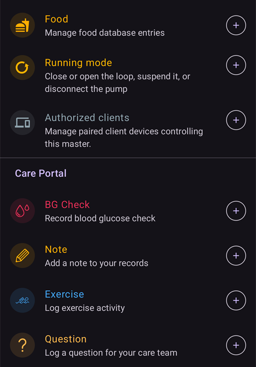
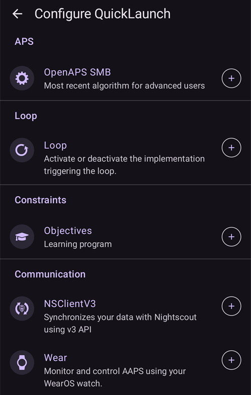

(quicklaunch)=
# Швидкий запуск (панель швидких дій на екрані огляду)

**Швидкий запуск** – це невелика **панель швидких дій**, яка розташована внизу екрана огляду **AAPS**, одразу над нижньою навігацією. Це ряд кнопок, які спрацьовують одним дотиком, і його можна налаштувати: ви вирішуєте, які дії там будуть і в якому порядку. Так те, що ви робите найчастіше, завжди доступне одним дотиком на головному екрані.

```{contents} Table of contents
:depth: 2
:local: true
```


---

## Використання панелі

Панель розташована на екрані **огляду**, між графіками та нижньою навігацією:


- **Натисніть** на значок, щоб виконати його дію – так само, як якби ви відкрили її з її звичайного екрана (болюс або терапія все одно спочатку показують звичайне підтвердження).
- **Довго натисніть** на значок, щоб побачити **підказку** з назвою дії та коротким описом.
- Якщо ви додасте **більше кнопок, ніж поміщається** на екрані, зайві переходять у **додаткове меню** (кнопка **⋮** у кінці панелі).
- Кожен значок має **колір** своєї дії (напр. інсулін, вуглеводи, тимчасова ціль), тому його легко впізнати з першого погляду.

```{admonition} The toolbar is always there
:class: note
Остання кнопка – це завжди **Налаштувати швидкий запуск** (шестерня **⚙️**). Її не можна видалити, тому ви завжди можете перейти до екрана налаштування прямо з панелі. За замовчуванням на панелі лише дві кнопки – **Калькулятор болюса** і ця шестерня.
```

---

## Налаштування швидкого запуску

Натисніть на шестерню **⚙️** на панелі (або відкрийте **[Конфігурація](../SettingUpAaps/ConfigBuilder.md) → … → Налаштувати швидкий запуск**), щоб відкрити екран **Налаштувати швидкий запуск** (*«Налаштуйте кнопки швидких дій на екрані огляду»*).


Екран має дві частини:

- **Вибрані дії** (угорі) – кнопки, які зараз є на вашій панелі, у порядку панелі.
- **Каталог** під ними – усі дії, які можна додати, згруповані за категоріями. Кожен запис каталогу має кнопку **➕**, щоб його додати.

### Вибрані дії – зміна порядку, редагування, видалення

Кожна вибрана дія має:

- **⠿ маркер перетягування** – натисніть і перетягніть, щоб **змінити порядок** кнопок (порядок тут – це порядок на панелі),
- кнопку **−** – **видалити** її з панелі,
- і лише для ярлика **Профіль** – кнопку **✏️**, щоб змінити його відсоток/тривалість (див. [Ярлики профілів](#profile-shortcuts)).

Зміни діють **одразу** – окремої кнопки *Зберегти* немає. Додана дія з’являється в кінці панелі; звідти можна змінити її порядок.

---

## Категорії дій

Каталог групує все, що можна додати, у такі категорії, у такому порядку. Категорії, у яких немає що запропонувати (напр. у вас немає сцен), просто не показуються.

### Терапія

Щоденні діалоги терапії та CGM:

- **Інсулін** – ввести болюс вручну.
- **Вуглеводи** – записати вуглеводи без інсуліну.
- **Калькулятор болюса** – відкрити калькулятор болюса.
- **Терапія** – записати інсулін і вуглеводи разом.
- **CGM** – відкрити ваш застосунок CGM (напр. xDrip).
- **Калібрування** – калібрувати сенсор CGM.

### Careportal

Події Careportal і записи про обслуговування пристроїв:

- **Контроль ГК**, **Примітка**, **Тренування**, **Питання**, **Оголошення**,
- **Встановлення сенсора**, **Заміна батареї помпи**, **Заміна канюлі**, **Підготовка/Заповнення**, **Чергування місць введення**.

**Підготовка/Заповнення** і **Заміна батареї помпи** пропонуються, лише якщо ваша помпа їх використовує. Наприклад, патч-помпи заповнюються та міняють батарею у власних кроках активації, тому для них ці записи не показуються (як і в меню **Керувати**).


Це ті самі записи, до яких інакше можна дійти через меню **[Терапія](#v4changes-treatments)** і **[Керувати](#v4changes-manage)** – швидкий запуск просто виносить на екран огляду ті, якими ви користуєтеся.

### Керувати

Екрани меню **[Керувати](#v4changes-manage)** у тому самому порядку, щоб ви могли відкривати з панелі той, яким користуєтеся найчастіше:

- **Профіль**, **Налаштування інсуліну** (керування налаштуваннями інсуліну та їх активація – назва навмисно відрізняється від **Інсулін**, бо та кнопка вводить болюс), **Тимчасова ціль**, **Швидкий майстер**, **Сцени**, **Автоматизація**, **Їжа**,
- **Робочий режим** – закрити або відкрити петлю, призупинити її або від’єднати помпу,
- **Авторизовані клієнти** – лише на основному телефоні або спареному клієнті.

Ці кнопки відкривають екран; самі вони нічого не запускають. Щоб запускати сцену або Швидкий майстер одним дотиком, додайте їх із категорії **Сцени** або **Швидкий майстер** нижче.

 

### Швидкий майстер

Кожен ваш шаблон **[Швидкий майстер](QuickWizards.md)** можна додати як кнопку, тож регулярний прийом їжі буде на відстані одного дотику від екрана огляду. Кнопка має назву шаблону й показує кількість вуглеводів/інсуліну; натискання запускає Швидкий майстер із звичайним підтвердженням.

Записи Швидкого майстра, які налаштовано показувати лише на годиннику, не пропонуються. Кнопка Швидкого майстра на панелі діє за тими самими правилами, що й у меню **Терапія**: вона прихована поза своїм [дійсним часовим проміжком](#quickwizard_validity) і на короткий час після використання. Вона залишається в налаштуваннях вашої панелі й з’являється знову, коли Швидкий майстер знову можна використати.

### Сцени

Кожну ввімкнену **[сцену](Scenes.md)** можна додати як кнопку. Після натискання з’являється запит на підтвердження, а потім сцена активується (той самий набір дій, що й з екрана «Сцени»). Ця категорія з’являється, лише якщо у вас є хоча б одна сцена.

Підказка та каталог показують той самий підсумок, що й **Керувати → Сцени**, наприклад *«Дій: 3, 2 год → Cooldown»*, де назва після стрілки – це наступна сцена.

### Автоматизація

Ваші правила автоматизації типу **дія користувача** (ті, які ви запускаєте вручну) можна додати як кнопки. Після натискання з’являється запит на підтвердження, а потім виконуються дії цього правила.

```{admonition} Automation buttons run on the master
:class: note
Автоматизація виконується на **основному телефоні**, тому ярлики автоматизації пропонуються та працюють лише на основному телефоні. Вони недоступні на спареному **[клієнті](../RemoteFeatures/ClientMasterControl.md)**.
```

### Шаблони тимчасових цілей

Кожен ваш шаблон **[Тимчасова ціль](TempTargets.md)** можна додати як кнопку (показано його назву, ціль і тривалість, наприклад *«Очікуваний прийом їжі – 5,0 ммоль/л, 45 хв»*). Після натискання з’являється запит на підтвердження, а потім запускається ця тимчасова ціль.


(profile-shortcuts)=
### Профіль

Кожен **[профіль](ProfileSwitch-ProfilePercentage.md)** можна додати як **ярлик**, який виконує **перемикання профілю** одним дотиком. На відміну від більшості ярликів, ярлик профілю має власні **відсоток** і **тривалість**, які ви задаєте після додавання кнопкою **✏️**:

- **Відсоток** (30–250 %, з кроком 5 %) – масштабує профіль під час застосування. 100 % використовує його без змін.
- **Тривалість** (0–10080 хв, тобто до 7 днів, з кроком 10 хв) – скільки триває перемикання. **0 = Постійно** (доки ви не перемкнете профіль знову).


Так можна мати кілька кнопок для **того самого** профілю з різною силою – наприклад *«Профіль 100 %»* і *«Профіль 70 % на 2 год»* – і застосовувати будь-яку одним дотиком. (Той самий профіль можна додати кілька разів з різними налаштуваннями.)

### Плагіни



І нарешті, будь-який **увімкнений плагін**, що має власний екран, можна додати як ярлик, щоб відкривати його напряму. Вони згруповані за типом плагіна – **Помпа**, **Джерело ГК**, **APS**, **Петля**, **Визначення чутливості**, **Згладжування**, **Калібрування**, **Обмеження**, **Звʼязок** і **Загальне** – тож ви можете, наприклад, одразу перейти з екрана огляду на екран помпи або петлі.

---

## Швидкий запуск і основний телефон/клієнт

На відміну від більшості ваших налаштувань, **панель швидкого запуску налаштовується окремо для кожного пристрою** – вона зберігається **локально й не синхронізується** між основним телефоном і спареними клієнтами, тому кожен пристрій має власний набір кнопок. (Але вона *входить* до **резервної копії/експорту** налаштувань, тож відновлення повертає її на тому самому пристрої.)

Те, що кожен пристрій може розмістити на своїй панелі, все одно залежить від того, що на ньому є: Швидкий майстер, сцени, шаблони тимчасових цілей і профілі синхронізуються, тому каталог клієнта пропонує ті самі елементи – ви просто вибираєте їх для кожного пристрою окремо. Кілька деталей, які варто знати:

- Кнопки, ціль яких більше не існує (видалений запис Швидкого майстра, сцена чи шаблон, вимкнене правило), **автоматично пропускаються**.
- Ярлики **Автоматизація** пропонуються та працюють лише на **основному телефоні** (автоматизація виконується на основному телефоні). Кнопки сцен, Швидкого майстра, тимчасових цілей і профілів доступні на клієнті.
- Коли ви натискаєте на клієнті кнопку, яка має виконуватися на основному телефоні (болюс, тимчасова ціль, перемикання профілю або сцена), її виконує **основний телефон** і він же формує підтвердження. Див. [Керування основний телефон ↔ клієнт](../RemoteFeatures/ClientMasterControl.md).

---


<!-- =====================================================================
     Screenshots captured from a real master device:
       - quicklaunch_toolbar.png    (cropped close-up of the overview toolbar pill)
       - quicklaunch_overview.png   (full overview showing the toolbar in place)
       - quicklaunch_config.png     (Configure QuickLaunch: Selected actions + Treatment + start of Manage)
       - quicklaunch_dynamic.png    (catalog: Quick Wizard / Scenes / Automation / Temp Target Presets)
       - quicklaunch_categories.png (catalog: Profile shortcuts + plugin categories)
     No QuickLaunch action was actually run (nothing delivered; only scrolled).
     Maintainers: relocate page + images and fix cross-links as needed.
     ===================================================================== -->
