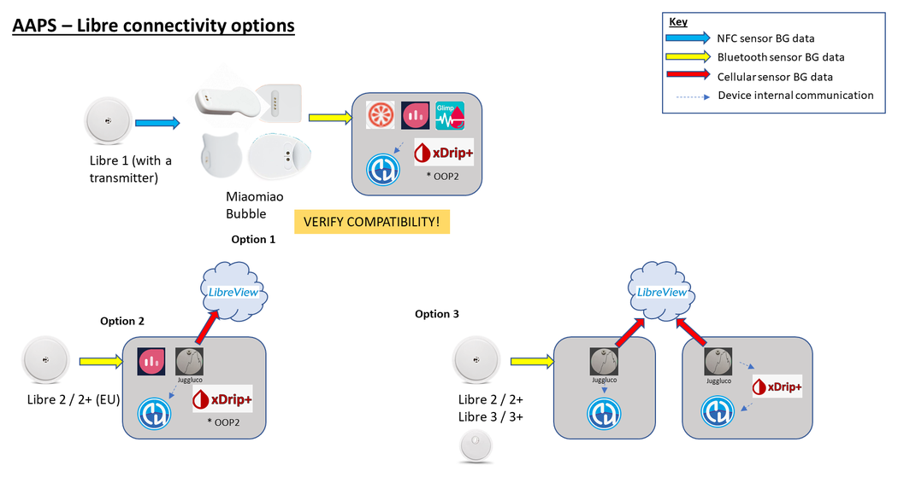

# Підготовка до початку роботи з AAPS

Ласкаво просимо. Ця документація допомагає користувачам, які готуються налаштувати і почати використовувати Android Artificial Pancreas System (**AAPS**).

## Як орієнтуватися в документації

**Зміст** і пояснення структури документації можна знайти [тут](../index.md). Туди також можна перейти, натиснувши на символ **AAPS** угорі ліворуч у документації. Там ви знайдете огляд призначення різних розділів документації. Ви також можете переходити по документації за допомогою заголовків ліворуч від цієї сторінки. І нарешті, є зручна функція пошуку, одразу під символом **AAPS**.

Ми прагнемо, щоб було легко зрозуміти і можливості, і обмеження **AAPS**. Буває прикро, коли після часу, витраченого на читання документації, ви дізнаєтеся, що у вас немає сумісної інсулінової помпи або CGM, або що **AAPS** має інші функції, ніж ви сподівалися.

Багато деталей з досвіду користувачів у документації **AAPS** стають зрозумілішими, коли ви вже використовуєте **AAPS** у реальному житті. Як важко навчитися спортивній грі, лише читаючи правила, так і тут: спочатку потрібно вивчити основні правила безпечної роботи з **AAPS**, а потім навчитися якнайкраще застосовувати ці правила, коли ви почнете використовувати **AAPS**.

(preparing-safety-first)=

## Safety First
«З великою силою приходить велика відповідальність…»

### Технічна безпека
**AAPS** має широкий набір функцій безпеки. Вони накладають обмеження, які поступово знімаються, коли ви по черзі виконуєте [Завдання](../SettingUpAaps/CompletingTheObjectives.md). Завдання включають перевірку певних параметрів і відповіді на питання з кількома варіантами відповіді. Функції **AAPS** стають доступними, коли ви успішно виконуєте Завдання. Так користувач може безпечно, крок за кроком, перейти від відкритої петлі до закритої петлі і водночас вивчити різні функції **AAPS**.

[Завдання](../SettingUpAaps/CompletingTheObjectives.md) створено так, щоб якнайкраще познайомити вас з **AAPS**. Вони враховують типові помилки та загальні тенденції, які розробники **AAPS** помітили в нових користувачів. Помилки можуть статися, бо початківець не має досвіду і дуже хоче швидше почати роботу з **AAPS**, або пропустив важливі моменти. [Завдання](../SettingUpAaps/CompletingTheObjectives.md) мають на меті зменшити ці проблеми.

### Медична безпека
```{admonition} Avoid permanent and painful damage to your eyes and nerves
:class: danger
Будьте обережні зі швидким покращенням контролю глюкози крові і зниженням HbA1c 
```

Важливий аспект безпеки: **швидке зниження HbA1c і покращення контролю глюкози крові в людей, у яких рівень глюкози тривалий час був високим, може спричинити незворотну шкоду**. Багато людей з діабетом цього не знають, і не всі лікарі попереджають про це своїх пацієнтів.

Ця шкода може включати **втрату зору і незворотну нейропатію (біль)**. Цієї шкоди можна уникнути, якщо знижувати середній рівень глюкози повільніше. Якщо у вас зараз високий HbA1c і ви переходите на **AAPS** (або будь-яку іншу систему закритої петлі), _будь ласка_, обговоріть цей можливий ризик зі своєю медичною командою перед початком і погодьте з нею графік поступового зниження безпечних цілей глюкози. Спочатку ви можете легко встановити вищі цілі глюкози в **AAPS** (зараз найвища ціль, яку можна вибрати, – 11,1 ммоль/л, але за потреби можна також свідомо використовувати слабкий профіль), а потім знижувати ціль з кожним місяцем.

#### Як швидко я можу знизити HbA1c без ризику незворотної шкоди?

Одне ретроспективне [дослідження](https://pubmed.ncbi.nlm.nih.gov/1464975/) 76 пацієнтів показало, що ризик прогресування ретинопатії зростав у 1,6, 2,4 і 3,8 раза, якщо HbA1c знижувався відповідно на 1 %, 2 % або 3 % за 6 місяців. Вони запропонували, що **«зниження значення HbA1c за будь-які 6 місяців слід обмежити менш ніж 2 %, щоб запобігти прогресуванню ретинопатії... Занадто швидке зниження на початку контролю глікемії може спричинити тяжке або тимчасове загострення прогресування ретинопатії».**

Примітка. Якщо ви використовуєте інші одиниці HbA1c (ммоль/моль замість %), натисніть [тут](https://www.diabetes.co.uk/hba1c-units-converter.html), щоб відкрити калькулятор HbA1c.

В іншому ретроспективному [дослідженні](https://academic.oup.com/brain/article/138/1/43/337923) 954 пацієнтів дослідники зазначили:

**«При зниженні HbA1c на 2–3 процентні пункти за 3 місяці абсолютний ризик розвитку спричиненої лікуванням нейропатії при діабеті становив 20 %, а при зниженні HbA1c на >4 процентні пункти за 3 місяці абсолютний ризик розвитку спричиненої лікуванням нейропатії при діабеті перевищував 80 %».**

[Коментар](https://academic.oup.com/brain/article/138/1/2/340563) до цієї роботи погодився, що для уникнення ускладнень **метою має бути зниження A1c на <2 % за 3 місяці.** Інші огляди на цю тему можна прочитати [тут](https://www.ncbi.nlm.nih.gov/pmc/articles/PMC6587545/pdf/DOM-21-454.pdf) і [тут](https://www.mdpi.com/1999-4923/15/7/1791).

Загалом визнано, що люди з _щойно_ діагностованим діабетом 1 типу (у яких під час діагностики, до початку інсулінотерапії, часто дуже високий HbA1c), схоже, можуть швидко знизити HbA1c одразу після діагностики без таких ризиків тієї ж міри, бо в них рівень глюкози крові не був високим так довго. Однак це все одно питання, яке вам слід обговорити зі своїм лікарем.

(PreparingForAaps-no-sglt-2-inhibitors)=
### Жодних інгібіторів SGLT-2

```{admonition} NO SGLT-2 inhibitors
:class: danger
Інгібітори SGLT-2, які також називають гліфлозинами, гальмують зворотне всмоктування глюкози в нирках. Гліфлозини знижують рівень цукру в крові непередбачувано, тому ви НЕ ПОВИННІ приймати їх, коли використовуєте систему закритої петлі, як-от AAPS! Це створює значний ризик кетоацидозу та/або гіпоглікемії! Поєднання цих ліків із системою, яка знижує базал, щоб підвищити ГК, особливо небезпечне. 

Коротко:
- **Приклад 1: ризик гіпо**
>Під час обіду ви вводите болюс через **AAPS** на 45 г глюкози, які ви з'їли. Проблема в тому, що інгібітори, без відома AAPS, змушують організм виводити частину вуглеводів. Через це в організмі залишається забагато інсуліну порівняно із засвоєними вуглеводами, і це призводить до гіпоглікемії.

- **Приклад 2: ризик кетоацидозу**
>Інгібітори непомітно виводять частину вуглеводів, і ваша ГК знижується. **AAPS** автоматично дасть помпі команду зменшити введення інсуліну, включно з базалом. З часом ваша ГК може залишатися нижче цілі настільки, що в організмі не буде достатньо фонового інсуліну, щоб засвоювати вуглеводи. Це призводить до кетоацидозу. Зазвичай кетоацидоз у людей з діабетом 1 типу розвивається, коли ламається помпа. Це викликає сповіщення на телефоні і помітно за високим значенням ГК. Однак небезпека гліфлозинів у тому, що сповіщень AAPS не буде, бо помпа працює, а ГК, можливо, залишається в межах цілі.

Поширені торгові назви інгібіторів SGLT-2: Invokana, Farxiga, Jardiance, Glyxambi, Synjardy, Steglatro, Xigduo XR та інші.
```


### Основні принципи роботи петлі з AAPS

Перед використанням **AAPS** потрібно зрозуміти основні принципи та поняття роботи петлі. Для цього потрібно витратити свій час на читання документації **AAPS** і виконати Завдання. Вони дають міцну основу для безпечного та ефективного використання **AAPS**. Спочатку обсяг документації **AAPS** може здатися величезним, але будьте терплячими і довіртеся процесу – з правильним підходом у вас усе вийде!

Швидкість просування залежить від людини, але знайте, що виконання всіх завдань зазвичай займає 6–9 тижнів. Багато людей збирають, встановлюють і налаштовують **AAPS** задовго до того, як почнуть його використовувати. Щоб допомогти з цим, система має «віртуальну помпу». Її можна використовувати під час перших завдань, щоб познайомитися з **AAPS**, не вводячи інсулін за його допомогою. Детальний розклад термінів наведено нижче. Знайте, що на завданні 7 **AAPS** у вас уже працює закрита петля. Наступні завдання додають такі функції, як **SMB** і **автоматизації**. Вони корисні деяким користувачам, але не є обов'язковими для основної роботи **AAPS**.

Успіх з **AAPS** потребує активного підходу, готовності аналізувати дані ГК і гнучкості, щоб вносити потрібні зміни в **AAPS** для кращих результатів. Майже неможливо навчитися грати в спортивну гру, лише читаючи правила. Те саме стосується **AAPS**.

#### Будьте готові до затримок і дрібних проблем, поки все налаштовуєте і запускаєте

На перших етапах роботи з **AAPS** у вас можуть бути труднощі з тим, щоб усі компоненти петлі добре зв'язувалися між собою (і з можливими послідовниками), а також з точним налаштуванням параметрів. Деякі збої неможливо усунути, поки **AAPS** не використовується в повсякденному житті, але багато допомоги можна отримати в групі Facebook і в Discord. Плануйте відповідно і вибирайте «добрий» час, наприклад спокійний ранок у вихідний (тобто не пізно вночі, не коли ви втомлені і не перед важливою зустріччю чи подорожжю), щоб шукати й усувати проблеми.

#### Сумісність технологій

**AAPS** сумісний лише з певними типами інсулінових помп, CGM і телефонів, а деякі технології можуть бути недоступні в деяких країнах. Щоб уникнути розчарувань, прочитайте розділи про [CGM](../Getting-Started/CompatiblesCgms.md), [помпи](../Getting-Started/CompatiblePumps.md) і [телефони](../Getting-Started/Phones.md).

#### Час на збірку застосунку і перехід до повної петлі

Час на збірку застосунку **AAPS** залежить від вашого досвіду і технічних навичок. Зазвичай недосвідченим користувачам на збірку **AAPS** потрібно до половини дня або цілий день (з допомогою спільноти). З новими версіями **AAPS** процес буде значно швидшим, бо ви набуватимете досвіду.

Кілька частин цієї документації допомагають вам пройти процес збірки:

- [Збірка AAPS](../SettingUpAaps/BuildingAaps.md) крок за кроком проводить вас через збірку застосунку і його встановлення на телефон;

- [FAQ](../UsefulLinks/FAQ.md) відповідає на поширені питання і пояснює найчастіші помилки; і

- розділ [Усунення несправностей](../GettingHelp/GeneralTroubleshooting.md) збирає рішення найчастіших проблем, згруповані за темами.

Скільки часу потрібно, щоб дійти до закритої петлі, залежить від людини; приблизний розклад досягнення повної петлі з **AAPS** наведено [нижче](#preparing-how-long-will-it-take).


#### Keystore та файл експорту налаштувань

«Keystore» (файл .jks) – це файл, зашифрований паролем, унікальний для вашої власної копії **AAPS**. Ваш телефон Android використовує його, щоб ніхто інший не міг оновити вашу копію без цього keystore. Коротко, під час збірки **AAPS** вам потрібно:

1.  Зберегти файл keystore (файл .jks, яким підписується ваш застосунок) у безпечному місці;

2.  Записати пароль до файлу keystore.

Як зберегти keystore, залежить від способу збірки:

- **Збірка в Android Studio (на комп'ютері)**: keystore створюється під час збірки – дивіться [Створення підписаного APK](#Building-APK-generate-signed-apk), щоб дізнатися, де його зберегти.
- **AAPS Builder**: збережіть резервний файл `aaps-keystore.jks`, який сторінка налаштування запропонувала, коли ви створювали ключ, разом з його паролем і псевдонімом (alias). Якщо ви вивантажили власний keystore, збережіть цей файл.
- **Збірка в браузері з fork**: використайте окремий workflow [Export keystore](#ci-keystore-export), щоб завантажити копію на свій Google Drive.

Так ви зможете використовувати той самий файл keystore щоразу, коли збираєте нову версію **AAPS**. У середньому потрібно 2 оновлення **AAPS** на рік.

Крім того, **AAPS** дає змогу [експортувати всі ваші налаштування](../Maintenance/ExportImportSettings.md). Так ви зможете безпечно відновити свою систему під час зміни телефону, оновлення або перевстановлення застосунку з мінімальними перервами. 

#### Усунення несправностей

Не соромтеся звертатися до спільноти AAPS, якщо в чомусь не впевнені – дурних питань не буває! Ми запрошуємо ставити питання всіх користувачів з будь-яким рівнем досвіду. Відповіді на питання зазвичай надходять швидко, бо користувачів **AAPS** багато.

##### [запитайте в групі AAPS у Facebook](https://www.facebook.com/groups/AndroidAPSUsers/)

##### [запитайте на каналі AAPS у Discord](https://discord.gg/4fQUWHZ4Mw)


#### [Де отримати допомогу](../GettingHelp/WhereCanIGetHelp.md)?

Цей розділ дає новим користувачам посилання на ресурси, де можна отримати допомогу. Серед них – підтримка спільноти з нових і досвідчених користувачів, які можуть відповісти на питання і допомогти з типовими труднощами в AAPS.

#### [Розділ для лікарів](../UsefulLinks/ClinicianGuideToAaps.md)

Це [розділ спеціально для лікарів](../UsefulLinks/ClinicianGuideToAaps.md), які хочуть більше дізнатися про AAPS і технологію штучної підшлункової залози з відкритим кодом. У Вступі також є поради щодо того, [як говорити зі своєю медичною командою](#introduction-how-can-i-approach-discussing-aaps-with-my-clinical-team).

## Що ми будемо збирати і встановлювати?

Ця схема показує огляд основних компонентів (апаратних і програмних) системи **AAPS**:


Крім трьох основних апаратних компонентів (телефон, помпа, сенсор глюкози), нам також потрібні: 1) Застосунок **AAPS** 2) Сервер звітів і 3) Застосунок для безперервного моніторингу глюкози (CGM)

### 1) Застосунок для телефону Android: **AAPS**

**AAPS** – це застосунок, який працює на смартфонах і пристроях Android. Ви самі зберете застосунок **AAPS** (файл apk) за покроковою інструкцією: завантажите вихідний код **AAPS** з GitHub, встановите потрібні програми (Android Studio, GitHub desktop) на свій комп'ютер і зберете власну копію застосунку **AAPS**. Потім ви перенесете застосунок **AAPS** на свій смартфон (електронною поштою, кабелем USB _тощо_) і встановите його.

### 2) Сервер звітів: Nightscout (Tidepool*)

Щоб повністю використовувати можливості **AAPS**, вам потрібно налаштувати сервер Nightscout. Ви можете [зробити це самостійно](https://nightscout.github.io/nightscout/new_user/#free-diy) або за невелику плату замовити налаштування [керованого сервісу Nightscout](https://nightscout.github.io/#nightscout-as-a-service). Nightscout збирає дані з **AAPS** протягом часу і може створювати детальні звіти, що зіставляють дані CGM та інсуліну. Доглядачі також можуть використовувати Nightscout для віддаленого зв'язку із застосунком **AAPS**, щоб стежити за лікуванням діабету своєї дитини. Такі функції віддаленого зв'язку включають моніторинг рівнів глюкози та інсуліну в реальному часі, віддалене введення болюсу інсуліну (через SMS) та оголошення їжі. Аналізувати свій діабет, дивлячись на дані CGM окремо від даних помпи, – це як вести машину, коли водій сліпий, а пасажир описує, що бачить. Tidepool також доступний як альтернатива Nightscout.

### 3) Застосунок сенсора CGM

Залежно від вашого сенсора глюкози / CGM вам потрібен сумісний застосунок, який отримує показники глюкози і надсилає їх до **AAPS**. Різні варіанти показано нижче, а більше інформації є в розділі [Сумісні CGM](../Getting-Started/CompatiblesCgms.md):

  

### Обслуговування системи **AAPS**

І **Nightscout**, і **AAPS** потрібно оновлювати приблизно раз на рік, коли виходять покращені версії. Іноді оновлення можна відкласти, в інших випадках його наполегливо радять або вважають обов'язковим для безпеки. Про ці оновлення повідомлять у групах Facebook і на серверах Discord. У примітках до випуску буде чітко сказано, який це випадок. Під час оновлення, найімовірніше, багато людей ставитимуть такі самі питання, як і ви, і ви отримаєте допомогу з оновленням.

(preparing-how-long-will-it-take)=
## Скільки часу займе налаштування всього?

Як ми вже казали, використання **AAPS** – це радше «подорож», яка потребує вашого особистого часу. Це не одноразове налаштування. За поточними оцінками, збірка **AAPS**, встановлення і налаштування **AAPS** та програм **CGM**, а також перехід від відкритої петлі до гібридної закритої петлі з **AAPS** займають загалом приблизно 4–6 місяців. Тому радимо якнайшвидше зібрати застосунок **AAPS** і почати виконувати перші завдання, навіть якщо ви ще використовуєте іншу систему введення інсуліну (віртуальну помпу можна використовувати до завдання 5).

Для деяких завдань має минути певна кількість днів, щоб ви напевно зрозуміли нові функції. Цей час очікування неможливо обійти; ці мінімальні терміни встановлено для вашої ж безпеки.

Ось приблизні терміни:

| Завдання                                                                   |        Приблизний час         |
| -------------------------------------------------------------------------- |:-----------------------------:|
| Перше читання документації                                                 |            1–2 дні            |
| Налаштування GitHub для збірки в браузері                                  |          1–4 години           |
| Налаштування сервера звітів                                                |           1 година            |
| Встановлення застосунку CGM (xDrip, BYODA, …)                              |           1 година            |
| Перше налаштування CGM → xDrip → AAPS                                      |           1 година            |
| Перше налаштування AAPS → помпа                                            |           1 година            |
| Налаштування AAPS → Nightscout/Tidepool (лише звіти)                       |           1 година            |
| Необов'язково: налаштування Nightscout ↔ **AAPS** і NSFollowers            |           1 година            |
| Завдання 1: Налаштування візуалізації та моніторингу                       |           1 година            |
| Завдання 2: Навчіться керувати AAPS                                        |           2 години            |
| Завдання 3: Підтвердьте свої знання                                        |          До 14 днів           |
| Завдання 4: Початок роботи в режимі відкритої петлі                        |       Щонайменше 7 днів       |
| Завдання 5: Розуміння вашої відкритої петлі                                |            7 днів             |
| Завдання 6: Початок закритої петлі (призупинення при низькій глюкозі, LGS) |   Щонайменше 5, до 14 днів    |
| Завдання 7: Налаштування закритої петлі                                    | Щонайменше 1 день, до 7 днів  |
| Завдання 8: Коригування базалу та коефіцієнтів, увімкнення Autosens        | Щонайменше 7 днів, до 14 днів |
| Завдання 9: Увімкнення Super Micro Bolus (SMB)                             |      Щонайменше 28 днів       |
| Завдання 10: Автоматизація                                                 |      Щонайменше 28 днів       |

Навіть коли **AAPS** повністю працює, вам усе одно потрібно регулярно точно налаштовувати параметри, щоб покращити загальне лікування діабету.

## Requirements

### Медичні аспекти

Крім медичних попереджень у [розділі про безпеку](#preparing-safety-first), є також різні параметри залежно від того, який інсулін ви використовуєте в помпі.

#### Вибір інсуліну

Розрахунки **AAPS** базуються на концентрації інсуліну 100 Од/мл (стандарт для помп). Інсулін налаштовується в **Керувати → Налаштування інсуліну**: задайте його **Пік** і **DIA** або використайте **Завантажити пік з**, щоб заповнити стандартний час піку одного із шаблонів:

- **Novorapid** (також для Humalog і NovoLog)
- **Fiasp**
- **Lyumjev**

Досвідчені користувачі можуть ввести будь-який час піку (від 35 до 120 хвилин) напряму, наприклад для суміші інсулінів. Дивіться [Налаштування інсуліну](#Config-Builder-insulin).


### Технічні аспекти

Ця документація має на меті зменшити потрібні технічні знання до абсолютного мінімуму. Щоб зібрати застосунок **AAPS**, є кілька способів – огляд дивіться на сторінці [Збірка AAPS](../SettingUpAaps/BuildingAaps.md):

- **Збірка в браузері** (рекомендовано): зберіть застосунок прямо зі смартфона за допомогою GitHub Actions, без комп'ютера і без Android Studio. З [AAPS Builder](../SettingUpAaps/BrowserBuildAapsBuilder.md) вам потрібен лише обліковий запис GitHub: ви завантажуєте застосунок прямо з GitHub. Для способу з fork також потрібен обліковий запис Google, щоб зберігати застосунок на вашому Google Drive.
- **Збірка в Android Studio**: зберіть застосунок на комп'ютері за допомогою Android Studio. Цей спосіб використовують переважно розробники, які хочуть змінювати код.
- **Збірка з командного рядка**: для користувачів, які хочуть збирати локально без встановлення Android Studio.

Крім збірки застосунку, вам також потрібно налаштувати сервер звітів, налаштувати кілька застосунків на телефоні Android і набути знань з лікування діабету. Цього можна досягти, якщо рухатися крок за кроком, бути терплячим і користуватися допомогою спільноти **AAPS**. Якщо ви вже вмієте користуватися інтернетом і самі працюєте зі своєю поштою Gmail, зібрати **AAPS** вам цілком під силу. Просто не поспішайте.

### Смартфони

#### AAPS і версії Android

Поточна версія **AAPS** (4.0) потребує смартфона Android з Google **Android 12.0 або новішим**. Якщо ви плануєте купити новий телефон (станом на січень 2026 року), краще обрати Android 16.<br/> Ми наполегливо радимо користувачам з міркувань безпеки оновлювати свою збірку **AAPS**. Однак для користувачів, які не можуть використовувати пристрій з Android 12.0 або новішим, залишаються доступними старіші версії **AAPS**, сумісні зі старішими версіями Android, дивіться: [Примітки до випуску](#maintenance-android-version-aaps-version).

#### Вибір моделі смартфона
Яку саме модель купити, залежить від потрібних функцій. На [сторінці Телефони](../Getting-Started/Phones.md) є рекомендації та відгуки користувачів про робочі комбінації пристроїв.

Ми радимо користувачам оновлювати версію Android на телефоні, зокрема оновлення безпеки. Однак якщо ви новачок в **AAPS** або не технічний експерт, ви можете відкласти оновлення телефону, поки інші не оновляться і не підтвердять на наших форумах, що це безпечно.

```{admonition} Delaying Samsung phone updates
:class: warning
На жаль, Samsung має історію примусових оновлень на своїх телефонах, які можуть спричиняти проблеми зі з'єднанням Bluetooth. Щоб вимкнути ці примусові оновлення, потрібно перевести телефон у «режим розробника»:

1. Перейдіть до **Settings** (Налаштування) > **About phone** (Про телефон) > **Software information** (Відомості про ПЗ), потім натискайте **Build number** (Номер збірки), поки не з'явиться підтвердження, що режим розробника увімкнено.
2. Поверніться до головного меню **Settings** (Налаштування), де має з'явитися новий пункт меню **Developer options** (Параметри розробника).
3. Відкрийте **Developer options** (Параметри розробника), знайдіть **Auto system update** (Автоматичне оновлення системи) і вимкніть його.
```

```{admonition} Google Play Protect potential issue
:class: warning
Є кілька повідомлень про те, що Google Play Protect щоранку довільно закриває **AAPS**. Якщо це трапляється, вам потрібно відкрити параметри Google Play і вимкнути **Google Play Protect**. Це стосується не всіх моделей телефонів і не всіх версій Android.
```

```{admonition} Android developer verification
:class: note
З вересня 2026 року Google поступово вводить [перевірку розробників Android](#android-developer-verification), яка змінює спосіб встановлення самостійно зібраного застосунку на телефон. Це не впливає на збірку **AAPS**, і безкоштовні способи встановлення залишаються доступними – подробиці дивіться на сторінці за посиланням.
```

