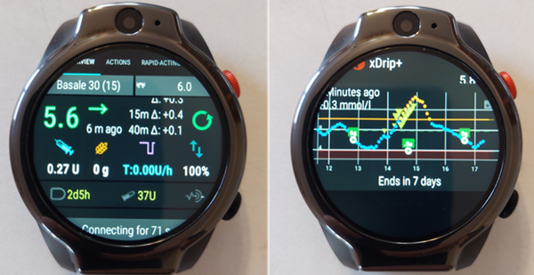
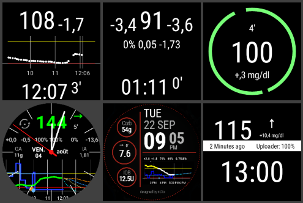
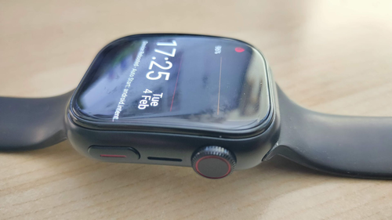

# Розумні годинники та AAPS

Різні розумні годинники можна використовувати, щоб показувати частину інформації з **AAPS** або виконувати дії віддалено.

Щоб розумний годинник напряму керував **AAPS** (помпою та сенсором), потрібен повноцінний годинник на Android (його можна вважати маленьким [смартфоном](./Phones.md)).

Деякі розумні годинники дають змогу вводити терапію та інше, але **AAPS** при цьому все одно працює на телефоні.

Розумні годинники все частіше використовують з **AAPS** _як_ дорослі з діабетом, так і доглядачі/батьки дітей з діабетом.

## Загальні переваги використання розумних годинників з **AAPS**


Розумні годинники, залежно від моделі, можна використовувати з **AAPS** багатьма різними способами. За їх допомогою можна повністю або частково керувати **AAPS** або просто віддалено перевіряти рівень глюкози, активний інсулін та інші параметри.

Поєднання розумного годинника з **AAPS** може бути корисним у багатьох ситуаціях, наприклад під час керування автомобілем або (мото)циклом і під час фізичних навантажень. Деяким людям здається, що поглянути на годинник (на нараді, вечірці, за обідом тощо) менш помітно, ніж на телефон. З погляду безпеки розумний годинник також корисний у дорозі: телефон з **AAPS** можна тримати поза полем зору (наприклад, у сумці), а для віддаленого керування користуватися годинником.

## Окремі переваги для батьків/доглядачів, які використовують **AAPS**

Якщо телефон дитини з **AAPS** поруч, доглядач може за допомогою розумного годинника стежити за станом або вносити зміни, не беручи до рук телефон з **AAPS**. Це корисно, наприклад, коли телефон з **AAPS** схований у поясі для помпи.

Розумний годинник можна використовувати _разом_ із варіантами на основі ТЕЛЕФОНУ для віддаленого керування або [лише стеження](../RemoteFeatures/FollowingOnly.md), або _замість_ них.

Крім того, на відміну від телефонів батьків/доглядачів для стеження (які залежать від мобільної мережі або Wi-Fi), розумні годинники, підключені через Bluetooth, можуть бути корисними у віддалених місцях, наприклад у печері, на човні або на півдорозі до вершини гори. Якщо обидва пристрої (телефон з **AAPS** і розумний годинник) в одній мережі Wi-Fi, вони можуть зв'язуватися і через Wi-Fi.

## Різні способи взаємодії розумного годинника з AAPS

Зараз є п'ять основних способів використання розумних годинників разом з **AAPS**. Їх показано в таблиці нижче: 

| Налаштування годинника    | Функції                                       | Вимоги                                                                                                                                                                                                                                                                                                                                               |
| ------------------------- | --------------------------------------------- | ---------------------------------------------------------------------------------------------------------------------------------------------------------------------------------------------------------------------------------------------------------------------------------------------------------------------------------------------------- |
| Автономний                | AAPS без телефону                             | Повноцінний розумний годинник на Android (перевірте мінімальну версію Android)</br> з **app-fullRelease**                                                                                                                                                                                                                                            |
| Повне віддалене керування | Більшість функцій AAPS                        | Годинник на Android **Wear OS** (перевірте Android/API)</br>з **wear-fullRelease**                                                                                                                                                                                                                                                                   |
| Віддалене керування       | Функції AAPSClient                            | Годинник на Android **Wear OS** (перевірте Android/API)</br>з **[wear-aapsclientRelease](https://github.com/nightscout/AndroidAPS/releases)**                                                                                                                                                                                                        |
| Віддалене керування       | Деякі функції AAPSClient                      | Годинники Garmin</br>(лише старі налаштування з Samsung Tizen і Fitbit, не рекомендовано)</br>Дивіться нижче.                                                                                                                                                                                                                                        |
| Відображення              | Глюкоза, тренд, IOB, COB, стан петлі та помпи | Багато розумних годинників – через супутній застосунок на телефоні з **AAPS**, який отримує дані з трансляції [Зовнішні супутні застосунки](#watches-external-companion-apps): [WatchDrip+](https://bigdigital.home.blog/) (Xiaomi, Amazfit), [GlucoDataHandler](https://github.com/pachi81/GlucoDataHandler) (Wear OS), G-Watch</br>Дивіться нижче. |

## Перш ніж купувати розумний годинник…

Яку саме модель розумного годинника купити, залежить від потрібних функцій. Корисну інформацію можна знайти на [сторінці «Телефони»](#Phones-list-of-tested-phones), зокрема список перевірених телефонів, у якому є й деякі розумні годинники.

Популярні марки годинників: Samsung Galaxy, Garmin, Fossil і Mi Band. Варіанти з таблиці вище докладніше описано нижче. Це допоможе вам вирішити, який розумний годинник підходить саме вам.

Якщо ви підключаєте розумний годинник до **AAPS** на телефоні, щоб віддалено керувати **AAPS**, перевірте також, чи ці два пристрої сумісні між собою, особливо якщо у вас старий або незвичайний телефон.

Загалом, якщо ви хочете лише стежити за глюкозою і не взаємодіяти з **AAPS**, вибір доступних і простіших годинників набагато ширший.

Найкращий спосіб вибрати розумний годинник – пошукати дописи про годинники («watch») у групах **AAPS** у Discord або Facebook. Почитайте про досвід інших і поставте своє запитання, якщо старі дописи на нього не відповідають.

## Повноцінний Android

Звучить привабливо, правда? Проте зараз лише кілька ентузіастів експериментують з **AAPS** на автономному годиннику. Розумних годинників із зручним інтерфейсом, які також добре працюють з автономним **AAPS** і вашим застосунком CGM, небагато. Популярні моделі: LEMFO LEM 15 Pro і 16. На годинник потрібно встановити apk **AAPS** «full» (той, що зазвичай встановлюють на смартфон), а не apk **AAPS** «wear».

Немає чіткої специфікації, яка показала б, чи добре годинник працюватиме з автономним **AAPS**, але допоможуть такі параметри:

1)  Android 12 або новіший. 2)  Можливість вимкнути «квадратний» режим циферблата, щоб текст був більшим і легше читався. 3)  Дуже добрий час роботи від батареї. 4)  Добрий радіус дії Bluetooth.

Більшість незручностей автономних годинників з **AAPS** пов'язані з крихітним екраном і з тим, що поточний інтерфейс повного застосунку AAPS не створено для годинника. Через малий розмір екрана для зміни налаштувань **AAPS** на годиннику може бути зручніше користуватися стилусом. Деякі кнопки AAPS можуть не вміщатися на екрані годинника.

Інші труднощі: важко отримати достатній час роботи від батареї, а годинники з достатньою батареєю часто великі й товсті. Користувачі повідомляють про боротьбу з налаштуваннями ОС та енергозбереження, труднощі із запуском сенсорів на годиннику, малий радіус дії Bluetooth (для підтримки з'єднання і з сенсором, і з помпою) та сумнівну водостійкість. Приклади показано на фото нижче.



Якщо ви хочете налаштувати автономний годинник, читайте дописи та коментарі в групі **AAPS** у Facebook (добрі слова для пошуку – «standalone» і «Lemfo») і в Discord.

## Wear OS

Код **AAPS** містить розширення застосунку, яке можна встановити на [розумні годинники з **Wear OS**](https://wearos.google.com/#oem-carousel).


Перевірте, що ваш розумний годинник відповідає [вимогам](#maintenance-android-version-aaps-version) **AAPS**.

### Що _таке_ Wear OS?

Для перших трьох варіантів на розумному годиннику має бути встановлено **Wear OS**.

**Wear OS** – це операційна система, яка працює на деяких сучасних розумних годинниках з Android. Якщо в описі розумного годинника вказано лише _сумісність_ з Android та iOS, це не означає, що він працює на Wear OS. Це може бути інша операційна система виробника, несумісна з **AAPS**. Щоб установити й використовувати будь-яку версію **AAPS** або **AAPSClient**, на розумному годиннику має бути **Wear OS 3.0, 3.2 або 3.5** (Android 11, рівень API 30) **або новіша**. Кожен випуск Wear OS відповідає версії Android, на якій він створений: **Wear OS 3** – це Android 11 (рівень API 30), **Wear OS 4** – Android 13 (рівень API 33), **Wear OS 5** – Android 14 (рівень API 34), а **Wear OS 6** – Android 16 (рівень API 36). Годинники з Wear OS 2 не можуть запускати **AAPS**.

Якщо ви встановите **AAPS** wear.apk на годинник з **Wear OS**, можна вибрати один з кількох власних циферблатів **AAPS**. Також можна використовувати звичайний циферблат годинника, а інформацію **AAPS** показувати в малих плитках на циферблаті, які називаються «віджетами» (complications). Віджет (complication) – це будь-який елемент, який показується на циферблаті на додачу до часу.

```{note}
Останні зміни у **Wear OS** поступово ламають власні циферблати **AAPS** (що вища версія Wear OS, то серйозніше), хоча **віджети** (complications) продовжують працювати. Перш ніж купувати або оновлювати годинник, прочитайте розділ [Зміни циферблатів у Wear OS](#wearos-watchface-changes).
```


### Як може виглядати мій розумний годинник?

Після [встановлення **AAPS** на годинник](../WearOS/WearOsSmartwatch.md) ви відразу зможете вибрати бажаний циферблат з цих циферблатів **AAPS**. На більшості годинників достатньо довго натиснути на головний екран, доки він не зменшиться, і провести вправо, щоб вибрати інший екран:



Це базові екрани, вбудовані в **AAPS**. Є [інші циферблати](#WearOS_changing-to-AAPS-watchface), а також можна використовувати [віджети](#Watchfaces-complications).

### Як користуватися годинником з Wear OS щодня?

Докладніше про циферблати та щоденне використання, зокрема про те, як створити (і поширити) власний циферблат, читайте в розділі [Налаштування AAPS на годиннику з Wear OS](../WearOS/WearOsSmartwatch.md).

(Watchfaces-tizen)= (watches-external-companion-apps)=

## Зовнішні супутні застосунки

**AAPS** може транслювати свій стан іншим застосункам на тому самому телефоні: глюкозу та тренд, IOB, COB, базал і тимчасовий базал, назву профілю, стан петлі, заряд батареї телефона та помпи, рівень резервуара і хід болюсу. Кілька супутніх застосунків для годинників читають цю трансляцію і показують дані на годинниках, які **AAPS** не підтримує напряму. Щоб надсилати дані, увімкніть **Зовнішні супутні застосунки** у **Конфігурація** > **Звʼязок** (дивіться [Зовнішні супутні застосунки](#external-companion-apps) на сторінці про конфігурацію). Трансляція надсилається з кожним новим значенням, і її не можна запросити: кнопка оновлення в супутньому застосунку ніяк не впливає на **AAPS**.


Супутні застосунки, які, як відомо, використовують цю трансляцію:

- [WatchDrip+](https://bigdigital.home.blog/) для годинників Xiaomi та Amazfit, дивіться [Годинники Xiaomi та Amazfit](#watches-xiaomi-amazfit) нижче.
- [GlucoDataHandler](https://github.com/pachi81/GlucoDataHandler) для годинників з Wear OS, як віджет на циферблаті (complication) або віджет. Це корисний запасний варіант для версій Wear OS, на яких циферблати **AAPS** працюють ненадійно, дивіться [Налаштування AAPS на годиннику з Wear OS](../WearOS/WearOsSmartwatch.md). Його супутній застосунок GlucoDataAuto показує ті самі дані в автомобілі з Android Auto.
- [Застосунок G-Watch](https://play.google.com/store/apps/details?id=sk.trupici.g_watch) для годинників Samsung Tizen і його пізніша версія для Wear OS. У попередніх версіях **AAPS** плагін називався **Samsung Tizen** на честь цього застосунку.

```{warning}
**Застосунок G-Watch** і його версія для **Wear OS** більше не підтримуються, а Samsung перевела свої розумні годинники з Tizen на Wear OS. G-Watch має сенс лише для наявних старих налаштувань і не рекомендований для нового встановлення. Останні новини дивіться в окремій [групі Facebook](https://www.facebook.com/groups/gwatchapp).
```

(Watchfaces-garmin)=

## Garmin

У магазині Garmin ConnectIQ є кілька циферблатів для Garmin, які працюють з [AAPS](https://apps.garmin.com/search?keywords=androidaps).


[AAPS Glucose Watch](https://apps.garmin.com/apps/3d163641-8b13-456e-84c3-470ecd781fb1) працює безпосередньо з **AAPS**. Він показує дані стану петлі (активний інсулін, тимчасовий базал) на додачу до значень глюкози і надсилає дані пульсу в **AAPS**. Він доступний у магазині ConnectIQ. Увімкніть плагін **Garmin** у **Конфігурація → Звʼязок**. 

1. Найвище та найнижче значення глюкози на графіку
2. Зміна глюкози за хвилину
3. Активний інсулін (IOB)
4. Час від останнього значення глюкози (хвилини:секунди)
5. Тимчасовий базал у відсотках від базалу профілю
6. Графік глюкози за останні 2 години
7. Поточне значення глюкози


## Fitbit

```{warning}
Google переносить Fitbit у Google Health і видаляє сторонні застосунки та циферблати з годинників Fitbit у ЄС. Тому циферблати Fitbit **більше не рекомендовані**, і купувати Fitbit для використання з **AAPS** не рекомендується.
```

Для наявних годинників Fitbit на [вебсторінках Nightscout](https://nightscout.github.io/nightscout/wearable/#fitbit) наведено кілька варіантів лише для моніторингу, наприклад [Glance](https://glancewatchface.com/). Це теж сторонні циферблати, тому на них діє те саме обмеження в ЄС.

## Лише стеження

Ці розумні годинники показують частину інформації з **AAPS**, для деяких потрібні інші застосунки.

Є широкий вибір доступних розумних годинників, які можуть лише показувати дані. Якщо ви використовуєте Nightscout, добрий огляд усіх варіантів є [тут](https://nightscout.github.io/nightscout/wearable/#)

Нижче наведено деякі годинники лише для стеження, популярні серед користувачів **AAPS**:

(watches-xiaomi-amazfit)=
### Годинники Xiaomi та Amazfit

**WatchDrip+** – супутній застосунок, створений спільнотою. Він показує дані глюкози та петлі на різних моделях розумних годинників, переважно марок Xiaomi (_наприклад_, Mi Band) та Amazfit:


Починаючи з версії 0.5, **WatchDrip+** отримує дані безпосередньо з **AAPS**, без xDrip+ як посередника. На телефоні з **AAPS**:

1. Увімкніть **Зовнішні супутні застосунки** у **Конфігурація** > **Звʼязок**, дивіться [вище](#watches-external-companion-apps). Він передає поточну глюкозу, дельту, стрілку тренду, IOB і стан помпи.
2. Увімкніть плагін **xDrip** у **Конфігурація** > **Звʼязок** і ввімкніть **Надсилати статус у xDrip+** в його налаштуваннях. Він передає рядок стану IOB/COB, а графік глюкози на годиннику заповнюється після кількох значень.
3. Якщо на телефоні встановлено xDrip+, вимкніть у ньому **Broadcast Service API** (xDrip+ > Settings > Inter-app settings), щоб годинник не отримував дані двічі. Якщо xDrip+ лише передавав дані на годинник, його можна видалити.

Кнопка оновлення у WatchDrip+ ніяк не діє з **AAPS**: дані надходять з кожним новим значенням.


Більше про них, зокрема про налаштування, можна прочитати на [сайті WatchDrip+](https://bigdigital.home.blog/). Перевага цих годинників у тому, що вони маленькі та відносно недорогі. Їх часто обирають для дітей і для тих, у кого тонке зап'ястя.

### Годинник Pebble


Годинники Pebble ([зараз знято з виробництва](https://en.wikipedia.org/wiki/Pebble_(watch))) продавали з 2013 до 2016 року, їх ще можна знайти вживаними. Активи Pebble перейшли до Fitbit. Користувачі Pebble можуть переглядати дані Nightscout за допомогою циферблата Urchin. Серед даних, які можна показати: IOB, поточна швидкість тимчасового базалу та прогнози. Якщо ви використовуєте відкриту петлю, за допомогою IFTTT можна створити аплет: якщо отримано сповіщення від **AAPS**, надіслати SMS або сповіщення Pushover.

### [Годинники Bluejay](https://bluejay.website/)





Це унікальні пристрої, які можуть отримувати дані глюкози **безпосередньо** від трансмітера Dexcom. Мало хто знає, що трансмітери Dexcom G6/G7 насправді транслюють поточні дані глюкози _двома_ окремими каналами: каналом для телефона і медичним каналом. Годинники Bluejay можна налаштувати на отримання даних глюкози з будь-якого каналу. Тож якщо **AAPS** використовує канал для телефона, годинник Bluejay може використовувати медичний канал.

Головна перевага в тому, що годинник не залежить ні від телефона, ні від системи петлі. Наприклад, якщо ви від'єднали помпу і залишили телефон з **AAPS** на пляжі чи в парку розваг і перебуваєте поза зоною дії телефона з **AAPS**, ви все одно отримуватимете дані від Dexcom безпосередньо на годинник Bluejay.

Оригінальний **Bluejay GTS** знято з виробництва, і він не може читати Dexcom G7. Пізніші моделі (U1, а потім поточна **U3**, яка на момент написання продається в ранньому доступі) – повноцінні годинники на Android з xDrip, які отримують дані безпосередньо від Dexcom G6 і G7. Виробник описує годинник як дослідницький інструмент, не призначений для медичного використання. Повідомлені недоліки: годинник не завжди отримує значення кожні 5 хвилин, а батарею треба часто заряджати. Актуальну модель і наявність дивіться на [сайті Bluejay](https://bluejay.website/).

### Apple Watch

Дивіться [Nightscout на вашому годиннику](https://nightscout.github.io/nightscout/wearable/#).

Apple Watch тепер підтримує пряме підключення до G7 і може працювати одночасно з **AAPS**.

