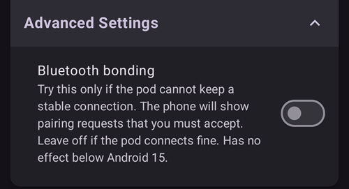

(bluetoothtroubleshooting-bluetooth-related-issues)=

# Проблеми, пов’язані з Bluetooth

Деякі користувачі мають проблеми з Bluetooth: невдала активація Omnipod DASH, проблеми зі з'єднанням Medtrum Nano та інші помилки Pod. Багато з цих проблем мають одну з причин, описаних нижче.

Деякі з цих проблем, імовірно, стосуються й інших інсулінових помп з Bluetooth. Відомо, що Medtrum Nano, як і Omnipod DASH, має проблеми з дозволом «Nearby devices» (Пристрої поблизу).

---

(bluetoothtroubleshooting-cannot-start-omnipod-with-android-16)=

## Не вдається запустити Omnipod на Android 16
- Для правильної роботи Omnipod DASH на Android 16 потрібна версія **AAPS** не нижче 3.3.2.1. У цій версії є виправлення саме для відомих проблем з Omnipod, які з'явилися в Android 16.

---

(bluetoothtroubleshooting-bluetooth-battery-optimisation)=

## Оптимізація батареї для Bluetooth

У нових версіях Android оптимізацію батареї ввімкнено для системного застосунку Bluetooth. Відомо, що це спричиняє проблеми з помпами та CGM, які працюють через Bluetooth.

Якщо ви пройшли [Майстер налаштування](../SettingUpAaps/SetupWizard.md) і виконали налаштування з розділу [Оптимізація батареї для Bluetooth](#setup-wizard-bluetooth-battery-optimisation), цей параметр має бути правильним. Але якщо ви користувалися старою версією цього посібника, можливо, ви його не змінили.

Якщо помпа та CGM втрачають з'єднання, перевірте, що цей параметр налаштовано правильно.

---

(bluetoothtroubleshooting-apps-using-nearby-device-permission)=

## Застосунки з дозволом Android «Nearby devices» (Пристрої поблизу) можуть спричиняти розриви з'єднання та проблеми з активацією Pod

Android дає змогу керувати тим, що кожен застосунок може робити на телефоні або до чого має доступ. Для цього є система дозволів. Для кожного встановленого застосунку можна дозволити або заборонити окремі дозволи, наприклад доступ до файлів на пристрої, доступ до Bluetooth, пошук пристроїв поблизу тощо.

Для роботи **AAPS** потрібні певні дозволи. Один з них, потрібний для роботи Pod, – це дозвіл «Nearby devices» (Пристрої поблизу). Цей дозвіл потрібен і багатьом іншим застосункам. Спільнота помітила, що деякі застосунки з цим дозволом на деяких пристроях можуть заважати активації нових Pod.

(bluetoothtroubleshooting-apps-using-nearby-device-permission-known-apps)=

### Застосунки з дозволом «Nearby device» (Пристрої поблизу), які вже спричиняли проблеми:

Про застосунки з цього списку в спільноті писали в одному або кількох місцях, що вони спричиняють проблеми з Omnipod DASH, а іноді й з Medtrum Nano.

```{admonition} Updating the list
:class: note
Напишіть @XiTatiON у каналі Discord #omnipod-dash, щоб обговорити, які застосунки додати до цього списку.
```

- **myBMW** MyBMW заважав роботі Medtrum Nano та Omnipod DASH. Застосунок MyBMW лише один раз запитує дозвіл «find nearby devices» (пошук пристроїв поблизу). Якщо ви його не надасте, застосунок усе одно працює цілком нормально.

- **Amazon Alexa**  Деяким людям допомогло вимкнення дозволу «Nearby devices» (Пристрої поблизу) для застосунку Alexa, але тоді не вдасться спарувати пристрої IoT Matter.

- **MINI app**  Схоже, цей застосунок створено на основі myBMW, тому він може поводитися так само.

- **BM2** Застосунок для моніторингу сонячної батареї, який використовують у деяких кемперах і сонячних системах для кемпінгу. Коли застосунок працював, він не давав активувати новий Pod. Тимчасове рішення: примусово зупиніть застосунок під час активації нового Pod. Якщо запустити застосунок після цього, він, схоже, не заважав роботі Dash (на Pixel 8 Pro з Android 16).

(bluetoothtroubleshooting-revoke-nearby-device-permission)=

### Як скасувати дозвіл «Nearby device» (Пристрої поблизу) для інших застосунків:
Якщо у вас проблеми з активацією нового Pod, а версія **AAPS** підтримує вашу версію Android, може знадобитися скасувати цей дозвіл для інших застосунків на час активації нового Pod.

Щоб скасувати дозвіл «Nearby device» (Пристрої поблизу) для всіх застосунків, крім **AAPS**, виконайте ці кроки:

```{admonition} Menus and settings
:class: note
Знімки екрана та інструкції в цьому посібнику зроблено на чистому Android 16 (Vanilla) на Google Pixel 8 Pro. На інших пристроях і в інших виробників меню та налаштування, імовірно, будуть трохи інакшими. Адаптуйте кроки до свого пристрою. Якщо ви застрягли, дивіться розділ [Де отримати допомогу щодо Dash](#omnipod-dash-where-to-get-help-for-dash): там описано, як звернутися по допомогу до спільноти.
```

1. Відкрийте налаштування Android на телефоні, прокрутіть униз і натисніть **Security and privacy (1)** (Безпека й конфіденційність).

    

2. Прокрутіть униз і натисніть **Privacy controls (1)** (Елементи керування конфіденційністю).

   

3. Натисніть **Permission manager (1)** (Диспетчер дозволів).

   

3. Прокрутіть униз і натисніть **Nearby devices (1)** (Пристрої поблизу).

   

4. Перегляньте список застосунків і натисніть на той, для якого хочете скасувати дозвіл **Nearby devices** (Пристрої поблизу).

   У цьому посібнику ми скасовуємо дозвіл для застосунку **Android Auto (1)**.

   Щоб не зіпсувати ще більше Pod, радимо спочатку скасувати цей дозвіл для всіх застосунків, крім **AAPS**.

```{admonition} Which app to select?
:class: tip
Якщо ви не знаєте, який застосунок спричиняє проблему, вимкніть дозвіл для всіх (також перевірте список відомих проблемних застосунків і почніть з них). Якщо ви можете дозволити собі втратити кілька Pod, вмикайте дозвіл для одного застосунку перед кожною новою активацією Pod. Так ви знайдете, який саме застосунок спричиняє проблеми з Pod. Якщо ви знайдете нові проблемні застосунки, повідомте нам у каналі Discord #omnipod-dash.
```

   

5. Щоб скасувати дозвіл, натисніть **Don't allow (1)** (Не дозволяти), а потім **Don't allow anyway (2)** (Усе одно не дозволяти). Якщо все зроблено правильно, буде вибрано варіант **Don't allow (3)** (Не дозволяти). Тепер можна повернутися до меню **Nearby device** (Пристрої поблизу), натиснувши **Back arrow (4)** (стрілка «Назад»), і за потреби змінити цей параметр для інших застосунків.

      

(bluetoothtroubleshooting-re-enable-nearby-device-permission)=

### Як знову ввімкнути дозвіл «Nearby device» (Пристрої поблизу) для системних та інших застосунків:

1. За потреби дивіться розділ **«Як скасувати дозвіл "Nearby device" для інших застосунків»**, щоб дізнатися, як відкрити налаштування конфіденційності застосунків. Коли ви будете в налаштуваннях **Nearby device** (Пристрої поблизу), переходьте до кроку 2.

2. Перегляньте список застосунків і натисніть на той, для якого хочете дозволити **Nearby devices** (Пристрої поблизу).

   У цьому посібнику ми надаємо дозвіл застосунку **Android Auto (1)**.

   Ви помітите, що після скасування дозволу застосунку **Android Auto (1)** немає в списку. Це тому, що **Android Auto** – **System app** (системний застосунок), а системні застосунки за замовчуванням приховані.

   

3. Щоб показати приховані системні застосунки, натисніть **three-dot menu (⋮) (1)** (меню з трьома крапками) у правому верхньому куті, а потім **"Show system" (2)** (Показати системні). Тепер ви маєте побачити в списку прихований системний застосунок **Android Auto (3)**.

```{admonition} Find your app
:class: tip
Якщо дозвіл для застосунку скасовано, прокрутіть униз до списку застосунків без дозволу.
```

     

5. Щоб знову ввімкнути дозволи для кожного застосунку, виконайте кроки з розділу **«Як скасувати дозвіл "Nearby device" для інших застосунків»** у зворотному порядку.

---

(bluetoothtroubleshooting-android-15-bluetooth-connection-problems)=

## Android 15: часті проблеми зі з'єднанням Bluetooth

Після оновлення Android або переходу на новий телефон **AAPS** часто втрачає з'єднання Bluetooth з помпою. Після перезапуску телефону проблема тимчасово зникає. Якщо ви використовуєте **Omnipod DASH** і ваш телефон працює на Android 15, увімкнення параметра **Звʼязування Bluetooth (bonding)** може зробити з'єднання Bluetooth стабільнішим. Щоб увімкнути його:

```{admonition} Android 16
:class: warning
Вмикайте **Звʼязування Bluetooth (bonding)** лише на Android 15 і лише тоді, коли маєте проблеми зі з'єднанням. НЕ вмикайте зв'язування (bonding) на Android 16.
```

1. Відкрийте [налаштування Dash](#omnipod-dash-settings): відкрийте екран помпи DASH через **Керувати** > **Помпа** і натисніть значок **Налаштування** (шестерня) у правому верхньому куті.

   

2. Відкрийте розділ **Додаткові налаштування** і ввімкніть **Звʼязування Bluetooth (bonding)**.

   

3. Якщо телефон покаже запит на спарювання, прийміть його.

4. Перезапустіть телефон.
