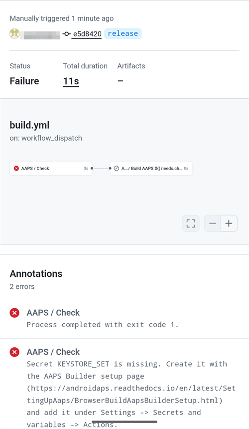
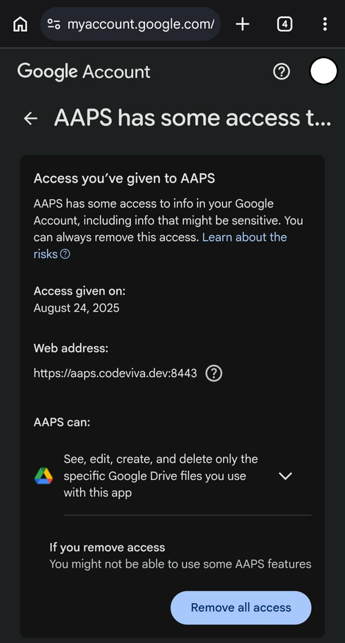
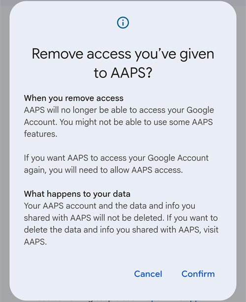

(aaps-ci-troubleshooting)=

# Збірка в браузері: усунення проблем

```{note}
This page collects troubleshooting tips for the [Browser build](../SettingUpAaps/BrowserBuild.md).
```

(aaps-builder-troubleshooting)=

## AAPS Builder

### Крок 1: репозиторій

(aaps-builder-ts-repo-exists)=

#### "my-aaps already exists in this account"


Цей репозиторій у вас уже є, наприклад з попередньої спроби. Закрийте вкладку GitHub, залиште цю назву в кроці 1 сторінки налаштування і продовжуйте. Якщо ви вже виконали для нього кроки 2 і 3, ваш ключ уже в ньому: продовжуйте з [кроку 4](#aaps-builder-step4). Якщо його створено попередньою версією сторінки налаштування, один раз оновіть його робочий процес, як описано в розділі [Оновлення AAPS](#aaps-builder-updates). Хочете почати з нуля? Введіть іншу назву, наприклад `my-aaps-2`, і використайте той самий keystore у кроці 2.

(aaps-builder-ts-user-not-found)=

#### «Користувача GitHub з таким ім’ям немає» ("No GitHub user with this name")


- **"No GitHub user with this name"** на кроці 1: введіть своє ім’я користувача GitHub, як воно показано у вашому профілі GitHub, а не адресу електронної пошти.
- **Немає кнопки «Build AAPS» або «Run workflow», або репозиторій порожній**: репозиторій створено не з шаблону. Видаліть його (**Settings** → унизу сторінки → **Delete this repository**) і знову виконайте [крок 1](#aaps-builder-step1) за допомогою кнопки **Створити мій приватний репозиторій**.

### Крок 3: секрет

(aaps-builder-ts-404)=

#### "Page not found" (404)


- **"Page not found" (404), коли сторінка налаштування відкриває GitHub**: увійдіть на github.com у тому самому браузері (GitHub показує 404 для приватних репозиторіїв, коли ви не увійшли). Якщо ви увійшли, то ім’я користувача або назва репозиторію на кроці 1 сторінки налаштування не збігаються з вашим репозиторієм. Введіть точні назви.

### Крок 4: збірка

(aaps-builder-ts-workflow-not-found)=

#### "This workflow does not exist"


Одразу після створення репозиторію GitHub може ще не прочитати його файл робочого процесу: **Build AAPS** немає на вкладці **Actions**, і немає кнопки **Run workflow**. Будь-яка невелика зміна у файлі змушує GitHub його прочитати:

1. У своєму репозиторії відкрийте **Code**, потім папку `.github`, потім `workflows`, потім файл `build.yml`.
2. Натисніть меню **⋯** угорі праворуч від файлу, потім **Edit file… In place** (на комп’ютері натисніть олівець).

   

3. Натисніть у самому кінці тексту і додайте порожній рядок (Enter). Натисніть **Commit changes…** угорі.

   

4. Знову натисніть **Commit changes**.

   

5. Знову відкрийте вкладку **Actions**: **Build AAPS** тепер є у списку робочих процесів (на телефоні список відкривається значком ліворуч від **All workflows**). Натисніть його, потім **Run workflow**.

   

(aaps-builder-ts-build-failed)=

#### Збірка не вдалася (червоний хрестик)

1. На сторінці налаштування натисніть **Відкрити мої збірки** і натисніть збірку з червоним хрестиком.

   

2. Сторінка збірки показує **Failure** (невдача) і яка частина не вдалася: **AAPS / Check** (репозиторій, секрет, версія або варіант: нічого не зібрано) або **AAPS / Build AAPS**.

   

3. Прокрутіть униз до **Annotations**, тримаючи палець на тексті, а не на схемі. Червоні рядки пояснюють проблему: натисніть **Show more**, щоб прочитати все повідомлення, а потім знайдіть його нижче.

   

- **"Secret KEYSTORE_SET is missing"**: виконайте крок 3 сторінки налаштування.
- **Збірка зупиняється з повідомленням "This repository is PUBLIC"**: у своєму репозиторії відкрийте **Settings** → **General** → **Danger Zone** → **Change visibility** → **Private**, потім зберіть знову.
- **"Version … does not exist"**: зібрати можна лише випущені версії **AAPS**, тобто ті, що є на [сторінці тегів](https://github.com/nightscout/AndroidAPS/tags) nightscout/AndroidAPS, наприклад `3.3.2.0`. Назва гілки, наприклад `dev`, не підходить. Використайте `latest` або введіть тег точно так, як він указаний у списку.
- **"Variant … is not supported"**: ваш файл робочого процесу застарілої версії. Замініть його, як описано в розділі [Оновлення AAPS](#aaps-builder-updates).
- **"The secret is too short"**, **"The secret is not a valid code"** або **"The secret does not contain a keystore"**: у секрет вставлено неправильний текст, часто саме слово `KEYSTORE_SET` або лише частину коду. У своєму репозиторії відкрийте **Settings** → **Secrets and variables** → **Actions**, відредагуйте `KEYSTORE_SET` і знову вставте довгий код, отриманий кнопкою **Копіювати секрет** (якщо ви закрили сторінку налаштування, спочатку повторіть на ній крок 2).
- **"Keystore, password or alias is wrong"**: перевірте пароль і псевдонім (alias) свого keystore, потім повторіть кроки 2 і 3 сторінки налаштування.
- **"Google Drive access has expired or was revoked"**: повторіть [крок 6](#aaps-builder-google-drive) і оновіть секрет `GDRIVE_OAUTH2`.
- **"Process completed with exit code 1" і червоний рядок лише з посиланням на `services.gradle.org`** менш ніж за хвилину: збірка не змогла завантажити Gradle – інструмент, потрібний для збірки застосунку. Сайт Gradle не відповідав. З вашим репозиторієм і налаштуваннями все гаразд. Зачекайте пів години, потім [запустіть збірку знову](#aaps-ci-rerun).
- **Інша помилка**: [прочитайте журнал збірки](#aaps-ci-read-the-logs), потім [запустіть збірку знову](#aaps-ci-rerun). Якщо вона знову не вдасться так само, попросіть допомоги, вказавши назву кроку, який не вдався, і рядки з помилкою. Ніколи не діліться вмістом своїх секретів.

### Крок 5: застосунок

- **Немає посилання Download, або відкрився застосунок GitHub**: застосунок GitHub не може завантажувати збірки. Відкрийте збірку в Chrome, як описано в [кроці 5](#aaps-builder-step5). Щоб посилання GitHub не відкривалися в застосунку: Android **Settings** (Налаштування) → **Apps** (Застосунки) → **GitHub** → **Open by default** (Відкривати за умовчанням) → вимкніть **Open supported links** (Відкривати підтримувані посилання).

## Усунення проблем AAPS-CI

(aaps-ci-read-the-logs)=
### Спочатку: з'ясуйте, що пішло не так

Коли збірка не вдається, GitHub зберігає журнал кожного кроку. Журнал показує, який крок не вдався і чому. Прочитайте його, перш ніж пробувати щось інше: саме повідомлення про помилку ви шукаєте на цій сторінці, і саме про нього запитають ті, хто допомагає.

1. У своїй копії AndroidAPS на GitHub відкрийте **Actions**. Невдала збірка позначена червоним хрестиком. Натисніть її назву.

   

2. Підсумок запуску показує **Failure** (невдача), а нижче – завдання, яке не вдалося (**Build AAPS**, з червоним хрестиком).

   

3. Прокрутіть униз до **Annotations** і натисніть червоний рядок **Build AAPS**.

   

4. Завдання відкриється. Кроки із сірою галочкою виконано успішно. Крок із червоним хрестиком – той, що не вдався: GitHub відкриває його для вас. Кроки після нього пропущено (сіре коло).

   

5. Прочитайте рядки безпосередньо над `Error: Process completed with exit code 1.`: вони пояснюють проблему. У цьому прикладі крок **Retrieving Google Drive access token** завершився помилкою `invalid_grant` і `Token has been expired or revoked.`, дивіться [Термін дії Google Refresh Token минув](#aaps-ci-google-token-expired).

   

```{tip}
Потрібна допомога? Повідомте назву кроку, який не вдався, і рядки з помилкою (підійде знімок екрана, як вище). Ніколи не діліться вмістом своїх секретів.
```

(aaps-ci-update-secret)=
#### Оновлення секрету

Багато виправлень полягає в заміні значення секрету. У своїй копії AndroidAPS на GitHub перейдіть до **Settings** → **Secrets and variables** → **Actions** і натисніть олівець біля секрету.


Введіть або вставте нове значення і натисніть **Update secret**. GitHub ніколи не показує старе значення: поле завжди порожнє.


(aaps-ci-rerun)=
#### Повторний запуск збірки після виправлення

Коли ви усунули причину, не потрібно починати все спочатку: відкрийте невдалий запуск, натисніть **...** (угорі праворуч), а потім **Re-run failed jobs**.


Натисніть **Re-run jobs**. Також можна, як зазвичай, запустити нову збірку через **Run workflow**.


(aaps-ci-preparation-web)=
### Вебсторінка aaps-ci-preparation
  - Сторінку підготовки показує тимчасовий локальний сервер (наприклад, Simple Web Server на комп'ютері). Він також отримує токен оновлення Google.
  - Якщо ви бачите екран нижче, локальний сервер зупинився або недоступний.
  - Закрийте сторінку підготовки, перевірте, що локальний сервер працює, потім знову відкрийте aaps-ci-preparation.html так само, як у кроці 2, і виконайте решту кроків. Це потрібно насамперед під час першого підключення до Google під час налаштування.

  

(aaps-ci-google-token-expired)=
### Термін дії Google Refresh Token минув
  - Термін дії токенів оновлення (refresh token) Google OAuth2 закінчується, якщо їх не використовувати 6 місяців. Вони також можуть стати недійсними в інших випадках (наприклад, ви змінили пароль облікового запису Google або вручну скасували доступ). Докладніше дивіться в [документації Google OAuth2](https://developers.google.com/identity/protocols/oauth2).
  - У [журналі збірки](#aaps-ci-read-the-logs) крок **Retrieving Google Drive access token** завершується помилкою `invalid_grant` і `Token has been expired or revoked.`:

  

  - Якщо збірка не вдається через прострочений або скасований токен оновлення Google, повторіть кроки [авторизації Google Drive](#aaps-ci-google-drive-auth), щоб отримати новий токен `GDRIVE_OAUTH2`, [оновіть секрет](#aaps-ci-update-secret) у своєму репозиторії GitHub, а потім [запустіть збірку знову](#aaps-ci-rerun).
  - Якщо авторизація знову не вдається або Google більше не запитує вашої згоди, спочатку видаліть наявний доступ AAPS з облікового запису Google, дивіться [нижче](#aaps-ci-google-remove-access).

(aaps-ci-google-remove-access)=
### Видаліть доступ AAPS з облікового запису Google і почніть авторизацію знову
  - Якщо авторизація Google Drive постійно не вдається або ви хочете почати все з чистого стану, спочатку видаліть доступ, який ви раніше надали AAPS, а потім пройдіть авторизацію знову.
  - На телефоні відкрийте [https://myaccount.google.com](https://myaccount.google.com), натисніть **Security** (Безпека), прокрутіть униз до **Your connections to third-party apps & services** (Ваші підключення до сторонніх застосунків і сервісів) і відкрийте список пов'язаних застосунків. Також можна відкрити безпосередньо [https://myaccount.google.com/connections](https://myaccount.google.com/connections).
  - Натисніть **AAPS** у списку.

  

  - На сторінці показано доступ, який ви надали AAPS (файли Google Drive, які використовує застосунок). Натисніть **Delete all** (Видалити все), щоб видалити підключення, або **See details** (Докладніше), щоб спочатку його переглянути.

  

  - На сторінці з подробицями натисніть **Remove all access** (Скасувати весь доступ).

  

  - Натисніть **Confirm** (Підтвердити).

  

  - Google підтверджує, що AAPS більше не має доступу. AAPS більше немає в списку пов'язаних застосунків.

  

  - Тепер почніть авторизацію знову з чистого стану: закрийте **обидва** – сторінку підготовки та файловий менеджер, знову відкрийте aaps-ci-preparation.html з файлового менеджера і повторіть кроки [авторизації Google Drive](#aaps-ci-google-drive-auth). Google знову попросить надати доступ, і сторінка видасть новий токен `GDRIVE_OAUTH2`.
  - [Оновіть секрет `GDRIVE_OAUTH2`](#aaps-ci-update-secret) у своєму репозиторії GitHub новим токеном, а потім [запустіть збірку знову](#aaps-ci-rerun).

(aaps-ci-disable-software)=
### Вимкніть програми, які можуть заважати перевірці OAuth
  - Перш ніж отримувати ключ OAuth, вимкніть на телефоні будь-який VPN або застосунок безпеки (брандмауер, антивірус тощо).

(aaps-ci-actions-permission)=
### Перевірте налаштування дозволів GitHub Actions
  - Переконайтеся, що політики GitHub Actions встановлено на “Allow all actions and reusable workflows” (Settings → Actions → General). Якщо ви його змінили, натисніть **Save** під параметрами.

  

`actions/checkout@v4` and `actions/setup-java@v4` are not allowed to be used in `xxxxx/AndroidAPS`. Actions in this workflow must be: within a repository owned by `xxxxx`

(aaps-ci-workflow-permissions)=
### Перевірте налаштування дозволів GitHub Workflow
  - Якщо збірка відразу завершується помилкою "Invalid workflow file", схожою на наведену нижче, то стандартні дозволи workflow у вашому репозиторії занадто обмежені:

```
Invalid workflow file
The workflow is not valid. .github/workflows/aaps-ci.yml (Line: 361, Col: 3):
Error calling workflow 'xxxxx/AndroidAPS/.github/workflows/cleanup-workflow-runs.yml@...'.
The nested job 'cleanup' is requesting 'actions: write', but is only allowed 'actions: none'.
```

  - Переконайтеся, що Workflow permissions встановлено на “Read and write permissions” (Settings → Actions → General → Workflow permissions), потім збережіть і запустіть робочий процес збірки знову.

  

(aaps-ci-password-special-characters)=
### Збірка не проходить перевірку пароля keystore
  - У [журналі збірки](#aaps-ci-read-the-logs) крок **Validating keystore, alias and password** завершується помилкою `Either KEYSTORE_BASE64, KEYSTORE_PASSWORD, KEY_PASSWORD, or KEY_ALIAS is incorrect`, а за нею `Keystore was tampered with, or password was incorrect`. На цьому збірка зупиняється: keystore і паролі перевіряються до збирання AAPS.

  

  - Робочий процес збірки зберігає кожен символ ваших паролів без змін. Введіть `KEYSTORE_PASSWORD` і `KEY_PASSWORD` точно такими, як вони є, без зворотної скісної риски чи іншого символу екранування. Якщо ви додали зворотні скісні риски, [оновіть секрети](#aaps-ci-update-secret), вказавши пароль точно таким, як він є. Приклад нижче неправильний: пароль – `Example2026`, а зворотну скісну риску додано.

  

  - Якщо збірка все одно не вдається під час підписання APK, хоча пароль правильний, і пароль містить `$`, зворотний апостроф (backtick), `"` або `\`, то файл робочого процесу збірки у вашому fork старіший за вересень 2026 і все ще обробляє ці символи як спеціальні. [Синхронізуйте свій fork](#Update-to-new-version-update-your-repo) з останньою версією dev, а потім запустіть робочий процес збірки знову.
  - Вертикальна риска `|` – особливий випадок. Сторінка підготовки з [Варіанта 1](#aaps-ci-option1) об'єднує keystore, паролі та псевдонім (alias) в один секрет `KEYSTORE_SET`, розділений символом `|`, а workflow розбиває його за цим символом. Пароль, який створює сторінка підготовки, містить лише літери та цифри, тому з Варіантом 1 такого статися не може. Це можливо лише тоді, коли ви самі склали секрет `KEYSTORE_SET` з пароля, що містить `|`. У такому разі видаліть `KEYSTORE_SET` і введіть замість нього окремі секрети з [Варіанта 2](#aaps-ci-option2).
