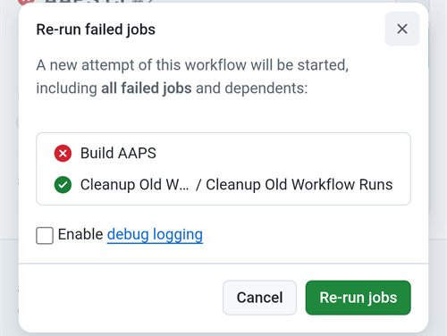
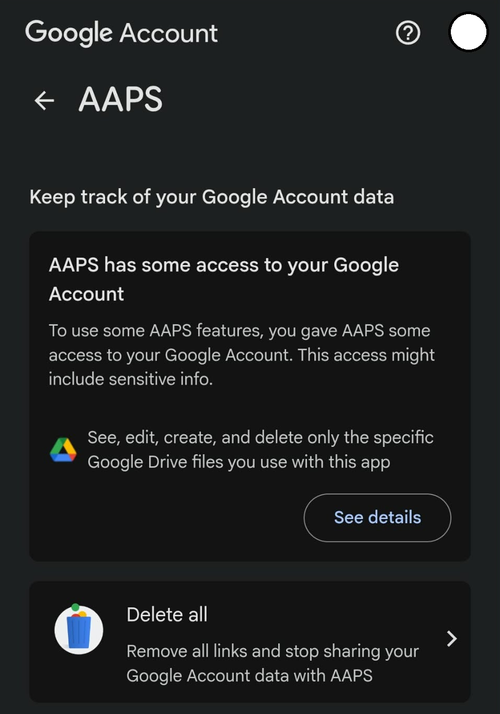

(aaps-ci-troubleshooting)=

# Збірка в браузері: усунення проблем

```{note}
На цій сторінці зібрано поради щодо усунення проблем зі [Збіркою в браузері](../SettingUpAaps/BrowserBuild.md).

Використовуєте **AAPS Builder**? Почніть з його власного [розділу про усунення проблем](#aaps-builder-troubleshooting). Розділи про Google Drive нижче також стосуються його.
```

## Усунення проблем AAPS-CI

(aaps-ci-read-the-logs)=
### Спочатку: з'ясуйте, що пішло не так

Коли збірка не вдається, GitHub зберігає журнал кожного кроку. Журнал показує, який крок не вдався і чому. Прочитайте його, перш ніж пробувати щось інше: саме повідомлення про помилку ви шукаєте на цій сторінці, і саме про нього запитають ті, хто допомагає.

1. У своїй копії AndroidAPS на GitHub відкрийте **Actions**. Невдала збірка позначена червоним хрестиком. Натисніть її назву.

   

2. Підсумок запуску показує **Failure** (невдача), а нижче – завдання, яке не вдалося (**Build AAPS**, з червоним хрестиком).

   

3. Прокрутіть униз до **Annotations** і натисніть червоний рядок **Build AAPS**.

   

4. Завдання відкриється. Кроки із сірою галочкою виконано успішно. Крок із червоним хрестиком – той, що не вдався: GitHub відкриває його для вас. Кроки після нього пропущено (сіре коло).

   

5. Прочитайте рядки безпосередньо над `Error: Process completed with exit code 1.`: вони пояснюють проблему. У цьому прикладі крок **Retrieving Google Drive access token** завершився помилкою `invalid_grant` і `Token has been expired or revoked.`, дивіться [Термін дії Google Refresh Token минув](#aaps-ci-google-token-expired).

   

```{tip}
Потрібна допомога? Повідомте назву кроку, який не вдався, і рядки з помилкою (підійде знімок екрана, як вище). Ніколи не діліться вмістом своїх секретів.
```

(aaps-ci-update-secret)=
#### Оновлення секрету

Багато виправлень полягає в заміні значення секрету. У своїй копії AndroidAPS на GitHub перейдіть до **Settings** → **Secrets and variables** → **Actions** і натисніть олівець біля секрету.


Введіть або вставте нове значення і натисніть **Update secret**. GitHub ніколи не показує старе значення: поле завжди порожнє.


(aaps-ci-rerun)=
#### Повторний запуск збірки після виправлення

Коли ви усунули причину, не потрібно починати все спочатку: відкрийте невдалий запуск, натисніть **...** (угорі праворуч), а потім **Re-run failed jobs**.


Натисніть **Re-run jobs**. Також можна, як зазвичай, запустити нову збірку через **Run workflow**.



(aaps-ci-preparation-web)=
### Вебсторінка aaps-ci-preparation
  - Сторінку підготовки показує тимчасовий локальний сервер (наприклад, Simple Web Server на комп'ютері). Він також отримує токен оновлення Google.
  - Якщо ви бачите екран нижче, локальний сервер зупинився або недоступний.
  - Закрийте сторінку підготовки, перевірте, що локальний сервер працює, потім знову відкрийте aaps-ci-preparation.html так само, як у кроці 2, і виконайте решту кроків. Це потрібно насамперед під час першого підключення до Google під час налаштування.

  

(aaps-ci-google-token-expired)=
### Термін дії Google Refresh Token минув
  - Термін дії токенів оновлення (refresh token) Google OAuth2 закінчується, якщо їх не використовувати 6 місяців. Вони також можуть стати недійсними в інших випадках (наприклад, ви змінили пароль облікового запису Google або вручну скасували доступ). Докладніше дивіться в [документації Google OAuth2](https://developers.google.com/identity/protocols/oauth2).
  - У [журналі збірки](#aaps-ci-read-the-logs) крок **Retrieving Google Drive access token** завершується помилкою `invalid_grant` і `Token has been expired or revoked.`:

  

  - Якщо збірка не вдається через прострочений або скасований токен оновлення Google, повторіть кроки [авторизації Google Drive](#aaps-ci-google-drive-auth), щоб отримати новий токен `GDRIVE_OAUTH2`, [оновіть секрет](#aaps-ci-update-secret) у своєму репозиторії GitHub, а потім [запустіть збірку знову](#aaps-ci-rerun).
  - Якщо авторизація знову не вдається або Google більше не запитує вашої згоди, спочатку видаліть наявний доступ AAPS з облікового запису Google, дивіться [нижче](#aaps-ci-google-remove-access).

(aaps-ci-google-remove-access)=
### Видаліть доступ AAPS з облікового запису Google і почніть авторизацію знову
  - Якщо авторизація Google Drive постійно не вдається або ви хочете почати все з чистого стану, спочатку видаліть доступ, який ви раніше надали AAPS, а потім пройдіть авторизацію знову.
  - На телефоні відкрийте [https://myaccount.google.com](https://myaccount.google.com), натисніть **Security** (Безпека), прокрутіть униз до **Your connections to third-party apps & services** (Ваші підключення до сторонніх застосунків і сервісів) і відкрийте список пов'язаних застосунків. Також можна відкрити безпосередньо [https://myaccount.google.com/connections](https://myaccount.google.com/connections).
  - Натисніть **AAPS** у списку.

  

  - На сторінці показано доступ, який ви надали AAPS (файли Google Drive, які використовує застосунок). Натисніть **Delete all** (Видалити все), щоб видалити підключення, або **See details** (Докладніше), щоб спочатку його переглянути.

  

  - На сторінці з подробицями натисніть **Remove all access** (Скасувати весь доступ).

  

  - Натисніть **Confirm** (Підтвердити).

  

  - Google підтверджує, що AAPS більше не має доступу. AAPS більше немає в списку пов'язаних застосунків.

  

  - Тепер почніть авторизацію знову з чистого стану: закрийте **обидва** – сторінку підготовки та файловий менеджер, знову відкрийте aaps-ci-preparation.html з файлового менеджера і повторіть кроки [авторизації Google Drive](#aaps-ci-google-drive-auth). Google знову попросить надати доступ, і сторінка видасть новий токен `GDRIVE_OAUTH2`.
  - [Оновіть секрет `GDRIVE_OAUTH2`](#aaps-ci-update-secret) у своєму репозиторії GitHub новим токеном, а потім [запустіть збірку знову](#aaps-ci-rerun).

(aaps-ci-disable-software)=
### Disable Software That May Interfere With OAuth Verification
  - Disable any VPN or security app (firewall, antimalware,...) on the phone before trying to get the OAuth key.

(aaps-ci-actions-permission)=
### Перевірте налаштування дозволів GitHub Actions
  - Переконайтеся, що політики GitHub Actions встановлено на “Allow all actions and reusable workflows” (Settings → Actions → General). Якщо ви його змінили, натисніть **Save** під параметрами.

  

`actions/checkout@v4` and `actions/setup-java@v4` are not allowed to be used in `xxxxx/AndroidAPS`. Actions in this workflow must be: within a repository owned by `xxxxx`

(aaps-ci-workflow-permissions)=
### Перевірте налаштування дозволів GitHub Workflow
  - Якщо збірка відразу завершується помилкою "Invalid workflow file", схожою на наведену нижче, то стандартні дозволи workflow у вашому репозиторії занадто обмежені:

```
Invalid workflow file
The workflow is not valid. .github/workflows/aaps-ci.yml (Line: 361, Col: 3):
Error calling workflow 'xxxxx/AndroidAPS/.github/workflows/cleanup-workflow-runs.yml@...'.
The nested job 'cleanup' is requesting 'actions: write', but is only allowed 'actions: none'.
```

  - Переконайтеся, що Workflow permissions встановлено на “Read and write permissions” (Settings → Actions → General → Workflow permissions), потім збережіть і запустіть робочий процес збірки знову.

  

(aaps-ci-password-special-characters)=
### Збірка не проходить перевірку пароля keystore
  - У [журналі збірки](#aaps-ci-read-the-logs) крок **Validating keystore, alias and password** завершується помилкою `Either KEYSTORE_BASE64, KEYSTORE_PASSWORD, KEY_PASSWORD, or KEY_ALIAS is incorrect`, а за нею `Keystore was tampered with, or password was incorrect`. На цьому збірка зупиняється: keystore і паролі перевіряються до збирання AAPS.

  

  - Робочий процес збірки зберігає кожен символ ваших паролів без змін. Введіть `KEYSTORE_PASSWORD` і `KEY_PASSWORD` точно такими, як вони є, без зворотної скісної риски чи іншого символу екранування. Якщо ви додали зворотні скісні риски, [оновіть секрети](#aaps-ci-update-secret), вказавши пароль точно таким, як він є. Приклад нижче неправильний: пароль – `Example2026`, а зворотну скісну риску додано.

  

  - Якщо збірка все одно не вдається під час підписання APK, хоча пароль правильний, і пароль містить `$`, зворотний апостроф (backtick), `"` або `\`, то файл робочого процесу збірки у вашому fork старіший за вересень 2026 і все ще обробляє ці символи як спеціальні. [Синхронізуйте свій fork](#Update-to-new-version-update-your-repo) з останньою версією dev, а потім запустіть робочий процес збірки знову.
  - Вертикальна риска `|` – особливий випадок. Сторінка підготовки з [Варіанта 1](#aaps-ci-option1) об'єднує keystore, паролі та псевдонім (alias) в один секрет `KEYSTORE_SET`, розділений символом `|`, а workflow розбиває його за цим символом. Пароль, який створює сторінка підготовки, містить лише літери та цифри, тому з Варіантом 1 такого статися не може. Це можливо лише тоді, коли ви самі склали секрет `KEYSTORE_SET` з пароля, що містить `|`. У такому разі видаліть `KEYSTORE_SET` і введіть замість нього окремі секрети з [Варіанта 2](#aaps-ci-option2).
