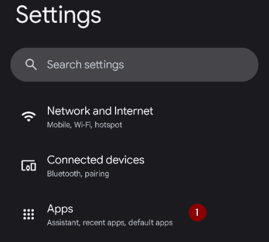
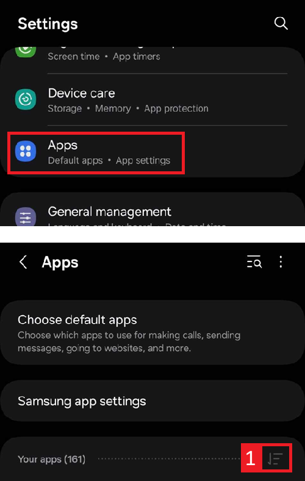
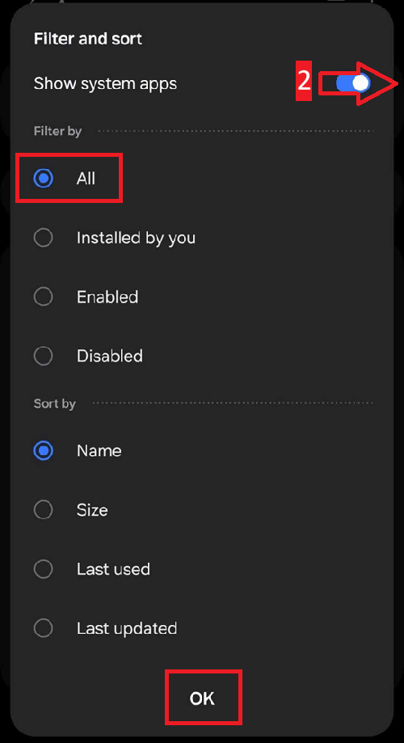

(generaltroubleshooting)=

# Усунення несправностей

**Почніть тут, коли щось не працює.** Інформація про усунення проблем є на багатьох сторінках документації. Ця сторінка збирає її разом: це єдиний набір посилань, упорядкованих за темами, який допоможе вирішити найчастіші проблеми.

Якщо ви не знайшли відповідь нижче, перегляньте також:

* [Часті запитання (FAQ)](../UsefulLinks/FAQ.md) – відповіді на часті запитання, та
* [Посібник з налаштування профілю](ProfileTuning.md), якщо петля працює, але контроль глюкози треба покращити.

```{admonition} Still stuck?
:class: tip
Якщо жодне посилання не вирішило вашу проблему, перегляньте сторінку [Де отримати допомогу](WhereCanIGetHelp.md), щоб запитати спільноту (Facebook, Discord), або надішліть ваші [файли журналу](AccessingLogFiles.md) розробникам.
```

---

(generaltroubleshooting-aaps-app)=

## Застосунок AAPS

### Збірка та оновлення

* Якщо збірка не вдалася, перегляньте розділ [Якщо збірка не вдалася](#building-aaps-troubleshooting): там є розділ з усунення проблем для кожного способу збірки:
  * [AAPS Builder](#aaps-builder-troubleshooting)
  * [Збірка в браузері](#aaps-ci-troubleshooting)
  * [Android Studio](TroubleshootingAndroidStudio.md)
* Втрачений або новий keystore: [Перевстановлення AAPS](#reinstall-aaps)
* Оновлення **AAPS**: [з AAPS Builder](#aaps-builder-updates), [зі збіркою в браузері (fork)](#update-browser-build-troubleshooting), [з Android Studio](#update-computer-build-troubleshooting)

### Встановлення

* [Попередження Google Play Protect](#transferring-installing-play-protect-warning): застосунок позначено як небезпечний.
* Встановлення **заблоковано** з повідомленням про неперевіреного розробника: безкоштовні способи встановлення описано в розділі [Перевірка розробників Android](#android-developer-verification).

### Налаштування

* [Профіль: «Базальна швидкість несумісна з поточною помпою»](#your-aaps-profile-basal-not-compatible)
* [Помпа: «Дані надходять з іншої помпи»](#config-builder-wrong-pump-data)
* [Nightscout Client](TroubleshootingNsClient.md)

### Використання

* [Неправильні значення вуглеводів (повільне засвоєння вуглеводів)](#CobCalculation-detection-of-wrong-cob-values)
* [Автоматизація](#automations-troubleshooting)
* [Повністю закрита петля](#full-closed-loop-troubleshooting)

---

(generaltroubleshooting-bluetooth-related-issues)=


## Проблеми, пов’язані з Bluetooth

Про відомі проблеми з Bluetooth-з’єднанням, обриви зв’язку з помпою/Pod, а також проблеми з активацією та підключенням див. [Проблеми, пов’язані з Bluetooth](../GettingHelp/BluetoothTroubleshooting.md)

---

(generaltroubleshooting-android-related-issues)=

## Проблеми, пов'язані з Android

### Оптимізація батареї

**AAPS** може допомогти знайти правильні налаштування для вашого телефона: відкрийте **Меню** (☰) > **Про застосунок** і натисніть **Не закривати мій застосунок?**. Відкриється інструкція для марки вашого телефона на сайті [Don't kill my app](https://dontkillmyapp.com/). [Майстер налаштування](#setup-wizard-bluetooth-battery-optimisation) також просить вимкнути оптимізацію батареї для **AAPS** і Bluetooth.

В Android є налаштування економії батареї, які увімкнені за замовчуванням. Ці налаштування автоматично призупиняють застосунки, які не потрібні для роботи системи. Так вони економлять заряд батареї, який витрачають застосунки, що не мусять працювати весь час.

Якщо вона увімкнена, це дуже ймовірно спричинить проблеми для **AAPS** та інших допоміжних застосунків, наприклад **xDrip**.

Важливо вимкнути оптимізацію батареї, щоб **AAPS** та інші допоміжні застосунки весь час залишалися активними.

Залежно від марки та моделі телефону, це може знадобитися вимкнути в кількох місцях і налаштуваннях.

***ПРИМІТКА:** Виконайте кроки нижче, щоб вимкнути оптимізацію батареї для служби Bluetooth, якщо у вашому телефоні є такий параметр. Ті самі кроки підходять і для **AAPS** та інших застосунків, але знімки екрана показують це лише для служби Bluetooth.*

#### Телефони Pixel (стандартний Android)

* Відкрийте налаштування Android, виберіть «Apps» (Застосунки).

  

* Виберіть «See all apps» (Переглянути всі застосунки)

  

* У меню праворуч виберіть «Show system» (Показати системні застосунки).

  

* Тепер знайдіть і виберіть застосунок «Bluetooth».

  

* Натисніть «App battery usage» (Використання батареї застосунком) і виберіть «Unrestricted» (Без обмежень; у деяких старіших версіях Android – «Not optimized», Не оптимізовано).

  


#### Телефони Samsung

* Відкрийте налаштування Android, виберіть «Apps» (Застосунки)

* Натисніть значок, який нібито змінює сортування (1), і виберіть «Show system apps» (Показати системні застосунки) (2).

  

  

* Тепер знайдіть застосунок Bluetooth і виберіть його, щоб побачити його налаштування.

  

* Виберіть «Battery» (Батарея).

  

* Встановіть «Unrestricted» (Без обмежень; у деяких старіших версіях Android – «Not optimized», Не оптимізовано).

  

#### Телефони Huawei

Перегляньте цей посібник: [Bluetooth і оптимізація батареї на Huawei](../CompatiblePhones/Huawei.md)

---

(generaltroubleshooting-cgm)=

## Система безперервного моніторингу глюкози (CGM)

Корисні посилання на відомі проблеми CGM і кроки для їх усунення.

* [Загальне](#general-cgm-troubleshooting)
* [Dexcom G6](#DexcomG6-troubleshooting-g6)
* [Libre 2 з Minimal Looper](#minimallooper-troubleshooting)
* [Libre 3](#libre3-experiences-and-troubleshooting)
* [xDrip – немає даних CGM](#xdrip-identify-receiver)
* [xDrip – усунення проблем з Dexcom](#xdrip-troubleshooting-dexcom-g5-g6-and-xdrip)

---

(generaltroubleshooting-pumps)=

## Помпи

Корисні посилання на відомі проблеми помп і кроки для їх усунення

* [Accu-Chek Combo](#combov2-tips-for-basic-usage)
* [Accu-Chek Insight](#Accu-Chek-Insight-Pump-insight-specific-errors)
* [CareLevo](#carelevo-alarms-and-notifications)
* [DanaRS](#DanaRS-Insulin-Pump-dana-rs-specific-errors)
* [Diaconn G8](#diaconn-g8-bluetooth-troubleshooting)
* [EOPatch2](#eopatch2-alarms-and-warnings)
* [Medtronic + RileyLink](#MedtronicPump-what-to-do-if-i-loose-connection-to-rileylink-and-or-pump)
* [Medtrum Nano](#medtrum-nano-troubleshooting)
* [Omnipod DASH](#omnipod-dash-troubleshooting)
* [Omnipod Eros](#OmnipodEros-troubleshooting)

---

(generaltroubleshooting-phones)=

## Телефони

Корисні посилання на відомі проблеми телефонів і кроки для їх усунення

* [Список перевірених телефонів і комбінацій пристроїв](https://docs.google.com/spreadsheets/u/1/d/e/2PACX-1vScCNaIguEZVTVFAgpv1kXHdsHl3fs6xT6RB2Z1CeVJ561AvvqGwxMhlmSHk4J056gMCAQE02sAWJvT/pubhtml?gid=683363241&single=true)
* [Jelly](../CompatiblePhones/Jelly.md)
* [Bluetooth і оптимізація батареї на Huawei](../CompatiblePhones/Huawei.md)

---

(generaltroubleshooting-remote-control)=

## Віддалене керування

* [AAPSClient і віддалене керування (спарювання, команди не надходять)](#client-master-control-troubleshooting)
* [Проблеми з «Токен доступу Nightscout»](#remotecontrol-nightscout-access-token)
* [SMS-команди](#SMSCommands-troubleshooting)
* [Android Auto](#android-auto-troubleshooting)

---

(generaltroubleshooting-smartwatches)=

## Розумні годинники

Корисні посилання на відомі проблеми розумних годинників і кроки для їх усунення

* [Усунення проблем із застосунком для годинника (Wear)](#Watchfaces-troubleshooting-the-wear-app)
* [Годинник і телефон не обмінюються даними](#wear-os-watch-phone-communication)
* [Wear OS 5](#wear-os-5-troubleshooting)
* [Збірка застосунку для годинника (Wear)](#building-aaps-wear-os-troubleshooting)
