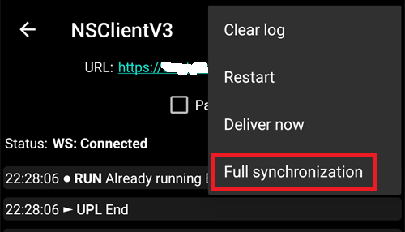

(reinstall-aaps)=
# Перевстановлення AAPS з новим keystore

Кожен apk **AAPS** підписаний за допомогою **keystore** (сховища ключів). Оновлення встановлюється поверх вашого поточного **AAPS**, лише якщо воно підписане **тим самим keystore**: тоді всі ваші налаштування і дані зберігаються. Тому радимо зберігати keystore і його пароль у безпечному місці.

Якщо ви спробуєте встановити apk, підписаний іншим keystore, ніж раніше, ви отримаєте повідомлення про помилку: встановлення не вдалося!

(reinstall-aaps-when)=
## Коли потрібно перевстановлювати?

Вам потрібно видалити і знову встановити **AAPS**, коли ваш новий apk підписаний іншим keystore, наприклад:

- Ви не можете знайти свій старий keystore або його пароль.
- Ви створили новий keystore, наприклад за допомогою [варіанту 1 збірки в браузері](../SettingUpAaps/BrowserBuildKeystore.md) або **Create a new key** (Створити новий ключ) в [AAPS Builder](../SettingUpAaps/BrowserBuildAapsBuilder.md).
- Ви збираєте на новому комп'ютері і не скопіювали на нього свій keystore.

Якщо у вас ще є ваш keystore, ця сторінка вам не потрібна: використайте його знову і [оновіть **AAPS**](../Maintenance/UpdateToNewVersion.md) поверх наявного.

(reinstall-aaps-before)=
## Перш ніж почати

- Видалення **AAPS** видаляє всі його налаштування, ваші [завдання](../SettingUpAaps/CompletingTheObjectives.md) і поточне з'єднання з помпою. Ви повернете їх, імпортувавши ваш **файл налаштувань**, тому переконайтеся, що у вас є свіжий файл.
- Файл налаштувань не містить історії терапії та глюкози. Якщо ви вивантажуєте дані в [Nightscout](../SettingUpAaps/SettingUpTheReportingServer.md), ви можете завантажити її назад після перевстановлення (крок 8).
- Вам потрібен ваш [**Головний пароль**](#Preferences-master-password): файл налаштувань зашифровано ним.
- **Користувачі Omnipod і Medtrum:** спочатку прочитайте розділ [Безтрубкові помпи](#ExportImportSettings-tubeless-pumps). Ваш файл налаштувань має бути експортований під час Pod або патча, який ви носите зараз.
- Якщо потрібно, [налаштуйте приймач вашого CGM / джерела ГК](../Getting-Started/CompatiblesCgms.md), перш ніж почати.

(reinstall-aaps-steps)=
## Кроки

Малюнки показують перехід з **AAPS** 3.4 (кроки 1–3) на **AAPS** 4 (кроки 6–8). Інші версії виглядають трохи інакше.

(reinstall-aaps-export)=
### 1. Експортуйте налаштування

Експортуйте ваші налаштування за допомогою **AAPS**, який зараз встановлено на вашому телефоні. Подробиці див. у розділі [Експорт налаштувань](#ExportImportSettings-Settings-Export).

В **AAPS** 3.4: відкрийте **Обслуговування** і натисніть **Export options** (Параметри експорту). У розділі **User Settings** (Налаштування користувача) позначте **Local Storage** (Локальне сховище) і натисніть **OK**.

*Примітка: ви також можете використати [хмарне сховище](#preferences-maintenance-cloud) для резервної копії про всяк випадок: це добра ідея, але залиште локальне сховище, щоб швидко відновлювати налаштування.*

Тепер на кнопці написано **Export settings (local)** (Експорт налаштувань (локально)). Натисніть її.

**AAPS** показує назву файлу, який він створить. Натисніть **OK**, введіть ваш головний пароль і натисніть **OK**.

В **AAPS** 4: відкрийте **Обслуговування**, виберіть чип **Локально** поруч з **Експорт налаштувань** і натисніть **Експорт налаштувань**.

(reinstall-aaps-copy)=
### 2. Скопіюйте файл налаштувань з телефона

Файл лежить у папці **preferences** вашого [каталогу **AAPS**](#SetupWizard-StoragePermission) і має назву на кшталт `2026-10-13_222735_full.json`. Скопіюйте або вивантажте його в інше місце (наприклад, на ваш комп'ютер, у хмарне сховище...). Зазвичай файл залишається на телефоні після видалення, але про всяк випадок зберігайте копію в іншому місці.

(reinstall-aaps-nightscout-before)=
### 3. Синхронізуйте з Nightscout

Цей крок не обов'язковий, але рекомендований, якщо ви використовуєте [DynISF](#Open-APS-features-DynamicISF): він дозволить продовжити одразу з поточними налаштуваннями, а не чекати 5 днів, поки накопичаться потрібні для плагіна дані. NSClient V3 має бути [увімкнений і налаштований](../SettingUpAaps/SettingUpTheReportingServer.md).

Перед видаленням переконайтеся, що в Nightscout є всі ваші дані.

Відкрийте **NSClient**, натисніть кнопку **Повна синхронізація** внизу екрана, а потім **OK**.

*Примітка: потрібний час залежить від сервісу, на якому розміщено ваш Nightscout.*

Потім **AAPS** пропонує очистити свою базу даних. **OK** видаляє з телефона дані, старші за 3 місяці, і тоді синхронізація проходить набагато швидше. **Скасувати** синхронізує без очищення. Під час видалення база даних телефона все одно видаляється, тому підходить будь-який варіант.

Не закривайте **AAPS**, доки синхронізація не завершиться.

(reinstall-aaps-build)=
### 4. Зберіть новий apk

[Зберіть](../SettingUpAaps/BuildingAaps.md) новий підписаний apk з вашим новим keystore і перенесіть його на телефон.

(reinstall-aaps-uninstall)=
### 5. Видаліть AAPS

У телефоні відкрийте **Settings** (Налаштування) > **Apps** (Застосунки) > **AAPS**, натисніть **Uninstall** (Видалити) і підтвердьте кнопкою **OK**.

(reinstall-aaps-install)=
### 6. Встановіть і запустіть новий AAPS

[Встановіть](../SettingUpAaps/TransferringAndInstallingAaps.md) новий apk і запустіть **AAPS**. [Майстер налаштування](../SettingUpAaps/SetupWizard.md) запитує дозволи, потрібні **AAPS**: натисніть **Надати** для кожного з них. Це також знову вимикає [оптимізацію батареї](#setup-wizard-bluetooth-battery-optimisation).

Для **Каталог AAPS** виберіть ту саму папку **AAPS**, що й раніше (ту, в якій є папка **preferences**), натисніть **Use this folder** (Використати цю папку) і **Allow** (Дозволити).

Коли **AAPS** знаходить ваші експортовані налаштування, майстер налаштування показує екран [Знайдено збережені налаштування](#setup-wizard-import-settings), де ви можете їх імпортувати. Ви також можете закрити майстер і імпортувати з **Обслуговування**, як описано нижче.

(reinstall-aaps-import)=
### 7. Імпортуйте ваші налаштування

Якщо файлу налаштувань більше немає на телефоні, скопіюйте його назад у папку **preferences** вашого каталогу **AAPS**.

Відкрийте меню (☰) > **Обслуговування**, виберіть чип **Локально** поруч з **Імпорт налаштувань** і натисніть **Імпорт налаштувань**.

У списку для кожного файлу показано версію **AAPS** і його вік. Виберіть файл, який ви експортували на кроці 1.

Спочатку встановлювати головний пароль у новому **AAPS** не потрібно. Введіть головний пароль, який ви використали для експорту, у полі **Пароль для розшифрування** і натисніть **Розшифрувати**. Повідомлення **Файл зашифровано іншим паролем** очікуване: новий **AAPS** ще не знає вашого пароля. Імпорт відновлює його разом з іншими вашими налаштуваннями.

Позначте **Також замінити налаштування помпи**: без цього ваша помпа та її налаштування не відновлюються. Користувачі Omnipod і Medtrum: позначайте це, лише якщо файл було експортовано під час вашого поточного Pod або патча (див. [Безтрубкові помпи](#ExportImportSettings-tubeless-pumps)).

Натисніть **Імпортувати**, потім **OK**, щоб застосувати налаштування, і ще раз **OK** у вікні **Налаштування застосовано**.

(reinstall-aaps-nightscout-after)=
### 8. Поверніть вашу історію з Nightscout

Відкрийте меню (☰) > [**Конфігурація**](../SettingUpAaps/ChangeAapsConfiguration.md) > **Звʼязок** і натисніть **Відкрити плагін** під **NSClientV3**. Перевірте, що статус показує **Підключено**. Якщо ні, див. [Усунення проблем з NSClient](TroubleshootingNsClient.md).

Натисніть кнопку **Повна синхронізація** внизу екрана і **OK**. База даних нова, тому на запитання про очищення можна відповісти як завгодно.

**AAPS** завантажує ваші дані з Nightscout. Коли все готово, журнал показує **Full sync finished** (повну синхронізацію завершено).

(reinstall-aaps-check)=
### 9. Перевірте і продовжуйте користуватися петлею

Перевірте, що помпа підключена і значення CGM надходять, а потім продовжуйте користуватися петлею.

(reinstall-aaps-afterwards)=
## Після цього

Відтепер завжди використовуйте ваш новий keystore і зберігайте його разом з паролем у безпечному місці, не на телефоні. Див. [Створення резервних копій](../Maintenance/ExportImportSettings.md).
