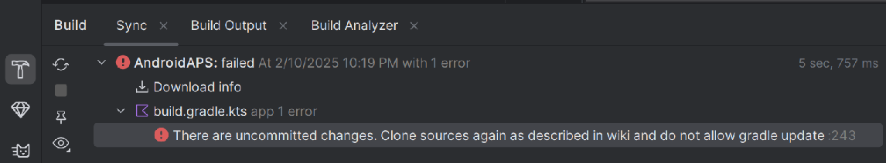
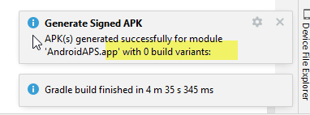

(troubleshooting_androidstudio-troubleshooting-android-studio)=

# Усунення проблем з Android Studio

```{contents} List of common issues
:depth: 2
:local: true
```

(troubleshooting_androidstudio-lost-keystore)=
## Втрачений keystore
Якщо ви втратили ваш keystore або його пароль, apk, підписаний новим keystore, не може оновити ваш поточний **AAPS**: вам потрібно видалити його і встановити знову. Див. [Перевстановлення AAPS з новим keystore](#reinstall-aaps).

## Помилка синхронізації Gradle (Gradle Sync failed)
Синхронізація Gradle може не вдатися з різних причин. Коли ви отримуєте повідомлення «gradle sync failed», відкрийте вкладку «Build» (1) внизу Android Studio і перевірте, яке повідомлення про помилку (2) показано.


```{contents} Likely reasons for gradle sync failures are:
:depth: 1
:local: true
```

*Важливо*: Після того як ви виконали інструкції для вашої проблеми, потрібно знову запустити [синхронізацію Gradle](#gradle-resync).

(troubleshooting_androidstudio-uncommitted-changes)=
### Незафіксовані зміни (Uncommitted changes)

Якщо ви отримали повідомлення про помилку, як це:



```
Build file 'C:\Data\50-Android\AndroidAPS\app\build.gradle.kts' line: 243

There are uncommitted changes.
Знову клонуйте вихідний код, як описано у вікі, і не дозволяйте оновлення Gradle
```

#### Крок 1 – Перевірте встановлення Git
  * Відкрийте вкладку терміналу (1) внизу Android Studio, скопіюйте наведений нижче текст і вставте або введіть його в термінал (2).
    ```
    git --version
    ```

    

    Примітка: між Git і version є пробіл і два дефіси!

  * Ви маєте отримати повідомлення про те, яку версію Git встановлено, як видно на знімку екрана вище. У такому випадку перейдіть до [кроку 2](#troubleshooting-android-studio-check-for-uncommitted-changes).

  * In case you get a message saying
    ```
    Git: command not found
    ```
    то Git встановлено неправильно.

  * [Перевірка встановлення Git](#BuildingAaps-steps-for-installing-git)

  * Якщо ви працюєте у Windows і Git щойно встановлено, перезапустіть комп'ютер, щоб Git став доступним глобально після встановлення

  * If Git is installed, you have restarted (if on Windows), and Git still cannot be found:

  * Знайдіть на комп'ютері файл «git.exe».

    Запишіть собі, в якому каталозі він збережений.

  * Go to the Environment variables in Windows, select the variable "PATH" and click edit. Додайте каталог, у якому ви знайшли встановлений Git.

  * Збережіть і закрийте.

  * Перезапустіть Android Studio.

(troubleshooting-android-studio-check-for-uncommitted-changes)=
#### Крок 2: Перевірте незафіксовані зміни.

  * В Android Studio відкрийте вкладку «Commit» (1) ліворуч. 
  * Ви можете побачити або «Changes» (у старіших версіях Android Studio – «Default changeset») (2), або «Unversioned Files» (3):

    * Якщо це «Changes», ви, ймовірно, оновили «Gradle» або помилково змінили вміст деяких файлів.

    * Натисніть правою кнопкою миші на «Changes» і виберіть «Rollback…» (1)

      

    * Файли знову завантажуються з сервера Git. Якщо на вкладці Commit немає інших змін, перейдіть до [кроку 3](#gradle-resync).

  * Якщо ви бачите «Unversioned Files», можливо, ви помилково зберегли файли в каталозі вихідного коду. Можливо, це важливі файли, наприклад ваш файл keystore, який слід перемістити в інше місце. Якщо ви не знаєте, що це за файли, і не створювали їх самі, їх можна видалити.

    * За допомогою звичайного файлового менеджера на комп'ютері перемістіть (або виріжте і вставте) цей файл у безпечне місце.

    * Поверніться в Android Studio і натисніть кнопку Refresh (4) на вкладці Commit, щоб переконатися, що файлу більше немає в каталозі **AAPS**.

      Якщо на вкладці Commit немає інших змін, перейдіть до [кроку 3](#gradle-resync).


#### Крок 3: Знову синхронізуйте Gradle

Виконайте інструкції з розділу [Повторна синхронізація Gradle](#gradle-resync).

### Git Pull Failed - Please tell me who you are

Якщо ви бачите це повідомлення, Git потрібно, щоб ви себе ідентифікували.


Відкрийте термінал і введіть дві такі команди, одну за одною.

```
git config --global user.name "Your name here"
git config --global user.email your.email@here.com
```

Ваше ім'я треба писати в лапках.


(troubleshooting_androidstudio-android-gradle-plugin-requires-java-11-to-run)=

(incompatible-gradle-jvm)=
### Несумісна Gradle JVM (Incompatible Gradle JVM)


```
Your build is currently configured to use incompatible Java 21.0.3 and Gradle 8.2.
Cannot sync the project.

We recommend upgrading to Gradle version 8.9.

The minimum compatible Gradle version is 8.5.

The maximum compatible Gradle JVM version is 19.
```

Або:

```
Cause: error: invalid source release: 21
```

If you experience the above error message, you need to download a correct JVM version before you can try to rebuild:

1.  Перевірте в [таблиці вимог](#Building-APK-recommended-specification-of-computer-for-building-apk-file), яка версія JVM потрібна для версії **AAPS**, яку ви збираєте, і запишіть її.

2. Відкрийте подання Gradle, натиснувши на слона (1) праворуч в Android Studio, відкрийте налаштування (2) і виберіть **Gradle Settings** (3):


3.  У полі **Gradle JDK** перевірте, чи вибрано потрібну версію (1). Якщо ні, натисніть на поле і подивіться, чи вона вже є у списку. У прикладі нижче JVM 21 позначено як «jbr-21». Якщо ви її знайшли, просто виберіть її, і все готово. Якщо її немає, виберіть **Download JDK** (2).


4. У полі Version (1) виберіть JDK, потрібний для вашої версії **AAPS** (той, який ви записали, коли перевіряли таблицю вимог). У полі Vendor (2) виберіть будь-якого постачальника. Location (3): не змінюйте. Натисніть **Download** (4).


5.  Закрийте діалог **Settings** кнопкою **OK**.
6. Тепер потрібно знову запустити синхронізацію Gradle (Gradle Sync). Виконайте інструкції з розділу [Повторна синхронізація Gradle](#gradle-resync).

(incompatible-version-of-android-gradle-plugin)=
### Несумісна версія плагіна Android Gradle

  Якщо ви бачите таке повідомлення про помилку

`The project is using an incompatible version (AGP x.x.x) of the Android Gradle plugin. Latest supported version is AGP x.x.x`

  

  Ви використовуєте застарілу версію Android Studio. У меню відкрийте Help > Check for updates і встановіть усі знайдені оновлення Android Studio та її плагінів.

(troubleshooting_androidstudio-could-not-resolve-no-cached-version)=
### Could not resolve / No cached version

  Ви можете отримати таке повідомлення про помилку:


  * Праворуч відкрийте вкладку Gradle (1).

    Переконайтеся, що кнопку, показану на (2), *НЕ* вибрано.

    

  * Тепер потрібно запустити [повторну синхронізацію Gradle](#gradle-resync)

(troubleshooting_androidstudio-unable-to-start-daemon-process)=
### Unable to start daemon process

  Якщо ви бачите повідомлення про помилку, як показано нижче, ви, ймовірно, використовуєте 32-бітну систему Windows 10. Android Studio 3.5.1 і новіші це не підтримують, і, на жаль, розробники **AAPS** нічого не можуть з цим зробити!

  В інтернеті є інформація про те, як визначити, 32-бітна чи 64-бітна у вас ОС, наприклад [ця](https://support.microsoft.com/en-us/windows/32-bit-and-64-bit-windows-frequently-asked-questions-c6ca9541-8dce-4d48-0415-94a3faa2e13d).

  

(gradle-resync)=
### Повторна синхронізація Gradle

  Якщо ви все ще бачите повідомлення, що синхронізація Gradle не вдалася, тепер виберіть посилання **Try again** (1). 


  Якщо ви більше не бачите повідомлення, ви все одно можете запустити це вручну:

  * Відкрийте вкладку Gradle (1) на правому краю Android Studio.

    

  * Натисніть правою кнопкою миші на AAPS (2)

  * Натисніть «Reload Gradle Project» (3)

## Generate Signed APK: успішно створено з 0 варіантами збірки (0 build variants)

Коли ви створюєте підписаний apk, ви можете отримати сповіщення, що створення пройшло успішно, але створено «0 build variants» (0 варіантів збірки):



Це хибне попередження. Перевірте каталог, який ви вибрали як «Destination folder» для створення (крок [Generate Signed APK](#Building-APK-generate-signed-apk)), і там ви знайдете створений apk!


## Застосунок створено з попередженнями компілятора/Kotlin

Якщо збірка завершилася успішно, але ви отримали попередження компілятора або Kotlin (позначені жовтим або синім знаком оклику), ці попередження можна просто ігнорувати.

 

Ваш apk успішно зібрано, і його можна перенести на телефон!


## AAPS не отримує даних CGM

* Якщо ви використовуєте пропатчений застосунок Dexcom G6: цей застосунок застарів. Натомість використовуйте застосунок [BYODA](#DexcomG6-if-using-g6-with-build-your-own-dexcom-app).

* Якщо ви використовуєте xDrip: позначте приймач, як описано на [сторінці налаштувань xDrip](#xdrip-identify-receiver).


## Apk не встановлено


* Переконайтеся, що ви перенесли файл «app-full-release.apk» на телефон.
* Ця помилка зазвичай означає, що новий apk підписаний іншим keystore, ніж ваш встановлений **AAPS**. Якщо у вас ще є ваш попередній keystore, виберіть його і зберіть знову. Інакше див. [Перевстановлення AAPS з новим keystore](#reinstall-aaps).
* Якщо на телефоні показано «App not installed» (Застосунок не встановлено), виконайте такі кроки:

1. [Експортуйте налаштування](../Maintenance/ExportImportSettings.md) (у версії AAPS, яку вже встановлено на телефоні)
2. Видаліть **AAPS** з телефона.
3. Увімкніть режим польоту і вимкніть Bluetooth.
4. Встановіть нову версію («app-full-release.apk»)
5. [Імпортуйте налаштування](../Maintenance/ExportImportSettings.md)
6. Знову увімкніть Bluetooth і вимкніть режим польоту

## Apk встановлено, але версія стара

If you built the app successfully, transferred it to your phone and installed it successfully but the version number stays the same then you might have forgotten to [update your local copy](#Update-to-new-version-update-your-local-copy)

## Нічого з наведеного не допомогло

Якщо жодна з порад вище не допомогла, можете спробувати зібрати apk з нуля:

1. [Експортуйте налаштування](../Maintenance/ExportImportSettings.md) (у версії AAPS, яку вже встановлено на телефоні)

2. Підготуйте пароль ключа (key password) і пароль сховища ключів (key store password).

    Або просто використовуйте новий keystore.

3. Зберіть apk з нуля, як описано [тут](#Building-APK-download-AAPS-code).

4. Коли apk успішно зібрано, видаліть наявний apk з телефона, перенесіть новий apk на телефон і встановіть його.
5. Знову [імпортуйте налаштування](../Maintenance/ExportImportSettings.md), щоб відновити ваші завдання та налаштування.
6. Перевірте параметри оптимізації батареї і знову вимкніть їх.

## Найгірший випадок

Якщо це не вирішило вашу проблему зі збіркою, можете спробувати повністю видалити Android Studio і зібрати все з нуля.  Деякі користувачі вважають, що це може вирішити їхню проблему зі збіркою.  Коли видаляєте Android Studio, не видаляйте налаштування користувача Android і **обов'язково видаліть усі файли, пов'язані з Android Studio.** Якщо ви не видалите Android Studio повністю, разом з усіма прихованими файлами, видалення може спричинити нові проблеми замість того, щоб вирішити наявні. Інструкції для повного видалення можна знайти в інтернеті, наприклад:

[https://stackoverflow.com/questions/39953495/how-to-completely-uninstall-android-studio-from-windowsv10](https://stackoverflow.com/questions/39953495/how-to-completely-uninstall-android-studio-from-windowsv10).

Встановіть Android Studio з нуля, як описано [тут](#Building-APK-install-android-studio).
