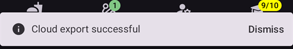
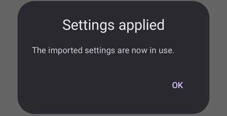

# Створення та відновлення резервних копій

Коли ви встановлюєте AAPS на телефон, він стає «медичним пристроєм», на який ви покладаєтеся щодня. Дуже рекомендуємо мати аварійний план на випадок, якщо телефон зламається, його вкрадуть або ви його загубите. Тому важливо підготуватися, запитавши себе: «А що, якщо?»

Щоб відновити налаштування AAPS на наявному або новому телефоні, важливо зберігати такі речі в безпечному місці (тобто не на телефоні). Найкраще зберігати щонайменше дві окремі резервні копії: на локальному жорсткому диску, USB-флешці і (бажано) у хмарному сховищі, наприклад Google Drive або Microsoft 365 OneDrive. Якщо ви зберігаєте резервні копії в хмарі, усе потрібне для відновлення буде доступне з телефону будь-де і будь-коли.

Подумайте про запасний телефон і потренуйтеся відновлювати на ньому AAPS, щоб переконатися, що запасний телефон працює як слід. Цей крок дасть вам упевненість, що ваш аварійний план працює і що ви зможете без перерви користуватися AAPS, якщо основний телефон стане недоступним.

```{admonition} Android backups and phone-transfer tools do not carry your AAPS settings
:class: warning
Since **AAPS** 4.0 the settings are kept in an encrypted store on the phone, and they are left out of the Google backup and of the phone-to-phone transfer of a new phone. A settings export, as described on this page, is the only way to carry them over.
```

Для відновлення важливо мати під рукою:

- Ваш **файл keystore з Android Studio** і відповідний **пароль**: потрібні для (повторної) збірки інсталяційного файлу AAPS .APK.
- Свіжу копію **інсталяційного файлу AAPS .APK**
- Свіжий файл **експорту налаштувань**: для відновлення важливих налаштувань (зокрема ваших завдань!).
- Ваш **головний пароль AAPS**
- Резервні копії додаткових застосунків: наприклад, BYODA та/або xDrip.
- Особисті нотатки про ваше налаштування.

Нижче наведено речі, резервні копії яких рекомендуємо зберігати.

## Створення резервних копій

### Файл keystore з комп'ютера, на якому ви збирали APK
Коли ви збираєте інсталяційний файл .APK в Android Studio, використовується **файл keystore і пароль для підпису інсталяційного файлу .APK**. Щоб оновити поточне встановлення AAPS, інсталяційний файл оновлення .APK потрібно підписати тим самим keystore, що й під час першого встановлення. Під час оновлення всі налаштування і база даних AAPS зберігаються. Зверніть увагу: без цього вам доведеться спочатку видалити поточний застосунок, а потім [перевстановити](#reinstall-aaps) і знову налаштувати AAPS.

Якщо ви збережете keystore і його пароль, оновлювати APK у майбутньому буде набагато простіше, особливо якщо потрібно буде зібрати застосунок на новому комп'ютері. Як використовувати keystore під час збірки нового APK, дивіться в розділі [Оновлення AAPS](../Maintenance/UpdateToNewVersion.md).

**Коли створювати резервну копію:** резервну копію keystore слід створити після першої збірки інсталяційного файлу **AAPS** .APK.

**Як створити резервну копію:** знайдіть шлях до свого keystore. Якщо ви його не пам'ятаєте, його можна знайти в Android Studio через **Build > APK > Next**. Шлях буде вказано в полі “Key store path”. У файловому менеджері перейдіть за цим шляхом і зробіть копію файлу keystore (з розширенням `.jks`). Збережіть його в надійному хмарному сховищі на випадок, якщо ваш комп'ютер стане недоступним. Також обов'язково запишіть пароль keystore, псевдонім ключа (key alias) і пароль ключа.

### Копії найновішого APK
Якщо ваш основний телефон з **AAPS** загублено або пошкоджено, копія APK дозволить швидко продовжити користуватися **AAPS** на новому телефоні. Примітка: вам також знадобиться резервна копія налаштувань, як описано нижче.

**Коли створювати резервну копію:** зберігайте резервну копію найновішого APK, який ви встановили на основний телефон з **AAPS**. Можна також зберігати одну старішу версію на випадок, якщо з будь-якої причини потрібно буде повернутися до неї.

**Як створити резервну копію:** зберігайте копію на комп'ютері, на якому ви збирали APK в Android Studio. Крім того, рекомендуємо зберігати копію інсталяційного APK на хмарній платформі. Переконайтеся, що ви знаєте, де знайти обидві резервні копії, коли вони знадобляться. Можна створити окремі папки для цих резервних копій.

### Файл налаштувань AAPS (також називається 'Preferences')

```{admonition} Where are preferences stored on my phone?
:class: tip
Ваші налаштування знаходяться в **Каталозі AAPS**, який ви вибрали під час [налаштування AAPS](#SetupWizard-StoragePermission).</br>
**Каталог AAPS** також можна змінити на екрані **Обслуговування** (**меню** (☰) > **Обслуговування**), дивіться [Налаштування локального каталогу AAPS](#preferences-maintenance-logdirectory).
```

Маючи копію інсталяційного файлу APK (див. вище) і файл **Налаштування**, ви зможете швидко почати роботу на наявному або новому телефоні.

Файл **Налаштування** використовується, щоб пристосувати застосунок AAPS до вашого налаштування. Він містить, зокрема, ваші налаштування **Конфігурації**, стан завдань, налаштування зв'язку зі сторонніми сервісами (наприклад, Nightscout, Tidepool), автоматизації та профілі.

Експорт налаштувань AAPS у файл дозволяє відновити конфігурацію на певний момент часу. Як уже сказано, крім усіх налаштувань конфігурації, файл експорту також містить стан ваших завдань, який потрібно відновити під час **(повторного) встановлення** AAPS. Без нього вам доведеться виконати всі завдання з самого початку, щоб увімкнути закриту петлю. Файли налаштувань також дозволяють відновити «останні добрі» налаштування, щоб скасувати зміни конфігурації.

**Коли створювати резервну копію налаштувань AAPS:**
* Щоразу, коли ви виконали завдання, щоб не втратити свій прогрес. _Без копії **Налаштувань** вам доведеться знову виконати всі завдання, якщо потрібно буде перевстановити AAPS або замінити телефон._

* Щоразу, коли ви плануєте суттєві зміни конфігурації (зміна налаштувань SMB, зміна типу інсуліну, зміна помпи, зміни в автоматизаціях), створюйте резервну копію **Налаштувань** до і після змін. Так у вас будуть найновіші налаштування, а також копія налаштувань до змін, якщо потрібно буде до них повернутися.

* Tubeless pumps (Such as Omnipod and Medtrum) users only: the **Settings** file contains connection details on your current pod and can be used to restore connection to that pod with a new phone. Якщо у вас немає копії налаштувань, експортованої після запуску поточного пода, вам доведеться запустити новий под, якщо потрібно буде замінити поточний телефон.

**Як створити резервну копію вручну:**

1. If this is your first time importing or exporting **Settings** you will need to set a master password in [Settings > Protection](#Preferences-master-password). Задайте пароль і запишіть його в безпечному місці. _Без цього пароля ви не зможете відкрити резервні копії **Налаштувань**._

2. На головному екрані **AAPS** відкрийте **меню** (☰) > **Обслуговування**. Виберіть, куди зберегти файл, за допомогою перемикачів **Локально** і **Хмара** поруч з **Експорт налаштувань** (дивіться **Експорт або імпорт налаштувань** нижче), потім натисніть **Експорт налаштувань**. **AAPS** показує, куди буде збережено файл: ім'я файлу для **Локально**, **Google Drive** для **Хмара**. Натисніть **OK**.

   

   

   Введіть головний пароль, заданий вище, і натисніть **OK**.

   

   Повідомлення **Налаштування експортовано** (локально) або **Експорт у хмару виконано** (хмара) підтверджує експорт.

   

   

3. У файловому менеджері телефону (зазвичай він називається “Files” («Файли») або “My Files” («Мої файли»)) перейдіть до Internal Storage («Внутрішня пам'ять») > AAPS > preferences. Тут ви побачите копії всіх експортованих файлів налаштувань. Ім'я файлу має бути `YYYY-MM-DD_Time_appname.json`. Вивантажте цей файл на хмарну платформу на ваш вибір. Потім завантажте з хмарної платформи копію також на свій локальний комп'ютер.

(ExportImportSettings-Settings-Export)=

## Експорт налаштувань

```{admonition} Where are preferences stored on my phone?
:class: tip
Ваші налаштування знаходяться в **Каталозі AAPS**, який ви вибрали під час [налаштування AAPS](#SetupWizard-StoragePermission).</br>
**Каталог AAPS** також можна змінити на екрані **Обслуговування** (**меню** (☰) > **Обслуговування**), дивіться [Налаштування локального каталогу AAPS](#preferences-maintenance-logdirectory).
```

Рекомендуємо регулярно експортувати налаштування, особливо до і після змін конфігурації. Експорт можна робити **вручну або (бажано) за допомогою автоматизації**. Обов'язково запишіть головний пароль AAPS і збережіть резервні копії файлів налаштувань поза телефоном, наприклад у хмарному сховищі.

**Примітка**: _Експортовані налаштування шифруються вашим головним паролем AAPS: без головного пароля, використаного під час експорту, ви не зможете імпортувати файл налаштувань!_

### Експорт або імпорт налаштувань
Щоб експортувати або імпортувати налаштування, відкрийте **меню** (☰) і виберіть **Обслуговування**. У розділі **Керування файлами** перемикачі **Локально** і **Хмара** поруч з **Експорт налаштувань** та **Імпорт налаштувань** визначають, куди зберігається файл налаштувань або звідки він читається: **Локально** — це каталог AAPS на вашому телефоні, **Хмара** доступна, коли налаштовано [Хмарний каталог](#preferences-maintenance-cloud). Натискання на перемикач вмикає або вимикає його; щонайменше один завжди залишається вибраним, і обидва рядки мають однаковий вибір. Потім натисніть саме **Експорт налаштувань** або **Імпорт налаштувань**, щоб почати.


(ExportImportSettings-Automating-Settings-Export)=
### Автоматизація експорту налаштувань

To automate settings exports [(**see Automation**)](../DailyLifeWithAaps/Automations.md#automating-preference-settings-export) open [**Settings** > **Maintenance**](#preferences-maintenance-settings), expand **Unattended Settings Export** and switch on **Enable automated settings export**.

Тепер можна налаштувати [Автоматизацію](../DailyLifeWithAaps/Automations.md#automating-preference-settings-export) для експорту налаштувань: або регулярно (_наприклад_, щотижня), або після заміни пода.

_**Примітка:** під час імпорту налаштувань завжди потрібно вводити головний пароль AAPS!_


(ExportImportSettings-restoring-from-your-backups-on-a-new-phone-or-fresh-installation-of-aaps)=
## Відновлення з резервних копій на новому телефоні або в новому встановленні AAPS

```{admonition} Where are preferences stored on my phone?
:class: tip
Ваші налаштування знаходяться в **Каталозі AAPS**, який ви вибрали під час [налаштування AAPS](#SetupWizard-StoragePermission).</br>
**Каталог AAPS** також можна змінити на екрані **Обслуговування** (**меню** (☰) > **Обслуговування**), дивіться [Налаштування локального каталогу AAPS](#preferences-maintenance-logdirectory).</br>
Якщо **AAPS** втратить доступ до цього каталогу (це може статися після перевстановлення або після очищення сховища застосунку), він показує сповіщення **Доступ до каталогу AAPS втрачено** і перестає зберігати налаштування на телефоні, доки ви [не виберете каталог ще раз](#preferences-maintenance-logdirectory).
```

Використовуйте ці інструкції, якщо у вас є резервна копія APK і **Налаштувань**, яку ви хочете завантажити на новий телефон, або якщо з будь-якої причини вам довелося видалити і знову встановити APK на наявному телефоні.

_Якщо ви оновлюєте **AAPS** за допомогою APK, зібраного з тим самим keystore, цей процес вам не потрібен. Однак все одно радимо створити резервну копію перед тим, як встановити оновлення._

Якщо ви оновлюєте **AAPS** після того, як втратили або замінили свій початковий keystore (наприклад, збираєте на новому комп'ютері без перенесення keystore), обов'язково створіть резервну копію всіх налаштувань, як описано вище, а потім видаліть наявну версію **AAPS** з телефону. Повну процедуру дивіться в розділі [Перевстановлення AAPS з новим keystore](#reinstall-aaps).

Якщо потрібно, перед наступними кроками [налаштуйте свій CGM/застосунок-приймач ГК](../Getting-Started/CompatiblesCgms.md)

(ExportImportSettings-tubeless-pumps)=
```{admonition} Tubeless pumps (Omnipod and Medtrum) users
:class: warning
Файл **Налаштування** містить сесію пода або патча, який був активним, коли ви його експортували.
- **Експортуйте одразу після кожної активації пода або патча** і скопіюйте файл з телефону.
- **Той самий телефон, под ще працює:** залиште **Також замінити налаштування помпи** без позначки. Ваш поточний под зберігається, імпортуються лише інші налаштування.
- **Новий телефон переймає под:** позначте **Також замінити налаштування помпи** і використовуйте лише файл, експортований під час пода, який ви носите зараз. Файл з попереднього пода замінить сесію вашого поточного пода, і вам доведеться запустити новий под.
- **Помилково імпортовано стару сесію пода:** **AAPS** і далі намагається зв'язатися з тим подом, і ви не можете активувати новий. Деактивуйте його; якщо це не вдається, викиньте його (дивіться, наприклад, [Викидання Pod](#omnipod-dash-discard-pod) для Omnipod DASH).
```

```{admonition} Pump settings are kept unless you say otherwise
:class: note
Типово імпорт не змінює налаштування помпи: помпа, вибрана в **Конфігурації**, її спарювання і всі інші її налаштування залишаються такими, як є на цьому телефоні. Позначайте **Також замінити налаштування помпи** на екрані імпорту лише тоді, коли відновлюєте налаштування на новий телефон, який має перейняти ту саму помпу. Налаштування, яких немає у файлі, імпорт ніколи не видаляє.
```

1. Використовуючи резервну копію APK, описану вище, виконайте інструкції для [нового встановлення](../SettingUpAaps/TransferringAndInstallingAaps.md)

2. Запустіть **AAPS** і надайте всі запитані дозволи

3. Вийдіть з майстра налаштування. Ми імпортуємо всі потрібні налаштування з резервної копії **Налаштувань**

4. На головному екрані **AAPS** натисніть **Надати** і надайте всі дозволи, перелічені на панелі **Потрібні дозволи** вгорі

5. На головному екрані **AAPS** задайте головний пароль у [Налаштування > Захист](#Preferences-master-password) — той самий пароль, який ви використовували для резервних копій.

6. Якщо ви ще цього не зробили, [задайте **Каталог AAPS**](#preferences-maintenance-logdirectory): на головному екрані **AAPS** відкрийте **меню** (☰) > **Обслуговування** > **Каталог AAPS**.

7. На головному екрані **AAPS** відкрийте **меню** (☰) > **Обслуговування** > **Експорт налаштувань** > введіть головний пароль, заданий вище > **OK**. Це створить папку preferences, якщо її ще немає на вашому телефоні.

8. Завантажте з хмарної платформи резервну копію файлу налаштувань (**Preferences**).

9. У файловому менеджері (зазвичай він називається “Files” («Файли») або “My Files” («Мої файли»)) перемістіть файл із завантажень до `/internal storage/AAPS/preferences`, якщо ваш **Каталог AAPS** встановлено як `/internal storage/AAPS`

10. На головному екрані **AAPS** відкрийте **меню** (☰) > **Обслуговування** і натисніть **Імпорт налаштувань**. Виберіть файл налаштувань, з якого потрібно відновити (найновіший угорі). Переконайтеся, що вибрали правильний файл налаштувань: показуються всі файли .json з папки preferences (або з хмарного каталогу, якщо вибрано **Хмара**).

    

    **AAPS** показує відомості про файл. Введіть головний пароль, заданий вище, і натисніть **Розшифрувати & переглянути**.

11. Коли файл розшифровано, вирішіть, що робити з налаштуваннями помпи. На новому телефоні, який переймає ту саму помпу, позначте **Також замінити налаштування помпи**, щоб спарювання і налаштування помпи було взято з файлу. Залиште поле без позначки, щоб зберегти помпу, з якою цей телефон уже спарений. Потім натисніть **Імпортувати**.

    

12. **AAPS** запитує **Застосувати імпортовані налаштування?** і показує, скільки налаштувань зміниться, а якщо ви залишили поле без позначки, — скільки налаштувань помпи буде збережено. Ще нічого не записано, тому **Скасувати** залишає телефон точно таким, яким він був. Натисніть **OK**, щоб застосувати.

    

13. **AAPS** застосовує імпортовані налаштування одразу, без перезапуску. Перезапускаються лише плагіни, налаштування яких змінилися. Під час цього **AAPS** показує **Застосування налаштувань…**; якщо помпа зайнята, він показує **Очікування помпи…** і застосовує налаштування, коли помпа звільниться. Якщо помпа все ще зайнята через одну хвилину, **AAPS** пропонує спробувати ще раз. Повідомлення **Налаштування застосовано** підтверджує, що імпортовані налаштування використовуються. Будь-яку терапію, що стояла в черзі під час імпорту, буде скасовано, і **AAPS** повідомить вам про це, тому ніщо не буде надіслано на помпу двічі.

    

Якщо у файлі вибрано помпу, якої немає в цій версії **AAPS**, **AAPS** перемикається на **Віртуальна помпа** і повідомляє вам про це. Виберіть свою помпу знову в **Конфігурації** і перевірте її налаштування.

14. Лише для користувачів безтрубкових помп (Omnipod і Medtrum): якщо ви позначили **Також замінити налаштування помпи**, а ваші **Налаштування** не були збережені під час того самого пода, який ви використовуєте зараз, вам доведеться запустити новий под, щоб почати введення інсуліну.

**Усунення проблем:** якщо не вдається встановити активний профіль, на головному екрані **AAPS** відкрийте **меню** (☰) зліва вгорі > **Конфігурація** > **Помпа** > перемкніть на **Віртуальна помпа** > потім перемкніть назад на свій тип помпи

### Примітка для користувачів Dana RS

- Якщо ви позначили **Також замінити налаштування помпи**, налаштування з'єднання з помпою теж імпортуються: **AAPS** на новому телефоні вже «знатиме» помпу і тому не запускатиме пошук Bluetooth.
- Спаруйте новий телефон і помпу вручну.