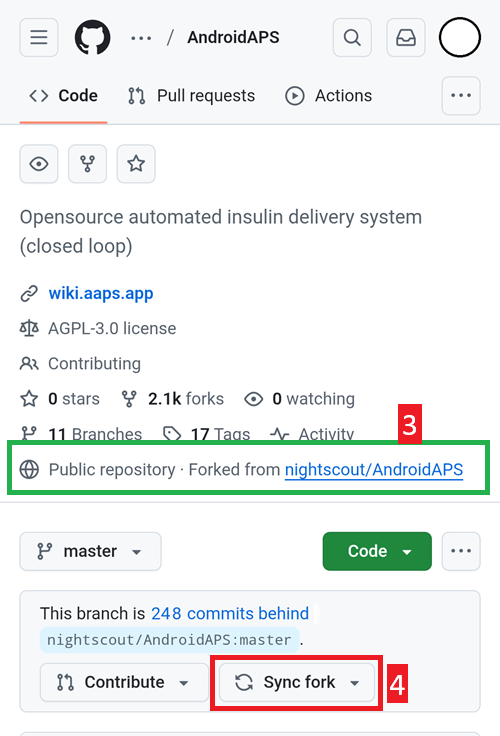

# Оновлення в браузері (fork)

```{tip}
Ви зібрали AAPS за допомогою **AAPS Builder**? Ця сторінка вам не потрібна: див. [Оновлення AAPS з AAPS Builder](#aaps-builder-updates).
```

## Зберіть самі, а не завантажуйте

**AAPS** не можна завантажити через правила для медичних виробів. Збирати застосунок для власного використання законно, але ви не повинні давати його копію іншим! Докладніше див. на [сторінці FAQ](../UsefulLinks/FAQ.md).

```{note}
Якщо ви хочете оновити **AAPS** у браузері вперше: скопіюйте резервну копію файлу keystore на ваш Google Drive. Потім виконайте [процедуру збірки **AAPS** в браузері](../SettingUpAaps/BrowserBuild.md), а не цю інструкцію. Замість того щоб створювати новий keystore, ви повинні вибрати той, який скопіювали зі свого комп’ютера.
Це обов’язково лише перший раз, а для наступних оновлень ви зможете виконувати цю інструкцію.
```

```{tip}
**Переходите на AAPS Builder?** [AAPS Builder](../SettingUpAaps/BrowserBuildAapsBuilder.md) — простіша збірка в браузері: не треба синхронізувати fork, а застосунок ви завантажуєте прямо з GitHub. Переходити не обов’язково: ця інструкція й далі працює. Якщо ви переходите, спочатку отримайте копію вашого keystore зі свого fork, як описано в розділі [Перехід з попередньої збірки в браузері](#aaps-builder-from-fork). Інакше нова збірка не зможе оновити AAPS на вашому телефоні.
```

## Огляд оновлення до нової версії AAPS у браузері

```{contents} Steps for updating to a new version of AAPS
:depth: 1
:local: true
```

Якщо виникли проблеми, див. окрему сторінку [Збірка в браузері: усунення проблем](../GettingHelp/BrowserBuildTroubleshooting.md).

### Експортуйте налаштування

Експортуйте налаштування з наявної версії **AAPS** на вашому телефоні. Можливо, вони вам не знадобляться, але краще перестрахуватися.

Якщо ви не пам’ятаєте, як це зробити, див. сторінку [Експорт та імпорт налаштувань](ExportImportSettings.md).

(Update-to-new-version-update-your-repo)=
### Оновіть ваш репозиторій GitHub

[Увійдіть у GitHub](https://github.com/login).

1. Виберіть Repositories (репозиторії).
2. Прокрутіть униз і виберіть ваш власний репозиторій AndroidAPS.


3. Переконайтеся, що ви використовуєте власну копію AndroidAPS (Forked from nightscout/AndroidAPS)
4. Натисніть Sync fork, щоб оновити її (кількість комітів, на які копія відстає, може відрізнятися від зображення)




5. Натисніть Update branch


Примітка: якщо ви помилково змінили свою копію AndroidAPS, ви побачите цей екран. Відхиліть усі зміни (коміти) (Discard), щоб повернутися до випущеної версії.


Тепер ви синхронізували (оновили) свою копію з останнім випуском AndroidAPS. Чудово.


### Запустіть робочий процес (workflow), щоб зібрати підписаний APK

1. У вашій копії AndroidAPS на GitHub виберіть Actions.
2. Розгорніть All workflows.
3. Виберіть AAPS-CI


4. Прокрутіть униз і натисніть Run workflow.


5. Залиште гілку master, виберіть AAPS Version (версію AAPS), яку хочете зібрати, — останню версію або конкретну потрібну версію, — виберіть [варіант](#browserbuild-variant) (fullRelease), а потім натисніть Run workflow.


6. Ви побачите повідомлення Workflow run was successfully requested. Оновіть сторінку в браузері, і ви зможете стежити за ходом збірки. Коли дія завершиться, біля дії AAPS CI з’явиться зелена галочка. Ви успішно зібрали оновлену версію AndroidAPS. Це означає, що apk для основного телефона (Master) і для годинника (Wear) тепер зберігаються прямо у вашому Google Drive (як показано нижче). apk AAPSClient можна завантажити з Github > nightscout > AndroidAPS [тут](https://github.com/nightscout/AndroidAPS/releases)


### Встановіть APK AAPS

1. Відкрийте ваш Google Drive
2. Відкрийте папку AAPS, виберіть папку нової версії, і ви знайдете там версії для телефона і для Android Wear.


```{note}
З вересня 2026 року [перевірка розробників Android](#android-developer-verification) від Google може, залежно від вашої країни, блокувати встановлення APK натисканням на файл. Безкоштовні обхідні способи описано на тій сторінці.
```

Продовжуйте [тут](#Update-to-new-version-check-aaps-version-on-phone)

(update-browser-build-troubleshooting)=

## Усунення несправностей

Якщо щось пішло не так, не панікуйте.

Зробіть вдих!

Потім перевірте, чи вашу проблему вже описано: див. [Усунення проблем з AAPS Builder](#aaps-builder-troubleshooting), якщо ви збираєте за допомогою **AAPS Builder**, або [Усунення проблем зі збіркою в браузері](#aaps-ci-troubleshooting) в іншому випадку.

Якщо вам потрібна додаткова допомога, зверніться до інших користувачів **AAPS** у [Facebook](https://www.facebook.com/groups/AndroidAPSUsers) або [Discord](https://discord.gg/4fQUWHZ4Mw).
