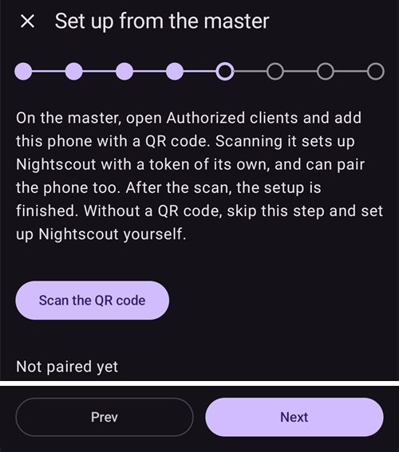
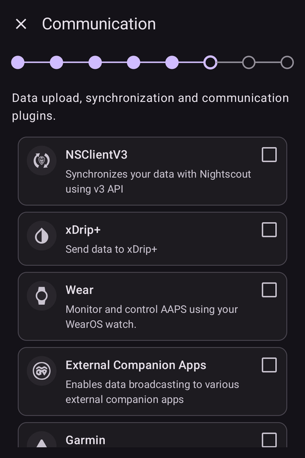
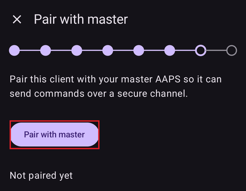
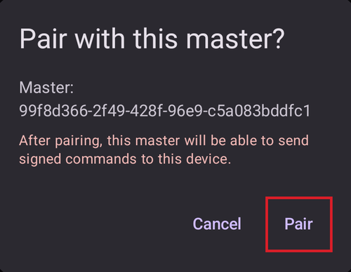
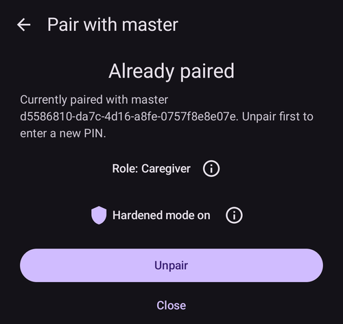
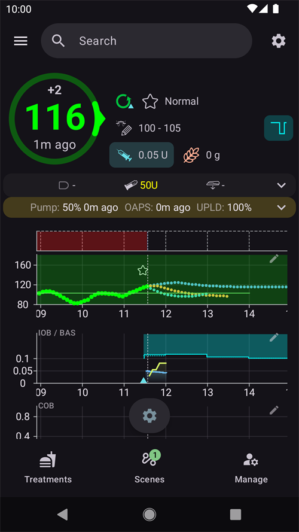
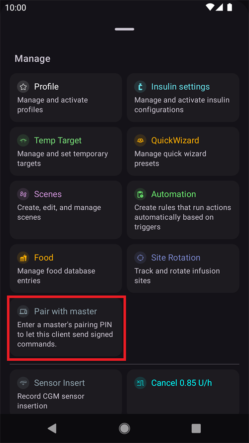
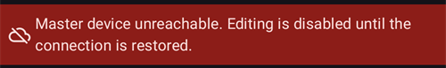

(aapsclient-app)=
# Застосунок AAPSClient

**AAPSClient** — це допоміжний застосунок **AAPS**: застосунок для другого телефону — зазвичай телефону доглядача, — який **стежить** за людиною, що користується **AAPS**. Починаючи з **AAPS** версії 4, доглядач також може віддалено **керувати** петлею за допомогою підписаних команд. Обидва телефони обмінюються даними через ваш сайт **Nightscout**; пряме з'єднання між телефонами не потрібне.

```{admonition} Wording used on this page
:class: note
- **Клієнт** = телефон, на якому працює **AAPSClient**.
- **Основний телефон (master)** = головний телефон з **AAPS**, який керує помпою і на якому працює петля.
```

```{admonition} Which devices can run AAPSClient?
:class: note
Починаючи з версії **AAPS** 4, **AAPSClient** працює на телефонах і планшетах Android, на годинниках Wear OS і на комп'ютерах (Windows, Mac і Linux). Для iPhone немає готового файлу для завантаження: застосунок ви збираєте самі. Дивіться [таблицю завантажень за пристроями](#aapsclient-platforms).
```

```{contents} Table of contents
:depth: 2
:local: true
```

## Що таке AAPSClient (і чим він не є)

**AAPSClient** виглядає і працює як **AAPS**, але **не має власної петлі**:

- Він не містить **алгоритму APS**, **Завдань** і **драйверів помп** — він ніколи не подає інсулін сам.
- Плагіни, які використовує лише основний застосунок (**SMS Комунікатор**, **Tidepool**, **Open Humans**), теж не включено.
- Що він *містить*: синхронізацію **NSClientV3**, плагіни джерела ГК, трансляцію даних у **xDrip+** і конектори для **Wear OS** / **Garmin** — усе, що потрібно, щоб стежити і передавати команди. Годинник **Garmin**, підключений до клієнта, може показувати дані, але вуглеводи, які він надсилає, не вводяться, і він не може підключити або відключити помпу: клієнт показує повідомлення, і ви вводите це в **AAPS**.

Усе, що ви запускаєте з **AAPSClient**, перевіряє, обмежує, підтверджує і **виконує основний телефон** (телефон з помпою). Окрема сторінка [Керування основний телефон ↔ клієнт](ClientMasterControl.md) пояснює, як це працює: як спарувати два телефони, як основний телефон формує текст підтвердження, який ви бачите, як подається болюс, запущений на клієнті, і що відбувається, коли основний телефон не в мережі.

## Версії: AAPSClient, AAPSClient2 і AAPSClient3

На одному телефоні-послідовнику можна встановити поруч до трьох клієнтських застосунків, кожен стежить за **іншою** людиною: **AAPSClient** (значок жовтої сови), **AAPSClient2** (синя сова) і — нове в **AAPS** версії 4 — **AAPSClient3** (зелена сова). За функціями вони однакові. Відрізняються лише назва і колір (значок застосунку, фон віджета і розділ стану на головному екрані), щоб їх можна було розрізнити. Кожен застосунок спарений зі своїм основним телефоном. Докладніше див. [Про AAPSClient, AAPSClient2 і AAPSClient3](#remotecontrol-aapsclient-versions).

(aapsclient-platforms)=
## Як отримати застосунок

Усі готові файли є у списку *Assets* останнього випуску на [GitHub](https://github.com/nightscout/AndroidAPS/releases/) (натисніть *Assets* внизу випуску, щоб розгорнути список). У таблиці *x.y.z* означає номер версії. Виберіть файл, який підходить для вашого пристрою:

| Device                      | Файл для завантаження               | Примітки                                                                                                                                                                                                        |
| --------------------------- | ----------------------------------- | --------------------------------------------------------------------------------------------------------------------------------------------------------------------------------------------------------------- |
| Телефон або планшет Android | `app-aapsclient-release_x.y.z.apk`  | Встановіть його так само, як основний застосунок: див. [Завантаження та встановлення AAPSClient](#RemoteControl_aapsclient) і [Перенесення та встановлення](../SettingUpAaps/TransferringAndInstallingAaps.md). |
| Годинник Wear OS            | `wear-aapsclient-release_x.y.z.apk` | Працює разом із застосунком AAPSClient на телефоні. Див. [Розумний годинник Wear OS](../WearOS/WearOsSmartwatch.md).                                                                                            |
| Комп'ютер з Windows         | `AAPSClient-x.y.z.msi`              | Відкрийте файл, щоб встановити.                                                                                                                                                                                 |
| Mac                         | `AAPSClient-x.y.z.dmg`              | Див. примітку про macOS під таблицею.                                                                                                                                                                           |
| Linux (Debian, Ubuntu)      | `aapsclient_x.y.z_amd64.deb`        | Встановіть його за допомогою менеджера пакетів.                                                                                                                                                                 |
| iPhone                      | немає                               | Немає ні версії в App Store, ні файлу для завантаження. Застосунок ви збираєте самі, див. [AAPSClient на iPhone](#aapsclient-iphone).                                                                           |

**Стежите за двома людьми?** Кожен файл вище також є у варіанті *aapsclient2* / *AAPSClient2*. Це другий клієнтський застосунок, який встановлюється поруч із першим, тому один пристрій може стежити за двома людьми (див. [Про AAPSClient, AAPSClient2 і AAPSClient3](#remotecontrol-aapsclient-versions)). **AAPSClient3** немає серед файлів випуску: зберіть його самі ([варіанти збірки](#browserbuild-variant)).

**Файли, які треба пропустити:** файли *pumpcontrol* (`app-pumpcontrol-release_…`, `wear-pumpcontrol-release_…`) — це не клієнт. Не завантажуйте їх.

**Mac: перший запуск.** Застосунок не нотаризований Apple, тому macOS блокує його, коли ви відкриваєте його вперше. Натисніть *Done*, потім відкрийте *System Settings → Privacy & Security* (Системні параметри → Приватність і безпека), прокрутіть униз і натисніть *Open Anyway* (Все одно відкрити).

**Комп'ютер: як під'єднати.** Комп'ютер не має камери, тому QR-код не можна відсканувати. Налаштуйте **Nightscout** у клієнті, потім на основному телефоні додайте клієнт з **PIN** і введіть 8-значний PIN у клієнті (**Спарувати з основним пристроєм**). Див. [Спарювання з основним телефоном](#aapsclient-pairing-with-the-master).

**Скрізь та сама версія.** Основний телефон і всі його клієнти мають працювати на тій самій версії **AAPS**. Коли оновлюєте основний телефон, оновіть і клієнти.

(aapsclient-iphone)=
### AAPSClient на iPhone

В App Store немає **AAPSClient** і немає готового файлу для завантаження, тому застосунок ви збираєте самі:

- Вам потрібен Mac з **Xcode** і акаунт розробника Apple.
- Проєкт — це папка `ios` у [репозиторії AndroidAPS на GitHub](https://github.com/nightscout/AndroidAPS/tree/master/ios).
- Збірка для справжнього iPhone підписується вашою власною командою розробника Apple. Збірці для симулятора iPhone вона не потрібна.
- Покрокової інструкції поки немає. Цю сторінку буде оновлено, коли вона з'явиться.

Версія для iPhone спарюється з основним телефоном так само, як інші. На відміну від версій для комп'ютера, iPhone може відсканувати QR-код основного телефону своєю камерою.

## Перший запуск: коротший Майстер налаштування

Під час першого запуску **AAPSClient** запускає той самий **Майстер налаштування**, який ви знаєте з **AAPS**, але з набагато меншою кількістю кроків — на телефоні-послідовнику немає налаштування профілю, інсуліну, помпи, APS або завдань:

1. **Ласкаво просимо**, **ліцензійна угода**, **дозволи** і **головний пароль** — так само, як в основному застосунку, див. [Майстер налаштування AAPS](../SettingUpAaps/SetupWizard.md).
2. Клієнт **не** запитує **одиниці** або **нижню/верхню межі**: він бере їх з основного телефону, щойно підключиться до Nightscout. Пізніше ви можете побачити їх у **Налаштуваннях**, де маленький **значок телефону** показує, що вони [синхронізуються з основним телефоном](#client-master-config-prefs). Змінювати їх можна лише тоді, коли основний телефон доступний.
3. **Налаштувати з основного телефону** — на основному телефоні відкрийте **Керувати → Авторизовані клієнти**, додайте цей телефон за допомогою **QR-коду** і тут торкніться **Сканувати QR-код**. Одне сканування налаштовує Nightscout з власним токеном цього телефону, а якщо код містить спарювання, то також спаровує телефон. Телефон також бере як назву свого екземпляра ім'я, з яким його додали на основному телефоні (літери з діакритичними знаками стають звичайними: «Miloš» стає «Milos»). **Після сканування налаштування завершено**: майстер закривається, бо наступні кроки лише показали б те, що вже зробив код. Без QR-коду пропустіть цей крок. (Не на комп'ютері: він не має камери, див. [Як отримати застосунок](#aapsclient-platforms).)

   

4. **Звʼязок** — у списку плагінів є лише те, що потрібно послідовнику (NSClientV3, xDrip+, Wear, Зовнішні супутні застосунки, Garmin). Якщо ви не сканували QR-код, увімкніть **NSClientV3** і введіть **той самий URL Nightscout**, що й на основному телефоні, і токен доступу, з увімкненими **websockets** — точно так, як описано в розділі [Синхронізація](#RemoteControl_aapsclient). Websockets **обов'язкові** для віддаленого керування з **AAPSClient** на обох телефонах.

   

5. **Спарувати з основним пристроєм** — цей крок є **лише** на клієнті. Він підключає цей пристрій до основного телефону через захищений канал команд за допомогою PIN-коду і бере ім'я, з яким телефон додали на основному телефоні, так само як QR-код. **Після спарювання налаштування завершено.** Ви також можете пропустити цей крок і спарувати телефон будь-коли пізніше через **Керувати → Спарувати з основним пристроєм**.

   

6. **Хто користується цим телефоном?** — лише якщо ви не спарували телефон у майстрі: ім'я людини, яка користується цим телефоном. За ним цей екземпляр можна відрізнити у звітах і під час синхронізації.

(aapsclient-pairing-with-the-master)=

## Спарювання з основним телефоном

На **основному телефоні** відкрийте **Керувати → Авторизовані клієнти** і додайте клієнт. Спарувати можна двома способами:

- **За допомогою QR-коду** (найшвидше, якщо телефон має камеру): відскануйте код на кроці майстра «**Налаштувати з основного телефону**» або через **Керувати → Спарувати з основним пристроєм → Сканувати QR-код** і підтвердьте кнопкою «**Використати**». Це також налаштовує Nightscout.
- **За допомогою PIN-коду**: на **клієнті** відкрийте описаний вище крок майстра (або **Керувати → Спарувати з основним пристроєм**), введіть одноразовий PIN-код, показаний на основному телефоні, і натисніть «**Спарувати**». Потім клієнт показує, кому він збирається довіряти, — підтвердьте кнопкою «**Спарувати**»:



Якщо спарювання в майстрі пройшло успішно, налаштування завершується і відкривається головний екран. На основному телефоні клієнт з'являється як **Активний** у списку [Авторизовані клієнти](#client_master_master_setup). Після цього **Керувати → Спарувати з основним пристроєм** показує «*Уже спарено*», роль телефону і те, чи увімкнено захищений режим:

 Повний порядок спарювання, деталі безпеки та усунення проблем описано на сторінці [Керування основний телефон ↔ клієнт](#client_master_client_setup).

Після спарювання клієнт отримує від основного телефону власний токен Nightscout (якщо основний телефон має токен адміністратора) лише з тими правами, які потрібні клієнту, і перестає використовувати токен, який ви, можливо, ввели. **AAPSClient** ніколи сам не записує терапію або ГК у Nightscout: усе, що він робить, надсилається основному телефону, який це записує. Див. [Власний токен Nightscout клієнта](#client-master-control-own-token).

Основний телефон визначає, що може робити цей телефон, за допомогою його **[ролі](#client-master-control-roles)** (Лише читання, Їжа, Доглядач або Адмін). **Керувати → Спарувати з основним пристроєм** показує роль телефону.

## Головний екран

Головний екран клієнта відображає петлю, за якою він стежить:



- **ГК, графіки, IOB/COB і профіль** надходять з Nightscout саме в тому вигляді, у якому їх вивантажив основний телефон.
- Показаний **стан петлі** — це стан петлі **основного телефону** (клієнт не має власної петлі). Поки клієнт не отримав з Nightscout робочий режим основного телефону, мітка робочого режиму показує **знак питання** (невідомо).
- **Картка стану** показує резервуар і батарею **помпи, за якою стежить клієнт**, і батарею телефону, що вивантажує дані, — взяті зі стану пристрою в Nightscout. Клієнт не має помпи, тому в застосунку немає ні локального стану помпи, ні керування помпою.
- Нижня панель містить **Терапія**, **Сцени** і **Керувати**, коли клієнт спарено (до спарювання лише **Керувати**), — вкладок помпи або завдань немає.

## Терапія і дії

Усе в **Керувати** працює так само, як в основному застосунку, з однією важливою відмінністю: на клієнті дії, які змінюють терапію (болюс, вуглеводи, тимчасові цілі, сцени…), **приховано, доки пристрій не спарено**, а після спарювання їх **передають основному телефону** для підтвердження і виконання — див. [Використання віддаленого керування](#client-master-control).

Виняток — пункт **Профіль**: його видно навіть на **неспареному** клієнті, але він відкривається **лише для перегляду** — клієнт показує профілі, які отримує через Nightscout (вони потрібні йому для власних розрахунків), без кнопок редагування і активації. Коли клієнт **спарено**, список профілів синхронізується з основним телефоном, і ви можете редагувати й активувати профілі з клієнта, як і будь-яку іншу віддалену дію.

На **неспареному** клієнті **Керувати** містить лише **Профіль** і **Спарувати з основним пристроєм**:


Червоний банер «*Основний пристрій недоступний. Редагування вимкнено, доки зʼєднання не відновиться.*» також з'являється на неспареному клієнті. Так і має бути: ще немає основного телефону, до якого можна підключитися. Банер зникає, коли клієнт спарено і основний телефон у мережі.

Коли клієнт спарено, з'являються дії терапії:



Пункту **Помпа немає** — клієнт не має помпи.

Якщо основний телефон недоступний, той самий банер з'являється і на спареному клієнті: дії терапії стають сірими, і все, що ви пробуєте зробити, блокується ще до надсилання. Клієнт помічає, що основний телефон не в мережі, коли ви пробуєте виконати дію, і знову вмикає дії, коли основний телефон повертається в мережу.



## Налаштування, синхронізовані з основним телефоном

Активна **конфігурація** плагінів і багато **параметрів** синхронізуються між основним телефоном і спареними з ним клієнтами; синхронізовані пункти позначені маленьким **значком телефону** і вимкнені (з банером «*Основний пристрій недоступний*»), поки основний телефон недоступний. Це описано в розділі [Зміна конфігурації та параметрів](#client-master-config-prefs).

## AAPSClient на розумному годиннику

Годинник Wear OS можна спарувати з телефоном-**клієнтом**; його дії передаються через клієнт на основний телефон. Див. [Wear OS](../WearOS/WearOsSmartwatch.md) і [варіанти з розумним годинником у розділі «Віддалене керування»](#RemoteControl_smartwatches).
