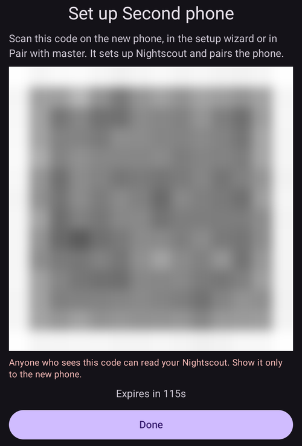
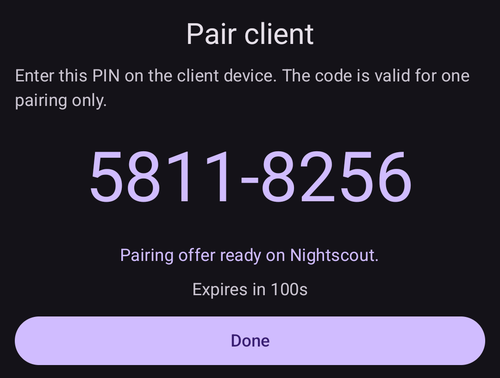

(client-master-control)=
# Керування «основний телефон ↔ клієнт» (підписане віддалене керування)

Починаючи з версії 4 **AAPS**, телефон-послідовник з **AAPSClient** може набагато більше, ніж просто *повідомляти* про терапію через Nightscout: після **спарювання** з основним телефоном він може надсилати **підписані команди**, які основний телефон (**master**) перевіряє, підтверджує та виконує, зокрема подає **болюс інсуліну** помпою основного телефону.

На цій сторінці пояснено, як це працює, як це налаштувати та як цим користуватися.

```{contents} Table of contents
:depth: 2
:local: true
```

```{admonition} Wording used on this page
:class: note
- **Основний телефон** (master) = головний телефон з **AAPS**, до якого підключена помпа і на якому працює петля (застосунок `full`).
- **Клієнт** = телефон з **AAPSClient** без помпи, який стежить за основним телефоном, а тепер також *керує* ним.
- Обидва телефони мають бути підключені до **того самого сайту Nightscout**. Увесь зв'язок і далі йде через Nightscout — пряме з'єднання між телефонами не потрібне.
```

---

## Як це працює

```{admonition} Coming from AAPS v3?
:class: note
В **AAPS** v3 **AAPSClient** міг лише записувати в Nightscout непідписані записи терапії careportal і не міг подати болюс. Тепер для віддаленого керування потрібне одноразове [спарювання](#client_master_master_setup). Див. також [Що змінилося в AAPS v4](#v4changes-remote-control).
```

**AAPS** v4 використовує окремий канал **Client-Control**. Він і далі працює через ваш сайт Nightscout (у колекції `settings`), але кожне повідомлення **криптографічно підписане** секретом, який знають лише ці два телефони. Секрет передається один раз, під час **спарювання**, і одразу після цього замінюється новим, тому він ніколи не передається відкритим текстом.

Головний принцип: **рішення ухвалює основний телефон**:

1. Клієнт надсилає *намір* («болюс 2 Од», «запустити сцену Exercise», «встановити цю тимчасову ціль»…).
2. **Основний телефон** перераховує дію та **обмежує** її за своїми **власними** актуальними даними (профіль, IOB, COB, поточна тимчасова ціль, помпа) і **сам складає точний текст підтвердження**, який побачить користувач.
3. Клієнт (або годинник) показує текст підтвердження **основного телефону** — свого власного він ніколи не складає.
4. Після підтвердження основний телефон **виконує дію один раз** і повідомляє клієнту результат.

Що це означає для вас:

- **Підписані команди**: команди можуть надсилати лише спарені вами клієнти (окремий секрет спарювання та підпис для кожного клієнта). Старі або повторно надіслані команди відхиляються.
- **Роль для кожного клієнта**: ви вирішуєте, що може робити кожен клієнт, від *Лише читання* до *Адмін* — див. [Ролі клієнтів](#client-master-control-roles).
- **Болюс інсуліну з клієнта**: основний телефон подає його своєю помпою, а клієнт показує хід подачі.
- **Рішення ухвалює основний телефон**: він обмежує кожну дію своїми власними обмеженнями і пише текст підтвердження, який показує клієнт.
- **Терапію змінюють лише спарені клієнти**: поки керування з клієнтів увімкнене, основний телефон більше не приймає терапію чи зміни, введені прямо в Nightscout — див. [Захищений режим](#client-master-control-hardened-mode).
- **Кожен клієнт отримує власний токен Nightscout** лише з тими правами, які потрібні клієнту — див. [Власний токен Nightscout клієнта](#client-master-control-own-token).
- **Основний телефон не в мережі**: дії блокуються, і ви бачите зрозуміле повідомлення.
- **Відкликати доступ клієнта** можна одним натисканням (для кожного клієнта окремо), або вимикачем на основному телефоні можна зупинити всіх клієнтів.

Дії, які можна запустити з клієнта: **болюс**, **вуглеводи / подовжені вуглеводи (eCarbs)**, **тимчасова ціль** (встановити й скасувати), **перемикання профілю**, зміна **петлі / робочого режиму**, **тимчасовий базал** (встановити й скасувати), **подовжений болюс** (встановити й скасувати), **вибір інсуліну** і **[сцени](../DailyLifeWithAaps/Scenes.md)**. Частина **налаштувань** також синхронізується в обидва боки між основним телефоном і клієнтами.

---

## Ролі та передумови

```{admonition} Before you start
:class: important
- На **основному телефоні** працює звичайна збірка `full` **AAPS**, і він підключений до вашої помпи.
- **Основний телефон** використовує **NSClientV3** з вашим Nightscout і показує *підключено*. Дайте йому **токен адміністратора** вашого Nightscout: з ним основний телефон може створити окремий токен для кожного клієнта і показати його клієнту як QR-код.
- На **клієнті** працює **[AAPSClient](AapsClient.md)** (або **AAPSClient2** / **AAPSClient3** для інших пацієнтів — див. [Про AAPSClient, AAPSClient2 і AAPSClient3](#remotecontrol-aapsclient-versions)). Він має використовувати **той самий** Nightscout. Якщо ви налаштовуєте клієнт за QR-кодом основного телефону, клієнт отримує адресу Nightscout і токен від основного телефону; інакше спочатку самі налаштуйте на ньому **NSClientV3**.
- **Websockets** потрібні на обох телефонах: команди доходять до основного телефону лише через з'єднання websocket. Поки керування з клієнтів увімкнене, **AAPS** тримає websockets увімкненими на основному телефоні та на спарених клієнтах.
```

Спарювання і синхронізація — це дві різні речі:

- **Синхронізація** (дані: ГК, терапія, профіль) налаштовується, як і раніше — див. [Синхронізація](#RemoteControl_aapsclient). QR-код основного телефону може зробити це за вас на клієнті.
- **Спарювання** (керування: описаний тут канал підписаних команд) — це новий крок, описаний нижче.

---

## Налаштування

(client_master_master_setup)=
### 1. На основному телефоні — увімкніть керування та додайте клієнта

На основному телефоні відкрийте екран **Керувати** і виберіть **Авторизовані клієнти**.

Увімкніть **Дозволити керування з клієнтів** (типово цей параметр **вимкнено**). Це головний вимикач: коли він вимкнений, жоден клієнт не може надсилати команди, але ваші спарені клієнти зберігаються, тож пізніше ви можете знову його увімкнути. Його ввімкнення також вмикає [Захищений режим](#client-master-control-hardened-mode), що показано як «*Захищений режим увімкнено*» зі значком **(i)**, який його пояснює. У [Простому режимі](#preferences-simple-mode) керування з клієнтів завжди увімкнене, тому вимикач не показується.


Натисніть кнопку **+** (унизу праворуч), щоб додати клієнта. У діалозі **Новий клієнт**:

1. Введіть **назву пристрою**, щоб ви могли впізнати його в списку.
2. Виберіть, **як налаштовується телефон** (див. таблицю нижче).
3. Виберіть його **[роль](#client-master-control-roles)**. Нічого не вибрано заздалегідь: правильна роль залежить від того, хто користується телефоном.


| Спосіб                              | Що отримує новий телефон                                                     | Коли використовувати                                                                                                   |
| ----------------------------------- | ---------------------------------------------------------------------------- | ---------------------------------------------------------------------------------------------------------------------- |
| **QR-код: Nightscout і спарювання** | адресу Nightscout, власний токен Nightscout і спарювання — одним скануванням | новий телефон має камеру: найшвидший спосіб, нічого не треба вводити                                                   |
| **QR-код: лише Nightscout**         | адресу Nightscout і власний токен Nightscout, без спарювання                 | телефон має лише **показувати** дані й ніколи не надсилати команди                                                     |
| **PIN**                             | лише спарювання; налаштування Nightscout, які вже є на телефоні, залишаються | телефон не має камери (або основний телефон не може створювати токени); телефон уже має бути підключений до Nightscout |

Для обох способів із QR-кодом потрібен **токен адміністратора** в налаштуваннях **NSClientV3** основного телефону, бо основний телефон створює токен клієнта в Nightscout. Без нього варіанти з QR-кодом показуються, але їх не можна вибрати, і діалог пояснює чому; **PIN** працює завжди.

#### За допомогою QR-коду

Натисніть **OK**: основний телефон створює токен Nightscout для клієнта і показує **QR-код**. Код, який також спарює, діє приблизно **дві хвилини**; на екрані йде зворотний відлік, і екран закривається сам, коли клієнт спарився. Відскануйте його на новому телефоні, як описано в розділі [На клієнті](#client_master_client_setup).

```{admonition} The QR code is a secret
:class: warning
Будь-хто, хто бачить QR-код, може читати ваш Nightscout, а код, який спарює, також містить спарювання. Показуйте його лише новому телефону. **AAPS** блокує знімки екрана, поки код на екрані.
```



#### За допомогою PIN

Натисніть **OK**: основний телефон показує 8-значний **PIN спарювання** у двох групах по чотири цифри (наприклад, `1234 5678`). Цей PIN **одноразовий** і **діє приблизно дві хвилини**.



```{admonition} The pairing PIN is a secret
:class: warning
PIN захищає секрет спарювання, який передається через Nightscout. Повідомляйте його лише пристрою, який ви спарюєте, не публікуйте його і дайте йому закінчитися, якщо ви ним не користуєтеся. Новий PIN завжди можна створити, знову натиснувши **+**.
```

(client_master_client_setup)=
### 2. На клієнті — спарювання з основним телефоном

#### Сканування QR-коду

QR-код основного телефону можна відсканувати у двох місцях:

- у **Майстрі налаштування** клієнта, на кроці «**Налаштувати з основного телефону**», який іде перед кроком Nightscout. Тоді одне сканування налаштовує Nightscout, а з кодом, що спарює, також і спарювання, тож налаштування завершено: майстер закривається і відкривається головний екран;
- будь-коли пізніше через **Керувати → Спарувати з основним пристроєм → Сканувати QR-код**.

Першого разу **AAPSClient** запитує дозвіл на **камеру**. Якщо ви його не дасте, на екрані буде сказано, що потрібна камера, і ви можете дозволити її кнопкою **Спробувати ще раз** або натомість спарувати за допомогою PIN.

Наведіть камеру на код. Клієнт показує, що робить код — адресу Nightscout і, для коду, що спарює, основний телефон, з яким відбудеться спарювання, — і запитує «**Використати цей код?**». Натисніть **Використати**: клієнт вмикає **NSClientV3**, замінює свою адресу Nightscout і токен на ті, що з коду, і вмикає websockets. Код, що спарює, також спарює телефон; телефон вітається з основним телефоном, щойно підключиться до Nightscout.


```{admonition} Scanning is available on Android
:class: note
Сканер поки що недоступний на iOS, а комп'ютер не має камери: там використовуйте PIN.
```

#### Введення PIN

На клієнті відкрийте **Керувати → Спарувати з основним пристроєм** (або крок майстра **Спарувати з основним пристроєм**, після кроку Nightscout), **введіть 8-значний PIN**, показаний на основному телефоні, і натисніть **Спарувати**. Клієнт за допомогою PIN безпечно отримує пропозицію спарювання через Nightscout, потім запитує «**Спарувати з цим основним пристроєм?**» і показує ідентифікатор основного телефону. Натисніть **Спарувати**, щоб підтвердити (знімок екрана див. у розділі [Спарювання з основним телефоном](#aapsclient-pairing-with-the-master)).


#### Після спарювання

Щойно клієнт спарено, він надсилає основному телефону **Hello** (привітання) і з'являється в списку **Авторизовані клієнти** основного телефону як **Активний**, з часом *«Остання активність»*. Клієнт знає свою [роль](#client-master-control-roles) зі спарювання, тому одразу показує потрібні кнопки. Спарювання в Майстрі налаштування завершує роботу майстра. На цьому ж кроці два телефони замінюють секрет спарювання новим, який ніколи не передавався (див. [Примітки щодо безпеки](#client-master-control-security)), а клієнт, налаштований за допомогою PIN, отримує власний токен Nightscout (див. [Власний токен Nightscout клієнта](#client-master-control-own-token)). Клієнт може бути спарений лише з **одним** основним телефоном одночасно; щоб спарити його з іншим основним телефоном, спочатку натисніть **Розпарувати**.


### 3. Керування клієнтами

На екрані **Авторизовані клієнти** основного телефону ви будь-коли можете:

- **Змінити роль** клієнта рядом із чотирьох кнопок під його назвою. Нова роль діє одразу, без повторного спарювання.
- **Побачити, з яким токеном Nightscout** записує клієнт: «*Власний токен Nightscout*» — це те, що вам потрібно. Червоний рядок «*Використовує токен Nightscout …, який має більше прав, ніж потрібно клієнту*» означає, що клієнт досі використовує токен із більшими правами, зазвичай ваш токен адміністратора — див. [Власний токен Nightscout клієнта](#client-master-control-own-token).
- **Відкликати доступ** окремого клієнта — натисніть значок **кошика** поруч із ним. Клієнт більше не може надсилати команди, доки його знову не спарять. Його власний токен Nightscout теж видаляється, тож він більше не може й читати ваш Nightscout.
- **Зупинити все керування**, не втрачаючи спарювань, — вимкніть **Дозволити керування з клієнтів**.

Телефони, налаштовані через **QR-код: лише Nightscout**, показано під клієнтами, у розділі «**Лише читання Nightscout**». Для кожного з них можна знову показати QR-код (щоб ще раз налаштувати той самий телефон) або видалити його токен, що закриває йому доступ до вашого Nightscout.


---

(client-master-control-roles)=
## Ролі клієнтів

Кожен спарений клієнт має **роль**. Основний телефон перевіряє її для кожної команди, а клієнт показує лише те, що дозволяє його роль. Нова роль діє одразу, без повторного спарювання. Ролі будуються одна на одній: кожна може все, що може попередня.

| Роль             | Клієнт може                                                                                                                                                                                                                                           |
| ---------------- | ----------------------------------------------------------------------------------------------------------------------------------------------------------------------------------------------------------------------------------------------------- |
| **Лише читання** | лише показувати дані. Він залишається спареним, тож готовий, коли ви дасте йому вищу роль.                                                                                                                                                            |
| **Їжа**          | подавати болюс, користуватися калькулятором болюса та Швидким майстром, вводити вуглеводи та зупиняти болюс, що триває. Вуглеводи, введені тут, можуть змусити петлю подати більше інсуліну.                                                          |
| **Доглядач**     | робити все, що робить користувач в **AAPS**: тимчасові цілі, перемикання профілю та інсуліну, режим петлі, тимчасовий базал, подовжений болюс, сцени, події careportal, калібрування та видалення записів. Не може змінювати налаштування чи шаблони. |
| **Адмін**        | робити все, включно з налаштуваннями та шаблонами (Швидкий майстер, шаблони тимчасових цілей, сцени, профілі, автоматизація, інсулін).                                                                                                                |

Значок **(i)** угорі екрана **Авторизовані клієнти** показує те саме пояснення. На клієнті **Керувати → Спарувати з основним пристроєм** показує власну роль телефону.

---

(client-master-control-hardened-mode)=
## Захищений режим

Коли параметр **Дозволити керування з клієнтів** увімкнено, основний телефон працює в **захищеному режимі**: він приймає зміни лише від спарених клієнтів. Він **не** приймає записи терапії, тимчасові цілі, зміни профілю, зміни робочого режиму чи видалення, зроблені прямо в Nightscout, наприклад на сайті Nightscout або в інших застосунках.

- Налаштування прийому даних із Nightscout (**NSClientV3 → Синхронізація**) приховані, поки захищений режим увімкнено; **AAPS** працює так, ніби вони вимкнені.
- Основний телефон і далі **вивантажує** всі свої дані в Nightscout, включно з ГК, і тримає **websockets** увімкненими.
- Якщо основний телефон отримує **ГК з Nightscout**, він і далі бере ГК звідти.
- Щоб завантажити історію на **новий** основний телефон, використайте **Повна синхронізація** в **NSClientV3**: так він отримає все, що є в Nightscout, включно з профілями.
- На [SMS-команди](SMSCommands.md) це не впливає.

Спарений клієнт дотримується захищеного режиму основного телефону: він тримає websockets увімкненими, і на ньому приховано ті самі налаштування Nightscout. Неспарений клієнт зберігає власні налаштування.

[Простий режим](#preferences-simple-mode) завжди вмикає захищений режим. Щоб вимкнути його, вийдіть із Простого режиму та вимкніть **Дозволити керування з клієнтів** на основному телефоні.

```{admonition} Why hardened mode
:class: note
Усе, що надсилає спарений клієнт, підписане, перевірене та підтверджене основним телефоном. Запис терапії, введений на сайті Nightscout, — ні: його міг би додати будь-хто з правом запису у ваш Nightscout. У захищеному режимі змінити дії основного телефону можуть лише підписані команди.
```

---

(client-master-control-own-token)=
## Власний токен Nightscout клієнта

Клієнту не потрібен токен адміністратора. Він лише читає ваш Nightscout і надсилає через нього свої команди основному телефону; сам він нічого не вивантажує. Тому основний телефон дає кожному клієнту власний токен Nightscout лише з такими правами:

- читати все,
- записувати в колекцію `settings` — канал до основного телефону,
- відкладати сигнали тривоги Nightscout.

Токен належить ролі Nightscout з назвою **`aaps-client`**, яку основний телефон створює, коли вона вперше потрібна. Роль і токени (з назвою `aaps-` і назвою клієнта) можна побачити в **Admin tools** (інструменти адміністратора) вашого сайту Nightscout. Якщо роль там змінено, основний телефон відновлює її наступного разу, коли створює токен або коли ви відкриваєте **Авторизовані клієнти**.

Як клієнт отримує свій токен:

- **Налаштування за QR-кодом**: токен міститься в коді.
- **Спарювання за допомогою PIN** (або спарювання ще до появи цієї функції): після спарювання основний телефон надсилає клієнту його власний токен через спарений канал у зашифрованому вигляді. Клієнт спочатку перевіряє, що вхід із цим токеном працює, а потім використовує його замість попереднього токена. Для цього на основному телефоні потрібен токен адміністратора; без нього клієнт залишає свій токен, а його картка на основному телефоні показує червоний рядок.

**Клієнт зберігає свій власний токен.** Щойно основний телефон побачив, що клієнт записує з власним токеном, він приймає команди цього клієнта лише з цим токеном. Команду, записану з іншим токеном (наприклад, з токеном адміністратора, пізніше введеним у клієнт, або з токеном іншого клієнта), буде відхилено, хоча клієнт спарений, і клієнт покаже «*Основний телефон відхилив команду: цей телефон записує в Nightscout з іншим токеном, ніж власний*». Його картка на основному телефоні показує це червоним. Клієнт і далі показується як онлайн, тож ви бачите, що не так. Щоб це виправити, видаліть клієнта на основному телефоні та додайте його знову.

Основний телефон ніколи не видаляє і не змінює токен Nightscout, який він не створював (з іншими ролями, ніж `aaps-client`): ці токени ваші. Власний токен клієнта він видаляє, коли ви видаляєте клієнта.

---

## Використання віддаленого керування

### Запуск дії з клієнта

Користуйтеся клієнтом точно так, як самим основним телефоном: відкрийте **Вуглеводи**, **Інсулін**, **Тимчасова ціль**, **Профіль**, **Сцени**, панель **Керувати** тощо і заповніть значення.

Коли ви підтверджуєте, клієнт коротко показує **«Звʼязок з основним телефоном…»**, **основний телефон** розраховує та обмежує дію, а потім клієнт показує **власне підтвердження основного телефону** — ті самі рядки, значення та кольори, які основний телефон показав би на своєму екрані. Перевірте їх і натисніть **OK**, щоб продовжити.


Те саме стосується простого введення вуглеводів — кількість, показана для підтвердження, розрахована основним телефоном:


Після вашого підтвердження основний телефон виконує дію один раз, і результат з'являється на клієнті.

### Болюс інсуліну з клієнта

Це головна нова можливість у v4. Болюс, запущений на клієнті, **подає основний телефон своєю помпою**; основний телефон обмежує його своїми власними обмеженнями, а клієнт показує **хід подачі в реальному часі**, поки болюс триває (і сигнал тривоги, якщо помпа повідомляє про помилку).

```{admonition} Boluses are always confirmed and capped on the master
:class: note
Клієнт ніколи сам не вирішує, яку кількість подати. Основний телефон перераховує й обмежує її, ви підтверджуєте кількість, складену основним телефоном, і лише тоді її буде подано.
```

(clientmastercontrol-when-the-master-is-offline)=
### Коли основний телефон не в мережі

Якщо основний телефон недоступний (телефон вимкнений або спить, не підключений до Nightscout або websockets не працюють), дії керування на клієнті **блокуються ще до надсилання**, і ви отримуєте зрозуміле повідомлення. Нічого не виконується наполовину.


Клієнт сам повторно перевіряє зв'язок і знову вмикає керування, щойно основний телефон знову в мережі.

(clientmastercontrol-wear-os-on-a-client)=

### Wear OS (годинник) на клієнті

Годинник, спарений із телефоном-**клієнтом**, передає свої дії через клієнта на основний телефон (годинник → клієнт → основний телефон). Годинник показує рядки підтвердження **основного телефону** і справжній результат — так само, як телефон. Налаштування годинника не змінилося — див. [Wear OS](../WearOS/WearOsSmartwatch.md).


<!-- 📷 SCREENSHOT NEEDED (optional): watch confirmation screen relayed from the master,
     and/or the "Contacting master" state on the watch. Requires a paired Wear OS device. -->

---

(client-master-config-prefs)=
## Зміна конфігурації та налаштувань

Спарювання не лише передає окремі дії — воно також узгоджує **конфігурацію** і багато **налаштувань** між основним телефоном і його клієнтами.

### Конфігурація (які плагіни активні)

Активні **плагіни** (алгоритм APS, чутливість, згладжування, …) вибираються на **основному телефоні** і **віддзеркалюються** на кожен спарений клієнт. На клієнті ці вибори позначено маленьким **значком телефона** на екрані [Конфігурація](#configuration_sync_icon) — змініть їх на основному телефоні, і клієнти автоматично підлаштуються, і навпаки.

На клієнті значок телефона є біля *Згладжування*, *Калібрування*, *Визначення чутливості* і *APS* (синхронізуються з основним телефоном), але не біля *Звʼязок*:


Дані підключення, унікальні для кожного пристрою, — передусім **URL Nightscout / токен доступу NSClient** — *не* синхронізуються. Кожен телефон має власні; на клієнті вони беруться з QR-коду основного телефону, або ви задаєте їх самі.

### Профілі

Ваш **список профілів** теж синхронізується між основним телефоном і його спареними клієнтами. На спареному клієнті **Керувати → Профіль** показує ті самі профілі, що й на основному телефоні; ви можете **редагувати** профіль або **активувати** його, і — як і будь-яка інша команда — зміну буде надіслано на **основний телефон**, застосовано там і синхронізовано назад.

Коли ви вперше активуєте профіль на щойно встановленому клієнті, клієнт може показати «*Інсулін ще не використовується*» і попросити **вибрати інсулін**. Виберіть інсулін, активний на основному телефоні (його показує **Керувати → Налаштування інсуліну** на основному телефоні).

На клієнті, який **не спарений**, екран «Профіль» доступний, але **лише для перегляду**: клієнт показує профілі, які отримує через Nightscout (вони потрібні йому для власних розрахунків), але кнопок редагування й активації немає — немає основного телефону, якому можна надіслати зміну.

### Налаштування

Частина **налаштувань** є **двосторонньою**: їх можна змінювати на **основному телефоні або на спареному клієнті**, і зміна синхронізується на інший бік. Коли ви змінюєте таке налаштування на клієнті, його надсилають на основний телефон підписаним каналом, застосовують там, а остаточне значення надсилають назад — тож на клієнті ви завжди бачите те, що зберіг основний телефон. Якщо те саме налаштування змінено на двох пристроях майже одночасно, **перемагає остання зміна**. Для налаштування з повзунком нове значення надсилається, коли ви відпускаєте палець.

Усередині налаштувань той самий маленький **значок телефона** позначає окремі налаштування, які синхронізуються. У прикладі нижче *Межа засвоєння* синхронізується (значок телефона), а налаштування без значка діють лише на цьому пристрої:


```{admonition} The master must be online to change synced settings from a client
:class: note
Основний телефон є головним джерелом збереженого значення, тому щоб змінити з клієнта елемент конфігурації, яким керує основний телефон, або двостороннє налаштування, основний телефон має бути **доступний**. Коли основний телефон не в мережі, ці елементи керування на клієнті вимкнені (див. [Коли основний телефон не в мережі](#clientmastercontrol-when-the-master-is-offline)).
```

---

(client-master-control-security)=
## Примітки щодо безпеки

```{admonition} How the channel is protected
:class: tip
- **Секрет спарювання**: основний телефон один раз передає його клієнту — захищеним PIN у документі Nightscout або всередині QR-коду — і обидва телефони зберігають його в зашифрованому вигляді.
- **Новий секрет одразу після спарювання**: перше повідомлення клієнта після спарювання запускає обмін ключами, і відтоді обидва телефони використовують секрет, який ніколи не передавався. Секрет, який хтось міг побачити (сфотографований QR-код, пропозиція з PIN, прочитана з Nightscout), після цього нічого не дає. Телефони, спарені ще до появи цієї функції, роблять те саме один раз після оновлення.
- **Кожна команда підписана** (HMAC). Основний телефон відхиляє все, чий підпис не відповідає спареному клієнту.
- **Повторне надсилання команд заблоковано** монотонним лічильником для кожного клієнта, а кожна команда **закінчується** після короткого часу дії.
- **Мінімальні права в Nightscout**: кожен клієнт має [власний токен Nightscout](#client-master-control-own-token), який може лише читати та записувати в канал керування з клієнта. Щойно клієнт його використав, основний телефон приймає його команди лише з цим токеном. Видалення клієнта видаляє й токен.
- **Лише підписані зміни**: у [захищеному режимі](#client-master-control-hardened-mode) основний телефон ігнорує зміни терапії, введені прямо в Nightscout.
- **Основний телефон підписує те, чим ділиться**: налаштування, список клієнтів і знак «основний телефон працює», які основний телефон записує в Nightscout для своїх клієнтів, мають підпис основного телефону. Клієнт приймає їх, лише коли підпис належить основному телефону, тому токен іншого клієнта не може їх змінити. Клієнт дізнається ключ основного телефону під час спарювання, а телефон, який лише читає Nightscout, — з QR-коду. Відхилений документ показується в журналі NSClient як «*✕ SETTINGS … refused*».
- **Керування залишається за вами**: дайте кожному клієнту потрібну йому [роль](#client-master-control-roles), відкличте доступ клієнта одним натисканням або вимкніть усе параметром **Дозволити керування з клієнтів**.
```

```{admonition} After restoring a backup
:class: warning
Якщо клієнт відновлено з резервної копії, у якій його лічильник команд менший, основний телефон відхилятиме його наступні команди як повторні. Щоб це виправити, просто **розпаруйте і спаруйте знову**.
```

---

(client-master-control-troubleshooting)=

## Усунення несправностей

| Ознака                                                                                                                    | Що перевірити                                                                                                                                                                                                                                                                                                                                                      |
| ------------------------------------------------------------------------------------------------------------------------- | ------------------------------------------------------------------------------------------------------------------------------------------------------------------------------------------------------------------------------------------------------------------------------------------------------------------------------------------------------------------ |
| Клієнт повідомляє, що **основний телефон не в мережі**                                                                    | Основний телефон не спить і на ньому працює **AAPS**; обидва телефони підключені в **NSClientV3**; **websockets** увімкнені на обох; той самий сайт Nightscout.                                                                                                                                                                                                    |
| Клієнт повідомляє, що він **не спарений**                                                                                 | Спаруйте знову через **Керувати → Спарувати з основним пристроєм**. Перевірте, що клієнт має стан **Активний** у списку **Авторизовані клієнти** основного телефону.                                                                                                                                                                                               |
| Основний телефон **відхилив** команду                                                                                     | Основний телефон повторно перевіряє команду за своїм поточним станом — наприклад, вибраного профілю вже немає або тип помпи не збігається. Перевірте на основному телефоні.                                                                                                                                                                                        |
| Команди працюють, але **повільно**                                                                                        | Увімкніть **websockets** на обох телефонах (інакше застосунки переходять на повільніше опитування).                                                                                                                                                                                                                                                                |
| Спарювання скасовано з повідомленням *«Не вдалося зберегти секрет спарювання»*                                            | Нічого не змінено. Почніть спарювання знову; якщо помилка повторюється, перезапустіть **AAPSClient** і спробуйте ще раз.                                                                                                                                                                                                                                           |
| Після спарювання нічого не відбувається                                                                                   | Переконайтеся, що на основному телефоні параметр **Дозволити керування з клієнтів** УВІМКНЕНО і що основний телефон підключений до Nightscout.                                                                                                                                                                                                                     |
| Варіанти з QR-кодом не можна вибрати в діалозі **Новий клієнт**                                                           | Діалог пояснює чому. *Не токен адміністратора*: дайте основному телефону токен адміністратора вашого Nightscout або додайте клієнта за допомогою **PIN**. *Не підключено*: зачекайте, доки основний телефон покаже *підключено* в **NSClientV3**.                                                                                                                  |
| *«У Nightscout уже є токен із цією назвою та іншими правами»*                                                             | Один із ваших власних токенів Nightscout має назву `aaps-` плюс цю назву. Виберіть іншу назву для клієнта.                                                                                                                                                                                                                                                         |
| *«Клієнт із такою назвою вже є в списку»*                                                                                 | Виберіть іншу назву або спочатку видаліть цього клієнта.                                                                                                                                                                                                                                                                                                           |
| Клієнт повідомляє *«Цей код з іншої версії AAPS»*                                                                         | На основному телефоні та клієнті має працювати **однакова** версія **AAPS**. Оновіть старішу.                                                                                                                                                                                                                                                                      |
| Клієнт повідомляє *«Термін дії цього коду минув»*                                                                         | Код, що спарює, діє приблизно дві хвилини. Додайте клієнта на основному телефоні знову, щоб отримати новий код.                                                                                                                                                                                                                                                    |
| Клієнт повідомляє *«Цей телефон уже спарено»*                                                                             | Спочатку розпаруйте його (**Керувати → Спарувати з основним пристроєм → Розпарувати**), потім скануйте знову. Код **лише Nightscout** працює й на спареному телефоні.                                                                                                                                                                                              |
| Клієнт повідомляє *«Основний телефон відхилив команду: цей телефон записує в Nightscout з іншим токеном, ніж власний»*    | Клієнт раніше використовував власний токен Nightscout, а тепер записує з іншим, наприклад після того, як у його налаштування Nightscout ввели токен. Видаліть клієнта на основному телефоні та додайте його знову (див. [Власний токен Nightscout клієнта](#client-master-control-own-token)).                                                                     |
| Журнал NSClient на клієнті показує *«✕ SETTINGS … refused»*, і його налаштування більше не слідують за основним телефоном | Хтось інший записав документ налаштувань основного телефону, або основний телефон має новий ключ (наприклад, після очищення його даних). Спарений клієнт сам приймає новий ключ, коли наступного разу підключається до Nightscout. Телефону, який лише читає Nightscout, знову потрібен QR-код основного телефону (**Лише читання Nightscout → Показати QR-код**). |
| Картка клієнта показує червоним *«Використовує токен Nightscout …»*                                                       | Клієнт досі записує з токеном, який має більше прав, ніж йому потрібно. Основний телефон надсилає йому власний токен після спарювання, але лише якщо основний телефон має токен адміністратора. Перевірте токен основного телефону або налаштуйте клієнта знову за QR-кодом.                                                                                       |
| Клієнт більше не може читати Nightscout                                                                                   | Його токен видалено, наприклад тому, що клієнта видалили на основному телефоні. Додайте його знову.                                                                                                                                                                                                                                                                |
| Записи терапії, введені на сайті Nightscout, не застосовуються                                                            | Так і має бути в [захищеному режимі](#client-master-control-hardened-mode): вводьте їх натомість на спареному клієнті.                                                                                                                                                                                                                                             |

Щодо проблем із Nightscout / синхронізацією спочатку див. [Усунення проблем з NSClient](../GettingHelp/TroubleshootingNsClient.md).

---


<!-- =====================================================================
     SCREENSHOTS STILL TO ADD:
       1. (optional) Wear OS confirmation relayed from the master
     Already included:
       - authorized_clients_master.png       (master: Allow client control, hardened mode, client card, + button)
       - authorized_clients_roles.png        (master: client card with roles, Read Nightscout only section)
       - new_client_master.png               (master: New client dialog, three ways and role row)
       - qr_code_master.png                  (master: pairing QR code with countdown, code blurred; console screenshot)
       - aapsclient_wizard_from_master.png   (client: Set up from the master wizard step)
       - pair_with_master_unpaired.png       (client: pairing screen, unpaired PIN entry)
       - pairing_pin_master.png              (master: one-time pairing PIN — expired demo PIN)
       - pair_with_master_client.png         (client: pairing screen, paired state)
       - confirmation_master_authored.png    (client: master-authored scene confirmation)
       - carbs_confirmation_client.png       (client: master-authored carbs confirmation)
       - master_offline_error.png            (client: master-offline message)
     Maintainers: relocate page + images and fix cross-links as needed.
     ===================================================================== -->
