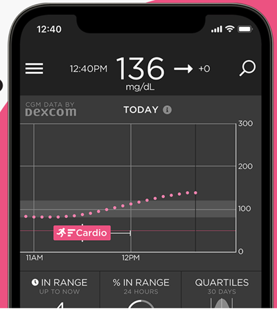
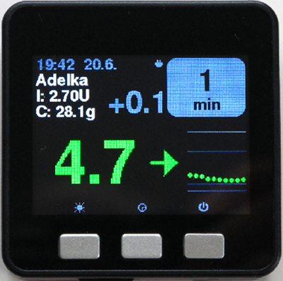

# Стеження за AAPS (без взаємодії із системою AAPS)

Окрім багатьох можливостей віддалено керувати **AAPS** _і_ стежити за ним, які описано на сторінці [Віддалене керування AAPS](../RemoteFeatures/RemoteControl.md), спільнота створила ще кілька застосунків і пристроїв, щоб просто стежити за числами (рівнем глюкози та іншою інформацією) без взаємодії з **AAPS**.

Добрий огляд багатьох варіантів стеження за **AAPS** є на вебсторінці [Nightscout follower](https://nightscout.github.io/nightscout/downloaders/#).

```{contents} Table of contents
:depth: 1
:local: true
```

Найпоширеніші способи, які використовують разом з **AAPS**, докладніше описано нижче.

## Застосунки для смартфона

```{contents} These are some of the main “follower” apps used by **AAPS** users. All of these apps are “free”: 
:depth: 1
:local: true
```

### Dexcom Follow ([Android](https://play.google.com/store/apps/details?id=com.dexcom.follow.region2.mgdl) і [iOS](https://apps.apple.com/fr/app/dexcom-follow-mg-dl-dxcm2/id1032203080))


* Dexcom Follow працює на багатьох телефонах (і Android, і iPhone). Dexcom Follow можна використовувати, навіть якщо ви не отримуєте дані сенсора через офіційний застосунок Dexcom.

* Багато доглядачів знають Dexcom Follow і віддають перевагу його зрозумілому інтерфейсу перед складнішими застосунками.

* Dexcom Follow дуже добре підходить для вчителів, бабусь і дідусів та людей, які мало знають про діабет і рівень цукру. Має налаштовувані сигнали (рівень ГК, який звук відтворювати тощо). За потреби сповіщення можна повністю вимкнути. Це дуже корисно, якщо сенсор ще не стабілізувався і показує багато хибних низьких значень.

#### Налаштування Dexcom Follow: інструкція

Якщо ви отримуєте дані сенсора через неофіційний застосунок Dexcom BYODA, можливо, ви зможете надсилати запрошення послідовникам прямо з BYODA.

Надсилати листи-запрошення послідовникам Dexcom зі сторонніх застосунків більше не можна. У xDrip запит на запрошення просто закінчиться повідомленням «invite not sent» (запрошення не надіслано).

Потрібно встановити офіційний застосунок Dexcom, надіслати запрошення, а потім видалити офіційний застосунок.

Кроки такі:

1)  Встановіть офіційний застосунок «Dexcom» на _будь-який_ смартфон (Android/iPhone). Якщо так зручніше, це може бути телефон послідовника. 2)  Увійдіть зі своїм ім'ям користувача і паролем Dexcom. Це ті самі дані, які ви використовуєте для Dexcom Clarity, якщо ви вже клієнт Dexcom/Clarity. Якщо у вас немає облікового запису Dexcom, на цьому кроці можна створити новий.   
3)  Прогорніть вступні екрани. 4)  Для коду сенсора виберіть «no code» (без коду). 5)  У пункті Transmitter SN виберіть «enter manually» (ввести вручну) і введіть будь-який дійсний код трансмітера (використайте код одного зі своїх старих трансмітерів, якщо ви його знаєте, щоб не заважати роботі поточного трансмітера. Коди мають певний формат з цифр і літер: «NLNNNL», і можливі лише певні комбінації, тому найпростіше взяти код, про який ви точно знаєте, що він дійсний). 6)  Коли застосунок шукає трансмітер і сенсор, ви вже можете запросити послідовників: торкніться трьох маленьких крапок угорі ліворуч і додайте нового послідовника. Це також можна використати, якщо хтось із ваших послідовників змінив телефон і потребує нового запрошення: тут можна видалити його зі списку послідовників і надіслати новий лист із запрошенням для нового телефону. 7)  На телефоні послідовника встановіть Dexcom Follow з App Store (iPhone) або Google Play (Android). Налаштуйте застосунок Dexcom Follow. Вас попросять відкрити пошту і знайти запрошення стати послідовником.    
8)  Тепер офіційний застосунок Dexcom G6 можна видалити.

Для Dexcom Follow дані сенсора потім експортуються з телефону з **AAPS** — або прямо з BYODA, або з xDrip, залежно від того, який застосунок ви використовуєте.


### [Nightguard](https://apps.apple.com/fr/app/nightguard/id1116430352) (iOS)


Переваги (за словами користувачів):

* Доступний в [App Store](https://apps.apple.com/us/app/nightguard/id1116430352), простий і зручний інтерфейс.

* Проведіть по кнопці або струсніть телефон, щоб відкласти сигнали на різний час: від 5 хв до 24 годин

* Налаштовувані сигнали (висока, низька глюкоза, пропущені показники, якщо даних немає 15–45 хвилин).

* Швидке зростання/падіння протягом 2–5 показників поспіль (ви вибираєте). Можна також вибрати дельту між двома окремими показниками

* Розумне відкладання: немає сигналу, якщо рівень змінюється в правильному напрямку

* Є вкладка Care, яка, схоже, дозволяє встановити нову тимчасову ціль на певний час, видалити тимчасову ціль або ввести вуглеводи.

Недоліки (за словами користувачів)

* Доступний лише для iOS

* Тимчасова ціль (TT) завжди показується як 5 ммоль, незалежно від встановленого рівня TT

* Ніколи не показує швидкість тимчасового базалу, хоча показує, що TB діє

### [Nightwatch](https://play.google.com/store/apps/details?id=se.cornixit.nightwatch) (Android)


* Nightwatch позиціонує себе як клієнт Nightscout і показує рівень глюкози користувача з Nightscout на телефоні або планшеті Android.

* Застосунок можна завантажити з [Google Play](https://play.google.com/store/apps/details?id=se.cornixit.nightwatch). Він показує дані ГК в реальному часі.

* Користувач може отримувати гучні налаштовувані сигнали низької і високої глюкози.

* Дані ГК можна дивитися в ммоль/л або мг/дл.

* Потрібен Android 5.0 або новіший.

* Має темний інтерфейс, великі цифри і кнопки, розроблений для використання вночі.

### xDrip (Android)

xDrip можна використовувати як послідовника.

#### З Nightscout

Налаштуйте xDrip як послідовника Nightscout (Nightscout Follower). Ви отримуєте ГК і записи терапії, але не базал.


#### Без Nightscout — джерело ГК xDrip

Якщо джерело даних **AAPS** — xDrip (або якщо xDrip також може отримувати ГК з іншого застосунку, наприклад BYODA, Juggluco, ...), ви можете використовувати його на основному телефоні, щоб передавати дані послідовникам xDrip: ГК, терапію і базальні швидкості.


#### Без Nightscout — допоміжний застосунок xDrip для ГК

Якщо джерело даних **AAPS** не xDrip, але ви можете показувати дані ГК з джерела даних Companion App, ви можете використовувати його на основному телефоні, щоб передавати дані послідовникам xDrip: ГК, терапію і базальні швидкості.


### xDrip4iOS (iOS)


xDripSwift was created from porting the original xDrip app to iOS and evolved into "xDrip for iOS", written as **xDrip4iOS**.

```{admonition} Further detail about how to attempt to obtain the original **xDrip4iOS** app
:class: dropdown
[Група xDrip4iOS у Facebook](https://www.facebook.com/groups/853994615056838/announcements) — головна спільнота підтримки xDrip4iOS і Shuggah. **xDrip4iOS** може підключатися до багатьох різних систем CGM і трансмітерів, показувати значення глюкози крові, графіки і статистику, а також подавати сигнали. Він також може вивантажувати дані в Nightscout або працювати як [застосунок-послідовник для Nightscout](https://xdrip4ios.readthedocs.io/en/latest/connect/follower/). 

«Як отримати **xDrip4iOS** на мій iPhone?»
Є два варіанти:

1. Якщо у вас є Mac і обліковий запис Apple Developer (99 EUR/USD на рік), ви можете зібрати власний xDrip4iOS, [дотримуючись інструкцій](https://xdrip4ios.readthedocs.io/en/latest/install/build/).

Якщо бажаєте, потім можете стати «релізером» і [поділитися особистою збіркою xDrip4iOS через TestFlight](https://xdrip4ios.readthedocs.io/en/latest/install/personal_testflight/) з до 100 іншими людьми, щоб допомогти їм.

2. Приєднайтеся до [групи xDrip4iOS у Facebook](https://www.facebook.com/groups/853994615056838/announcements) і прочитайте закріплені дописи, щоб дізнатися, як зараз отримати застосунок. **Не просіть запрошення до застосунку** (прочитайте правила групи).
```


«Що таке **Shuggah**?» Група українських розробників скопіювала код проєкту xDrip4iOS (який відкрито опубліковано на GitHub) і випустила його в App Store під комерційним обліковим записом. Розробники xDrip4iOS ніяк не керують випуском Shuggah.

[Група xDrip4iOS у Facebook](https://www.facebook.com/groups/853994615056838/announcements) підтримує xDrip4iOS і відповідні застосунки для Apple Watch.

### [Sugarmate](https://apps.apple.com/fr/app/sugarmate/id1111093108) (iOS)




[Sugarmate](https://sugarmate.io/) можна завантажити на iPhone з App Store. Sugarmate працює з:
* Apple iPhone (потрібна версія системи 13.0 або новіша)
* Apple iPad (потрібна версія системи 13.0 або новіша)
* Google Android (збережіть вебзастосунок на головний екран)

Користувачі Sugarmate повідомляють, що у США його можна використовувати з Apple CarPlay, щоб бачити показники глюкози під час водіння. Поки невідомо, чи це можливо в інших країнах. If you know more about this, please add details in here to the documentation by completing a [pull request](../SupportingAaps/HowToEditTheDocs.md), which is quick and easy to do.


### [Spike](https://spike-app.com/) (iOS)


Spike можна використовувати як основний приймач або як застосунок-послідовник. Він показує ГК, сигнали, IOB і більше.

Вебсайт і застосунок більше не розробляються. Підтримку можна знайти у [Facebook](https://www.facebook.com/groups/1973791946274873) і [Gitter](https://gitter.im/SpikeiOS/Lobby).

## Розумні годинники для **моніторингу AAPS** (повні дані профілю або лише глюкоза), коли **AAPS** працює на телефоні.

Див. [тут](../Getting-Started/Watches.md).


## Пристрої для стеження за AAPS

```{contents} Devices include:
:depth: 1
:local: true
```

### M5Stack



M5Stack — це маленька коробка, яку можна запрограмувати для багатьох задач. Проєкт Мартіна [M5Stack NightscoutMon](https://github.com/mlukasek/M5_NightscoutMon/wiki) показує значення глюкози сенсора і тренди, IOB і COB. Це пластикова коробка з кольоровим дисплеєм, слотом для карти micro SD, 3 кнопками, динаміком і вбудованим акумулятором. Це чудовий монітор цукру в крові, і його відносно легко налаштувати, якщо у вас є обліковий запис Nightscout. Зазвичай його використовують через домашній Wi-Fi, але деякі користувачі показують на ньому дані під час їзди на мотоциклі, підключивши його до точки доступу Wi-Fi телефону.

### SugarPixel

SugarPixel — це пристрій для додаткового показу глюкози і сповіщень при безперервному моніторингу глюкози. Він підключається до застосунку Dexcom або Nightscout на смартфоні користувача. Пристрій показує рівень цукру в крові в реальному часі. Цей апаратний монітор CGM має звукові сигнали з випадковими тонами (дуже гучні), вібросигнали для людей з порушенням слуху, налаштовуваний вигляд і вбудоване стеження для кількох користувачів.


* SugarPixel має кілька варіантів показу в мг/дл і ммоль/л під потреби користувача, зі значеннями глюкози різного кольору.
* Стандартний циферблат показує ГК, стрілку тренду і дельту. Дельта — це зміна (+ або -) від останнього показника.
* SugarPixel можна налаштувати для слабкого освітлення з циферблатом BG and Time (ГК і час), щоб бачити ГК користувача і поточний час на нічному столику.
* Кольоровий циферблат SugarPixel використовує весь дисплей, щоб показати один колір, який відповідає значенню ГК. Так користувач бачить показники ГК здалеку через вікно, коли грається надворі, на терасі або в басейні.
* Циферблат Big BG (велика ГК) зручний на нічному столику для тих, хто носить окуляри або контактні лінзи.

### Nightscout Clock на Ulanzi TC001

**Nightscout Clock** — це програма з відкритим кодом, яка працює на пристрої **Ulanzi TC001**. Вона підключається до серверів Dexcom або Nightscout і показує рівень цукру в крові в реальному часі.


* Годинник підтримує одиниці ммоль/л і мг/дл і має звукові сигнали.
* Доступно кілька циферблатів, огляд див. на [Github nightscout-clock](https://github.com/ktomy/nightscout-clock?tab=readme-ov-file#more-information-for-people-who-needs-it).
* Налаштувати пристрій можна за кілька простих кроків. Після налаштування йому потрібні лише живлення і Wi-Fi.
* Пристрій Ulanzi TC001 коштує значно дешевше, ніж SugarPixel.
* Програму та інструкцію зі встановлення можна знайти на [Github nightscout-clock](https://github.com/ktomy/nightscout-clock?tab=readme-ov-file).
* Її розробляє і підтримує Artiom Kenibasov, допомогу він надає в [групі AAPS Users у Facebook](https://www.facebook.com/groups/cgminthecloud/posts/8776932509094594/).

### ПК (TeamViewer)
Деяким користувачам для складнішого віддаленого усунення проблем допомагає інструмент повного віддаленого доступу, наприклад [TeamViewer](https://www.teamviewer.com/).
