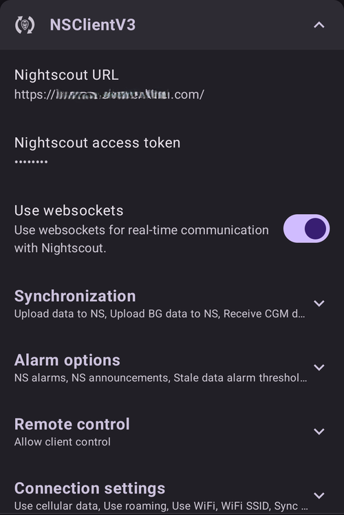
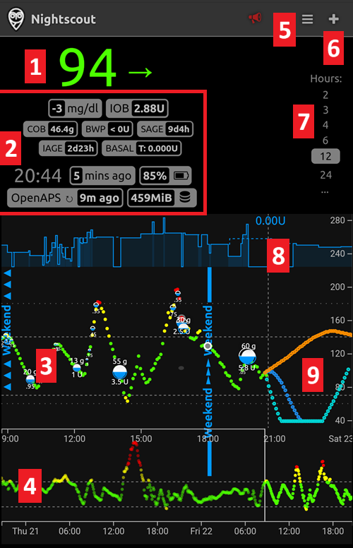
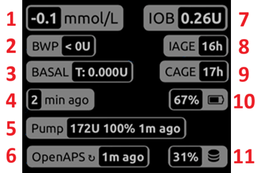

# Віддалене керування AAPS

```{contents} In this page
:backlinks: entry
:depth: 2
```

Є чотири дуже ефективні інструменти для віддаленого керування **AAPS**:

1) [SMS-команди](#RemoteControl_SMS-Commands) (телефон-послідовник може бути Android або iOS), 2) [AAPSClient](#RemoteControl_aapsclient) (телефон-послідовник — Android; версія для iPhone розробляється) 3) [Nightscout](#RemoteControl_nightscout) (Android, iOS або інший комп'ютер/пристрій), переважно для стеження: див. примітку про [керування з клієнта](#client-master-control) в цьому розділі.  
4) [Розумні годинники](#RemoteControl_smartwatches) (Android)

Перші три підходять переважно для доглядачів/батьків, але розумні годинники дуже корисні і для доглядачів/батьків, **і** для дорослих з діабетом.


(RemoteControl_SMS-Commands)=

## 1) SMS-команди

Див. окрему сторінку [SMS-команди](../RemoteFeatures/SMSCommands.md).

(RemoteControl_aapsclient)=
## 2) AAPSClient

**AAPSClient** на вигляд дуже схожий на сам **AAPS**: доглядач має ті самі екрани і кнопки, щоб віддалено надсилати команди в **AAPS**:


(remotecontrol-aapsclient-versions)=
### Про AAPSClient, AAPSClient2 і AAPSClient3

Є 3 версії клієнтського застосунку: **AAPSClient**, **AAPSClient2** і **AAPSClient3**. Вони працюють однаково. Єдина відмінність: їх можна встановити поруч на одному телефоні-послідовнику.

Доглядачу, який стежить за однією людиною, потрібен лише **AAPSClient**. Щоб стежити за другою людиною (з її власним сайтом **Nightscout** і власним телефоном з **AAPS**) і віддалено керувати, встановіть також **AAPSClient2**, а для третьої людини — **AAPSClient3**. Кожен застосунок налаштовують і [спаровують](#aapsclient-pairing-with-the-master) окремо — із сайтом **Nightscout** і телефоном з **AAPS** тієї людини, за якою він стежить.

Щоб застосунки було легко розрізнити, деякі елементи мають різний колір: жовтий для **AAPSClient**, синій для **AAPSClient2** і зелений для **AAPSClient3**. Ці елементи — значок застосунку, фон віджета і розділ стану **AAPS** на головному екрані застосунку. <br/> Примітка: непрозорість фону віджета можна задати в налаштуваннях віджета. При низькій непрозорості колір погано видно.


### Завантаження і встановлення

**AAPSClient** можна встановити на один або на кілька телефонів-послідовників (наприклад, телефон-послідовник батька 1 і телефон-послідовник батька 2), щоб обидва доглядачі мали доступ і могли віддалено керувати телефоном пацієнта з **AAPS**.

Щоб завантажити **AAPSClient**, перейдіть до [репозиторію Github](https://github.com/nightscout/AndroidAPS/releases/) і натисніть на файл **«app-AAPSClient-release_x.x.x.x»** (версія може бути новішою, ніж на знімку екрана нижче):


Потім відкрийте _downloads_ (завантаження) на комп'ютері. У Windows _downloads_ (завантаження) з'являться на панелі праворуч:


Після завантаження натисніть _show in folder_ (показати в папці), щоб знайти файл.

Тепер apk **AAPSClient** можна:

перенести на телефон-послідовник через USB-кабель; або перетягнути в папку Google Drive, а потім встановити на телефоні-послідовнику, торкнувшись файлу «app-AAPSClient-release».

Якщо вам потрібен **AAPS** для себе і **AAPSClient** для моніторингу іншої людини, вам треба зібрати **AAPSClient** самостійно, а не завантажувати його з репозиторію Github, як описано вище. Причина в тому, що не можна встановити на один телефон **AAPS** і **AAPSClient**, підписані різними ключами. <br/> Щоб зібрати **AAPSClient** самостійно, виконайте ті самі кроки, що і для [звичайної збірки AAPS](../SettingUpAaps/BuildingAaps.md). На сторінці **Generate signed App Bundle or APK** виберіть **aapsclientRelease** замість **fullRelease**.

Те саме правило діє, коли ви встановлюєте кілька клієнтських застосунків (**AAPSClient**, **AAPSClient2**, **AAPSClient3**) на один телефон-послідовник: усі вони мають бути підписані **тим самим ключем**. Інакше Android не дасть встановити другий (помилка `INSTALL_FAILED_DUPLICATE_PERMISSION`).

### Синхронізація: налаштування AAPSClient і AAPS

Після встановлення apk __AAPSClient__ на телефон-послідовник переконайтеся, що **NSClientV3** налаштовано однаково на обох телефонах для Nightscout 15 (див. [примітки до оновлення](../Maintenance/UpdateToNewVersion.md)). Приклад нижче показує налаштування синхронізації з NSClientV3 і Nightscout 15; в __AAPS__ доступні й інші джерела даних (наприклад, xDrip).

У **Конфігурація** > **Звʼязок** користувач синхронізує свої дані з Nightscout через __NSClientV3__ (з API v3). Його налаштовують однаково і в __AAPS__, і на телефоні-послідовнику.


Користувач має переконатися, що __обидва__ телефони, з AAPS і з AAPSClient, синхронізуються між собою: для цього на кожному налаштовують NSClientV3. На телефоні-послідовнику замість цього можна відсканувати QR-код, який показує **AAPS**, див. [Спарювання AAPSClient з AAPS](#remotecontrol-pairing) нижче:

- Введіть **URL Nightscout** у **Налаштуваннях** NSClientV3

- Введіть **Токен доступу Nightscout** у тих самих налаштуваннях. Будь ласка, дотримуйтеся інструкцій [тут](https://nightscout.github.io/nightscout/security/#create-a-token). На телефоні з **AAPS** використовуйте **токен адміністратора (admin token)**: з ним **AAPS** створює окремий токен для кожного телефону-послідовника.

- Увімкніть **Використовувати websockets** на **обох** телефонах. На телефоні з **AAPS** websockets **обов'язкові** для віддаленого керування: без них **AAPS** не може отримувати команди від **AAPSClient**. На обох телефонах вони також прискорюють синхронізацію, але трохи більше витрачають батарею.




Користувач має переконатися, що і __AAPSClient__, і __AAPS__ показують «Підключено» на екрані **NSClientV3** кожного телефону. Тепер **AAPSClient** стежить за **AAPS** (ГК, терапія, профіль), але ще не може ним керувати: спаруйте два телефони, як описано нижче.

(remotecontrol-pairing)=
### Спарювання AAPSClient з AAPS (віддалене керування)

Починаючи з **AAPS** версії 4, **AAPSClient** керує **AAPS** через захищене **спарене** з'єднання. Самої синхронізації недостатньо: поки телефони не спарені, **AAPSClient** показує лише **Керувати** з **Профілем** тільки для перегляду і **Спарувати з основним пристроєм**.

1. На телефоні з **AAPS** відкрийте **Керувати → Авторизовані клієнти** і увімкніть **Дозволити керування з клієнтів** (за замовчуванням вимкнено, у простому режимі завжди увімкнено).
2. Торкніться **+**, введіть назву телефону-послідовника, виберіть спосіб налаштування і його **роль**:
   - **QR-код: Nightscout і спарювання** — **AAPS** показує QR-код, який одним скануванням налаштовує Nightscout на телефоні-послідовнику і спаровує його. Для цього в налаштуваннях NSClientV3 на телефоні з **AAPS** потрібен токен адміністратора.
   - **PIN** — для телефону-послідовника без камери, вже підключеного до Nightscout: запишіть одноразовий **PIN** (дійсний близько двох хвилин).
3. На телефоні з **AAPSClient** відскануйте код (у Майстрі налаштування або в **Керувати → Спарувати з основним пристроєм → Сканувати QR-код**) або відкрийте **Керувати → Спарувати з основним пристроєм** і введіть PIN. Підтвердьте.

Після цього телефон-послідовник з'явиться як **Активний** у списку **Авторизовані клієнти**, а **AAPSClient** покаже **Терапія**, **Сцени** і **Керувати**. Телефон-послідовник отримує власний токен Nightscout лише з тими правами, які йому потрібні. Повна інструкція зі знімками екрана і порадами щодо проблем є на сторінці [Керування основний телефон ↔ клієнт](#client_master_master_setup).

Перевірте, що все працює: введіть вуглеводи в **AAPSClient**, підтвердьте показану кількість і перевірте, що запис з'явився в **Терапії** на обох телефонах.

(remotecontrol-nightscout-access-token)=

### Усунення проблем з налаштуванням «Токен доступу Nightscout»

Точне налаштування «Токен доступу Nightscout» може відрізнятися залежно від того, чи ваш Nightscout розміщено на платному хостингу.

Якщо **AAPS** не приймає «Токен доступу Nightscout» і ви використовуєте платний хостинг Nightscout, спершу варто звернутися до вашого постачальника Nightscout і запитати, як вирішити проблему з «Токеном доступу Nightscout». Інакше зверніться до групи **AAPS**, але перед цим, будь ласка, ще раз перевірте, що ви правильно виконали інструкції [тут](https://nightscout.github.io/nightscout/security/#create-a-token).

### Що пропонує AAPSClient

Після спарювання **AAPSClient** дає доглядачу майже ті самі екрани, що і сам **AAPS**:

- **Терапія**: болюс інсуліну, вуглеводи і калькулятор болюса.
- **Сцени**: запуск і зупинка [сцен](../DailyLifeWithAaps/Scenes.md).
- **Керувати**: профілі, налаштування інсуліну, тимчасові цілі, Швидкий майстер, автоматизація, їжа, чергування місць введення, спарювання і поточний тимчасовий базал.
- **Головне меню**: історія терапії, перегляд історії, статистика, обслуговування, конфігурація.

В **AAPSClient** немає помпи і завдань. Докладний опис див. на сторінці [Застосунок AAPSClient](AapsClient.md).

**AAPSClient** дозволяє доглядачу віддалено, через мобільну мережу або інтернет, робити більшість змін, доступних прямо в **AAPS**, **включно з болюсами інсуліну**. Кожна команда підписується і надсилається через Nightscout на телефон з **AAPS**. Він перевіряє її за власними даними, обмежує, показує вам власне підтвердження і лише після цього виконує. **AAPSClient** _може_ бути значно швидшим, ніж [SMS-команди](../RemoteFeatures/SMSCommands.md), особливо для команд, які потребують автентифікації.

Терапія, введена в Nightscout іншим способом (наприклад, через сайт Nightscout), не застосовується, поки увімкнено керування з клієнтів: тоді **AAPS** працює в [захищеному режимі](#client-master-control-hardened-mode) і приймає зміни лише від спарених клієнтів. Коли керування з клієнтів вимкнено, вона застосовується, лише якщо увімкнено відповідні параметри **Отримувати** у [розділі «Синхронізація» налаштувань NSClient](#Preferences-nsclient-synchronization).

Віддалене керування через **AAPSClient** рекомендовано лише тоді, коли синхронізація працює добре (_тобто_ ви не бачите небажаних змін даних, як-от самовільна зміна TT, TBR тощо).

### AAPSClient з можливостями для розумного годинника

Розумний годинник може бути дуже корисним інструментом для керування **AAPS** у дітей. Можливі кілька різних конфігурацій. Якщо **AAPSClient** встановлено на телефоні доглядача, [застосунок **AAPSClient WearOS**](https://github.com/nightscout/AndroidAPS/releases/) можна завантажити і встановити на сумісний розумний годинник, підключений до телефону батьків. Він показуватиме поточну ГК і стан петлі. Коли **AAPSClient** спарено з **AAPS**, дії з годинника (включно з болюсами, вуглеводами, тимчасовими цілями і змінами профілю) передаються через **AAPSClient** в **AAPS**, який їх підтверджує і виконує: див. [Wear OS (годинник) на клієнті](#clientmastercontrol-wear-os-on-a-client). Більше про розумні годинники читайте [тут](#remotecontrol-smartwatches).

(RemoteControl_nightscout)=
## 3) Nightscout

Nightscout — це сервер «у хмарі», але є також окремий застосунок **Nightscout**, який можна завантажити прямо з App Store на iPhone. Якщо ваш телефон-послідовник — Android, окремого застосунку Nightscout немає, і краще використовувати [**AAPSClient**](#2-aapsclient). Або, якщо ви хочете лише стежити, а не надсилати терапію, можна завантажити і встановити застосунок [Nightwatch](https://play.google.com/store/apps/details?id=se.cornixit.nightwatch) з Play Маркет.

Після встановлення застосунку **Nightscout** на iPhone відкрийте його і виконайте кроки налаштування: введіть адресу вашого Nightscout (див. нижче, ліворуч). Вигляд адреси може бути різним, залежно від того, де розміщено ваш Nightscout. (_наприклад,_ http://youraddresshere.herokuapp.com). Потім введіть ваш API secret Nightscout (див. нижче, праворуч). Якщо застосунок не запитав пароль API, введіть його, натиснувши на замок угорі застосунку:


Більше інформації про налаштування є прямо на сайті [Nightscout](https://nightscout.github.io/nightscout/discover/)

Під час першого входу ви побачите дуже простий екран. Налаштуйте, що показувати: виберіть меню-«гамбургер» угорі праворуч і прогорніть вниз:


Прогорніть вниз до «Settings» (Налаштування). Можливо, ви захочете змінити «scale» (шкала) на «linear» (лінійна), бо за замовчуванням ГК показано в логарифмічній шкалі, а в «render basal» (показ базалу) вибрати «default» (за замовчуванням), щоб було видно базал помпи.


Виберіть потрібні параметри. Зніміть позначку з сигналів, якщо для сигналів ви використовуєте інший застосунок.


Гортайте далі вниз до «show plugins» (показати плагіни).

Переконайтеся, що «careportal» позначено. Можна також вибрати інші показники (найкорисніші: IOB, care portal, pump, cannula age, insulin age, basal profile і OpenAPS).

Важливо: тепер натисніть «save» (зберегти) внизу, щоб зміни почали діяти.


Після натискання «save» застосунок повернеться до головного екрана Nightscout, який виглядатиме приблизно так:

1. Поточне значення глюкози
2. Інформація про стан системи AAPS — торкніться окремих вкладок на екрані, щоб побачити подробиці. Додавайте або прибирайте ці елементи через меню-гамбургер.
3. Недавній графік глюкози з терапією (вуглеводи, болюси)
4. Довший графік глюкози
5. Меню-«гамбургер» для налаштування вигляду, створення звітів, редагування профілів і адміністративних інструментів Nightscout
6. Меню «**+**» для введення терапії (див. [нижче](#RemoteControl_nightscout-treatments), коли **AAPS** її застосовує).
7. Вибір іншого періоду для показу
8. Профіль базального інсуліну
9. Зелена лінія = історія глюкози Сині лінії = прогноз глюкози



Докладніше про меню вгорі ліворуч у застосунку Nightscout:

1. Careportal: редагування минулих записів
2. Увімкнути/вимкнути сигнали
3. Гамбургер — для налаштувань
4. Careportal — запис терапії (див. [нижче](#RemoteControl_nightscout-treatments), коли **AAPS** застосовує ці записи)


На цьому екрані в сірих вкладках є дуже багато інформації про стан системи **AAPS** (а якщо торкнутися вкладки, з'явиться ще більше):

1. Тренд глюкози за 5 хв
2. Попередній перегляд калькулятора болюса (Bolus wizard preview)
3. Натисніть на Basal, щоб побачити поточний профіль і інформацію про базал
4. Час від останнього показника CGM в AAPS
5. **Помпа**: інсулін, заряд батареї у % і коли AAPS востаннє до неї підключався
6. Коли AAPS востаннє оновлювався — якщо минуло більше 5 хв, це може означати проблему зі зв'язком між телефоном з AAPS і помпою/CGM
7. Натисніть на IOB, щоб побачити розподіл на базальний і болюсний інсулін
8. Вік інсуліну в резервуарі
9. Вік канюлі
10. Стан батареї телефону з AAPS
11. Розмір вашої бази даних. Якщо вона надто заповнена (лише для власного Nightscout — для платних хостингів це неважливо), можуть початися проблеми зі зв'язком. Щоб зменшити це число, можна видалити дані в меню Admin tools (через гамбургер).




Натисніть «refresh» внизу сторінки, щоб закрити спливне вікно.

(RemoteControl_nightscout-treatments)=
### Надсилання терапії в AAPS через застосунок Nightscout

В **AAPS** 4 підтримуваний спосіб віддалено керувати **AAPS** — це **спарений AAPSClient**, див. [Керування основний телефон ↔ клієнт](#client-master-control): кожен клієнт має [роль](#client-master-control-roles), яка обмежує, що він може робити, а кожну команду підписує, перевіряє і підтверджує телефон з **AAPS**. Поки увімкнено керування з клієнтів, телефон з **AAPS** працює в [захищеному режимі](#client-master-control-hardened-mode): терапія, тимчасові цілі і перемикання профілю, введені на сайті Nightscout або в застосунку Nightscout, **не** застосовуються. Тоді застосунок Nightscout — це інструмент лише для стеження.

```{admonition} Only when client control is off
:class: warning
Якщо **Дозволити керування з клієнтів** вимкнено в **Керувати → Авторизовані клієнти** (і простий режим вимкнено), **AAPS** застосовує записи careportal з Nightscout лише для тих типів даних, які ви увімкнули в параметрах **Отримувати** у [розділі «Синхронізація» налаштувань NSClientV3](#Preferences-nsclient-synchronization): вуглеводи, тимчасові цілі, перемикання профілю та інші записи careportal. Інсулін так ніколи не подається: «Болюс на корекцію», введений у Nightscout, лише *оголошується*, і **AAPS** враховує його як активний інсулін, не подаючи його. Таке налаштування не рекомендовано для віддаленого керування; натомість використовуйте спарений **AAPSClient**.
```

Більше про можливості **Nightscout** читайте [тут](https://nightscout.github.io/)

### Поради, як найкраще використовувати застосунок Nightscout

1). Якщо ви «застрягли» на сторінці і хочете знову побачити головний екран, просто натисніть «refresh» (оновити, внизу посередині). Ви повернетеся на головну сторінку **Nightscout** з графіком ГК.

Щоб побачити поточний профіль, який працює на телефоні, натискайте різні значки на екрані над графіком. Більше інформації (поточний вуглеводний коефіцієнт, чутливість, часовий пояс тощо) можна побачити, натиснувши «basal», а «OpenAPS» показує інформацію про профіль, поточну ціль тощо. Також можна стежити за зарядом батареї телефону (%) і батареї помпи (%). BWP показує, що, на думку алгоритму, станеться в майбутньому з урахуванням IOB і COB.

#### Інші значки в меню: що означає олівець (редагування)?

(Технічно) олівцем редагування можна перемістити або видалити болюси чи корекції за останні 48 год.

Більше про це [тут](https://nightscout.github.io/nightscout/discover/#edit-mode-edit)

Це може бути корисно, щоб видалити оголошені вуглеводи (на які болюс не подали), але зараз це погано працює з **AAPS**. Ми радимо робити такі зміни прямо в застосунку **AAPS**.

(RemoteControl_smartwatches)= (remotecontrol-smartwatches)=

## 4) Розумні годинники

### Варіант 1) Керування AAPS з годинника Wear OS


Коли ви [налаштуєте **AAPS** на годиннику](../WearOS/BuildingAapsWearOS.md), докладний опис циферблатів і їхніх функцій див. на сторінці [Налаштування AAPS на годиннику з Wear OS](../WearOS/WearOsSmartwatch.md).

Коротко: з розумного годинника можна запустити такі функції:

* встановити тимчасову ціль

* використати калькулятор болюса (параметри розрахунку можна задати в налаштуваннях на телефоні)

* ввести eCarbs

* подати болюс (інсулін + вуглеводи)

* налаштування годинника

* стан

* перевірити стан помпи

* перевірити стан петлі

* перевірити і змінити профіль, CPP (Circadian Percentage Profile = зсув часу + відсоток)

* показати TDD (загальна добова доза = болюс + базал за добу)

* Віддалений болюс, коли доглядач і дитина з ЦД1 у різних місцях (це можливо для годинника з **AAPS** і телефону з **AAPS**, якщо обидва пристрої підключені до мережі)

#### Зв'язок доглядачів з годинником через інші застосунки (наприклад, WhatsApp)

На годинник можна додати інші застосунки, наприклад WhatsApp, щоб, скажімо, обмінюватися повідомленнями між доглядачами і дітьми. Важливо, щоб із телефоном був пов'язаний лише ОДИН обліковий запис Google, інакше годинник не перенесе ці дані. Щоб мати обліковий запис Samsung, вам має бути 13 років або більше. Його треба створити на ту саму електронну адресу, яка використовується на телефоні Android.

Відео про налаштування WhatsApp для повідомлень на годиннику Galaxy Watch 4 (усі функції WhatsApp там недоступні) можна переглянути [тут](https://gorilla-fitnesswatches.com/how-to-get-whatsapp-on-galaxy-watch-4/)

Якщо змінити налаштування і в застосунку **Galaxy Wearable** на телефоні з **AAPS**, і на годиннику, повідомлення WhatsApp можуть сповіщати легкою вібрацією, а саме повідомлення показуватиметься поверх циферблата.

### Варіант 2) **AAPS** на годиннику для віддаленого керування **AAPS** на телефоні

Так само як телефон-послідовник з **AAPSClient** або SMS-командами (див. розділи вище), розумний годинник можна використовувати для віддаленого керування **AAPS** і для показу повних даних профілю. Головна відмінність від телефону-послідовника: годинник зв'язаний з телефоном з **AAPS** через Bluetooth, і йому не потрібні ні Nightscout, ні код автентифікації. Додатково: якщо годинник і телефон з **AAPS**, зв'язані через Bluetooth, також підключені до мережі Wi-Fi/мобільних даних, годинник взаємодіятиме з телефоном з **AAPS** і на більшій відстані. Це включає віддалене подання болюса, коли доглядач з годинником з **AAPS** і дитина з ЦД1 (з телефоном з **AAPS**) у різних місцях. Це може бути корисно, наприклад, коли дитина з ЦД1 у школі.

Тому годинник для віддаленого керування часто корисний у будь-якій ситуації, коли:

a)  **AAPSClient** або **SMS**-команди не можуть працювати; або

b)  користувач не хоче вводити код автентифікації (потрібний для SMS-команд).

Щоб керувати **AAPS**, розумному годиннику потрібна **Wear OS 3 або новіша**. Будь ласка, перевірте технічні характеристики годинника і див. сторінку [Розумні годинники та AAPS](../Getting-Started/Watches.md). Якщо не впевнені, пошукайте або запитайте в групах **AAPS**  у Facebook/Discord.

Нижче наведено інструкції з налаштування **AAPS** на популярному годиннику Samsung Galaxy Watch 4 (40 мм). Годинник [Garmin](https://apps.garmin.com/en-US/apps/a2eebcac-d18a-4227-a143-cd333cf89b55?fbclid=IwAR0k3w3oes-OHgFdPO-cGCuTSIpqFJejHG-klBTm_rmyEJo6gdArw8Nl4Zc#0) теж популярний вибір. Якщо ви налаштовували інший розумний годинник і вважаєте, що це буде корисно іншим, будь ласка, додайте це на ці сторінки ([редагувати документацію](../SupportingAaps/HowToEditTheDocs.md)), щоб поділитися досвідом з усією спільнотою **AAPS**.

### Варіант 3) AAPSClient на годиннику для віддаленого керування **AAPS** на телефоні


Програму для годинника, **AAPSClient** Wear apk, можна завантажити прямо з [Github](https://github.com/nightscout/AndroidAPS/releases/).

Щоб завантажити програму, натисніть на застосунок для годинника, який відповідає клієнтському застосунку на телефоні: **wear-aapsclient-release_**_версія_ — для **AAPSClient**, **wear-aapsclient2-release_**_версія_ — для **AAPSClient2** (див. [Про AAPSClient, AAPSClient2 і AAPSClient3](#remotecontrol-aapsclient-versions)):


Потім виберіть «save as» (зберегти як) і збережіть файл у зручне місце на комп'ютері:


Apk **AAPSClient** wear можна перенести на телефон і встановити на годинник так само, як застосунок **AAPS** Wear, як описано в [Перенесення застосунку Wear на телефон з AAPS](#remote-control-transferring-the-aaps-wear-app-onto-your-aaps-phone)  


