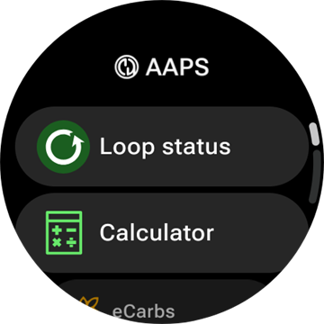
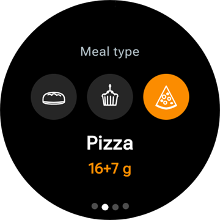
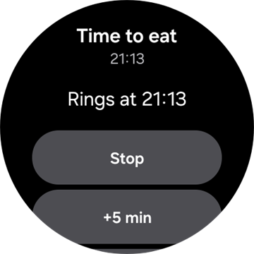
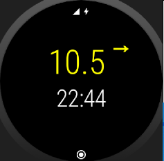
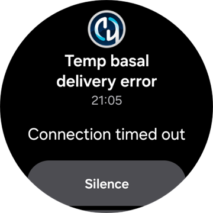

# Керування AAPS за допомогою розумного годинника з Wear OS

(Watchfaces-aaps-watchfaces)=

## Циферблати AAPS

```{warning}
Класичні циферблати **AAPS** працюють лише на Wear OS 5 і старіших, і вже Wear OS 5 їх обмежує. На **Wear OS 6 і новіших** застосунок для годинника натомість встановлює один циферблат у форматі Google Watch Face Format: ваш власний циферблат як зображення або **Циферблат з віджетами**. Див. [Зміни циферблатів у Wear OS](#wearos-watchface-changes), щоб дізнатися, що перестає працювати в кожній версії Wear OS, і [циферблат, який встановлює AAPS](#wearos-aaps-v4-watchface) для Wear OS 6.
```

На Wear OS 5 і старіших у застосунок **AAPS** для годинника вбудовано кілька класичних циферблатів. Вони показують значення глюкози з дельтою, IOB, активну базальну швидкість і графік вимірювань. На них працюють два дотики:

* Двічі торкніться значення глюкози, щоб відкрити головне меню **AAPS**
* Двічі торкніться графіка, щоб змінити його діапазон часу

На кожній версії Wear OS [віджети](#Watchfaces-complications) і [плитки](#WearOsSmartwatch-wear-os-tiles), описані на цій сторінці, працюють з будь-яким циферблатом, на якому для них є місце.

## Налаштування

Увімкніть **Wear** у [**Конфігурація** > **Звʼязок**](#Config-Builder-wear).

Щоб вводити болюс або виконувати інші дії з годинника, увімкніть **Керування з годинника**. Параметри калькулятора болюса для годинника задаються там само: див. [Налаштування > Wear](#preferences-wear). Поки **Керування з годинника** вимкнено, телефон відхиляє кожен запис терапії або зміну режиму, надіслані з годинника, а годинник показує *«Керування з годинника вимкнено в налаштуваннях Wear на телефоні.»*

Кнопкою **Відкрити плагін** на картці **Wear** ви відкриваєте екран Wear:


У верхньому рядку показано назву підключеного годинника або **(Годинник не підключено)**. На цьому екрані можна

* Надіслати всі дані знову. Може бути корисно, якщо годинник деякий час не був підключений і ви хочете передати на нього інформацію.
* Відкрити налаштування годинника прямо з телефона.
* Вибрати, який циферблат **AAPS** встановлює на годинник (**Циферблат, встановлений на годиннику**: ваш власний циферблат або циферблат з віджетами). Цю картку показано лише тоді, коли підключено годинник з **Wear OS 6** або новішою. Див. [циферблат, який встановлює AAPS](#wearos-aaps-v4-watchface).
* Керувати **власним циферблатом** (картку показано, коли годинник підключено): **Завантажити циферблат** надсилає власний циферблат на годинник, **Інформація про циферблат** показує деталі завантаженого циферблата і поля, які він містить, **Більше циферблатів** відкриває у браузері [сайт обміну](../ExchangeSiteCustomWatchfaces/index.md), а **Експортувати шаблон** зберігає шаблон, який можна редагувати. Під кнопками показано попередній перегляд завантаженого циферблата. Див. [Перехід на циферблат AAPS](#WearOS_changing-to-AAPS-watchface).

Переконайтеся, що сповіщення від AAPS на годиннику не заблоковано. Підтвердження дії (наприклад, болюсу, тимчасової цілі) надходить як сповіщення, яке треба провести пальцем і відмітити галочкою.

## Як відкрити головне меню AAPS



Щоб відкрити головне меню **AAPS**, зробіть одне з цього:

* відкрийте **AAPS** зі списку застосунків годинника
* торкніться віджета **AAPS**, який відкриває меню, див. [Налаштування віджетів](#WearOsSmartwatch-complication-settings)
* торкніться плитки **Графік ГК**, для якої **Дія при торканні** встановлена на **Головне меню**, див. [Налаштування плиток](#WearOsSmartwatch-wear-os-tiles)
* на класичному циферблаті **AAPS** двічі торкніться значення глюкози

(WearOsSmartwatch-loop-status)=

## Екран «Статус петлі»

Екран **Статус петлі** коротко показує, що робить петля, без потреби діставати телефон. Відкрийте його з головного меню AAPS (**Статус петлі** або **Статус → Петля**) або торкнувшись віджета **Глюкоза крові**. У меню **Статус** є також сторінка **Помпа** і сторінка **TDD** із загальними добовими дозами.


Екран – це список карток. Прокрутіть униз, щоб побачити їх усі:

* **Робочий режим** — поточний режим (закрита петля, відкрита петля, LGS, призупинено, від’єднано…) і, для тимчасового режиму, скільки він ще триватиме.
* **Результат петлі** — коли петля востаннє запускалася і який тимчасовий базал або SMB вона запросила.
* **Сцена** — лише поки активна [сцена](#scenes-from-watch): її назва, час, що залишився (або **До завершення** для сцени без часу закінчення), і **Наступна сцена**, яка почнеться, коли ця закінчиться.
* **Цілі** — ваша ціль і тимчасова ціль, якщо вона діє.
* **Профіль** — назва активного профілю з його **Відсотком** і **Зсувом часу**, якщо вони не мають значень за замовчуванням. Тимчасове перемикання профілю виділено; показано, скільки воно ще триватиме і до якого профілю відбудеться **Повернення до**, коли воно закінчиться.
* **Чутливість** — ті самі рядки, що й на чипі чутливості на головному екрані телефона: значення autosens і профільний, змінний та ефективний ISF.

Маленька іконка сцени біля робочого режиму, тимчасової цілі або перемикання профілю означає, що це **Встановлено активною сценою**. Ця сама іконка показана у виборі **Робочий режим**.


(WearOsSmartwatch-bolus-calculator)=

## Калькулятор болюса на годиннику

Відкрийте **Калькулятор** з головного меню **AAPS**, з [плитки «Дії»](#WearOsSmartwatch-wear-os-tiles) або з віджета, налаштованого на відкриття калькулятора. Він має кілька сторінок; щоб перейти далі, проведіть пальцем справа наліво:

| Вуглеводи                                                                 | Запит                                                                   | Результат                                                                  | Розрахунок                                                                      | Підтвердити                                                                   |
| ------------------------------------------------------------------------- | ----------------------------------------------------------------------- | -------------------------------------------------------------------------- | ------------------------------------------------------------------------------- | ----------------------------------------------------------------------------- |
|  |  |  |  |  |

1. **Вуглеводи**: введіть вуглеводи кнопками **+10**, **+5**, **−** і **+**.
2. **Запит**: остання сторінка перед тим, як роботу бере на себе телефон. Вона показує, що ви ввели: вуглеводи, а також тип їжі, час прийому вуглеводів і відсоток, якщо ви їх використовуєте, див. [Додаткові сторінки](#WearOsSmartwatch-calculator-optional-pages). Торкніться галочки, щоб надіслати запит на телефон, який виконає розрахунок.
3. **Результат**: болюс, який пропонує **AAPS**, а під ним вуглеводи: вуглеводи зараз і eCarbs пізніше, час прийому вуглеводів і дзвіночок нагадування про їжу. Змінюйте дозу кнопками **−** і **+**, див. нижче. Прокрутіть униз до картки **Розрахунок**: торкніться її, щоб побачити кожен рядок розрахунку, як на телефоні.
4. **Підтвердити**: перейдіть на другу сторінку і торкніться галочки. Телефон вводить болюс і записує вуглеводи.

(WearOsSmartwatch-calculator-optional-pages)=

### Додаткові сторінки

Три налаштування годинника додають кожне по сторінці після сторінки **Вуглеводи**. За замовчуванням вони вимкнені. Відкрийте головне меню **AAPS**, потім **Налаштування** > **Інтерфейс** і увімкніть потрібні; коли увімкнено більше одного, сторінки йдуть у такому порядку: **Тип їжі**, **Час прийому вуглеводів**, **Відсоток**. Крапки внизу калькулятора показують, скільки в ньому сторінок.

| Налаштування                                                                                   | Тип їжі                                                                     | Час прийому вуглеводів                                                                     | Відсоток                                                                      |
| ---------------------------------------------------------------------------------------------- | --------------------------------------------------------------------------- | ------------------------------------------------------------------------------------------ | ----------------------------------------------------------------------------- |
|  |  |  |  |

* **Тип їжі в калькуляторі**: **Хліб**, **Торт** або **Піца**; ділить вуглеводи повільної їжі на вуглеводи зараз і eCarbs пізніше, див. [Вибір типу їжі](#WearOsSmartwatch-wizard-meal-type).
* **Час вуглеводів у калькуляторі**: хвилини до їжі, з дзвіночком **Встановити нагадування** для нагадування про їжу, див. [Час прийому вуглеводів і нагадування про їжу](#WearOsSmartwatch-wizard-carb-time).
* **Відсоток калькулятора**: відсоток від розрахованого болюсу, наприклад 70 %, коли ви хочете меншу дозу. Початкове значення – **Відсоток болюсу** з [налаштувань калькулятора болюса](#Preferences-deliver-this-part-of-bolus-wizard-result) на телефоні, 100 %, якщо ви його не змінювали. Див. також примітку в розділі [Зміна болюсу на сторінці результату](#WearOsSmartwatch-wizard-result).

(WearOsSmartwatch-wizard-result)=

### Зміна болюсу на сторінці результату

Сторінка результату показує болюс, який пропонує **AAPS**, разом із кнопками **−** і **+**. Використовуйте їх, щоб змінити дозу перед підтвердженням, без повернення до телефона.

| Запропоновано                                                                       | Більше                                                                              | Менше                                                                                |
| ----------------------------------------------------------------------------------- | ----------------------------------------------------------------------------------- | ------------------------------------------------------------------------------------ |
|  |  |  |

* Кожне натискання змінює болюс на **один крок вашої помпи**, тож запропоновані кількості завжди відповідають тому, що ваша помпа справді може ввести.
* **Натисніть і утримуйте** кнопку, щоб значення змінювалося далі. Чим довше ви утримуєте, тим швидше воно змінюється.
* Не можна опуститися нижче **0 Од** або піднятися вище за ваше налаштування **максимального болюсу**.

Поточна сума показана на сторінці результату, тож ви завжди бачите кількість, яку збираєтеся підтвердити. Зміна показана після вуглеводів, наприклад *(+0,20 Од)*, а кнопка, якою ви скористалися, стає зеленою для збільшення або червоною для зменшення.

Якщо **AAPS** довелося обмежити дозу, наприклад тому що розрахований болюс більший за ваше налаштування **максимального болюсу**, про це повідомляє бурштиновий рядок попередження під сумою (наприклад, *«Застосовано обмеження болюса»*). Те саме стосується обмеженої кількості вуглеводів.

```{admonition} Це не те саме, що «Відсоток калькулятора» :class: note Налаштування **Відсоток калькулятора** дозволяє ввести *відсоток* від розрахованого болюсу **до** того, як з'явиться сторінка результату. Кнопки **−** і **+** змінюють *остаточну кількість* **на** сторінці результату. Можна використовувати обидва.

    <br />(WearOsSmartwatch-wizard-meal-type)=
    
    ### Вибір типу їжі
    
    Калькулятор на годиннику може ділити вуглеводи повільної їжі на вуглеводи зараз і eCarbs пізніше, як [тип вуглеводів](#AapsScreens-carbs-type) у калькуляторі на телефоні. Увімкніть **Тип їжі в калькуляторі** в розділі годинника **Налаштування** > **Інтерфейс**. За замовчуванням налаштування вимкнене, і тоді сторінка **Тип їжі** пропускається.
    
    * Після введення вуглеводів сторінка **Тип їжі** показує три іконки: **Хліб**, **Торт** і **Піца**. Торкніться іконки: під іконками з'являться її назва і вуглеводи, які вона дає, наприклад *65 г* для хліба або *52+22 г* для піци (52 г зараз і 22 г eCarbs пізніше). **Хліб** – значення за замовчуванням, усі вуглеводи залишаються «зараз».
    * Сторінки запиту й підтвердження показують вуглеводи так само (*52+22 г*). Сторінка результату також показує, коли починаються eCarbs і скільки вони тривають.
    * Болюс розраховується лише на вуглеводи, які з'їдено зараз. Поділ використовує ті самі числа, що й калькулятор на телефоні.
    
    (WearOsSmartwatch-wizard-carb-time)=
    
    ### Час прийому вуглеводів і нагадування про їжу
    
    Якщо в розділі годинника **Налаштування** > **Інтерфейс** увімкнено **Час вуглеводів у калькуляторі**, після вуглеводів іде сторінка **Час прийому вуглеводів**: хвилини до їжі, як [час прийому вуглеводів](#aaps-screens-bolus-wizard) у калькуляторі на телефоні. За замовчуванням – **Зараз**. **−** і **+** змінюють його кроками по 5 хвилин, до години раніше або пізніше від поточного часу. Час у минулому – для вуглеводів, які ви вже з'їли.
    
    Якщо час у майбутньому, під значенням з'являється дзвіночок **Встановити нагадування**. За замовчуванням він увімкнений; торкніться його, щоб вимкнути. Сторінки запиту й результату показують час прийому вуглеводів, наприклад *+30 хв*, і дзвіночок. Телефон записує вуглеводи на цей час, зсуває разом із ними eCarbs вибраного типу їжі і запускає своє нагадування **Час їсти**.
    
    | Результат | Графік ГК | Відлік | Час їсти |
    | --- | --- | --- | --- |
    |  |  |  |  |
    
    Нагадування працює і на годиннику, тож воно дзвонить, навіть коли телефон поза досяжністю:
    
    * Екран **Графік ГК**, плитка **Графік ГК** і графік на **Циферблаті з віджетами** показують пунктирну помаранчеву лінію там, де продзвонить нагадування, а поруч – скільки хвилин залишилося.
    * Поки триває відлік, у стрічці сповіщень є беззвучне сповіщення **Час їсти** з кнопками **Зупинити** і **+5 хв**. Якщо його змахнути, воно повертається, доки нагадування не закінчиться.
    * Коли настає час, годинник вібрує і повторює це кожні пів хвилини протягом п'яти хвилин, доки ви не відповісте. Сповіщення пропонує **Вимкнути звук** і **+5 хв**; якщо його змахнути, звук також вимикається.
    
    **Зупинити**, **Вимкнути звук** і **+5 хв** діють однаково на годиннику, на телефоні і в **AAPSClient**, і всі вони показують те саме нагадування.
    
    (Watchfaces-complications)=
    
    ## Віджети
    
    _Complication_ (віджет, в Wear OS також «ускладнення») – це термін із традиційного годинникарства, де він означає доповнення до основного циферблата – ще одне маленьке віконце або додатковий циферблат (з датою, днем тижня, фазою місяця тощо). Wear OS 2.0 переносить цю ідею на годинники: власні джерела даних, наприклад погода, сповіщення, фітнес-лічильники тощо, можна додавати на будь-які циферблати, які підтримують віджети.
    
    Застосунок AAPS для Wear OS підтримує віджети починаючи зі збірки `2.6` і дозволяє налаштувати будь-який сторонній циферблат, що підтримує віджети, для показу даних AAPS (ГК з тенденцією, IOB, COB тощо).
    
    Віджети також служать **ярликами** до функцій AAPS. Якщо торкнутися їх, відкриваються меню та діалоги AAPS (залежно від типу віджета і налаштувань).
    
    
    
    ### Типи віджетів
    
    Застосунок AAPS для Wear OS надає лише сирі дані у визначених форматах. Де і як показувати віджети, вирішує сторонній циферблат, зокрема їхнє розташування, рамку, колір і шрифт. З багатьох доступних у Wear OS типів віджетів AAPS використовує:
    
    * `SHORT TEXT` – містить два рядки тексту по 7 символів; їх іноді називають значенням і підписом. Зазвичай показується в колі або в маленькій «пігулці» – один під одним або поруч. Це віджет з дуже малим місцем. AAPS намагається прибрати зайві символи, щоб усе вмістилося: округлює значення, прибирає нулі на початку і в кінці значень тощо.
    * `LONG TEXT` – містить два рядки тексту приблизно по 20 символів. Зазвичай показується в прямокутнику або довгій «пігулці» – один під одним. Використовується для більшої кількості деталей і текстового статусу.
    * `RANGED VALUE` – використовується для значень із визначеного діапазону, наприклад відсотка. Містить іконку, підпис і зазвичай показується як круговий індикатор прогресу.
    * `LARGE IMAGE` – власне фонове зображення, яке можна використати як фон (якщо циферблат це підтримує).
    * `SMALL IMAGE` / `MONOCHROMATIC IMAGE` – маленька іконка. У місці `SMALL IMAGE` AAPS малює її у власному кольорі; у місці `MONOCHROMATIC IMAGE` її розфарбовує циферблат.
    
    ### Налаштування віджетів
    
    Щоб додати віджет на циферблат, налаштуйте його: довго натисніть на циферблат і торкніться іконки шестерні внизу. Залежно від того, як конкретний циферблат їх налаштовує, торкніться місць для віджетів або відкрийте меню налаштування віджетів циферблата. Віджети AAPS згруповано в пункті меню AAPS.
    
    Під час налаштування віджетів на циферблаті Wear OS показує і фільтрує список віджетів, які можна розмістити у вибраному місці циферблата. Якщо конкретного віджета немає в списку, то, ймовірно, його тип не підходить для цього місця.
    
    ### Віджети від AAPS
    
    AAPS надає такі віджети. «Відкриває» – це те, що робить дотик, коли **Дія при натисканні на віджет** залишена на **За замовчуванням**, див. [Налаштування віджетів](#WearOsSmartwatch-complication-settings).
    
    **Глюкоза**
    
    * **Глюкоза крові** (`SHORT TEXT`, відкриває _Статус петлі_): значення глюкози зі стрілкою тенденції в першому рядку, вік вимірювання і дельта – у другому.
    * **Глюкоза крові (велика)** (`SHORT TEXT`, відкриває _Графік ГК_): лише значення глюкози в першому рядку, щоб циферблат міг показати його великим. Вік і стрілка тенденції – у другому рядку.
    * **Графік ГК** (`SMALL IMAGE` / `LARGE IMAGE`, відкриває _Графік ГК_): графік ГК як зображення, для циферблатів із місцем для зображення. Це графік на **Циферблаті з віджетами**.
    * **Повний статус** (`LONG TEXT`, відкриває _Меню_): більшість даних в одному рядку: значення глюкози зі стрілкою тенденції, дельта і вік вимірювання, далі активні вуглеводи, активний інсулін і базальна швидкість.
    * **Повний статус (перевернутий)** (`LONG TEXT`, відкриває _Меню_): те саме, але рядки поміняно місцями, для циферблатів, які показують лише один із двох рядків місця `LONG TEXT`.
    
    **Інсулін і вуглеводи**
    
    * **Іконка IoB** (`SHORT TEXT`, відкриває _Болюс_): активний інсулін з іконкою шприца.
    * **IoB детально** (`SHORT TEXT`, відкриває _Болюс_): загальний активний інсулін у першому рядку, болюсна і базальна частини – у другому.
    * **Іконка CoB** (`SHORT TEXT`, відкриває _Калькулятор_): активні вуглеводи з іконкою вуглеводів.
    * **CoB детально** (`SHORT TEXT`, відкриває _Калькулятор_): активні вуглеводи зараз у першому рядку, вуглеводи, які ще надійдуть (eCarbs), – у другому.
    * **CoB & IoB** (`SHORT TEXT`, відкриває _Калькулятор_): активний інсулін у першому рядку, активні вуглеводи – у другому.
    
    **Базал і ціль**
    
    * **Базальна швидкість** (`SHORT TEXT`, відкриває _Меню_): поточна базальна швидкість.
    * **BR & IoB** (`SHORT TEXT`, відкриває _Меню_): активний інсулін у першому рядку, базальна швидкість – у другому.
    * **BR & ціль** (`SHORT TEXT`, відкриває _Тимчасова ціль_): ціль у першому рядку, з часом, що залишився, коли діє тимчасова ціль, і базальна швидкість – у другому.
    * **Ціль** (`SHORT TEXT`, відкриває _Тимчасова ціль_): ціль у першому рядку і, поки діє тимчасова ціль, час, що залишився, – у другому.
    * **BR, CoB & IoB** (`SHORT TEXT`, відкриває _Меню_): базальна швидкість у першому рядку, активні вуглеводи й активний інсулін – у другому.
    
    **Петля і телефон**
    
    * **Робочий режим** (`SMALL IMAGE` / `ICON`, відкриває _вибір робочого режиму_): поточний режим петлі як іконка: закрита петля, відкрита петля, зупинка базалу при низькому ГК, призупинено, від’єднано або вимкнено. Дотик відкриває вибір зі змінами режиму, дозволеними саме зараз, наприклад **Призупинити петлю**, **Від’єднати помпу**, **Відновити петлю** або **Знову під’єднати помпу**. Той самий вибір є в головному меню **AAPS** у пункті **Робочий режим**.
    * **Батарея Uploader/телефона** (`RANGED VALUE` / `SHORT TEXT` / `ICON`, відкриває _Статус_): батарея телефона з **AAPS** як шкала з іконкою батареї, як число або лише як іконка. Оновлюється разом з іншими даними **AAPS**, зазвичай кожні 5 хвилин з новим вимірюванням.
    
    Вибір **Робочий режим**, відкритий з віджета, головного меню або плитки «Робочий режим»:
    
    
    
    (WearOsSmartwatch-complication-settings)=
    
    ### Налаштування віджетів
    
    У головному меню **AAPS** на годиннику відкрийте **Налаштування** > **Віджет**:
    
    
    
    * **Дія при натисканні на віджет** (за замовчуванням `Default`): що відкриває дотик до віджета **AAPS**, для всіх віджетів одразу:
      * _За замовчуванням_: те, що відкриває сам віджет, див. список вище
      * _Меню_: головне меню **AAPS**
      * _Калькулятор_: калькулятор болюса
      * _Терапія_: діалог терапії, інсулін і вуглеводи
      * _eCarbs_: діалог eCarbs
      * _Статус_: меню статусу
      * _Робочий режим_: вибір робочого режиму. Потрібно, щоб **Керування з годинника** було увімкнено в налаштуваннях Wear на телефоні, інакше натомість відкривається головне меню.
      * _Нічого_: дотик нічого не робить
    * **Діапазон часу графіка ГК** (за замовчуванням `3 hours`): скільки годин показує віджет **Графік ГК**: 1, 3 або 6. Плитка «Графік ГК» має власне налаштування.
    * **Юнікод у віджетах** (за замовчуванням `On`): віджети використовують символи Юнікоду, наприклад `Δ` для дельти, `⁞` як роздільник і `⎍` для базальної швидкості. Як вони виглядають, залежить від шрифту циферблата. Встановіть `Off`, якщо циферблат показує їх як квадратики або порожні місця.
    
    (WearOsSmartwatch-wear-os-tiles)=
    
    ## Плитки Wear OS
    
    Плитки – це сторінки, до яких ви переходите, провівши пальцем від циферблата. **AAPS** додає сім плиток, кожна – набір до чотирьох кнопок. Дотик до кнопки відкриває відповідний діалог на годиннику або просить підтвердження, а потім роботу виконує телефон. Плитка – це ярлик, а не екран статусу: вона не зберігає стан застосунку на телефоні.
    
    Перш ніж користуватися плитками, увімкніть **Керування з годинника** в [Налаштування > Wear](#preferences-wear).
    
    ### Як додати плитку
    
    Є два способи, залежно від вашого годинника і телефона:
    
    1. На годиннику: проведіть пальцем від циферблата за останню плитку до **Add tile** (Додати плитку) і виберіть плитку **AAPS**. На більшості годинників довге натискання на плитку також відкриває екран додавання та видалення.
    2. На телефоні, у супутньому застосунку для вашого годинника (**Galaxy Wearable** для Samsung, **Wear OS** для інших марок): відкрийте **Tiles** (Плитки), торкніться **Add** (Додати) і виберіть потрібні плитки **AAPS**. Порядок плиток можна змінити перетягуванням.
    
    
    
    ### Налаштування плиток
    
    Плитки **Дії**, **Тимчасова ціль**, **Графік ГК** і **Сцена** мають налаштування на годиннику. Відкрийте головне меню **AAPS**, потім **Налаштування** > **Плитки** і виберіть плитку. Довге натискання на плитку також відкриває її налаштування, крім годинників Pixel. Інші три плитки заповнюються з телефона і не мають налаштувань на годиннику.
    
    | Головне меню | Налаштування | Плитки |
    | --- | --- | --- |
    |  |  |  |
    
    Налаштування плитки – це список її чотирьох місць. Торкніться місця, щоб вибрати, що воно показує, або **Немає**, щоб залишити його порожнім.
    
    | Довге натискання на плитку | Налаштування плитки «Тимчасова ціль» |
    | --- | --- |
    |  |  |
    
    Кожна плитка має чотири місця. Плитка, у якій записів більше, показує перші чотири.
    
    ### Плитка «Дії»
    
    
    
    Ярлики до діалогів застосунку **AAPS** на годиннику. Виберіть до чотирьох із них у налаштуваннях плитки:
    
    * **Кальк.**: калькулятор болюса з полем вуглеводів, необов'язковим відсотком [1] і необов'язковим типом їжі [2]
    * **Терап**: інсулін і вуглеводи за один раз
    * **Інсулін**: болюс, введений в одиницях
    * **Вуглеводи**: вуглеводи, також подовжені вуглеводи. Можна ввести **від'ємну** кількість, до ваших поточних COB, щоб виправити раніше введені вуглеводи. Видалення вуглеводів показано на графіку ГК годинника.
    * **eCarbs**: подовжені вуглеводи
    * **Тимчасова ціль**: тимчасова ціль із власним значенням цілі й тривалістю
    * **Перемикання профілю**: перемикання профілю з відсотком, зсувом часу і тривалістю
    
    
    
    Діалоги, які відкривають кнопки. Проведіть пальцем справа наліво, щоб перейти на наступну сторінку діалогу, і торкніться галочки на останній сторінці, щоб надіслати запит на телефон:
    
    | Терап | Інсулін | Вуглеводи | eCarbs | Тимчасова ціль | Перемикання профілю |
    | --- | --- | --- | --- | --- | --- |
    |  |  |  |  |  |  |
    
    [1] У розділі годинника **Налаштування** > **Інтерфейс** увімкніть **Відсоток калькулятора**, щоб у калькуляторі болюса було поле відсотка. The default percentage comes from the phone's ["Bolus percentage"](#Preferences-deliver-this-part-of-bolus-wizard-result). Інші налаштування калькулятора – це налаштування телефона в **Налаштування** > **Налаштування калькулятора болюса**.
    
    [2] У розділі годинника **Налаштування** > **Інтерфейс** увімкніть **Тип їжі в калькуляторі**, щоб показати сторінку **Тип їжі**, де ви вибираєте **Хліб**, **Торт** або **Піца**, щоб поділити вуглеводи повільної їжі на вуглеводи зараз і eCarbs пізніше. Див. [Вибір типу їжі](#WearOsSmartwatch-wizard-meal-type).
    
    ### Плитка «Тимчасова ціль»
    
    
    
    Тимчасові цілі з шаблонів телефона. Тривалість і ціль кожного шаблону задайте на телефоні в **Налаштування** > [Тимчасові цілі за замовчуванням](#Preferences-default-temp-targets). Виберіть до чотирьох із них у налаштуваннях плитки:
    
    * **Активність**: для спорту
    * **Харчування**: скоро їжа, нижча ціль, щоб під час їжі було більше активного інсуліну
    * **Гіпо**: вища ціль під час лікування гіпо
    * **Вручну**: власна ціль і тривалість
    * **Скасувати**: зупиняє поточну тимчасову ціль. Кнопку показано лише тоді, коли діє тимчасова ціль.
    
    ### Плитка «Швидкий майстер»
    
    
    
    Записи [Швидкого майстра](#quickwizards) з телефона, у яких увімкнено **Показувати на годиннику**, у межах їхніх дійсних годин. Запис вуглеводів показує свої вуглеводи в г, запис інсуліну – свою фіксовану дозу в Од. Дотик запускає запис після підтвердження на годиннику. На годиннику нічого налаштовувати не треба: редагуйте записи на телефоні й увімкніть **Показувати на годиннику** в розділі **Вибір пристрою** для кожного запису, який має бути на плитці. Поза дійсними годинами всіх ваших записів плитка показує **Немає доступної конфігурації**.
    
    
    
    ### Плитка «Сцена»
    
    
    
    [Сцени](#scenes-from-watch) з телефона. Кожне з чотирьох місць у налаштуваннях плитки встановлюється на **Автоматично**, **Немає** або на одну сцену. Місце **Автоматично** бере наступну сцену зі списку телефона, яку не зайняло інше місце. Місце, встановлене на сцену, якої вже немає на телефоні, показує **Недоступно**.
    
    
    
    ### Плитка «Робочий режим»
    
    
    
    [Робочі режими](#aaps-screens-running-mode), на які можна перемкнутися з поточного, з тими самими іконками, що й на телефоні: закрита петля, зупинка базалу при низькому ГК, відкрита петля, вимкнути петлю, призупинити петлю і від’єднати помпу, або відновити і знову під’єднати, коли діє один із цих режимів. **Призупинити петлю** і **Від’єднати помпу** спершу запитують тривалість. Які режими пропонувати, вирішує телефон; годинник показує перші чотири і не показує **Вимкнути петлю**, коли в списку є **Призупинити петлю**.
    
    ### Плитка «Дія користувача»
    
    
    
    Одна кнопка для кожної [автоматизації](#automations-automation-triggers) на телефоні, тригер якої – **Дія користувача**. Дотик просить підтвердження, потім телефон виконує дії автоматизації. Кнопки мають назви автоматизацій, тому давайте їм короткі назви. На годиннику нічого налаштовувати не треба.
    
    ### Плитка «Графік ГК»
    
    
    
    Значення глюкози зі стрілкою, дельтою і віком, під ним IOB, COB, базальна швидкість і ціль, а також графік ГК із прогнозами, болюсами, вуглеводами і SMB. Два налаштування на годиннику: **Діапазон часу** (1, 3 або 6 годин) і **Дія при торканні**, яка відкриває повний **Графік ГК**, **Головне меню** або екран **Статус петлі**.
    
    
    
    
    
    ## Завжди увімкнений екран
    
    Цей і наступний розділи стосуються класичних циферблатів **AAPS** на Wear OS 5 і старіших. На Wear OS 6 **Циферблат з віджетами** має власний режим «завжди на екрані», див. [циферблат, який встановлює AAPS](#wearos-aaps-v4-watchface).
    
    Довга робота батареї розумних годинників з Android Wear OS – це складне завдання. Деякі розумні годинники працюють до 30 годин без підзарядки. Для найкращої економії енергії дисплей має вимикатися, коли годинник не використовується. Більшість годинників підтримують дисплей «Always on» (Завжди увімкнений).
    
    Починаючи з AAPS версії 3, у режимі «Always on» можна використовувати «Спростити інтерфейс». Цей інтерфейс містить лише глюкозу крові, напрямок і час. Цей інтерфейс оптимізовано для економії енергії: він рідше оновлюється, показує менше інформації і вмикає менше пікселів, щоб економити енергію на OLED-дисплеях.
    
    Спрощений режим інтерфейсу доступний для циферблатів Digital Style і Custom. Спрощений інтерфейс необов'язковий; його налаштовують у налаштуваннях циферблата (довго натисніть на циферблат і торкніться «edit» (редагувати) або іконки шестерні). Виберіть налаштування «Спростити інтерфейс» і встановіть його на «Режим «Завжди на екрані»» або «„Завжди на екрані“ і зарядка».
    
    ### Нічний режим
    
    Під час зарядки було б корисно, щоб дисплей залишався «завжди увімкненим» і вночі показував вашу глюкозу крові. Однак стандартні циферблати надто яскраві й містять забагато інформації, а деталі важко читати сонними очима. Тому ми додали для циферблата параметр, щоб спрощувати інтерфейс лише під час зарядки, якщо це встановлено в налаштуваннях.
    
    Спрощений режим інтерфейсу доступний для циферблатів Digital Style і Custom. Спрощений інтерфейс необов'язковий; його налаштовують у налаштуваннях циферблата (довго натисніть на циферблат і торкніться «edit» (редагувати) або іконки шестерні). Виберіть налаштування «Спростити інтерфейс» і встановіть його на «Під час зарядки» або «„Завжди на екрані“ і зарядка».
    
    Параметри розробника Android дозволяють годиннику не засинати під час зарядки. Як увімкнути параметри розробника, див. [офіційну документацію](https://developer.android.com/training/wearables/get-started/debugging). Set the “Stay awake when charging” to “on” in the developer options.
    
    Примітка: не всі дисплеї добре витримують режим «завжди увімкнений». Це може спричинити вигорання екрана, особливо на старіших OLED-дисплеях. Зазвичай годинники притемнюють дисплей, щоб запобігти вигоранню; поради шукайте в посібнику користувача, у виробника або в інтернеті.
    
    
    
    
    
    (WearOsSmartwatch-phone-alarms)=
    
    ## Сигнали тривоги телефона на годиннику
    
    
    
    Годинник показує сигнали тривоги телефона, тож ви бачите, чому телефон подає звук, і можете відповісти з зап'ястя. Годинник вібрує і повторює це кожні пів хвилини протягом п'яти хвилин, доки ви не відповісте. Сповіщення показує заголовок і текст сигналу тривоги з тими самими відповідями, що й нагадування [час їсти](#WearOsSmartwatch-wizard-carb-time):
    
    * **Вимкнути звук** або змахування: сигнал тривоги зупиняється, і екран тривоги на телефоні закривається.
    * **Без звуку 5 хв**: сигнал тривоги зупиняється і знову дзвонить через п'ять хвилин, на телефоні й на годиннику.
    
    На годинник надходять два види сигналів тривоги:
    
    * Екран тривоги телефона (помилки помпи, сигнали тривоги автоматизації, сигнали тривоги ГК): **Вимкнути звук** і **Без звуку 5 хв**.
    * Термінові сповіщення зі звуком, наприклад *Помпа недоступна* або сигнал тривоги Nightscout: лише **Вимкнути звук**. Для них на телефоні є лише **Закрити**, і вони самі повертаються, поки існує їхня причина.
    
    Нагадування *Час їсти* не надсилається цим шляхом: його годинник подає сам.
    
    ## Ярлик для відкладення сповіщень
    
    Годинник сам [показує сигнал тривоги](#WearOsSmartwatch-phone-alarms); ярлик – це другий спосіб вимкнути його, одним натисканням. Можна створити ярлик, щоб відкласти сповіщення/сигнали тривоги AAPS. Вимкнути звук на годиннику зручно і швидше, ніж тягнутися до телефона. Note: you still have to check your alarm message on your phone and handle it accordingly, but you can check that later. Якщо ваш годинник має дві кнопки, можна призначити клавішу програмі `AAPS Snooze Alert` («AAPS Відкласти сповіщення»).
    
    Щоб призначити кнопку на Samsung Watch 4, перейдіть до `Settings > Advanced Features > Customize Buttons > Double press > AAPS Snooze Alert` (Налаштування → Додаткові функції → Налаштувати кнопки → Подвійне натискання → AAPS Відкласти сповіщення)
    
    На циферблаті з віджетами віджет **App shortcut** (Ярлик застосунку), налаштований на **AAPS Відкласти сповіщення**, робить те саме дотиком. [Альтернативне налаштування циферблата з віджетами](#wearos-complications-watchface-setup) використовує для цього верхнє праве місце.
    
    ### Відкладення сигналів xDrip
    
    Якщо ви використовуєте xDrip і xDrip встановлено на годиннику, ярлик «AAPS Відкласти сповіщення» також відкладе будь-який сигнал тривоги xDrip. 
    
    
    ## Поради щодо продуктивності й роботи батареї
    
    Годинники з Wear OS – пристрої з дуже обмеженим живленням. Розмір корпусу годинника обмежує ємність батареї в ньому. Навіть з останніми покращеннями апаратного і програмного забезпечення годинники з Wear OS усе ще треба заряджати щодня.
    
    Якщо батарея працює менше доби (від світанку до смеркання), ось кілька порад, як знайти причину.
    
    Найбільше енергії витрачають:
    
    * Активний дисплей з увімкненим підсвічуванням (для LED) або в режимі повної яскравості (для OLED)
    * Малювання на екрані
    * Радіозв'язок через Bluetooth
    
    Оскільки ми не можемо жертвувати зв'язком (потрібні актуальні дані) і хочемо показувати найсвіжіші дані, більшість оптимізацій можна зробити в частині _час роботи дисплея_:
    
    * Стандартні циферблати зазвичай краще оптимізовані, ніж власні, завантажені з магазину.
    * Краще використовувати циферблати, які обмежують кількість показаних даних у неактивному / притемненому режимі.
    * Будьте уважні, коли поєднуєте інші віджети, наприклад сторонні віджети погоди або інші, що використовують дані із зовнішніх джерел.
    * Почніть із простіших циферблатів. Додавайте по одному віджету і стежте, як вони впливають на роботу батареї.
    * Використовуйте темну тему на циферблаті. На OLED-дисплеях менше світних пікселів означає менше витрат енергії і менше вигорання.
    * Перевірте, що краще працює на вашому годиннику: стандартні циферблати AAPS чи інші циферблати з віджетами AAPS.
    * Спостерігайте кілька днів, з різними профілями активності. Більшість годинників вмикають дисплей, коли ви на нього дивитеся, рухаєте рукою, і через інші дії.
    * Перевірте загальні системні налаштування, які впливають на продуктивність: сповіщення, тайм-аут підсвічування / активного дисплея, коли вмикається GPS.
    * Перегляньте [список перевірених телефонів і годинників](#Phones-list-of-tested-phones) і [запитайте спільноту](../GettingHelp/WhereCanIGetHelp.md) про досвід інших користувачів і тривалість роботи батареї.
    * **Ми не можемо гарантувати, що дані, показані на циферблаті або віджеті, актуальні**. Зрештою саме Wear OS вирішує, коли оновлювати циферблат або віджет. Навіть коли застосунок AAPS просить оновлення, система може відкласти або проігнорувати оновлення, щоб зберегти батарею. Якщо є сумніви і батарея годинника розряджається – завжди перевіряйте в основному застосунку AAPS на телефоні.
    
    (Watchfaces-troubleshooting-the-wear-app)=
    
    ## Усунення проблем із застосунком для годинника
    
    Якщо годинник не показує даних або показує старі дані, спершу перевірте зв'язок між годинником і телефоном, див. [Усунення проблем зв'язку годинника AAPS з телефоном AAPS](#wear-os-watch-phone-communication). Для годинника з Wear OS 5 див. також [загальні рекомендації з усунення проблем для Wear OS 5](#wear-os-5-troubleshooting). Віджет, який не оновлюється, має ті самі причини, що й плитка чи циферблат, які не оновлюються, тож спершу перевірте їх.
    
    ## Доступні також інші власні циферблати AAPS
    
    [Тут](../ExchangeSiteCustomWatchfaces/index.md) можна завантажити Zip-файли з власними циферблатами, які створили інші користувачі.
    
    ## Створіть власний циферблат
    
    Якщо ви хочете створити власний циферблат, дотримуйтеся [цього посібника](../ExchangeSiteCustomWatchfaces/CustomWatchfaceReference.md).
    
    Once you have built a custom watchface, you can share your own **AAPS** custom watchface with others, the zip-file can be uploaded in the folder "ExchangeSiteCustomWatchfaces" via a Pull Request into GitHub. Під час злиття запиту на злиття (pull request) команда документації витягне файл CustomWatchface.png і додасть до його назви ім'я Zip-файлу як префікс.
    
    (WearOsSmartwatch-complications-watchface-download)=
    
    ## Створіть власну версію циферблата з віджетами
    
    **Циферблат з віджетами**, який **AAPS** встановлює на Wear OS 6 (див. [циферблат, який встановлює AAPS](#wearos-aaps-v4-watchface)), створено в Samsung **Watch Face Studio**. Його файл проєкту можна вільно завантажити, тож його можна змінити на свій смак або використовувати на годиннику з Wear OS 5 або старішою, де **AAPS** його не встановлює:
    
    [Циферблат з віджетами (AAPS V4), zip](https://github.com/openaps/AndroidAPSdocs/raw/refs/heads/master/docs/_static/wearos/Complications_watchface_AAPS_V4.zip)
    
    Zip містить чотири файли:
    
    * `AAPS V4_0_2.wfs`: проєкт. Відкрийте його у [Watch Face Studio](https://developer.samsung.com/watch-face-studio/download.html), змініть, що хочете, і встановіть звідти на годинник.
    * `com.watchfacestudio.aapsv4.apk`: циферблат як є, готовий до встановлення за допомогою [adb](https://developer.android.com/tools/releases/platform-tools): `adb install com.watchfacestudio.aapsv4.apk`, коли годинник підключено через налагодження ADB.
    * `README.txt`: два рекомендовані налаштування віджетів, такі самі, як на [сторінці Wear OS](#wearos-complications-watchface-setup).
    * `AAPS V4.png`: попередній перегляд.
    
    ```{admonition} Це не власний циферблат
    :class: note
    Цей zip не є власним циферблатом для **Завантажити циферблат** у плагіні **Wear**, і телефон не може його встановити. Його треба розпакувати і встановити на годинник за допомогою Watch Face Studio або adb, як описано вище.