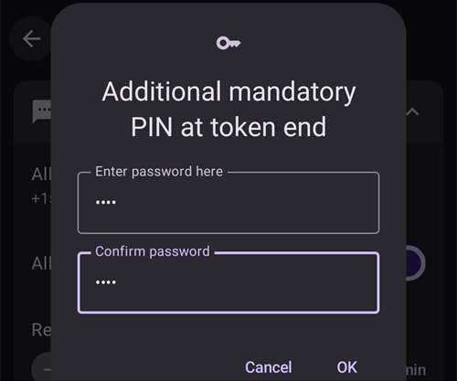
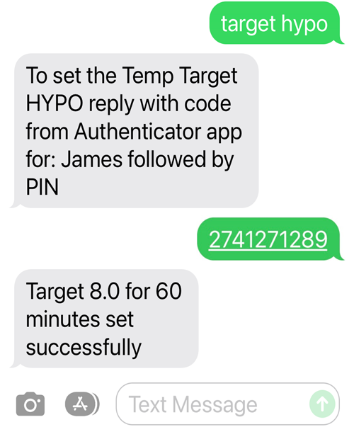

# SMS-команди

```{contents} Table of contents
:depth: 2
```

Більшість віддалених змін (тимчасові цілі, вуглеводи, перемикання профілю і, коли клієнт спарено, болюси) можна зробити в [застосунку **AAPSClient**](../RemoteFeatures/RemoteMonitoring.md) на телефоні з Android і доступом до інтернету, див. [Керування основний телефон ↔ клієнт](#client-master-control) (версія **AAPSClient** для iPhone ще в розробці, див. [AAPSClient](AapsClient.md)). SMS-команди залишаються альтернативою, яка працює без інтернету, і єдиним варіантом віддаленого керування, якщо ви як послідовник використовуєте iPhone і ще не маєте **AAPSClient**.

**SMS-команди дуже корисні:**
1. Для звичайного віддаленого керування

2. Якщо ви хочете віддалено вводити болюс інсуліну без спареного **AAPSClient**

3. У місцевості з поганим інтернетом, де текстові повідомлення проходять, але мобільні дані / інтернет на телефоні працюють погано. Це дуже корисно, коли ви їдете у віддалені місця (наприклад, у похід з наметом чи на лижі).

4. Якщо ваш інший спосіб віддаленого керування (**AAPSClient**) тимчасово не працює

## Безпека понад усе

Якщо ви вмикаєте **SMS Комунікатор** в **AAPS**, пам'ятайте, що телефон, з якого надсилають віддалені команди, можуть вкрасти та/або ним може скористатися хтось інший. Завжди блокуйте свій телефон принаймні PIN-кодом. Дуже радимо використовувати надійний пароль та/або біометричне блокування. Переконайтеся, що цей пароль відрізняється від головного пароля APK (пароля, потрібного для експорту налаштувань **AAPS**).

Крім того, радимо дозволити для SMS-команд [другий номер телефону](#SMSCommands-authorized-phone-numbers). Так ви зможете за допомогою другого номера [вимкнути](#SMSCommands-other) SMS Комунікатор, якщо ваш основний телефон для віддаленого керування опиниться в чужих руках.

The default minimum time delay between bolus commands is 15 minutes, counted from the moment the pump accepts a bolus. З міркувань безпеки, щоб скоротити цей інтервал, треба додати принаймні два дозволені номери телефону. Якщо ви спробуєте знову ввести болюс віддалено раніше ніж через 15 хвилин після попереднього болюсу, ви отримаєте відповідь «Віддалений болюс недоступний. Спробуйте пізніше.»

AAPS також повідомить вас текстовим повідомленням, чи виконано ваші віддалені команди, наприклад болюс або зміну профілю. Радимо налаштувати все так, щоб тексти підтвердження надходили принаймні на два різні номери телефону, на випадок якщо один із телефонів-отримувачів вкрадуть.

**Якщо ви вводите болюс через SMS-команди, вуглеводи треба ввести окремо (друге SMS, AAPSClient...)!** Якщо цього не зробити, IOB буде правильним, але COB буде занадто низьким. Тоді коригувальний болюс може не бути введено, бо **AAPS** вважає, що у вас забагато активного інсуліну.

Для чутливих команд, щоб підвищити безпеку, треба використовувати застосунок-автентифікатор з одноразовим паролем, що залежить від часу.

Якщо ви хочете забрати в телефона доглядача можливість надсилати SMS-команди, використайте аварійну кнопку «[Скинути Authenticators](#sms-commands-authenticator-setup)» в **AAPS** або надішліть SMS-команду «[SMS stop](#SMSCommands-other)». Коли ви скидаєте автентифікатори, ВСІ телефони доглядачів перестають бути дійсними. Вам доведеться налаштувати їх знову.

## Налаштування SMS-команд

```{contents} The overall process is as follows
:depth: 1
:local: true
```

(sms-commands-authenticator-setup)=
### Налаштування Authenticator

Для більшої безпеки використовується двофакторна автентифікація.

На телефоні доглядача завантажте (з App Store або Google Play) і встановіть застосунок-автентифікатор (Authenticator). Популярні безкоштовні застосунки:
  - [Authy](https://authy.com/download/)
  - Google Authenticator - [Android](https://play.google.com/store/apps/details?id=com.google.android.apps.authenticator2) / [iOS](https://apps.apple.com/de/app/google-authenticator/id388497605)
  - [LastPass Authenticator](https://lastpass.com/auth/)
  - [FreeOTP Authenticator](https://freeotp.github.io/)

Ці застосунки створюють одноразовий 6-значний пароль з обмеженим часом дії, як у мобільному банкінгу чи під час онлайн-покупок. Можна використовувати інший застосунок-автентифікатор, якщо він підтримує токени RFC 6238 TOTP. Microsoft Authenticator не працює.

### Перевірте налаштування телефона

На телефоні перейдіть до **Apps > AAPS > Permissions** (Застосунки → AAPS → Дозволи). Переконайтеся, що дозволи **SMS** і **Phone** (Телефон) надано.


```{admonition} "App was denied access to SMS"
:class: tip
Android може блокувати дозвіл **SMS** для застосунків, які встановлено не з магазину застосунків, як-от **AAPS**. Якщо ви бачите це повідомлення, коли надаєте дозвіл **SMS**, відкрийте на телефоні **Settings > Apps > AAPS** (Налаштування → Застосунки → AAPS), торкніться меню **⋮** (вгорі праворуч) і виберіть **Allow restricted settings** (Дозволити обмежені налаштування). Потім знову надайте дозвіл **SMS**.
```


### Синхронізація дати й часу

Час на обох телефонах має бути синхронізований. Найкраще встановлювати його автоматично з мережі. Різниця в часі може спричинити проблеми з автентифікацією.

І на телефоні з **AAPS**, і на телефоні доглядача перевірте, що дата й час синхронізовані. Як саме це зробити, залежить від вашого пристрою; можливо, доведеться спробувати різні налаштування.

Приклад (для Samsung S23): **Settings > General management > Date and time** (Налаштування → Загальне керування → Дата й час): переконайтеся, що **Automatic date and time** (Автоматичні дата й час) увімкнено.

Деякі параметри можуть бути неактивними (сірими), бо, якщо телефон налаштовано як дитячий обліковий запис, ними керує адміністратор сімейного облікового запису. На iPhone доглядача/батьків це налаштування дати й часу називається «Set Automatically» (Автоматично). Якщо ви не впевнені, що телефони синхронізовано, не хвилюйтеся: можна налаштувати SMS-команди, а потім шукати причину, якщо здається, що через це виникають проблеми (за потреби попросіть допомоги).

### Налаштування AAPS

Тепер, коли налаштування телефона перевірено, у самому застосунку **AAPS** перейдіть до [**Конфігурація** → **Звʼязок**](../SettingUpAaps/ConfigBuilder.md) і увімкніть плагін **SMS Комунікатор**.

Відкрийте налаштування **SMS Комунікатор**.

Увімкніть **Дозволити віддалені команди через SMS**. Параметри **Додатковий обов’язковий PIN у кінці токена** і **Налаштування Authenticator** з’являються лише після того, як це ввімкнено:


(SMSCommands-authorized-phone-numbers)=
#### Дозволені номери телефонів

Введіть номер(и) телефону доглядача. Вкажіть код країни і не пишіть першу «0» номера телефону, як у цих прикладах:
* Номер телефону у Великій Британії: +447976304596
* Номер телефону в США: +11234567890
* Номер телефону у Франції:  +33612344567
* _тощо._

Зверніть увагу: знак «+» перед номером може бути потрібен або не потрібен, залежно від вашої країни. Щоб це визначити, надішліть пробне повідомлення: отриманий формат буде видно на екрані плагіна **SMS Комунікатор** (**Конфігурація** → **Звʼязок** → **SMS Комунікатор** → **Відкрити плагін**).

Якщо треба додати кілька номерів телефону, розділіть їх крапкою з комою, **БЕЗ пробілів між номерами** (це дуже важливо!). Виберіть **OK**:


#### Мін. інтервал між віддаленими болюсами

- Можна задати мінімальну затримку (у хвилинах) між двома болюсами, надісланими через SMS.
- З міркувань безпеки, щоб змінити це значення, треба додати принаймні два дозволені номери телефону.

#### Додатковий обов’язковий PIN у кінці токена

З міркувань безпеки після коду відповіді треба ввести PIN. Виберіть PIN, який ви (та інші доглядачі) будете додавати в кінці коду автентифікатора, коли надсилаєте SMS-команду.

Вимоги до PIN:

* щонайменше 6 цифр
* лише цифри

Для надійнішого PIN не використовуйте одну цифру багато разів (_наприклад_, 111111) або послідовність (_наприклад_, 123456).



#### Налаштування Authenticator

* Торкніться **Налаштування Authenticator** і виконуйте покрокові інструкції на екрані.
* Відкрийте встановлений застосунок-автентифікатор на _телефоні доглядача_, створіть нове підключення і
* Телефоном доглядача відскануйте QR-код, показаний під написом **Відскануйте код, щоб налаштувати OTP-коди AAPS**.


* У розділі **Перевірте одноразовий пароль** введіть у поле **Код для перевірки** одноразовий код із застосунку-автентифікатора на телефоні доглядача, а одразу після нього ваш PIN:

Приклад:
* Токен із застосунку-автентифікатора: 457051
* Ваш обов’язковий PIN: 2401
* Код для перевірки: 4570512401

Якщо введено правильно, червоний текст «НЕПРАВИЛЬНИЙ PIN» автоматично зміниться на зелений «OK». **Тут немає кнопки, яку треба натиснути!** Процес завершено, після введення коду не потрібно натискати кнопку «OK»:


Тепер SMS-команди мають бути налаштовані.

Якщо ви хочете видалити налаштовані автентифікатори, натисніть кнопку **Скинути Authenticators** внизу екрана **Налаштування Authenticator**. (Коли ви скидаєте автентифікатори, ВСІ вже налаштовані автентифікатори перестають бути дійсними. Вам доведеться налаштувати їх знову.)

## Використання SMS-команд

### Перші кроки з SMS-командами

1)  Щоб перевірити, що все налаштовано правильно, перевірте зв'язок: надішліть з телефона доглядача на телефон з **AAPS** SMS з текстом «bg». Ви маєте отримати відповідь, подібну до показаної тут:


Якщо ви не отримали жодної відповіді, див. розділ [Усунення проблем](#SMSCommands-troubleshooting) нижче.

2)  Тепер спробуйте SMS-команду, яка потребує автентифікатора, _наприклад_ «target hypo». Телефон доглядача отримає відповідь із проханням ввести **шестизначний пароль** із застосунку-автентифікатора, а після нього додатковий секретний **PIN**, який знають лише доглядачі/послідовники (разом рядок із дванадцяти цифр, якщо ваш PIN має 6 цифр).

Коли ви вперше надсилаєте SMS-команду, спробуйте це поруч із телефоном з **AAPS**, щоб побачити, як це працює:


Телефон доглядача отримає від **AAPS** SMS-відповідь, яка підтвердить, чи успішно виконано віддалену SMS-команду.

Якщо команду виконано успішно, ви отримаєте відповідь із підтвердженням. Якщо виникла проблема, ви отримаєте повідомлення про помилку. Типові помилки див. у розділі [Усунення проблем](#SMSCommands-troubleshooting) нижче.

**Порада**: якщо ви надсилатимете багато SMS, корисно мати тариф з необмеженими SMS (для кожного телефона, який використовується).

### Болюси на їжу через SMS-команди

Віддалено ввести болюс інсуліну можна через **SMS-команди** або через спарений **AAPSClient** (див. [Керування основний телефон ↔ клієнт](#client-master-control)); через вебсайт Nightscout це зробити не можна. Вуглеводи також можна ввести через SMS або **AAPSClient**. Через SMS не можна надіслати команди для вуглеводів та інсуліну в одному повідомленні. Ці команди треба надсилати окремо, ось так:

1)  Надішліть болюс інсуліну (_наприклад_, «bolus 2» дасть команду на болюс 2 одиниці). Через SMS-команди це те саме, що **Терапія** → **Інсулін** в **AAPS**. 2)  Надішліть вуглеводи (_наприклад_, «carbs 20» вводить 20 г вуглеводів). Це те саме, що **Терапія** → **Вуглеводи** в **AAPS**.

Щоб уникнути гіпо, краще починати обережно: вводьте **менше інсуліну**, ніж потрібно за вашим вуглеводним коефіцієнтом, бо ви не враховуєте поточний рівень глюкози і тенденцію глюкози.

**Порядок, у якому ви надсилаєте ці команди, важливий**. Якщо ви будь-яким способом вводите велику кількість вуглеводів і SMB увімкнено, **AAPS** може одразу відреагувати і ввести частковий болюс інсуліну. Тому, якщо ви потім спробуєте надіслати болюс інсуліну _після_ введення вуглеводів, може бути неприємна затримка і повідомлення «болюс уже вводиться», і тоді треба перевірити, скільки було введено як SMB. Або, якщо ви не помітите, що вводиться SMB, а ваш власний наступний болюс теж буде успішним, на цю їжу загалом може бути введено забагато інсуліну. Тому, якщо ви вводите болюс на їжу віддалено, завжди надсилайте болюс інсуліну _до_ введення вуглеводів. Якщо хочете, можна поєднувати **AAPSClient** із SMS-командами: вуглеводи, введені на спареному **AAPSClient**, не потребують коду автентифікації, тому це швидше, ніж SMS-команди. Вуглеводи або інші записи терапії, введені на вебсайті Nightscout, **не** застосовуються, поки увімкнено керування з клієнта; тоді **AAPS** працює в [захищеному режимі](#client-master-control-hardened-mode).

(SMSCommands-commands)=
## Команди

```{contents} List of command groups
:depth: 1
:local: true
```

Команди треба надсилати англійською, а відповідь буде вашою мовою, якщо текст відповіді вже [перекладено](#translations-translate-strings-for-AAPS-app). Команди не залежать від регістру: можна писати малими або великими літерами.


**Таблиці SMS-команд** нижче показують усі можливі SMS-команди. Для кращого розуміння наведено _приклади значень_. Команди мають той самий діапазон можливих значень (цілі, відсоток профілю тощо), що й сам застосунок **AAPS**.

(authentication-or-not)=
### Потрібна автентифікація чи ні?

Деякі SMS-команди дають відповідь одразу, а деякі потребують надійної **автентифікації** через застосунок-автентифікатор. Простий запит, наприклад «**BG**» (запит поточного значення глюкози), швидко набрати, він не потребує автентифікації і повертає інформацію про стан **AAPS**, як показано нижче:


Команди, яким потрібна більша безпека, потребують введення коду, наприклад:



Стовпець *Автент.* у таблицях нижче показує, чи потрібна така надійна автентифікація для кожної команди.

### Дані CGM

| Команда    | Автент. | Функція та *відповідь*                                                                                                                                                                      |
| ---------- | ------- | ------------------------------------------------------------------------------------------------------------------------------------------------------------------------------------------- |
| BG         | Ні      | Повертає: останню ГК, дельту, IOB (болюс і базал), COB<br/>*Остання ГК: 5,6 4 хв тому, Дельта: -0,2 ммоль, IOB: 0,20 Од (Болюс: 0,10 Од Базал: 0,10 Од)*                              |
| CAL 5.6/90 | Так     | Калібрує CGM значенням 5.6/90<br/>(використовуйте значення у ваших одиницях глюкози)<br/>Працює, лише якщо правильно налаштовано в **AAPS**.<br/>*Калібрування надіслано* |

### Помпа

| Команда              | Автент. | Функція та *відповідь*                                                                                |
| -------------------- | ------- | ----------------------------------------------------------------------------------------------------- |
| ПОМПА                | Ні      | Last conn: 1 min ago<br/>Temp: 0.00U/h @11:38 5/30min<br/>IOB: 0.5U Reserv: 34U Batt: 100 |
| PUMP DISCONNECT *30* | Так     | Від’єднати помпу на *30* хвилин                                                                       |
| PUMP CONNECT         | Так     | Помпу знову під’єднано                                                                                |

### Базал

| Команда           | Автент. | Функція та *відповідь*              |
| ----------------- | ------- | ----------------------------------- |
| BASAL 0.3         | Так     | Запустити базал 0,3 Од/год на 30 хв |
| BASAL 0.3 20      | Так     | Запустити базал 0,3 Од/год на 20 хв |
| BASAL 30%         | Так     | Запустити базал 30 % на 30 хв       |
| BASAL 30% 50      | Так     | Запустити базал 30 % на 50 хв       |
| BASAL STOP/CANCEL | Так     | Зупинити тимчасовий базал           |

Деякі помпи приймають тимчасовий базал лише у відсотках, інші — лише в Од/год. Якщо ви використаєте іншу форму, **AAPS** відповість *«Ця помпа приймає тимчасовий базал лише у відсотках, а не в Од/год.»* (або навпаки) і нічого не встановить. Тривалість має бути кратною кроку тривалості тимчасового базалу вашої помпи.


### Петля

| Команда           | Автент. | Функція та *відповідь*                                                                                                                                                                                                                       |
| ----------------- | ------- | -------------------------------------------------------------------------------------------------------------------------------------------------------------------------------------------------------------------------------------------- |
| LOOP STATUS       | Ні      | Відповідь залежить від поточного стану:<br/> - *Петля вимкнена*, якщо петлю вимкнено або LGS<br/> - *Петлю увімкнено*, якщо петля закрита або відкрита<br/> - *Призупинено (10 хв)*, якщо петлю від’єднано або призупинено |
| LOOP STOP/DISABLE | Так     | Помпа повернеться до запрограмованої базальної швидкості.<br/>*Петлю вимкнено*                                                                                                                                                         |
| LOOP SUSPEND 20   | Так     | *Петлю призупинено на 20 хвилин*                                                                                                                                                                                                             |
| LOOP RESUME       | Так     | *Петлю відновлено*                                                                                                                                                                                                                           |
| LOOP CLOSED       | Так     | *Поточний робочий режим: Закрита петля*                                                                                                                                                                                                      |
| LOOP LGS          | Так     | *Поточний робочий режим: Зупинка базалу при низькому ГК*                                                                                                                                                                                     |

### Болюс

Віддалений болюс не дозволено протягом 15 хв (це значення можна змінити, лише якщо додано 2 номери телефону) після останньої команди болюсу або віддалених команд! У цьому випадку відповідь буде *Віддалений болюс недоступний. Спробуйте пізніше.* Таку відповідь ви також отримаєте, якщо помпа зараз вводить болюс.

| Команда              | Автент. | Функція та *відповідь*                                                                                                                                            |
| -------------------- | ------- | ----------------------------------------------------------------------------------------------------------------------------------------------------------------- |
| BOLUS 1.2            | Так     |                                                                                                                                                                   |
| BOLUS 0.60 MEAL      | Так     | Вводить вказаний болюс 0,60 Од<br/>**і** встановлює [тимчасову ціль «Очікуваний прийом їжі»](#TempTargets-eating-soon-temp-target)                          |
| CARBS 5              | Так     | Ввести 5 г без болюсу                                                                                                                                             |
| CARBS 5 17:35/5:35PM | Так     | Ввести 5 г о 17:35.<br/>Допустимий формат часу залежить<br/> від налаштування часу (12 год/24 год) на телефоні.                                       |
| EXTENDED 2 120       | Так     | Запустити подовжений болюс 2 Од на 120 хв.<br/>Лише для [сумісних помп](#Extended-Carbs-extended-bolus-and-switch-to-open-loop-dana-and-insight-pump-only). |
| EXTENDED STOP/CANCEL | Так     | Зупинити подовжений болюс                                                                                                                                         |

### Профіль

| Команда        | Автент. | Функція та *відповідь*                                                                                                                                                     |
| -------------- | ------- | -------------------------------------------------------------------------------------------------------------------------------------------------------------------------- |
| PROFILE STATUS | Ні      | Поточний профіль і відсоток                                                                                                                                                |
| PROFILE LIST   | Ні      | Поточний список профілів в **AAPS**, наприклад:<br/>1. Profile1<br/> 2. Profile2                                                                               |
| PROFILE 1      | Так     | Перемкнути профіль на профіль 1 зі списку.<br/>Використовуйте номери, які повертає команда **PROFILE LIST**,<br/>а не назви профілів, під якими ви їх зберегли |
| PROFILE 2 30   | Так     | Перемкнути профіль на Profile2 30 %                                                                                                                                        |

Відсоток має бути від 30 до 250 %, як у застосунку. Значення поза цим діапазоном відхиляється ще до того, як у вас попросять код автентифікації.

### Тимчасові цілі

| Команда                   | Автент. | Функція та *відповідь*                                             |
| ------------------------- | ------- | ------------------------------------------------------------------ |
| TARGET MEAL/ACTIVITY/HYPO | Так     | Встановити тимчасову ціль MEAL/ACTIVITY/HYPO (їжа/активність/гіпо) |
| TARGET STOP/CANCEL        | Так     | Скасувати тимчасову ціль                                           |


(SMSCommands-other)=
### Інше

| Команда          | Автент. | Функція та *відповідь*                                                                                                                                                                                                                                         |
| ---------------- | ------- | -------------------------------------------------------------------------------------------------------------------------------------------------------------------------------------------------------------------------------------------------------------- |
| RESTART          | Так     | Перезапускає AAPS. Корисно, якщо виникли проблеми, які зазвичай зникають після перезапуску.                                                                                                                                                                    |
| SMS DISABLE/STOP | Так     | Щоб вимкнути віддалений сервіс SMS, дайте відповідь кодом.<br/>Пам'ятайте, що знову ввімкнути його можна буде<br/>лише безпосередньо на основному телефоні з **AAPS**.                                                                             |
| HELP             | Ні      | Повертає всі функції, про які можна запитати:<br/>BG, LOOP, PUMP, BASAL, BOLUS, EXTENDED, CAL, PROFILE, TARGET, SMS, CARBS, HELP, RESTART<br/>Надішліть ще команду ***HELP ***FUNCTION******, щоб побачити<br/>усі варіанти в цьому розділі. |
| HELP BOLUS       |         | *BOLUS 1.2<br/>BOLUS 1.2 MEAL*                                                                                                                                                                                                                           |

(SMSCommands-troubleshooting)=
## Усунення проблем і часті запитання

```{contents} List of questions and issues
:depth: 1
:local: true
```

### Чого _не можна_ робити за допомогою SMS-команд?

1)  **Не можна встановити _тимчасове_ перемикання профілю** (наприклад, «profile exercise» на 60 хвилин), хоча можна назавжди перемкнутися на «profile exercise». Натомість тимчасові перемикання профілю можна встановити через **AAPSClient**.

2)  **Не можна скасувати автоматизації** або **встановити власні цілі**, але є приблизні рішення: Наприклад, уявіть, що звичайна ціль профілю – 5,5. Ви налаштували в AAPS автоматизацію, яка завжди встановлює високу ціль 7,0 з 14:30 до 15:30 через урок фізкультури в школі, а одна з умов автоматизації – «тимчасової цілі немає». Цього тижня вам в останню мить сказали, що урок фізкультури скасовано і замість нього буде піца, але ваша дитина вже в школі з телефоном з **AAPS**. Якщо автоматизація запустить високу тимчасову ціль 7,0, а ви її скасуєте (на телефоні з **AAPS** або віддалено), умови автоматизації все ще виконуються, і **AAPS** просто знову встановить високу ціль через хвилину.

**Якщо у вас є доступ до телефона з AAPS**, можна вимкнути або змінити автоматизацію. Або, якщо ви не хочете цього робити, просто встановіть нову тимчасову ціль 5,6 на 60 хв: натисніть на ціль на головному екрані або виберіть **Керувати** → **Тимчасова ціль**. Тоді автоматизація не встановить високу ціль 7,0.

**Якщо у вас немає доступу до телефона з AAPS**, SMS-команди можна використати для приблизного рішення: наприклад, командою «target meal» встановити ціль 5,0 на 45 хв (інші стандартні цілі – 8,0 для активності або гіпо, див. таблицю). Однак за допомогою SMS-команд не можна задати _конкретне_ значення цілі (наприклад, 5,6 на 60 хвилин); для цього потрібен **AAPSClient**.

### Що робити, якщо я передумав щодо команди, яку щойно надіслав?

**AAPS** виконає лише останню команду. Тож якщо ви наберете «bolus 1.5», а потім, без автентифікації, надішлете нову команду «bolus 1», попередню команду 1.5 буде проігноровано. **AAPS** завжди надсилає на телефон доглядача відповідь, яка підтверджує, що це за SMS-команда, перш ніж попросити ввести код автентифікації, а також відповідь після виконання дії.

### Чому я не отримав відповіді на SMS-команду?

Це може бути з однієї з таких причин:

1)  Повідомлення не дійшло до телефона (проблеми з мережею). 2)  **AAPS** ще обробляє запит (_наприклад_, болюс, введення якого може тривати деякий час залежно від швидкості введення болюсу). 3)  Коли надійшла команда, телефон з **AAPS** не мав доброго з'єднання Bluetooth з помпою, і команда не виконалася (зазвичай це викликає сигнал тривоги на телефоні з **AAPS**).

### Жодної відповіді на SMS-команди

На телефоні доглядача та/або телефоні з **AAPS** спробуйте вимкнути такі параметри:
* **Send as chat message** (Надсилати як чат-повідомлення) 
* Якщо ви користуєтеся застосунком Android Messages або Google Messages, вимкніть обмін повідомленнями RCS:
  - відкрийте потрібну розмову SMS у застосунку «Повідомлення»
  - Торкніться меню з трьома крапками у верхньому правому куті
  - виберіть «Details» (Подробиці)
  - Увімкніть «Only send SMS and MMS messages» (Надсилати лише SMS і MMS) 

### Помилки під час виконання команд

Є кілька можливих причин, чому команда може не виконатися:

* Налаштування SMS-команд не завершене або неправильне
* Ви надіслали команду в неправильному форматі (наприклад, «disconnect pump 45» замість «pump disconnect 45»)
* Ви використали неправильний або прострочений код автентифікатора (зазвичай краще зачекати кілька секунд на новий код, якщо дія поточного скоро закінчиться)
* Код+PIN були правильні, але SMS затрималось під час надсилання/доставки, тому **AAPS** вирішив, що дія коду автентифікатора вже закінчилася
* Телефон з **AAPS** поза зоною дії помпи / немає зв'язку з помпою
* Система вже зайнята введенням болюсу

Типові помилки показано в прикладах нижче:


### Як зупинити команду, коли її вже автентифіковано?

Ніяк. Однак болюс, надісланий через SMS, можна скасувати на самому телефоні з **AAPS**: просто скасуйте його у спливному вікні болюсу, якщо встигнете. Багато SMS-команд (крім болюсів і введення вуглеводів) легко скасувати, або можна вжити заходів, щоб зменшити небажані наслідки помилки.

Навіть при помилках з болюсом і введенням вуглеводів ви все ще можете діяти. Наприклад, якщо ви ввели 20 г вуглеводів, а дитина з'їла лише 10 г, і ви (або доглядач поруч) не можете видалити запис терапії безпосередньо на телефоні з **AAPS**, можна встановити високу тимчасову ціль або знижений профіль, щоб **AAPS** діяв менш агресивно.

### Кілька SMS

Якщо ви знову й знову отримуєте те саме повідомлення (_наприклад_, про перемикання профілю), можливо, ви випадково створили зациклення з іншими застосунками. Наприклад, це може бути xDrip. Якщо так, переконайтеся, що xDrip (або інший застосунок) не вивантажує записи терапії в Nightscout.

Якщо інший застосунок встановлено на кількох телефонах, вимкніть вивантаження на всіх.

(sms-commands-too-many-messages)=
### Я отримую надто багато текстових повідомлень від SMS-команд. Чи можна зменшити їх кількість або зовсім вимкнути?

SMS-команди можуть створювати багато автоматичних повідомлень з телефона з **AAPS** на телефон доглядача. Ви також отримуватимете повідомлення, наприклад «Базальний профіль помпи оновлено», якщо в **AAPS** налаштовано автоматизації. Якщо ви надсилатимете багато SMS, корисно мати необмежені SMS у тарифі телефона з **AAPS** (і для кожного телефона доглядача), а також вимкнути сповіщення, звуки та вібрацію для SMS на всіх телефонах. Не можна користуватися SMS-командами і не отримувати ці повідомлення. Тому вам, можливо, знадобиться інший спосіб спілкуватися безпосередньо з дитиною (якщо вона вже досить доросла), а не через SMS. Поширені застосунки для спілкування, якими користуються доглядачі **AAPS**: Whatsapp, Lime, Telegram і Facebook Messenger.

Можна вимкнути SMS «Profile changed» (Профіль змінено), коли зміна профілю надійшла з Nightscout. Для цього створіть файл з назвою **точно**  `do_not_send_sms_on_profile_change` у теці `extra` вашої теки AAPS.
