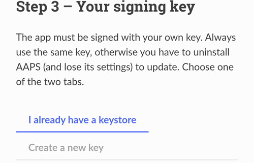
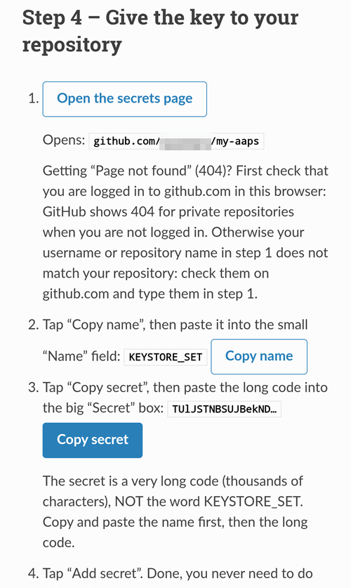
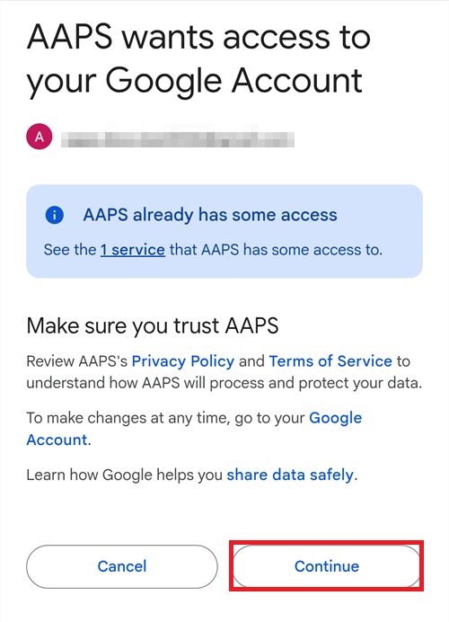
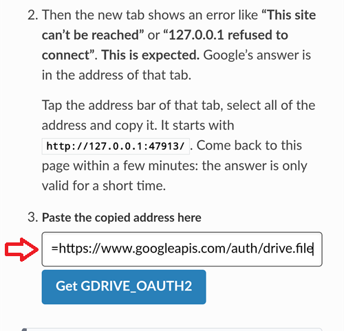
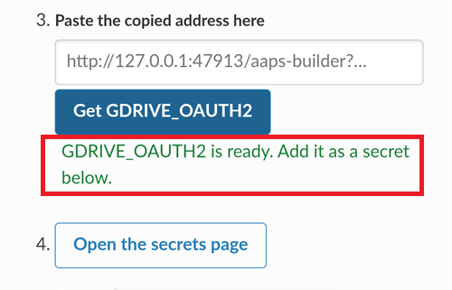

(aaps-builder)=

# Збірка в браузері з AAPS Builder

```{note}
Це рекомендований спосіб зібрати AAPS з **телефона Android**. Він також працює в будь-якому браузері на комп’ютері. Інші способи збірки з комп’ютера або iPhone описано в огляді [Збірка в браузері](BrowserBuild.md).
```

```{contents} In this page
:backlinks: entry
:depth: 2
```

**AAPS Builder** збирає для вас застосунок AAPS на GitHub – безкоштовному сайті для зберігання коду. На телефон нічого не треба встановлювати, і не треба відкривати файл підготовки.

Сторінка налаштування проведе вас через усі кроки. Перший раз це займає близько 10 хвилин:

1. Створіть власну **приватну копію** AAPS Builder у своєму обліковому записі GitHub: сторінка налаштування відкриває GitHub з усім уже заповненим, вам потрібно лише підтвердити. Робочий процес збірки – файл, який каже GitHub, як збирати AAPS, – уже є в ній.
2. Створіть або вивантажте свій **ключ для підпису** (keystore).
3. Передайте ключ своєму репозиторію як **секрет** GitHub.
4. **Зберіть** застосунок. Одна збірка триває від 15 до 30 хвилин.
5. **Завантажте і встановіть** застосунок на свій телефон.

Вам **не** потрібно робити fork AndroidAPS: вихідний код AAPS завантажується з офіційного репозиторію AndroidAPS під час кожної збірки. Вам також **не** потрібен Google Drive: застосунок ви завантажуєте прямо з GitHub.

```{admonition} Where the code comes from
:class: note

Робочий процес збірки підтримують розробники AAPS у репозиторії [nightscout/aaps-builder](https://github.com/nightscout/aaps-builder), а ваш репозиторій – це його копія. [Робочий процес](https://github.com/nightscout/aaps-builder/blob/main/.github/workflows/build.yml) у вашій копії короткий: він запускає [кроки збірки](https://github.com/nightscout/aaps-builder/blob/main/.github/workflows/aaps-builder.yml), які зберігаються в тому репозиторії, тож покращення доходять до вас без жодних змін у вашому репозиторії. Ви можете прочитати обидва файли. Під час збірки робочий процес завантажує лише офіційний вихідний код AAPS і власні інструменти збірки GitHub. Ваш keystore ніколи не залишає ваш браузер і ваш приватний репозиторій.
```

(aaps-builder-before-you-start)=

## Перш ніж почати

Вам знадобиться:

- **Обліковий запис GitHub** (безкоштовний). Якщо у вас його немає, спочатку створіть його на [github.com](https://github.com/signup).
- **Веббраузер**: Chrome на телефоні або будь-який браузер на комп’ютері. Перш ніж почати, увійдіть на github.com у цьому браузері.
- **На телефоні є застосунок GitHub?** Ви можете його залишити. Тоді деякі кнопки сторінки налаштування відкривають застосунок замість Chrome. Збірка працює в застосунку, але застосунок **не може завантажити** готовий AAPS: [крок 5](#aaps-builder-step5) показує, як перейти в Chrome для завантаження.
- Ваш **наявний keystore** (файл `.jks`), його пароль і псевдонім (alias), якщо ви вже збирали AAPS раніше і хочете оновити його без перевстановлення.

```{warning}
**Ваш репозиторій для збірки має залишатися приватним.** Усе, що створює збірка, бачить кожен, хто може бачити репозиторій. Сторінка налаштування створює для вас приватний репозиторій. Ніколи не робіть його публічним і не робіть **fork** AAPS Builder замість копії: fork завжди публічний.

Приватний репозиторій отримує 2000 безкоштовних хвилин GitHub Actions на місяць. Цього достатньо для кількох збірок.
```

```{warning}
**Новий ключ чи наявний ключ: від цього залежить, чи зможете ви оновити AAPS.**

- **AAPS вже є на вашому телефоні, і він зібраний з keystore, який у вас досі є**: виберіть на сторінці налаштування **У мене вже є keystore** і вивантажте його. Ваша наступна збірка оновить AAPS без перевстановлення. Ви збирали AAPS попереднім способом збірки в браузері (власний fork)? Ваш keystore зберігається у вашому fork: [спочатку отримайте його копію](#aaps-builder-from-fork).
- **Ви збираєте AAPS вперше, або ви втратили свій keystore чи його пароль**: виберіть **Створити новий ключ**. Застосунок, підписаний новим ключем, **не може оновити** AAPS, підписаний іншим ключем. Ви маєте експортувати налаштування, скопіювати файл за межі телефона, видалити старий AAPS, встановити новий, а потім імпортувати налаштування: див. [Перевстановлення AAPS з новим keystore](#reinstall-aaps).

Надалі завжди використовуйте той самий ключ. Коли ви створюєте новий ключ, завантажте резервну копію, яку пропонує сторінка, і зберігайте її разом з паролем і псевдонімом (`key0`) у безпечному місці поза телефоном.
```

(aaps-builder-from-fork)=

## Перехід з попередньої збірки в браузері (fork)

Пропустіть цей розділ, якщо ви ніколи не збирали AAPS попереднім способом збірки в браузері (власна копія, або fork, AndroidAPS на GitHub, з файлом підготовки і Google Drive).

Ваш keystore зберігається як секрети у вашому fork. GitHub ніколи не показує секрет вдруге, тому ви не можете скопіювати його в новий репозиторій. Спочатку отримайте копію свого keystore, потім використайте її на [кроці 2](#aaps-builder-step2) з варіантом **У мене вже є keystore**.

```{warning}
Не вибирайте **Створити новий ключ**. AAPS, зібраний з новим ключем, не може оновити AAPS на вашому телефоні.
```

Який випадок ваш?

- **Ви використали Варіант 2** (ви вивантажили власний keystore з Android Studio), і у вас досі є файл `.jks`, його паролі та псевдонім: тут нічого робити не треба. Використайте цей файл на кроці 2.
- **Ви використали Варіант 1** (ключ створив файл підготовки), або у вас більше немає файлу keystore: експортуйте його зі свого fork, як описано нижче.

Щоб експортувати keystore зі свого fork:

1. У своєму fork відкрийте **Settings** → **Secrets and variables** → **Actions** і додайте секрет з назвою `ZIP_PASSWORD`. Виберіть пароль лише з англійських літер і цифр. Він захищає файл, який ви зараз створите.
2. Відкрийте вкладку **Actions** вашого fork, натисніть **CI Keystore Export**, потім **Run workflow**. Докладніше: [Експорт вашого keystore](#ci-keystore-export).
3. Коли біля запуску з’явиться зелена галочка, відкрийте свій Google Drive: файл `keystore.zip` лежить у папці **AAPS** → **KeyStore**. Якщо запуск не вдається на кроці Google Drive, термін доступу вашого fork до Google Drive минув: див. [Термін дії Google Refresh Token минув](#aaps-ci-google-token-expired).
4. Завантажте `keystore.zip` і відкрийте його з вашим `ZIP_PASSWORD`: на комп’ютері або на телефоні за допомогою файлового менеджера, який може відкривати ZIP-файли, захищені паролем. Він містить:
   - `keystore.jks`: ваш keystore,
   - `keyStoreInfo.txt`: ваші `KEYSTORE_PASSWORD`, `KEY_PASSWORD` і `ALIAS` (зазвичай `key0`).
5. Скопіюйте `keystore.jks` на телефон (або на Google Drive, щоб вибрати його звідти).

На [кроці 2](#aaps-builder-step2) сторінки налаштування:

1. Натисніть **У мене вже є keystore**.
2. У полі **Файл keystore** виберіть `keystore.jks`.
3. У полі **Пароль keystore** введіть `KEYSTORE_PASSWORD` з `keyStoreInfo.txt`.
4. У полі **Псевдонім ключа (alias)** виберіть або введіть `ALIAS` з `keyStoreInfo.txt`.
5. Якщо `KEY_PASSWORD` відрізняється від `KEYSTORE_PASSWORD`, зніміть позначку **Пароль ключа такий самий, як пароль keystore** і введіть `KEY_PASSWORD`.

Зберігайте `keystore.zip` і його `ZIP_PASSWORD` у безпечному місці поза телефоном: це резервна копія вашого ключа.

Щоб також зберігати збірки AAPS Builder на Google Drive, виконайте [крок 6](#aaps-builder-google-drive): сторінка налаштування отримає для вас новий `GDRIVE_OAUTH2`. Ви можете залишити свій fork, доки AAPS, зібраний з AAPS Builder, не буде встановлено на ваш телефон.

## Відкрийте сторінку налаштування

**→ [Відкрийте сторінку налаштування AAPS Builder](#aaps-builder-setup)**

Сторінка налаштування є частиною цієї документації, вашою мовою. Також тримайте цю сторінку відкритою в іншій вкладці: розділи нижче докладніше пояснюють кожен крок сторінки налаштування, зі знімками екрана.

Сторінка налаштування відкриває кожну сторінку GitHub у новій вкладці Chrome. Щоб повернутися на сторінку налаштування, натисніть кнопку вкладок поруч з адресним рядком Chrome (квадрат із числом) і виберіть сторінку налаштування AAPS Builder.


Сторінка налаштування працює повністю у вашому браузері: ваш ключ і паролі нікуди не надсилаються, крім секрету GitHub, у який ви самі їх вставляєте. У GitHub надсилається лише ваше ім'я користувача GitHub, щоб перевірити, чи воно існує. Вона запам’ятовує ваше ім’я користувача GitHub і назву репозиторію, тож ви можете будь-коли повернутися до неї, щоб знову відкрити сторінку секретів або свої збірки.


(aaps-builder-step1)=

## Крок 1 – Створіть свій приватний репозиторій для збірки

Цей крок створює вашу власну приватну копію AAPS Builder у вашому обліковому записі GitHub, з робочим процесом збірки всередині. Лише ви бачите його і застосунки, які він збирає.

1. Переконайтеся, що ви увійшли на github.com у цьому браузері.

2. У полі **Ваше ім'я користувача GitHub** введіть своє ім’я користувача GitHub, а не адресу електронної пошти. Сторінка перевіряє його на GitHub: **✓ GitHub user found** означає, що все правильно.

3. У полі **Назва вашого репозиторію** залиште запропоновану назву `my-aaps`. Якщо ви вже створили свій репозиторій з іншою назвою, введіть точно цю назву.

   ```{note}
   **Вже маєте репозиторій AAPS Builder** (створений попередньою версією сторінки налаштування)? Не створюйте новий: введіть точно його назву, пропустіть кнопку **Створити мій приватний репозиторій** і один раз оновіть його робочий процес, як пояснено в розділі [Оновлення AAPS](#aaps-builder-updates). Ваші секрети залишаються такими, як є. Якщо ви все ж хочете новий репозиторій, виберіть назву, якої у вас ще немає, наприклад `my-aaps-2`, і використайте той самий keystore на кроці 2.

   Не вводьте назву свого fork AndroidAPS: fork публічний, і він уже збирає за допомогою власного робочого процесу **AAPS CI**.
   ```

   

4. Перевірте рядок **Ваш репозиторій:** там має бути `github.com/<your username>/my-aaps`. Сторінка налаштування запам’ятовує назву з вашого останнього відвідування: перевіряйте її щоразу, перш ніж натискати її кнопки.

5. Натисніть **Створити мій приватний репозиторій**.

   

6. GitHub відкриває **Create a new repository** у новій вкладці. Усе вже заповнено: у розділі **Start with a template** – шаблон `nightscout/aaps-builder` з вимкненим **Include all branches**, а в розділі **General** – ваш обліковий запис як **Owner** і вибрана вами назва.

   

   Нічого не змінюйте.

7. Прокрутіть униз: у розділі **Configuration** для **Choose visibility** вже вибрано **Private**. Натисніть зелену кнопку **Create repository**.

   

   GitHub показує ваш новий репозиторій: він містить папку `.github` (з робочим процесом збірки) і файл `README.md`. **Поверніться на вкладку сторінки налаштування** для кроку 2: натисніть кнопку вкладок поруч з адресним рядком Chrome і виберіть сторінку налаштування.

   

```{warning}
**Ваш новий репозиторій порожній**, без файлів? Його створено не з шаблону, і він не може збирати. Видаліть його (**Settings** → унизу сторінки → **Delete this repository**), потім знову натисніть **Створити мій приватний репозиторій** на сторінці налаштування.
```

```{tip}
GitHub каже **my-aaps already exists in this account**? Ваш репозиторій уже є: закрийте вкладку GitHub і продовжуйте на сторінці налаштування. Якщо ваш ключ уже в ньому, продовжуйте з [кроку 4](#aaps-builder-step4). See [troubleshooting](#aaps-builder-ts-repo-exists).
```

(aaps-builder-step2)=

## Крок 2 – Ваш ключ для підпису

Застосунок має бути підписаний вашим власним ключем. Виберіть одну з двох вкладок. Спочатку прочитайте [попередження про новий чи наявний ключ](#aaps-builder-before-you-start).



### У мене вже є keystore

1. Натисніть **У мене вже є keystore**.
2. У полі **Файл keystore** виберіть свій файл `.jks` (або `.keystore`, `.p12`, `.pfx`). На телефоні спочатку скопіюйте файл на телефон або на Google Drive.
3. У полі **Пароль keystore** введіть пароль keystore.
4. У полі **Псевдонім ключа (alias)** виберіть свій псевдонім зі списку або введіть його, якщо списку немає. Для keystore, створених в Android Studio, це зазвичай `key0`.
5. Якщо пароль ключа відрізняється від пароля keystore, зніміть позначку **Пароль ключа такий самий, як пароль keystore** і введіть пароль ключа.
6. Натисніть **Перевірити і продовжити**.

Сторінка перевіряє пароль і псевдонім на вашому пристрої. **Keystore OK! Continue with step 3.** означає, що все правильно. Якщо там написано, що пароль буде перевірено під час збірки, все одно продовжуйте: збірка повідомить вам, якщо щось не так.

### Створити новий ключ

1. Натисніть **Створити новий ключ**.

2. Придумайте пароль і введіть його двічі. Правила: щонайменше 8 символів, лише літери a–z і A–Z, цифри 0–9 і символи, наприклад `! ? #`. Без пробілів, без літер з діакритикою (наголосами) і без символу `|`.

3. Натисніть **Створити ключ**. Мине кілька секунд, перш ніж з’явиться **Ключ створено**.

   

4. Натисніть **Завантажити резервну копію (aaps-keystore.jks)**. Якщо Chrome запитує **Download file again?** (Завантажити файл ще раз?), на телефоні вже є старіша резервна копія з такою самою назвою: натисніть **Download again** (Завантажити ще раз). Тоді Chrome зберігає новий ключ як `aaps-keystore (1).jks`: саме цей файл належить до цього ключа. Збережіть його і не плутайте зі старішим.

   Зберігайте ці три речі разом, у безпечному місці поза телефоном (наприклад, у власному хмарному сховищі):

   - файл `aaps-keystore.jks`,
   - ваш пароль,
   - псевдонім (alias) ключа: **`key0`**.

   Усі три речі вам знадобляться, якщо ви колись збиратимете AAPS іншим способом, наприклад в Android Studio. Ключі, створені попередньою версією сторінки налаштування, мають псевдонім `aaps`.

   

(aaps-builder-step3)=

## Крок 3 – Передайте ключ своєму репозиторію

Крок 3 стає доступним, коли виконано крок 2. Ваш ключ, його паролі та псевдонім упаковано в одне значення – секрет `KEYSTORE_SET`.

1. Натисніть **Відкрити сторінку секретів**.



2. GitHub відкриває сторінку **New secret** вашого репозиторію. На телефоні вона розташована під меню налаштувань: прокрутіть униз.


3. Перейдіть на вкладку сторінки налаштування і натисніть **Копіювати назву**. Поверніться на вкладку GitHub і вставте назву в маленьке поле **Name**. Назва – `KEYSTORE_SET`.

4. Перейдіть на вкладку сторінки налаштування і натисніть **Копіювати секрет**. Поверніться на вкладку GitHub і вставте секрет у велике поле **Secret** (на телефоні довге натискання). Секрет – це дуже довгий код, тисячі символів: сторінка налаштування показує його перші символи поруч із кнопкою. Не вставляйте туди слово `KEYSTORE_SET`.

5. Натисніть **Add secret**. `KEYSTORE_SET` тепер видно в розділі **Repository secrets**.


Це потрібно зробити лише один раз.

```{tip}
GitHub показує **Page not found** (404)? Спочатку перевірте, що ви увійшли на github.com у цьому браузері: для приватних репозиторіїв GitHub показує 404, якщо ви не увійшли. Інакше ім’я користувача або назва репозиторію на кроці 1 не збігаються з вашим репозиторієм. Перевірте ім’я на github.com, виправте його на кроці 1 і натисніть кнопку ще раз.
```

(aaps-builder-step4)=

## Крок 4 – Зберіть застосунок

1. На сторінці налаштування натисніть **Відкрити сторінку збірки**. GitHub відкриває сторінку **Build AAPS** вашого репозиторію.

   

   Якщо замість цього відкривається **застосунок GitHub**: натисніть **RUN WORKFLOW**, перевірте версію і варіант і ще раз натисніть **RUN WORKFLOW**. Застосунок може ще показувати **Nothing to see here**: потягніть список униз, щоб оновити його і побачити свою збірку. Потім продовжуйте з кроку 4 нижче.

2. Якщо GitHub запитає, натисніть зелену кнопку, щоб увімкнути робочі процеси.

   Список робочих процесів містить два записи: використовуйте **Build AAPS**. Не звертайте уваги на **AAPS Builder**: він містить кроки збірки і не має кнопки **Run workflow**.

3. Натисніть **Run workflow**. Відкриється невелика форма:
   - **Version**: залиште `latest`, щоб зібрати найновіший випуск AAPS, або введіть номер випуску, наприклад `4.0.0`.
   - **Variant**: залиште `fullRelease` для звичайного використання з помпою. Інші варіанти пояснено в розділі [варіанти збірки](#browserbuild-variant). `aapsclient3Release` збирає **AAPSClient3**, доступний з версії **AAPS** 4.0 (див. [Про AAPSClient, AAPSClient2 і AAPSClient3](#remotecontrol-aapsclient-versions)).
   - Натисніть зелену кнопку **Run workflow**.

   

4. Збірка починається і показує **In progress**, з двома частинами: **AAPS / Check**, потім **AAPS / Build AAPS**.

   

5. Зачекайте від 15 до 30 хвилин. Зелена галочка означає, що збірку завершено. Червоний хрестик означає, що збірка не вдалася: відкрийте збірку, щоб прочитати повідомлення, потім див. [усунення проблем](#aaps-builder-troubleshooting).

   

   ```{tip}
   **Лист, коли збірку завершено:** GitHub надсилає лист лише тоді, коли збірка не вдалася. Щоб отримувати лист і тоді, коли вона вдалася: на github.com відкрийте своє фото профілю → **Settings** → **Notifications** → **System** → **Actions** і зніміть позначку **Only notify for failed workflows**.
   ```

Якщо немає кнопки **Build AAPS** або **Run workflow**:

- Відкрийте свій репозиторій і перевірте, що в ньому є папка `.github` з файлом `workflows/build.yml`. Якщо репозиторій порожній, його створено не з шаблону: видаліть його (**Settings** → унизу сторінки → **Delete this repository**) і знову виконайте [крок 1](#aaps-builder-step1) за допомогою кнопки.
- Файл є, але GitHub показує **This workflow does not exist**: див. [усунення проблем](#aaps-builder-ts-workflow-not-found).
- Відкрийте вкладку **Actions**. Якщо там написано, що робочі процеси вимкнено, натисніть зелену кнопку, щоб їх увімкнути, потім натисніть **Build AAPS** у списку.

(aaps-builder-step5)=

## Крок 5 – Встановіть застосунок на телефон

```{warning}
**Перед кожним оновленням** [експортуйте налаштування](#ExportImportSettings-Automating-Settings-Export) в AAPS і скопіюйте файл **за межі телефона** (Google Drive, Dropbox…). Зберігайте там також кілька старіших експортів і файли APK, щоб завжди можна було повернутися назад.
```

1. На телефоні відкрийте сторінку налаштування в **Chrome**. Увійдіть на github.com, якщо буде запит.
2. Натисніть **Відкрити мої збірки**, потім найновішу збірку із зеленою галочкою.

   ```{admonition} The GitHub app opened instead of Chrome?
   :class: note

   Застосунок GitHub не може завантажувати збірки. У застосунку відкрийте найновішу збірку, потім натисніть **Artifacts ↗** або натисніть значок «Поділитися» вгорі і виберіть **Chrome** (або **Copy link**, потім вставте посилання в адресний рядок Chrome). Збірка відкривається в Chrome: продовжуйте там з наступного кроку.

   Щоб посилання GitHub не відкривалися в застосунку: Android **Settings** (Налаштування) → **Apps** (Застосунки) → **GitHub** → **Open by default** (Відкривати за умовчанням) → вимкніть **Open supported links** (Відкривати підтримувані посилання).
   ```

   

3. Прокрутіть униз до підсумку збірки і натисніть посилання **Download AAPS**.

   

   ```{tip}
   Прокручуйте пальцем по тексту, а не по схемі кроків збірки: інакше рухається схема, а не сторінка.
   ```

   Ви також можете прокрутити далі вниз до **Artifacts** і натиснути значок завантаження поруч з `aaps-….apk`.

   

4. Коли завантаження завершиться, відкрийте меню Chrome **⋮** → **Downloads** (Завантаження), натисніть `aaps-….apk` і виберіть **Install** (Встановити). Якщо буде запит, дозвольте встановлення застосунків із цього джерела.

   

`aaps-wear-….apk` – це застосунок для розумного годинника. Пропустіть його, якщо у вас немає годинника.

Застосунок зберігається на сторінці збірки **14 днів**. Його не видно в розділі **Code** вашого репозиторію. Скопіюйте його в безпечне місце поза телефоном, разом з експортами налаштувань.

Інші способи встановлення застосунку див. у розділі [Перенесення та встановлення AAPS](TransferringAndInstallingAaps.md).

```{note}
З вересня 2026 року [перевірка розробників Android](#android-developer-verification) від Google може, залежно від вашої країни, блокувати встановлення APK натисканням на файл. Безкоштовні обхідні способи описано на тій сторінці.
```

(aaps-builder-google-drive)=

## Крок 6 (необов’язково) – Також зберігайте застосунок на Google Drive

Ви також можете зберігати кожну збірку на своєму Google Drive, у папці `AAPS/<version>`. Це необов’язково: застосунок завжди доступний на сторінці збірки.

Для цього потрібен ще один секрет – `GDRIVE_OAUTH2`. Крок 6 сторінки налаштування отримує його від Google для вас, на телефоні або на комп’ютері. Тоді **AAPS** може бачити і змінювати лише ті файли, які він створює на вашому Google Drive, і нічого більше.

1. На сторінці налаштування натисніть **Підключити Google Drive**. Google відкривається в новій вкладці.

2. Виберіть свій обліковий запис Google і дозвольте доступ. Якщо Google каже, що застосунок не перевірено, натисніть **Advanced** (Додатково), потім **Go to …** (Перейти до …).

   

   

3. Потім нова вкладка показує помилку, наприклад **This site can't be reached** або **127.0.0.1 refused to connect**. **Так і має бути:** відповідь Google міститься в адресі цієї вкладки. Натисніть адресний рядок, потім значок копіювання поруч з адресою (на комп’ютері: виділіть усю адресу і скопіюйте її). Вона починається з `http://127.0.0.1:47913/`.

   

   

4. Поверніться на вкладку сторінки налаштування протягом кількох хвилин: відповідь Google дійсна лише короткий час і лише один раз. Вставте адресу в поле **Вставте сюди скопійовану адресу** і натисніть **Отримати GDRIVE_OAUTH2**. Сторінка показує **GDRIVE_OAUTH2 is ready**.

   

   

5. Натисніть **Відкрити сторінку секретів**. Натисніть **Копіювати назву**, потім вставте назву в маленьке поле **Name** (назва – `GDRIVE_OAUTH2`). Натисніть **Копіювати секрет**, вставте секрет у велике поле **Secret** і натисніть **Add secret**.

   

Починаючи з наступної збірки, APK також зберігаються на Google Drive.

Вже маєте значення `GDRIVE_OAUTH2` з файлу підготовки інших способів збірки в браузері? Воно теж підходить: додайте його як секрет `GDRIVE_OAUTH2`.

Google зупиняє доступ, якщо ви не збираєте 6 місяців або якщо ви змінили пароль Google. Тоді збірка повідомить вам про це: виконайте ці кроки знову. Див. [Термін дії Google Refresh Token минув](#aaps-ci-google-token-expired).

(aaps-builder-updates)=

## Оновлення AAPS

Ваш репозиторій ніколи нічого не збирає сам: ви вирішуєте, коли збирати, яку версію і який варіант. Коли виходить нова версія AAPS:

1. [Зробіть резервну копію налаштувань](#aaps-builder-step5), як пояснено на кроці 5.
2. Зберіть нову версію, як на [кроці 4](#aaps-builder-step4). Залиште `latest` або введіть номер випуску.
3. Завантажте і встановіть її, як на [кроці 5](#aaps-builder-step5).

**Оновлення кроків збірки** доходять до вас самі: під час кожної збірки ваш репозиторій запускає кроки збірки, випущені розробниками AAPS у nightscout/aaps-builder. У вашому репозиторії нічого не змінюється, і автоматичної збірки немає.

**Оновлення вашого файлу робочого процесу** бувають рідко: лише коли змінюється форма **Run workflow**, наприклад для нового варіанта збірки, або один раз, якщо ваш репозиторій створено попередньою версією сторінки налаштування (порожній репозиторій з коротким файлом робочого процесу) або зі старого шаблону. Про це повідомляє сторінка [Оновлення та зміни документації](../Maintenance/DocumentationUpdate.md). Ваш секрет `KEYSTORE_SET` залишається без змін. На сторінці налаштування відкрийте **Updating your copy** наприкінці кроку 1:

1. Натисніть **Відкрити найновіший робочий процес**. На комп’ютері натисніть **значок копіювання** («Copy raw file») угорі праворуч від файлу. На телефоні натомість відкрийте **текстову версію**, натисніть і утримуйте текст, потім **Select all** (Вибрати все) і **Copy** (Копіювати).
2. Натисніть **Відкрити мій файл робочого процесу**, потім меню **⋯** угорі праворуч від файлу і **Edit file… In place** (на комп’ютері натисніть олівець).
3. Замініть весь текст скопійованим робочим процесом (довге натискання на телефоні: **Select all**, потім **Paste**).
4. Натисніть **Commit changes…**, потім **Commit changes**.

Перший рядок файлу показує його версію.

## Усунення несправностей

Something went wrong? Див. [Усунення проблем з AAPS Builder](#aaps-builder-troubleshooting).

```{toctree}
:hidden:

AAPS Builder setup page <BrowserBuildAapsBuilderSetup.md>
```
