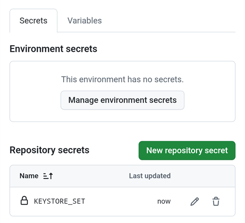

(aaps-builder)=

# Збірка в браузері з AAPS Builder

```{note}
Це рекомендований спосіб зібрати AAPS з **телефона Android**. Він також працює в будь-якому браузері на комп’ютері. Інші способи збірки з комп’ютера або iPhone описано в огляді [Збірка в браузері](BrowserBuild.md).
```

```{contents} In this page
:backlinks: entry
:depth: 2
```

**AAPS Builder** збирає для вас застосунок AAPS на GitHub – безкоштовному сайті для зберігання коду. На телефон нічого не треба встановлювати, і не треба відкривати файл підготовки.

A setup page walks you through it. Перший раз це займає близько 10 хвилин:

1. Create your own **private copy** of AAPS Builder in your GitHub account: the setup page opens GitHub with everything filled in, you only confirm. The build workflow, the file that tells GitHub how to build AAPS, is already in it.
2. Create or upload your **signing key** (the keystore).
3. Give the key to your repository as a GitHub **secret**.
4. **Build** the app. One build takes 15 to 30 minutes.
5. **Download and install** the app on your phone.

Вам **не** потрібно робити fork AndroidAPS: вихідний код AAPS завантажується з офіційного репозиторію AndroidAPS під час кожної збірки. Вам також **не** потрібен Google Drive: застосунок ви завантажуєте прямо з GitHub.

```{admonition} Where the code comes from
:class: note

The build workflow is maintained by the AAPS developers in the [nightscout/aaps-builder](https://github.com/nightscout/aaps-builder) repository, and your repository is a copy of it. The [workflow](https://github.com/nightscout/aaps-builder/blob/main/.github/workflows/build.yml) in your copy is short: it runs the [build steps](https://github.com/nightscout/aaps-builder/blob/main/.github/workflows/aaps-builder.yml) kept in that repository, so improvements reach you without any change to your repository. You can read both files. Під час збірки робочий процес завантажує лише офіційний вихідний код AAPS і власні інструменти збірки GitHub. Ваш keystore ніколи не залишає ваш браузер і ваш приватний репозиторій.
```

(aaps-builder-before-you-start)=

## Перш ніж почати

Вам знадобиться:

- **Обліковий запис GitHub** (безкоштовний). Якщо у вас його немає, спочатку створіть його на [github.com](https://github.com/signup).
- **Веббраузер**: Chrome на телефоні або будь-який браузер на комп’ютері. Перш ніж почати, увійдіть на github.com у цьому браузері.
- **На телефоні є застосунок GitHub?** Ви можете його залишити. Тоді деякі кнопки сторінки налаштування відкривають застосунок замість Chrome. Building works in the app, but the app **cannot download** the finished AAPS: [step 5](#aaps-builder-step5) shows how to switch to Chrome for the download.
- Ваш **наявний keystore** (файл `.jks`), його пароль і псевдонім (alias), якщо ви вже збирали AAPS раніше і хочете оновити його без перевстановлення.

```{warning}
**Ваш репозиторій для збірки має залишатися приватним.** Усе, що створює збірка, бачить кожен, хто може бачити репозиторій. Сторінка налаштування створює для вас приватний репозиторій. Never change it to public, and don't **fork** AAPS Builder instead: a fork is always public.

Приватний репозиторій отримує 2000 безкоштовних хвилин GitHub Actions на місяць. Цього достатньо для кількох збірок.
```

```{warning}
**Новий ключ чи наявний ключ: від цього залежить, чи зможете ви оновити AAPS.**

- **AAPS вже є на вашому телефоні, і він зібраний з keystore, який у вас досі є**: виберіть на сторінці налаштування **I already have a keystore** (у мене вже є keystore) і вивантажте його. Ваша наступна збірка оновить AAPS без перевстановлення. Ви збирали AAPS попереднім способом збірки в браузері (власний fork)? Ваш keystore зберігається у вашому fork: [спочатку отримайте його копію](#aaps-builder-from-fork).
- **Ви збираєте AAPS вперше, або ви втратили свій keystore чи його пароль**: виберіть **Create a new key** (створити новий ключ). Застосунок, підписаний новим ключем, **не може оновити** AAPS, підписаний іншим ключем. Ви маєте експортувати налаштування, скопіювати файл за межі телефона, видалити старий AAPS, встановити новий, а потім імпортувати налаштування: див. [Перевстановлення AAPS з новим keystore](#reinstall-aaps).

Надалі завжди використовуйте той самий ключ. Коли ви створюєте новий ключ, завантажте резервну копію, яку пропонує сторінка, і зберігайте її разом з паролем і псевдонімом (`key0`) у безпечному місці поза телефоном.
```

(aaps-builder-from-fork)=

## Перехід з попередньої збірки в браузері (fork)

Пропустіть цей розділ, якщо ви ніколи не збирали AAPS попереднім способом збірки в браузері (власна копія, або fork, AndroidAPS на GitHub, з файлом підготовки і Google Drive).

Ваш keystore зберігається як секрети у вашому fork. GitHub ніколи не показує секрет вдруге, тому ви не можете скопіювати його в новий репозиторій. Get a copy of your keystore first, then use it in [step 2](#aaps-builder-step2) with **I already have a keystore**.

```{warning}
Не вибирайте **Create a new key**. AAPS, зібраний з новим ключем, не може оновити AAPS на вашому телефоні.
```

Який випадок ваш?

- **Ви використали Варіант 2** (ви вивантажили власний keystore з Android Studio), і у вас досі є файл `.jks`, його паролі та псевдонім: тут нічого робити не треба. Use that file in step 2.
- **Ви використали Варіант 1** (ключ створив файл підготовки), або у вас більше немає файлу keystore: експортуйте його зі свого fork, як описано нижче.

Щоб експортувати keystore зі свого fork:

1. У своєму fork відкрийте **Settings** → **Secrets and variables** → **Actions** і додайте секрет з назвою `ZIP_PASSWORD`. Виберіть пароль лише з англійських літер і цифр. Він захищає файл, який ви зараз створите.
2. Відкрийте вкладку **Actions** вашого fork, натисніть **CI Keystore Export**, потім **Run workflow**. Докладніше: [Експорт вашого keystore](#ci-keystore-export).
3. Коли біля запуску з’явиться зелена галочка, відкрийте свій Google Drive: файл `keystore.zip` лежить у папці **AAPS** → **KeyStore**. Якщо запуск не вдається на кроці Google Drive, термін доступу вашого fork до Google Drive минув: див. [Термін дії Google Refresh Token минув](#aaps-ci-google-token-expired).
4. Завантажте `keystore.zip` і відкрийте його з вашим `ZIP_PASSWORD`: на комп’ютері або на телефоні за допомогою файлового менеджера, який може відкривати ZIP-файли, захищені паролем. Він містить:
   - `keystore.jks`: ваш keystore,
   - `keyStoreInfo.txt`: ваші `KEYSTORE_PASSWORD`, `KEY_PASSWORD` і `ALIAS` (зазвичай `key0`).
5. Скопіюйте `keystore.jks` на телефон (або на Google Drive, щоб вибрати його звідти).

In [step 2](#aaps-builder-step2) of the setup page:

1. Натисніть **I already have a keystore**.
2. У полі **Keystore file** виберіть `keystore.jks`.
3. У полі **Keystore password** введіть `KEYSTORE_PASSWORD` з `keyStoreInfo.txt`.
4. У полі **Key alias** виберіть або введіть `ALIAS` з `keyStoreInfo.txt`.
5. Якщо `KEY_PASSWORD` відрізняється від `KEYSTORE_PASSWORD`, зніміть позначку **Key password is the same as the keystore password** і введіть `KEY_PASSWORD`.

Зберігайте `keystore.zip` і його `ZIP_PASSWORD` у безпечному місці поза телефоном: це резервна копія вашого ключа.

To also save the builds of AAPS Builder in Google Drive, do [step 6](#aaps-builder-google-drive): the setup page gets a new `GDRIVE_OAUTH2` for you. Ви можете залишити свій fork, доки AAPS, зібраний з AAPS Builder, не буде встановлено на ваш телефон.

## Відкрийте сторінку налаштування

**→ [Відкрийте сторінку налаштування AAPS Builder](#aaps-builder-setup)**

The setup page is part of this documentation, in your language. Keep this page open in another tab as well: the sections below explain each step of the setup page in more detail, with screenshots.

Сторінка налаштування відкриває кожну сторінку GitHub у новій вкладці Chrome. Щоб повернутися на сторінку налаштування, натисніть кнопку вкладок поруч з адресним рядком Chrome (квадрат із числом) і виберіть сторінку налаштування AAPS Builder.

Сторінка налаштування працює повністю у вашому браузері: ваш ключ і паролі нікуди не надсилаються, крім секрету GitHub, у який ви самі їх вставляєте. У GitHub надсилається лише ваше ім'я користувача GitHub, щоб перевірити, чи воно існує. Вона запам’ятовує ваше ім’я користувача GitHub і назву репозиторію, тож ви можете будь-коли повернутися до неї, щоб знову відкрити сторінку секретів або свої збірки.


(aaps-builder-step1)=

## Крок 1 – Створіть свій приватний репозиторій для збірки

This step creates your own private copy of AAPS Builder in your GitHub account, with the build workflow already in it. Лише ви бачите його і застосунки, які він збирає.

1. Переконайтеся, що ви увійшли на github.com у цьому браузері.

2. У полі **Your GitHub username** введіть своє ім’я користувача GitHub, а не адресу електронної пошти. Сторінка перевіряє його на GitHub: **✓ GitHub user found** означає, що все правильно.

3. У полі **Name of your repository** залиште запропоновану назву `my-aaps`. Якщо ви вже створили свій репозиторій з іншою назвою, введіть точно цю назву.

   ```{note}
   **Already have an AAPS Builder repository** (made with an earlier version of the setup page)? Don't create a new one: type its exact name, skip **Create my private repository**, and update its workflow once as explained in [Updating AAPS](#aaps-builder-updates). Your secrets stay as they are. If you want a new repository anyway, choose a name you don't have yet, for example `my-aaps-2`, and use the same keystore in step 2.

   Don't type the name of your fork of AndroidAPS: a fork is public, and it already builds with its own **AAPS CI** workflow.
   ```

   

4. Перевірте рядок **Your repository:** там має бути `github.com/<your username>/my-aaps`. The setup page remembers the name from your last visit: check it every time before you use its buttons.

5. Натисніть **Create my private repository**.

   

6. GitHub opens **Create a new repository** in a new tab. Everything is already filled in: under **Start with a template**, the template `nightscout/aaps-builder` with **Include all branches** off, and under **General**, your account as **Owner** and the name you chose.

   

   Don't change anything.

7. Scroll down: under **Configuration**, **Choose visibility** is already **Private**. Tap the green **Create repository** button.

   

   GitHub shows your new repository: it contains a folder `.github` (with the build workflow) and a file `README.md`. **Поверніться на вкладку сторінки налаштування** для кроку 2: натисніть кнопку вкладок поруч з адресним рядком Chrome і виберіть сторінку налаштування.

```{warning}
**Your new repository is empty**, with no files? It was not created from the template, and it cannot build. Delete it (**Settings** → bottom of the page → **Delete this repository**), then tap **Create my private repository** on the setup page again.
```

(aaps-builder-step2)=

## Step 2 – Your signing key

Застосунок має бути підписаний вашим власним ключем. Виберіть одну з двох вкладок. Спочатку прочитайте [попередження про новий чи наявний ключ](#aaps-builder-before-you-start).


### I already have a keystore (у мене вже є keystore)

1. Натисніть **I already have a keystore**.
2. У полі **Keystore file** виберіть свій файл `.jks` (або `.keystore`, `.p12`, `.pfx`). На телефоні спочатку скопіюйте файл на телефон або на Google Drive.
3. У полі **Keystore password** введіть пароль keystore.
4. У полі **Key alias** виберіть свій псевдонім зі списку або введіть його, якщо списку немає. Для keystore, створених в Android Studio, це зазвичай `key0`.
5. Якщо пароль ключа відрізняється від пароля keystore, зніміть позначку **Key password is the same as the keystore password** і введіть пароль ключа.
6. Натисніть **Check and continue**.

Сторінка перевіряє пароль і псевдонім на вашому пристрої. **Keystore OK! Continue with step 3.** means everything is right. Якщо там написано, що пароль буде перевірено під час збірки, все одно продовжуйте: збірка повідомить вам, якщо щось не так.

### Create a new key (створити новий ключ)

1. Натисніть **Create a new key**.

2. Придумайте пароль і введіть його двічі. Правила: щонайменше 8 символів, лише літери a–z і A–Z, цифри 0–9 і символи, наприклад `! ? #`. Без пробілів, без літер з діакритикою (наголосами) і без символу `|`.

3. Натисніть **Create key**. Мине кілька секунд, перш ніж з’явиться **Key created**.

   

4. Натисніть **Download backup (aaps-keystore.jks)**. Якщо Chrome запитує **Download file again?** (Завантажити файл ще раз?), на телефоні вже є старіша резервна копія з такою самою назвою: натисніть **Download again** (Завантажити ще раз). Тоді Chrome зберігає новий ключ як `aaps-keystore (1).jks`: саме цей файл належить до цього ключа. Збережіть його і не плутайте зі старішим.

   Зберігайте ці три речі разом, у безпечному місці поза телефоном (наприклад, у власному хмарному сховищі):

   - файл `aaps-keystore.jks`,
   - ваш пароль,
   - псевдонім (alias) ключа: **`key0`**.

   Усі три речі вам знадобляться, якщо ви колись збиратимете AAPS іншим способом, наприклад в Android Studio. Ключі, створені попередньою версією сторінки налаштування, мають псевдонім `aaps`.

   

(aaps-builder-step3)=

## Step 3 – Give the key to your repository

Step 3 unlocks when step 2 is done. Ваш ключ, його паролі та псевдонім упаковано в одне значення – секрет `KEYSTORE_SET`.

1. Натисніть **Open the secrets page**.


2. GitHub відкриває сторінку **New secret** вашого репозиторію. На телефоні вона розташована під меню налаштувань: прокрутіть униз.


3. Перейдіть на вкладку сторінки налаштування і натисніть **Copy name**. Поверніться на вкладку GitHub і вставте назву в маленьке поле **Name**. Назва – `KEYSTORE_SET`.

4. Перейдіть на вкладку сторінки налаштування і натисніть **Copy secret**. Поверніться на вкладку GitHub і вставте секрет у велике поле **Secret** (на телефоні довге натискання). Секрет – це дуже довгий код, тисячі символів: сторінка налаштування показує його перші символи поруч із кнопкою. Не вставляйте туди слово `KEYSTORE_SET`.

5. Натисніть **Add secret**. `KEYSTORE_SET` тепер видно в розділі **Repository secrets**.



Це потрібно зробити лише один раз.

```{tip}
GitHub показує **Page not found** (404)? Спочатку перевірте, що ви увійшли на github.com у цьому браузері: для приватних репозиторіїв GitHub показує 404, якщо ви не увійшли. Інакше ім’я користувача або назва репозиторію на кроці 1 не збігаються з вашим репозиторієм. Перевірте ім’я на github.com, виправте його на кроці 1 і натисніть кнопку ще раз.
```

(aaps-builder-step4)=

## Step 4 – Build the app

1. На сторінці налаштування натисніть **Open the build page**. GitHub відкриває сторінку **Build AAPS** вашого репозиторію.

   

   Якщо замість цього відкривається **застосунок GitHub**: натисніть **RUN WORKFLOW**, перевірте версію і варіант і ще раз натисніть **RUN WORKFLOW**. Застосунок може ще показувати **Nothing to see here**: потягніть список униз, щоб оновити його і побачити свою збірку. Потім продовжуйте з кроку 4 нижче.

2. Якщо GitHub запитає, натисніть зелену кнопку, щоб увімкнути робочі процеси (workflows).
3. Натисніть **Run workflow**. Відкриється невелика форма:
   - **Version**: keep `latest` to build the newest AAPS release, or type a release number such as `4.0.0`.
   - **Variant**: залиште `fullRelease` для звичайного використання з помпою. Інші варіанти пояснено в розділі [варіанти збірки](#browserbuild-variant). `aapsclient3Release` збирає **AAPSClient3**, доступний з версії **AAPS** 4.0 (див. [Про AAPSClient, AAPSClient2 і AAPSClient3](#remotecontrol-aapsclient-versions)).
   - Натисніть зелену кнопку **Run workflow**.

   

4. Збірка починається і показує **In progress**, з двома частинами: **AAPS / Check**, потім **AAPS / Build AAPS**.

   

5. Зачекайте від 15 до 30 хвилин. Зелена галочка означає, що збірку завершено. Червоний хрестик означає, що збірка не вдалася: відкрийте збірку, щоб прочитати повідомлення, потім див. [усунення проблем](#aaps-builder-troubleshooting).

   

   ```{tip}
   **Лист, коли збірку завершено:** GitHub надсилає лист лише тоді, коли збірка не вдалася. Щоб отримувати лист і тоді, коли вона вдалася: на github.com відкрийте своє фото профілю → **Settings** → **Notifications** → **System** → **Actions** і зніміть позначку **Only notify for failed workflows**.
   ```

Якщо немає кнопки **Build AAPS** або **Run workflow**:

- Open your repository and check that it has a folder `.github` with the file `workflows/build.yml`. If the repository is empty, it was not created from the template: delete it (**Settings** → bottom of the page → **Delete this repository**) and do [step 1](#aaps-builder-step1) again with the button.
- Відкрийте вкладку **Actions**. Якщо там написано, що робочі процеси вимкнено, натисніть зелену кнопку, щоб їх увімкнути, потім натисніть **Build AAPS** у списку.

(aaps-builder-step5)=

## Step 5 – Install the app on your phone

```{warning}
**Перед кожним оновленням** [експортуйте налаштування](#ExportImportSettings-Automating-Settings-Export) в AAPS і скопіюйте файл **за межі телефона** (Google Drive, Dropbox…). Зберігайте там також кілька старіших експортів і файли APK, щоб завжди можна було повернутися назад.
```

1. На телефоні відкрийте сторінку налаштування в **Chrome**. Увійдіть на github.com, якщо буде запит.
2. Натисніть **Open my builds**, потім найновішу збірку із зеленою галочкою.

   ```{admonition} The GitHub app opened instead of Chrome?
   :class: note

   Застосунок GitHub не може завантажувати збірки. У застосунку відкрийте найновішу збірку, потім натисніть **Artifacts ↗** або натисніть значок «Поділитися» вгорі і виберіть **Chrome** (або **Copy link**, потім вставте посилання в адресний рядок Chrome). Збірка відкривається в Chrome: продовжуйте там з наступного кроку.

   Щоб посилання GitHub не відкривалися в застосунку: Android **Settings** (Налаштування) → **Apps** (Застосунки) → **GitHub** → **Open by default** (Відкривати за умовчанням) → вимкніть **Open supported links** (Відкривати підтримувані посилання).
   ```

   

3. Прокрутіть униз до підсумку збірки і натисніть посилання **Download AAPS**.

   

   ```{tip}
   Прокручуйте пальцем по тексту, а не по схемі кроків збірки: інакше рухається схема, а не сторінка.
   ```

   Ви також можете прокрутити далі вниз до **Artifacts** і натиснути значок завантаження поруч з `aaps-….apk`.

   

4. Коли завантаження завершиться, відкрийте меню Chrome **⋮** → **Downloads** (Завантаження), натисніть `aaps-….apk` і виберіть **Install** (Встановити). Якщо буде запит, дозвольте встановлення застосунків із цього джерела.

   

`aaps-wear-….apk` – це застосунок для розумного годинника. Пропустіть його, якщо у вас немає годинника.

Застосунок зберігається на сторінці збірки **14 днів**. Його не видно в розділі **Code** вашого репозиторію. Скопіюйте його в безпечне місце поза телефоном, разом з експортами налаштувань.

Інші способи встановлення застосунку див. у розділі [Перенесення та встановлення AAPS](TransferringAndInstallingAaps.md).

```{note}
З вересня 2026 року [перевірка розробників Android](#android-developer-verification) від Google може, залежно від вашої країни, блокувати встановлення APK натисканням на файл. Безкоштовні обхідні способи описано на тій сторінці.
```

(aaps-builder-google-drive)=

## Step 6 (optional) – Also save the app in Google Drive

Ви також можете зберігати кожну збірку на своєму Google Drive, у папці `AAPS/<version>`. Це необов’язково: застосунок завжди доступний на сторінці збірки.

Для цього потрібен ще один секрет – `GDRIVE_OAUTH2`. Step 6 of the setup page gets it from Google for you, on a phone or a computer. **AAPS** can then only see and change the files it creates in your Google Drive, nothing else.

1. On the setup page, tap **Connect Google Drive**. Google opens in a new tab.
2. Choose your Google account and allow access. If Google says the app is not verified, tap **Advanced**, then **Go to …**.
3. The new tab then shows an error such as **This site can't be reached** or **127.0.0.1 refused to connect**. **This is expected:** Google's answer is in the address of that tab. Tap the address bar, select the whole address (it starts with `http://127.0.0.1:47913/`) and copy it.
4. Go back to the setup page tab within a few minutes: Google's answer is only valid for a short time, and only once. Paste the address into **Paste the copied address here** and tap **Get GDRIVE_OAUTH2**. The page shows **GDRIVE_OAUTH2 is ready**.
5. Натисніть **Open the secrets page**. Натисніть **Copy name**, потім вставте назву в маленьке поле **Name** (назва – `GDRIVE_OAUTH2`). Tap **Copy secret**, paste it into the big **Secret** box and tap **Add secret**.

Починаючи з наступної збірки, APK також зберігаються на Google Drive.

Already have a `GDRIVE_OAUTH2` value from the preparation file of the other browser build methods? It works too: add it as the `GDRIVE_OAUTH2` secret.

Google зупиняє доступ, якщо ви не збираєте 6 місяців або якщо ви змінили пароль Google. Тоді збірка повідомить вам про це: виконайте ці кроки знову. Див. [Термін дії Google Refresh Token минув](#aaps-ci-google-token-expired).

(aaps-builder-updates)=

## Оновлення AAPS

Ваш репозиторій ніколи нічого не збирає сам: ви вирішуєте, коли збирати, яку версію і який варіант. Коли виходить нова версія AAPS:

1. [Back up your settings](#aaps-builder-step5) as explained in step 5.
2. Build the new version as in [step 4](#aaps-builder-step4). Залиште `latest` або введіть номер випуску.
3. Download and install it as in [step 5](#aaps-builder-step5).

**Updates of the build steps** reach you by themselves: at every build, your repository runs the build steps released by the AAPS developers in nightscout/aaps-builder. Nothing changes in your repository, and there is no automatic build.

**Updates of your workflow file** are rare: only when the **Run workflow** form changes, for example for a new build variant, or once if your repository was made with an earlier version of the setup page (an empty repository with a short workflow file) or from the old template. The [Docs updates & changes](../Maintenance/DocumentationUpdate.md) page says so. Your `KEYSTORE_SET` secret stays as it is. On the setup page, open **Updating your copy** at the end of step 1:

1. Tap **Open the newest workflow**. On a computer, click the **copy icon** ("Copy raw file") at the top right of the file. On a phone, open the **plain-text version** instead, press and hold the text, then **Select all** and **Copy**.
2. Tap **Open my workflow file**.
3. Replace the whole text with the copied workflow (long press on a phone: **Select all**, then **Paste**).
4. Tap **Commit changes…**, then **Commit changes**.

The first line of the file shows its version.

(aaps-builder-troubleshooting)=

## Усунення несправностей

To see why a build failed, [read the build log](#aaps-ci-read-the-logs): the step names are different, but you find the error the same way. You can also [update a secret](#aaps-ci-update-secret) and [run the build again](#aaps-ci-rerun) the same way.

- **No "Build AAPS" or "Run workflow" button, or the repository is empty**: the repository was not created from the template. Delete it (**Settings** → bottom of the page → **Delete this repository**) and do [step 1](#aaps-builder-step1) again with the **Create my private repository** button.
- **Збірка зупиняється з повідомленням "This repository is PUBLIC"**: у своєму репозиторії відкрийте **Settings** → **General** → **Danger Zone** → **Change visibility** → **Private**, потім зберіть знову.
- **"Secret KEYSTORE_SET is missing"**: do step 3 of the setup page.
- **"The secret is too short"**, **"The secret is not a valid code"** або **"The secret does not contain a keystore"**: у секрет вставлено неправильний текст, часто саме слово `KEYSTORE_SET` або лише частину коду. In your repository, open **Settings** → **Secrets and variables** → **Actions**, edit `KEYSTORE_SET` and paste the long code from **Copy secret** again (redo step 2 of the setup page first if you closed it).
- **"Keystore, password or alias is wrong"**: check your keystore's password and alias, then redo steps 2 and 3 of the setup page.
- **"Version … does not exist"**: версія, яку ви ввели, не є випуском AAPS. Використайте `latest` або перевірте номер випуску.
- **"Variant … is not supported"**: your workflow file is an older version. Replace it as explained in [Updating AAPS](#aaps-builder-updates).
- **"Page not found" (404), коли сторінка налаштування відкриває GitHub**: увійдіть на github.com у тому самому браузері (GitHub показує 404 для приватних репозиторіїв, коли ви не увійшли). Якщо ви увійшли, то ім’я користувача або назва репозиторію на кроці 1 сторінки налаштування не збігаються з вашим репозиторієм. Введіть точні назви.
- **"No GitHub user with this name"** на кроці 1: введіть своє ім’я користувача GitHub, як воно показано у вашому профілі GitHub, а не адресу електронної пошти.
- **Немає посилання Download, або відкрився застосунок GitHub**: застосунок GitHub не може завантажувати збірки. Open the build in Chrome as explained in [step 5](#aaps-builder-step5). Щоб посилання GitHub не відкривалися в застосунку: Android **Settings** (Налаштування) → **Apps** (Застосунки) → **GitHub** → **Open by default** (Відкривати за умовчанням) → вимкніть **Open supported links** (Відкривати підтримувані посилання).
- **"Google Drive access has expired or was revoked"**: redo [step 6](#aaps-builder-google-drive) and update the `GDRIVE_OAUTH2` secret.

For other GitHub and Google Drive issues, see [Browser build troubleshooting](../GettingHelp/BrowserBuildTroubleshooting.md).

```{toctree}
:hidden:

AAPS Builder setup page <BrowserBuildAapsBuilderSetup.md>
```
