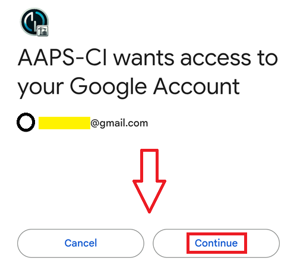

(aaps-ci-google-drive-auth)=

# Збірка в браузері – Крок 3: Авторизуйте Google Drive

```{note}
Це **Крок 3** [Збірки в браузері](BrowserBuild.md). Спочатку виконайте [Крок 2 – Створіть свій keystore для підпису](BrowserBuildKeystore.md).
```

```{warning}
Незалежно від того, яку з попередніх інструкцій ви виконали (Варіант 1 чи Варіант 2), ви ОБОВ'ЯЗКОВО маєте додати авторизацію Google Drive, щоб збірка в браузері працювала.
```

Примітка: якщо ви вже виконали цю частину за відео, можете перейти одразу до [Кроку 4 – Зберіть APK](BrowserBuildAPK.md).

```{warning}
Якщо авторизація Google не починається або сторінка підготовки видає помилку, закрийте сторінку підготовки, знову відкрийте `aaps-ci-preparation.html` так само, як у Кроці 2, і почніть цей крок знову. Дивіться [усунення проблем](#aaps-ci-preparation-web).
```

Поверніться на вкладку сторінки підготовки.

Прокрутіть униз до розділу «Google Drive Auth» і натисніть «Start Auth» (Почати авторизацію).


Виберіть свій обліковий запис Google.


Прокрутіть униз і надайте доступ. Він потрібен вебсторінці, щоб отримати ключ авторизації Google Drive.

Натисніть «Continue» (Продовжити).



Поле `GDRIVE_OAUTH2` заповниться. Натисніть верхню кнопку «Copy» (Копіювати).


Поверніться на вкладку GitHub.

Прокрутіть униз до «Repository secrets» (секрети репозиторію) і натисніть «New repository secret» (новий секрет репозиторію).

Якщо ви виконували Варіант 1, ви маєте побачити таке:


Якщо ви виконували Варіант 2, ключів буде більше:


Вставте щойно скопійований текст у поле «Name» (Назва). Щоб відкрити меню вставлення, довго натисніть на текстове поле.


Перейдіть на вкладку сторінки підготовки.

Натисніть другу кнопку «Copy» (Копіювати).


Поверніться на вкладку GitHub.

1. Вставте щойно скопійований текст у поле «Secret» (Секрет). Щоб відкрити меню вставлення, довго натисніть на текстове поле.

2. Натисніть «Add secret» (Додати секрет).


Тепер у вас має бути два (Варіант 1) або п'ять (Варіант 2) секретів.


Після збірки GitHub зможе зберегти APK-файл AAPS у вашому Google Drive.

----

**Далі: [Крок 4 – Зберіть APK](BrowserBuildAPK.md) →**
