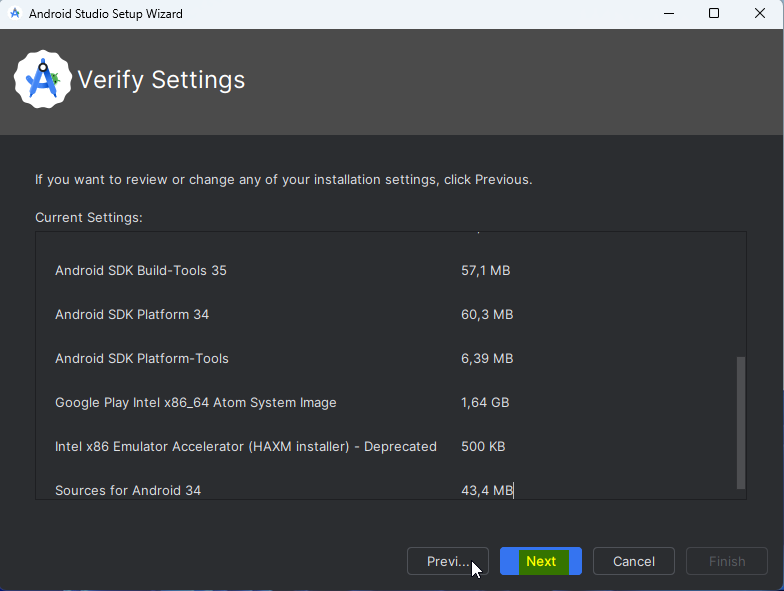
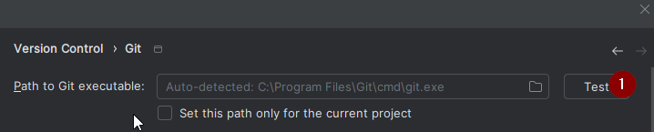
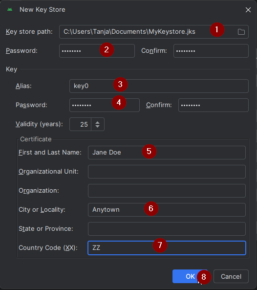
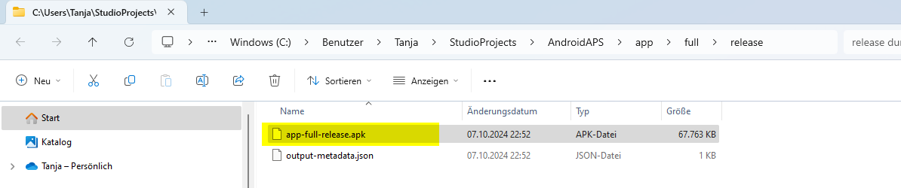

<!-- Android Studio Build, FKA Computer Build. Preserve filenames to avoid breaking URLs. -->

# Збірка в Android Studio

Це традиційний спосіб зібрати застосунок AAPS.

Ви можете зібрати застосунок без комп'ютера способом [Збірка в браузері](./BrowserBuild.md).

## Зберіть самі, а не завантажуйте

**Застосунок AAPS (файл apk) не можна завантажити готовим через правила для медичних виробів. Збирати застосунок для власного використання законно, але ви не повинні давати його копію іншим!**

Докладніше див. на [сторінці FAQ](../UsefulLinks/FAQ.md).

---

(Building-APK-recommended-specification-of-computer-for-building-apk-file)=
## Computer and software specifications for building AAPS

* Для збірки apk може знадобитися певна версія **[Android Studio](https://developer.android.com/studio/)**. Див. таблицю нижче:

| Версія AAPS             | Рекомендована<br/>версія<br/>Android Studio | Альтернативна<br/>версія<br/>Android Studio | Gradle | JVM |
| ----------------------- | ------------------------------------------------------- | ------------------------------------------------------- | ------ |:--- |
| 2.6.2                   | 3.6.1                                                   |                                                         | 5.6.4  | 11  |
| 2.8.2.1                 | 4.1.1                                                   |                                                         | 6.1.1  | 13  |
| [3.1.0.3](#version3100) | 2020.3.1                                                | перевірено до Quail 4                                   | 7.3.3  | 17  |
| [3.2.0.4](#version3204) | Hedgehog (2023.1.1)                                     | перевірено до Quail 4                                   | 8.2    | 17  |
| [3.3.1.3](#version3300) | Ladybug Feature Drop (2024.2.2)                         | перевірено до Quail 4                                   | 8.10   | 21  |
| [3.3.2](#version3300)   | Meerkat (2024.3.1)                                      | перевірено до Quail 4                                   | 8.11.1 | 21  |
| [3.3.2.1](#version3321) | Narwhal (2025.1.2)                                      | перевірено до Quail 4                                   | 8.13   | 21  |
| [3.4.2.6](#version3426) | Panda 2 (2025.3.2)                                      | перевірено до Quail 4                                   | 9      | 21  |
| [4.0.0](#version400)    | Rabbit 2 (2026.2.2)                                     | Latest                                                  | 9.8    | 21  |

«Рекомендована версія» постачається з відповідною версією JVM. Рекомендована версія — це також мінімальна версія, якою можна зібрати **AAPS**. Ви **НЕ** зможете зібрати застосунок у версії, старішій за «рекомендовану». Якщо ви використовуєте іншу версію, можуть виникнути проблеми, пов’язані з версією JVM. Щоб розв'язати ці проблеми, див. сторінку [Усунення проблем з Android Studio](#troubleshooting_androidstudio-uncommitted-changes). Якщо вашої поточної версії Android Studio немає в таблиці, спочатку оновіть її.

Версія Gradle пов’язана з вихідним кодом: ви завжди отримаєте правильну версію Gradle, коли завантажуєте або оновлюєте вихідний код. Її вказано тут лише для довідки, нічого робити з нею не потрібно.

* [32-бітні системи Windows](#troubleshooting_androidstudio-unable-to-start-daemon-process) не підтримуються Android Studio. Пам’ятайте, що **64-бітний процесор і 64-бітна операційна система є обов’язковою умовою.** Якщо ваша система НЕ відповідає цій умові, вам потрібно замінити відповідне обладнання, програмне забезпечення або всю систему.

<table class="tg">
<tbody>
  <tr>
    <th class="tg-baqh">OS (Only 64 bit)</th>
    <td class="tg-baqh">Windows 10 or higher</td>
    <td class="tg-baqh">macOS 12 or higher</td>
    <td class="tg-baqh">Any Linux distribution that supports Gnome, KDE, or Unity DE;&nbsp;&nbsp;GNU C Library (glibc) 2.31 or later</td>
  </tr>
  <tr>
    <th class="tg-baqh"><p align="center">CPU (Only 64 bit)</th>
    <td class="tg-baqh">x86_64 CPU from 2017 or newer (Intel 8th generation Core i5, AMD Ryzen, or newer) with <a href="https://developer.android.com/studio/install" target="_blank" rel="noopener noreferrer">virtualization support</a> (Intel VT-x or AMD-V) enabled in the BIOS</td>
    <td class="tg-baqh">Apple Silicon (M1 or newer), or 6th generation Intel Core or newer (support for Intel Macs is being phased out)</td>
    <td class="tg-baqh">x86_64 CPU from 2017 or newer (Intel 8th generation Core i5, AMD Ryzen, or newer) with virtualization support (Intel VT-x or AMD-V) enabled in the BIOS</td>
  </tr>
  <tr>
    <th class="tg-baqh"><p align="center">RAM</th>
    <td class="tg-baqh" colspan="3"><p align="center">16GB or more (8GB is the strict minimum for Android Studio alone, 32GB is recommended)</td>
  </tr>
  <tr>
    <th class="tg-baqh"><p align="center">Disk</th>
    <td class="tg-baqh" colspan="3"><p align="center">At least 32GB free space. SSD is recommended.</td>
  </tr>
  <tr>
    <th class="tg-baqh"><p align="center">Resolution</th>
    <td class="tg-baqh" colspan="3"><p align="center">1280 x 800 minimum (1920 x 1080 recommended)<br></td>
  </tr>
  <tr>
    <th class="tg-baqh"><p align="center">Internet</th>
    <td class="tg-baqh" colspan="3"><p align="center">Broadband</td>
  </tr>
</tbody>
</table>

**Наполегливо рекомендуємо (але це не обов’язково) використовувати SSD (твердотільний накопичувач) замість HDD (жорсткого диска), бо так збірка файлу apk AAPS займе менше часу.**  Ви все одно можете використовувати HDD для збірки файлу apk **AAPS**. If you do, the building process may take a long time to complete, but once it has started, you can leave it running unattended.

## Help and support during the building process

Якщо під час збирання застосунку **AAPS** виникнуть труднощі, є окремий розділ [**Усунення проблем з Android Studio**](../GettingHelp/TroubleshootingAndroidStudio.md). Будь ласка, спершу зверніться до нього.

Якщо ви вважаєте, що в інструкціях зі збірки щось неправильно, чогось бракує або щось незрозуміло, або у вас досі не виходить, зверніться до групи інших користувачів **AAPS** у [Facebook](https://www.facebook.com/groups/AndroidAPSUsers) або [Discord](https://discord.gg/4fQUWHZ4Mw). Якщо ви хочете щось змінити самі (оновити знімки екрана _тощо_), будь ласка, надішліть [pull request (PR)](../SupportingAaps/HowToEditTheDocs.md).

## Step-by-step guide to building the AAPS app

```{admonition} WARNING
:class: warning
Якщо ви вже збирали AAPS раніше, не потрібно знову виконувати всі наступні кроки.
Перейдіть одразу до [посібника з оновлення](../Maintenance/UpdateToNewVersion.md)!
```

```{contents} The overall steps for building the **AAPS** apk file
:depth: 1
:local: true
```

У цьому посібнику ви знайдете _приклади_ знімків екрана зі збирання apk-файлу **AAPS**. **Android Studio** — програму, якою ми збираємо apk **AAPS**, — регулярно оновлюють. Тому ці знімки екрана можуть відрізнятися від вашої установки, але за ними все одно можна виконати кроки.

Оскільки **Android Studio** працює на Windows, Mac OS X і Linux, кроки на різних платформах можуть трохи відрізнятися.

(install-git-if-you-dont-have-it)=
### Встановіть Git

```{admonition} Why Git? 
:class: dropdown

Git — це так звана «_система керування версіями_» (VCS).\
Git — це програма, яка дозволяє відстежувати зміни в коді й працювати разом з іншими. За допомогою Git ви зробите копію вихідного коду **AAPS** із сайту GitHub на свій комп'ютер. Потім ви використаєте Android Studio на комп'ютері, щоб зібрати застосунок **AAPS** (apk). 
```

(BuildingAaps-steps-for-installing-git)=
#### Steps for Installing Git

1.  Перевірте, чи **Git** у вас уже не встановлено. Для цього введіть «git» у рядку пошуку Windows. Якщо ви бачите **“Git bash”** або іншу форму Git, він уже встановлений, і можна одразу перейти до [встановлення Android Studio](#install-android-studio):


2. Якщо Git не встановлено, завантажте й установіть останню версію для вашої системи з розділу "Download" [**тут**](https://git-scm.com/downloads). Any recent Git version should work, select the correct version according to your system, either Mac, Windows and Linux.

**Примітка для користувачів Mac:** сайт Git також підкаже вам установити додаткову програму "homebrew", яка допомагає з установленням. If you install Git via homebrew, there is no need to change any preferences.

(Make_a_note_of_Git_path)=

* Під час установлення, коли вас попросять "select destination location" (вибрати місце встановлення), запишіть, _куди_ встановлюється Git (**шлях установлення**). Вам потрібно буде перевірити його на наступному кроці. It will be something similar to "C:\Program Files\Git\cmd\git.exe"

*  As you proceed through several steps of the Git installation, just accept all the default options.

*  After the install, if you forgot to make a note of the where Git was installed, you can find it as follows: type "git" into the PC search bar, right click on "Git bash", select "open file location" hover over the "Git bash" icon with your mouse, which will then reveal where it is installed.

* Reboot your computer before the next step.

(Building-APK-install-android-studio)=
### Install Android Studio

- **Під час наступних кроків увесь час залишайтеся в мережі, бо Android Studio завантажує кілька оновлень**

```{admonition} What is Android Studio?
:class: dropdown
Android Studio — це програма, яка працює на вашому комп'ютері. Вона дозволяє завантажувати вихідний код з інтернету (за допомогою Git) і збирати застосунки для смартфона (і смарт-годинника). Збираючи новий або оновлений застосунок на ПК в Android Studio, ви не можете «зламати» поточну робочу версію **AAPS**, яка, можливо, працює на вашому смартфоні: це зовсім окремі процеси. 
```

Одне з найважливіших правил під час установлення Android Studio — **будьте терплячі!** Під час установлення й налаштування Android Studio завантажує багато даних, і це займає час.

```{admonition} Different UI
:class: warning
Важлива примітка: в останніх випусках Android Studio змінила свій інтерфейс. У цьому посібнику кроки показано з *новим інтерфейсом*. Знімки екрана зроблено у версії "Ladybug", тому новіші версії можуть виглядати трохи інакше. Якщо ви ще використовуєте старий інтерфейс, можливо, спершу варто перевести Android Studio на новий інтерфейс за [цими інструкціями](#computerbuild-NewUI).
```

Версія Android Studio дуже важлива. Щоб вибрати правильну версію Android Studio, див. [інструкції вище](#Building-APK-recommended-specification-of-computer-for-building-apk-file).

Завантажте [поточну версію Android Studio](https://developer.android.com/studio) або старішу версію з [**Archives**](https://developer.android.com/studio/archive) (архіву) і прийміть умови завантаження.


Once the download is finished, start the downloaded application to install it on your computer. You might need to accept/confirm some warnings about downloaded apps from Windows!

Install Android Studio by clicking "Next", as shown in the following screenshots. Вам **не** потрібно змінювати жодних налаштувань!


Якщо хочете заощадити місце на диску, можна зняти позначку Android Virtual Device: для збирання **AAPS** він не потрібен.


Now click on "Install":


Once it's completed, press "Next"


In the last step, click on "Finished" to start Android Studio for the first time.


You will be asked if you want to help improve Android Studio. Choose the option to your liking, it won't make any difference for the following steps.


The welcome screen greets you to the installation of Android Studio. Press "Next".


Select "Standard" as installation type.


Verify the settings by clicking "Next" again.



Now you need to accept the license agreements. You have two sections (1 + 3) on the left side which you have to select one after the other and each select "Accept" (2 + 4) on the right side.

Then the "Finish" (5) button can be clicked.


Some Android packages will now be downloaded and installed. Be patient and wait.

When it's finished, you will find the following screen where you can select "Finish" again.


You will now see the Welcome screen of Android Studio.


(Building-APK-download-AAPS-code)=
### Download the AAPS code

```{admonition} Why can it take a long time to download the AAPS code?
:class: dropdown

Коли **AAPS** завантажується вперше, Android Studio через інтернет під'єднується до сайту Github, щоб завантажити вихідний код **AAPS**. Це має зайняти приблизно 1 хвилину. 

Потім Android Studio за допомогою **Gradle** (інструмента розробки для застосунків Android) визначить інші компоненти, потрібні для збирання на вашому комп'ютері. 
```

На екрані привітання Android Studio перевірте, що ліворуч виділено "**Projects**" (1).

Потім праворуч натисніть "**Clone Repository**" (2):


We will now tell Android Studio where to get the code from:


* "Repository URL" should be selected (by default) on the left (1).
* "Git" should be selected (by default) as version control (2).
* Now copy this URL:
    ```
    https://github.com/nightscout/AndroidAPS.git
    ```
    and paste it into the URL textbox (3).

* Перевірте, що папки (за замовчуванням) для збереження клонованого коду ще немає на вашому комп'ютері (4). You can change it to some directory, but please remember where you stored it!
* Now click the button "Clone" (5).

```{admonition} INFORMATION
:class: note
Запишіть цю папку. Саме тут зберігається ваш вихідний код!
```

You will now see a screen telling you that the repository is being cloned:


At some point, Android Studio will close and start again. You may be asked whether you want to trust the project. Click on "Trust project":

  


Only for Windows users: If your firewall asks for permission, grant access:

 

After the repository is cloned successfully, Android Studio will open the cloned project.

(computerbuild-NewUI)=
```{admonition} New UI
:class: note
Android Studio нещодавно змінила свій інтерфейс. Нові установки Android Studio за замовчуванням використовують новий інтерфейс!

Лише якщо ваша Android Studio виглядає інакше, вам, можливо, треба перейти на новий інтерфейс:
Натисніть меню-«гамбургер» вгорі ліворуч, потім виберіть **Settings** (або **Preferences** на комп'ютерах Apple).
У **Appearance & Behavior** перейдіть до **New UI** і поставте позначку **Enable new UI**. Потім перезапустіть Android Studio, щоб почати нею користуватися.

Якщо ви не знаходите параметр **New UI**, не хвилюйтеся: ви вже використовуєте новий інтерфейс!
```


Коли Android Studio відкриється, терпляче зачекайте (це може зайняти кілька хвилин) і особливо **не** оновлюйте проєкт, як пропонує спливне вікно.

Android Studio will start a "Gradle project sync" automatically, which will take a couple of minutes to finish. You can see it (still) running:


```{admonition} NEVER UPDATE GRADLE!
:class: warning

Android Studio може запропонувати оновити систему gradle. **Ніколи не оновлюйте gradle!** Це призведе до проблем.
```

Лише на комп'ютерах з Windows: може з'явитися сповіщення про роботу Windows Defender. Натисніть **Automatically** і підтвердьте — так збирання буде швидшим!


You can leave the gradle sync running and follow the next steps already.

(Building-APK-set-git-path-in-preferences)=
### Set Git path in Android Studio preferences

Тепер вкажемо Android Studio, де знайти Git, який ви встановили [раніше](#install-git-if-you-dont-have-it).

* Лише для користувачів Windows: переконайтеся, що ви перезапустили комп'ютер після [встановлення Git](#install-git-if-you-dont-have-it). If not, restart now and re-open Android Studio

У верхньому лівому куті **Android Studio** відкрийте меню-«гамбургер» і перейдіть до **File** > **Settings** (у Windows) або **Android Studio** > **Preferences** (на Mac). Відкриється таке вікно. Натисніть, щоб розгорнути список **Version Control** (1), і виберіть **Git** (2)


Перевірте, чи **Android Studio** може автоматично знайти правильний **Path to Git executable** (шлях до виконуваного файлу Git): натисніть кнопку "Test" (1):




Якщо автоматичне налаштування вдалося, поруч зі шляхом буде показано вашу поточну версію **Git**.

   


Якщо **git.exe** не знаходиться автоматично або натискання "Test" дає помилку, ви можете або
* вручну ввести шлях, який ви записали [раніше](#BuildingAaps-steps-for-installing-git), або
* натиснути значок папки (1) і вручну перейти до папки, куди [раніше](#BuildingAaps-steps-for-installing-git) було встановлено **git.exe**
* Перевірте налаштування кнопкою **Test**!

  

(Building-APK-generate-signed-apk)=
### Build the AAPS "signed" APK

```{admonition} Why does the AAPS app need to be "signed"?
:class: dropdown

Android вимагає, щоб кожен застосунок був _підписаний_. Так застосунок можна буде пізніше оновити лише з того самого надійного джерела, яке випустило початковий застосунок. Більше інформації на цю тему — за [цим посиланням](https://developer.android.com/studio/publish/app-signing.html#generate-key). 

Для нас це просто означає, що ми створюємо файл підпису, або «keystore», і використовуємо його, коли збираємо застосунок **AAPS**.
```


**Важливо: перш ніж продовжити, переконайтеся, що синхронізація gradle успішно завершилася!**


Click the hamburger menu on the top left to open the menu bar. Виберіть **Build** (1), потім виберіть **Generate Signed App Bundle / APK** (2)


Виберіть "APK" (1) замість "Android App Bundle" і натисніть "Next" (2):


На наступному екрані переконайтеся, що для "Module" вибрано "AndroidAPS.app" (1). Частина перед ".app" — це назва папки, у яку ви клонували код.

(Building-APK-wearapk)=
```{admonition} INFORMATION!
:class: note
Якщо ви хочете створити apk для годинника, тепер потрібно вибрати AndroidAPS.wear!
```


Click "Create new..." (2) to start creating your key store.

```{admonition} INFORMATION!
:class: note
Keystore потрібно створити лише один раз.
Якщо ви вже збирали AAPS раніше, НЕ створюйте новий keystore, а виберіть наявний і введіть його паролі!
```

**_Примітка:_** keystore (сховище ключів) — це файл, у якому зберігається інформація для підпису застосунку. It is encrypted, and the information is secured with passwords.



* Click the "folder" symbol (1) to select a path on your computer for your key store.

  **Не** використовуйте папку, де зберігається ваш вихідний код. Виберіть папку, яку ви також перенесете на новий комп'ютер.

```{admonition} WARNING!
:class: warning
Обов'язково запишіть собі, де зберігається ваш keystore. Він знадобиться вам, коли ви збиратимете наступне оновлення AndroidAPS!
```

* Now choose a simple password (and make a note of it), enter it in the password box (2), and confirm it (2).

  The passwords for key store and key do not have to be sophisticated. Якщо в майбутньому ви втратите пароль, див. [Перевстановлення AAPS з новим keystore](#reinstall-aaps).

```{warning}
**Не використовуйте спеціальні символи в паролях.** Для пароля keystore і пароля ключа використовуйте лише літери та цифри. Зокрема, не використовуйте `$`, зворотний апостроф (backtick), `"` або `\`. Якщо пізніше ви перейдете на [Збірку в браузері](#aaps-ci-option2) і використаєте цей самий keystore, ці символи можуть зламати крок підпису, див. [Збірка в браузері: усунення проблем](#aaps-ci-password-special-characters).
```

* The default alias (3) for your key is "key0", leave this unchanged.

* You now need a password for your key. To keep it simple, if you want, you can use the same password you used for your keystore, above. Enter a password (4) and confirm it.

```{admonition} WARNING!
:class: warning
Запишіть ці паролі! Вони знадобляться вам, коли ви збиратимете наступне оновлення AAPS!
```

* The validity is 25 years by default, leave it as it is.

* Enter your first and last name (5). No other information needs to be added but you are free to do (6-7).

* Click "OK" (8) to continue:


На сторінці **Generate signed App Bundle or APK** тепер буде показано шлях до вашого keystore. Now re-enter the Key Store password (1) and Key password (2), and tick the box (3) to remember passwords, so you don't have to enter them again next time you build the apk (i.e. when updating to a new AAPS version). Click "Next" (4):


На наступному екрані виберіть варіант збірки "fullRelease" (1) і натисніть "Create" (3). Запам'ятайте папку призначення, показану в (2), бо пізніше саме там ви знайдете зібраний apk-файл!

   

Тепер Android Studio збере apk **AAPS**. It will show "Gradle Build running" (2) at the bottom right. Процес займає деякий час залежно від вашого комп'ютера та інтернет-з'єднання, тож **будьте терплячі!** Якщо хочете стежити за ходом збирання, натисніть маленький молоток "build" (1) унизу Android Studio:


Now you can watch the building progress:


Android Studio will display the information "BUILD SUCCESSFUL" after build is finished. You may see a popup notification which you can click to select "locate". Якщо ви це пропустили, натисніть значок сповіщень (1), щоб відкрити Notifications, а потім **locate** (2):


**_Якщо збирання не вдалося, зверніться до розділу [Усунення проблем з Android Studio](../GettingHelp/TroubleshootingAndroidStudio.md)._**

In the Notifications box, click on the blue link "locate":

 Відкриється ваш файловий менеджер і покаже щойно зібраний apk-файл.

   

Вітаємо! Тепер, коли ви зібрали apk-файл **AAPS**, у наступному розділі документації ви перенесете цей файл на смартфон.

```{tip}
Якщо ви думаєте, що в майбутньому захочете користуватися смарт-годинником Android Wear, зараз найкращий час зібрати apk AAPS Wear, щоб він точно відповідав вашому apk AAPS.
```

Перейдіть до наступного етапу: [Перенесення та встановлення **AAPS**](../SettingUpAaps/TransferringAndInstallingAaps.md).


