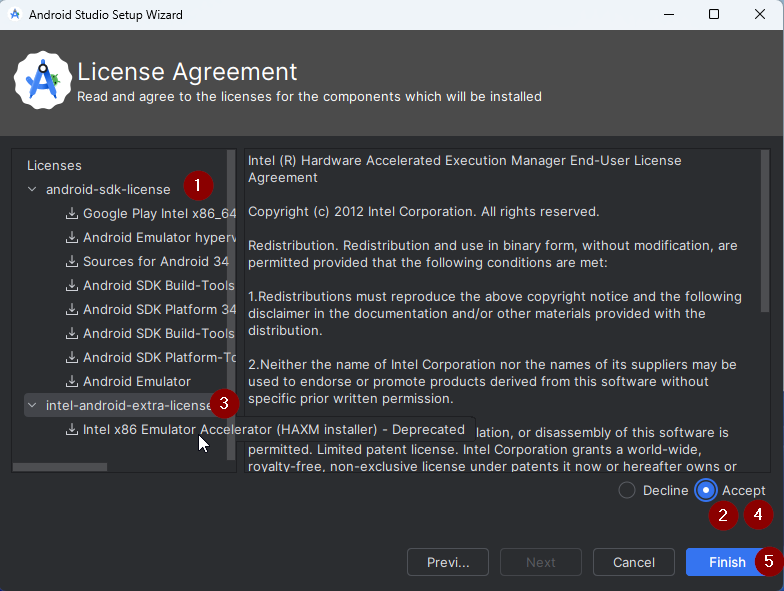
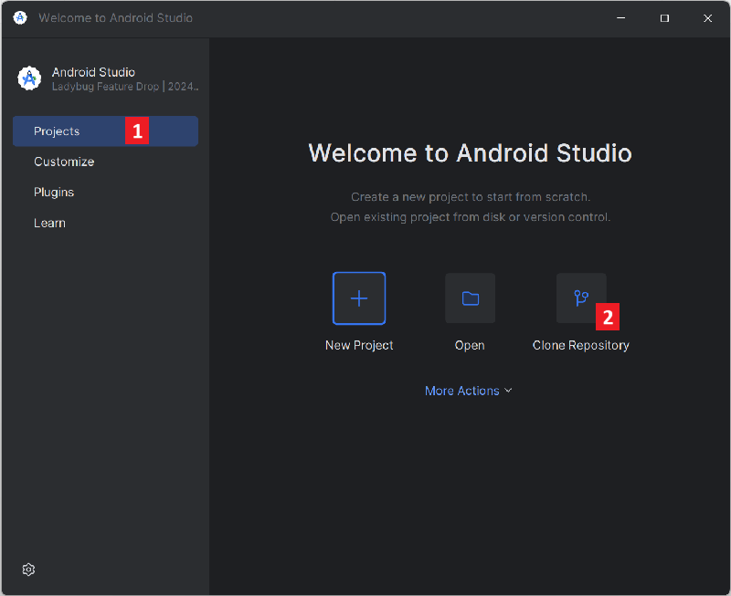
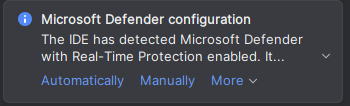
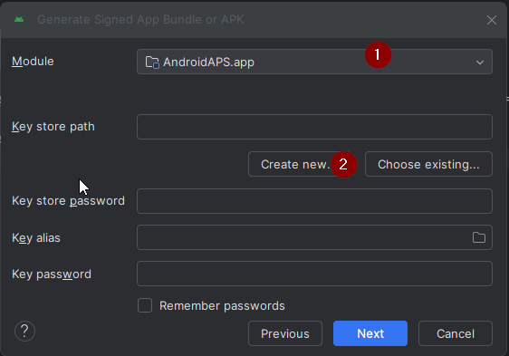
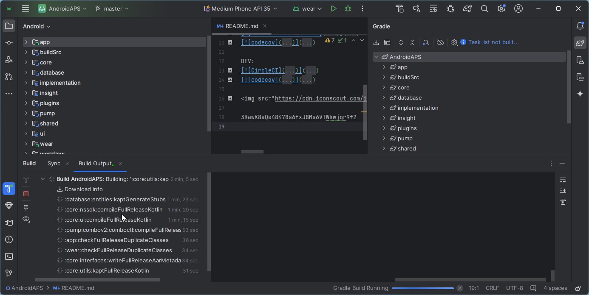

<!-- Android Studio Build, FKA Computer Build. Preserve filenames to avoid breaking URLs. -->

# Збірка в Android Studio

Це традиційний спосіб зібрати застосунок AAPS.

Ви можете зібрати застосунок без комп'ютера способом [Збірка в браузері](./BrowserBuild.md).

## Зберіть самі, а не завантажуйте

**Застосунок AAPS (файл apk) не можна завантажити готовим через правила для медичних виробів. Збирати застосунок для власного використання законно, але ви не повинні давати його копію іншим!**

Докладніше див. на [сторінці FAQ](../UsefulLinks/FAQ.md).

---

(Building-APK-recommended-specification-of-computer-for-building-apk-file)=
## Вимоги до комп’ютера та програм для збірки AAPS

* Для збірки apk може знадобитися певна версія **[Android Studio](https://developer.android.com/studio/)**. Див. таблицю нижче:

| Версія AAPS             | Рекомендована<br/>версія<br/>Android Studio | Альтернативна<br/>версія<br/>Android Studio | Gradle | JVM |
| ----------------------- | ------------------------------------------------------- | ------------------------------------------------------- | ------ |:--- |
| 2.6.2                   | 3.6.1                                                   |                                                         | 5.6.4  | 11  |
| 2.8.2.1                 | 4.1.1                                                   |                                                         | 6.1.1  | 13  |
| [3.1.0.3](#version3100) | 2020.3.1                                                | перевірено до Quail 4                                   | 7.3.3  | 17  |
| [3.2.0.4](#version3204) | Hedgehog (2023.1.1)                                     | перевірено до Quail 4                                   | 8.2    | 17  |
| [3.3.1.3](#version3300) | Ladybug Feature Drop (2024.2.2)                         | перевірено до Quail 4                                   | 8.10   | 21  |
| [3.3.2](#version3300)   | Meerkat (2024.3.1)                                      | перевірено до Quail 4                                   | 8.11.1 | 21  |
| [3.3.2.1](#version3321) | Narwhal (2025.1.2)                                      | перевірено до Quail 4                                   | 8.13   | 21  |
| [3.4.2.6](#version3426) | Panda 2 (2025.3.2)                                      | перевірено до Quail 4                                   | 9      | 21  |
| [4.0.0](#version400)    | Rabbit 2 (2026.2.2)                                     | Найновіша                                               | 9.8    | 21  |

«Рекомендована версія» постачається з відповідною версією JVM. Рекомендована версія — це також мінімальна версія, якою можна зібрати **AAPS**. Ви **НЕ** зможете зібрати застосунок у версії, старішій за «рекомендовану». Якщо ви використовуєте іншу версію, можуть виникнути проблеми, пов’язані з версією JVM. Щоб розв'язати ці проблеми, див. сторінку [Усунення проблем з Android Studio](#troubleshooting_androidstudio-uncommitted-changes). Якщо вашої поточної версії Android Studio немає в таблиці, спочатку оновіть її.

Версія Gradle пов’язана з вихідним кодом: ви завжди отримаєте правильну версію Gradle, коли завантажуєте або оновлюєте вихідний код. Її вказано тут лише для довідки, нічого робити з нею не потрібно.

* [32-бітні системи Windows](#troubleshooting_androidstudio-unable-to-start-daemon-process) не підтримуються Android Studio. Пам’ятайте, що **64-бітний процесор і 64-бітна операційна система є обов’язковою умовою.** Якщо ваша система НЕ відповідає цій умові, вам потрібно замінити відповідне обладнання, програмне забезпечення або всю систему.

<table class="tg">
<tbody>
  <tr>
    <th class="tg-baqh">ОС (лише 64-бітна)</th>
    <td class="tg-baqh">Windows 10 або новіша</td>
    <td class="tg-baqh">macOS 12 або новіша</td>
    <td class="tg-baqh">Будь-який дистрибутив Linux, що підтримує Gnome, KDE або Unity DE;&nbsp;&nbsp;GNU C Library (glibc) 2.31 або новіша</td>
  </tr>
  <tr>
    <th class="tg-baqh"><p align="center">Процесор (лише 64-бітний)</th>
    <td class="tg-baqh">Процесор x86_64 2017 року або новіший (Intel Core i5 8-го покоління, AMD Ryzen або новіший) з увімкненою в BIOS <a href="https://developer.android.com/studio/install" target="_blank" rel="noopener noreferrer">підтримкою віртуалізації</a> (Intel VT-x або AMD-V)</td>
    <td class="tg-baqh">Apple Silicon (M1 або новіший) або Intel Core 6-го покоління чи новіший (підтримку комп’ютерів Mac з Intel поступово припиняють)</td>
    <td class="tg-baqh">Процесор x86_64 2017 року або новіший (Intel Core i5 8-го покоління, AMD Ryzen або новіший) з увімкненою в BIOS підтримкою віртуалізації (Intel VT-x або AMD-V)</td>
  </tr>
  <tr>
    <th class="tg-baqh"><p align="center">Оперативна пам'ять</th>
    <td class="tg-baqh" colspan="3"><p align="center">16 ГБ або більше (8 ГБ – це абсолютний мінімум лише для Android Studio, рекомендовано 32 ГБ)</td>
  </tr>
  <tr>
    <th class="tg-baqh"><p align="center">Диск</th>
    <td class="tg-baqh" colspan="3"><p align="center">Щонайменше 32 ГБ вільного місця. Рекомендовано SSD.</td>
  </tr>
  <tr>
    <th class="tg-baqh"><p align="center">Роздільна здатність</th>
    <td class="tg-baqh" colspan="3"><p align="center">Мінімум 1280 x 800 (рекомендовано 1920 x 1080)<br></td>
  </tr>
  <tr>
    <th class="tg-baqh"><p align="center">Інтернет</th>
    <td class="tg-baqh" colspan="3"><p align="center">Широкосмуговий</td>
  </tr>
</tbody>
</table>

**Наполегливо рекомендуємо (але це не обов’язково) використовувати SSD (твердотільний накопичувач) замість HDD (жорсткого диска), бо так збірка файлу apk AAPS займе менше часу.**  Ви все одно можете використовувати HDD для збірки файлу apk **AAPS**. У такому разі збірка може тривати довго, але коли вона почалася, її можна залишити працювати без нагляду.

## Допомога та підтримка під час збірки

Якщо під час збирання застосунку **AAPS** виникнуть труднощі, є окремий розділ [**Усунення проблем з Android Studio**](../GettingHelp/TroubleshootingAndroidStudio.md). Будь ласка, спершу зверніться до нього.

Якщо ви вважаєте, що в інструкціях зі збірки щось неправильно, чогось бракує або щось незрозуміло, або у вас досі не виходить, зверніться до групи інших користувачів **AAPS** у [Facebook](https://www.facebook.com/groups/AndroidAPSUsers) або [Discord](https://discord.gg/4fQUWHZ4Mw). Якщо ви хочете щось змінити самі (оновити знімки екрана _тощо_), будь ласка, надішліть [pull request (PR)](../SupportingAaps/HowToEditTheDocs.md).

## Покрокова інструкція зі збірки застосунку AAPS

```{admonition} WARNING
:class: warning
Якщо ви вже збирали AAPS раніше, не потрібно знову виконувати всі наступні кроки.
Перейдіть одразу до [посібника з оновлення](../Maintenance/UpdateToNewVersion.md)!
```

```{contents} The overall steps for building the **AAPS** apk file
:depth: 1
:local: true
```

У цьому посібнику ви знайдете _приклади_ знімків екрана зі збирання apk-файлу **AAPS**. **Android Studio** — програму, якою ми збираємо apk **AAPS**, — регулярно оновлюють. Тому ці знімки екрана можуть відрізнятися від вашої установки, але за ними все одно можна виконати кроки.

Оскільки **Android Studio** працює на Windows, Mac OS X і Linux, кроки на різних платформах можуть трохи відрізнятися.

(install-git-if-you-dont-have-it)=
### Встановіть Git

```{admonition} Why Git? 
:class: dropdown

Git — це так звана «_система керування версіями_» (VCS).\
Git — це програма, яка дозволяє відстежувати зміни в коді й працювати разом з іншими. За допомогою Git ви зробите копію вихідного коду **AAPS** із сайту GitHub на свій комп'ютер. Потім ви використаєте Android Studio на комп'ютері, щоб зібрати застосунок **AAPS** (apk). 
```

(BuildingAaps-steps-for-installing-git)=
#### Кроки встановлення Git

1.  Перевірте, чи **Git** у вас уже не встановлено. You can do this by typing “git” in the Windows search bar – if you see **“Git bash”** or some other form of Git, it is already installed and you can go straight to [installing Android Studio](#Building-APK-install-android-studio):


2. Якщо Git у вас не встановлено, завантажте та встановіть найновішу версію для вашої системи з розділу "Download" [**тут**](https://git-scm.com/downloads). Підійде будь-яка нова версія Git. Виберіть правильну версію для вашої системи: Mac, Windows або Linux.

**Примітка для користувачів Mac:** сайт Git також підкаже вам установити додаткову програму "homebrew", яка допомагає з установленням. Якщо ви встановлюєте Git через homebrew, жодних налаштувань змінювати не потрібно.

(Make_a_note_of_Git_path)=

* Під час установлення, коли вас попросять "select destination location" (вибрати місце встановлення), запишіть, _куди_ встановлюється Git (**шлях установлення**). Вам потрібно буде перевірити його на наступному кроці. Він буде схожий на "C:\Program Files\Git\cmd\git.exe"

*  Проходячи кроки встановлення Git, просто приймайте всі параметри за замовчуванням.

*  Якщо після встановлення ви забули записати, куди встановлено Git, його можна знайти так: введіть "git" у рядок пошуку на ПК, натисніть правою кнопкою миші на "Git bash", виберіть "open file location" (відкрити розташування файлу) і наведіть мишу на значок "Git bash" – так ви побачите, де його встановлено.

* Перед наступним кроком перезапустіть комп’ютер.

(Building-APK-install-android-studio)=
### Встановіть Android Studio

- **Під час наступних кроків увесь час залишайтеся в мережі, бо Android Studio завантажує кілька оновлень**

```{admonition} What is Android Studio?
:class: dropdown
Android Studio — це програма, яка працює на вашому комп'ютері. Вона дозволяє завантажувати вихідний код з інтернету (за допомогою Git) і збирати застосунки для смартфона (і смарт-годинника). Збираючи новий або оновлений застосунок на ПК в Android Studio, ви не можете «зламати» поточну робочу версію **AAPS**, яка, можливо, працює на вашому смартфоні: це зовсім окремі процеси. 
```

Одне з найважливіших правил під час установлення Android Studio — **будьте терплячі!** Під час установлення й налаштування Android Studio завантажує багато даних, і це займає час.

```{admonition} Different UI
:class: warning
Важлива примітка: в останніх випусках Android Studio змінила свій інтерфейс. У цьому посібнику кроки показано з *новим інтерфейсом*. Знімки екрана зроблено у версії "Ladybug", тому новіші версії можуть виглядати трохи інакше. Якщо ви ще використовуєте старий інтерфейс, можливо, спершу варто перевести Android Studio на новий інтерфейс за [цими інструкціями](#computerbuild-NewUI).
```

Версія Android Studio дуже важлива. Щоб вибрати правильну версію Android Studio, див. [інструкції вище](#Building-APK-recommended-specification-of-computer-for-building-apk-file).

Завантажте [поточну версію Android Studio](https://developer.android.com/studio) або старішу версію з [**Archives**](https://developer.android.com/studio/archive) (архіву) і прийміть умови завантаження.


Коли завантаження завершиться, запустіть завантажений файл, щоб встановити програму на комп’ютер. Можливо, доведеться прийняти або підтвердити кілька попереджень Windows про завантажені програми!

Встановіть Android Studio, натискаючи "Next", як показано на наступних знімках екрана. Вам **не** потрібно змінювати жодних налаштувань!


Якщо хочете заощадити місце на диску, можна зняти позначку Android Virtual Device: для збирання **AAPS** він не потрібен.


Тепер натисніть "Install":


Коли все буде готово, натисніть "Next"


На останньому кроці натисніть "Finish", щоб уперше запустити Android Studio.


Вас запитають, чи хочете ви допомогти покращити Android Studio. Виберіть варіант на свій розсуд, це ніяк не вплине на наступні кроки.


Вас вітає екран привітання встановлення Android Studio. Натисніть "Next".


Виберіть тип встановлення "Standard".


Перевірте налаштування та знову натисніть "Next".


Тепер потрібно прийняти ліцензійні угоди. Ліворуч є два розділи (1 + 3): виберіть їх по черзі і для кожного виберіть праворуч "Accept" (2 + 4).

Потім можна натиснути кнопку "Finish" (5).



Тепер буде завантажено та встановлено деякі пакети Android. Будьте терплячі й зачекайте.

Коли все завершиться, ви побачите такий екран, на якому знову можна вибрати "Finish".


Тепер ви побачите екран привітання Android Studio.


(Building-APK-download-AAPS-code)=
### Завантажте код AAPS

```{admonition} Why can it take a long time to download the AAPS code?
:class: dropdown

Коли **AAPS** завантажується вперше, Android Studio через інтернет під'єднується до сайту Github, щоб завантажити вихідний код **AAPS**. Це має зайняти приблизно 1 хвилину. 

Потім Android Studio за допомогою **Gradle** (інструмента розробки для застосунків Android) визначить інші компоненти, потрібні для збирання на вашому комп'ютері. 
```

На екрані привітання Android Studio перевірте, що ліворуч виділено "**Projects**" (1).

Потім праворуч натисніть "**Clone Repository**" (2):



Тепер вкажемо Android Studio, звідки взяти код:


* Ліворуч (1) має бути вибрано (за замовчуванням) "Repository URL".
* Як систему керування версіями (2) має бути вибрано (за замовчуванням) "Git".
* Тепер скопіюйте цю URL-адресу:
    ```
    https://github.com/nightscout/AndroidAPS.git
    ```
    і вставте її в текстове поле URL (3).

* Перевірте, що папки (за замовчуванням) для збереження клонованого коду ще немає на вашому комп'ютері (4). Ви можете змінити її на іншу папку, але обов’язково запам’ятайте, де ви зберегли код!
* Тепер натисніть кнопку "Clone" (5).

```{admonition} INFORMATION
:class: note
Запишіть цю папку. Саме тут зберігається ваш вихідний код!
```

Тепер ви побачите екран, який повідомляє, що репозиторій клонується:


У якийсь момент Android Studio закриється і запуститься знову. Вас можуть запитати, чи довіряєте ви проєкту. Натисніть "Trust project":

  


Лише для користувачів Windows: якщо брандмауер запитує дозвіл, надайте доступ:

 

Після успішного клонування репозиторію Android Studio відкриє клонований проєкт.

(computerbuild-NewUI)=
```{admonition} New UI
:class: note
Android Studio нещодавно змінила свій інтерфейс. Нові установки Android Studio за замовчуванням використовують новий інтерфейс!

Лише якщо ваша Android Studio виглядає інакше, вам, можливо, треба перейти на новий інтерфейс:
Натисніть меню-«гамбургер» вгорі ліворуч, потім виберіть **Settings** (або **Preferences** на комп'ютерах Apple).
У **Appearance & Behavior** перейдіть до **New UI** і поставте позначку **Enable new UI**. Потім перезапустіть Android Studio, щоб почати нею користуватися.

Якщо ви не знаходите параметр **New UI**, не хвилюйтеся: ви вже використовуєте новий інтерфейс!
```


Коли Android Studio відкриється, терпляче зачекайте (це може зайняти кілька хвилин) і особливо **не** оновлюйте проєкт, як пропонує спливне вікно.

Android Studio автоматично запустить "Gradle project sync" (синхронізацію проєкту Gradle), яка триватиме кілька хвилин. Ви можете бачити, що вона (ще) триває:


```{admonition} NEVER UPDATE GRADLE!
:class: warning

Android Studio може запропонувати оновити систему gradle. **Ніколи не оновлюйте gradle!** Це призведе до проблем.
```

Лише на комп'ютерах з Windows: може з'явитися сповіщення про роботу Windows Defender. Натисніть **Automatically** і підтвердьте — так збирання буде швидшим!




Можна залишити синхронізацію gradle працювати й уже виконувати наступні кроки.

(Building-APK-set-git-path-in-preferences)=
### Вкажіть шлях до Git у налаштуваннях Android Studio

Тепер вкажемо Android Studio, де знайти Git, який ви встановили [раніше](#install-git-if-you-dont-have-it).

* Лише для користувачів Windows: переконайтеся, що ви перезапустили комп'ютер після [встановлення Git](#install-git-if-you-dont-have-it). Якщо ні, перезапустіть комп’ютер зараз і знову відкрийте Android Studio

У верхньому лівому куті **Android Studio** відкрийте меню-«гамбургер» і перейдіть до **File** > **Settings** (у Windows) або **Android Studio** > **Preferences** (на Mac). Відкриється таке вікно. Натисніть, щоб розгорнути список **Version Control** (1), і виберіть **Git** (2)


Перевірте, чи **Android Studio** може автоматично знайти правильний **Path to Git executable** (шлях до виконуваного файлу Git), натиснувши кнопку "Test" (1):


Якщо автоматичне налаштування вдалося, поруч зі шляхом буде показано вашу поточну версію **Git**.

   


Якщо **git.exe** не знаходиться автоматично або натискання "Test" дає помилку, ви можете або
* вручну ввести шлях, який ви записали [раніше](#BuildingAaps-steps-for-installing-git), або
* натиснути значок папки (1) і вручну перейти до папки, куди [раніше](#BuildingAaps-steps-for-installing-git) було встановлено **git.exe**
* Перевірте налаштування кнопкою **Test**!

  

(Building-APK-generate-signed-apk)=
### Зберіть «підписаний» APK AAPS

```{admonition} Why does the AAPS app need to be "signed"?
:class: dropdown

Android вимагає, щоб кожен застосунок був _підписаний_. Так застосунок можна буде пізніше оновити лише з того самого надійного джерела, яке випустило початковий застосунок. Більше інформації на цю тему — за [цим посиланням](https://developer.android.com/studio/publish/app-signing.html#generate-key). 

Для нас це просто означає, що ми створюємо файл підпису, або «keystore», і використовуємо його, коли збираємо застосунок **AAPS**.
```


**Важливо: перш ніж продовжити, переконайтеся, що синхронізація gradle успішно завершилася!**


Натисніть меню-«гамбургер» вгорі ліворуч, щоб відкрити панель меню. Виберіть **Build** (1), потім виберіть **Generate Signed App Bundle / APK** (2)


Виберіть "APK" (1) замість "Android App Bundle" і натисніть "Next" (2):


На наступному екрані переконайтеся, що для "Module" вибрано "AndroidAPS.app" (1). Частина перед ".app" — це назва папки, у яку ви клонували код.

(Building-APK-wearapk)=
```{admonition} INFORMATION!
:class: note
Якщо ви хочете створити apk для годинника, тепер потрібно вибрати AndroidAPS.wear!
```


Натисніть "Create new..." (2), щоб почати створення keystore.

```{admonition} INFORMATION!
:class: note
Keystore потрібно створити лише один раз.
Якщо ви вже збирали AAPS раніше, НЕ створюйте новий keystore, а виберіть наявний і введіть його паролі!
```

**_Примітка:_** keystore (сховище ключів) — це файл, у якому зберігається інформація для підпису застосунку. Він зашифрований, а інформація захищена паролями.


* Натисніть значок "папки" (1), щоб вибрати на комп’ютері шлях для keystore.

  **Не** використовуйте папку, де зберігається ваш вихідний код. Виберіть папку, яку ви також перенесете на новий комп'ютер.

```{admonition} WARNING!
:class: warning
Обов'язково запишіть собі, де зберігається ваш keystore. Він знадобиться вам, коли ви збиратимете наступне оновлення AAPS!
```

* Тепер виберіть простий пароль (і запишіть його), введіть його в поле пароля (2) і підтвердьте (2).

  Паролі для keystore і ключа не мають бути складними. Якщо в майбутньому ви втратите пароль, див. [Перевстановлення AAPS з новим keystore](#reinstall-aaps).

```{warning}
**Не використовуйте спеціальні символи в паролях.** Для пароля keystore і пароля ключа використовуйте лише літери та цифри. Зокрема, не використовуйте `$`, зворотний апостроф (backtick), `"` або `\`. Якщо пізніше ви перейдете на [Збірку в браузері](#aaps-ci-option2) і використаєте цей самий keystore, ці символи можуть зламати крок підпису, див. [Збірка в браузері: усунення проблем](#aaps-ci-password-special-characters).
```

* Псевдонім (alias) ключа за замовчуванням (3) – "key0", не змінюйте його.

* Тепер потрібен пароль для ключа. Щоб було простіше, ви можете використати той самий пароль, що й для keystore вище. Введіть пароль (4) і підтвердьте його.

```{admonition} WARNING!
:class: warning
Запишіть ці паролі! Вони знадобляться вам, коли ви збиратимете наступне оновлення AAPS!
```

* Термін дії за замовчуванням – 25 років, залиште його без змін.

* Введіть своє ім’я та прізвище (5). Іншу інформацію додавати не потрібно, але за бажанням можна (6-7).

* Натисніть "OK" (8), щоб продовжити:


На сторінці **Generate signed App Bundle or APK** тепер буде показано шлях до вашого keystore. Тепер ще раз введіть пароль keystore (1) і пароль ключа (2) та поставте позначку (3), щоб запам’ятати паролі. Тоді вам не доведеться вводити їх знову під час наступної збірки apk (тобто під час оновлення до нової версії AAPS). Натисніть "Next" (4):


На наступному екрані виберіть варіант збірки "fullRelease" (1) і натисніть "Create" (3). Запам'ятайте папку призначення, показану в (2), бо пізніше саме там ви знайдете зібраний apk-файл!

   

Тепер Android Studio збере apk **AAPS**. Праворуч унизу буде показано "Gradle Build running" (2). Процес займає деякий час залежно від вашого комп'ютера та інтернет-з'єднання, тож **будьте терплячі!** Якщо хочете стежити за ходом збирання, натисніть маленький молоток "build" (1) унизу Android Studio:


Тепер ви можете стежити за ходом збірки:



Після завершення збірки Android Studio покаже повідомлення "BUILD SUCCESSFUL". Може з’явитися спливне сповіщення, у якому можна натиснути "locate". Якщо ви це пропустили, натисніть значок сповіщень (1), щоб відкрити Notifications, а потім **locate** (2):


**_Якщо збирання не вдалося, зверніться до розділу [Усунення проблем з Android Studio](../GettingHelp/TroubleshootingAndroidStudio.md)._**

У вікні Notifications натисніть синє посилання "locate":

 Відкриється ваш файловий менеджер і покаже щойно зібраний apk-файл.

   

Вітаємо! Тепер, коли ви зібрали apk-файл **AAPS**, у наступному розділі документації ви перенесете цей файл на смартфон.

```{tip}
Якщо ви думаєте, що в майбутньому захочете користуватися смарт-годинником Android Wear, зараз найкращий час зібрати apk AAPS Wear, щоб він точно відповідав вашому apk AAPS.
```

Перейдіть до наступного етапу: [Перенесення та встановлення **AAPS**](../SettingUpAaps/TransferringAndInstallingAaps.md).


