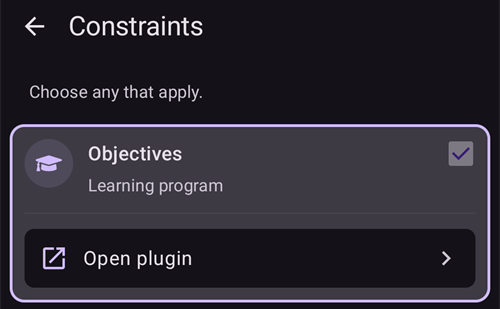

# Конфігурація (Config Builder)

```{admonition} Переходите з AAPS v3? :class: note **Config Builder** тепер називається **Конфігурація** і знаходиться в **меню** (☰). Дивіться [Що змінилося в AAPS v4](#v4-changes).

    <br />У **Конфігурації** ви вибираєте, які плагіни активні (CGM, помпа, алгоритм APS, чутливість, синхронізація, …), і відкриваєте кожен плагін та його налаштування. [Покрокову інструкцію](#configuration-v4) наведено нижче; решта сторінки докладно описує кожен розділ.
    
    (configuration-v4)=
    ## Конфігурація в AAPS v4
    
    В **AAPS** v4 торкніться **меню** (☰) у **лівому верхньому** куті головного екрана і виберіть **Конфігурація** (*«Налаштуйте вашу конфігурацію (CGM, помпа, ...) і ввімкніть функції»*).
    
    
    
    Плагіни згруповано за **категоріями** — наприклад, *Згладжування*, *Калібрування*, *Визначення чутливості*, *APS*, *Звʼязок* і *Загальне*. У кожному рядку показано назву категорії та **поточний активний** плагін (наприклад, *APS → OpenAPS SMB*). Торкніться рядка, щоб відкрити категорію.
    
    
    
    Усередині категорії ви бачите плагіни, доступні для неї. У категоріях з одним вибором ви вибираєте активний плагін; у деяких категоріях можна вибрати кілька (*«Виберіть усі потрібні.»*). Кожен плагін пропонує дві дії:
    
    - **Відкрити плагін** — відкриває власний екран плагіна.
    - **Налаштування** — відкриває параметри плагіна (налаштування можуть бути згруповані в розділи, які можна розгорнути).
    
    
    
    (configuration_sync_icon)=
    ### Значок телефона — «синхронізовано з основного телефона»
    
    Маленький **значок телефона** біля категорії або налаштування означає, що цей пункт **синхронізується з основного телефона** — його значення/вибір надходить на цей пристрій через канал NSClientV3 (Nightscout).
    
    На **клієнті** (**AAPSClient**) ці пункти **синхронізуються з основним телефоном**. Значок показується лише на клієнті, тому його немає на знімку екрана вище, який зроблено в основному застосунку **AAPS**. На клієнті він зазвичай з'являється біля *Згладжування*, *Калібрування*, *Визначення чутливості* і *APS*. Як саме основний телефон і клієнти залишаються узгодженими — і які налаштування можна змінювати з кожного боку — описано в розділі [Керування «основний телефон ↔ клієнт»](#client-master-config-prefs).
    
    Той самий значок є також **усередині налаштувань**, біля окремих параметрів, які синхронізуються. У прикладі нижче значок має *Межа засвоєння*; налаштування без значка задаються окремо на кожному пристрої:
    
    
    
    Пункти **без** значка налаштовуються **на кожному пристрої окремо**. Найважливіший приклад — саме з'єднання **NSClientV3 (Звʼязок)**: **URL Nightscout**, **токен доступу** і **websockets** задаються на кожному телефоні окремо, тому значка телефона біля них **немає**.
    
    ---
    
    (Config-Builder-tab-or-hamburger-menu)=
    ## Як відкрити екран плагіна
    
    Кожен екран плагіна відкривається одним із цих способів (вкладок і прапорця з оком з **AAPS** v3 більше немає, дивіться [Що змінилося в AAPS v4](#v4-changes)):
    
    - **Конфігурація** → категорія плагіна → **Відкрити плагін**,
    - панель **Керувати** в нижній навігації, для екранів, якими ви користуєтеся найчастіше (Профіль, Налаштування інсуліну, Помпа, Автоматизація, Їжа...),
    - кнопка [швидкого запуску](../DailyLifeWithAaps/QuickLaunch.md), яку ви додаєте самі,
    - **рядок пошуку** на головному екрані.
    
    ```{contents}
    :backlinks: entry
    :depth: 2
    

(ConfigBuilder_Profile)=

## Профіль

Цей модуль не можна вимкнути, бо він є основною частиною **AAPS**.

Дивіться [Ваш профіль AAPS](../SettingUpAaps/YourAapsProfile.md), щоб отримати базове розуміння того, що входить у ваш **Профіль**.

(insulin)= (Config-Builder-insulin)=

## Інсулін


В **AAPS** 4 інсулін більше не є плагіном, який вибирають у **Конфігурації**. Відкрийте **Керувати → Налаштування інсуліну**, щоб налаштувати інсулін, який ви використовуєте.

У редакторі інсуліну можна:

* give the insulin an **Insulin nickname** so it is easy to recognise,
* set the **Peak** (time to maximum insulin activity, in minutes) and the **DIA** (Duration of Insulin Action, in hours), either by typing the value or using the **–** / **+** buttons,
* торкнутися кнопки шаблону **Завантажити пік з** — **Novorapid** (75 хв), **Fiasp** (55 хв) або **Lyumjev** (45 хв), — щоб одним кроком заповнити стандартний час піку для цього інсуліну.

Допустимі діапазони однакові для будь-якого інсуліну:

* **DIA**: 5–9 годин (5–10 годин, якщо тип пацієнта **Вагітність**). Як вибрати значення, дивіться в розділі [Тривалість дії інсуліну (DIA) і пік](#Config-Builder-insulin-dia).
* **Пік**: 35–120 хвилин.

Криві **IOB** (активний інсулін) і **Активність** унизу редактора змінюються разом зі значеннями, тож ви одразу бачите, як ваші налаштування впливають на дію інсуліну.

Більше інформації про профіль інсуліну, як його показує **AAPS**, — [тут](#AapsScreens-insulin-profile).

(Config-Builder-insulin-change-active)=

### Зміна інсуліну, який використовується (DIA або пік)

Інсулін з позначкою **АКТИВНИЙ** — це той, який використовує ваш поточний профіль. Його поля сірі: його не можна змінити або видалити. Так назва інсуліну у вашому поточному профілі завжди відповідає налаштуванням, які справді використовуються.

Щоб змінити DIA або пік, які ви використовуєте:

1. Відкрийте **Керувати → Налаштування інсуліну**. Якщо екран відкривається лише для перегляду (**✏️ олівець** на верхній панелі), торкніться олівця і розблокуйте налаштування.
2. Торкніться **+** (*Додати новий інсулін*). **AAPS** створює копію інсуліну, показаного на екрані.
3. Задайте новий **Пік** та/або **DIA**, потім торкніться значка збереження (вгорі праворуч).
4. Торкніться **▶** (*Активувати інсулін*) і підтвердьте. Новий інсулін стає **АКТИВНИМ**.

```{admonition} Назва містить пік і DIA :class: note **AAPS** автоматично додає пік, DIA і концентрацію до назви інсуліну (наприклад, *Fiasp 55m 8h U100*), тож ви можете з першого погляду розрізнити свої налаштування.

    <br />Старий інсулін можна видалити, коли він більше не активний.
    
    ### Шаблони «Завантажити пік з»
    
    В **AAPS** 4 немає списку типів інсуліну, з якого треба вибирати. Усі інсуліни використовують однакову експоненціальну криву активності; відрізняються лише їхні **Пік** і **DIA**. Шаблони **Завантажити пік з** у редакторі інсуліну одним дотиком заповнюють рекомендований пік для найпоширеніших інсулінів (маленький значок ⓘ біля **Завантажити пік з** показує їх список зі значеннями піку). Після цього ви все ще можете змінити **Пік** і **DIA**.
    
    Змінюйте пік від рекомендованого значення, лише якщо розумієте, до чого це призведе. [Графік кривої інсуліну](#AapsScreens-insulin-profile) допоможе вам зрозуміти криві.
    
    #### Novorapid
    
    
    
    * рекомендовано для Humalog, Novolog і Novorapid (в **AAPS** v3 називався *Rapid-Acting Oref*)
    * Пік = 75 хвилин після ін'єкції
    
    #### Fiasp
    
    
    
    * рекомендовано для Fiasp (в **AAPS** v3 називався *Ultra-Rapid Oref*)
    * Пік = 55 хвилин після ін'єкції
    
    (Config-Builder-lyumjev)=
    #### Lyumjev
    
    
    
    * рекомендовано для Lyumjev
    * Пік = 45 хвилин після ін'єкції
    
    #### Власний пік
    
    * В **AAPS** 4 немає окремого типу інсуліну «Free-Peak Oref»: введіть будь-який **Пік** (35–120 хвилин) прямо в [редакторі інсуліну](#Config-Builder-insulin), без шаблону.
    * Власний пік корисний, якщо ви використовуєте інсулін, якого немає в списку, або суміш різних інсулінів.
    
    (Config-Builder-insulin-dia)=
    ### Тривалість дії інсуліну (DIA) і пік
    
    ```{warning}
    Під час роботи петлі зменшення DIA або піку завжди збільшує кількість введеного інсуліну. DIA в AAPS працює інакше, ніж у комерційних системах AID, і необережні зміни цих налаштувань можуть змінити дозування інсуліну набагато сильніше або слабше, ніж ви очікуєте.
    

AAPS моделює перебіг дії інсуліну математичною формулою, яку задають налаштування **DIA** і тісно пов'язане з ним налаштування **піку**. DIA — це теоретичний час, поки IOB не стане нулем, а пік — момент, коли дія інсуліну найсильніша. З цього виходить крива IOB і крива активності, яка є просто **швидкістю** зменшення IOB.

Врахуйте, що під час роботи петлі в AAPS періоди [нульового тимчасового базалу](#Open-APS-features-super-micro-bolus-smb) — це нормально. Цей відсутній базальний інсулін повністю віднімається від IOB. Тому на практиці IOB стає нулем на багато годин раніше, ніж закінчується налаштована DIA. [IOB болюсу і IOB базалу](#aaps-screens-iob-cob-basal-sens) можна переглянути окремо на головному екрані.

Щоб налаштувати DIA і пік, торкніться **Керувати** на головному екрані, а потім **Налаштування інсуліну**. AAPS показує активне налаштування інсуліну так:


У цьому прикладі пік — 55 хвилин, DIA — 8 годин, а [концентрація інсуліну](#Insulin-Concentration) — стандартні 100 Од/мл.

Через вплив нульового тимчасового базалу, описаний вище, і формулу зменшення IOB в AAPS більшість користувачів задають помітно вищу DIA, ніж у комерційних системах. Загалом багатьом людям добре підходить **DIA** 9 год. Коли у вас буде більше досвіду з AAPS і добре налаштований профіль, ви можете спробувати знайти власні значення DIA і піку за допомогою інформації нижче.

````{admonition} Подробиці про вплив налаштувань DIA і піку :class: dropdown

Оскільки базальна швидкість опосередковано впливає на зменшення IOB в AAPS, занадто високі базальні швидкості можуть приховувати занадто високу DIA, і навпаки. Тому варто спершу ретельно налаштувати базальні швидкості, а вже потім змінювати DIA і пік. Крім того, врахуйте, що налаштування DIA і піку взаємодіють: дія DIA залежить від піку, і навпаки.

Ці графіки показують точний вплив DIA і піку на криві IOB у всьому діапазоні допустимих значень.

Зміна DIA:

```{image} ../images/iob_remaining_static_peak.png :width: 400px

    <br />Зміна піку:
    
    ```{image} ../images/iob_remaining_static_dia.png
    :width: 400px
    

Нарешті, порівняння, де DIA і пік змінюються одночасно. Ідея в тому, що обидва значення змінюються в однаковій пропорції, тобто `49/35 ~ 7/5`. Або так само `120/93 ~ 9/7`. Інтервали будуть однаковими незалежно від початкових DIA або піку, якщо відносна зміна однакова для обох.

```{image} ../images/iob_remaining_uniform.png :width: 400px

    <br />Зверніть увагу: якщо DIA і пік змінювати так, кожна точка кривої зміститься на однакову відносну величину.
    
    ````
    
    #### Додатково про налаштування DIA і піку
    
    * [Технічні подробиці та історія від попередника AAPS, OpenAPS](https://openaps.readthedocs.io/en/latest/docs/While%20You%20Wait%20For%20Gear/understanding-insulin-on-board-calculations.html#understanding-the-new-iob-curves-based-on-exponential-activity-curves) (англ.).
    * [Why we are regularly wrong in the duration of insulin action (DIA) times we use, and why it matters…](https://www.diabettech.com/insulin/why-we-are-regularly-wrong-in-the-duration-of-insulin-action-dia-times-we-use-and-why-it-matters/) (чому ми часто помиляємося з тривалістю дії інсуліну (DIA) і чому це важливо) на Diabettech.
    * [Exponential Insulin Curves + Fiasp](https://web.archive.org/web/20220630154425/http://seemycgm.com/2017/10/21/exponential-insulin-curves-fiasp/) (експоненціальні криві інсуліну + Fiasp) на See My CGM (архів).
    * [Revised Humalog model in a closed loop](https://bionicwookiee.com/2022/04/13/revised-humalog-model-in-a-closed-loop/) (переглянута модель Humalog у закритій петлі) та інші статті на Bionic Wookie, які радять DIA 9 год для Lyumjev, Fiasp, NovoRapid, Humalog.
    
    (Config-Builder-bg-source)=
    ## Джерело ГК
    Виберіть джерело глюкози крові, яке ви використовуєте. Більше інформації про налаштування дивіться на сторінці [Джерело ГК](../Getting-Started/CompatiblesCgms.md).
    
    
    
    Прокрутіть вниз, щоб побачити інші джерела:
    
    
    
    
    
    * [xDrip+ BG](../CompatibleCgms/xDrip.md) – також для сумісних застосунків, як-от [Juggluco](../CompatibleCgms/Juggluco.md)
    * [NSClient BG](../CompatibleCgms/CgmNightscoutUpload.md) – лише якщо ви знаєте, що робите, дивіться [Джерело ГК](../Getting-Started/CompatiblesCgms.md).
    * [MM640g](../CompatibleCgms/MM640g.md)
    * Glimp – підтримуються лише версії 4.15.57 і новіші
    * [BYODA (Build Your Own Dexcom App)](#DexcomG6-if-using-g6-with-build-your-own-dexcom-app).
    * MicroTech CGM App – для CGM Aidex / LinX
    * [Poctech](../CompatibleCgms/PocTech.md)
    * Tomato (MiaoMiao) – застосунок Tomato для пристрою MiaoMiao
    * [Glunovo](https://infinovo.com/) – застосунок Glunovo для системи CGM Glunovo
    * Intelligo – застосунок Intelligo
    * Syai/Ottai – для застосунків Syai і Ottai (дивіться [Syai Tag](../CompatibleCgms/SyaiTagX1.md) і [Ottai](../CompatibleCgms/OttaiM8.md))
    * SI App – змінений (patched) SI App або застосунок Sibionics для CGM Sibionics
    * Sino App – змінений (patched) застосунок для CGM Sinocare
    * Notification Reader – читає значення глюкози зі сповіщень офіційних застосунків CGM (Dexcom, Medtronic, Eversense тощо)
    * Instara – застосунок Instara
    * Випадкова ГК – створює випадкові дані ГК для тестування. Її можна ввімкнути лише в інженерній збірці (для розробників) з **Віртуальною помпою**, тому у звичайній установці **AAPS** її використовувати не можна.
    
    ## Згладжування
    
    
    
    Дивіться [Згладжування даних глюкози крові](../CompatibleCgms/SmoothingBloodGlucoseData.md).
    
    ## Калібрування
    
    Виберіть, як **AAPS** обробляє значення, які отримує з вашого сенсора:
    
    - **Без калібрування**: значення сенсора використовуються як є. Використовуйте цей варіант, якщо сенсор уже відкалібрований на заводі й точний. Це значення за замовчуванням.
    - **Лінійне калібрування**: **AAPS** коригує значення сенсора за нахилом і зсувом, які обчислює з ваших вимірювань з пальця.
    
    How to use **Linear calibration**:
    
    1. Select **Linear calibration** in the **Calibration** category.
    2. When you insert a new sensor, log the sensor change: use **Log sensor change** on the calibration screen, or enter a CGM sensor insert in the Careportal. This tells **AAPS** when the sensor session started. If **AAPS** notices a gap of more than 30 minutes in the readings, it may ask you to mark a sensor change; this prompt appears on the master only, not on a client.
    3. Open the plugin and tap **Add calibration**. Enter your fingerstick value. **AAPS** pairs it with the sensor value from the last 10 minutes.
    
    A calibration is accepted only when:
    
    - a sensor change is logged and at least **2 hours** have passed since then (warm-up),
    - your glucose is stable. If it changes too fast, the dialog tells you and shows the limit,
    - there is a CGM reading from the last 10 minutes,
    - it is for the current moment. You cannot enter older fingerstick values.
    
    How the correction works:
    
    - **AAPS** draws a straight line through the pairs of the current sensor: `corrected value = slope × sensor value + offset`.
    - Newer pairs count more than older ones: a pair that is 2 days old counts about 37 %, a 4-day-old pair about 14 %. The line therefore follows your sensor as it drifts.
    - At least **2 pairs** are needed.
    - If the pairs are close together (less than 54 mg/dL / 3 mmol/L apart), only the values are shifted (offset, no slope).
    - The slope is kept between 0.55 and 1.6. A slope outside this range is limited to the nearest value.
    - Safety limit: if the correction at 100 mg/dL (5.5 mmol/L) would be more than ±30 mg/dL (1.7 mmol/L), no correction is applied. This protects you from a wrong entry.
    
    What it changes:
    
    - The corrected value is used everywhere: the BG on the main screen, the graph and the loop. The sensor readings themselves are not changed. The correction is applied on top, also to the earlier readings of the current sensor.
    - A new sensor change starts from zero. Pairs from earlier sensors no longer count.
    - On the graph, a calibration is shown as a marker at the fingerstick value.
    - Calibrations are synchronized through Nightscout, so your clients show the same corrected values.
    
    Check and remove entries:
    
    - **Open plugin** shows the status (for example *Slope 0.85, mid-range correction -0.4*), a chart of your pairs with the line, and the list of entries.
    - If an entry is wrong (for example, you had sugar on your finger), tap the bin icon next to it. The line is calculated again at once.
    
    ```{admonition} Using xDrip+ as BG source?
    :class: note
    xDrip+ has its own calibration. Calibrate in one place only, so that the sensor values are not corrected twice.
    

    {admonition} Calibrate with care
    :class: warning
    A wrong fingerstick value leads to wrong glucose values and therefore to wrong insulin dosing. Перед вимірюванням помийте руки і не калібруйте, коли глюкоза швидко змінюється.


(Config-Builder-pump)=

## Помпа

Виберіть помпу, яку ви використовуєте. Більше інформації про налаштування дивіться на сторінці [Сумісні помпи](../Getting-Started/CompatiblePumps.md).


Прокрутіть вниз, щоб побачити всі драйвери помп:


Коли ви вибираєте іншу помпу, **AAPS** просить підтвердити зміну:


* [Dana R](../CompatiblePumps/DanaR-Insulin-Pump.md)
* Dana R Korean (для помпи DanaR з корейського ринку)
* Dana Rv2 (помпа DanaR з неофіційним оновленням прошивки)
* [Dana-i/RS](../CompatiblePumps/DanaRS-Insulin-Pump.md)
* [Accu Chek Insight](../CompatiblePumps/Accu-Chek-Insight-Pump.md)
* [Accu Chek Combo](../CompatiblePumps/Accu-Chek-Combo-Pump-v2.md)
* Omnipod для [Omnipod Eros](../CompatiblePumps/OmnipodEros.md)
* Dash для [Omnipod DASH](../CompatiblePumps/OmnipodDASH.md)
* [Medtronic](../CompatiblePumps/MedtronicPump.md)
* [Diaconn G8](../CompatiblePumps/DiaconnG8.md)
* [EOPatch2](../CompatiblePumps/EOPatch2.md)
* [Medtrum](../CompatiblePumps/MedtrumNano.md)
* [Equil 5.3](../CompatiblePumps/Equil5.3.md)
* [Carelevo](../CompatiblePumps/CareLevo.md)
* Віртуальна помпа: відкрита петля – лише пропозиції **AAPS** 
  * as you make your first steps with **AAPS**, during the first [objectives](../SettingUpAaps/CompletingTheObjectives.md)
  * для помпи, для якої ще немає драйвера

(config-builder-wrong-pump-data)=

### Повідомлення: «Дані надходять з іншої помпи»

**AAPS** запам'ятовує помпу, з якою з'єднаний (тип помпи і серійний номер). Якщо він отримує дані з іншої помпи, наприклад після заміни вашої помпи на нову тієї ж моделі, він показує це повідомлення і ігнорує дані з тієї помпи:


Щоб використовувати нову помпу, змініть драйвер помпи: виберіть **Віртуальна помпа**, підтвердьте, а потім знову виберіть свою помпу. Тоді **AAPS** реєструє помпу, з якою з'єднаний зараз.

(Config-Builder-sensitivity-detection)=

## Визначення чутливості


Виберіть тип визначення чутливості. Докладніше про різні варіанти [читайте тут](../DailyLifeWithAaps/SensitivityDetectionAndCob.md). Він аналізує дані з історії на ходу і робить корекції, якщо бачить, що ви реагуєте на інсулін чутливіше (або, навпаки, з більшою резистентністю), ніж зазвичай. Докладніше про те, як обчислюється сам коефіцієнт чутливості, читайте в розділі [Основні функції AAPS > Autosens](#Open-APS-features-autosens).

You can view your sensitivity on the main screen in an [additional graph](#AapsScreens-section-g-additional-graphs), by selecting SENS% and watching the white line. Зверніть увагу: щоб визначення чутливості/[Autosens](#Open-APS-features-autosens) автоматично змінювало кількість введеного інсуліну, ви маєте бути на [Завданні 8](#objectives-objective8). До цього завдання відсоток Autosens / лінія на графіку показуються лише для інформації.

### Налаштування засвоєння

Якщо ви використовуєте Oref1 зі **SMB**, ви маєте змінити **min_5m_carbimpact** на 8. Це значення використовується лише під час пропусків у даних **CGM** або коли фізична активність «з'їдає» весь ріст глюкози крові, за яким **AAPS** інакше зменшував би COB. Коли [засвоєння вуглеводів](../DailyLifeWithAaps/CobCalculation.md) не можна динамічно розрахувати за реакцією вашої глюкози крові, застосовується стандартне зменшення ваших вуглеводів. По суті, це захисний механізм.

(Config-Builder-aps)=

## APS


Виберіть потрібний алгоритм APS для коригування терапії. Поточні подробиці вибраного алгоритму можна переглянути через **Відкрити плагін**.

* OpenAPS AMA 
  * Advanced Meal Assist (розширена допомога при їжі): старіший алгоритм, більше не рекомендований.
  * Простими словами, перевага в тому, що після болюсу на їжу система може швидше задати високий тимчасовий базал, ЯКЩО ви надійно вводите вуглеводи.
* [OpenAPS SMB](#Open-APS-features-super-micro-bolus-smb) 
  * Super Micro Bolus (супермікроболюс): найновіший алгоритм, рекомендований для всіх користувачів.
  * На відміну від AMA, SMB керує рівнем глюкози не тимчасовими базалами, а переважно малими **супермікроболюсами (SMB)**.
  * Примітка: цей алгоритм рекомендується використовувати з самого початку, хоча SMB насправді вводитимуться лише з [Завдання 9](#objectives-objective9).
* [Auto ISF](#Open-APS-features-auto-isf) 
  * Експериментальний алгоритм для досвідчених користувачів. Він з'являється в списку лише після виконання завдань.

Якщо ви переходите з алгоритму AMA на SMB, *min_5m_carbimpact* потрібно вручну змінити на **8** (значення за замовчуванням для SMB) у [Налаштування → Налаштування засвоєння](#Preferences-min_5m_carbimpact).

## Петля

Цей модуль не можна вимкнути, бо він є основною частиною **AAPS**.


## Обмеження



### Завдання

**AAPS** має навчальну програму (низку завдань), яку ви повинні пройти крок за кроком. Вона має безпечно провести вас через налаштування системи із закритою петлею.

Більше інформації дивіться на сторінці [Завдання](../SettingUpAaps/CompletingTheObjectives.md).

## Звʼязок

У цій категорії (в **AAPS** v3 вона називалася **Синхронізація**) ви вибираєте, чи і куди **AAPS** надсилатиме ваші дані.


Прокрутіть вниз, щоб побачити решту списку:


### NSClientV3

Можна використовувати як [сервер звітів](../SettingUpAaps/SettingUpTheReportingServer.md) і/або для [віддаленого моніторингу](../RemoteFeatures/RemoteMonitoring.md), [віддаленого керування](../RemoteFeatures/RemoteControl.md).

Щоб налаштувати синхронізацію NSClientV3, дивіться [Синхронізація із сервером звітів](#SetupWizard-synchronization-with-the-reporting-server-and-more).

### Tidepool

Можна використовувати як [сервер звітів](../SettingUpAaps/SettingUpTheReportingServer.md).

Дивіться [Tidepool](../SettingUpAaps/Tidepool.md).

### xDrip

Використовується, щоб **надсилати** дані, як-от значення глюкози і записи терапії, у xDrip+ на тому самому телефоні. Його налаштування також містять **Надсилати статус у xDrip+** — рядок статусу з IOB і COB, який показують xDrip+ і деякі супутні застосунки для годинників.

### Open Humans

Дивіться [Open Humans](../SupportingAaps/OpenHumans.md).

(Config-Builder-wear)=

### Wear

Моніторинг і керування **AAPS** з годинника Wear OS. Налаштування годинника описано на сторінці [Розумний годинник Wear OS](../WearOS/WearOsSmartwatch.md). Після ввімкнення плагіна виберіть його параметри в [Налаштування > Wear](#preferences-wear). Користування годинником описано на сторінці [Керування AAPS за допомогою розумного годинника з Wear OS](../RemoteFeatures/RemoteControlWearOS.md).

(external-companion-apps)=

### Зовнішні супутні застосунки

Транслює дані статусу **AAPS** на телефоні, щоб інші встановлені на ньому застосунки могли їх показувати — наприклад, супутні застосунки для годинників або віджетів. Трансляція містить глюкозу і тренд, IOB, COB, базал і тимчасовий базал, назву профілю, стан петлі, заряд батареї телефона і помпи, рівень резервуара і хід болюсу. Вмикайте його, лише якщо супутній застосунок, яким ви користуєтеся, потребує цих даних.

Відомі застосунки, які читають цю трансляцію: [WatchDrip+](https://bigdigital.home.blog/) (годинники Xiaomi і Amazfit), [GlucoDataHandler](https://github.com/pachi81/GlucoDataHandler) (віджети Wear OS (complications) і віджети телефона, а також Android Auto через GlucoDataAuto) і застосунок G-Watch. Їх налаштування описано на сторінці [Розумні годинники та AAPS](#watches-external-companion-apps). Деякі з них також використовують **Надсилати статус у xDrip+** з плагіна **xDrip** вище для рядка статусу з IOB і COB.

У попередніх версіях цей плагін називався **Samsung Tizen**, за назвою [застосунку G-Watch для годинників Samsung Tizen](#Watchfaces-tizen), для якого його спершу створили.

### Garmin

З'єднання з пристроєм Garmin (Fenix, Edge...)

## Терапія

Відкрийте **меню** (☰) і виберіть [Історія терапії](#aaps-screens-treatments), щоб побачити записану терапію. Якщо ви хочете змінити або видалити запис (наприклад, ви з'їли менше вуглеводів, ніж очікували), виберіть «Видалити» і введіть нове значення (за потреби змініть час) через **Терапія → Вуглеводи** в нижній навігації (дивіться [Вуглеводи](#screens-bolus-carbs)).

## Загальне

В **AAPS** 4 категорія **Загальне** у **Конфігурації** містить лише **Autotune**. Інші функції, описані нижче, доступні завжди, і їх більше не треба тут вмикати; у кожному абзаці сказано, де їх знайти.


### Огляд

[Головний екран](#AapsScreens-the-homescreen) **AAPS** більше не є плагіном і не має власних налаштувань у **Конфігурації**. Параметри, які раніше були тут, тепер у **Налаштуваннях** (значок шестерні): [Показувати примітки в діалогах](#Preferences-show-notes-field-in-treatments-dialogs), [Покажчики статусу](#Preferences-status-lights) і [Відсоток болюсу](#Preferences-deliver-this-part-of-bolus-wizard-result), який використовує калькулятор болюсу. Параметр супер-болюсу з **AAPS** 3.x в **AAPS** 4 [недоступний як налаштування](#Preferences-advanced-settings-overview).

(Config-Builder-actions)=

### Дії

Вкладки «Дії» з **AAPS** 3.x більше немає. Її кнопки тепер на панелі **Керувати** — дивіться [Куди поділася вкладка «Дії»?](#screens-action-tab).

### Автоматизація

**Керувати → Автоматизація** дозволяє керувати вашими [автоматизаціями](../DailyLifeWithAaps/Automations.md), починаючи із [Завдання 10](#objectives-objective10).

(Config-Builder-sms-communicator)=

### SMS Комунікатор

Дозволяє доглядачам віддалено керувати деякими функціями **AAPS** через SMS. Більше інформації про налаштування дивіться в розділі [SMS-команди](../RemoteFeatures/SMSCommands.md).

### Їжа

**Керувати → Їжа** показує шаблони їжі, задані в базі їжі Nightscout. Більше інформації про налаштування дивіться в [Nightscout Readme](https://github.com/nightscout/cgm-remote-monitor#food-custom-foods).

Примітка: ці записи не можна використовувати в калькуляторі **AAPS**. (Лише перегляд)

(Config-Builder-autotune)=

### Autotune

Ви можете ввімкнути Autotune, дивіться [тут](../AdvancedOptions/Autotune.md).

### Обслуговування

Відкрийте **меню** (☰) і виберіть **Обслуговування**, щоб експортувати / імпортувати налаштування і керувати файлами журналу.


### Config Builder

Тепер називається **Конфігурація**: це поточна сторінка.