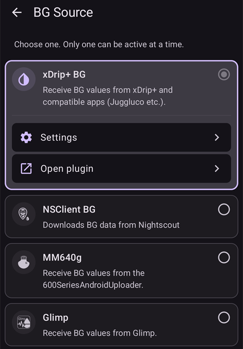

# Конфігурація (Config Builder)

```{admonition} Coming from AAPS v3?
:class: note
The **Config Builder** is now called **Configuration** and is in the **menu** (☰). See [What changed in AAPS v4](#v4-changes).
```

**Configuration** is where you choose which plugins are active (CGM, pump, APS algorithm, sensitivity, sync, …) and open each plugin and its settings. [Покрокову інструкцію](#configuration-v4) наведено нижче; решта сторінки докладно описує кожен розділ.

(configuration-v4)=
## Configuration in AAPS v4

In **AAPS** v4, tap the **menu** (☰) in the **top-left** corner of the main screen and choose **Configuration** (_“Set up your configuration (CGM, pump, …) and enable features”_).


Plugins are grouped by **category** — for example _Smoothing_, _Calibration_, _Sensitivity detection_, _APS_, _Communication_ and _General_. У кожному рядку показано назву категорії та **поточний активний** плагін (наприклад, _APS → OpenAPS SMB_). Торкніться рядка, щоб відкрити категорію.


Inside a category you see the plugins available for it. У категоріях з одним вибором ви вибираєте активний плагін; у деяких категоріях можна вибрати кілька (_«Виберіть усі потрібні.»_). Each plugin offers two actions:

- **Open plugin** — opens the plugin's own screen.
- **Settings** — opens the plugin's preferences (settings may be grouped into expandable sections).


(configuration_sync_icon)=
### The mobile icon — “synced from the master”

A small **mobile (phone) icon** next to a category or setting means that item is **synchronized from the master** — its value/selection is delivered to this device over the NSClientV3 (Nightscout) channel.

На **клієнті** (**AAPSClient**) ці пункти **синхронізуються з основним телефоном**. The icon is only shown on a client, so it does not appear in the screenshot above, which was taken on the main **AAPS** app. On a client it typically appears on _Smoothing_, _Calibration_, _Sensitivity detection_ and _APS_. Як саме основний телефон і клієнти залишаються узгодженими — і які налаштування можна змінювати з кожного боку — описано в розділі [Керування «основний телефон ↔ клієнт»](#client-master-config-prefs).

Той самий значок є також **усередині налаштувань**, біля окремих параметрів, які синхронізуються. In the example below _Absorption cutoff_ carries the icon; settings without the icon are configured per device:


Items **without** the icon are configured **per device**. Найважливіший приклад — саме з'єднання **NSClientV3 (Звʼязок)**: **URL Nightscout**, **токен доступу** і **websockets** задаються на кожному телефоні окремо, тому значка телефона біля них **немає**.

---

(Config-Builder-tab-or-hamburger-menu)=
## Opening a plugin screen

Each plugin screen is opened in one of these ways (the tabs and the eye checkbox of **AAPS** v3 are gone, see [What changed in AAPS v4](#v4-changes)):

- **Configuration** → the plugin's category → **Open plugin**,
- the **Manage** sheet of the bottom navigation, for the screens you use most (Profile, Insulin settings, Pump, Automation, Food...),
- a [QuickLaunch](../DailyLifeWithAaps/QuickLaunch.md) button that you add yourself,
- the **search bar** on the main screen.

```{contents}
:backlinks: entry
:depth: 2
```

(ConfigBuilder_Profile)=

## Профіль

This module cannot be disabled as it is a core part of **AAPS**.

See [Your AAPS Profile](../SettingUpAaps/YourAapsProfile.md) for a basic understanding of what goes inside your **Profile**.

(insulin)=
(Config-Builder-insulin)=
## Інсулін


In **AAPS** 4 the insulin is no longer a plugin selected in **Configuration**. Open **Manage → Insulin settings** to set up the insulin you are using.

У редакторі інсуліну можна:

- give the insulin an **Insulin nickname** so it is easy to recognise,
- set the **Peak** (time to maximum insulin activity, in minutes) and the **DIA** (Duration of Insulin Action, in hours), either by typing the value or using the **–** / **+** buttons,
- tap a **Load peak from** preset button — **Novorapid** (75 min), **Fiasp** (55 min) or **Lyumjev** (45 min) — to fill in the standard peak time for that insulin in one step.

Допустимі діапазони однакові для будь-якого інсуліну:

- **DIA**: 5 to 9 hours (5 to 10 hours if the patient type is set to **Pregnant**). See [Duration of insulin action (DIA) and peak](#Config-Builder-insulin-dia) to choose a value.
- **Peak**: 35 to 120 minutes.

The **IOB** (insulin on board) and **Activity** curves shown at the bottom of the editor update as you change the values, so you can see straight away how your settings shape the insulin action.

More information to understand the Insulin Profile as shown in **AAPS** [here](#AapsScreens-insulin-profile).

(Config-Builder-insulin-change-active)=
### Зміна інсуліну, який використовується (DIA або пік)

The insulin marked **ACTIVE** is the one your running profile uses. Його поля сірі: його не можна змінити або видалити. Так назва інсуліну у вашому поточному профілі завжди відповідає налаштуванням, які справді використовуються.

Щоб змінити DIA або пік, які ви використовуєте:

1. Open **Manage → Insulin settings**. If the screen opens read-only (a **✏️ pencil** in the top bar), tap the pencil and unlock your settings.
2. Tap **+** (_Add new insulin_). **AAPS** creates a copy of the insulin shown on screen.
3. Set the new **Peak** and/or **DIA**, then tap the save icon (top right).
4. Tap **▶** (_Activate insulin_) and confirm. The new insulin becomes **ACTIVE**.

```{admonition} The name includes peak and DIA
:class: note
**AAPS** adds the peak, DIA and concentration to the insulin name automatically (for example _Fiasp 55m 8h U100_), so you can tell your configurations apart at a glance.
```

Старий інсулін можна видалити, коли він більше не активний.

### The "Load peak from" presets

In **AAPS** 4 there is no list of insulin types to choose from. Усі інсуліни використовують однакову експоненціальну криву активності; відрізняються лише їхні **Пік** і **DIA**. Шаблони **Завантажити пік з** у редакторі інсуліну одним дотиком заповнюють рекомендований пік для найпоширеніших інсулінів (маленький значок ⓘ біля **Завантажити пік з** показує їх список зі значеннями піку). Після цього ви все ще можете змінити **Пік** і **DIA**.

Змінюйте пік від рекомендованого значення, лише якщо розумієте, до чого це призведе. [Графік кривої інсуліну](#AapsScreens-insulin-profile) допоможе вам зрозуміти криві.

#### Novorapid


- recommended for Humalog, Novolog and Novorapid (called _Rapid-Acting Oref_ in **AAPS** v3)
- Peak = 75 minutes after injection

#### Fiasp


- recommended for Fiasp (called _Ultra-Rapid Oref_ in **AAPS** v3)
- Peak = 55 minutes after injection

(Config-Builder-lyumjev)=
#### Lyumjev


- recommended for Lyumjev
- Peak = 45 minutes after injection

#### Custom peak

- There is no separate "Free-Peak Oref" insulin type in **AAPS** 4: enter any **Peak** (35 to 120 minutes) directly in the [insulin editor](#Config-Builder-insulin), without using a preset.
- A custom peak is useful if you use an insulin that is not in the list, or a mixture of different insulins.

(Config-Builder-insulin-dia)=
### Duration of insulin action (DIA) and peak

```{warning}
In looping, decreasing DIA or peak will always increase administered insulin. DIA works differently in AAPS than in commercial AID systems, and careless changes to these settings can change insulin dosing in a way which is much larger or smaller than expected.
```

AAPS models the timeline of insulin action with a mathematical formula, configured using **DIA** and the closely related **peak** settings. DIA — це теоретичний час, поки IOB не стане нулем, а пік — момент, коли дія інсуліну найсильніша. This yields an IOB curve and an activity curve, which is simply the **rate** of IOB decay.

Consider that when AAPS is looping, it's normal to have periods of [zero-temping](#Open-APS-features-super-micro-bolus-smb). Цей відсутній базальний інсулін повністю віднімається від IOB. Тому на практиці IOB стає нулем на багато годин раніше, ніж закінчується налаштована DIA. You can inspect [bolus IOB and basal IOB](#aaps-screens-iob-cob-basal-sens) separately from the main screen.

To configure DIA and peak, tap **Manage** in the main screen, and then tap **Insulin settings**. AAPS показує активне налаштування інсуліну так:


In this example, the peak setting is 55 minutes, DIA is 8 hours and [insulin concentration](#Insulin-Concentration) is the standard 100 IU/mL.

Через вплив нульового тимчасового базалу, описаний вище, і формулу зменшення IOB в AAPS більшість користувачів задають помітно вищу DIA, ніж у комерційних системах. In general, many people find that a **DIA** of 9h works well for them. Коли у вас буде більше досвіду з AAPS і добре налаштований профіль, ви можете спробувати знайти власні значення DIA і піку за допомогою інформації нижче.

````{admonition} Details on the impact of DIA and peak configuration
:class: dropdown

Since the basal rate has an indirect influence on IOB decay in AAPS, it follows that too high basal rates can mask too high DIA, and vice versa. It makes sense to first carefully tune basal rates before adjusting DIA and peak. Additionally, consider that the DIA and peak settings interact, in the sense that the effect of DIA depends on peak, and vice versa.

These charts show the exact impact of DIA and peak on the IOB curves, across the range of allowed values.

Adjusting DIA:

```{image} ../images/iob_remaining_static_peak.png
:width: 400px
```

Adjusting peak:

```{image} ../images/iob_remaining_static_dia.png
:width: 400px
```

Finally, a comparison adjusting DIA and peak in parallel. The logic here is that both values are adjusted in the same relative amounts, so that `49/35 ~ 7/5`. Or similarly, `120/93 ~ 9/7`. The intervals will be consistent regardless of the baseline DIA or peak, as long as the relative change is the same for both.

```{image} ../images/iob_remaining_uniform.png
:width: 400px
```

Note that when DIA and peak are adjusted in this fashion, every point in the curve will shift by the same relative amount.

````

#### Further reading on DIA and peak configuration

- [Technical details and historical background from the AAPS predecessor, OpenAPS](https://openaps.readthedocs.io/en/latest/docs/While%20You%20Wait%20For%20Gear/understanding-insulin-on-board-calculations.html#understanding-the-new-iob-curves-based-on-exponential-activity-curves).
- [Why we are regularly wrong in the duration of insulin action (DIA) times we use, and why it matters…](https://www.diabettech.com/insulin/why-we-are-regularly-wrong-in-the-duration-of-insulin-action-dia-times-we-use-and-why-it-matters/) on Diabettech.
- [Exponential Insulin Curves + Fiasp](https://web.archive.org/web/20220630154425/http://seemycgm.com/2017/10/21/exponential-insulin-curves-fiasp/) on See My CGM (archive).
- [Revised Humalog model in a closed loop](https://bionicwookiee.com/2022/04/13/revised-humalog-model-in-a-closed-loop/) and other articles on Bionic Wookie, recommending a DIA of 9h for Lyumjev, Fiasp, NovoRapid, Humalog.

(Config-Builder-bg-source)=
## Джерело ГК
Select the blood glucose source you are using. Більше інформації про налаштування дивіться на сторінці [Джерело ГК](../Getting-Started/CompatiblesCgms.md).



Scroll down to see the other sources:


- [xDrip+ BG](../CompatibleCgms/xDrip.md) - also for compatible apps such as [Juggluco](../CompatibleCgms/Juggluco.md)
- [NSClient BG](../CompatibleCgms/CgmNightscoutUpload.md) - only if you know what you are doing, see [BG Source](../Getting-Started/CompatiblesCgms.md).
- [MM640g](../CompatibleCgms/MM640g.md)
- Glimp - only version 4.15.57 and newer are supported
- [BYODA (Build Your Own Dexcom App)](#DexcomG6-if-using-g6-with-build-your-own-dexcom-app).
- MicroTech CGM App - for the Aidex / LinX CGM
- [Poctech](../CompatibleCgms/PocTech.md)
- Tomato (MiaoMiao) - Tomato App for MiaoMiao device
- [Glunovo](https://infinovo.com/) - Glunovo App for Glunovo CGM system
- Intelligo - Intelligo App
- Syai/Ottai - for the Syai and Ottai apps (see [Syai Tag](../CompatibleCgms/SyaiTagX1.md) and [Ottai](../CompatibleCgms/OttaiM8.md))
- SI App - patched SI App or Sibionics App for Sibionics CGM
- Sino App - patched app for Sinocare CGM
- Notification Reader - reads glucose values from the notifications shown by official CGM apps (Dexcom, Medtronic, Eversense, etc.)
- Instara - Instara App
- Random BG - generates random BG data for testing. Її можна ввімкнути лише в інженерній збірці (для розробників) з **Віртуальною помпою**, тому у звичайній установці **AAPS** її використовувати не можна.

## Smoothing


See [Smoothing blood glucose data](../CompatibleCgms/SmoothingBloodGlucoseData.md).

## Калібрування

Choose how **AAPS** treats the values it receives from your sensor:

- **No calibration**: the sensor values are used as they are. Використовуйте цей варіант, якщо сенсор уже відкалібрований на заводі й точний. Це значення за замовчуванням.
- **Linear calibration**: **AAPS** corrects the sensor values with a slope and an offset that it computes from your fingerstick entries.

How to use **Linear calibration**:

1. Select **Linear calibration** in the **Calibration** category.
2. When you insert a new sensor, log the sensor change: use **Log sensor change** on the calibration screen, or enter a CGM sensor insert in the Careportal. This tells **AAPS** when the sensor session started. If **AAPS** notices a gap of more than 30 minutes in the readings, it may ask you to mark a sensor change; this prompt appears on the master only, not on a client.
3. Open the plugin and tap **Add calibration**. Enter your fingerstick value. **AAPS** pairs it with the sensor value from the last 10 minutes.

A calibration is accepted only when:

- a sensor change is logged and at least **2 hours** have passed since then (warm-up),
- your glucose is stable. If it changes too fast, the dialog tells you and shows the limit,
- there is a CGM reading from the last 10 minutes,
- it is for the current moment. You cannot enter older fingerstick values.

How the correction works:

- **AAPS** draws a straight line through the pairs of the current sensor: `corrected value = slope × sensor value + offset`.
- Newer pairs count more than older ones: a pair that is 2 days old counts about 37 %, a 4-day-old pair about 14 %. The line therefore follows your sensor as it drifts.
- At least **2 pairs** are needed.
- If the pairs are close together (less than 54 mg/dL / 3 mmol/L apart), only the values are shifted (offset, no slope).
- The slope is kept between 0.55 and 1.6. A slope outside this range is limited to the nearest value.
- Safety limit: if the correction at 100 mg/dL (5.5 mmol/L) would be more than ±30 mg/dL (1.7 mmol/L), no correction is applied. This protects you from a wrong entry.

What it changes:

- The corrected value is used everywhere: the BG on the main screen, the graph and the loop. The sensor readings themselves are not changed. The correction is applied on top, also to the earlier readings of the current sensor.
- A new sensor change starts from zero. Pairs from earlier sensors no longer count.
- On the graph, a calibration is shown as a marker at the fingerstick value.
- Calibrations are synchronized through Nightscout, so your clients show the same corrected values.

Check and remove entries:

- **Open plugin** shows the status (for example _Slope 0.85, mid-range correction -0.4_), a chart of your pairs with the line, and the list of entries.
- If an entry is wrong (for example, you had sugar on your finger), tap the bin icon next to it. The line is calculated again at once.

```{admonition} Using xDrip+ as BG source?
:class: note
xDrip+ has its own calibration. Calibrate in one place only, so that the sensor values are not corrected twice.
```

```{admonition} Calibrate with care
:class: warning
A wrong fingerstick value leads to wrong glucose values and therefore to wrong insulin dosing. Wash your hands before measuring, and do not calibrate while your glucose is changing fast.
```


(Config-Builder-pump)=
## Помпа
Виберіть помпу, яку ви використовуєте. See [Compatible pumps](../Getting-Started/CompatiblePumps.md) page for more setup information.


Прокрутіть вниз, щоб побачити всі драйвери помп:


When you select another pump, **AAPS** asks you to confirm the change:


- [Dana R](../CompatiblePumps/DanaR-Insulin-Pump.md)
- Dana R Korean (для помпи DanaR з корейського ринку)
- Dana Rv2 (помпа DanaR з неофіційним оновленням прошивки)
- [Dana-i/RS](../CompatiblePumps/DanaRS-Insulin-Pump.md)
- [Accu Chek Insight](../CompatiblePumps/Accu-Chek-Insight-Pump.md)
- [Accu Chek Combo](../CompatiblePumps/Accu-Chek-Combo-Pump-v2.md)
- Omnipod for [Omnipod Eros](../CompatiblePumps/OmnipodEros.md)
- Dash for [Omnipod DASH](../CompatiblePumps/OmnipodDASH.md)
- [Medtronic](../CompatiblePumps/MedtronicPump.md)
- [Diaconn G8](../CompatiblePumps/DiaconnG8.md)
- [EOPatch2](../CompatiblePumps/EOPatch2.md)
- [Medtrum](../CompatiblePumps/MedtrumNano.md)
- [Equil 5.3](../CompatiblePumps/Equil5.3.md)
- [Carelevo](../CompatiblePumps/CareLevo.md)
- Virtual pump: open loop - **AAPS** suggestions only
  - as you make your first steps with **AAPS**, during the first [objectives](../SettingUpAaps/CompletingTheObjectives.md)
  - для помпи, для якої ще немає драйвера

(config-builder-wrong-pump-data)=
### Повідомлення: «Дані надходять з іншої помпи»

**AAPS** remembers the pump it is connected to (pump type and serial number). Якщо він отримує дані з іншої помпи, наприклад після заміни вашої помпи на нову тієї ж моделі, він показує це повідомлення і ігнорує дані з тієї помпи:


To use the new pump, change the pump driver: select **Virtual pump**, confirm, then select your pump again. **AAPS** then registers the pump it is connected to now.

(Config-Builder-sensitivity-detection)=

## Визначення чутливості


Виберіть тип визначення чутливості. For more details of different designs please [read on here](../DailyLifeWithAaps/SensitivityDetectionAndCob.md). Він аналізує дані з історії на ходу і робить корекції, якщо бачить, що ви реагуєте на інсулін чутливіше (або, навпаки, з більшою резистентністю), ніж зазвичай. More details about how the sensitivity ratio itself is calculated can be found in [Key AAPS Features > Autosens](#Open-APS-features-autosens).

You can view your sensitivity on the main screen in an [additional graph](#AapsScreens-section-g-additional-graphs), by selecting SENS% and watching the white line. Note, you need to be in [Objective 8](#objectives-objective8) in order to let Sensitivity Detection/[Autosens](#Open-APS-features-autosens) automatically adjust the amount of insulin delivered. До цього завдання відсоток Autosens / лінія на графіку показуються лише для інформації.

### Налаштування засвоєння
If you use Oref1 with **SMB** you must change **min_5m_carbimpact** to 8. The value is only used during gaps in **CGM** readings or when physical activity "uses up" all the blood glucose rise that would otherwise cause **AAPS** to decay COB. At times when [carb absorption](../DailyLifeWithAaps/CobCalculation.md) can't be dynamically worked out based on your blood's reactions it inserts a default decay to your carbs. По суті, це захисний механізм.

(Config-Builder-aps)=
## APS


Виберіть потрібний алгоритм APS для коригування терапії. You can view the active detail of the chosen algorithm with **Open plugin**.
- OpenAPS AMA
  - Advanced Meal Assist (розширена допомога при їжі): старіший алгоритм, більше не рекомендований.
  - Простими словами, перевага в тому, що після болюсу на їжу система може швидше задати високий тимчасовий базал, ЯКЩО ви надійно вводите вуглеводи.
- [OpenAPS SMB](#Open-APS-features-super-micro-bolus-smb)
  - Super Micro Bolus (супермікроболюс): найновіший алгоритм, рекомендований для всіх користувачів.
  - In contrast to AMA, SMB does not use temporary basal rates to control glucose levels, but mainly small **Super Micro Boluses**.
  - Note : It is recommended to use this algorithm from the beginning, even though you will not actually get SMBs delivered until [Objective 9](#objectives-objective9).
- [Auto ISF](#Open-APS-features-auto-isf)
  - Експериментальний алгоритм для досвідчених користувачів. Він з'являється в списку лише після виконання завдань.

If switching from AMA to SMB algorithm, _min_5m_carbimpact_ must be changed manually to **8** (default value for SMB) in [Settings → Absorption settings](#Preferences-min_5m_carbimpact).

## Петля

This module cannot be disabled as it is a core part of **AAPS**.


## Обмеження


### Завдання

**AAPS** has a learning program (a series of objectives) that you have to fulfill step by step. Вона має безпечно провести вас через налаштування системи із закритою петлею.

See [Objectives](../SettingUpAaps/CompletingTheObjectives.md) page for more information.

## Звʼязок

In this category (called **Synchronization** in **AAPS** v3), you choose if/where you want **AAPS** to send your data to.


Прокрутіть вниз, щоб побачити решту списку:


### NSClientV3

Can be used as a [reporting server](../SettingUpAaps/SettingUpTheReportingServer.md) and/or for [remote monitoring](../RemoteFeatures/RemoteMonitoring.md), [remote control](../RemoteFeatures/RemoteControl.md).

See [Synchronization with the reporting server](#SetupWizard-synchronization-with-the-reporting-server-and-more) to set up NSClientV3 synchronization.

### Tidepool

Can be used as a [reporting server](../SettingUpAaps/SettingUpTheReportingServer.md).

See [Tidepool](../SettingUpAaps/Tidepool.md).

### xDrip

Used to **send** data such as glucose values and treatments to xDrip+ on the same phone. Its settings also hold **Send status to xDrip+**, a status line with IOB and COB that xDrip+ and some watch companion apps display.

### Open Humans

See [Open Humans](../SupportingAaps/OpenHumans.md).

(Config-Builder-wear)=
### Wear
Monitor and control **AAPS** from a Wear OS watch. Setting up the watch is explained on [Wear OS smartwatch](../WearOS/WearOsSmartwatch.md). After enabling the plugin, choose its options in [Settings > Wear](#preferences-wear). Using the watch is explained on [Operation of AAPS via your Wear OS smartwatch](../RemoteFeatures/RemoteControlWearOS.md).

(external-companion-apps)=
### Зовнішні супутні застосунки

Broadcasts **AAPS** status data on the phone so that other apps installed on it can display it — for example watch or widget companion apps. Трансляція містить глюкозу і тренд, IOB, COB, базал і тимчасовий базал, назву профілю, стан петлі, заряд батареї телефона і помпи, рівень резервуара і хід болюсу. Вмикайте його, лише якщо супутній застосунок, яким ви користуєтеся, потребує цих даних.

Apps known to read this broadcast are [WatchDrip+](https://bigdigital.home.blog/) (Xiaomi and Amazfit watches), [GlucoDataHandler](https://github.com/pachi81/GlucoDataHandler) (Wear OS complications and widgets, and Android Auto through GlucoDataAuto) and the G-Watch app. Their setup is described on [Smartwatches and AAPS](#watches-external-companion-apps). Some of them also use **Send status to xDrip+** from the **xDrip** plugin above for a status line with IOB and COB.

In earlier versions this plugin was called **Samsung Tizen**, after the [G-Watch app for Samsung Tizen watches](#Watchfaces-tizen) it was first made for.

### Garmin

З'єднання з пристроєм Garmin (Fenix, Edge...)
## Терапія
Open the **menu** (☰) and select [Treatments history](#aaps-screens-treatments) to see the treatments that have been recorded. Should you wish to edit or delete an entry (e.g. you ate less carbs than you expected) then select 'Remove' and enter the new value (change the time if necessary) through **Treatments → Carbs** in the bottom navigation (see [Carbs](#screens-bolus-carbs)).

## Загальне

In **AAPS** 4 the **General** category of **Configuration** only lists **Autotune**. Інші функції, описані нижче, доступні завжди, і їх більше не треба тут вмикати; у кожному абзаці сказано, де їх знайти.


### Огляд

The [main screen](#AapsScreens-the-homescreen) of **AAPS** is not a plugin any more and has no settings of its own in **Configuration**. The options that used to be here are in **Settings** (gear icon): [Show notes in dialogs](#Preferences-show-notes-field-in-treatments-dialogs), [Status lights](#Preferences-status-lights) and the [Bolus percentage](#Preferences-deliver-this-part-of-bolus-wizard-result) used by the bolus wizard. The super bolus option of **AAPS** 3.x is [not available as a setting](#Preferences-advanced-settings-overview) in **AAPS** 4.

(Config-Builder-actions)=
### Дії

The Actions tab of **AAPS** 3.x no longer exists. Its buttons are now in the **Manage** sheet — see [Where did the Actions tab go?](#screens-action-tab).

### Автоматизація

**Manage → Automation** lets you manage your [Automations](../DailyLifeWithAaps/Automations.md), starting at [Objective 10](#objectives-objective10).

(Config-Builder-sms-communicator)=
### SMS Комунікатор
Allows remote caregivers to control some **AAPS** features via SMS, see [SMS Commands](../RemoteFeatures/SMSCommands.md) for more setup information.

### Їжа
**Manage → Food** displays the food presets defined in the Nightscout food database, see [Nightscout Readme](https://github.com/nightscout/cgm-remote-monitor#food-custom-foods) for more setup information.

Note: Entries cannot be used in the **AAPS** calculator. (Лише перегляд)

(Config-Builder-autotune)=
### Autotune

You can enable Autotune, see [here](../AdvancedOptions/Autotune.md).

### Обслуговування

Open the **menu** (☰) and select **Maintenance** to export / import settings and manage log files.


### Config Builder

Now called **Configuration**: this current page.