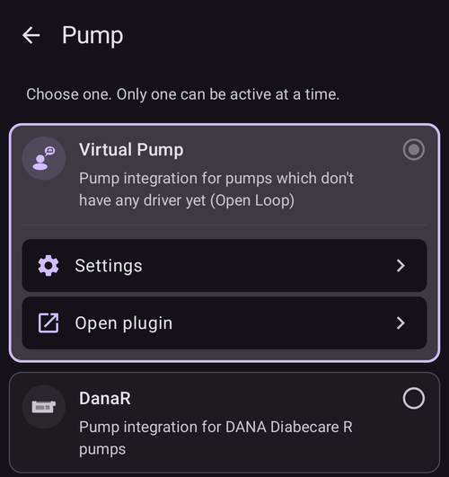
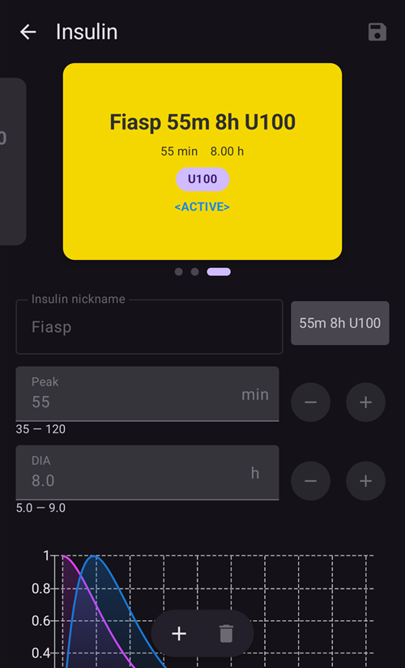
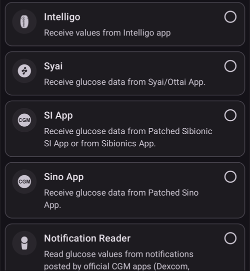
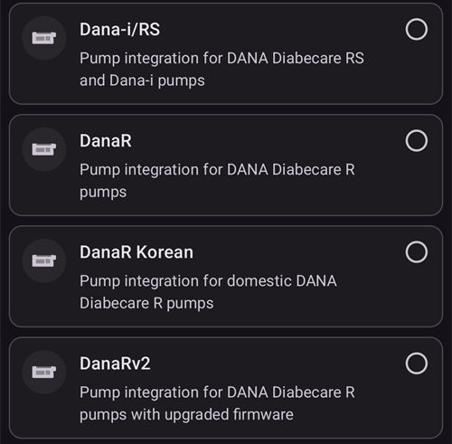

# Конфігурація (Config Builder)

```{admonition} Coming from AAPS v3?
:class: note
**Конфігуратор** тепер називається **Конфігурація** і знаходиться в **меню** (☰). Див. [Що змінилося в AAPS v4](#v4-changes).
```

**Конфігурація** — це місце, де ви вибираєте, які плагіни активні (CGM, помпа, алгоритм APS, чутливість, синхронізація, …) і відкриваєте кожен плагін та його налаштування. [Покрокову інструкцію](#configuration-v4) наведено нижче; решта сторінки докладно описує кожен розділ.

(configuration-v4)=
## Конфігурація в AAPS v4

В **AAPS** v4 натисніть **меню** (☰) у **верхньому лівому** куті головного екрана й виберіть **Конфігурація** (_«Налаштуйте вашу конфігурацію (CGM, помпа, …) і ввімкніть функції»_).


Плагіни згруповані за **категоріями** — наприклад, _Згладжування_, _Калібрування_, _Визначення чутливості_, _APS_, _Звʼязок_ і _Загальне_. У кожному рядку показано назву категорії та **поточний активний** плагін (наприклад, _APS → OpenAPS SMB_). Торкніться рядка, щоб відкрити категорію.


У категорії ви бачите плагіни, доступні для неї. У категоріях з одним вибором ви вибираєте активний плагін; у деяких категоріях можна вибрати кілька (_«Виберіть усі потрібні.»_). Кожен плагін має дві дії:

- **Відкрити плагін** — відкриває власний екран плагіна.
- **Settings** — opens the plugin's preferences (settings may be grouped into expandable sections).



(configuration_sync_icon)=
### Іконка телефону — «синхронізовано з основного телефону»

Маленька **іконка телефону** біля категорії або налаштування означає, що цей пункт **синхронізується з основного телефону** — його значення або вибір надходить на цей пристрій через канал NSClientV3 (Nightscout).

На **клієнті** (**AAPSClient**) ці пункти **синхронізуються з основним телефоном**. Іконка показується лише на клієнті, тому її немає на знімку екрана вище, зробленому в основному застосунку **AAPS**. На клієнті вона зазвичай є біля _Згладжування_, _Калібрування_, _Визначення чутливості_ і _APS_. Як саме основний телефон і клієнти залишаються узгодженими — і які налаштування можна змінювати з кожного боку — описано в розділі [Керування «основний телефон ↔ клієнт»](#client-master-config-prefs).

Той самий значок є також **усередині налаштувань**, біля окремих параметрів, які синхронізуються. У прикладі нижче іконку має _Межа засвоєння_; налаштування без іконки задаються окремо на кожному пристрої:


Пункти **без** іконки задаються **окремо на кожному пристрої**. Найважливіший приклад — саме з'єднання **NSClientV3 (Звʼязок)**: **URL Nightscout**, **токен доступу** і **websockets** задаються на кожному телефоні окремо, тому значка телефона біля них **немає**.

---

(Config-Builder-tab-or-hamburger-menu)=
## Як відкрити екран плагіна

Кожен екран плагіна можна відкрити одним із цих способів (вкладок і прапорця з оком з **AAPS** v3 більше немає, див. [Що змінилося в AAPS v4](#v4-changes)):

- **Конфігурація** → категорія плагіна → **Відкрити плагін**,
- панель **Керувати** в нижній навігації, для екранів, якими ви користуєтеся найчастіше (Профіль, Налаштування інсуліну, Помпа, Автоматизація, Їжа...),
- кнопка [швидкого запуску](../DailyLifeWithAaps/QuickLaunch.md), яку ви додаєте самі,
- **рядок пошуку** на головному екрані.

```{contents}
:backlinks: entry
:depth: 2
```

(ConfigBuilder_Profile)=

## Профіль

Цей модуль не можна вимкнути, бо він є основною частиною **AAPS**.

Див. [Ваш профіль AAPS](../SettingUpAaps/YourAapsProfile.md), щоб зрозуміти основи того, що входить у ваш **Профіль**.

(insulin)=
(Config-Builder-insulin)=
## Інсулін


В **AAPS** 4 інсулін більше не є плагіном, який вибирають у **Конфігурації**. Відкрийте **Керувати → Налаштування інсуліну**, щоб налаштувати інсулін, який ви використовуєте.

У редакторі інсуліну можна:

- дайте інсуліну **Псевдонім інсуліну**, щоб його було легко впізнати,
- задайте **Пік** (час до максимальної дії інсуліну, у хвилинах) і **DIA** (тривалість дії інсуліну, у годинах): введіть значення або скористайтеся кнопками **–** / **+**,
- натисніть кнопку шаблону **Завантажити пік з** — **Novorapid** (75 хв), **Fiasp** (55 хв) або **Lyumjev** (45 хв) — щоб одним кроком заповнити стандартний час піку для цього інсуліну.

Допустимі діапазони однакові для будь-якого інсуліну:

- **DIA**: від 5 до 9 годин (від 5 до 10 годин, якщо тип пацієнта — **Вагітність**). Див. [Тривалість дії інсуліну (DIA) і пік](#Config-Builder-insulin-dia), щоб вибрати значення.
- **Пік**: від 35 до 120 хвилин.

Криві **IOB** (активний інсулін) і **Активність** унизу редактора змінюються разом зі значеннями, тож ви одразу бачите, як ваші налаштування впливають на дію інсуліну.

Більше інформації про профіль інсуліну, як його показує **AAPS**, [тут](#AapsScreens-insulin-profile).

(Config-Builder-insulin-change-active)=
### Зміна інсуліну, який використовується (DIA або пік)

Інсулін, позначений **АКТИВНИЙ**, — це той, який використовує ваш поточний профіль. Його поля сірі: його не можна змінити або видалити. Так назва інсуліну у вашому поточному профілі завжди відповідає налаштуванням, які справді використовуються.

Щоб змінити DIA або пік, які ви використовуєте:

1. Відкрийте **Керувати → Налаштування інсуліну**. Якщо екран відкривається лише для перегляду (**✏️ олівець** у верхній панелі), натисніть олівець і розблокуйте налаштування.
2. Натисніть **+** (_Додати новий інсулін_). **AAPS** створює копію інсуліну, показаного на екрані.
3. Задайте новий **Пік** та/або **DIA**, потім натисніть іконку збереження (вгорі праворуч).
4. Натисніть **▶** (_Активувати інсулін_) і підтвердьте. Новий інсулін стає **АКТИВНИЙ**.

```{admonition} The name includes peak and DIA
:class: note
**AAPS** автоматично додає до назви інсуліну пік, DIA і концентрацію (наприклад, _Fiasp 55m 8h U100_), тож ви одразу відрізните свої конфігурації.
```

Старий інсулін можна видалити, коли він більше не активний.

### Шаблони «Завантажити пік з»

В **AAPS** 4 немає списку типів інсуліну для вибору. Усі інсуліни використовують однакову експоненціальну криву активності; відрізняються лише їхні **Пік** і **DIA**. Шаблони **Завантажити пік з** у редакторі інсуліну одним дотиком заповнюють рекомендований пік для найпоширеніших інсулінів (маленький значок ⓘ біля **Завантажити пік з** показує їх список зі значеннями піку). Після цього ви все ще можете змінити **Пік** і **DIA**.

Змінюйте пік від рекомендованого значення, лише якщо розумієте, до чого це призведе. [Графік кривої інсуліну](#AapsScreens-insulin-profile) допоможе вам зрозуміти криві.

#### Novorapid


- рекомендовано для Humalog, Novolog і Novorapid (в **AAPS** v3 називався _Rapid-Acting Oref_)
- Пік = 75 хвилин після ін'єкції

#### Fiasp


- рекомендовано для Fiasp (в **AAPS** v3 називався _Ultra-Rapid Oref_)
- Пік = 55 хвилин після ін'єкції

(Config-Builder-lyumjev)=
#### Lyumjev


- рекомендовано для Lyumjev
- Пік = 45 хвилин після ін'єкції

#### Власний пік

- В **AAPS** 4 немає окремого типу інсуліну «Free-Peak Oref»: введіть будь-який **Пік** (від 35 до 120 хвилин) прямо в [редакторі інсуліну](#Config-Builder-insulin), без шаблону.
- A custom peak is useful if you use an insulin that is not in the list, or a mixture of different insulins.

(Config-Builder-insulin-dia)=
### Тривалість дії інсуліну (DIA) і пік

```{warning}
У петлі зменшення DIA або піку завжди збільшує кількість введеного інсуліну. DIA в AAPS працює інакше, ніж у комерційних системах AID, і необережні зміни цих налаштувань можуть змінити дозування інсуліну набагато сильніше або слабше, ніж ви очікуєте.
```

AAPS моделює перебіг дії інсуліну в часі математичною формулою, яку налаштовують параметрами **DIA** і тісно повʼязаним з ним **піком**. DIA — це теоретичний час, поки IOB не стане нулем, а пік — момент, коли дія інсуліну найсильніша. З цього виходять крива IOB і крива активності, яка є просто **швидкістю** зменшення IOB.

Майте на увазі: коли AAPS працює в петлі, періоди [нульового тимчасового базалу](#Open-APS-features-super-micro-bolus-smb) — це нормально. Цей відсутній базальний інсулін повністю віднімається від IOB. Тому на практиці IOB стає нулем на багато годин раніше, ніж закінчується налаштована DIA. Ви можете окремо переглянути [IOB болюсу та IOB базалу](#aaps-screens-iob-cob-basal-sens) з головного екрана.

Щоб налаштувати DIA і пік, натисніть **Керувати** на головному екрані, а потім **Налаштування інсуліну**. AAPS показує активне налаштування інсуліну так:



У цьому прикладі пік становить 55 хвилин, DIA — 8 годин, а [концентрація інсуліну](#Insulin-Concentration) — стандартна 100 Од/мл.

Через вплив нульового тимчасового базалу, описаний вище, і формулу зменшення IOB в AAPS більшість користувачів задають помітно вищу DIA, ніж у комерційних системах. Загалом багатьом людям добре підходить **DIA** 9 год. Коли у вас буде більше досвіду з AAPS і добре налаштований профіль, ви можете спробувати знайти власні значення DIA і піку за допомогою інформації нижче.

````{admonition} Details on the impact of DIA and peak configuration
:class: dropdown

Оскільки базал непрямо впливає на зменшення IOB в AAPS, занадто високий базал може приховувати занадто велику DIA, і навпаки. Тому має сенс спершу ретельно налаштувати базал, а вже потім змінювати DIA і пік. Також врахуйте, що налаштування DIA і піку впливають одне на одне: дія DIA залежить від піку, і навпаки.

Ці графіки показують точний вплив DIA і піку на криві IOB у всьому діапазоні дозволених значень.

Зміна DIA:

```{image} ../images/Profile/iob_remaining_static_peak.png
:width: 400px
```

Зміна піку:

```{image} ../images/Profile/iob_remaining_static_dia.png
:width: 400px
```

Нарешті, порівняння, де DIA і пік змінюються разом. Логіка тут така: обидва значення змінюються в однаковій пропорції, тож `49/35 ~ 7/5`. Або так само `120/93 ~ 9/7`. Інтервали будуть однаковими незалежно від базового значення DIA чи піку, якщо відносна зміна однакова для обох.

```{image} ../images/Profile/iob_remaining_uniform.png
:width: 400px
```

Зверніть увагу: коли DIA і пік змінюються таким чином, кожна точка кривої зсувається на ту саму відносну величину.

````

#### Додаткові матеріали про налаштування DIA і піку

- [Технічні подробиці та історія від попередника AAPS — OpenAPS](https://openaps.readthedocs.io/en/latest/docs/While%20You%20Wait%20For%20Gear/understanding-insulin-on-board-calculations.html#understanding-the-new-iob-curves-based-on-exponential-activity-curves).
- [Why we are regularly wrong in the duration of insulin action (DIA) times we use, and why it matters…](https://www.diabettech.com/insulin/why-we-are-regularly-wrong-in-the-duration-of-insulin-action-dia-times-we-use-and-why-it-matters/) on Diabettech.
- [Exponential Insulin Curves + Fiasp](https://web.archive.org/web/20220630154425/http://seemycgm.com/2017/10/21/exponential-insulin-curves-fiasp/) on See My CGM (archive).
- [Revised Humalog model in a closed loop](https://bionicwookiee.com/2022/04/13/revised-humalog-model-in-a-closed-loop/) and other articles on Bionic Wookie, recommending a DIA of 9h for Lyumjev, Fiasp, NovoRapid, Humalog.

(Config-Builder-bg-source)=
## Джерело ГК
Виберіть джерело глюкози крові, яке ви використовуєте. Більше інформації про налаштування дивіться на сторінці [Джерело ГК](../Getting-Started/CompatiblesCgms.md).


Прокрутіть униз, щоб побачити інші джерела:




- [xDrip+ BG](../CompatibleCgms/xDrip.md) — також для сумісних застосунків, таких як [Juggluco](../CompatibleCgms/Juggluco.md)
- [NSClient BG](../CompatibleCgms/CgmNightscoutUpload.md) — лише якщо ви знаєте, що робите, див. [Джерело ГК](../Getting-Started/CompatiblesCgms.md).
- [MM640g](../CompatibleCgms/MM640g.md)
- Glimp — підтримуються лише версії 4.15.57 і новіші
- [BYODA (Build Your Own Dexcom App — зберіть власний застосунок Dexcom)](#DexcomG6-if-using-g6-with-build-your-own-dexcom-app).
- MicroTech CGM App — для CGM Aidex / LinX
- [Poctech](../CompatibleCgms/PocTech.md)
- Tomato (MiaoMiao) — застосунок Tomato для пристрою MiaoMiao
- [Glunovo](https://infinovo.com/) — застосунок Glunovo для системи CGM Glunovo
- Intelligo — застосунок Intelligo
- Syai/Ottai — для застосунків Syai і Ottai (див. [Syai Tag](../CompatibleCgms/SyaiTagX1.md) і [Ottai](../CompatibleCgms/OttaiM8.md))
- SI App — змінений (patched) SI App або застосунок Sibionics для CGM Sibionics
- Sino App — змінений (patched) застосунок для CGM Sinocare
- Читач сповіщень — зчитує значення глюкози зі сповіщень офіційних застосунків CGM (Dexcom, Medtronic, Eversense тощо)
- Instara — застосунок Instara
- Випадкова ГК — генерує випадкові дані ГК для тестування. Її можна ввімкнути лише в інженерній збірці (для розробників) з **Віртуальною помпою**, тому у звичайній установці **AAPS** її використовувати не можна.

## Smoothing


Див. [Згладжування даних глюкози крові](../CompatibleCgms/SmoothingBloodGlucoseData.md).

## Калібрування

Виберіть, як **AAPS** обробляє значення, які отримує від вашого сенсора:

- **Без калібрування**: значення сенсора використовуються такими, як є. Використовуйте цей варіант, якщо сенсор уже відкалібрований на заводі й точний. Це значення за замовчуванням.
- **Linear calibration**: **AAPS** corrects the sensor values with a slope and an offset that it computes from your fingerstick entries.

Як користуватися **Лінійним калібруванням**:

1. Виберіть **Лінійне калібрування** в категорії **Калібрування**.
2. Коли ви ставите новий сенсор, запишіть заміну сенсора: натисніть **Записати заміну сенсора** на екрані калібрування або внесіть встановлення сенсора CGM у Careportal. Так **AAPS** знає, коли почалася сесія сенсора. Якщо **AAPS** бачить у показах перерву понад 30 хвилин, він може попросити вас позначити заміну сенсора; цей запит з'являється лише на основному телефоні, не на клієнті.
3. Відкрийте плагін і натисніть **Додати калібрування**. Введіть значення, виміряне з пальця. **AAPS** поєднує його в пару зі значенням сенсора за останні 10 хвилин.

Калібрування приймається, лише якщо:

- заміну сенсора записано і відтоді минуло щонайменше **2 години** (прогрівання),
- ваша глюкоза стабільна. Якщо вона змінюється занадто швидко, діалог повідомить про це і покаже межу,
- є показ CGM за останні 10 хвилин,
- воно стосується поточного моменту. Старіші значення з пальця ввести не можна.

Як працює корекція:

- **AAPS** проводить пряму лінію через пари поточного сенсора: `corrected value = slope × sensor value + offset` (виправлене значення = нахил × значення сенсора + зсув).
- Новіші пари важать більше, ніж старіші: пара віком 2 дні важить приблизно 37 %, пара віком 4 дні — приблизно 14 %. Тому лінія йде за вашим сенсором, коли його значення поступово зміщуються.
- Потрібно щонайменше **2 пари**.
- Якщо пари близькі одна до одної (різниця менше 54 мг/дл / 3 ммоль/л), значення лише зсуваються (зсув, без нахилу).
- Нахил тримається в межах від 0,55 до 1,6. Нахил поза цим діапазоном обмежується найближчим значенням.
- Межа безпеки: якщо корекція при 100 мг/дл (5,5 ммоль/л) була б більшою ніж ±30 мг/дл (1,7 ммоль/л), корекція не застосовується. Це захищає вас від помилкового запису.

Що це змінює:

- Виправлене значення використовується всюди: ГК на головному екрані, графік і петля. Самі значення сенсора не змінюються. Корекція додається зверху, також до попередніх значень поточного сенсора.
- Нова заміна сенсора починає з нуля. Пари з попередніх сенсорів більше не враховуються.
- На графіку калібрування показано позначкою на значенні з пальця.
- Калібрування синхронізуються через Nightscout, тому ваші клієнти показують ті самі виправлені значення.

Перевірка та видалення записів:

- **Відкрити плагін** показує статус (наприклад, _Нахил 0,85, корекція в середині діапазону -0,4_), графік ваших пар з лінією та список записів.
- Якщо запис неправильний (наприклад, у вас був цукор на пальці), натисніть іконку кошика поруч із ним. Лінія одразу розраховується заново.

```{admonition} Using xDrip+ as BG source?
:class: note
xDrip+ має власне калібрування. Калібруйте лише в одному місці, щоб значення сенсора не виправлялися двічі.
```

```{admonition} Calibrate with care
:class: warning
Неправильне значення з пальця призводить до неправильних значень глюкози, а отже, до неправильного дозування інсуліну. Помийте руки перед вимірюванням і не калібруйте, коли ваша глюкоза швидко змінюється.
```


(Config-Builder-pump)=
## Помпа
Виберіть помпу, яку ви використовуєте. Більше інформації про налаштування на сторінці [Сумісні помпи](../Getting-Started/CompatiblePumps.md).


Прокрутіть вниз, щоб побачити всі драйвери помп:




Коли ви вибираєте іншу помпу, **AAPS** просить підтвердити зміну:


- [Dana R](../CompatiblePumps/DanaR-Insulin-Pump.md)
- Dana R Korean (для помпи DanaR з корейського ринку)
- Dana Rv2 (помпа DanaR з неофіційним оновленням прошивки)
- [Dana-i/RS](../CompatiblePumps/DanaRS-Insulin-Pump.md)
- [Accu Chek Insight](../CompatiblePumps/Accu-Chek-Insight-Pump.md)
- [Accu Chek Combo](../CompatiblePumps/Accu-Chek-Combo-Pump-v2.md)
- Omnipod для [Omnipod Eros](../CompatiblePumps/OmnipodEros.md)
- Dash для [Omnipod DASH](../CompatiblePumps/OmnipodDASH.md)
- [Medtronic](../CompatiblePumps/MedtronicPump.md)
- [Diaconn G8](../CompatiblePumps/DiaconnG8.md)
- [EOPatch2](../CompatiblePumps/EOPatch2.md)
- [Medtrum](../CompatiblePumps/MedtrumNano.md)
- [Equil 5.3](../CompatiblePumps/Equil5.3.md)
- [Carelevo](../CompatiblePumps/CareLevo.md)
- [AP550](../CompatiblePumps/AP550-Insulin-Pump.md)
- Віртуальна помпа: відкрита петля — лише пропозиції **AAPS**
  - коли ви робите перші кроки з **AAPS**, під час перших [завдань](../SettingUpAaps/CompletingTheObjectives.md)
  - для помпи, для якої ще немає драйвера

(config-builder-wrong-pump-data)=
### Повідомлення: «Дані надходять з іншої помпи»

**AAPS** запамʼятовує помпу, до якої він підключений (тип помпи та серійний номер). Якщо він отримує дані з іншої помпи, наприклад після заміни вашої помпи на нову тієї ж моделі, він показує це повідомлення і ігнорує дані з тієї помпи:


Щоб користуватися новою помпою, змініть драйвер помпи: виберіть **Віртуальна помпа**, підтвердьте, а потім знову виберіть свою помпу. Тоді **AAPS** реєструє помпу, до якої він підключений зараз.

(Config-Builder-sensitivity-detection)=

## Визначення чутливості


Виберіть тип визначення чутливості. Більше подробиць про різні варіанти [читайте тут](../DailyLifeWithAaps/SensitivityDetectionAndCob.md). Він аналізує дані з історії на ходу і робить корекції, якщо бачить, що ви реагуєте на інсулін чутливіше (або, навпаки, з більшою резистентністю), ніж зазвичай. Більше подробиць про те, як розраховується сам коефіцієнт чутливості, див. у [Ключові функції AAPS > Autosens](#Open-APS-features-autosens).

Ви можете бачити свою чутливість на головному екрані на [додатковому графіку](#AapsScreens-section-g-additional-graphs): виберіть SENS% і стежте за білою лінією. Зверніть увагу: щоб визначення чутливості/[Autosens](#Open-APS-features-autosens) автоматично змінювало кількість введеного інсуліну, ви маєте бути на [Завданні 8](#objectives-objective8). До цього завдання відсоток Autosens / лінія на графіку показуються лише для інформації.

### Налаштування засвоєння
Якщо ви використовуєте Oref1 зі **SMB**, вам потрібно змінити **min_5m_carbimpact** на 8. Це значення використовується лише під час пропусків у показах **CGM** або коли фізична активність «забирає» весь ріст глюкози крові, який інакше дозволив би **AAPS** зменшувати COB. Коли [засвоєння вуглеводів](../DailyLifeWithAaps/CobCalculation.md) не можна динамічно визначити за реакцією вашої крові, застосовується стандартне зменшення ваших вуглеводів. По суті, це захисний механізм.

(Config-Builder-aps)=
## APS


Виберіть потрібний алгоритм APS для коригування терапії. Активні подробиці вибраного алгоритму можна переглянути через **Відкрити плагін**.
- OpenAPS AMA
  - Advanced Meal Assist (розширена допомога при їжі): старіший алгоритм, більше не рекомендований.
  - Простими словами, перевага в тому, що після болюсу на їжу система може швидше задати високий тимчасовий базал, ЯКЩО ви надійно вводите вуглеводи.
- [OpenAPS SMB](#Open-APS-features-super-micro-bolus-smb)
  - Super Micro Bolus (супермікроболюс): найновіший алгоритм, рекомендований для всіх користувачів.
  - На відміну від AMA, SMB керує рівнем глюкози не тимчасовими базалами, а переважно малими **супермікроболюсами** (Super Micro Boluses).
  - Примітка: цей алгоритм рекомендовано використовувати від самого початку, хоча SMB насправді не вводитимуться до [Завдання 9](#objectives-objective9).
- [Auto ISF](#Open-APS-features-auto-isf)
  - Експериментальний алгоритм для досвідчених користувачів. Він з'являється в списку лише після виконання завдань.

Якщо ви переходите з алгоритму AMA на SMB, _min_5m_carbimpact_ потрібно вручну змінити на **8** (стандартне значення для SMB) у [Налаштування → Налаштування засвоєння](#Preferences-min_5m_carbimpact).

## Петля

Цей модуль не можна вимкнути, бо він є основною частиною **AAPS**.


## Обмеження


### Завдання

**AAPS** має навчальну програму (низку завдань), яку потрібно виконати крок за кроком. Вона має безпечно провести вас через налаштування системи із закритою петлею.

Більше інформації на сторінці [Виконання завдань](../SettingUpAaps/CompletingTheObjectives.md).

## Звʼязок

У цій категорії (в **AAPS** v3 вона називалася **Синхронізація**) ви вибираєте, чи і куди **AAPS** має надсилати ваші дані.


Прокрутіть вниз, щоб побачити решту списку:


### NSClientV3

Можна використовувати як [сервер звітів](../SettingUpAaps/SettingUpTheReportingServer.md) та/або для [віддаленого моніторингу](../RemoteFeatures/RemoteMonitoring.md), [віддаленого керування](../RemoteFeatures/RemoteControl.md).

Щоб налаштувати синхронізацію NSClientV3, див. [Синхронізація із сервером звітів](#SetupWizard-synchronization-with-the-reporting-server-and-more).

### Tidepool

Можна використовувати як [сервер звітів](../SettingUpAaps/SettingUpTheReportingServer.md).

Див. [Tidepool](../SettingUpAaps/Tidepool.md).

### xDrip

Використовується, щоб **надсилати** дані, як-от значення глюкози та терапію, у xDrip+ на тому самому телефоні. Його налаштування також містять **Надсилати статус у xDrip+** — рядок статусу з IOB і COB, який показують xDrip+ і деякі застосунки-компаньйони для годинників.

### Open Humans

Див. [Вивантаження в Open Humans](../SupportingAaps/OpenHumans.md).

(Config-Builder-wear)=
### Wear
Моніторинг і керування **AAPS** з годинника Wear OS. Налаштування годинника описано на сторінці [Розумний годинник Wear OS](../WearOS/WearOsSmartwatch.md). Після ввімкнення плагіна виберіть його параметри в [Налаштування > Wear](#preferences-wear). Користування годинником описано на сторінці [Керування AAPS за допомогою розумного годинника з Wear OS](../RemoteFeatures/RemoteControlWearOS.md).

(external-companion-apps)=
### Зовнішні супутні застосунки

Транслює дані статусу **AAPS** на телефоні, щоб інші встановлені на ньому застосунки могли їх показувати — наприклад, застосунки-компаньйони для годинників або віджетів. Трансляція містить глюкозу і тренд, IOB, COB, базал і тимчасовий базал, назву профілю, стан петлі, заряд батареї телефона і помпи, рівень резервуара і хід болюсу. Вмикайте його, лише якщо супутній застосунок, яким ви користуєтеся, потребує цих даних.

Застосунки, які, як відомо, читають цю трансляцію: [WatchDrip+](https://bigdigital.home.blog/) (годинники Xiaomi і Amazfit), [GlucoDataHandler](https://github.com/pachi81/GlucoDataHandler) (віджети для Wear OS і телефону, а також Android Auto через GlucoDataAuto) і застосунок G-Watch. Їх налаштування описано на сторінці [Розумні годинники та AAPS](#watches-external-companion-apps). Деякі з них також використовують **Надсилати статус у xDrip+** з плагіна **xDrip** вище для рядка статусу з IOB і COB.

У попередніх версіях цей плагін називався **Samsung Tizen**, за назвою [застосунку G-Watch для годинників Samsung Tizen](#Watchfaces-tizen), для якого його спершу створили.

### Garmin

З'єднання з пристроєм Garmin (Fenix, Edge...)
## Терапія
Відкрийте **меню** (☰) і виберіть [Історія терапії](#aaps-screens-treatments), щоб побачити записану терапію. Якщо ви хочете змінити або видалити запис (наприклад, ви зʼїли менше вуглеводів, ніж очікували), виберіть «Видалити» і введіть нове значення (за потреби змініть час) через **Терапія → Вуглеводи** в нижній навігації (див. [Вуглеводи](#screens-bolus-carbs)).

## Загальне

В **AAPS** 4 категорія **Загальне** в **Конфігурації** містить лише **Autotune**. Інші функції, описані нижче, доступні завжди, і їх більше не треба тут вмикати; у кожному абзаці сказано, де їх знайти.


### Огляд

[Головний екран](#AapsScreens-the-homescreen) **AAPS** більше не є плагіном і не має власних налаштувань у **Конфігурації**. Параметри, які раніше були тут, тепер у **Налаштуваннях** (іконка шестерні): [Показувати примітки в діалогах](#Preferences-show-notes-field-in-treatments-dialogs), [Покажчики статусу](#Preferences-status-lights) і [Відсоток болюсу](#Preferences-deliver-this-part-of-bolus-wizard-result), який використовує калькулятор болюсу. Параметр суперболюсу з **AAPS** 3.x [недоступний як налаштування](#Preferences-advanced-settings-overview) в **AAPS** 4.

(Config-Builder-actions)=
### Дії

Вкладки «Дії» з **AAPS** 3.x більше немає. Її кнопки тепер на панелі **Керувати** — див. [Куди поділася вкладка «Дії»?](#screens-action-tab).

### Автоматизація

**Керувати → Автоматизація** дозволяє керувати вашими [автоматизаціями](../DailyLifeWithAaps/Automations.md), починаючи із [Завдання 10](#objectives-objective10).

(Config-Builder-sms-communicator)=
### SMS Комунікатор
Дозволяє доглядачам віддалено керувати деякими функціями **AAPS** через SMS, більше інформації про налаштування див. на сторінці [SMS-команди](../RemoteFeatures/SMSCommands.md).

### Їжа
**Керувати → Їжа** показує шаблони їжі, визначені в базі їжі Nightscout, більше інформації про налаштування див. у [Nightscout Readme](https://github.com/nightscout/cgm-remote-monitor#food-custom-foods).

Примітка: записи не можна використовувати в калькуляторі **AAPS**. (Лише перегляд)

(Config-Builder-autotune)=
### Autotune

Ви можете ввімкнути Autotune, див. [тут](../AdvancedOptions/Autotune.md).

### Обслуговування

Відкрийте **меню** (☰) і виберіть **Обслуговування**, щоб експортувати / імпортувати налаштування та керувати файлами журналу.


### Config Builder

Тепер називається **Конфігурація**: це поточна сторінка.