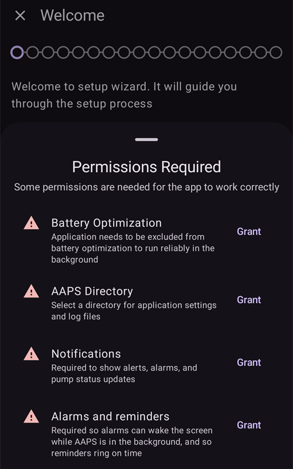
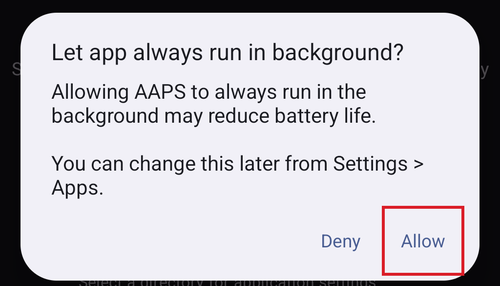
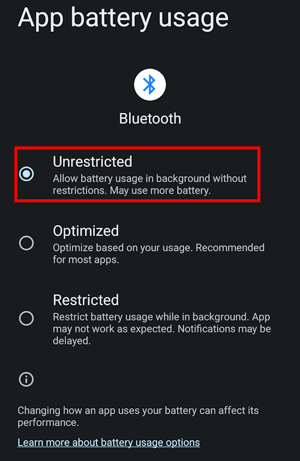
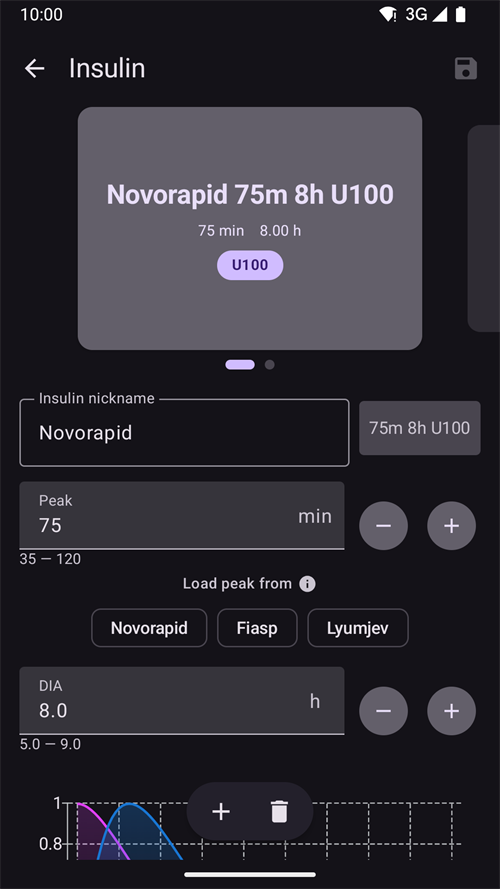
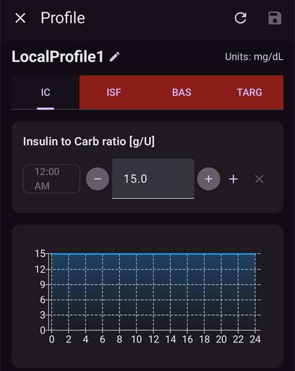
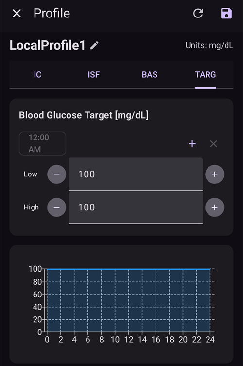
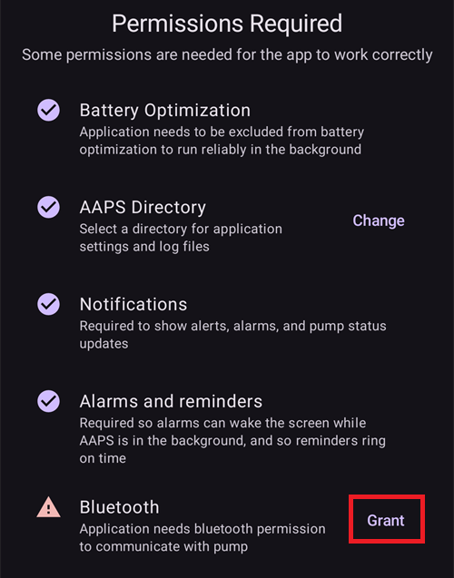

# Майстер налаштування AAPS

```{contents} In this page
:backlinks: entry
:depth: 2
```

Коли ви вперше запускаєте **AAPS**, вас веде «**Майстер налаштування**». Він допомагає швидко налаштувати всі основні параметри застосунку за один раз. **Майстер налаштування** веде вас крок за кроком, щоб ви не забули нічого важливого. Наприклад, **налаштування дозволів** дуже важливі для правильного налаштування **AAPS**.

Але не обовʼязково налаштувати все повністю під час першого запуску **Майстра налаштування**. Ви можете легко вийти з майстра і повернутися до нього пізніше. Після **Майстра налаштування** є три способи далі оптимізувати або змінити конфігурацію. These will be explained in the next section. So, it's okay if you skip some points in the Setup Wizard, you can easily configure them later.

Під час роботи з **Майстром налаштування** і відразу після неї ви, можливо, не помітите в **AAPS** значних змін. Щоб увімкнути петлю **AAPS**, вам потрібно проходити **Завдання** і вмикати функції одну за одною. Ви почнете **Завдання 1** наприкінці роботи Майстра налаштування. Ви керуєте **AAPS**, а не навпаки.

```{admonition} Preview Objectives
:class: note
Якщо ви хочете дізнатися, як побудовані завдання, прочитайте [Виконання завдань](../SettingUpAaps/CompletingTheObjectives.md), але потім поверніться сюди й спочатку пройдіть Майстер налаштування.

```

З досвіду ми знаємо, що новачки часто поспішають налаштувати **AAPS** якомога швидше. Це може призвести до розчарування, бо треба багато чого навчитися.

Тому, будь ласка, не поспішайте з налаштуванням петлі: переваги добре налаштованої петлі **AAPS** величезні.

```{admonition} Ask for Help
:class: note
If there is an error in the documentation or you have a better idea for how something can be explained, you can ask for help from the community as explained at [Connect with other users](../GettingHelp/WhereCanIGetHelp.md).
```
## Welcome message

Коли відкривається Майстер налаштування, він вітає вас коротким повідомленням і відразу показує внизу екрана панель «**Потрібні дозволи**» (див. наступний розділ).

Коли ви надасте дозволи, панель закриється, а на екрані привітання зʼявиться кнопка «**Далі**». Натисніть «**ДАЛІ**», щоб продовжити:


## Required permissions

Для правильної роботи **AAPS** потрібно кілька дозволів. Майстер збирає їх на одній панелі «**Потрібні дозволи**», і кожен має власну кнопку «**Надати**». Надайте їх по одному — коли дозвіл надано, значок поруч із пунктом змінюється на галочку.



### Оптимізація батареї

Споживання заряду батареї смартфона важливе, бо можливості батарей досі досить обмежені. Тому операційна система Android на вашому смартфоні обмежує роботу застосунків і використання ними процесора, а отже і заряду батареї.

Проте **AAPS** має працювати регулярно, _наприклад_, щоб кожні кілька хвилин отримувати значення глюкози, а потім застосовувати алгоритм і вирішувати, що робити з вашим рівнем глюкози відповідно до ваших налаштувань. Тому його потрібно виключити з оптимізації батареї.

Натисніть «**Надати**» поруч із «**Оптимізація батареї**», потім у діалозі «Let app always run in background?» (Дозволити застосунку завжди працювати у фоні?) виберіть «**Allow**» (Дозволити):



(SetupWizard-StoragePermission)=

### Каталог AAPS

**AAPS** має зберігати свої налаштування та журнали в постійній памʼяті вашого смартфона. Permanent storage means that it will be available even after rebooting your smartphone. Other information is just lost, as it is not saved to permanent storage.

Натисніть «**Надати**» поруч із «**Каталог AAPS**». Відкриється файлова система телефону, і ви зможете вибрати, де **AAPS** зберігатиме свою інформацію.

```{tip}
Рекомендуємо вибрати типовий каталог AAPS.</br>
**Не** вибирайте підкаталог AAPS.
```

Типовий каталог — **AAPS**, але ви можете використовувати будь-який окремий каталог на свій вибір. За потреби створіть каталог, відкрийте його й виберіть «**USE THIS FOLDER**» (ВИКОРИСТОВУВАТИ ЦЮ ПАПКУ):


Підтвердіть кнопкою «**ALLOW**» (ДОЗВОЛИТИ), що надаєте **AAPS** доступ до вибраного каталогу:


### Сповіщення

Android requires special permission for apps if they want to send you notifications.

Вимикати сповіщення, _наприклад_, від соцмереж — корисно, але дуже важливо дозволити **AAPS** надсилати вам сповіщення.

Натисніть «**Надати**» поруч із «**Сповіщення**» і в системному запиті виберіть «**Allow**» (Дозволити):


### Будильники й нагадування

На **Android 14 і новіших** **AAPS** потребує дозволу «**Будильники й нагадування**», щоб сигнали могли вмикати екран, коли **AAPS** працює у фоні, і щоб нагадування (наприклад, з **Автоматизації**) спрацьовували вчасно.

Цей пункт показується лише тоді, коли він потрібен. Коли **AAPS** виключено з оптимізації батареї (див. вище), Android автоматично дозволяє точні будильники, і пункт зникає. Якщо він усе ще є в списку, натисніть «**Надати**» поруч із «**Будильники й нагадування**». Відкриється екран системних налаштувань для **AAPS**; увімкніть перемикач і поверніться в **AAPS**. На Android 13 і старіших цього пункту немає, і нічого робити не потрібно.

Коли всі дозволи позначено галочкою (три, або чотири на Android 14 і новіших), панель «**Потрібні дозволи**» закриється сама, і ви зможете натиснути «**ДАЛІ**» на екрані привітання, щоб продовжити.

(setup-wizard-bluetooth-battery-optimisation)=
### Оптимізація батареї для Bluetooth

```{admonition} Extra Android setting, not part of the Wizard
:class: note
Далі описано додаткове налаштування Android, яке виконується поза Майстром налаштування. Це не одна з кнопок «Надати» вище, але це важливо для надійного зʼєднання з помпою.
```

Нові версії Android застосовують оптимізацію батареї і до системного застосунку Bluetooth.

Окрім вимкнення оптимізації батареї для **AAPS**, вам, імовірно, потрібно вимкнути її і для системного застосунку Bluetooth. Якщо цього не зробити, можливі розриви зʼєднання з помпою та інші проблеми.

***ПРИМІТКА: як це зробити, описано в документації xDrip: [документація xDrip](https://navid200.github.io/xDrip/docs/BluetoothBatteryOpt.html)***

Виконайте ці кроки на Android 16; в інших версіях усе трохи відрізняється від наведених знімків екрана:

1. Відкрийте налаштування Android, знайдіть **Apps** (Застосунки) і відкрийте налаштування застосунків.

   

2. Ви побачите налаштування застосунків, але потрібно показати всі застосунки: натисніть **See all apps** (Показати всі застосунки).

   

3. Застосунок Bluetooth є системним, тому типово він прихований, і потрібно показати системні застосунки. Натисніть **три крапки** (⋮) у верхньому правому куті (1). Потім натисніть **Show system** (Показати системні) (2).

   

4. Знайдіть застосунок `Bluetooth` і натисніть `Bluetooth` та/або `Legacy Bluetooth`. Якщо є обидва, виконайте ці кроки для кожного з них.

   ***ПРИМІТКА: `Bluetooth MIDI Service` можна спокійно пропустити, AAPS його не використовує.***

           

   1. On Android 12 click on `Battery`, on Android 13+ click on `App battery usage`.

      

5. На Android 12+ виберіть варіант `Unrestricted` (Без обмежень). На Android 15+ спочатку розгорніть налаштування `Allow background usage` (Дозволити використання у фоні): натисніть розділ, виділений червоним, а потім виконайте крок 6.

       

6. На Android 16 виберіть `Unrestricted` (Без обмежень)

   

## License agreement

Ліцензійна угода кінцевого користувача містить важливу інформацію про юридичні аспекти використання **AAPS**. Please read it carefully.

Якщо ви не розумієте ліцензійної угоди кінцевого користувача або не можете з нею погодитися, не використовуйте **AAPS** взагалі!

Якщо ви розумієте й погоджуєтеся, натисніть кнопку «**Я РОЗУМІЮ ТА ПОГОДЖУЮСЯ**» і виконуйте кроки Майстра налаштування:


Після вашої згоди зʼявиться кнопка «**Далі**». Натисніть «**ДАЛІ**».

Наступний екран, «**Дозволи**», ще раз показує список дозволів. Усі вони мають бути позначені галочкою, бо ви надали їх на початку. Якщо якогось бракує, натисніть «**Надати**» поруч із ним. Натисніть «**ДАЛІ**», щоб продовжити:


## Головний пароль

Конфігурація **AAPS** містить деякі конфіденційні дані (_наприклад_, токен доступу до вашого сервера Nightscout), тому вона шифрується паролем, який ви задаєте тут.

Майстер показує «**Пароль не встановлено**». Натисніть «**Задати**»:


Відкриється екран «**Захист**». Натисніть «**Головний пароль**» (показано як «Пароль не встановлено»):


Введіть той самий пароль в обидва поля й натисніть «**OK**»:


Поверніться назад стрілкою у верхньому лівому куті. Тепер майстер показує «**Пароль встановлено!**»:


```{admonition} Do not lose your Master Password
:class: danger
Будь ласка, **НЕ ВТРАЧАЙТЕ СВІЙ ГОЛОВНИЙ ПАРОЛЬ**. Запишіть його, _наприклад_, на Google Drive — це гарне місце, бо Google робить для вас резервну копію. Your smartphone or PC can crash and you may have no actual copy. If you forget your Master Password, it can be difficult to recover your profile configuration and progress through the **Objectives** at a later date.
```

Коли закінчите, натисніть «**ДАЛІ**», щоб перейти до наступного екрана.

(setup-wizard-import-settings)=
## Імпортуйте налаштування

Цей екран показується лише тоді, коли **AAPS** знаходить у каталозі **AAPS** раніше експортовані налаштування («Знайдено збережені налаштування»), наприклад, коли ви перевстановлюєте застосунок або переходите на новий телефон.

- Щоб відновити попередню конфігурацію, натисніть «**Імпорт налаштувань**» — див. [Створення та відновлення резервних копій](../Maintenance/ExportImportSettings.md).
- Щоб почати з нової конфігурації, натисніть «**ДАЛІ**» і продовжуйте роботу з майстром.


## Одиниці (мг/дл <-> ммоль/л)

Виберіть, у чому ваші значення глюкози: у мг/дл чи ммоль/л, потім натисніть кнопку «**ДАЛІ**»:


## Параметри відображення

Тут ви задаєте «**Нижня межа**» і «**Верхня межа**» для показу глюкози сенсора. Значення глюкози між цими двома межами показуються як «у діапазоні». Поки що можна залишити типові значення (72 і 180 мг/дл) і змінити їх пізніше.

The values you choose only affect the graphical presentation of the diagram, and nothing else.

Ваша цільова глюкоза, _наприклад_, налаштовується окремо у вашому профілі.

Your range to analyze TIR (time in range) is configured separately in your reporting server.

За потреби змініть межі кнопками «−» / «+», потім натисніть кнопку «**ДАЛІ**»:


(SetupWizard-synchronization-with-the-reporting-server-and-more)=
## Звʼязок

Екран «**Звʼязок**» показує плагіни для вивантаження, синхронізації та трансляції ваших даних:

- **SMS Комунікатор** – віддалене керування **AAPS** за допомогою SMS-команд
- **NSClientV3** – синхронізує ваші дані з Nightscout через API v3
- **Tidepool** – вивантажує дані в Tidepool
- **xDrip** – надсилає дані в xDrip
- **Open Humans** – вивантаження ваших даних про діабет і передання їх науковим проєктам
- **Wear** – моніторинг і керування **AAPS** з годинника WearOS
- **Зовнішні супутні застосунки** – трансляція даних у різні зовнішні застосунки
- **Garmin** – зʼєднання з пристроєм Garmin


Прокрутіть вниз, щоб побачити решту списку:


Ви можете зараз налаштувати кілька з них, але під час першого запуску ми зосередимося лише на сервері звітів. Якщо зараз ви не можете його налаштувати, пропустіть цей крок — це можна зробити пізніше.

У цьому прикладі як сервер звітів ми використовуємо Nightscout. Поставте галочку праворуч від «**NSClientV3**», щоб увімкнути його. For Tidepool it is even simpler, as you only need your personal login information.

Після цього натисніть «**Налаштування**» під NSClientV3, щоб налаштувати його:


Тут ви налаштовуєте сервер звітів Nightscout. Налаштування NSClientV3 показано на одній сторінці, яку можна прокручувати:


Натисніть «**URL Nightscout**» і введіть адресу вашого особистого сервера Nightscout (URL, який ви налаштували самі або отримали від вашого постачальника послуг). Підтвердіть кнопкою «**OK**».

Натисніть «**Токен доступу Nightscout**» і введіть токен доступу для вашого сервера Nightscout. Without this token, access will not work. Якщо у вас його ще немає, перегляньте документацію про налаштування сервера звітів.

Залиште ввімкненим «**Використовувати websockets**» для звʼязку з Nightscout у реальному часі.

Інші розділи поки що можна залишити з типовими значеннями. Їх описано тут, щоб ви знали, де знайти їх пізніше:

**Параметри сповіщень** — сигнали Nightscout, оголошення та пороги застарілих даних. Поки що залиште перемикачі вимкненими; ми відкриваємо їх лише для того, щоб ви знали про ці можливості.

**Налаштування підключення** — виберіть, як передаються дані. Доглядачі мають увімкнути «**Використовувати мобільні дані**», інакше телефон людини, про яку вони піклуються (_наприклад_, дитини), не зможе вивантажувати дані поза зоною Wi-Fi, _наприклад_, дорогою до школи. Інші користувачі можуть вимкнути передачу через мобільну мережу, щоб заощадити трафік або батарею. Якщо сумніваєтеся, залиште все ввімкненим.


**Додаткові налаштування** — увімкніть «**Записувати подію запуску застосунку**», якщо хочете бачити в Nightscout, коли застосунок перезапускається (корисно для доглядачів). Залиште ввімкненими «**Створювати оголошення з помилок**» і «**Створювати оголошення з потреби у вуглеводах**». Залиште «**Повільна синхронізація**» вимкненою; вона потрібна лише тоді, коли сервер Nightscout повільно обробляє великий обсяг даних.


Поверніться до списку плагінів і натисніть «**ДАЛІ**», щоб перейти до наступного екрана.

## Керування з клієнта

Починаючи з версії **AAPS** 4, клієнтські пристрої з **AAPSClient** можна **спарувати** з цим телефоном (**основний телефон**) і керувати ним підписаними командами, які надсилаються через Nightscout. Це новий рекомендований спосіб віддаленого керування **AAPS** — повний опис і налаштування див. у розділі [Керування «основний телефон ↔ клієнт»](../RemoteFeatures/ClientMasterControl.md).

На цьому екрані зараз нічого налаштовувати не потрібно; спарувати клієнтів можна будь-коли пізніше в **Керувати → Авторизовані клієнти**. Там ви додаєте клієнта за **QR-кодом** (він також налаштовує Nightscout на клієнті) або за **PIN-кодом** і призначаєте йому **роль**.

- «**Авторизовані клієнти**» — керування спареними клієнтськими пристроями, яким дозволено керувати цим основним телефоном.
- «**Приймання даних з Nightscout**» — приймання записів терапії та даних, введених безпосередньо в Nightscout (старий, менш безпечний спосіб), тепер типово вимкнено. Відкривайте ці налаштування, лише якщо вам це ще потрібно, _наприклад_, щоб вводити дані через Nightscout або сторонні застосунки.

Коли керування з клієнта вже ввімкнено (у [Простому режимі](#preferences-simple-mode) воно ввімкнене завжди), цей телефон працює в [захищеному режимі](#client-master-control-hardened-mode): він приймає зміни лише від спарених клієнтів, тому екран пояснює захищений режим замість налаштувань «**Приймання даних з Nightscout**».


«**Приймання даних з Nightscout**» відкриває налаштування «**Синхронізація**», де для кожного типу даних, отриманих з Nightscout, є окремий перемикач:


Натисніть «**ДАЛІ**», щоб перейти до наступного екрана.

(setup-wizard-instance-name)=
## Хто користується цим телефоном?

Тут ви вводите імʼя людини, яка користується цим телефоном. Так цей екземпляр **AAPS** можна відрізнити від інших у звітах і під час синхронізації, наприклад, якщо у вашій родині **AAPS** користуються двоє дітей. Імʼя також використовується в назвах файлів експортованих налаштувань і показується на годиннику.

It can be anything. Пізніше його можна змінити в **Налаштування → Загальне → Назва екземпляра**.

Натисніть «**ДАЛІ**», щоб перейти до наступного екрана.


## Patient type

Тут ви вибираєте «Тип пацієнта». Це важливо, бо програма **AAPS** має різні обмеження залежно від віку пацієнта. This is important for security and safety reasons.

Тут ви також налаштовуєте **максимальний дозволений болюс** на їжу. That is, the largest bolus you need to give to cover your typical meals. Це функція безпеки, яка допомагає уникнути випадкового передозування, коли ви вводите болюс на їжу.

The second limit is similar in concept, but relates to the max carbohydrate intake you expect.

Після встановлення цих значень натисніть «**ДАЛІ**», щоб перейти до наступного екрана:


## Інсулін

Тут ви налаштовуєте інсулін, який використовується у вашій помпі. Нові профілі інсуліну потребують **DIA щонайменше 5 год**.

Натисніть кнопку «**Інсулін**», щоб відкрити редактор інсуліну:


У редакторі можна дати інсуліну **псевдонім** і задати його **Пік** (у хвилинах) і **DIA** (у годинах). Найшвидше — завантажити шаблон через «**Завантажити пік з**»: виберіть **Novorapid**, **Fiasp** або **Lyumjev**, і пік буде заповнено автоматично. Графік унизу показує, якою буде крива активності інсуліну.



Виберіть шаблон, що відповідає вашому інсуліну, наприклад **Fiasp**:


```{admonition} Use your insulin brand's preset peak
:class: danger
Не змінюйте пік, якщо ви не експерт — зазвичай значення шаблону добре підходять для кожного фірмового інсуліну.
```

Якщо ви новий користувач **AAPS**, встановіть **DIA** 9 годин — чому, пояснено в розділі [Тривалість дії інсуліну (DIA) і пік](#Config-Builder-insulin-dia).

```{admonition} "Insulin configuration changed" dialog
:class: note
Якщо спарений клієнт (_наприклад_, інший телефон) змінив конфігурацію інсуліну, зʼявиться діалог. Натисніть **OK**, щоб завантажити його зміни, або **Скасувати**, щоб продовжити редагування (ваше наступне збереження перезапише його зміни).
```


Натисніть значок збереження (вгорі праворуч), потім натисніть «**ДАЛІ**», щоб перейти до наступного екрана.

## Blood sugar source

Тут ви вибираєте, звідки **AAPS** отримує дані глюкози. Прочитайте документацію для вашого [джерела ГК](../Getting-Started/CompatiblesCgms.md).

Доступно багато джерел — прокрутіть список і виберіть те, яким користуєтеся:


Коли ви вибираєте джерело, його картка розгортається й показує дві кнопки: «**Налаштування**» — щоб налаштувати, як отримуються дані, і «**Відкрити плагін**» — щоб відкрити власний екран джерела. У прикладі нижче вибрано **BYODA**. Деякі джерела на цьому етапі не потребують налаштування, тож зазвичай можна відразу перейти до наступного екрана:


Зробивши вибір, натисніть «**ДАЛІ**», щоб перейти до наступного екрана.

(setup-wizard-profile)=
## Профіль

Now we are entering a very important part of the Setup Wizard.

Перш ніж вводити дані профілю на наступному екрані, прочитайте документацію про [профілі](../SettingUpAaps/YourAapsProfile.md).

```{admonition} Working profile required - no exceptions here !
:class: danger
Точний профіль потрібен, щоб **AAPS** діяв безпечно.

Обовʼязково визначте й обговоріть свій профіль з лікарем. Профіль має бути перевірений успішними тестами базалу, ISF та IC!

Якщо робот отримує неправильні вхідні дані, він помилятиметься — постійно. **AAPS** може працювати лише з тією інформацією, яку отримує. Якщо ваш профіль занадто сильний, є ризик гіпоглікемії, а якщо занадто слабкий — ризик гіперглікемії. 
```

Натисніть кнопку «**Профіль**», щоб відкрити редактор профілю:


Редактор відкривається порожнім («Записи відсутні»). Натисніть кнопку «**+**» унизу, щоб створити новий профіль:


You can have several profiles in the long-term if needed. We only create one here.

```{admonition} Profile only for tutorial - not for your usage
:class: note
Приклад профілю тут лише показує, як вводити дані.

Це не точний і не добре оптимізований профіль, бо потреби кожної людини дуже різні.

Не використовуйте його для справжньої роботи петлі!
```

Новий профіль (наприклад, «**LocalProfile1**») має чотири вкладки: **IC**, **ISF**, **BAS** і **TARG**. Натисніть олівець поруч із назвою профілю, щоб перейменувати його. Заповніть кожну вкладку — вкладка залишається червоною й показує повідомлення про помилку, доки не містить правильних значень:


Натисніть «**IC**» і введіть свої значення [IC](#your-aaps-profile-insulin-to-carbs-ratio). Кнопкою «**+**» додайте інші часові блоки:



Натисніть «**ISF**» і введіть свої [значення ISF](#your-aaps-profile-insulin-sensitivity-factor):


Натисніть «**BAS**» і введіть свої [значення базалу](#your-aaps-profile-basal-rates):


Натисніть «**TARG**» і введіть свої цільові значення глюкози крові.

Для відкритої петлі ця ціль може бути ширшим діапазоном, бо інакше **AAPS** постійно просить вас змінити тимчасовий базал або інше налаштування, а це може дуже втомлювати.

Later, for closed looping, you will generally have only one value for top and bottom. Так **AAPS** легше досягати цілі, і ви отримаєте кращий загальний контроль діабету.



Коли всі чотири вкладки правильні, **значок збереження** (вгорі праворуч) стає активним. Натисніть його, щоб зберегти профіль:


Закрийте редактор кнопкою «**X**» у верхньому лівому куті. Після цього підсумок профілю показує його назву, загальний добовий базал (∑), одиниці, а також значення IC та ISF з їхніми графіками:


```{admonition} Several defined but only one active profile
:class: note
Ви можете мати кілька профілів, але в будь-який момент активним може бути лише один.
```

Натисніть кнопку «**▶**» (активувати) унизу праворуч. Відкриється екран «**Активувати**». Оскільки інсулін ще не використовується, спочатку потрібно вибрати інсулін, яким ви користуєтеся, щоб перемикання профілю могло його записати. Доки ви цього не зробите, кнопка «**Активувати**» залишається сірою:


Натисніть «**Вибрати інсулін**» і виберіть інсулін, який ви налаштували раніше. Залиште відсоток 100 % і натисніть «**Активувати**»:


Зʼявиться діалог перемикання профілю. У цьому випадку залиште все як є і підтвердіть кнопкою «**OK**»:

```{admonition} Profile switch dialog
:class: note
Пізніше ви дізнаєтеся, як використовувати цей загальний діалог у ситуаціях, як-от хвороба чи спорт, коли потрібно змінити профіль відповідно до обставин.
```


Ваш профіль тепер активний. Натисніть «**ДАЛІ**», щоб перейти до наступного екрана.

## Інсулінова помпа

Тепер виберіть свою інсулінову помпу. Прочитайте документацію для вашої [інсулінової помпи](../Getting-Started/CompatiblePumps.md).

Прокрутіть список і виберіть свою помпу. У цьому прикладі ми використовуємо «**Віртуальна помпа**». Це корисно, поки ви ще навчаєтеся і не підключили справжню помпу:


Підтримується багато помп — прокрутіть униз, щоб знайти свою:


Коли ви вибираєте справжню помпу, **AAPS** просить підтвердження, бо скопіює базали вашого профілю в помпу й перезапише базали, збережені в ній. Натискайте «**OK**», лише якщо базали у вашому профілі **AAPS** правильні; інакше натисніть «**Скасувати**» і перейдіть на помпу пізніше:


If the pump you select communicates over Bluetooth, **AAPS** asks for permission to connect to nearby devices once you finish the Wizard (see [Bluetooth permission](#setup-wizard-bluetooth-permission)).

Якщо ви вже налаштували профіль і знаєте, як підключити помпу, можете підключити її зараз. Інакше поки що залиште **Віртуальна помпа** — ви можете змінити її будь-коли або вийти з Майстра налаштування стрілкою у верхньому лівому куті, щоб **AAPS** спочатку показав вам кілька значень глюкози крові.

Натисніть «**ДАЛІ**», щоб перейти до наступного екрана.

## Алгоритм APS

Use the OpenAPS SMB algorithm as your APS algorithm. Попри назву, функція SMB в алгоритмі вимкнена, доки ви не освоїте AAPS і не пройдете перші завдання. Утім, OpenAPS SMB новіший і загалом кращий за OpenAPS AMA.

SMB спочатку вимкнено, бо функція SMB швидше реагує на зростання глюкози крові: вона вводить супермікроболюс (Super Micro Bolus) замість збільшення відсотка базалу. Оскільки на початку ваш профіль зазвичай не такий добрий, як після певного досвіду, цю функцію спочатку вимкнено.

```{admonition} Only use the older algorithm **OpenAPS AMA** if you know what you are doing
:class: note
OpenAPS AMA — найпростіший алгоритм, який не підтримує мікроболюси для корекції високих значень. Можуть бути обставини, коли краще використовувати цей алгоритм, але ми його не рекомендуємо.
```

Виберіть «**OpenAPS SMB**», потім натисніть «**Налаштування**», щоб переглянути подробиці:


Єдиний параметр тут — «**Використовувати динамічну чутливість**». Залиште його вимкненим і поки нічого не змінюйте — просто прочитайте текст.

Через обмеження, які накладають **Завдання**, ви зараз однаково не можете використовувати ні «закриту петлю», ні «функції SMB».

Поверніться назад і натисніть «**ДАЛІ**», щоб перейти до наступного екрана:


## Визначення чутливості

Залиште вибраним «**Sensitivity Oref1**» як стандартний плагін чутливості:


Якщо натиснути «**Налаштування**», можна переглянути налаштування засвоєння; типові значення (_наприклад_, межа засвоєння 6 год) поки що підходять.


Натисніть «**ДАЛІ**», щоб перейти до наступного екрана.

## Start Objective 1

Тепер ви переходите до Завдань — кваліфікації для доступу до інших функцій **AAPS**.

Натисніть «**Відкрити Завдання**»:


Here we start Objective 1, even if at the moment our setup is not completely ready to successfully complete this Objective. But this is the start.

Press the "**Start**" button of **Objective 1**:


Завдання розгортається й показує окремі перевірки. Ви бачите, що вже маєте певний прогрес, а інші пункти ще треба виконати:


Поверніться назад, потім натисніть «**ЗАВЕРШИТИ**», щоб завершити роботу Майстра налаштування:


Після натискання «**ЗАВЕРШИТИ**» ви потрапите на головний екран **AAPS**. Може відкритися панель «**Сповіщення**» з інформаційними повідомленнями, наприклад, про щойно виконане перемикання профілю — натисніть «**Закрити**» під кожним повідомленням, щоб прибрати його.

Якщо ви випадково вийдете з Майстра налаштування, ви можете просто знову запустити майстер або змінити [конфігурацію петлі AAPS](../SettingUpAaps/ChangeAapsConfiguration.md) вручну.

(setup-wizard-bluetooth-permission)=
## Дозвіл Bluetooth

Якщо ви вибираєте помпу, яка підключається через Bluetooth (наприклад, **Omnipod Dash**), банер нагадує, що **AAPS** потрібен дозвіл Bluetooth. Поки що можна натиснути «**Закрити**» — дозвіл надається після завершення майстра:


Після завершення Майстра налаштування на головному екрані **AAPS** зʼявиться панель «**Потрібні дозволи**». Інші дозволи вже надано; натисніть «**Надати**» поруч із «**Bluetooth**»:



Виберіть «**Allow**» (Дозволити), щоб **AAPS** міг знаходити вашу помпу й підключатися до неї:


Якщо ваша петля **AAPS** тепер повністю налаштована, перейдіть до наступного розділу [«Виконання завдань»](../SettingUpAaps/CompletingTheObjectives.md).
