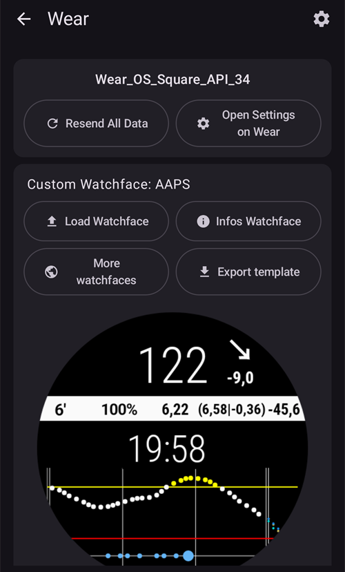

# Налаштування AAPS на годиннику з Wear OS

Інструкції нижче стосуються apk **AAPS Wear**, який вам потрібно зібрати. Якщо ви його ще не зібрали, дивіться посібник [тут](../WearOS/BuildingAapsWearOS.md). Під час збірки обов'язково використовуйте той самий файл keystore, що і для apk **AAPS** на телефоні.

Частину цієї інформації можна використати і для apk **AAPSClient** і **PumpControl** **Wear**. Кожен застосунок **Wear** обмінюється даними з відповідним застосунком на телефоні. Наприклад, застосунок **AAPSClient Wear** можна використовувати, щоб показувати дані **AAPSClient**, а не дані **AAPS**. Якщо поруч встановлено кілька варіантів клієнта (**AAPSClient**, **AAPSClient2**, **AAPSClient3**), плитки кожного з них мають невеликий заголовок у кольорі цього варіанта, щоб їх можна було розрізнити під час гортання.

## Версії Wear OS і сумісність

(wearos-watchface-changes)=

### Зміни циферблатів у Wear OS (вплив на циферблати AAPS)

```{admonition} Why newer Wear OS watches break AAPS watchfaces
:class: warning

У червні 2025 року Google [оголосила про зміни](https://android-developers.googleblog.com/2025/06/upcoming-changes-to-wear-os-watch-faces.html), які поступово прибирають старий рушій циферблатів (рушій AndroidX / Wearable Support Library, або "WSL") на користь нового декларативного **Watch Face Format**. Власні циферблати **AAPS** створені на старому рушії, тому чим новіша версія Wear OS, тим імовірніше, що циферблат AAPS працюватиме неправильно або перестане працювати.

Це стосується саме **циферблатів** — **віджетів** AAPS, плиток і функцій віддаленого керування це не стосується. Тому ж **оновлення прошивки/системи на годиннику з Wear OS може зламати циферблати AAPS**, а повернути годинник до старішої версії Wear OS потім не можна. Якщо ваш циферблат AAPS зараз працює, **вимкніть автоматичні оновлення годинника**.
```

У таблиці нижче показано, як зміни Google впливають на циферблати AAPS (на старому рушії) залежно від версії Wear OS:

| Версія Wear OS          | Базова версія Android | Рівень API | Вплив на циферблати AAPS (старі)                                                                                                                                                                |
| ----------------------- | --------------------- | ---------- | ----------------------------------------------------------------------------------------------------------------------------------------------------------------------------------------------- |
| Wear OS 6               | Android 16            | 36         | **Старі циферблати більше не доступні** — AAPS натомість встановлює [циферблат у форматі Watch Face Format](#wearos-aaps-v4-watchface): ваш власний циферблат або циферблат з віджетами AAPS V4 |
| Wear OS 5               | Android 14            | 34         | **Сильний** — активний (інтерактивний) режим часто не працює, віджети зависають, анімації зупиняються                                                                                           |
| Wear OS 4               | Android 13            | 33         | **Помірний** — обмеження частоти оновлень, пропущені оновлення, часткові збої                                                                                                                   |
| Wear OS 3.0 / 3.2 / 3.5 | Android 11            | 30         | **Низький** — старий рушій ще підтримується                                                                                                                                                     |

Якщо на вашому годиннику версія, де циферблати AAPS працюють ненадійно, ви можете натомість показувати дані AAPS через **віджети** на сумісному циферблаті або використати [GlucoDataHandler](https://play.google.com/store/apps/details?id=de.michelinside.glucodatahandler) з віджетом, який отримує дані від плагіна [Зовнішні супутні застосунки](#external-companion-apps) в **AAPS**. На **Wear OS 6 і новіших** AAPS встановлює циферблат на заміну, створений у новому форматі — див. нижче.

(wearos-aaps-v4-watchface)=

### Wear OS 6 і новіші — циферблат, який встановлює AAPS

Годинники з **Wear OS 6 або новішою** не можуть використовувати класичні циферблати AAPS як циферблати. Для цих годинників застосунок AAPS для годинника містить два циферблати в новому форматі Google **Watch Face Format**. Wear OS дозволяє застосунку встановити лише **один** циферблат, тому ви вибираєте, який з двох буде на годиннику:

- **Власний циферблат** (за замовчуванням): показує власний циферблат, який ви завантажили з телефона кнопкою **Завантажити циферблат** (див. [Перехід на циферблат AAPS](#WearOS_changing-to-AAPS-watchface)). Годинник малює ваш дизайн як зображення, тому працює кожен наявний власний циферблат. Місця для віджетів, які може мати власний циферблат, на цьому зображенні **недоступні**, бо Wear OS передає дані віджетів лише справжньому циферблату. Натисніть і утримуйте циферблат, щоб відкрити його єдине налаштування: що показує режим «завжди на екрані» — простий годинник чи ваш власний дизайн, затемнений.
- **Циферблат з віджетами** (циферблат **AAPS V4**): його **сім місць для віджетів** вже **налаштовані з даними AAPS**: BG значення, IOB, COB, [віджет «Графік ГК»](#Watchfaces-complications), базальна швидкість / тимчасова ціль і значок **Робочий режим** у верхньому лівому місці (торкніться його, щоб змінити режим петлі з годинника). Торкніться часу вгорі, щоб відкрити застосунок будильника на годиннику. Що показує кожне місце, можна змінити в редакторі циферблата.

Вибір робиться на телефоні: відкрийте плагін **Wear** і в розділі **Циферблат, встановлений на годиннику** виберіть один з двох. Ця картка показується лише тоді, коли підключено годинник з Wear OS 6 або новішою. **AAPS** просить підтвердити вибір, бо годинник одразу замінює циферблат. Якщо ви переходите з **Циферблата з віджетами** на інший, віджети, які ви змінили в редакторі циферблата, також повертаються до стандартних, і підтвердження про це попереджає. Поки вибрано **Циферблат з віджетами**, кнопки власного циферблата приховані, а замість них показано попередній перегляд циферблата. Якщо ви завантажуєте власний циферблат, коли вибрано **Циферблат з віджетами**, **AAPS** нагадує перемкнутися на **Власний циферблат**, щоб побачити його на годиннику.

- Вибраний циферблат **встановлюється і активується автоматично**, коли застосунок AAPS для годинника вперше запускається на такому годиннику, і **оновлюється автоматично** разом із застосунком для годинника.
- Якщо ви видалили циферблат, внизу **головного меню** AAPS на годиннику з'явиться пункт **Встановити циферблат** — торкніться його, щоб встановити циферблат знову.

Поки підключено годинник з Wear OS 5 або старішою, картка **Циферблат, встановлений на годиннику** взагалі не показується (механізм, на якому вона працює, потребує Wear OS 6); класичні циферблати там працюють, як і раніше.

(wearos-complications-watchface-setup)=

### Циферблат з віджетами — рекомендоване налаштування

**Циферблат з віджетами** має сім місць для віджетів. Натисніть і утримуйте циферблат, торкніться **Customize** (Налаштувати) і виберіть джерело даних для кожного місця. Місця пронумеровані як у редакторі циферблата: **1** ліворуч, **2** по центру, **3** праворуч, **4** графік, **5** внизу, **6** вгорі ліворуч і **7** вгорі праворуч.

| Стандартне налаштування                                                                                 | Альтернативне налаштування                                                                                     |
| ------------------------------------------------------------------------------------------------------- | -------------------------------------------------------------------------------------------------------------- |
|  |  |

| Місце | Положення      | Стандартно                                                                   | Альтернативно                                  |
| ----- | -------------- | ---------------------------------------------------------------------------- | ---------------------------------------------- |
| 1     | Ліворуч        | Іконка IoB                                                                   | CoB & IoB                                      |
| 2     | По центру      | Глюкоза крові                                                                | Глюкоза крові                                  |
| 3     | Праворуч       | Іконка CoB                                                                   | BR & ціль                                      |
| 4     | Графік         | Графік ГК                                                                    | Графік ГК                                      |
| 5     | Внизу          | BR & ціль                                                                    | Батарея Uploader/телефона                      |
| 6     | Вгорі ліворуч  | Робочий режим                                                                | Робочий режим                                  |
| 7     | Вгорі праворуч | Батарея Uploader/телефона або ярлик застосунку **AAPS Відкласти сповіщення** | Ярлик застосунку **AAPS Відкласти сповіщення** |

Ярлик **AAPS Відкласти сповіщення** вибирають серед власних віджетів годинника **App shortcut** (Ярлик застосунку). Якщо торкнутися його, сигнал, який звучить на телефоні, буде відкладено.

```{tip}
Увімкніть на годиннику **Always-on display** (Завжди на екрані) (**Settings** (Налаштування) > **Display** (Екран)). Тоді циферблат і далі показує вашу глюкозу, коли рука опущена, а не порожній екран чи простий годинник.
```

```{admonition} No complication data while the watch is locked
:class: note
Якщо в **Settings** (Налаштування) > **Security and privacy** (Безпека і конфіденційність) задано **Lock type** (Тип блокування), годинник приховує дані віджетів, поки він заблокований, і циферблат показує порожні місця, доки ви його не розблокуєте. Щоб дані залишалися видимими, вимкніть **Hide information** (Приховувати інформацію) у тому самому меню.
```

### Wear OS 3

Встановіть apk **AAPS Wear** за допомогою [Wear Installer 2](https://youtu.be/abgN4jQqHb0?si=5L7WUeYMSd_8IdPV), Easy Fire Tools (описано нижче) або ADB.  
Робота **AAPS Wear** без обмежень.

(BuildingAapsWearOs-WearOS5)=

### Wear OS 4 і Wear OS 5

Наприклад: Galaxy Watch 4, 5, 6, 7 і Ultra або Pixel Watch, які **ще не** оновлено до Wear OS 6. Перевірте версію в **Settings** (Налаштування) > **About watch** (Про годинник) > **Software** (Програмне забезпечення).

Встановіть apk **AAPS Wear** за допомогою [Wear Installer 2](https://youtu.be/abgN4jQqHb0?si=5L7WUeYMSd_8IdPV) (для Wear OS 5 дивіться [це відео](https://www.youtube.com/watch?v=yef_qGvcCnk)). Усі функції **AAPS Wear** працюють, але класичні циферблати **AAPS** мають обмеження, описані в таблиці вище: на Wear OS 4 оновлення обмежені, на Wear OS 5 вони часто не працюють.

```{admonition} Wear OS 5
:class: warning
На Wear OS 5 циферблат AAPS треба вибрати у Wear Installer 2 одразу після встановлення застосунку Wear: наприкінці встановлення програма пропонує циферблат **AAPS (Персональний)**. Якщо ви випадково перемкнулися на інший циферблат, повторіть встановлення. Змінити налаштування циферблата («Темна», Watchdivider тощо) може бути неможливо.

Якщо класичний циферблат зараз у вас працює, **вимкніть автоматичні оновлення годинника**: наступне оновлення прошивки, найімовірніше, його зламає. Якщо ви все ж оновитеся до Wear OS 6, прочитайте розділ вище: тоді **AAPS** встановлює власний циферблат у новому форматі.
```

Якщо циферблат працює надто ненадійно, розгляньте натомість [GlucoDataHandler](https://play.google.com/store/apps/details?id=de.michelinside.glucodatahandler) з віджетом. Для цього в **AAPS** має бути ввімкнено плагін [Зовнішні супутні застосунки](#external-companion-apps).

### Wear OS 6 і новіші

Наприклад: Galaxy Watch 4 і новіші з One UI 8 Watch, Pixel Watch після оновлення 2025 року. Більшість годинників Galaxy і Pixel вже отримали це оновлення.

Встановіть apk **AAPS Wear** за допомогою [Wear Installer 2](https://youtu.be/abgN4jQqHb0?si=5L7WUeYMSd_8IdPV). Класичні циферблати недоступні; **AAPS** автоматично встановлює циферблат, вибраний на телефоні, див. [циферблат, який встановлює AAPS](#wearos-aaps-v4-watchface). Робота **AAPS Wear** без обмежень.

## Як налаштувати розумний годинник Samsung Galaxy Watch 4 з **AAPS**

Цей розділ для тих, хто ще зовсім не знайомий з розумними годинниками. Він коротко знайомить з популярним годинником **Galaxy Watch 4**, а потім крок за кроком пояснює, як налаштувати **AAPS** на годиннику.

_Цей посібник написано для Galaxy Watch з Wear OS 3._ На Wear OS 4 і новіших годинник просить **код спарювання**, коли телефон або комп'ютер підключається через ADB. Wear Installer 2 і процедура з терміналом [нижче](#BuildingAapsWearOs-WearOS5-TShoot) це підтримують.

Ось основні посібники з налаштування для [Galaxy Watch 5](https://www.youtube.com/watch?v=Y5upzOIxwTU) і [Galaxy Watch 6](https://www.youtube.com/watch?v=D6bq20KzPW0)

## Знайомство з розумним годинником

Після основного налаштування годинника за відео вище відкрийте на телефоні Play Маркет і завантажте такі застосунки: "Galaxy Wearable", “Samsung” і “Easy Fire tools” або "Wear Installer 2".

Є багато відео на YouTube від інших авторів, які допоможуть вам познайомитися з новим розумним годинником, наприклад:

[https://www.youtube.com/watch?v=tSVkqWNmO2c](https://www.youtube.com/watch?v=tSVkqWNmO2c)

У застосунку “Galaxy Wearable” також є розділ з інструкцією. Відкрийте Galaxy Wearable на телефоні, знайдіть годинник і спробуйте спарувати годинник з телефоном. Залежно від версії, вас можуть попросити встановити з Play Маркету ще один застосунок “galaxy watch 4 plugin” (завантаження триває деякий час). Встановіть його на телефон, а потім знову спробуйте спарувати годинник і телефон у застосунку Wearable. Пройдіть кілька меню і позначте потрібні налаштування.

## Налаштування облікового запису Samsung

Переконайтеся, що в обліковому записі електронної пошти, який ви використовуєте для облікового запису Samsung, вказана така дата народження, що користувачеві 13 років або більше. Інакше дозволи Samsung дуже важко підтвердити. Якщо ви створили для дитини до 13 років обліковий запис Gmail і використовуєте цю адресу, ви не можете просто змінити його на обліковий запис дорослого. Це можна обійти, якщо змінити поточну дату народження так, щоб вік був 12 років і 364 дні. Наступного дня обліковий запис стане обліковим записом дорослого, і ви зможете продовжити налаштування облікового запису Samsung.

(remote-control-transferring-the-aaps-wear-app-onto-your-aaps-phone)=

## Перенесення застосунку **AAPS** Wear на телефон з **AAPS**

Перенести Wear.apk з Android Studio на телефон можна так:

а) за допомогою USB-кабелю скопіюйте apk-файл **AAPS** wear на телефон, а потім встановіть його на годинник вручну («side-load»). Перенесіть Wear.apk на телефон через USB у папку завантажень; або

б) скопіюйте Wear.apk з Android Studio на ваш Google Drive.


Щоб встановити AAPS на годинник вручну (side-load), можна використати: 1) Wear Installer 2 2) Easy Fire tools 3) Android Debug Bridge (ADB) Ми рекомендуємо Wear Installer 2, бо інструкції і процес у відео дуже зрозумілі і добре пояснені. Якщо Wear Installer 2 у вас не працює, спробуйте Easy Fire Tools або ADB, обидва способи описано нижче.

### Встановлення **AAPS** Wear з телефона на годинник за допомогою Wear Installer 2

 

Wear Installer 2, розроблений [Malcolm Bryant](https://www.youtube.com/@Freepoc), можна завантажити з Google Play на телефон і використати, щоб встановити застосунок AAPS wear на годинник вручну (side-load). У застосунку є зручне [відео](https://youtu.be/abgN4jQqHb0?si=5L7WUeYMSd_8IdPV) «як встановити вручну».

```{tip}
Для годинників з Wear OS 5 дивіться [це відео](https://www.youtube.com/watch?v=yef_qGvcCnk).
Поради з усунення проблем дивіться [нижче](#BuildingAapsWearOs-WearOS5-TShoot).
```

Тут є всі потрібні подробиці (краще відкрити відео на іншому пристрої, щоб дивитися його під час налаштування телефона).

Як сказано у відео, після завершення вимкніть налагодження ADB на годиннику, щоб не розряджати батарею годинника.

Інакше (але не для Wear OS 5) ви можете:

### Встановлення **AAPS** wear на годинник за допомогою Easy Fire tools

1)   Завантажте _[Easy Fire Tools](https://play.google.com/store/apps/details?id=de.agondev.easyfiretools&hl=en)_ з Play Маркету на телефон


2)  Увімкніть на годиннику режим розробника (після налаштування і підключення до телефона):

Перейдіть у **Settings** (Налаштування) > **System** (Система) > **About** (Про пристрій) > **Versions** (Версії) (назви меню відрізняються на годинниках різних виробників — на деяких це **About watch** (Про годинник) > **Software info** (Інформація про ПЗ) > **Software version** (Версія ПЗ)).


Швидко торкніться кілька разів **Build number** (Номер збірки) (або **Software version**), поки не з'явиться повідомлення, що ви тепер розробник.


Поверніться в **Settings** > **System**: тепер там є нове меню **Developer options** (Параметри розробника).

У **Developer options** увімкніть **ADB debugging** (налагодження ADB) і **Wireless debugging** (бездротове налагодження) і підтвердіть запити. Тоді в бездротовому налагодженні буде показано **IP address & Port** (IP-адреса і порт) годинника, приблизно так: **192.168.1.214** : 5555. Вам потрібна лише IP-адреса (тут **192.168.1.214**), а не номер порту після двокрапки. Зверніть увагу: IP-адреса може змінюватися, наприклад щоразу, коли ви переходите на новий телефон для AAPS.


КРОК 3)     Введіть IP-адресу, _наприклад_ **192.168.1.214**, в Easy Fire tools на телефоні (відкрийте меню ліворуч, налаштування і введіть IP-адресу).


Потім натисніть значок розетки вгорі праворуч. Після підключення він стане зеленим.


КРОК 4) Виконайте інструкції [тут](https://wearablestouse.com/blog/2022/01/04/install-apps-apk-samsung-galaxy-watch-4/?utm_content=cmp-true), щоб встановити вручну (тобто перенести) aaps-wear.apk на розумний годинник за допомогою Easy Fire tools


(BuildingAapsWearOs-WearOS5-TShoot)=

### Через термінал
Підключіть розумний годинник і комп'ютер до однієї мережі Wi-Fi.

- Щоб встановити ADB, завантажте його звідси: https://developer.android.com/tools/releases/platform-tools
- Відкрийте термінал.
- У Windows створіть нову папку з назвою `adb` на диску `C:`. Відкрийте файл `platform-tools-latest-windows.zip`, який ви завантажили вище. Скопіюйте всі файли з `platform-tools` у `C:\adb` і відкрийте цю папку в командному рядку (клацніть правою кнопкою миші і виберіть Open in Terminal (Відкрити в терміналі)). Введіть команду нижче, щоб додати до шляху папку, де лежить ADB: `setx PATH "%PATH%;C:\adb"`
- На Mac замість ручного встановлення можна використати homebrew: `brew install android-platform-tools`

На годиннику:
- Перейдіть у Settings (Налаштування) → About watch (Про годинник) → **Software Information** (Інформація про ПЗ)
- Торкніться Software version (Версія ПЗ) 7 разів, поки не побачите, що режим розробника ввімкнено.
- Перейдіть у Settings (Налаштування) → Developer options (Параметри розробника). Увімкніть **ADB debugging** (налагодження ADB)
- Перейдіть у Settings (Налаштування) → Developer options (Параметри розробника) → Wireless debugging (Бездротове налагодження) → **Pair new device** (Спарувати новий пристрій)

З'являться код спарювання Wi-Fi, IP-адреса і порт:


- У терміналі: `adb pair ipaddress:port` Наприклад: `adb pair 10.10.1.125:36299`
- Вас попросять ввести код спарювання. Введіть його.
- Ви побачите відповідь:<br> `Successfully paired to 10.10.1.125:36299 [guid=adb-RXXXW20LMKJY-eh5zBj]`<br>
- У терміналі введіть: <br>`adb devices`.<br> Ви маєте побачити приблизно таке:<br> `List of devices attached`<br> `10.10.1.125:36299  offline`<br> `adb-RFAW20LMKJY-eh5zBj._adb-tls-connect._tcp   device`<br>

- Тепер перейдіть у папку на комп'ютері, де лежить Wear apk, і введіть<br> `adb install wear-full.apk` <br>замінивши wear-full.apk на назву вашого apk-файлу.
- Ви побачите:<br> `Performing Streamed Install`<br> `Success`


(wear-os-5-troubleshooting)=

### Загальні рекомендації з усунення проблем для Wear OS 5

- Не використовуйте Wi-Fi-модем (точку доступу на телефоні). Це не спрацює.
- Вмикати налагодження adb на телефоні не потрібно (лише на годиннику). Вимкніть налагодження adb на телефоні.
- Переконайтеся, що ви підключаєтеся до своєї локальної мережі, де телефон і годинник бачать один одного (не використовуйте гостьову мережу Wi-Fi).
- Переконайтеся, що годинник і телефон в одній мережі і підключені до одного пристрою Wi-Fi. Особливо проблеми можуть створювати повторювачі Wi-Fi або точки доступу.
- Будьте поруч з основним роутером, потім перезапустіть і телефон, і годинник.

**Спарювання:**

- Годинник: Wireless Debugging (бездротове налагодження): запишіть IP-адресу.
- Wear Installer: введіть IP у застосунку Wear Installer.
- Виберіть Pair new (спарувати новий), запишіть показаний код спарювання і номер порту.
- Wear Installer: введіть код спарювання + пробіл + номер порту.
- Wear installer має повідомити, що спарювання успішне. Якщо ні, вийдіть з Wear Installer і спробуйте ще раз.

Після спарювання ви зможете встановити apk AAPS wear:

- Вийдіть/закрийте, потім знову запустіть Wear Installer.
- У бездротовому налагодженні запишіть IP і номер порту і обов'язково перевірте/введіть IP і номер порту в Wear Installer.
- Примітка: цей номер порту відрізняється від того, що використовувався для спарювання!

## Налаштування з'єднання між годинником і телефоном з **AAPS**

Останній крок — налаштувати **AAPS** на телефоні для роботи з **Wear.apk** на годиннику. Для цього ввімкніть плагін Wear:

* Відкрийте застосунок **AAPS** на телефоні

* Відкрийте **меню** (☰) у верхньому лівому куті і перейдіть у **Конфігурація** > **Звʼязок**

* Позначте пункт **Wear**


Щоб вводити болюс або виконувати інші дії з годинника, також увімкніть **Керування з годинника** в [Налаштування > Wear](#preferences-wear).

Щоб вибрати інший циферблат **AAPS**, натисніть і утримуйте головний екран годинника, і з'явиться “customise” (налаштувати). Потім гортайте праворуч, поки не побачите всі циферблати **AAPS**.

Якщо **AAPS** Wear.apk успішно встановлено на розумний годинник, це виглядатиме так:


Для деяких розумних годинників, наприклад Samsung Galaxy, параметр 'Remote Connection' (Віддалене підключення) у розділі Advanced Features (Додаткові функції) Samsung Galaxy має бути **увімкнено**, щоб використовувати **Wear.apk** & **AAPS** віддалено через Wi-Fi.


(wear-os-watch-phone-communication)=

### Усунення проблем зі зв'язком між годинником з **AAPS** і телефоном з **AAPS**

1.  Якщо EasyFire tools не підключається або ви бачите ‘authorisation failed’ (помилка авторизації) > перевірте, чи правильно введено IP-адресу.
2.  Перевірте, чи розумний годинник підключений до інтернету (а не лише до телефона через Bluetooth).
3.  Перевірте, чи телефон з **AAPS** і розумний годинник спарені або пов'язані в застосунку Samsung.
4.  Також може допомогти повний перезапуск телефона і розумного годинника (тобто вимкнути і знову ввімкнути телефон)
5.  Якщо вам вдалося завантажити Wear.apk на телефон, але ви не отримуєте даних ГК, _перевірте_, чи ви встановили на годинник правильний apk **AAPS** Wear: застосунок для годинника зі збірки в браузері — це файл `aaps-wear-….apk`, див. [Збірка застосунку AAPS Wear](../WearOS/BuildingAapsWearOS.md). Якщо ви встановили будь-який з цих файлів: а) apk **AAPSClient** Wear (а на телефоні працює **AAPS**); б) файл `.aab`; або в) файл зі словом ‘debug’ у назві, значить, під час збірки ви вибрали неправильний apk для Wear OS.
6.  Перевірте, чи ваш роутер не ізолює пристрої один від одного.

Більше порад з усунення проблем можна знайти [тут](https://freepoc.org/wear-installer-help-page/#:~:text=If%20you%20are%20having%20problems,your%20phone%20and%20your%20watch.)

(WearOS_changing-to-AAPS-watchface)=

## Перехід на циферблат AAPS на годиннику з WearOS

У стандартній збірці AAPS Wear OS APK є кілька циферблатів. Після встановлення AAPS Wear APK на годинник вони стануть доступними. Ось як вибрати один з них:

1. На годиннику (якщо це WearOS) натисніть і утримуйте поточний циферблат, щоб відкрити екран вибору циферблатів. Прокрутіть до кінця праворуч, поки не побачите кнопку "Add Watch Face" (Додати циферблат), і виберіть її


2. Прокрутіть список, поки не знайдете "AAPS (Персональний)" (залежно від годинника, циферблати встановлених застосунків показано в розділі "Downloaded" (Завантажені) або згруповано за застосунками), і натисніть на середину зображення, щоб додати його до списку поточних циферблатів. Не зважайте на поточний вигляд циферблата "AAPS (Персональний)": ви виберете потрібний вигляд на наступному кроці.


3. Тепер відкрийте AAPS на телефоні і відкрийте плагін Wear: **Конфігурація** > **Звʼязок** > **Wear** > **Відкрити плагін** (спочатку позначте **Wear**, якщо його не ввімкнено).



4. Натисніть кнопку "Завантажити циферблат" і виберіть циферблат, який вам подобається


5. Перевірте годинник: циферблат "AAPS (Персональний)" тепер має показувати вибраний вами вигляд. Зачекайте кілька секунд, поки він оновиться. Екран **Wear** на телефоні тепер показує назву завантаженого циферблата і його попередній перегляд. **Інформація про циферблат** показує подробиці про нього і поля, які він містить, а **Більше циферблатів** відкриває [сайт обміну](../ExchangeSiteCustomWatchfaces/index.md), де можна завантажити інші власні циферблати. Тепер ви можете налаштувати віджети тощо: натисніть і утримуйте циферблат, а потім натисніть кнопку "Customize" (Налаштувати) на зображенні циферблата.

```{admonition} Complications on a custom watchface
:class: note
Власні циферблати, створені у версії 3.0 або новішій формату власних циферблатів, можуть мати до п'яти місць для віджетів, положення і розмір яких задає сам циферблат (**Розташування віджетів**). На годиннику натисніть і утримуйте циферблат, торкніться **Customize** (Налаштувати) і торкніться від **Віджет 1** до **Віджет 5**, щоб вибрати джерело даних для кожного місця. Ті самі рядки є в застосунку AAPS на годиннику в **Налаштування** > **AAPS (Персональний)**; якщо торкнутися одного з них там, відкриється той самий список вибору. **Пріоритет типів віджетів** визначає, що місце показує переважно: значення чи шкалу, текст або значок, коли джерело даних пропонує кілька варіантів. Змінений пріоритет діє лише тоді, коли ви наступного разу виберете джерело даних для цього місця.

Ці місця працюють лише на годинниках з **Wear OS 5 або старішою**, де власний циферблат працює як справжній циферблат. На **Wear OS 6 і новіших** власний циферблат показується як зображення без місць для віджетів, і кроки 1 і 2 вище не потрібні: переконайтеся, що в плагіні **Wear** на телефоні в **Циферблат, встановлений на годиннику** вибрано **Власний циферблат** (див. [циферблат, який встановлює AAPS](#wearos-aaps-v4-watchface)).
```

## Циферблат AAPSv2 – легенда


A – час від останнього запуску петлі

B – показник CGM

C – хвилини від останнього показника CGM

D – зміна порівняно з останнім показником CGM (у ммоль або мг/дл)

E – середня зміна показника CGM за останні 15 хвилин

F – батарея телефона

G – базальна швидкість (в Од/год при стандартній швидкості і в % під час TBR)

H – BGI (blood glucose interaction, вплив на глюкозу крові) -> наскільки BG «мала б» зростати або знижуватися лише через дію інсуліну.

I – вуглеводи (активні вуглеводи | e-carbs у майбутньому)

J – активний інсулін (від болюсу | від базалу)
