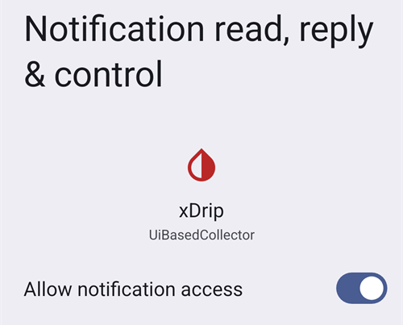

# Dexcom G7, ONE+ and Stelo


## 提前做好准备至关重要

Noteworthy is the fact that the G7, ONE+ and Stelo systems, compared to the G6, do not smooth the values, neither in the app, nor in the reader. 更多详情请参见[此处](https://www.dexcom.com/en-us/faqs/why-does-past-cgm-data-look-different-from-past-data-on-receiver-and-follow-app)。

```{admonition} Smoothing method 
请参阅[Dexcom G7/ONE+/Stelo适用的平滑方法建议](../CompatibleCgms/SmoothingBloodGlucoseData.md)
```

## 1. xDrip (direct connection to G7, ONE+ or Stelo)

- xDrip connects to the sensor itself: uninstall the Dexcom app, as only one app can connect to the sensor. To keep the Dexcom app, use [xDrip Companion App](#DexcomG7-xdrip-companion-app) instead.
- Follow the instructions here: [xDrip G7, ONE+ and Stelo](https://navid200.github.io/xDrip/docs/Dexcom/G7.html). A recent xDrip release is required — see the linked page for the minimum version.
- Select xDrip in [**Configuration → BG Source**](#Config-Builder-bg-source).

- Adjust the xDrip settings according to the explanations on the xDrip settings page [xDrip settings](../CompatibleCgms/xDrip.md).

## 2. Build Your Own Dexcom App (G7 only)

```{admonition} Old app version
:class: warning
Dexcom BYODA is now a very old version of the app and cannot be updated. Not available for ONE+ or Stelo.
```

-   [Build Your Own Dexcom App](https://docs.google.com/forms/d/e/1FAIpQLScD76G0Y-BlL4tZljaFkjlwuqhT83QlFM5v6ZEfO7gCU98iJQ/viewform?fbzx=2196386787609383750) (BYODA) supports local broadcast to AAPS

-   This app lets you use your Dexcom G7 with any Android smartphone.
-   Uninstall the original Dexcom app
-   安装下载的 apk
-   Enter sensor code in patched app
-   After a short time BYODA should pick up the sensor signal.

(DexcomG7-xdrip-companion-app)=

## 3. xDrip Companion App (G7, ONE+ and Stelo)

The official Dexcom app stays connected to the sensor. xDrip reads the glucose values from the notifications of the Dexcom app and sends them to **AAPS**.

```{admonition} Not a trusted data source
:class: note
**AAPS** does not consider xDrip in Companion App mode a [trusted BG data source](#GettingStarted-TrustedBGSource): SMBs are not allowed all the time.

To read the Dexcom app notifications without xDrip, as a trusted data source, use the [Notification Reader](#DexcomG7-notification-reader).
```

### Read the Dexcom app notifications

- Keep the Dexcom app installed and connected to the sensor. Its notifications must stay visible: do not silence or hide them.
- Download and install [xDrip](https://github.com/NightscoutFoundation/xDrip). Use the same glucose units in xDrip as in the Dexcom app.
- In xDrip, go to **Settings** > **Hardware Data Source** and select **Companion App**.

  

- xDrip asks for permission to read notifications. Tap **OK**, then select **xDrip** in the list and turn on **Allow notification access**.

  

- If **Allow notification access** is greyed out (*Controlled by Restricted Setting*), Android blocks it because xDrip was not installed from the Play Store:

  

  Open the xDrip app info (long press the xDrip icon > **App info**), tap the three dots menu at the top right and select **Allow restricted settings**. Then go back to the notification access screen and allow it.

  

  

- Readings appear in xDrip when the Dexcom app shows a new value. If nothing appears, you may need to start a sensor in xDrip: this has no effect on the real sensor. Stelo gives a reading every 15 minutes in this mode.

### Companion Bluetooth (G7)

When the Dexcom app is connected to a G7 sensor, xDrip can also listen to the readings the sensor sends to the Dexcom app over Bluetooth. xDrip does not pair with the sensor and you do not need to enter the sensor code: the Dexcom app stays in control.

With **Companion Bluetooth**, xDrip gets the exact time and trend of each reading from the sensor, instead of the time the notification appeared, and fills gaps when the phone was out of range (backfill).

- In xDrip, go to **Settings** > **Less common settings** > **Bluetooth Settings** and enable **Companion Bluetooth**.

  

- This does not work on all phones and Android versions. Disable it if you see problems.
- If an old Dexcom sensor is still in the phone's Bluetooth list, xDrip might listen to the wrong one: in Android **Settings** > **Connected devices**, forget sensors you no longer use.
- Companion Bluetooth is made for the G7. With ONE+ and Stelo, rely on notifications.

### AAPS 中的配置

- Select xDrip in [**Configuration → BG Source**](#Config-Builder-bg-source).
- Adjust the xDrip settings according to the explanations on the xDrip settings page [xDrip settings](../CompatibleCgms/xDrip.md).

## 4. Juggluco (G7 and ONE+)

Version 9.0+ required

- 请禁用先前连接传感器的应用：卸载该应用或使用"强制停止"功能。在应用设置中禁用"附近设备"权限。限制应用程序的电池使用量。

- 在蓝牙设置中移除传感器：进入安卓设置，在已配对设备中找到该传感器并选择"忘记"。 Dexcom G7 传感器名称以 DXCM 开头。

- 避免其他传感器干扰：请将旧款Dexcom传感器移出蓝牙覆盖范围。

- 将G7传感器连接至Juggluco：打开Juggluco → 左侧菜单 → 照片选项。扫描G7传感器注射器上的二维码。请等待最多5分钟，让Juggluco查找传感器。

- 配对要求：需同意将传感器与Juggluco进行配对。请确保配对过程中屏幕保持解锁状态。若配对失败，请等待5分钟后再重试。

- 例外情况：Wear OS智能手表无需点击同意按钮即可完成绑定。

(DexcomG7-notification-reader)=

## 5. Notification Reader (G7, ONE+ and Stelo)

The official Dexcom app stays connected to the sensor. **AAPS** reads the glucose value directly from the notification of the Dexcom app, without any other app in between.

```{admonition} Trusted data source
:class: note
Readings from the Dexcom G7, ONE+ and Stelo apps are a [trusted BG data source](#GettingStarted-TrustedBGSource): SMBs can be allowed all the time.
```

Compared to the other methods on this page, the Notification Reader has limits:

- **No trend arrow** and **no backfill**: readings missed while the phone was off or out of range are lost.
- Each reading gets the time the notification appeared, not the exact time of the sensor reading.
- Only values between 40 and 405 mg/dL (2.2 and 22.5 mmol/L) are read. "LOW" and "HIGH" are not read.
- Stelo gives a reading every 15 minutes.

### Set up the Dexcom app

- Keep the Dexcom app installed and connected to the sensor.
- Make sure the Dexcom app shows the current glucose value in its notification. Its notifications must stay visible: do not silence or hide them.
- Use the same glucose units (mg/dL or mmol/L) in the Dexcom app as in **AAPS**. Otherwise **AAPS** cannot read the value.

### AAPS 中的配置

- Select **Notification Reader** in [**Configuration → BG Source**](#Config-Builder-bg-source) and confirm the switch.

  

- Back on the main screen, **AAPS** shows **Permissions Required**. Next to **Notification Access**, tap **Grant**.

  

- Android opens its notification access list (its name depends on your Android version, for example *Notification read, reply & control*). Select **AAPS**, turn on **Allow notification access** and confirm with **Allow**.

  

  Android warns that **AAPS** could read all your notifications. **AAPS** only reads the notifications of supported CGM apps and ignores all others.

  

- If **Allow notification access** is greyed out (*Controlled by Restricted Setting*), Android blocks it because **AAPS** was not installed from the Play Store. Open the **AAPS** app info (long press the **AAPS** icon > **App info**), tap the three dots menu at the top right and select **Allow restricted settings**. Then go back to the notification access screen and allow it.
- Readings appear in **AAPS** when the Dexcom app shows a new value.

```{warning}
If the Dexcom app notification shows more than one glucose number, or none, **AAPS** skips that notification.
```
