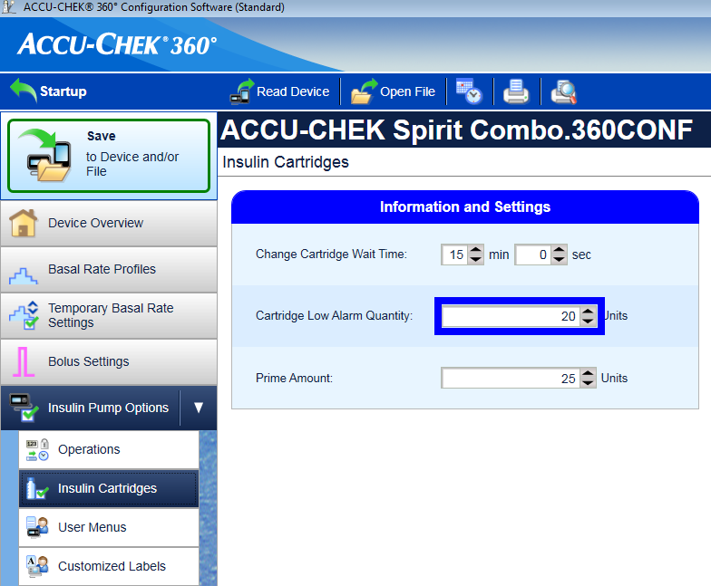
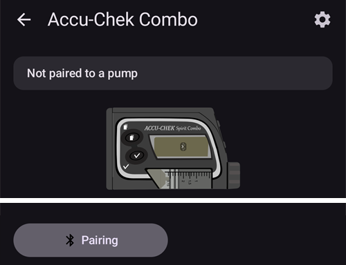

# Accu-Chek Combo

**该软件是DIY解决方案的一部分，并非成品，但需要您阅读、学习并理解系统，包括其使用方法。该工具并非全自动糖尿病管理系统，但如果您愿意投入必要时间，它能帮助您改善糖尿病状况并提高生活质量。切勿操之过急，给自己留出学习的时间。使用后果由您自行承担。**

```{admonition} Accu-Chek Combo is being phased out
:class: note

Roche is withdrawing from the insulin pump market to refocus its diabetes portfolio on the Accu-Chek SmartGuide CGM. It has communicated the end of sales of both the Accu-Chek Combo and Accu-Chek Insight pumps; its remaining Accu-Chek Solo micropump is also being wound down (last deliveries in Germany at the end of 2025). The change is being rolled out by region, starting in Germany, with other European markets expected to follow. If you rely on this pump, plan ahead for a transition to a supported pump.
```

```{contents} Table of contents
:depth: 1
:local: true
```

## AAPS支持的胰岛素泵功能

* Communicates with **AAPS** over your phone's native Bluetooth, without an additional communication device.
* Automatic DST and timezone handling.

## 硬件和软件要求

* Roche Accu-Chek Combo 泵（任何固件版本均可）。
* 需使用Smartpix或Realtyme设备配合360配置软件来设置胰岛素泵。（罗氏公司应客户要求可免费提供Smartpix设备及配置软件。）
* A compatible phone running Android 12 or newer. 详情请参阅[版本说明](#maintenance-android-version-aaps-version)。
* The **AAPS** app installed on your phone.

某些手机可能比其他手机表现更好，这取决于其蓝牙支持的质量以及是否具有额外且非常激进的省电逻辑。手机列表详见[AAPS Phones](#Phones-list-of-tested-phones)文档。请注意，这并非完整列表，仅反映用户个人使用体验。我们鼓励您分享使用体验，以此帮助他人（这些项目的核心理念正是薪火相传）。

(combov2-before-you-begin)=
## 在您开始前

**安全第一**——请勿在无法从错误中恢复的环境中进行此操作。请将您的Smartpix/Realtyme设备及360配置软件置于手边备用。预计需花费约1小时完成全部设置并确保各项功能正常运行。

请注意以下限制条件：

* 当前不支持扩展大剂量和多波大剂量功能（可使用[扩展碳水化合物](../DailyLifeWithAaps/ExtendedCarbs.md)功能替代）。
* 仅支持一个基础率配置文件（第一个配置文件）。
* The lowest basal rate in your **Profile** is 0.05 U/h. **AAPS** refuses a **Profile** with a lower rate. The Combo rounds basal rates to its own steps (0.01 U/h below 1 U/h, 0.05 U/h up to 10 U/h, 0.1 U/h above). **AAPS** uses the rates the pump really gives.
* Temporary basal rates are limited to 500% of the current basal rate. **AAPS** takes this limit into account.
* 若当前泵上激活的配置文件不是1号配置文件，循环功能将被禁用。 This continues until profile no. 1 is made the active one; when that is done, the next time AAPS connects (either on its own after a while or because you tap **Refresh** on the Accu-Chek Combo pump screen), it will notice that profile no. 1 is the current one, and enable the loop again.
* 若循环系统请求取消正在运行的临时基础率，Combo泵将改为设置15分钟90%或110%的临时基础率替代。这是因为直接取消临时基础率会触发泵体警报并伴随强烈震动，且该震动功能无法关闭。
* 蓝牙连接稳定性因手机型号而异，可能导致"无法连接泵体"警报，此时将完全无法建立与泵的连接。 If that error occurs, make sure Bluetooth is enabled, tap **Refresh** on the pump screen (**Manage** > **Pump**) to see if this was caused by an intermittent issue and if still no connection is established, reboot the phone which should usually fix this.
* There is another issue where a restart doesn't help but a button on the pump must be pressed (which resets the pump's Bluetooth stack), before the pump accepts connections from the phone again.
* 应避免在泵体上直接设置临时基础率，因循环系统已接管临时基础率控制权。检测泵上新设置的临时基础率最长可能需要20分钟，且其效果仅从被检测到的那一刻起计算，因此在最坏情况下，可能有20分钟的临时基础率未被计入活性胰岛素量。

The driver is currently written to support the following languages on the Combo. （此设置与AAPS应用语言无关——特指Combo泵液晶屏显示的语言。）

* 英语
* 西班牙语
* 法语
* 意大利语
* 俄语
* 土耳其语
* 波兰语
* 捷克语
* 匈牙利语
* 斯洛伐克语
* 罗马尼亚语
* 克罗地亚语
* 荷兰语
* 希腊语
* 芬兰语
* 挪威语
* 葡萄牙语
* 瑞典语
* 丹麦语
* 德语
* 斯洛文尼亚语
* 立陶宛语

**重要提示**：若您的泵体语言设置不在本列表范围内，请联系开发人员，并将泵体语言切换至列表内选项。否则该驱动将无法正常运行。

## 手机设置

务必确保已关闭电池优化功能。 AAPS已自动检测是否受电池优化影响，并在界面中提示要求关闭该功能。但在现代安卓手机上，蓝牙_本身_就是一个应用（系统应用）。通常，该"蓝牙应用"_默认启用电池优化功能_。这将导致手机为省电终止蓝牙应用时，蓝牙功能可能停止响应。这意味着必须在蓝牙系统应用的设置中同时关闭电池优化功能。遗憾的是，不同手机查找该蓝牙系统应用的方式各不相同。在原生安卓系统中，请前往设置 -> 应用 -> 查看全部N个应用（N代表您手机上的应用总数）。然后点击右上角菜单，选择"显示系统应用"或"全部应用"。现在，在展开的应用列表中查找"蓝牙"应用。选择该应用后，在其"应用信息"界面点击"电池"选项。在此界面关闭电池优化功能（有时称为"电池用量"）。

## Combo 设置

* 请使用Accu-Chek 360配置软件设置泵体参数。若未获取该软件，请联系Accu-Chek服务热线。客服通常会给注册用户寄送含"360°泵体配置软件"的光盘及SmartPix USB红外连接设备（若持有Realtyme设备亦可使用）。

  - **必要设置**（截图中绿色标记部分）：

     * 将/保持菜单配置设为"标准模式"，该设置将仅显示泵体支持的菜单/操作，并隐藏不受支持的功能（扩展/多波大剂量、多段基础率）。使用非支持功能会导致闭环功能受限，因其无法以安全方式运行闭环系统。
     * 确认_快速信息文本_设置为"QUICK INFO"（不带引号，位于_胰岛素泵选项_下）。
     * 将临时基础率_最大调节幅度_设为500%
     * 禁用_临时基础率结束提示_
     * 将临时基础率_持续时间增量_设为15分钟
     * 启用蓝牙

  - **推荐设置**（截图中蓝色标记部分）

     * 请按需设置药筒低量警报
     * 请根据治疗方案设置最大单次大剂量值，以防软件漏洞风险
     * 同理，请设置临时基础率最长持续时间作为安全防护。请至少允许3小时，因为"断开泵体3小时"的选项会设置3小时0%输注率。
     * 启用泵体按键锁功能以防止通过泵体直接输注大剂量，特别是当泵体之前使用过且用户已养成快速输注习惯时。
     * 将屏幕超时和菜单超时分别设为最小值5.5和5。这能让AAPS更快从错误状态恢复，并减少此类错误发生时可能产生的振动次数。

  

  

  

  

## 激活驱动程序并与Combo配对

* Open the **menu** (☰) in the top-left corner, go to [**Configuration** > **Pump**](../SettingUpAaps/ConfigBuilder.md) and select **Accu-Chek Combo**.

  

  Once it is selected, the **Accu-Chek Combo** card shows two buttons, **Settings** and **Open plugin**:

  

  **Settings** opens the settings of the Accu-Chek Combo driver (see [Settings](#combov2-preferences) below):

  

  **Open plugin** (or **Manage** > **Pump**) opens the Accu-Chek Combo pump screen. Before a pump is paired it shows **Not paired to a pump**:

  

* On the pump screen, tap **Pairing**. The **Pair with pump** screen opens. Follow the steps shown on screen, then tap **Start pairing**. When Android asks for permission to make the phone visible to other Bluetooth devices, tap **Allow**. Eventually, the Combo shows a 10-digit pairing PIN on its screen, and **AAPS** asks for it. Enter that PIN in the **10-digit PIN** field.

  

  

  

  The next pictures are from an older **AAPS** version. The steps and texts are the same, but the screens look slightly different.

  

  

  

* If the PIN is entered incorrectly, **AAPS** shows **PIN did not work. Check if there was a typo. If this keeps happening, cancel and retry pairing.**

  

* When **Successfully paired with Combo** is shown, tap **OK**. You return to the pump screen, which now shows the pump status (see [Accu-Chek Combo pump screen contents](#combov2-tab-contents) below). The **Pairing** button is replaced by **Unpair**.

* 为验证设置（为确保安全，请将泵体**断开**与任何输注管路连接），使用AAPS设置500%的临时基础率持续15分钟并执行一次大剂量输注。此时泵体应显示临时基础率正在运行，且历史记录中可见大剂量输注信息。 AAPS也应显示当前运行的临时基础率及已输注的大剂量。

* 建议在Combo上启用按键锁功能以防止通过泵体直接输注大剂量，特别是当泵体之前使用过且用户已养成使用"快速大剂量"功能的习惯时。

## 关于配对的注意事项

Accu-Chek Combo的开发时间早于蓝牙4.0发布，距离首个Android版本问世仅一年。因此其设备配对方式与现行Android系统的标准配对流程并非完全兼容。要彻底解决此问题，AAPS需获取系统级权限，而该权限仅对系统应用开放。这些系统应用由手机制造商预装——用户无法自行安装系统级应用。

The consequence of this is that pairing will never be 100% without problems. 特别说明：配对过程中，Android系统的蓝牙PIN码对话框可能会短暂闪现后自动消失。但有时该对话框会持续显示，并要求输入4位PIN码。（请注意：这与Combo要求的10位配对PIN码不同）无需输入任何内容，直接点击取消即可。若配对未继续进行，请按屏幕提示重试配对操作。

(combov2-tab-contents)=
## Accu-Chek Combo pump screen contents

To open the pump screen, go to **Manage** > **Pump**. Once a pump is paired, it shows the following information (items are listed from top to bottom):


1. **Driver state**: The driver can be in one of the following states:
   - **Disconnected**: There is no Bluetooth connection; the driver is in this state most of the time, and only connects to the pump when needed - this saves power
   - **Connecting**
   - **Checking pump**: the pump is connected, but the driver is currently performing safety checks to ensure that everything is OK and up to date
   - **Ready**: the driver is ready to accept commands from AAPS
   - **Suspended**: the pump is suspended (shown as "stopped" in the Combo)
   - A description of the command being executed, for example **Setting basal profile** or **Updating pump status**
   - **Error**: an error occurred; the connection was terminated, any ongoing command was aborted
2. **Last connection**: How many minutes ago the driver successfully connected to the Combo; if this goes beyond 30 minutes, this item is shown with a red color
3. **Battery**: Battery level; the Combo only indicates **Full**, **Low** or **Empty**, and does not offer anything more accurate (like a percentage), so only these three levels are shown here
4. **Reservoir**: How many IU are currently in the Combo's reservoir
5. **Last bolus**: How many minutes ago the last bolus was delivered; if none was delivered yet after AAPS was started, this is not shown
6. **Temp basal**: Details about the currently active temporary basal; if none is currently active, this is not shown
7. **Base basal rate**: Currently active base basal rate ("base" means the basal rate without any active TBR influencing the basal rate factor)
8. **Serial number**: Combo serial number as indicated by the pump (this corresponds to the serial number shown on the back of the Combo)
9. **Bluetooth address**: The Combo's 6-byte Bluetooth address, shown in the `XX:XX:XX:XX:XX:XX` format

While the driver is doing something (for example, setting a basal profile), a box below the list describes the current activity, with a thin progress bar showing the progress.

Combo可通过蓝牙在_远程终端_模式或_指令_模式下运行。远程终端模式对应Combo血糖仪上的"遥控模式"，可模拟泵体LCD屏及四个按键的操作。由于部分操作在指令模式下无法实现，驱动程序必须在此模式下执行这些特定指令。指令模式虽速度更快，但如前所述，其功能范围存在局限。 When the remote-terminal mode is active, the current remote-terminal screen is shown in the field that is located just above the Combo drawing. 但当驱动程序切换至指令模式时，该区域将保持空白。

(You do not influence this; the driver fully decides on its own what mode to use. This is merely a note for you to know why sometimes you can see Combo frames in that field.)

At the bottom, there are these buttons:

- **Refresh**: Triggers an immediate pump status update. It is also used to let AAPS know that a previously discovered error is now fixed and that AAPS can check again that everything is OK (more on that below in [the section about alerts](#combov2-alerts)). You can only tap it when the driver is disconnected, suspended or in the error state.
- **Unpair**: Unpairs the paired Combo from **AAPS** and Android, after you confirm **Do you really want to unpair the pump?**. When no pump is paired, this button is replaced by **Pairing**.

(combov2-preferences)=
## 设置

These settings are available for the Combo driver (**Configuration** > **Pump** > **Accu-Chek Combo** > **Settings**, or the settings icon (cog wheel) on the pump screen). Items are listed from top to bottom:

1. **Discovery duration (in seconds)**: When pairing, the driver makes the phone discoverable by the pump. 此项控制设备可被发现的持续时间。默认选择最大值（300秒=5分钟）。 Android系统不允许无限期保持可发现状态，因此必须设定具体时长。
2. **Autodetect and automatically enter insulin reservoir change**: If enabled, the driver enters the "reservoir change" that you would normally enter yourself with **Manage** > **Prime/Fill**. This is explained [in further detail below](#combov2-autodetections).
3. **Autodetect and automatically enter battery change**: If enabled, the driver enters the "battery change" that you would normally enter yourself with **Manage** > **Pump Battery Change**. This is explained [in further detail below](#combov2-autodetections).
4. **Enable verbose Combo logging**: This greatly expands the amount of logging done by the driver. **注意**：除非开发者要求，否则请勿启用此选项。 Otherwise, this can add a lot of noise to **AAPS** logs and lessen their usefulness.

Pairing and unpairing are done on the pump screen, not in the settings (see above).

(combov2-autodetections)=
## 自动检测并执行电池及储药器更换操作

驱动程序通过持续监测电池电量及储药器余量，可自动识别电池更换与储药器更换操作。若Combo在上次状态更新时报告电池电量低，而本次更新显示电量恢复正常，驱动程序将判定用户已完成电池更换。储药器余量采用相同逻辑判定：若当前余量高于先前数值，则视为已完成储药器更换。

此功能仅在电池/储药器余量报告为低值时进行更换_且_新电池/储药器已充分填充的情况下生效。

These autodetections can be turned off in the driver [settings](#combov2-preferences).

(combov2-alerts)=
## 警报（警告与错误）及其处理机制

Combo通过远程终端界面显示警报信息。 Warnings are shown with a "Wx" code (x is a digit), along with a short description. 例如"W7"表示"临时基础率超限"。错误信息采用相同格式，但代码前缀为"Ex"。

特定警告可由驱动程序自动消除。自动消除的警告包括：

- W1 "reservoir low" : the driver turns this into a "low reservoir" warning that is shown on the AAPS main screen
- W2 "battery low" : the driver turns this into a "low battery" warning that is shown on the AAPS main screen
- W3、W6、W7、W8：此类警告仅向用户提供参考信息，驱动程序可安全执行自动消除

其余警告_不会_被自动消除。此外，错误信息_绝不_会自动消除。这两类警报采用相同处理机制：触发后驱动程序将在AAPS界面弹出警示对话框，并立即终止所有正在执行的指令。 The driver then switches to the "error" state (see [the Accu-Chek Combo pump screen contents above](#combov2-tab-contents)). 该状态下禁止执行任何指令。用户须在胰岛素泵上处理错误，例如发生输注阻塞错误时可能需要更换输注管路。 Once the user took care of the error, normal operation can be resumed by tapping **Refresh** on the Accu-Chek Combo pump screen. 驱动程序将重新连接Combo并更新状态，检查屏幕是否仍显示错误信息等。此外，驱动程序会定期自动刷新胰岛素泵状态，因此并非必须手动点击该按钮。

大剂量注射属于特殊情况。该操作在Combo的命令模式下执行，此模式不会在注射过程中报告出现的警报。因此，驱动程序_无法_在大剂量注射期间自动消除警告。这意味着胰岛素泵将持续发出蜂鸣声直至大剂量注射完成。大剂量注射期间最常见的警报通常是W1"储药器余量低"。 **Don't** dismiss Combo warnings on the pump itself manually during a bolus. 此操作可能导致大剂量注射中断。驱动程序将在大剂量注射完成后处理该警告。

驱动程序未连接Combo时发生的警报将无法被检测到。 Combo无法自动推送警报至手机，必须由手机主动发起连接。因此，警报将持续显示直至驱动程序连接胰岛素泵。 You can tap **Refresh** on the pump screen to trigger a connection and let the driver handle the alert right then and there (instead of waiting until AAPS itself decides to initiate a connection).

**重要提示**：若发生错误或出现非自动消除类警告，驱动程序将进入错误状态。在此状态下，闭环系统**将被阻断**，直至刷新胰岛素泵状态！ It is unblocked after the pump status is updated (either by tapping **Refresh** or by the driver's eventual auto-update) and no error is shown anymore.

## 使用Combo时的注意事项

* 请注意这并非商业化产品，尤其在初始阶段，用户需持续监控并充分理解系统功能、使用限制及潜在故障模式。强烈建议不具备完全理解该系统能力的人员不要使用。
* 由于Combo远程控制功能的工作原理，多项操作（特别是设置基础率配置文件）相比其他胰岛素泵更为缓慢。这是Combo无法克服的固有缺陷。
* 切勿在胰岛素泵上设置或取消临时基础率。闭环系统需完全掌控临时基础率，否则无法可靠运行，因无法确定用户在胰岛素泵上设置的临时基础率起始时间。
* 当AAPS与胰岛素泵通信时（泵体显示蓝牙标识期间），请勿操作泵体任何按键。此操作将中断蓝牙连接。 Only do that if there are problems with establishing a connection (see [the "Before you begin" section above](#combov2-before-you-begin)).
* 大剂量注射期间请勿操作任何按键。特别提醒：切勿通过按键操作来消除警报。 See [the section about alerts](#combov2-alerts) for a more detailed explanation why.

## Combo无法建立连接时的排查清单

驱动程序会竭尽全力连接Combo，并采用多种技巧来最大限度地提高可靠性。尽管如此，有时仍无法建立连接。以下是尝试解决此问题的步骤。

1. 按下Combo上的任意按键。有时Combo的蓝牙协议栈会停止响应，不再接受任何连接。通过按下Combo按键使LCD屏幕显示内容，可重置蓝牙协议栈。大多数情况下，仅需此步骤即可解决连接问题。
2. 重启手机。当手机蓝牙协议栈自身出现问题时可能需要此操作。
3. 若Combo电池盖老旧，建议更换新部件。老化的电池盖可能导致Combo供电异常，进而影响蓝牙功能。
4. 若连接尝试持续失败，建议解除配对后重新配对胰岛素泵。

(combov2-tips-for-basic-usage)=
## Tips for basic usage

### How to ensure smooth operations

* Always **carry the smartphone with you**, leave it next to your bed at night. As your pump may lay behind or under your body while you sleep, a higher position (on a shelf or board) works best.
* Always make sure that the pump battery is as full as possible. See the battery section for tips regarding the battery.
* Whenever possible, only operate the pump via the AAPS app. To facilitate this, activate the key lock on the pump under **PUMP SETTINGS / KEY LOCK / ON**. Only when changing the battery or the cartridge, it is necessary to use the pump's keys.


### Pump not reachable. What to do?

#### Activate pump unreachable alarm
* In **AAPS**, tap the **Settings** (gear) icon at the top right of the main screen, go to **Local alerts**, activate **Alert if pump is unreachable** and set **Pump unreachable threshold** to **31** minutes.
* This will give you enough time to not trigger the alarm when leaving the room while your phone is left on the desk, but informs you if the pump cannot be reached for a time that exceeds the duration of a temporary basal rate.

#### Restore reachability of the pump

* When AAPS reports a **pump unreachable** alarm, first release the keylock and **press any key on the pump** (e.g. "down" button). As soon as the pump display has turned off, tap **Refresh** on the Accu-Chek Combo pump screen (**Manage** > **Pump**). Mostly then the communication works again.
* If that does not help, reboot your smartphone. After the restart, AAPS will be reactivated and a new connection will be established with the pump.

* The tests with different smartphones have shown that certain smartphones trigger the "pump unreachable" error more often than others. See [AAPS Phones](#Phones-list-of-tested-phones) for successfully tested smartphones.

#### Root causes and consequences of frequent communication errors
* On phones with **low memory** (or **aggressive power-saving** settings), AAPS is often shut down. You can tell by the fact that the treatment buttons (QuickLaunch toolbar) on the main screen are not shown when opening AAPS because the system is initializing. This can trigger "pump unreachable alarms" at startup. In the **Last connection** field of the pump screen (**Manage** > **Pump**), you can check when AAPS last communicated with the pump.


* This error can drain the pump's battery faster because the basal profile is read from the pump when the app is restarted.
* It also increases the likelihood of causing the error that causes the pump to reject all incoming connections until a button on the pump is pressed.

### Cancellation of temporary basal rate fails
* Occasionally, AAPS cannot automatically cancel a **TBR CANCELED** alert. Then you have to either tap **Refresh** on the Accu-Chek Combo pump screen or the alarm on the pump will need to be confirmed.

### Pump battery considerations

#### Changing the battery
* After a **low battery** alarm, the battery should be changed as soon as possible to always have enough energy for a reliable Bluetooth communication with the smartphone, even if the phone is within a wider distance of the pump.
* Even after a **low battery** alarm, the battery might be used for a significant amount of time. However, it is recommended to always have a fresh battery with you after a "low battery" alarm rang.
* Before changing the battery, press on the **Loop** symbol on the main screen and select **Suspend loop** for 1 hour.
* Wait for the phone to communicate with the pump and for the Bluetooth logo on the pump to fade.


* Release the key lock on the pump, put the pump into stop mode, confirm a possibly canceled temporary basal rate, and change the battery quickly.
* You don't need to re-set the pump's clock after the battery change: AAPS automatically updates the pump's date and time.
* Then put the pump back in run mode and select **Resume** when pressing on the **Suspended Loop** icon on the main screen.
* AAPS will re-set a necessary temporary basal rate with the arrival of the next blood sugar value.

(Accu-Chek-Combo-Tips-for-Basic-usage-battery-type-and-causes-of-short-battery-life)=
#### Battery type and causes of short battery life
* As intensive Bluetooth communication consumes a lot of energy, only use **high-quality batteries** like Energizer Ultimate Lithium, the "power one"s from the "large" Accu-Chek service pack, or if you are going for a rechargeable battery, use Eneloop batteries.

 

Ranges for typical life time of the different battery types are as follows:
* **Energizer Ultimate Lithium**: 4 to 7 weeks
* **Power One Alkaline** (Varta) from the service pack: 2 to 4 weeks
* **Eneloop rechargeable** batteries (BK-3MCCE): 1 to 3 weeks

If your battery life is significantly shorter than the ranges given above, please check the following possible causes:
* There are some variants of the screw-on battery cap of the Combo pump, which partially short circuit the batteries and drain them quickly. The caps without this problem can be recognized by the golden metal contacts.
* If the pump clock does not "survive" a short battery change, it is likely that the capacitor is broken which keeps the clock running during a brief power outage. In this case, a replacement of the pump by Roche might help, which is not a problem during the warranty period.
* The smart phone hardware and software (Android operating system and Bluetooth stack) also impact the battery lifetime of the pump, even though the exact factors are not completely known yet. If you have the opportunity, try another smartphone and compare battery lifetimes.

### Extended bolus, multiwave bolus
The OpenAPS algorithm does not support a parallel extended bolus or multiwave bolus. But a similar treatment can be achieved by the following alternatives:
* Use **e-Carbs** when entering carbs or using the Bolus wizard by entering the carbs of the full meal and the duration you expect the carbs to arrive as glucose in your blood. The system will then calculate small carbs equally distributed over the whole duration which will cause the algorithm to provide equivalent insulin dosing while still permanently checking the overall rise/decrease of the blood glucose level. For a multiwave bolus approach, you can also combine a smaller immediate bolus with e-carbs.
* Before eating, set a temporary **Eating Soon** target of 80 mg/dL (4.4 mmol/L) for several hours (press the target on the main screen, or **Manage** > **Temp Target**). The duration should be based on the interval you would choose for an extended bolus. This will keep your target lower than usual and therefore increase the amount of insulin delivered.
* Then use the **Bolus wizard** to enter the full carbs of the meal, but do not directly apply the values it suggests. If a multiwave-like bolus is to be delivered, correct the insulin dosage down. Depending on the meal, the algorithm now has to deliver additional SMBs or higher temporary basal rates to counteract the increase in blood sugar. Here, the safety limitation of the basal rate (Max U/h, Maximum basal IOB) should be very carefully experimented with and, if necessary, temporarily changed.

* Don't use the extended or multiwave bolus directly on the pump. The driver does not support them (see [Before you begin](#combov2-before-you-begin)); if a multiwave bolus is given on the pump anyway, **AAPS** records it from the pump history as a normal bolus plus an extended bolus, so it is counted in IOB. An extended bolus does not work in a closed loop environment (see [this page](#extended-bolus-and-why-they-wont-work-in-closed-loop-environment) for details).

### Alarms at bolus delivery
* After each bolus, the driver reads the pump's bolus history. This is a safety mechanism to correctly calculate insulin on board (IOB), even when a bolus is delivered directly from the pump.
* Before a bolus, if the pump history has a bolus that **AAPS** did not know about (for example, a bolus given directly on the pump), the requested bolus is **not given**, because it was calculated without that insulin. **AAPS** shows **The pump history has a bolus that AAPS did not know about. The requested bolus was not given...** Check the bolus history on the pump and your IOB. If a bolus is still needed, calculate it again. This also applies when the unknown bolus is found on a new connection.
* If the bolus was given but the pump history also had other boluses that **AAPS** did not know about, they are recorded now and **AAPS** asks you to check IOB before the next bolus.
* If the connection to the pump is lost **during** a bolus, **AAPS** does not record 0 U: it shows how much the pump had given by then and warns that the pump may still give the rest. **Do not bolus again.** **AAPS** reads the real amount from the pump history at the next connection.
* If the connection is lost while **AAPS** sends the bolus, it is not known whether the pump got it. Check the bolus history on the pump before the next bolus.
* If **AAPS** cannot confirm that a bolus was delivered, it shows **Bolus delivery failed. It appears no bolus was delivered. To be sure, please check the pump to avoid a double bolus and then bolus again.** Boluses are never retried automatically.

## 获取帮助途径

Development of the Combo driver is done by the community on a **volunteer** basis. Before requesting help, please:

1. **Read** the relevant section of this documentation to confirm how the feature is meant to work.
2. **Ask** on the *#AAPS* channel on [Discord](https://discord.gg/4fQUWHZ4Mw), or in one of the other [community channels](../GettingHelp/WhereCanIGetHelp.md).
3. **Report a bug** by searching the [existing issues](https://github.com/nightscout/AndroidAPS/issues); if yours is not listed, open a [new issue](https://github.com/nightscout/AndroidAPS/issues) and attach your [log files](../GettingHelp/AccessingLogFiles.md).

When asking for help, include your phone make and model, Android version, **AAPS** version, and a plain-English description of the problem (what changed, when it last worked).
