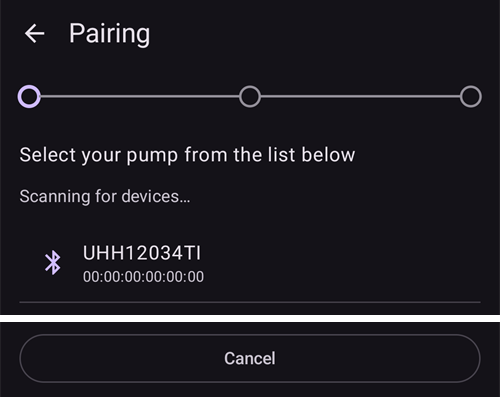
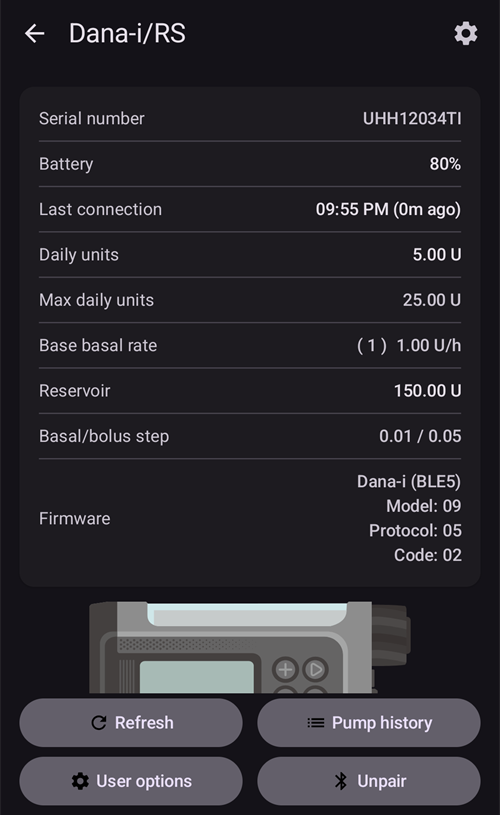

# DanaRS, Dana-i and Dana-i2

*These instructions are for configuring the app and your pump if you have a DanaRS from 2017 onwards, a Dana-i or a Dana-i2. 若使用初代DanaR泵体，请参阅[DanaR胰岛素泵](./DanaR-Insulin-Pump.md)章节。*

**Dana-i2 can be used from AAPS version 4.0 onwards.** It uses the same **Dana-i/RS** driver as the Dana-i.

* In DanaRS/i/i2 pump "BASAL A" is used by the app. Existing data gets overwritten.

    {contents} Table of contents
    :depth: 1
    :local: true

## AAPS支持的胰岛素泵功能

* Communicates with **AAPS** over your phone's native Bluetooth, without an additional communication device.
* DST and timezone changes must be handled manually (see [Timezone traveling](#timezone-traveling-danarv2-danars)).

(DanaRS-Insulin-Pump-pairing-pump)=

## 配对泵

* Open the **menu** (☰) in the top-left corner of the **AAPS** main screen and select **Configuration**.
* Tap **Pump** and select **Dana-i/RS**.
    
    
    
    Once it is selected, the **Dana-i/RS** card shows two buttons, **Settings** and **Open plugin**:
    
    
    
    **Settings** opens the settings of the Dana-i/RS driver:
    
    
    
    **Open plugin** (or **Manage** > **Pump**) opens the Dana-i/RS pump screen. Before a pump is paired it looks like this:
    
    

* On the pump screen, tap **Pairing**. **AAPS** scans for nearby pumps.

* Tap the entry for your pump in the list.
    
    

* **You have to confirm the pairing on the pump!** This works the same way as other Bluetooth pairings you may know (for example, smartphone and car audio).
    
    

* 根据泵体型号及固件版本执行配对流程：
    
    * For DanaRS v1, **AAPS** asks for the **Pump password (v1 only)**. Enter your pump password (see [Default password](#DanaRS-Insulin-Pump-default-password)).
    * For DanaRS v3, **AAPS** asks you to press OK on the pump and type the 2 sequences of numbers and letters shown on the pump. Keep the pump display on by pressing the minus button until you have finished. Then tap **Done**.
    * For Dana-i and Dana-i2, the standard Android pairing dialog appears. Enter the 6-digit number shown on the pump.

* When **Pairing successful!** is shown, tap **Done**.
    
    
    
    You are back on the pump screen, which now shows your pump's status.
    
    

* In **Settings**, select **Bolus speed** to change the default bolus speed (12 s/U, 30 s/U or 60 s/U).

* 通过医生菜单将泵体基础率步进值设为0.01单位/小时（详见泵体使用手册）。
* Set bolus step on pump to 0.05 U using Doctors menu (see pump user guide). **AAPS** reads the basal and bolus steps from the pump and uses them for every bolus, so a bolus always matches the step set on the pump. The pump screen shows them in the **Basal/Bolus step** row.
* 在泵上启用扩展大剂量

### Options shown only for some models

* **Auto lock**: on a Dana-i2, the **User options** screen (on the pump screen, **Manage** > **Pump**) has an **Auto lock** switch for the pump's auto lock setting. Press **Save options to pump** after changing it.
* **Easy mode**: on pump models that have an easy menu mode, the pump screen shows an **Easy mode** row with **On** or **Off**.
* If a Dana-i2 refuses a bolus, **AAPS** shows the reason, for example *Pump is not primed*, *Not enough insulin in the reservoir* or *Easy sleep mode is on in the pump*.

(DanaRS-Insulin-Pump-default-password)=

### 默认密码

* DanaRS固件v1/v2的默认密码为1234。
* DanaRS固件v3及Dana-i的默认密码采用生产日期MMDD格式（例如'0124'表示1月24日生产）。
    
    * 从主菜单选择查看功能，然后打开子菜单中的运输信息
    * Number 3 is manufacturing date. 
    * v3/i版本中该密码仅用于锁定泵体菜单。该密码不用于通信交互，也无需在AAPS中输入。

(DanaRS-Insulin-Pump-change-password-on-pump)=

## 修改泵体密码

* 按下泵上的确定按钮
* 在主菜单中选择"选项"（多次按右箭头键切换）
    
    

* 在选项菜单中选择"用户设置"
    
    

* 使用箭头按钮向下滚动到“11. 密码”
    
    

* 按确定输入旧密码。

* Enter **old password** (Default password see [above](#DanaRS-Insulin-Pump-default-password)) and press OK
    
    

* 此处输入错误密码时系统不会提示失败信息！

* 设置**新密码**（用加减键修改数字/按右箭头键切换）。
    
    

* 按 "确定 "按钮确认。

* 按 OK 保存设置。
    
    

* 向下移动到 "14. EXIT"（退出），然后按确定退出。
    
    

(DanaRS-Insulin-Pump-dana-rs-specific-errors)=

## Dana RS 特定错误

### 胰岛素输送过程中的错误

若AAPS与Dana RS在大剂量胰岛素输注期间断开连接（例如泵体输注时远离手机），将显示以下提示信息并触发警报音。

* 多数情况下仅为通信故障，实际胰岛素输注剂量仍准确。
* Check in the pump history that the correct bolus was given. You can do this on the pump itself, or in **AAPS** on the pump screen (**Manage** > **Pump**) > **Pump history** > **Boluses**.
* Delete the error entry in [treatments](#screens-bolus-carbs) if you wish.
* The real amount is read and recorded at the next connection. To force this, tap **Refresh** on the pump screen, or just wait for the next connection.

## 手机更换特别注意事项

更换新手机时必须执行以下步骤：

* 在旧手机[导出设置](../Maintenance/ExportImportSettings.md)
* 将设置从旧手机转移到新手机

### DanaRS v1

* **手动配对**Dana RS与新手机
* If you tick **Also replace pump settings** when importing, the pump connection settings are imported too and AAPS on your new phone will already "know" the pump and therefore not start a Bluetooth scan. 因此必须手动完成新手机与泵体的配对。
* 在新手机上安装AAPS。
* 在新手机上[导入设置](../Maintenance/ExportImportSettings.md)

### DanaRS v3, Dana-i, Dana-i2

* Start pairing procedure as described [above](#DanaRS-Insulin-Pump-pairing-pump).
* Sometimes you may need to clear the pairing information in **AAPS** first. On the pump screen (**Manage** > **Pump**), tap **Unpair** and confirm **Reset pairing information?**. Then tap **Pairing** again.

## Timezone traveling with DanaRS, Dana-i and Dana-i2 pumps

跨时区操作说明请参阅[泵体时区切换](#timezone-traveling-danarv2-danars)章节。

## 获取帮助途径

Development of the DanaRS/Dana-i/Dana-i2 driver is done by the community on a **volunteer** basis. Before requesting help, please:

1. **Read** the relevant section of this documentation to confirm how the feature is meant to work.
2. **Ask** on the *#AAPS* channel on [Discord](https://discord.gg/4fQUWHZ4Mw), or in one of the other [community channels](../GettingHelp/WhereCanIGetHelp.md).
3. **Report a bug** by searching the [existing issues](https://github.com/nightscout/AndroidAPS/issues); if yours is not listed, open a [new issue](https://github.com/nightscout/AndroidAPS/issues) and attach your [log files](../GettingHelp/AccessingLogFiles.md).

When asking for help, include your phone make and model, Android version, **AAPS** version, and a plain-English description of the problem (what changed, when it last worked).