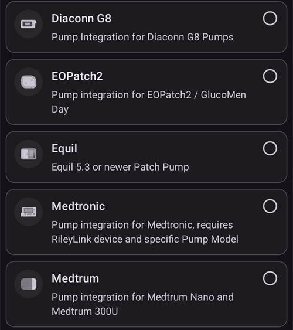
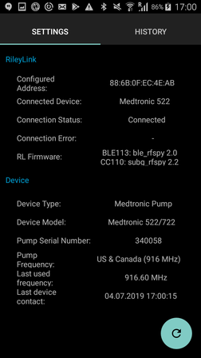

# 美敦力胰岛素泵

该驱动不适用于任何新型号，包括所有以G结尾的型号（530G、600系列[630G、640G、670G]、700系列[770G、780G]等）。

以下型号与固件组合兼容：

- 512/712（任何固件版本）
- 515/715（任何固件版本）
- 522/722（任何固件版本）
- 523/723（固件 2.4A 或更低版本）
- 554/754 欧盟版（固件 2.6A 或更低版本）
- 554/754 加拿大版（固件 2.7A 或更低版本）

您可在[OpenAPS文档](https://openaps.readthedocs.io/en/latest/docs/Gear%20Up/pump.html#how-to-check-pump-firmware-check-for-absence-of-pc-connect)或[LoopDocs](https://loopkit.github.io/loopdocs/build/step3/#medtronic-pump-firmware)中查看如何检查泵的固件版本。

    {contents} Table of contents
    :depth: 1
    :local: true

## AAPS支持的胰岛素泵功能

* Requires a RileyLink-compatible device to communicate with **AAPS**.
* Automatic DST and timezone handling.

## 硬件和软件要求

- **电话：** 美敦力驱动程序应适用于任何支持蓝牙连接的安卓手机。**重要提示：</0> 手机制造商的蓝牙实现方式可能有所不同，因此每种手机型号的表现也可能不同。例如，某些手机处理启用/禁用蓝牙的方式会有所不同。这可能会影响当AAPS需要重新连接到您的Rileylink类型设备时的用户体验。**
- **RileyLink兼容设备：** 安卓手机无法直接与美敦力泵通信，需要额外的设备来处理通信。该设备将通过蓝牙与您的手机连接，并通过兼容的无线连接与您的泵通信。首个此类设备被称为Rileylink，但现在已有多种其他选择可提供额外功能。
    
    - Rileylink可在[getrileylink.org](https://getrileylink.org/product/rileylink916)获取
    - Orangelink可在[getrileylink.org](https://getrileylink.org/product/orangelink)获取
    - Emalink(多种型号可选)可在[github.com](https://github.com/sks01/EmaLink)获取
    - Gnarl(需要额外DIY)详情请见[github.com](https://github.com/ecc1/gnarl)

各款Rileylink兼容设备的对比图表可在[getrileylink.org](https://getrileylink.org/rileylink-compatible-hardware-comparison-chart)查看

(MedtronicPump-configuration-of-the-pump)=

## 配置您的泵：

为便于AAPS远程发送指令，需在泵上配置以下设置。美敦力715泵上更改每个设置所需的操作步骤已在各项设置后用括号标出。具体步骤可能因泵型号和/或固件版本而异。

- **启用泵的远程模式**（在泵上按Act键，进入Utilities -> Remote Options，选择On，在下一屏幕选择Add ID并添加任意随机ID如111111）。远程ID列表中必须至少有一个ID，泵才会接收远程通信。
- **Set Max Basal** (On the pump press Act and go to Basal and then select Max Basal Rate) As an example setting this value to four times your maximum standard basal rate would allow a 400% Temporary Basal Rate. 泵允许的最大值为每小时34.9单位。
- **Set Max Bolus** (On the pump press Act and go to Bolus and then select Max Bolus) This is the largest bolus that the pump will accept. 泵允许的最大值为25单位。
- **将配置文件设为标准**。（在泵上按Act键，进入Basal然后选择Patterns）泵只需一个配置文件，因为AAPS将在您的手机上管理不同的配置文件。无需其他模式。
- **设置临时基础率类型**（在泵上按Act键，进入Basal然后选择Temp Basal Type）。选择绝对量（非百分比）。

## 手机/AAPS的美敦力配置

- **不要通过手机蓝牙菜单配对RileyLink兼容设备。** 若通过手机蓝牙菜单配对，按照以下说明操作时将导致AAPS无法识别您的RileyLink兼容设备。
- 禁用您手机上的自动屏幕旋转功能。在某些设备上，自动屏幕旋转会导致蓝牙会话重新启动，这会给您的美敦力泵带来问题。 
- 在AAPS中有两种配置美敦力泵的方式：

1. 使用新安装时的设置向导
2. In **Configuration** > **Pump**, by selecting **Medtronic**
    
    
    
    Once it is selected, the **Medtronic** card shows two buttons, **Settings** and **Open plugin**:
    
    
    
    **Settings** opens the settings of the Medtronic driver:
    
    
    
    **Open plugin** (or **Manage** > **Pump**) opens the Medtronic pump screen. Before a pump is paired it looks like this:
    
    

使用设置向导配置美敦力泵时，可能会因蓝牙问题（例如无法成功连接泵）而无法完成设置。若发生此情况，您应选择虚拟泵选项以完成配置，并通过使用选项2进行进一步故障排除。

While setting up AAPS to work with your medtronic pump you need to set the following items in **Settings** (see the settings picture above):

- **泵序列号**：显示在泵背面，以SN开头。只需输入显示的6位数字，无需输入任何字母字符（例如123456）。
- **泵型号**：您正在使用的泵型号（例如522）。 
- **泵频率**：根据泵的原始销售地区有两种选项。 Please check the [FAQ](#MedtronicPump-faq) if you are unsure which option to select: 
    - for US & Canada, frequency used is 916 MHz
    - for Worldwide, frequency used is 868 MHz
- **泵上最大基础率（单位/小时）**：必须与泵上的设置保持一致（参见上文泵配置部分）。此设置必须谨慎选择，因为它将决定AAPS能通过基础率输送多少胰岛素。这将实际设定临时基础率的最大值。例如，将此值设为标准最大基础率的四倍，将允许400%的临时基础率。泵允许的最大值为每小时34.9单位。
- **泵上最大单次剂量（单位）**（每小时）：必须与泵上的设置保持一致（参见上文泵配置部分）。此设置需慎重考虑，因为它决定了AAPS能设置的单次剂量上限。
- **单次剂量开始前延迟（秒）**：发出单次剂量指令后，实际发送至泵前的等待秒数。这段延迟时间允许用户在错误发送单次剂量指令时取消操作。已通过AAPS启动的单次剂量无法取消。取消已启动单次剂量的唯一方法是手动暂停泵，然后恢复运行。
- **Medtronic Encoding**: Determines where the Medtronic encoding is carried out (hardware or software). 首选选择硬件编码（即由Rileylink兼容设备执行），这样可减少数据传输量。若出现频繁断开连接的情况，选择软件编码（即由AAPS执行）可能有所帮助。如果您在Rileylink设备上使用0.x版本固件，此设置将被忽略。
- **电池类型（电量显示）**：为准确判断剩余电量，请选择当前使用的AAA电池类型。当选择非简易视图时，AAPS将显示计算得出的剩余电量百分比及电压值。可选选项如下：
    
    - 未选择 (简单视图)
    - 碱性电池 (扩展视图)
    - 锂电池(扩展视图)
    - 镍锌电池(扩展视图)
    - 镍氢电池 (扩展视图)
- **Use Scanning**: Activates Bluetooth scanning before connecting with your Rileylink Compatible devices. 这将提高设备连接的可靠性。

- **Show battery level reported by OrangeLink/EmaLink/DiaLink**: This feature is only supported on newer link devices such as the EmaLink or OrangeLink. The value is shown as **RileyLink Battery** on the Medtronic pump screen.
- **Set neutral temp basals**: By default Medtronic pumps beep on the hour when a temporary basal rate is active. 启用此选项可通过在整点切换时中断临时基础率来减少提示音次数。

(pairing-your-rileylink-compatible-device)=

### Pairing your RileyLink compatible device

Your RileyLink compatible device is paired from the Medtronic pump screen, not from the Bluetooth menu of your phone:

- Open the pump screen (**Manage** > **Pump**, or **Open plugin** on the Medtronic card in **Configuration** > **Pump**).
- Tap **Pair RileyLink**. **AAPS** scans for nearby RileyLink compatible devices.
- Tap your device in the list. When **RileyLink paired successfully** is shown, tap **OK**.

## Medtronic pump screen

To open the Medtronic pump screen, go to **Manage** > **Pump**. The pump screen displays the current pump status information along with some Medtronic specific actions (see the pump screen picture above).

- **RileyLink状态**：显示手机与Rileylink兼容设备之间的当前连接状态。这应始终显示为"已连接"。任何其他状态都可能需要用户干预。 
- **RileyLink电量**：显示EmaLink或OrangeLink设备的当前电量。 Only shown if **Show battery level reported by OrangeLink/EmaLink/DiaLink** is enabled in the Medtronic settings.
- **泵状态**：显示泵连接的当前状态。由于泵不会持续连接，这里主要会显示睡眠图标。其他可能状态包括：AAPS尝试发送命令时的"正在唤醒"状态，以及其他可能的泵命令状态如"获取时间"、"设置临时基础率"等。
- **Battery**: Shows battery status based on the value chosen for **Battery Type (Power View)** in the Medtronic settings.
- **上次连接**：显示最近一次成功泵连接发生的时间间隔。
- **上次大剂量**：显示最近一次成功输送大剂量的时间间隔。
- **基础率**：这是您当前配置文件中泵在此小时运行的基础率。
- **临时基础率**：当前正在输送的临时基础率，可能为0单位/小时。
- **储药器**：储药器中的胰岛素量(至少每小时更新一次)。
- **错误**：出现问题时显示的错误字符串(主要显示配置中的错误)。

At the bottom of the screen there are these buttons:

- **刷新**用于刷新泵的当前状态。仅当连接长时间中断时才应使用此功能，因为这将需要完整的数据刷新(检索历史记录、获取/设置时间、获取配置文件、获取电池状态等)。
- **Pair RileyLink**: Finds and pairs your RileyLink compatible device (see [above](#pairing-your-rileylink-compatible-device)).
- **Pump history**: Shows pump history (see [below](#MedtronicPump-pump-history)).
- **RL Stats**: Shows RL Stats (see [below](#MedtronicPump-rl-status-rileylink-status)).
- **Wake and Tune Up** and **Reset RileyLink**: See [Actions](#medtronic-actions) below.
- **Clear Bolus Block**: Only shown for a short time after a bolus, while **AAPS** waits for the pump to finish delivering it. Tapping it ends this wait.

(MedtronicPump-pump-history)=

## 泵历史记录

泵历史记录每5分钟检索一次并存储在本地。仅存储最近24小时的历史记录。 This allows for a convenient way to see pump behavior should that be required. The only items stored are those relevant to AAPS and will not include a configuration function that has no relevance.

Tap **Pump history** on the pump screen to open it. By default **All** is selected. Tap one of the filter buttons at the top (for example **Boluses**, **Basals** or **Alarms**) to show only one type of entry.

(MedtronicPump-rl-status-rileylink-status)=

## RL状态(RileyLink状态)

 

RL状态对话框包含两个标签页：

- **设置**：显示RileyLink兼容设备的设置信息：配置地址、连接设备、连接状态、连接错误和RileyLink固件版本。设备类型始终为美敦力泵，型号即您的泵型号，序列号为配置的序列号，泵频率显示您使用的频率，最后频率为上次使用的频率。
- **历史记录**：显示通信历史记录，其中带有RileyLink的项目显示RileyLink状态变更，美敦力项目显示发送给泵的指令。

(medtronic-actions)=

## 手动操作

When the Medtronic driver is used, two additional actions are available on the pump screen (**Manage** > **Pump**):

- **唤醒并调谐** - 若AAPS长时间未连接您的泵(本应每5分钟连接一次)，可强制进行调谐。此操作将通过搜索您泵可能使用的所有无线电频率来尝试建立连接。若成功建立连接，该成功频率将被设为默认值。 While the tune-up runs, the RileyLink status on the pump screen shows it. If a tune-up fails (for example because the pump was out of range), **AAPS** tries again by itself about every 10 minutes.
- **Reset RileyLink** - If you reset your RileyLink compatible device you may need to use this action so that device can be reconfigured (frequency set, frequency type set, encoding configured).

## 重要说明

### 需要特别注意NS配置

AAPS使用序列号进行同步，且该序列号会暴露给NS。由于掌握旧款美敦力泵的序列号可能被用于远程控制泵，请特别注意强化NS站点防护，防止泵序列号泄露。参见 https://nightscout.github.io/nightscout/security/

### OpenAPS用户

OpenAPS用户须知：AAPS与美敦力泵配合使用的方案与OpenAPS完全不同。 Using AAPS the primary method of interacting with the pump is via your phone. In normal use cases it is likely that the only time it is required to use the pump menu is when changing reservoirs. 这与OpenAPS的使用方式截然不同——OpenAPS通常需要通过快速大剂量按钮来输送至少部分药量。若通过泵手动输送大剂量时，AAPS若同时尝试输送药量可能导致冲突。系统设有检查机制来预防此类问题，但仍应尽可能避免这种情况。

### 日志记录

如需排查美敦力泵功能问题，请点击屏幕左上角菜单图标，选择"维护"和"日志设置"。排查美敦力问题时，需勾选Pump(泵)、PumpComm(泵通信)、PumpBTComm(泵蓝牙通信)日志项。

### 美敦力CGM

美敦力CGM当前不受支持。

### 手动操作泵

应避免在泵上手动输注大剂量或设置临时基础率。所有此类指令均应通过AAPS发送。若必须手动操作，每次操作间隔需至少3分钟以降低风险。

### 时区变更、夏令时(DST)及携带美敦力泵与AAPS出行注意事项

AAPS会自动检测时区变更，并在手机切换至新时间时更新泵的时间。

Traveling east means you are going to be adding hours to the current time (ex. from GMT+0 to GMT+2), which will not result in any issues as there will be no overlap (e.g. it won't be possible to have the same hour twice). Traveling west, however, can result in issues as you are effectively going back in time, which can result in incorrect IOB data.

The issues seen when traveling west are known to the developers and work on a possible solution is ongoing. 详情参见 https://github.com/andyrozman/RileyLinkAAPS/issues/145。目前请注意该问题可能发生，变更时区时需谨慎监测。

### GNARL是否完全兼容Rileylink设备？

GNARL代码完全支持AAPS中美敦力驱动器的所有功能，这意味着它是完全兼容的。需注意：这需要额外操作，您必须获取兼容硬件并将GNARL代码加载至设备。

**作者说明：** 请注意GNARL软件仍处于实验阶段且测试有限，其安全性暂无法与RileyLink相提并论。

(MedtronicPump-faq)=

## 常见问题解答

(MedtronicPump-what-to-do-if-i-loose-connection-to-rileylink-and-or-pump)=

### What to do if I lose connection to RileyLink and/or pump?

可尝试以下多种方法解决连接问题。

- Tap **Wake and Tune Up** on the pump screen (**Manage** > **Pump**) as detailed above.
- 禁用手机蓝牙10秒后重新启用。这将强制Rileylink设备重新连接手机。
- 重置Rileylink设备。 You must then tap **Reset RileyLink** on the pump screen (**Manage** > **Pump**).
- 其他用户发现，当常规方法无效时，以下步骤可有效恢复连接： 
    1. 重新启动手机
    2. *在*手机重启期间同时重启Rileylink设备
    3. 打开AAPS并等待连接恢复

### 如何确定我的泵使用什么频率

泵背面标有型号及特殊三字母代码。前两个字母决定频率类型，最后一个字母决定颜色。以下是频率的可能取值：

- NA - 北美地区（频率选择中需选"美国及加拿大(916 MHz)"）
- CA - 加拿大（频率选择中需选"美国及加拿大(916 MHz)"）
- WW - Worldwide (in frequency selection you need to select "Worldwide (868 MHz)")

(MedtronicPump-pump-unreachable)=

### How to fix the "pump unreachable" error

Some Medtronic pumps report a "pump unreachable" error after an **AAPS** update. To fix it, change the encoding type:

1. Go to **Configuration** > **Pump** and tap **Settings** on the **Medtronic** card.
2. Set **Medtronic Encoding** to **Hardware 4b6b Encoding**.

## 获取帮助途径

Development of the Medtronic driver is done by the community on a **volunteer** basis. Before requesting help, please:

1. **Read** the relevant section of this documentation to confirm how the feature is meant to work.
2. **Ask** on the *#AAPS* channel on [Discord](https://discord.gg/4fQUWHZ4Mw), or in one of the other [community channels](../GettingHelp/WhereCanIGetHelp.md).
3. **Report a bug** by searching the [existing issues](https://github.com/nightscout/AndroidAPS/issues); if yours is not listed, open a [new issue](https://github.com/nightscout/AndroidAPS/issues) and attach your [log files](../GettingHelp/AccessingLogFiles.md).

When asking for help, include your phone make and model, Android version, **AAPS** version, and a plain-English description of the problem (what changed, when it last worked).