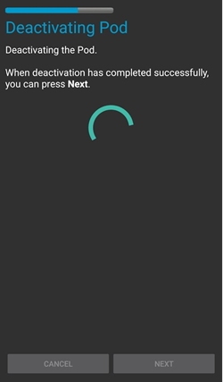
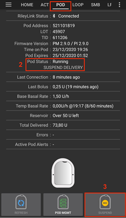
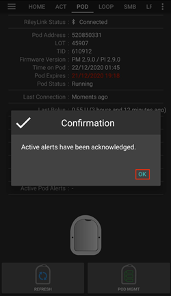
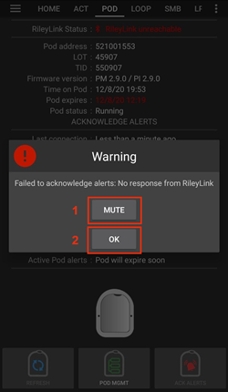
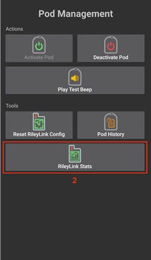
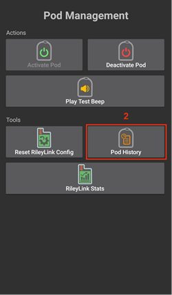
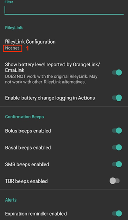
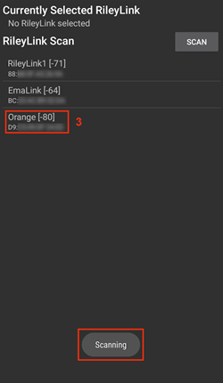

# Omnipod Eros

These instructions are for configuring the Omnipod Eros generation pump (**NOT Omnipod Dash**).

```{admonition} Omnipod Eros is being phased out
:class: note

The [Omnipod System](https://www.omnipod.com/current-podders/resources/omnipod-system) (the original Omnipod, comprising both the Personal Diabetes Manager (PDM) and the Pod) is being discontinued, and the end date varies by country. For example, it will no longer be available in Canada after 30 June 2026. If you rely on the Eros pump, plan ahead for a transition to a supported pump.
```

**本软件属于人工胰腺系统的DIY解决方案，并非商业产品，需要用户自行研习并全面掌握系统操作原理。使用后果由您自行承担。**

```{contents} Table of contents
:depth: 1
:local: true
```

## 硬件和软件要求

- **Pod 通信设备**

> 该组件实现AAPS手机端与Eros系列储药器间的通信桥接功能。
> 
> > -   [OrangeLink Website](https://getrileylink.org/product/orangelink)
> > -  [433MHz RileyLink](https://getrileylink.org/product/rileylink433)
> > -   [Emalink 网站](https://github.com/sks01/EmaLink) - [联系方式](mailto:getemalink@gmail.com)
> > -   DiaLink - [联系方式](mailto:Boshetyn@ukr.net)
> > -   [LoopLink官网](https://www.getlooplink.org/) - [联系方式](https://jameswedding.substack.com/) - 未经测试

-   **移动电话设备**

> 该组件负责运行AAPS并向储药器通信设备发送控制指令。
> 
> > - Supported [Android phone](#Phones-list-of-tested-phones) with **AAPS** and related components set up.

-   **胰岛素输注设备**

> Component that will interpret commands received from the Pod communication device originating from your AAPS enabled phone.
> 
> > - 全新Omnipod储药器（Eros系列 - **非DASH型号**）

These instructions assume that you are starting a new pod session. If this is not the case, please be patient and start this process at your next pod change.

In this page, **RileyLink** means any of the pod communication devices listed above.

## 在您开始前

**安全第一** - 请勿在无法处理突发故障的环境中操作（必须备有备用储药器、胰岛素、电量充足的RileyLink及手机设备）。

**AAPS Omnipod驱动激活储药器后，您的Omnipod PDM将无法继续使用**。此前您通过Omnipod PDM向Eros储药器发送指令。 Eros储药器仅允许单一设备与其建立通信连接。成功激活储药器的设备将成为此后唯一获准与其通信的设备。这意味着当您通过AAPS Omnipod驱动使用RileyLink激活Eros储药器后，**PDM将无法再控制该储药器**。配备RileyLink的AAPS Omnipod驱动现已成为您的实际控制设备。 *This does NOT mean you should throw away your PDM, it is recommended to keep it around as a backup, and for emergencies when AAPS is not working correctly.*

**Only one RileyLink at a time can communicate with a pod.** **AAPS** remembers one paired RileyLink. If you pair a different one, it replaces the previous one.

**当RileyLink超出通信范围时，储药器不会停止工作。**若RileyLink超出有效距离或信号受阻无法与当前储药器通信，储药器仍将持续输注基础胰岛素。激活储药器时，AAPS中设定的基础率配置文件将被写入新储药器。若与储药器通信中断，设备将自动切换至此预设基础率方案运行。在RileyLink重新进入通信范围并恢复连接前，您将无法发送新指令。

**AAPS不支持30分钟间隔的基础率配置。** 若您初次使用AAPS并设置基础率，请注意系统不支持半点起始的基础率方案，需调整为整点起始的配置模式。例如：若您设有1.1单位的基础率方案，起始时间为09:30并持续2小时至11:30结束，此配置将无法生效。您需将该1.1单位基础率的时间范围调整为9:00-11:00或10:00-12:00。虽然Omnipod硬件本身支持30分钟间隔的基础率配置，但AAPS算法目前无法兼容此类设置。

## 在AAPS中启用Omnipod驱动

您可通过**两种方式**在AAPS中启用Omnipod驱动：

### 选项一：通过设置向导启用

After installing a new version of AAPS, the **Setup Wizard** starts automatically. If you have already exported your settings from a previous installation, you can import them in the wizard. For new installations, continue below.

Go through the [Setup Wizard](../SettingUpAaps/SetupWizard.md) until you reach the **Pump** step, then select **Omnipod Eros** (the description reads "Pump integration for Omnipod Eros").


The Setup Wizard does not pair your RileyLink. After finishing the wizard, open the Omnipod pump screen and pair it as described in the [RileyLink Setup section](#OmnipodEros-rileylink-setup).

**或**

### Option 2: The Configuration screen

Open the top-left **menu** (☰) > **Configuration** > **Pump** and select the **radio button** of **Omnipod Eros**.

Once it is selected, the **Omnipod Eros** card shows two buttons, **Settings** and **Open plugin**:


**Settings** opens the settings of the Omnipod driver (see [Omnipod Settings](#OmnipodEros-omnipod-settings)):


**Open plugin** opens the Omnipod pump screen. You can also open it at any time from the main screen with **Manage** > **Pump**. This page calls it the **Omnipod pump screen**. Before a RileyLink is paired and a pod is activated, it looks like this:


### Verification of Omnipod Driver Selection

To verify that you have enabled the Omnipod driver, open **Manage** > **Pump** from the main screen. You should see the **Omnipod Eros** pump screen shown above. If you have not paired a RileyLink yet, **RileyLink Status** shows **Not Started** and **Pod Status** shows **No Active Pod**.

## Omnipod配置

All pod and RileyLink functions are buttons on the [Omnipod pump screen](#OmnipodEros-omnipod-pod-tab) (**Manage** > **Pump**). Some buttons only appear in certain situations, for example when a pod is active.

>  刷新储药器连接状态
> 
>  储药器管理（激活/停用设备、播放测试提示音、查看RileyLink统计及输注历史）

```{admonition} Older screenshot
:class: note
The screenshots above are from an earlier **AAPS** version. In **AAPS** 4 there is no **POD MGMT** button or Pod Management menu: **Refresh** and all pod management actions are buttons on the Omnipod pump screen.
```

(OmnipodEros-rileylink-setup)=

### RileyLink 设置

If you have already paired your RileyLink, continue to the [Activating a Pod section](#OmnipodEros-activating-a-pod) below.

*Note: A good visual indicator that the RileyLink is not connected is that the treatment buttons (QuickLaunch toolbar) on the main screen will be missing. AAPS启动后约30秒内也会出现此现象，此时系统正在主动连接RileyLink。*

1. Make sure that your RileyLink is fully charged and powered on.

2. Place the RileyLink [close to your phone](#OmnipodEros-optimal-omnipod-and-rileylink-positioning) (~30 cm away or less).

3. Open the Omnipod pump screen (**Manage** > **Pump**) and press **Pair RileyLink**.

4. The **Pair RileyLink** screen starts scanning for Bluetooth devices right away. Tap your RileyLink in the list of found devices.

   

5. When **RileyLink paired successfully** is shown with the name and address of your device, press **OK**.

6. Back on the Omnipod pump screen, check that **RileyLink Status** changes to **Connected**. **Pod Status** should show **No Active Pod**. If the RileyLink does not connect, press **Reset RileyLink**, or restart **AAPS**.

 

 


```{admonition} Older screenshot
:class: note
The six screenshots above (after step 6) are from an earlier **AAPS** version. In **AAPS** 4 you pair the RileyLink with the **Pair RileyLink** button on the Omnipod pump screen instead of **RileyLink Configuration** in the Omnipod settings, and scanning starts automatically.
```

```{note}
To switch to another RileyLink (for example a backup device), press **Pair RileyLink** again and select the new device. It replaces the one paired before. You do not need to remove the old device first.
```

(OmnipodEros-activating-a-pod)=

### 激活储药器

Before you can activate a pod, make sure your RileyLink is paired and **RileyLink Status** shows **Connected**. The **Activate Pod** button stays disabled until the RileyLink is ready.

*重要提示：出于安全防护机制，储药器激活配对时的通信距离存在严格限制。配对前储药器射频信号较弱，但成功配对后将恢复全功率信号传输。 During these procedures, make sure that your pod is* [within close proximity](#OmnipodEros-optimal-omnipod-and-rileylink-positioning) *(~30 cm away or less) but not on top of or right next to the RileyLink.*

01. Open the Omnipod pump screen (**Manage** > **Pump**) and press **Activate Pod**.

    If you have never activated a profile, a **Profile required** step appears first. Select the profile to apply on activation.

    >   
    > 
    > ```{admonition} Older screenshot
    >     :class: note
    >     The screenshots above are from an earlier **AAPS** version. In **AAPS** 4 **Activate Pod** is a button on the Omnipod pump screen instead of in the **POD MGMT** menu.
    > ```

02. 此时将显示**填充储药器**界面。 Fill a new pod with enough insulin for 3 days and listen for two beeps. They mean that the minimum amount of 80 units has been filled. Empty the fill syringe completely, even after hearing the two beeps. 计算3天所需胰岛素总量时，请注意储药器初始化将消耗12至15单位胰岛素。 Do not remove the pod's needle cap yet.

    > 
    > 
    > Ensure the new pod and RileyLink are within close proximity of each other (~30cm or less) and press **Next**.

03. **Select Insulin** (only shown if you have more than one insulin configured): select the insulin you are filling the pod with and press **Next**. A profile switch with this insulin is applied after activation.

04. 在**初始化储药器**界面，储药器将开始自检（您会听到"咔嗒"一声，随后是一连串滴答声，表明储药器正在进行自检程序）。若RileyLink超出待激活储药器的有效范围，您将收到**储药器无响应**的错误提示。 If this occurs, [move the RileyLink closer](#OmnipodEros-optimal-omnipod-and-rileylink-positioning) (~30 cm away or less) to but not on top of or right next to the Pod and press **Retry**.

    >  

05. When priming is successful, a green checkmark is shown and the **Next** button becomes enabled. Press **Next**.

    > 

06. **Site location** (only shown if **Manage pump site rotation** is enabled in [Site Rotation](#Aapsscreens-site-rotation)): select where you place the pod on your body and press **Next**.

07. The **Attach Pod** screen is displayed. Prepare the infusion site of the new pod. Remove the pod's plastic needle cap and white paper backing from the adhesive and apply the pod to your chosen site on your body. If the cannula sticks out, press **Cancel** and discard the pod. When finished, press **Next**.

    > 

08. A confirmation dialog appears: "When you press OK, the cannula will be inserted". **ONLY press OK if you are ready to deploy the cannula**.

    > 

09. On the **Insert Cannula** screen, it may take some time before the Omnipod responds and inserts the cannula (1-2 minutes maximum), so be patient.

    > 若RileyLink超出待激活储药器的有效范围，您将收到**储药器无响应**的错误提示。 If this occurs, move the RileyLink closer (~30 cm away or less) to but not on top of or right next to the Pod and press **Retry**.
    > 
    > 若RileyLink超出蓝牙范围或未与手机保持有效连接，您将收到**RileyLink无响应**的错误提示。 If this occurs, move the RileyLink closer to the phone and press **Retry**.
    > 
    > *注意：在插入导管前，建议捏起导管插入点附近的皮肤。这能确保针头顺利插入，并降低导管堵塞的发生概率。*
    > 
    > 
    > 
    >  

10. 导管成功插入后会出现绿色勾选标记，**下一步**按钮将变为可点击状态。 Press **Next**.

    > 

11. The **Pod Activated** screen is displayed. Check that the cannula has been inserted correctly, and change your pod if you think it has not. Press **Finish**. 恭喜！您已成功开启新的储药器使用会话。

    >  
    > 
    > ```{admonition} Older screenshot
    >     :class: note
    >     The screenshots in steps 2 to 11 are from an earlier **AAPS** version and may look different in **AAPS** 4. The **Select Insulin** and **Site location** steps are not pictured.
    > ```

12. You are returned to the Omnipod pump screen. The **Activate Pod** button is replaced by **Deactivate Pod**, because you cannot activate another pod without deactivating the active one first.

    The pump screen now shows information about your active pod, including the current basal rate, reservoir level, insulin delivered, pod errors and alerts. For more details, see the [Omnipod pump screen](#OmnipodEros-omnipod-pod-tab) section.

     

    ```{admonition} Older screenshot
    :class: note
    The screenshots above are from an earlier **AAPS** version. In **AAPS** 4 there is no Pod Management menu: you return directly to the Omnipod pump screen, where **Deactivate Pod** replaces **Activate Pod**.
    ```

```{note}
If activation was interrupted after priming (for example the app was closed), press **Activate Pod** again. The wizard continues from the cannula insertion steps.
```

### 停用储药器

正常情况下，储药器使用寿命为3天（72小时），触发过期警告后仍可延长使用8小时，总使用时长达80小时。

要停用储药器（无论是因到期还是故障）：

1. Open the Omnipod pump screen (**Manage** > **Pump**) and press **Deactivate Pod**.

   >   
   > 
   > ```{admonition} Older screenshot
   >    :class: note
   >    The screenshots above are from an earlier **AAPS** version. In **AAPS** 4 **Deactivate Pod** is a button on the Omnipod pump screen instead of in the **POD MGMT** menu.
   > ```

2. On the **Deactivate Pod** screen, first make sure the RileyLink is in close proximity to the pod but not on top of or right next to the pod. Then press **Next**. A dialog asks *A deactivated Pod can not be used again. Deactivate this Pod now?* Press **OK** to start deactivating the pod, or **Cancel** to keep it. Deactivation suspends all insulin delivery and cannot be undone.

   > 

3. The **Deactivating Pod** screen appears, and you will receive a confirmation beep from the pod that deactivation was successful.

   > 
   > 
   > **IF deactivation fails** and you do not receive a confirmation beep, you may receive a **No response from RileyLink** or **No response from Pod** message. Press **Retry** to attempt deactivation again. If deactivation keeps failing, press **Discard Pod** and confirm. **AAPS** then forgets the pod. Insulin delivery has **not** been suspended, so remove the pod from your body. If your pod has a screaming alarm, you may need to silence it manually (using a pin or a paperclip), because **Discard Pod** does not silence it.
   > 
   > >   

4. A green checkmark appears when deactivation is successful. Press **Next** to display the **Pod Deactivated** screen. 当前使用周期已终止，您现在可以移除储药器。

   > 

5. Press **Finish** to return to the Omnipod pump screen.

   >  
   > 
   > ```{admonition} Older screenshot
   >    :class: note
   >    The screenshots in steps 2 to 5 are from an earlier **AAPS** version and may look different in **AAPS** 4.
   > ```

6. On the Omnipod pump screen, check that **RileyLink Status** shows **Connected** and **Pod Status** shows **No Active Pod**.

   >    
   > 
   > ```{admonition} Older screenshot
   >    :class: note
   >    The screenshots above are from an earlier **AAPS** version. In **AAPS** 4 **Finish** returns you directly to the Omnipod pump screen; there is no Pod Management menu or **Omnipod (POD)** tab.
   > ```

### 暂停和恢复胰岛素输注

The process below shows you how to suspend and resume insulin delivery.

*NOTE - if you do not see a **Suspend** button*, it is hidden by default. Enable **Show Suspend Delivery button on the pump screen** in the [Omnipod settings](#OmnipodEros-omnipod-settings) under **Other**.

#### 暂停胰岛素输注

使用此命令将活动中的pod置于暂停状态。在此暂停状态下，pod将停止输送任何胰岛素。此命令模拟原装Omnipod PDM对活动pod发出的暂停功能。

1. Open the Omnipod pump screen (**Manage** > **Pump**) and press **Suspend**. The suspend command is sent through the RileyLink to the active pod.

2. When the pod has suspended all insulin delivery, **Pod Status** shows **Suspended** and the **Suspend** button is replaced by **Resume Delivery**.

   >  
   > 
   > 
   > 
   >  
   > 
   > ```{admonition} Older screenshot
   >    :class: note
   >    The screenshots above are from an earlier **AAPS** version. In **AAPS** 4 these steps take place on the Omnipod pump screen instead of the **Omnipod (POD)** tab, and the result is shown in **Pod Status**.
   > ```

If the command fails, a **Warning** dialog shows "Failed to suspend delivery" with the reason. Check the RileyLink connection and try again.

#### Resuming Insulin Delivery

此指令用于命令当前暂停中的储药器恢复胰岛素输注。命令成功处理后，胰岛素将根据当前时间从活动基础配置文件中恢复使用当前基础率进行正常输注。 Pod将重新接受大剂量、临时基础率和超微大剂量的指令。

1. Open the Omnipod pump screen and check that **Pod Status** shows **Suspended**. Press **Resume Delivery**.

2. When the command succeeds, **Pod Status** shows **Running** again and the **Resume Delivery** button disappears (the **Suspend** button is shown again if you have enabled it).

   >  
   > 
   > 
   > 
   >  
   > 
   > ```{admonition} Older screenshot
   >    :class: note
   >    The screenshots above are from an earlier **AAPS** version. In **AAPS** 4 these steps take place on the Omnipod pump screen instead of the **Omnipod (POD)** tab, and the result is shown in **Pod Status**.
   > ```

If the command fails, a **Warning** dialog shows "Failed to resume delivery" with the reason. Check the RileyLink connection and try again.

### Silencing Pod Alerts

*NOTE - The **Silence Alerts** button is only shown on the Omnipod pump screen while the pod has an active alert (for example the pod expiration or low reservoir alert), and only if **Automatically silence Pod alerts** is disabled.*

The process below shows you how to silence pod beeps that start when the pod reaches the warning time before it expires. This warning time is set with **Alert at hours before shutdown (80 Hours)** in the Omnipod **Alerts** settings. Pod最长使用寿命为80小时(3天8小时)，但Insulet建议不要超过72小时(3天)的限制。

*NOTE - If you have enabled **Automatically silence Pod alerts** in the Omnipod **Alerts** settings, **AAPS** silences the alert automatically at the next communication with the pod, and you do NOT need to do it manually.*

1. When the warning time is reached, the pod beeps to tell you that it will soon expire and needs to be changed. On the Omnipod pump screen, **Pod Expires** shows the exact time the pod expires (72 hours after activation); it turns **yellow** 4 hours before. **Pod Hard End** shows when the pod stops delivering insulin. **Active Pod Alerts** shows **Pod will expire soon**, and the **Silence Alerts** button appears. **AAPS** also shows a notification about the upcoming pod expiration.

   >   
   > 
   > ```{admonition} Older screenshot
   >    :class: note
   >    The screenshots above are from an earlier **AAPS** version. In **AAPS** 4 the **ACK ALERTS** button is called **Silence Alerts** and is on the Omnipod pump screen.
   > ```

2. Press **Silence Alerts**. The RileyLink sends the command to the pod to stop the expiration warning beeps.

   >  
   > 
   > ```{admonition} Older screenshot
   >    :class: note
   >    The screenshot above is from an earlier **AAPS** version. In **AAPS** 4 the button is called **Silence Alerts**.
   > ```

3. When the alerts are silenced, the pod beeps twice. **Active Pod Alerts** no longer shows the warning, the **Silence Alerts** button disappears and the pod stops its expiration warning beeps.

   >  
   > 
   > ```{admonition} Older screenshot
   >    :class: note
   >    The screenshot above is from an earlier **AAPS** version. In **AAPS** 4 the result is shown on the Omnipod pump screen: the warning disappears from **Active Pod Alerts**.
   > ```

If the command fails (for example the RileyLink is out of range of the pod), a **Warning** dialog shows "Failed to silence alerts" with the reason. Move the RileyLink closer to the pod and try again.



```{admonition} Older screenshot
:class: note
The screenshot above is from an earlier **AAPS** version. In **AAPS** 4 the **Warning** dialog shows "Failed to silence alerts" with the reason.
```

(OmnipodEros-view-pod-history)=

### View Pod History

本部分将向您展示如何查看活动pod的历史记录，并按不同操作类别进行筛选。 Pod历史记录工具可让您查看当前活动pod在其3天(72-80小时)生命周期内执行的操作及结果。

此功能可用于验证已执行但您不确定是否完成的大剂量、临时基础率和基础率变更。其余类别通常有助于故障排查，并确定导致故障的事件发生顺序。

*注意：* **不确定**指令会显示在pod历史记录中，但由于其特性，您无法确保其准确性。

1. Open the Omnipod pump screen (**Manage** > **Pump**) and press **Pod History**.

   >   
   > 
   > ```{admonition} Older screenshot
   >    :class: note
   >    The screenshots above are from an earlier **AAPS** version. In **AAPS** 4 **Pod History** is a button on the Omnipod pump screen instead of in the **POD MGMT** menu.
   > ```

2. The **Pod History** screen lists all pod actions and their results, newest first, grouped by day. By default **All** is selected. Tap one of the filter buttons at the top to show only one category. Use the back arrow at the top left to return to the Omnipod pump screen.

   > 

   >  
   > 
   > ```{admonition} Older screenshot
   >    :class: note
   >    The second screenshot is from an earlier **AAPS** version and may look different in **AAPS** 4.
   > ```

### 查看RileyLink设置与历史记录

The **RileyLink Stats** screen shows the settings of your RileyLink and active pod, and the communication history of both. It has two tabs: **Settings** and **History**.

The **RileyLink Stats** button is hidden by default. To show it on the Omnipod pump screen, enable **Show RileyLink Stats button in Pod Management menu** in the [Omnipod settings](#OmnipodEros-omnipod-settings) under **Other**.

#### 手动重建Pod通信设备蓝牙连接

If your pod communication device was out of Bluetooth range of your phone for a while, **RileyLink Status** may report **RileyLink unreachable** on the Omnipod pump screen. **AAPS** normally reconnects by itself when the device is back in range. If it does not:

1. Make sure the RileyLink is powered on, charged and close to your phone.

2. On the Omnipod pump screen, press **Reset RileyLink**. A message confirms **RileyLink configuration reset**. See the [Reset RileyLink notes](#OmnipodEros-reset-rileylink-config-notes) below.

3. 若**蓝牙连接**未能恢复，请尝试手动关闭手机蓝牙功能后再重新开启。

4. If it still does not reconnect, press **Pair RileyLink** and select your RileyLink again.

5. After a successful reconnection, **RileyLink Status** shows **Connected**. You can also check **Connection Status** on the **Settings** tab of the **RileyLink Stats** screen. 恭喜！您已成功将配置的pod通信设备重新连接至AAPS系统！

 


```{admonition} Older screenshot
:class: note
The screenshots above are from an earlier **AAPS** version. In **AAPS** 4 you reconnect with **Reset RileyLink** or **Pair RileyLink** on the Omnipod pump screen instead of the refresh button on the RileyLink Settings screen.
```

#### Pod通信设备与活动Pod设置

This screen shows information and status for both the currently paired pod communication device and the currently active Omnipod Eros pod. The information refreshes automatically.

1. Open the Omnipod pump screen (**Manage** > **Pump**) and press **RileyLink Stats**. The **Settings** tab shows your currently paired **RileyLink** and the active pod (**Device**).

   >   
   > 
   > ```{admonition} Older screenshot
   >    :class: note
   >    The screenshots above are from an earlier **AAPS** version. In **AAPS** 4 **RileyLink Stats** is a button on the Omnipod pump screen instead of in the **POD MGMT** menu.
   > ```

   > 

##### RileyLink fields

> - **Address:** MAC address of the paired pod communication device.
> - **Name:** Bluetooth name of the paired pod communication device.
> - **Battery Level:** The current battery level of the connected pod communication device. Only shown when **Show battery level reported by OrangeLink/EmaLink/DiaLink** is enabled.
> - **连接状态**：pod通信设备与运行AAPS的手机之间的当前蓝牙连接状态。
> - **Connection Error:** If there is an error with the pod communication device Bluetooth connection, details are displayed here.
> - **固件版本：** 当前连接的pod通信设备上安装的固件版本。

##### Device fields - With an Active Pod

> - **Device Type:** The type of device communicating with the pod communication device (Omnipod (Eros)).
> - **Configured Device Model:** The model of the device configured to communicate with the pod communication device.
> - **Connected Device Model:** The model of the device currently communicating with the pod communication device.
> - **Pump Serial Number:** Serial number of the currently activated pod.
> - **Pump Frequency:** Radio frequency used to communicate with the pod.
> - **Last Used Frequency:** Last known radio frequency the pod used to communicate with the pod communication device.
> - **最后设备联系时间：** pod与pod通信设备最后一次建立联系的具体日期和时间。

(omnipod-eros-rileylink-and-active-pod-history)=
#### RileyLink与活动Pod历史记录

This tab lists, newest first, each state or action of the RileyLink or the currently connected pod. The history is only available for the currently active pod. After a pod change, this history is erased and only events from the newly activated pod are recorded and shown.

1. Open the Omnipod pump screen (**Manage** > **Pump**), press **RileyLink Stats** and then tap the **History** tab.

   >   
   > 
   > ```{admonition} Older screenshot
   >    :class: note
   >    The screenshots above are from an earlier **AAPS** version. In **AAPS** 4 **RileyLink Stats** is a button on the Omnipod pump screen instead of in the **POD MGMT** menu.
   > ```

   > 

##### Fields

Each entry shows:

> - **Device:** The device to which the action or state refers.
> - **Time:** The time of the event.
> - **State or Action:** The state of the device or the action it performed.

(OmnipodEros-omnipod-pod-tab)=

## Omnipod pump screen

Below is an explanation of the status fields and buttons on the **Omnipod pump screen** (**Manage** > **Pump**, or **Configuration** > **Pump** > **Open plugin**).

The gear icon at the top right opens the [Omnipod settings](#OmnipodEros-omnipod-settings).

*NOTE: If any status field shows (uncertain), press **Refresh** to refresh the pod status and clear it.*


```{admonition} Older screenshot
:class: note
The screenshot above is from an earlier **AAPS** version, where this screen was the **Omnipod (POD)** tab. In **AAPS** 4 it is the Omnipod pump screen, and some field names and buttons differ.
```

### Fields

- **RileyLink Status:** Displays the current connection status of the RileyLink. Errors are shown in red.

- *Not Started* - no RileyLink is paired yet, or the connection has not started.
- *RileyLink unreachable* - pod communication device is either not within Bluetooth range of the phone, powered off or has a failure preventing Bluetooth communication.
- *RileyLink ready* - pod communication device is powered on and actively initializing the Bluetooth connection.
- *已连接* - pod通信设备已开机、连接并可通过蓝牙进行主动通信。

- **Unique ID:** Displays the address of the active pod.

- **LOT Number:** Displays the LOT number of the active pod.

- **Sequence Number:** Displays the serial number (TID) of the pod.

- **固件版本：**显示当前活动pod的固件版本。

- **Pod时间：**显示当前活动pod的时间。 It is highlighted when it differs from the phone time by more than 5 minutes.

- **Pod Expires:** Displays the date and time when the active pod will expire. The text turns yellow in the last 4 hours before this time. It never turns red, because the pod keeps delivering insulin after it.

- **Pod Hard End:** Displays the end of the pod's grace period (8 hours after **Pod Expires**, for a maximum pod life of 80 hours). The text turns yellow when the grace period starts (at **Pod Expires**) and red in the last 4 hours before the hard end. During the grace period it also shows the time left, for example *(17m remaining)*. The pod stops delivering insulin at the hard end and must be changed.

- **Pod Status:** Displays the status of the active pod (for example **No Active Pod**, **Running** or **Suspended**).

- **Last Connection:** Displays the last time communication with the active pod was achieved. The text turns red when the [pump unreachable threshold](#OmnipodEros-troubleshooting) is exceeded.

- *刚刚* - 指20秒内的时间。
- *不到一分钟前* - 超过20秒但不足60秒。
- *1分钟前* - 超过60秒但不足120秒（2分钟）
- *XX分钟前* - 超过2分钟，具体时间由XX值确定

- **Last Bolus:** Displays the dosage of the last bolus sent to the active pod and how long ago it was issued in parenthesis.

- **Base Basal Rate:** Displays the basal rate programmed for the current time from the basal rate profile.

- **Temp Basal Rate:** Only shown while a Temporary Basal Rate is running. Displays it in the following format:

- 单位/小时 @ 临时基础率设定时间（已运行分钟数/临时基础率总运行分钟数）
- *示例：* 0.00U/h @18:25 (90/120分钟)

- **Reservoir:** Displays **Over 50 U left** when more than 50 units are left in the reservoir. Below this value the approximate number of units is displayed. The text turns red below the low reservoir threshold set in the [Alerts settings](#OmnipodEros-omnipod-settings).

- **Total Delivered:** Displays the total number of units of insulin delivered from the reservoir. *请注意这是近似值，因为pod的灌注和填充并非精确过程。*

- **Active Pod Alerts:** Reserved for currently running alerts on the active pod. 通常用于当pod超过72小时有效期且设备原生蜂鸣警报正在运行时。

- **Errors:** Displays the last error encountered (shown in red). Review the [Pod history](#OmnipodEros-view-pod-history), [RileyLink history](#omnipod-eros-rileylink-and-active-pod-history) and log files for past errors and more detailed information.

### Buttons

The buttons at the bottom of the pump screen change depending on the situation. Buttons that cannot be used right now are greyed out, for example while the RileyLink is not connected.

**Pod status buttons** (shown when a pod is active):

- **Refresh:** Sends a refresh command to the active pod to update its status. Use it to refresh the pod status and clear status fields that contain the text (uncertain). See the [Troubleshooting section](#OmnipodEros-troubleshooting) below for additional information.

  

  ```{admonition} Older screenshot
  :class: note
  The screenshot above is from an earlier **AAPS** version. In **AAPS** 4 this is a text button named **Refresh** on the Omnipod pump screen.
  ```

- **Silence Alerts:** Silences the pod expiration and low reservoir beeps and notifications. Only shown when the pod has an active alert and **Automatically silence Pod alerts** is disabled. After the alerts are silenced, the button disappears.

  

  ```{admonition} Older screenshot
  :class: note
  The screenshot above is from an earlier **AAPS** version. In **AAPS** 4 this button is called **Silence Alerts**.
  ```

- **Set time:** Updates the time on the pod with the current time on your phone. Only shown when the time on the pod differs from the phone time by more than 5 minutes.

  

  ```{admonition} Older screenshot
  :class: note
  The screenshot above is from an earlier **AAPS** version. In **AAPS** 4 this is a text button named **Set time** on the Omnipod pump screen.
  ```

- **Suspend:** Suspends insulin delivery on the active pod. Only shown if enabled in the settings (**Show Suspend Delivery button on the pump screen**).

  

  ```{admonition} Older screenshot
  :class: note
  The screenshot above is from an earlier **AAPS** version. In **AAPS** 4 this is a text button named **Suspend** on the Omnipod pump screen.
  ```

- **Resume Delivery:** Resumes insulin delivery on the currently suspended, active pod. Only shown while the pod is suspended.

  

  ```{admonition} Older screenshot
  :class: note
  The screenshot above is from an earlier **AAPS** version. In **AAPS** 4 this is a text button named **Resume Delivery** on the Omnipod pump screen.
  ```

**Pod and RileyLink management buttons:**


```{admonition} Older screenshot
:class: note
The screenshot above is from an earlier **AAPS** version. In **AAPS** 4 there is no Pod Management menu: these actions are buttons directly on the Omnipod pump screen.
```

- **Activate Pod:** Primes and activates a new pod. Shown when no pod is active. It is enabled only when the RileyLink is connected.

  

  ```{admonition} Older screenshot
  :class: note
  The screenshot above is from an earlier **AAPS** version. In **AAPS** 4 **Activate Pod** is a button on the Omnipod pump screen instead of in the Pod Management menu.
  ```

- **Deactivate Pod:** Deactivates the currently active pod. Shown as soon as a pod is paired, also when an activation stopped part-way (for example because the pod failed during activation). It is enabled only when the RileyLink is connected. **AAPS** asks you to confirm before it deactivates the pod.

- 使用此命令可停用发出警报声的pod（错误代码49）。
- If deactivation fails, the deactivation wizard offers a **Discard Pod** option.

  

  ```{admonition} Older screenshot
  :class: note
  The screenshot above is from an earlier **AAPS** version. In **AAPS** 4 **Deactivate Pod** is a button on the Omnipod pump screen instead of in the Pod Management menu.
  ```

- **Play Test Beep:** Plays a single test beep on the pod when pressed. Shown when a pod is paired.

  

  ```{admonition} Older screenshot
  :class: note
  The screenshot above is from an earlier **AAPS** version. In **AAPS** 4 **Play Test Beep** is a button on the Omnipod pump screen instead of in the Pod Management menu.
  ```

- **Pod History:** Displays the active pod activity history. See [View Pod History](#OmnipodEros-view-pod-history).

  

  ```{admonition} Older screenshot
  :class: note
  The screenshot above is from an earlier **AAPS** version. In **AAPS** 4 **Pod History** is a button on the Omnipod pump screen instead of in the Pod Management menu.
  ```

- **Pair RileyLink:** Scans for your pod communication device and pairs it. See [RileyLink Setup](#OmnipodEros-rileylink-setup).

- **RileyLink Stats:** Opens the RileyLink Stats screen with two tabs. Only shown if enabled in the settings (**Show RileyLink Stats button in Pod Management menu**).

- **设置** - 显示RileyLink和活动pod的设置信息
- **历史记录** - 显示RileyLink与Pod的通信历史

  

  ```{admonition} Older screenshot
  :class: note
  The screenshot above is from an earlier **AAPS** version. In **AAPS** 4 **RileyLink Stats** is a button on the Omnipod pump screen instead of in the Pod Management menu.
  ```

- **Reset RileyLink:** Resets the configuration of the currently connected pod communication device. When communication is started, specific data is sent to and set in the RileyLink:

- Memory Registers are set
- Communication Protocols are set
- Tuned Radio Frequency is set
  > 
  > See [additional notes](#OmnipodEros-reset-rileylink-config-notes) below.

  

  ```{admonition} Older screenshot
  :class: note
  The screenshot above is from an earlier **AAPS** version. In **AAPS** 4 this button is called **Reset RileyLink** and is on the Omnipod pump screen.
  ```

- **Discard Pod:** Discards the pod state of an unresponsive pod, after a confirmation. Only shown when a pod has been started but not fully paired, as proper deactivation is no longer possible:

- 一个**pod未完全配对**，因此会忽略停用命令。
- A **pod is stuck** during the pairing process between steps.
- 一个**pod完全无法配对。**
  > 
  > After you discard a pod, **AAPS** can no longer communicate with it. Remove the pod from your body.

  

  ```{admonition} Older screenshot
  :class: note
  The screenshot above is from an earlier **AAPS** version. In **AAPS** 4 **Discard Pod** is a button on the Omnipod pump screen instead of in the Pod Management menu.
  ```

(OmnipodEros-reset-rileylink-config-notes)=

#### *Reset RileyLink Notes*

- 此功能主要用于当前活动的pod通信设备无响应且通信处于卡死状态时。
- If the pod communication device is turned off and then back on, press **Reset RileyLink** so that these communication parameters are set again in the pod communication device.
- 如未执行此操作，则在pod通信设备完成电源循环后必须重新启动AAPS。
- This button **DOES NOT** need to be pressed when switching between different pod communication devices.

(OmnipodEros-omnipod-settings)=

## Omnipod设置

To open the Omnipod driver settings, either:

- press the gear icon at the top right of the Omnipod pump screen (**Manage** > **Pump**), or
- open the top-left **menu** (☰) > **Configuration** > **Pump** and press **Settings** on the **Omnipod Eros** card.


```{admonition} Older screenshot
:class: note
The screenshot above is from an earlier **AAPS** version. In **AAPS** 4 you open the settings with **Settings** on the **Omnipod Eros** card or the gear icon on the Omnipod pump screen, instead of the settings gear in **Configuration** or the 3-dot menu.
```

The settings are grouped as listed below. Tap a group to expand it. Most entries are switches you can enable or disable:


*注意：星号(*)表示该设置的默认状态为启用。*

### RileyLink

Settings for the pod communication device. You pair the device itself with the **Pair RileyLink** button on the pump screen (see [RileyLink Setup](#OmnipodEros-rileylink-setup)).

- **Use Scanning:** Scans before connecting to the OrangeLink. This can improve connections. It can also be used with other RileyLink clones if needed.

- **Show battery level reported by OrangeLink/EmaLink/DiaLink:** Reports the actual battery level of the OrangeLink/EmaLink/DiaLink. **强烈建议**所有OrangeLink/EmaLink/DiaLink用户启用此设置。

- 不适用于原始RileyLink。
- 可能不适用于RileyLink替代设备。
- 启用 - 报告支持的pod通信设备的当前电池电量。
- 禁用 - 报告值为"不适用"。

- **Enable battery change logging in Actions:** Only available when the battery reporting setting above is enabled. Some pod communication devices can use regular batteries that you can change. With this setting enabled, you can record a **Pump Battery Change** [careportal entry](#aaps-screens-careportal) to note the change and reset the battery age.

### Confirmation Beeps

提供储药器对大剂量注射、基础率、超微大剂量(SMB)和临时基础率(TBR)输送及变更的确认提示音。

- ***启用大剂量提示音：** 设置是否在大剂量给药时播放确认提示音。
- **Basal beeps enabled:** Enable or disable confirmation beeps when a new basal rate is set, active basal rate is canceled or current basal rate is changed.
- ***超微大剂量提示音启用：** 设置是否在超微大剂量给药时播放确认提示音。
- **启用临时基础率提示音：** 控制设置或取消临时基础率(TBR)时是否发出确认提示音。

### Alerts

当pod到期、关机或根据设定的阈值单位检测到储药器药量不足时，提供AAPS警报和Nightscout通知。

*请注意：自警报触发后与储药器首次通信时，AAPS将始终针对任何警报发出通知。 Dismissing the notification will NOT silence the alert UNLESS **Automatically silence Pod alerts** is enabled. To silence the alert MANUALLY, open the Omnipod pump screen and press **Silence Alerts**.*

- **\*Expiration reminder enabled:** When enabled, the pod beeps when the time set below is reached.
- **Alert at hours before shutdown (80 Hours):** The number of hours before the pod shuts down (80 hours after activation) at which the expiration reminder is triggered (1 to 8 hours, default 8).
- ***启用低药量警报：** 设置当pod剩余药量达到"单位数"字段中定义的低药量限制时是否触发警报。
- **Number of units:** The number of units at which to trigger the pod low reservoir alert (5 to 50, default 20).
- **Automatically silence Pod alerts:** When enabled, a notification is still issued, but the alert is silenced automatically at the next communication with the pod after the alert started.

### Notifications

当不确定临时基础率(TBR)、超微大剂量(SMB)或大剂量给药是否成功时，提供AAPS通知和手机声音警报。

*注：这些仅为手机通知，不会触发储药器声音提示。*

- **\*Sound for uncertain TBR notifications enabled:** Enable or disable this setting to trigger an audible alert and visual notification when AAPS is uncertain if a TBR was successfully set.
- ***不确定超微大剂量通知的声音已启用:** 启用或禁用此设置，当AAPS不确定是否成功输注超微大剂量时，触发声音警报和视觉通知。
- ***不确定大剂量通知的声音已启用:** 启用或禁用此设置，当AAPS不确定是否成功输注大剂量时，触发声音警报和视觉通知。

### 其他

提供高级设置以协助调试。

- **Show Suspend Delivery button on the pump screen:** Hide or display the **Suspend** button on the Omnipod pump screen.
- **Show Pulse Log button in Pod Management menu:** This setting is still listed, but the current version of the pump screen has no **Pulse Log** button.

- **Show RileyLink Stats button in Pod Management menu:** Hide or display the **RileyLink Stats** button on the Omnipod pump screen.
- **\*DST/Time zone detection enabled:** Allows time zone changes to be automatically detected if the phone is used in an area where DST is observed.

### 切换或移除正在使用的Pod通讯设备(RileyLink)

With many alternative models to the original RileyLink available (such as OrangeLink or EmaLink), or the need to have multiple or backup versions of the same pod communication device, you may need to switch to another device.

To switch, open the Omnipod pump screen (**Manage** > **Pump**), press **Pair RileyLink** and select the new device, as described in [RileyLink Setup](#OmnipodEros-rileylink-setup). The new device replaces the previously paired one.

 




 

```{admonition} Older screenshot
:class: note
The screenshots above are from an earlier **AAPS** version. In **AAPS** 4 you add a device with **Pair RileyLink** on the Omnipod pump screen instead of **RileyLink Configuration** in the Omnipod settings, and scanning starts automatically.
```

There is no separate button to remove a paired device. If you stop using a RileyLink, simply pair the new one when you need it.


```{admonition} Older screenshot
:class: note
The screenshots above are from an earlier **AAPS** version. In **AAPS** 4 there is no **Remove** button: pairing a new RileyLink replaces the previous one.
```

## Status row and careportal

There are a few items that are specific to how the Omnipod pod differs from tube based pumps, especially after applying a new pod.

The **insulin** and **cannula** ages in the [status row](#screens-sensor-level-battery) of the main screen are **reset** to 0 days and 0 hours **after each pod change**. 这是由于Omnipod胰岛素泵的构造和工作原理决定的。**泵电池**和**胰岛素储药器**均内置于每个储药器单元内部。由于储药器在敷贴时会直接将输注套管插入皮肤，Omnipod泵不使用传统导管。*因此更换储药器后，这些数值的使用时长会自动归零。* **泵电池使用时长**不显示报告，因为储药器内置电池的寿命始终超过储药器使用期限（最长80小时）。


### 余量水平

**胰岛素储药量**

Omnipod Eros Pod中的胰岛素量报告不精确。 This is because it is not known exactly how much insulin was put in the pod, only that when the 2 beeps are triggered while filling the pod at least 80 units have been filled. 单个Pod最多可容纳200单位胰岛素。 Priming can also introduce variance as it is not an exact process. 基于这两个因素，Omnipod驱动程序的编写旨在提供储药器中剩余胰岛素的最佳估算值。

> - **超过50单位** - 当储药器中当前胰岛素量超过50单位时，显示为50+U。
> - **低于50单位** - 显示储药器中剩余胰岛素的估算值。
> - **短信查询** - 短信回复将返回实际数值或"50+单位"
> - **Nightscout** - 当药量超过50单位时，会向Nightscout上传50的数值（14.07及更早版本）。较新版本在药量超过50单位时将报告"50+"的数值。

**电池电量**

电池电量报告是一项可启用的设置，用于返回Pod通讯设备（如OrangeLink、EmaLink或DiaLink）的当前电池电量。  RileyLink硬件无法报告其电池电量。电池电量会在每次与Pod通讯后更新，因此充电时可能不会观察到线性增长。手动刷新将更新当前电池电量。当支持的Pod通讯设备断开连接时，将报告0%电量值。

> - **RileyLink硬件无法报告电池电量**
> - **必须在Omnipod设置中启用"显示OrangeLink/EmaLink/DiaLink报告的电池电量"选项才能获取电池电量数值**
> - **电池电量报告仅适用于OrangeLink、EmaLink和DiaLink设备**
> - **电池电量报告可能适用于其他设备(RileyLink除外)**
> - **SMS** - 当存在实际电量时返回当前电池电量作为响应，不会返回n/a值
> - **Nightscout** - 当存在实际电量时报告电池电量，不会报告n/a值

(OmnipodEros-troubleshooting)=

## 故障排除

### Pod Failures

储药器偶尔会因各种问题发生故障，包括储药器自身的硬件问题。最佳做法是不要向Insulet公司报修，因为AAPS并非官方认可的使用方案。故障代码列表可[在此处](https://github.com/openaps/openomni/wiki/Fault-event-codes)查看，以帮助确定原因。

### Preventing error 49 pod failures

该故障与指令对应的储药器状态错误或胰岛素输注指令执行出错有关。 We recommend that you set Nightscout synchronization to *upload only*: keep all the "Receive ... from NS" options disabled in the synchronization settings of the Nightscout client (see [Nightscout](../SettingUpAaps/Nightscout.md)) to prevent possible failures.

### Pump Unreachable Alerts

We recommend setting pump unreachable alerts to **120 minutes**. Press the **Settings** (gear) icon at the top right of the main screen, select **Local alerts** > **Pump unreachable threshold** and set it to **120**.

(OmnipodEros-import-settings-from-previous-aaps)=
### 从之前的AAPS导入设置

```{admonition} Importing settings can end your active Pod
:class: warning
On the phone that is already running the Pod, leave **Also replace pump settings** unticked: the Pod session is kept and only the other settings are imported. Tick it only with a file exported during the Pod you are wearing now. See [Tubeless pumps](#ExportImportSettings-tubeless-pumps).
```

The safest way to reinstall **AAPS** is between two Pods:

1. 停用您当前的Pod会话。确认您没有正在使用的Pod会话。
2. 请导出您的设置文件并妥善保存副本。
3. 卸载旧版AAPS并重启手机。
4. 安装新版AAPS并确认没有正在使用的Pod会话。
5. 导入您的设置并激活新Pod。

### Omnipod driver alerts

Please note that the Omnipod driver presents a variety of unique alerts on the **main screen**, most of them are informational and can be dismissed while some provide the user with an action to take to resolve the cause of the triggered alert. 以下是您可能会遇到的主要警报摘要：

#### 无活动Pod

未检测到活动的Pod会话。该警报可通过点击**暂缓**临时关闭，但在新储药器激活前将持续触发。该警报激活后将自动静音。

#### Pod已暂停

提示性警报：Pod已暂停。

#### 基础率配置文件设置失败。输注可能已暂停！ Please manually refresh the Pod status on the pump screen and resume delivery if needed.

Informational alert that the Pod basal profile setting has failed. Open the Omnipod pump screen and press **Refresh**, then **Resume Delivery** if needed.

#### 无法确认超微大剂量是否成功输注。若确认大剂量未成功输注，请手动从治疗记录中删除该条超微大剂量记录。

Alert that the SMB bolus success could not be verified. Check the **Last Bolus** field on the Omnipod pump screen to see if the SMB succeeded. If it did not, remove the entry from the treatments.

#### 无法确认"任务大剂量/临时基础率/超微大剂量"是否完成，请人工核验操作结果。

由于RileyLink与Omnipod的通讯特性，可能出现*无法确定*指令是否成功执行的情况。必须告知用户存在这种不确定性。

以下是可能触发不确定通知的几种情况示例。

- **大剂量** - 无法自动验证不确定的大剂量输注。该通知将持续到下次大剂量输注，但手动刷新Pod可清除该消息。*默认情况下，此类通知会启用警报提示音，因为需要用户手动进行确认。*
- **临时基础率、Pod状态、配置文件切换、时间变更** - 手动刷新Pod可清除该消息。
- **Pod Time Deviation -** When the time on the pod and the time on your phone differ too much, it is difficult for the AAPS loop to function and make accurate predictions and dosage recommendations. If the time difference between the pod and the phone is more than 5 minutes, a **Set time** button appears on the Omnipod pump screen. Press **Set time** to synchronize the time on the pod with the time on the phone. If **Pod Status** shows **Suspended** afterwards, press **Resume Delivery** to continue normal pod operations.

## 最佳实践

(OmnipodEros-optimal-omnipod-and-rileylink-positioning)=

### Omnipod与RileyLink的最佳摆放位置

RileyLink用于与Omnipod Pod通信的天线是433 MHz螺旋天线。由于其结构特性，它辐射出全向信号，就像一个三维环形，z轴代表垂直立式天线。这意味着RileyLink存在最佳摆放位置，特别是在Pod激活和停用过程中。


> *（图1. 螺旋天线全向辐射模式图示*）

出于安全和保密考虑，Pod*激活*操作需在*较近距离（约30厘米以内）*完成，该距离要求比其他操作（如输注大剂量、设置临时基础率或单纯刷新Pod状态）更为严格。由于RileyLink天线的信号传输特性，不建议将Pod直接放置在RileyLink正上方或紧贴其旁边。

下图展示了Pod激活和停用过程中RileyLink的最佳摆放方式。 Pod在其他位置也可能激活，但采用下图所示位置的成功率最高。

*注：若在最佳摆放位置下仍出现Pod与RileyLink通信失败，可能是电池电量不足导致天线传输范围缩小。为避免此问题，请确保RileyLink在此过程中电量充足或直接连接充电线。*


## 获取帮助途径

Omnipod驱动的所有开发工作均由社区志愿者完成；请您在寻求帮助时遵循以下准则并保持体谅：

- **第0级：**查阅本文档相关章节，确保您已理解遇到问题的功能模块的正确运作方式。
- **第一级：** 若使用本文档仍无法解决问题，请通过[此邀请链接](https://discord.gg/4fQUWHZ4Mw)加入**Discord**平台的*#androidaps*频道寻求帮助。
- **第二级：** 请先搜索现有问题，确认您的问题是否已被报告；若未发现相同问题，请新建[问题报告](https://github.com/nightscout/AndroidAPS/issues)并附上[日志文件](../GettingHelp/AccessingLogFiles.md)。
- **请保持耐心——我们社区成员多为热心志愿者，问题的解决往往需要用户和开发者双方投入时间与耐心。**
