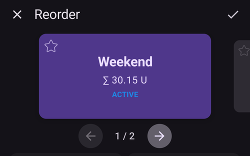

# 配置文件切换与配置文件百分比

本节将解释什么是**配置文件切换（Profile Switch）**和**配置文件百分比（Profile Percentage）**。 You can learn how to create a **Profile** in [Your AAPS Profile](#your-aaps-profile-create-and-edit-profiles).

当您初次开始使用**AAPS**时，您需要创建一个**配置文件**，了解如何进行**配置文件切换**，并学习配置文件百分比在AAPS中的影响。 The features of a **Profile Switch** or **Profile Percentage** can be particularly beneficial for:

- **月经周期**：可以在**自动化（Automations）**中设置**配置文件**内的百分比调整，以便<0>AAPS</0>能够适应激素周期的不同阶段和预测的胰岛素抵抗。

- **锻炼**：可以在**自动化**中为运动设置<0>配置文件</0>内的百分比调整，以减少基础量摄入。

- 夜班或轮班工作者：通过更改**配置文件**中的小时数，为轮班工作者设置时间偏移，以反映他们睡觉或起床时间的早晚变化。

为什么使用**配置文件百分比**而不是临时基础量调整？为了更有效地应用，**配置文件百分比**会在基础量、ISF（胰岛素敏感因子）和I:C（碳水化合物比例）上按比例减少或增加。这确保了**AAPS**在计算用户的胰岛素摄入量时采用平衡的方法。如果算法继续为ISF和I:C提供相同的比例，仅通过基础量减少在用户的**AAPS****配置文件**中获益甚微。

(ProfileSwitch-change-percentage)=

## Change the Profile Percentage from the main screen

You need at least one saved **Profile**. A **Profile Percentage** is always applied through a **Profile Switch**: you activate a **Profile** again, this time with a percentage.

```{admonition} Coming from AAPS 3? :class: note A long press on the profile name no longer opens the profile switch dialog. **Tap** the profile name, then tap the round **▶** button at the bottom right: it opens the same settings (percentage, duration, Activity temp target).

    <br />1. On the main screen, **tap the profile name** (next to the star icon). The [Profile screen](#ProfileSwitch-manage-v4) opens on the card of the running **Profile**, marked **ACTIVE**.
    
       
    
    2. To keep the same **Profile**, leave the **ACTIVE** card selected. To change **Profile** at the same time, swipe to another card.
    3. Tap the round **▶** button (**Activate**) at the bottom right. The **Activate** screen opens.
    4. Set the **Percentage** with **−** / **+** (steps of 5 %), or type it in (30 to 250 %). The field always starts at **100 %**: it does not show the percentage that is running now. For example, enter **80** for 20 % less insulin, or **120** for 20 % more.
    5. Set the **Duration** in minutes:
       * **0** keeps the new percentage until you make another **Profile Switch**;
       * any other value ends the switch after that time, and **AAPS** goes back to the **Profile** that was running before.
    
       
    
    6. Tap **▶ Activate** at the bottom of the screen. Check the summary in the **Profile switch** dialog and tap **OK**.
    
       
    
    Back on the main screen, the profile name shows the percentage and the remaining time, for example *Normal (80%) (59')*, and turns yellow while a switch with a duration is running. A star marks the switch on the glucose graph. See [the main screen](#aaps-screens-profile--target).
    
    
    
    To **go back to 100 %** before the end, repeat the steps and keep **Percentage** at 100 and **Duration** at 0.
    
    ```{admonition} One-tap percentages
    :class: tip
    If you often use the same percentage (sport, illness), add a [Profile shortcut](#profile-shortcuts) to the Quick Launch bar, or create a [scene](Scenes.md). Both apply a profile with a preset percentage and duration in one tap.
    

(ProfileSwitch-manage-v4)=

## Managing and activating profiles (Manage → Profile)

In **AAPS** v4 profiles are managed and activated from the **Manage** screen (bottom navigation) → **Profile** (*“Manage and activate profiles”*).

The Profile screen shows your profiles as a **swipeable card carousel**. The card of the running profile is marked **ACTIVE** and shows its total daily basal (e.g. *∑ 30.15 U*). Below the selected card you see that profile's details — the **Insulin** type, and the **IC**, **ISF**, **basal** and **target** schedules with graphs.

When a temporary switch is running, the **ACTIVE** card shows its percentage and time shift with the time left, for example *110% +2 h · 2 h 40 min*, above a progress bar. Both are refreshed every 30 seconds. The details below then have two columns: the values of the profile in blue, and the values in use with the percentage in red.


The buttons at the bottom act on the **selected** profile: **➕ Add**, **✏️ Edit**, **⧉ Clone** and **‘️ Delete**, and the round **▶ Activate** button on the right. For how to fill in the four schedules in the editor (IC / ISF / BAS / TARG), see [Create and edit Profiles](#your-aaps-profile-create-and-edit-profiles).

**⧉ Clone** uses the two-squares icon often used for *copy*, but there is nothing to paste: it makes the duplicate in one step. Confirm *Clone profile "Normal"?* and a new profile named *Normal copy* is added at the end of the carousel and selected, ready for **✏️ Edit** (where you can also rename it). This is not the same as cloning a past **Profile Switch** from the Treatments history, which creates a new profile *with the percentage and time shift applied*. See [Keep a profile switch for later use](#ProfileSwitch-keep-for-later).

(ProfileSwitch-read-only-mode)= **Only the ▶ Activate button?** Your settings are protected, so the screen opens read-only. Tap the **✏️ pencil** in the top bar and enter your settings password. See [Settings protection now also locks the management screens](#v4changes-read-only-management).

### Reordering profiles

If you have more than one profile you can choose their order in the carousel: tap the **Reorder** icon (⇅, two arrows pointing up and down) in the top bar. The page indicator is replaced by **◀ / ▶ move buttons** with a *position / total* readout — step the centred card earlier or later, then confirm with **✓** (or discard with **✕**). The new order is saved once, when you confirm.



### Activating a profile

Select a profile and tap **▶ Activate**. The **Activate** screen lets you tailor how the **Profile Switch** is applied:


- **Percentage** (30–250 %, starts at 100 % every time) — scale the whole profile. 100 % uses it as-is; for example 70 % reduces basal and the calculated insulin dose (both meal boluses and corrections) by 30 %. It does not change your glucose targets or carb absorption. See [Profile Percentage](#profile-percentage) for the full effect.
- **Duration** (0–10080 minutes, that is up to 7 days) — how long the switch lasts. **0 = indefinite** (until you switch again); a non-zero value reverts to the previous profile when it ends.
- **Temporary target / Activity** — appears only when you set a **Duration** and a **Percentage** below 100 %. Switch it on to also start an [Activity temp target](#TempTargets-activity-temp-target) for the same duration, as you would before exercise.
- **Time shift** — shows *0h*; tap **Change** to move the schedule forward or back by up to 23 hours (useful for shift work or travel). See [Time shift](#ProfileSwitch-ProfilePercentage-time-shift-of-the-circadian-percentage-profile).
- **Reuse** — appears when the running switch has a percentage other than 100 % or a time shift, for example **Reuse 80% 0h**. Tap it to fill in the same percentage and time shift, for instance to prolong a switch that is about to end.
    
    

- **Time** — *Now* by default. You can pick another time, up to 24 hours before or after now. A switch set in the future starts at that time; an Activity temp target set with it then also starts at that time.
    
    

- **Notes** — only shown if [Show notes in dialogs](#Preferences-show-notes-field-in-treatments-dialogs) is on.

If the basal rates at the chosen percentage are not compatible with your pump, a warning appears at the top and **▶ Activate** stays disabled: choose another percentage.

Tap **▶ Activate**, then **OK** in the confirmation dialog. The running profile then carries the **ACTIVE** badge on its card.

```{admonition} Your pump may round the basal rates :class: note Each pump can only give basal rates in its own steps (for example 0.05 U/h), so it rounds the rates of your **Profile**. **AAPS** then uses the basal the pump really gives, so IOB and TDD stay correct. If the pump gives a little more or less insulin per day than your **Profile**, the notice *"Basal profile in pump updated"* tells you how much, for example *"it gives 10.00 U per day instead of 10.12 U"*.

If the pump reports a basal that is far from your **Profile**, **AAPS** keeps the **Profile** basal and asks you to check the basal rates in the pump.

    <br />```{admonition} Percentage and time shift make one profile go a long way
    :class: note
    Rather than building many similar profiles, keep one base profile and apply it at a different **percentage** or **time shift** for recurring situations (illness, exercise, travel). This is exactly what [scenes](Scenes.md) automate.
    

A profile switch is not limited to this screen. The same switch can also be triggered from a **Wear OS watch**, a paired **client** (see [Master ↔ Client control](../RemoteFeatures/ClientMasterControl.md)), a **[scene](Scenes.md)**, or an **Automation** rule.

## Profile Percentage

用户了解**配置文件百分比**的基本功能至关重要。通过对**配置文件切换**应用百分比增加或减少，这将以相同的百分比提高或降低用户在**配置文件**中设置的参数。

例如：**配置文件切换**至130%（意味着用户胰岛素抵抗增加30%）将指示**AAPS**：

- **增加**基础率30%； 
- **降低****ISF**：通过除以1.3；
- **降低****I:C**：通过除以1.3。

请注意，降低**ISF**或**I:C**意味着比例增强，从而施用更多胰岛素。这一事实很容易被**AAPS**的新用户忽视。

选择后，**AAPS**会重新调整默认基础率，并且**AAPS**（无论开启还是关闭）将继续在所选百分比**配置文件**的基础上运行。

**配置文件百分比**的影响总结如下表：

| 配置文件切换  
百分比 |   影响   |     I:C  
g/U      | 示例  
（15g） |          ISF  
mmol/L/U  
mg/dL/U          | U to lower  
2mmol/L  
40mg/dL |
|:------------:|:------:|:------------------:|:----------:|:------------------------------------------:|:------------------------------:|
|     90%      |   较弱   | 5/0.9  
= **5.55** |   2.7 U    | 2.2/0.9  
=**2.4**  
  
40/0.9  
=**44.4** |             0.8 U              |
|   **100%**   | **标准** |       **5**        |  **3 U**   |                **2.2  
40**                |           **0.9** U            |
|     130%     |   较强   | 5/1.3  
=**3.85**  |   3.9 U    | 2.2/1.3  
=**1.7**  
  
40/1.3  
=**30.8** |             1.2 U              |

(ProfileSwitch-ProfilePercentage-time-shift-of-the-circadian-percentage-profile)=

## 昼夜节律百分比曲线的时间偏移

用户**配置文件**功能中的“时间偏移”可以将用户的**配置文件**设置围绕日常时钟（“昼夜节律”）移动到所需的小时数。这可以有助于以下情况：

- **夜班或轮班工作者**：通过调整工作小时数来改变用户在**个人设置**中的上床睡觉或起床时间，使其延后或提前多少小时上夜班。 
- **旅行中更改时区的用户**；或
- **1型糖宝**：在其**配置文件**中考虑到其固定的睡觉时间和胰岛素抵抗。如果出于某种原因，孩子预计睡觉时间较晚，看护者可以对孩子的**配置文件**应用“时间偏移”，以便**AAPS**在用户设定的时间段内对胰岛素抵抗做出反应。

这总是关于哪个小时的**配置文件**设置应替换当前时间的设置。这个时间必须偏移x小时。因此，请注意以下示例中描述的方向：

- 当前时间：12:00
- **正数** 时间偏移 
    - 2:00 **+10 h** -> 12:00
    - 由于正时间偏移，将使用2:00的设置，而不是通常用于12:00的设置。
- **负数** 时间偏移 
    - 22:00 **-10 h** -> 12:00
    - 由于负时间偏移，将使用22:00（晚上10点）的设置，而不是通常用于12:00的设置。


此**配置文件**快照机制允许对过去进行更精确的计算，并有可能跟踪**配置文件**的变化。

(ProfileSwitch-keep-for-later)=

## 保存配置文件切换以供后续使用

执行带有百分比和/或时间偏移的配置文件切换后，您可以将此临时配置文件复制到一个新配置文件中。

To do this, open the menu (☰) → **Treatments** and go to the **Profile switch** tab, see [Clone a Profile switch to a new Profile](#your-aaps-profile-clone-profile-switch).