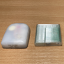

# 兼容的胰岛素泵

AAPS可与多种胰岛素泵配合使用。 The following list shows the currently supported devices. It indicates, in brackets, whether AAPS communicates with the pump using your phone's native Bluetooth function or whether it requires a RileyLink compatible device.

<!-- List of hidden pages to avoid overcrowding the menu -->

```{toctree}
:hidden:

../CompatiblePumps/Accu-Chek-Combo-Pump-v2.md
../CompatiblePumps/Accu-Chek-Insight-Pump.md
../CompatiblePumps/CareLevo.md
../CompatiblePumps/DanaR-Insulin-Pump.md
../CompatiblePumps/DanaRS-Insulin-Pump.md
../CompatiblePumps/DiaconnG8.md
../CompatiblePumps/EOPatch2.md
../CompatiblePumps/Equil5.3.md
../CompatiblePumps/MedtronicPump.md
../CompatiblePumps/MedtrumNano.md
../CompatiblePumps/OmnipodDASH.md
../CompatiblePumps/OmnipodEros.md
../CompatiblePumps/Future-possible-Pump-Drivers.md
```

- [Accu-Chek Combo](../CompatiblePumps/Accu-Chek-Combo-Pump-v2.md) (Bluetooth; see also [Tips for basic usage](#combov2-tips-for-basic-usage))
- [Accu-Chek Insight](../CompatiblePumps/Accu-Chek-Insight-Pump.md) (蓝牙)
- [CareLevo](../CompatiblePumps/CareLevo.md) (Bluetooth)
- [DanaR](../CompatiblePumps/DanaR-Insulin-Pump.md) (蓝牙)
- [DanaRS](../CompatiblePumps/DanaRS-Insulin-Pump.md) (蓝牙)
- [Dana-i](../CompatiblePumps/DanaRS-Insulin-Pump.md) (蓝牙)
- [Dana-i2](../CompatiblePumps/DanaRS-Insulin-Pump.md) (Bluetooth)
- [Diaconn G8](../CompatiblePumps/DiaconnG8.md) (Bluetooth)
- [EOPatch2](../CompatiblePumps/EOPatch2.md) (蓝牙)
- [Equil 5.3](../CompatiblePumps/Equil5.3.md) (Bluetooth)
- Certain older [Medtronic](../CompatiblePumps/MedtronicPump.md) ([additional communication device](#CompatiblePumps-additional-communication-device) needed)
- [Medtrum Nano 200U](../CompatiblePumps/MedtrumNano.md) (Bluetooth)
- [Medtrum 300U](../CompatiblePumps/MedtrumNano.md) (Bluetooth)
- [Omnipod DASH](../CompatiblePumps/OmnipodDASH.md) (Bluetooth)
- [Omnipod Eros](../CompatiblePumps/OmnipodEros.md) ([additional communication device](#CompatiblePumps-additional-communication-device) needed)

## 我的胰岛素泵未列出。

有关可能与AAPS配合使用的其他胰岛素泵的状态的详细信息，请参见[未来（可能）的泵](../CompatiblePumps/Future-possible-Pump-Drivers.md)页面。

(CompatiblePumps-additional-communication-device)=
## 附加通信设备。

If no additional communication device is mentioned, the communication between the insulin pump and **AAPS** is based on the integrated Bluetooth stack of Android, without the need for an additional communication device to translate the communication protocol.

For old Medtronic pumps and Omnipod Eros, an additional communication device (besides your phone) is needed to "translate" the radio signal from the pump to Bluetooth. The device must use the same radio frequency as your pump:

- **Omnipod Eros**: 433 MHz.
- **Medtronic**: 916 MHz for pumps sold in the US and Canada, 868 MHz for pumps sold elsewhere. See [How to determine what frequency my pump uses](#MedtronicPump-faq).

Available communication devices:

-   [OrangeLink Website](https://getrileylink.org/product/orangelink)
-  [433MHz RileyLink](https://getrileylink.org/product/rileylink433)
-   [Emalink 网站](https://github.com/sks01/EmaLink) - [联系方式](mailto:getemalink@gmail.com)
-   DiaLink - [联系方式](mailto:Boshetyn@ukr.net)
-   [LoopLink官网](https://www.getlooplink.org/) - [联系方式](https://jameswedding.substack.com/) - 未经测试