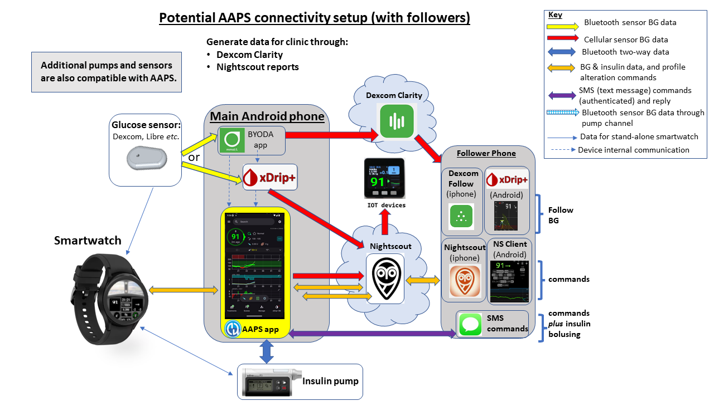

# APS和AAPS简介

```{contents} In this page
:backlinks: entry
:depth: 2
```

## 什么是“人工胰腺系统”（APS）？

人的胰腺不仅能调节血糖，还有很多其他功能。然而，**“人工胰腺系统”（APS）**通常是指能自动地将血糖水平保持在健康范围内的系统。

要实现这样的功能一般来说需要持续检测 **血糖水平**，用检测到的血糖值来 **测算（预测）** 并输注合适计量的**胰岛素**。每隔几分钟就重复一次这样的过程，7×24小时全天候运行。当需要人工干预或关注时，系统通过**警报**提示用户。 This system is typically made up of a **glucose sensor**, an **insulin pump** and a **controller** which runs the calculations. In **AAPS** and other open-source systems the controller is an app on a phone. In most commercial systems it is software built into the pump itself, with a phone app used mainly for display and control.

For background on how closed-loop systems developed and how they work, this 2022 review article is a good starting point. Bear in mind it predates most of the systems available today, so it is not a guide to what is currently on the market:

 [Closed-Loop Insulin Delivery Systems: Past, Present, and Future Directions](https://www.frontiersin.org/journals/endocrinology/articles/10.3389/fendo.2022.919942/full) (Templer, _Frontiers in Endocrinology_, 2022).

So-called “dual-hormone” systems infuse glucagon alongside insulin, with the aim of preventing severe hypos and allowing even tighter blood glucose control. A first system of this kind has been approved in Europe, but it is supplied only through studies and projects, and others are still in development. None is on general sale yet.

人工胰腺可被视为[“糖尿病的自动驾驶系统”](https://www.artificialpancreasbook.com/)。这意味着什么？

在航空领域，自动驾驶系统不可能完全取代飞行员，要不然飞行员就可以全程睡觉了。自动驾驶系统的作用在于辅助飞行员操作。 It relieves them of the burden of constantly having to manage the aircraft, allowing the pilot to concentrate on wider monitoring. The autopilot receives signals from various sensors, a computer evaluates the data together with the pilot’s specifications and then makes the necessary adjustments, alerting the pilot to any concerns. The pilot no longer has to worry about continually making decisions and this analogy can be applied to **AAPS**.


(Introduction-what-does-hybrid-closed-loop-mean)=
## 什么是混合闭环（hybrid closed loop）？

针对1型糖尿病的最佳解决方案是"功能性治愈"（比如通过移植受免疫保护的胰岛细胞实现）。 While the type 1 diabetic (T1D) community waits for that, a “full closed loop” artificial pancreas is probably the next best thing. 这种技术系统无需任何用户输入（如针对饮食的大剂量注射或运动前告知），即可实现良好的血糖调控。 Nearly every system in everyday use is a “hybrid” closed loop, because it uses a combination of automated technology and user input. The first full closed loop systems were approved in Europe in 2026, but none is widely available yet.

## 闭环的由来？

1型糖尿病（T1D）领域商业化技术的发展进程极为缓慢。 2013年，T1D患者群体发起了#WeAreNotWaiting（#我们不再等待）运动。他们利用胰岛素泵、血糖仪等目前可用的技术自己开发了各种系统来改进血糖控制方式、增强安全性、提高生活质量。 These are known as OS-AID (Open-Source Automated Insulin Delivery) systems (formerly DIY systems), because they are not formally approved by health bodies (FDA, NHS etc). There are four main OS-AID systems available: [OpenAPS](https://openaps.org/what-is-openaps/), **AAPS**, [Loop](https://loopkit.github.io/loopdocs/#what-is-loop) and [Trio](https://triodocs.org).

A great way to understand the fundamentals of OS-AID looping is to read Dana Lewis’s book “Automated Insulin Delivery”. 您可通过[此链接](https://www.artificialpancreasbook.com/)免费获取电子版(或购买实体书)。如果您想更多地了解**AAPS**的开发基础——[OpenAPS](https://openaps.org/what-is-openaps/)的详细信息，[OpenAPS 官网](https://openaps.org/what-is-openaps/)提供了丰富的学习资源。

Several commercial hybrid closed loop systems have also been launched. These are very different to OS-AID systems, mainly because many of them include a “learning algorithm” which adjusts how much insulin is delivered according to your insulin needs from previous days. Many people in the OS-AID community have already tried out commercial systems and compared them with their OS-AID system. You can find out more about how the different systems compare by asking on the dedicated Facebook groups for those systems, on the [AAPS Facebook group](https://www.facebook.com/groups/AndroidAPSUsers/) or on [Discord](https://discord.com/invite/4fQUWHZ4Mw).

## 什么是 Android APS (AAPS)？


**图1** Android APS (Artificial Pancreas System，人工胰腺系统)，AAPS的基本构成。

Android APS (**AAPS**) is a hybrid closed loop system, or Artificial Pancreas System (APS). It makes its insulin dosing calculations using established [OpenAPS](https://openaps.org/) algorithms (a set of rules) developed by the #WeAreNotWaiting T1D community.

Since OpenAPS is only compatible with certain older insulin pumps, **AAPS** (which can be used with a wider range of insulin pumps) was first developed in 2016 for a family member with type 1 diabetes. 自那时起， 很多与1型糖尿病有关的志愿者计算机开发团队和技术爱好者加入了进来，不断优化升级**AAPS** 。 Today, **AAPS** is used by many thousands of people worldwide. AAPS是一个高度可定制且多功能的系统，由于它是开源的，因此与众多开源糖尿病软件及平台实现良好兼容。目前 **AAPS** 系统的基本组件架构如上**图 1** 所示。


## AAPS的基本组件有哪些？

AAPS的“中枢”是您自己构建的 **应用程序**。构建过程有详细的逐步操作指南。然后你需要在一部[兼容的](../Getting-Started/Phones.md)**安卓智能手机**上安装**AAPS  应用程序**（**1**）。有的用户倾向于用一部专门的手机来安装闭环，而非平时用的手机。这样（尤其是苹果手机用户）就无需将生活中的其他事务迁移至安卓平台，仅需通过该安卓设备运行AAPS闭环即可。

除了 **AAPS** 之外，**安卓智能手机**还需要安装另一个 App。 This [additional app](../Getting-Started/CompatiblesCgms.md) receives glucose data from a sensor (**2**) by Bluetooth, and then sends the data internally on the phone to the **AAPS app**.

**AAPS** 采用的是 OpenAPS 的决策过程(也就是**算法**)。 Beginners start out using the basic **oref0** algorithm, but it is possible to switch to using the newer **oref1** algorithm as you progress with AAPS. 使用哪个算法 (oref0或 oref1) 取决于哪个算法最适合你的具体情况。两种算法均通过整合多维度参数，在每次接收探头新数据时进行实时运算， The algorithm then sends instructions to the insulin pump (**3**) on how much insulin to deliver by Bluetooth. All the information can be sent by mobile data or Wi-Fi to the internet (**4**). 如果需要的话，这些数据也可以分享给别人或者收集起来以供分析。 Optionally, you can also pair a [smartwatch](../Getting-Started/Watches.md) (**5**) with the phone to see your data at a glance and, with some watches, send basic commands to **AAPS**.

## AAPS系统有哪些优势？

**AAPS**采用的OpenAPS算法根据用户定义的参数（关键参数包括基础率、胰岛素敏感系数（ISF）、碳水系数（IC）、胰岛素作用时长（DIA）等），在无需人工干预的情况下，每5分钟响应探头新数据以调控血糖水平。

Some of the reported advantages of using **AAPS** are extensive fine-tunable options, **Automations** and increased transparency of the system for the patient/caregiver. This can result in better control over your diabetes (or that of someone you are caring for), which in turn may give improved quality of life and increased peace of mind.

投入时间，**AAPS**有可能带来以下好处

- 减轻管理 1 型糖尿病的压力与负担；

- 精简因疾病产生的​​琐碎管理决策；

- 根据实时数据提供个性化的动态胰岛素剂量，从而减少对低血糖治疗的需求，减少高血糖的发生；

- 强化用户对​​胰岛素参数调优的知识储备与实操信心；

- 创建契合生活方式的​​自动化规则（**自动化**）；

- 改善睡眠质量，并总体上减少夜间干预的频率；

- 为1型糖尿病患者的照护者提供远程监控和胰岛素输注管理功能；以及

- 通过使用由**AAPS**控制的安卓手机，实现​​便携糖尿病设备集约化管理（包括动态和胰岛素控制装置）。


**AAPS**最终能够​​赋能患者​​更高效地管理糖尿病，实现​​血糖稳定​​并改善​​远期健康收益​​。

### 具体优势包括：

#### 1) 算法安全特性
要了解oref0与oref1算法的内置安全机制，[请点击此处](https://openaps.org/reference-design/)。用户可自主设定安全限制参数。

#### 2) Hardware flexibility

**AAPS** works with a wide range of insulin pumps and sensors and offers flexibility as life changes. 例如，如果你用德康（Dexcom）的动态，但对它底板上的胶过敏，那你还可以换成雅培的Libre动态。 Users don't have to rebuild or reinstall the **AAPS** app, just select a different pump or BG source in **Configuration** to change your hardware. **AAPS** is independent of particular pump drivers and also contains a "virtual pump" so users can safely experiment before using it on themselves.

#### 3) Highly customisable, with wide parameters

用户可便捷地添加或删除功能模块，而且 **AAPS** 对开环和闭环模式都支持。以下是**AAPS**系统的潜在功能示例：

 a) The ability to set a lower **BG** target 30 min before eating; you can set the target as low as 72 mg/dL (4.0 mmol/L).

 b) If you are insulin-resistant resulting in high blood sugars, **AAPS** allows you to set an **automation** rule to activate when BG rises above 8 mmol/L (144 mg/dL), switching to (for example) a 120% profile (resulting in a 20% increase in basal and strengthening of other factors too, compared to your normal **profile** setting). 该自动化规则将根据您预设的持续时间内生效，并可限定仅在一周内的特定日期、每日具体时段，甚至特定地理位置触发。

 c) If your child is on a trampoline with no advance notice, **AAPS** allows insulin suspension for a set time period, directly via the phone.

 d) After reconnecting a tubed pump which has been disconnected for swimming, **AAPS** will calculate the basal insulin you have missed while disconnected and deliver it carefully, according to your current BG. 若系统计算的补充剂量超出实际需求，用户可通过"取消"功能直接中止缺失基础胰岛素的补注。

 e) **AAPS** 支持为不同场景创建多个配置文件（profile），并支持便捷切换。 For example, features which make the algorithm quicker to bring down elevated BG (like supermicro boluses (“**SMB**”) and unannounced meals (“**UAM**”)) can be set to only work during the daytime, if you are worried about night-time hypos.

以上均为示例，全套功能为日常生活提供了极大的灵活性，包括运动、疾病、激素周期_等_。最终，还是需要用户来决定如何灵活运用这些功能，而且没有放之四海而皆准的通用自动化规则（automations）。

#### 4) Remote monitoring
There are multiple possible monitoring channels (Sugarmate, Dexcom Follow, xDrip, Android Auto _etc._) which are useful for parents/carers and adults in certain scenarios (sleeping/driving) who need customisable alerts. In some apps (xDrip) you can also turn alarms off totally, which is great if you have a new sensor “soaking” or settling down that you don’t want to loop with yet.

#### 5) Remote control
A significant advantage of **AAPS** over commercial systems is that it is possible for followers, using authenticated text (SMS) commands or a paired **AAPSClient** app to send a wide range of commands back to the **AAPS** system. This feature is used extensively by parents of kids with type 1 diabetes who use **AAPS**.

The remote control features can be very useful: for example, in the playground, if you want to pre-bolus for a snack from your own phone, and your child is busy playing. It is also possible to monitor the system from a smartwatch (_e.g._ Garmin) or send basic commands from it (_e.g._ a Wear OS watch such as the Samsung Galaxy Watch).

#### 6) No commercial constraints, due to open application interfaces
除了采用开放源代码的方法，允许随时查看 **AAPS** 的源代码之外，提供标准开放式编程接口也给其他开发人员提供了贡献新想法的机会。 **AAPS** 与 Nightscout 紧密集成。这加快了开发速度，并让用户能通过附加功能进一步提升糖尿病管理的便利性。 Good examples for such integrations are [Nightscout](https://nightscout.github.io/), [Nightscout Reporter](https://nightscout-reporter.zreptil.de/), xDrip, [M5 stack](https://github.com/mlukasek/M5_NightscoutMon/wiki) etc. 开源开发者和商业系统开发者之间一直在进行对话。 Many of the OS-AID innovations are gradually adopted by commercial systems, where developments are understandably slower, partly because interfaces between systems from different companies (pumps, apps, sensors _etc_) need to be carefully negotiated and licenced. 这也会延缓那些方便患者（或有特殊需求的小部分患者）但不能产生可观利润的创新。

#### 7) Detailed app interface
使用 **AAPS** 可以方便地跟踪以下信息：泵内胰岛素量、管路使用时长、探头使用时长、泵电池使用时长、活性胰岛素_等_。 Many actions can be done through the **AAPS** app (priming the pump, disconnecting the pump _etc_.), instead of on the pump itself, which means the pump can stay in your pocket or belt (or that of someone you are caring for).

#### 8) Accessibility and affordability
**AAPS** gives people who currently can’t afford to self-fund, or don’t have funding/insurance, access to a hybrid closed looping system which is conceptually years ahead, in terms of development, of the commercial systems. You currently need a reporting server (Nightscout or Tidepool) to set up **AAPS**, although it is not required for day-to-day running of the **AAPS** loop. Many people continue to use Nightscout for collecting their data, and for remote monitoring. 虽然 **AAPS** 本身是免费的，但通过一些第三方平台来搭建 Nightscout 可能会产生费用（0 - 12 欧元），费用高低取决于您需要何种级别的支持（见对照表），以及设置后是否要继续使用 Nightscout。 **AAPS**兼容多种价格亲民（起价约150欧元）的[安卓手机](https://docs.google.com/spreadsheets/u/1/d/e/2PACX-1vScCNaIguEZVTVFAgpv1kXHdsHl3fs6xT6RB2Z1CeVJ561AvvqGwxMhlmSHk4J056gMCAQE02sAWJvT/pubhtml?gid=683363241&single=true)。针对特定地点和语言也有不同的版本，并支持[视障人士](#accessibility-for-users-aaps-who-are-partially-or-completely-blind)使用。

#### 9) Support
没有完美无缺的胰岛素自动给药系统。不管是商业化产品还是开源系统都会在通信和临时硬件故障等方面遇到许多同类型的问题。 Facebook、Discord 和 Github 上有很多来自世界各地的AAPS用户，他们很多人参与了AAPS的设计和开发，而且也是**AAPS**的使用者，你可以在这些线上社区里得到所需要的支持。此外，还有 Facebook 支持小组和诊所/商业公司为商用 APS 系统提供的帮助，毕竟与这些系统的用户或前用户交谈，可以获得有关常见故障、教育计划质量和持续支持水平的反馈。

#### 10) Predictability, transparency and safety
**AAPS** is transparent, logical and predictable, which may make it easier to know when a setting is wrong, and to adjust it accordingly. 你可以精准地看到系统正在做什么，为什么这么做，然后给它设定操作限制，这能让你始终掌握系统的控制权（还有相应的责任）。这样既能增强用户信心，也能睡个安稳觉。

#### 11) Access to advanced features through development (dev) modes including full closed loop
本 **AAPS** 文档侧重于 **AAPS** 开发项目的** "主 （master）"**分支。然而，研发工作一直在进行。更有经验的用户可能希望探索**开发分支**中的实验功能。创新研发的核心战略聚焦于​​全闭环系统（full closed looping）的实现​​（不必输注餐前大剂量_等_），致力于最大程度提升1型糖尿病患者的生活便利性。

#### 12) Ability to contribute yourself to further improvements
1型糖尿病可能非常令人沮丧和孤独。当掌控了自己的控糖技术以后，你就有了为其他糖友提供帮助的能力，在“把关怀与支持传递下去”的路途上，哪怕只有些许的效果你都会很有成就感。你可以自学自教，发现问题并去寻找新的研究进展和文献资料，乃至为问题的解决贡献一份力量。在社区中，还有其他人有着同样的追求，你可以与他们交流想法，一起合作。这是#WeAreNotWaiting运动的精髓。

## AAPS与MDI（每日多次胰岛素注射）和开环（open loop）的比较

每日多次胰岛素注射疗法（MDI，**图 2** 中的(a)）通常是指每天注射一次长效胰岛素（_如_德谷（Tresiba）），然后在进餐或补针时注射速效胰岛素（_如_诺和锐、Fiasp）。开环泵 (b) 一般按照预设的基础率持续泵入速效胰岛素，然后饭前或补针时泵入大剂量。闭环泵一般按照预设的基础率持续泵入速效胰岛素，然后饭前或补针时泵入大剂量，如果您的血糖水平上升并预计会过高，则会给您提供额外的胰岛素 (c)。虽然与现实生活相比，这张图过于简单，但它旨在展示这两种方法的关键区别。这三种方法中的任何一种都有可能实现非常好的血糖控制。


**图2** (a) MDI、(b) 开环泵和 (c) 混合闭环泵的概览。

## AAPS与其他闭环系统的比较

截至2023年6月，主流的开源闭环系统主要有四个：[OpenAPS](https://openaps.readthedocs.io/)、**AAPS**、[Loop](https://loopkit.github.io/loopdocs/#what-is-loop) 和 Trio（原FreeAPS X）。不同系统的功能差异见下表：


| Device type | 名称                                                               | [AAPS](https://wiki.aaps.app)     | [闭环（Loop）](https://loopkit.github.io/loopdocs/) | [Open APS](https://openaps.readthedocs.io/en/latest/) | [Trio](https://triodocs.org)      |
| ----------- | ---------------------------------------------------------------- | --------------------------------- | ----------------------------------------------- | ----------------------------------------------------- | --------------------------------- |
| 手机          | 安卓                                                               |     |                |                      |  |
| 手机          | iPhone                                                           |  |                   |                      |     |
| Rig         | 微电脑 (1)                                                          |  |                |                         |  |
| 泵           | [丹纳 I](../CompatiblePumps/DanaRS-Insulin-Pump.md)                |     |                   |                      |     |
| 泵           | [丹纳 RS](../CompatiblePumps/DanaRS-Insulin-Pump.md)               |     |                   |                      |     |
| 泵           | [Dana R](../CompatiblePumps/DanaR-Insulin-Pump.md)               |     |                |                      |  |
| 泵           | [Omnipod (Dash)](../CompatiblePumps/OmnipodDASH.md)              |     |                   |                      |     |
| 泵           | [Omnipod (Eros)](../CompatiblePumps/OmnipodEros.md)              |     |                   |                      |     |
| 泵           | [Diaconn G8](../CompatiblePumps/DiaconnG8.md)                    |     |                |                      |  |
| 泵           | [EOPatch 2](../CompatiblePumps/EOPatch2.md)                      |     |                |                      |  |
| 泵           | [Medtrum TouchCare Nano 200U](../CompatiblePumps/MedtrumNano.md) |     |                   |                      |     |
| 泵           | [移宇 TouchCare 300U](../CompatiblePumps/MedtrumNano.md)           |     |                   |                      |     |
| 泵           | [罗氏 Combo](../CompatiblePumps/Accu-Chek-Combo-Pump-v2.md)        |     |                |                      |  |
| 泵           | [罗氏 Insight](../CompatiblePumps/Accu-Chek-Insight-Pump.md)       |     |                |                      |  |
| 泵           | [老版美敦力（Older Medtronic）](../CompatiblePumps/MedtronicPump.md)    |     |                   |                         |     |
| 泵           | [Equil 5.3](../CompatiblePumps/Equil5.3.md)                      |     |                |                      |  |
| 泵           | [CareLevo](../CompatiblePumps/CareLevo.md)                       |     |                |                      |  |
| CGM         | [Dexcom G7/One+/Stelo](../CompatibleCgms/DexcomG7.md)            |     |                   |                      |     |
| CGM         | [德康 One](../CompatibleCgms/DexcomG6.md)                          |     |                   |                      |     |
| CGM         | [Dexcom G6](../CompatibleCgms/DexcomG6.md)                       |     |                   |                         |     |
| CGM         | [Libre 3/3+](../CompatibleCgms/Libre3.md)                        |     |                   |                      |     |
| CGM         | [Libre 2/2+](../CompatibleCgms/Libre2.md)                        |     |                   |                      |     |
| CGM         | [Libre 1](../CompatibleCgms/Libre1.md)                           |     |                   |                      |     |
| CGM         | [Eversense](../CompatibleCgms/Eversense.md)                      |     |                   |                      |     |
| CGM         | [MM640g/MM630g](../CompatibleCgms/MM640g.md)                     |     |                |                      |  |
| CGM         | [PocTech](../CompatibleCgms/PocTech.md)                          |     |                |                      |  |
| CGM         | [欧泰 (Ottai)](../CompatibleCgms/OttaiM8.md)                       |     |                |                      |  |
| CGM         | [Syai Tag](../CompatibleCgms/SyaiTagX1.md)                       |     |                |                      |  |
| CGM         | [Nightscout 作为血糖数据源](../CompatibleCgms/CgmNightscoutUpload.md)   |     |                   |                         |     |

_表格说明：_
1. **Rig**是一种随身携带的小型计算机，不带显示器。一种支持的设备类型是英特尔 Edison + Explorer Board，另一种是 Raspberry Pi + Explorer HAT 或 Adafruit RFM69HCW Bonnet。 The first APS systems were based on this setup, as mobile phones were not capable of running the required algorithms. 用这些系统的已经越来越少，因为手机上的设置变得更容易，而且手机还带有显示屏。英特尔公司也停止了英特尔 Edison 的销售。优秀的 OpenAPS 算法 **oref0** 和 **oref1** 现已被整合到 AAPS 和 Trio 中。


2022年，多名国际专家共同起草的 《开源自动胰岛素输注系统：国际专家共识与保健专业人员实践指南》（国际专家共识）发表在了[_《柳叶刀：糖尿病与内分泌学》_, 2022; 10: 58–74](https://www.ncbi.nlm.nih.gov/pmc/articles/PMC8720075/)(_1_) 上（糖尿病与内分泌学领域最牛X的期刊），其中就包含了开源闭环系统的指南。 It is well worth a read (including for your diabetes clinic) and summarizes the main technical differences between the different open-source hybrid closed loop systems.

百闻不如一见，不管什么系统不实际用一回怎么也不会有真正的体验，所以多去论坛、社群里面跟用过的人交流交流。 Most people find that **AAPS** is incredibly sophisticated in comparison to other hybrid closed loop systems (particularly the commercial systems), with a huge number of potentially customizable settings and features, discussed above. Some people can find this a little overwhelming at the beginning, but there is no rush to investigate all the possibilities at once. You can progress as slowly or as fast as you would like, and there is help available at every step of the way.


## AAPS是否使用人工智能或任何机器学习算法？

The current version of **AAPS** (4.0) does not have any machine learning algorithms, multiple-parameter insulin response models, or artificial intelligence. 因此，该系统在运作方式上是公开和透明的，不仅专家能看懂，临床医生和病人也能弄明白。 It also means that if you have a sharply varying schedule (maybe switching from a stressful week at work to a relaxing holiday) and are likely to need a significantly different amount of insulin, you can immediately switch **AAPS** to run a weaker/stronger customized profile. 如果是那些能“自动学习”的系统，类似的调整可以自动执行，但相比之下需要等一段时间才能调整胰岛素剂量（那些系统需要等指标的趋势发生变化才能做出调整）。

(which-system-is-right-for-me-or-my-dependent)=
## Which system is right for me or someone I am caring for?

实际上，选哪种系统往往取决于你在用或者能拿到哪种胰岛素泵，以及你要用哪种手机（苹果还是安卓）。如果还没有泵，那可选择的范围比较大。技术正在不断发展，不断有旧型号的泵在下架，也不断有新的泵和动态上市。大多数开源系统都能支持主流的动态（雅培和德康），新的动态发布一年左右一般也能支持（具体实践取决于安全和稳定性的测试进度）。

大多数 **AAPS** 用户表示，拥有一个能在夜间睡眠时自动调整基础率的系统后，他们的入框率更高了，糖化HbA1c 降低了，生活质量也得到了改善，而大多数混合闭环系统都是如此。 Some people have a preference for a very simple system which is not very customizable (which means you may prefer a commercial system), and others find this lack of control very frustrating (you may prefer an open-source system). If you (or someone you are caring for) are newly diagnosed, a common route is to get used to using MDI plus a glucose sensor first, then progress to a pump which has the potential for looping, then progress to **AAPS**, but some people (especially small kids) may go straight to a pump.

关键的一点是 **AAPS** 用户必须积极主动地区查找问题、解决问题，遇到问题需要到相应的社群寻求帮助。这跟使用商业化产品的思维方式和体验截然不同。 **AAPS** 用户拥有更多的控制权，但责任也更重，这得提前做好心理建设。

## 像AAPS这样的开源系统安全吗？

### AAPS 系统的安全性
更准确的问题可能是 "与我目前使用的胰岛素输注系统**相比**，它是否更安全？"因为没有一种胰岛素输注方法是零风险的。 **AAPS** 有许多制衡机制。 A recent [paper](https://www.liebertpub.com/doi/epub/10.1089/dia.2019.0375) looked at the use of **AAPS** in a computer-simulated setup, which was an effective way to objectively trial how safe and effective the system is. More generally, many thousands of individuals worldwide are using open-source automated-insulin delivery systems, and uptake continues to increase globally.

任何使用无线电通信的电子设备都可能被黑客攻击，即便是非闭环的胰岛素泵也不例外。目前，我们没有发现有人试图通过入侵糖尿病医疗设备来伤天害理的情况。然而，有多种方法可以预防这种风险：

1.  在胰岛素泵设置里，将大剂量和临时基础率的上限设置为你认为最安全的值。这是任何黑客都绕不过去的硬性限制。

2.  把您的 CGM设置成无论过高过低都报警。

3.  在线监控您的胰岛素输注情况。 Nightscout用户可以对各种各样的情况设置单独的警报提醒，包括那些比恶意攻击更可能发生的情况。除了过高过低以外，Nightscout还可以显示很多诊断指标，用来核实胰岛素泵是否按要求运行，包括目前的IOB、临时基础率历史、大剂量输入历史等。还可以主动提醒用户注意一些特殊情况，比如预计血糖偏高或偏低、储药器存量偏低以及胰岛素泵电量不足等。

如果你的胰岛素泵受到恶意攻击，那么这些策略规则将大大降低风险。每个将要使用 **AAPS** 的用户都需要结合使用其他系统的情况权衡相关风险。

#### 关于过快改善血糖控制的安全注意事项

快速降低 HbA1c 和改善血糖控制听起来很有吸引力。但是，不管用哪种闭环系统，_过快_降低平均血糖水平都可能造成永久性损伤，包括对眼睛的损伤，以及永远无法消除的疼痛性神经病变。这种损害可以通过缓慢降低血糖水平来避免。如果你目前的糖化血红蛋白（HbA1c）水平较高，并且准备开始使用 AAPS（或任何其他闭环系统），请在开始前与你的临床医疗团队讨论潜在的风险，并与他们商定一个时间计划。关于如何安全降低血糖水平的更广泛信息，包括指向医学文献的链接，请参阅安全章节中的[此处](#preparing-safety-first)。

#### 关于设备、耗材和其他药物的医疗安全

务必使用经过测试、功能完备的、经 FDA 或 CE 批准的胰岛素泵和 CGM 来构建人工胰腺闭环。对这些组件进行硬件或软件修改可能会导致胰岛素给药量出现意外，从而给用户带来重大风险。如果您发现或得到坏的、改装或自制的胰岛素泵或 CGM 接收器，请勿将其用于创建 AAPS 系统。

请使用胰岛素泵和 CGM 制造商认可的原装耗材，如助针器、管路和储药器。使用未经测试的或修改过的耗材可能导致动态血糖仪失准和胰岛素计量错误。剂量不当的胰岛素非常危险，破解设备/擅自改造耗材是拿你的生命开玩笑，别这么干。

使用 **AAPS** 时不要服用 SGLT-2 抑制剂（格列净类），因为它们会不可估量地降低血糖水平。 AAPS通过降低基础率来提高血糖，将AAPS与这类药物联用是很危险的，有关这方面的更多详情，请参阅主要[安全章节](#preparing-safety-first)。

(introduction-how-can-i-approach-discussing-aaps-with-my-clinical-team)=
## 如何与我的临床团队讨论AAPS？

建议用户主动与临床医生沟通使用 **AAPS** 的意向。 Please do not be afraid to have an honest conversation with your diabetes team if you intend to use **AAPS** (or any other OS-AID loop, for that matter). 患者和医生之间的透明度和信任至关重要。

### 建议方法：
与您的临床医生展开对话，确定他们对 CGM、泵、混合闭环和商业闭环等糖尿病治疗技术的熟悉程度，并了解他们对此类技术的态度。您的临床医生/内分泌科医生应具备基础技术认知，并愿意与您讨论他们所在地区的商业闭环产品的最新进展。

#### 了解当地先例

Obtain your clinicians/endocrinologists’ views on OS-AID loop _vs_ commercial looping, and gauge their knowledge in this area. Are they familiar with **AAPS** and can they share with you any helpful experience of working with patients with OS-AID looping?

Ask if your team has any patients under their care who already use OS-AID looping. 因患者保密原则，医生未经许可不得透露他人信息。 However, if you want to, you **can** ask them to pass **your** contact details to an existing OS-AID looping patient if there is one the clinician feels you might "click” with, suggesting that you would be happy for the patient to contact you to discuss OS-AID looping. 临床医生没有义务这样做，但部分理解1型糖尿病同伴支持重要性的医生愿意配合。 You may also find it useful to meet local friendly OS-AID loopers. 此举非必需，请根据自身需求决定。

#### 国内和国际项目

若临床团队对使用 **AAPS** 闭环持保留态度，以下论点可能会有所帮助：

a) **AAPS** 系统是由患者及其护理人员设计的。核心设计遵循最高安全标准并深度整合患者真实体验。 There are many thousands of **AAPS** users worldwide. There is therefore likely to be other patients using OS-AID looping in your clinic's patient population (whether they know about it or not).

b) Recent peer-reviewed published guidance in the internationally leading medical journal [The Lancet](https://www.ncbi.nlm.nih.gov/pmc/articles/PMC8720075/pdf/nihms-1765784.pdf)(_1_) has confirmed that OS-AID loops are **safe** and **effective at improving diabetic control**, including time in range. There are regular articles in leading journals like [Nature](https://doi.org/10.1038/d41586-023-02648-9)(_3_) which highlight the progress of the OS-AID looping community.

c) **AAPS** 采用渐进式迁移策略，从 "开环 "泵（open loop），到低血糖暂停（LGS），再到混合闭环（hybrid closed loop），用户需分阶段完成不用的学习目标。因此存在一个结构化流程，要求用户必须分阶段通过能力认证，并在启用闭环之前对其基本设置（基础率、ISF 和 ICR）进行调优。

d) Technical support is available to you from the OS-AID community through GitHub, Discord and Facebook closed groups.

e) 在诊所会议中，您将能够通过Nightscout/Tidepool平台整合**动态血糖仪（CGM）和胰岛素闭环/泵信息**数据，生成可视化报告（支持纸质/电子版呈递，如果您携带了笔记本电脑/平板电脑）。对动态血糖仪（CGM）和胰岛素数据的简化，将提升临床复盘效率并有助于优化治疗进展评估流程。

f）如果您的团队仍然强烈反对，请将本文中提到的参考文章的打印版交给您的临床医生，并给他们提供**AAPS**临床医生部分的链接：[“面向临床医生——**AAPS**的一般介绍和指南”](../UsefulLinks/ClinicianGuideToAaps.md)

#### Support for OS-AID looping by other clinicians

The paper published in the [Lancet Diabetes Endocrinology](https://www.ncbi.nlm.nih.gov/pmc/articles/PMC8720075/)(_1_) (co-led by King’s and Guy’s and St Thomas’ NHS Foundation Trust, and co-led by Dr Sufyan Hussain, a consultant diabetologist and honorary senior lecturer from King’s in London) provides:

a) **Assurance** for professionals that OS-AID artificial pancreas systems/ open source as a “safe and effective treatment” option for type 1 diabetes and provides guidance on recommendations, discussions, supports, documentation;

b)**确认**开源自动化胰岛素输注（“AID”）系统可提升各年龄/性别/族裔群体的血糖入框时间（TIR），降低血糖波动性，减少高/低血糖事件发生频率；

c) **建议**医疗卫生工作者应该**支持**选择使用开源自动化胰岛素输注（AID）系统管理病情的1型糖尿病患者或其照护者；

d) 建议医护人员尝试了解所有可能对患者有益的治疗方案，包括可用的开源 AID 系统。若存在资源或法规限制，**应寻求与其他具备相关经验的医疗专业人士协作**；

e) 强调所有持续葡萄糖监测（CGM）用户应始终能够实时且无障碍地获取**自己的健康数据**

f) 强调这些开源系统并未经过与市售医疗技术相同的监管评估，且没有商业技术支持。不过，**可以获得广泛的社区支持**；以及

g) 一项建议是，应更新**监管和法律框架**，以确保明确规定允许对这些开源系统进行合乎道德且有效的治疗。

另一篇发表在《[国际医疗法，2021](http://pure-oai.bham.ac.uk/ws/files/120241375/0968533221997510.pdf)》期刊第_4_期上的论文也强调了英国医学总会的“同意指南”非常注重医生和患者共同做出决定。 The doctor should explain the potential benefits, risks, burdens and side-effects on OS-AID APS and may recommend a particular option without pressuring the patient.

治疗决定权归属患者，由患者综合临床与非临床因素自主选择治疗方案。

If a doctor discovers in a clinic that their patient is looping with an OS-AID system, they are not exempted from their obligations to monitor the patient, simply because they did not prescribe the particular piece of technology the patient is using; clinicians must continue to monitor patients.

医生（至少在英国）并没有被禁止开具未获许可的药物处方，并可行使​​临床裁量权。 They should therefore use their clinical judgement to decide if an OS-AID APS is suitable for a specific patient, and discuss what they consider to be the pros and cons with the patient.

#### 上述引用的文章，以及其他有用的链接和立场声明，列于下方：

1. Open-source automated insulin delivery: international consensus statement and practical guidance for health-care professionals [_Lancet Diabetes Endocrinol_, (2022) _10_, 58–74](https://www.ncbi.nlm.nih.gov/pmc/articles/PMC8720075/)
2. [In Silico Trials of an Open-Source Android-Based Artificial Pancreas: A New Paradigm to Test Safety and Efficacy of Do-It-Yourself Systems, 2020](https://www.liebertpub.com/doi/epub/10.1089/dia.2019.0375)
3. A DIY ‘bionic pancreas’ is changing diabetes care — what's next? [_Nature_ (2023), _620_, 940-941](https://doi.org/10.1038/d41586-023-02648-9)
4. Prescribing unapproved medical devices? The case of DIY artificial pancreas systems [_Medical law international_, (2021), _21_, 42-68](http://pure-oai.bham.ac.uk/ws/files/120241375/0968533221997510.pdf)
5. [Berlin Institute of Health position statement, 2022](https://www.bihealth.org/en/notices/do-it-yourself-solutions-for-people-with-diabetes-are-safe-and-recommended)
6. Do-It-Yourself Automated Insulin Delivery: A Health-care Practitioner User’s Guide (Diabetes Canada position and guide) [_Canadian Journal of Diabetes_ (2023), _47_, E8, 389-397](https://www.canadianjournalofdiabetes.com/article/S1499-2671(23)00138-7/fulltext)
7.  Netherlands (EN/NL) - for clinicians - [how to help people on open source automated insulin delivery systems](https://www.diabetotech.com/blog/how-to-help-people-on-open-source-automated-insulin-delivery-systems)
8. First Use of Open-Source Automated Insulin Delivery AndroidAPS in Full Closed-Loop Scenario: Pancreas4ALL Randomized Pilot Study [_Diabetes Technol. Ther._, 25, _5_, 2023](https://www.liebertpub.com/doi/pdf/10.1089/dia.2022.0562?casa_token=D13eFx5vCwwAAAAA:MYvO8hChbViXVJFgov1T11RXBPx2N_wOMThLHwl3TVUxbCuANegPrIFRC5R5VXx_S71FoQYW-qg)
9. Pre-school and school-aged children benefit from the switch from a sensor-augmented pump to an AndroidAPS hybrid closed loop: A retrospective analysis [_Pediatr. Diabetes_ 2021, _22_, 594-604. 2021](https://onlinelibrary.wiley.com/doi/epdf/10.1111/pedi.13190)
10. Outcomes of the OPEN project, an EU-funded project into the Outcomes of Patient’s Evidence with Novel, Do-it-Yourself Artificial Pancreas Technology (https://www.open-diabetes.eu/publications)


## 为什么我不能直接下载 AAPS 并直接使用？

本应用没有上架到Google Play - 出于法律要求，你必须通过源代码自行构建安装包。 **AAPS**是未获许可的产品，这意味着它没有得到任何国家任何监管机构的批准。使用 **AAPS** 被视为用户自主进行的​​医疗实验行为，相关风险由​​用户自行承担。

构建该系统需要​​耐心、决心及技术知识的渐进积累​​。所有必要信息和支持均可从以下渠道获取：本文档库、线上资源平台或已有成功经验的实践者。 Many thousands of people have successfully built and are currently using **AAPS** worldwide.

**AAPS** 的开发人员对安全性有着​​极致要求，并致力于确保**AAPS**用户获得良好体验。因此每个用户（或未成年用户的监护人）必须遵循以下原则：

- 自己建立 AAPS 系统，并完成各项**目标**能力认证，确保在​​启用 "闭环 "时拥有合理的个性化设置并了解 **AAPS** 的基本工作原理；

- backs up their system by exporting and saving important files (like keystore and settings .json file) somewhere safe, so you can set up again quickly if needed;

- 及时升级至最新正式版；以及

- 维护和监测系统情况，以确保其正常运行。

## AAPS 系统的连接性如何？

**Figure 3 (below)** shows one example of the **AAPS** system for a user who does not require any followers interacting with the system. 图中未显示的其他开源软件和平台也可以集成进来。


**Figure 4 (below)** shows the full potential of the **AAPS** system for a user who has followers and needs to monitor and adjust the system remotely (like a child with type 1 diabetes). 图中未显示的其他开源软件和平台也可以集成进来。



## AAPS 如何不断发展和完善？

大多数**AAPS**用户使用的是经过全面测试的**正式版**，该版本在发布前已完成缺陷检测与问题修复。在幕后，开发者会对新功能进行​​尝试性验证​​，这些测试在**AAPS**的 ​​“开发者版”（**dev**）​​中进行，参与测试的用户社区具备​​短时响应缺陷修复的自发性​​。若新功能运行稳定，即作为新版​​正式版（master version）​​在**AAPS**中发布。所有新版正式版（master release）均通过​​Facebook小组​​发布公告，以便**AAPS**​​主流用户群体​​能够及时查看并更新至新版本。

部分​​技术资深的**AAPS**用户​​会开展​​前沿技术实验​​并使用**AAPS**​​开发版（dev versions）​​，普通用户无需亲自操作即可通过阅读他们的实验报告获益！人们也会在 Facebook 群组中分享这些实验。

您可以在这里阅读更多关于新兴技术的实验和讨论：

Tim Street [https://www.diabettech.com/](https://www.diabettech.com/)

David Burren [https://bionicwookie.com/](https://bionicwookie.com/)

## 哪些人可以从 AAPS 受益？

| 用户类型                                        |
| ------------------------------------------- |
| ✔️ 1 型糖尿病患者                                 |
| ✔️ 1 型糖尿病患者的照顾者或父母                          |
| ✔️ 1 型糖尿病盲人用户                               |
| ✔️ *clinicians and healthcare professionals |

The above table assumes that the user has access to both a continuous glucose monitor and an insulin pump.

* **AAPS**的所有数据均可通过数据共享平台（如Nightscout）提供给医护人员，包括动态血糖仪（CGM）数据实时监测​、胰岛素输注（insulin delivery）追踪​、碳水化合物登记（carbohydrate entries）记录、预测算法及参数设置（predictions and settings）可视化等。 Nightscout 的记录包括每日和每周报告，这些报告可以通过提供更准确的血糖控制数据和任何行为因素参考，协助医护人员与 1 型糖尿病患者进行讨论。

(accessibility-for-users-aaps-who-are-partially-or-completely-blind)=

### Accessibility for AAPS users who are partially or completely blind

#### AAPS 的日常使用：
盲人可以使用 AAPS。在安卓设备上，操作系统有一个名为 TalkBack 的程序。作为操作系统的一部分，它允许通过语音输出进行屏幕定位。通过使用TalkBack功能，您可以在无需视力辅助的情况下操作您的智能手机和AAPS。

#### 构建 AAPS App：
作为用户，您将在 Android Studio 中构建 AAPS 应用程序。许多人使用 Microsoft Windows 来完成此操作，在 Windows 系统中拥有与 Android 系统上的 TalkBack 类似的屏幕阅读器。由于 Android Studio 是 Java 应用程序，因此必须在控制面板中启用 "Java Access Bridge "组件。否则，在Android Studio中，电脑的屏幕阅读器将无法发声。

具体方法取决于操作系统，下面介绍两种方法：

1) 在 Windows 开始菜单的搜索栏中输入 "控制面板"，用回车键打开。它会打开： "所有控制面板项目"。

打开 "轻松访问中心"。

然后用回车键打开 "使用无显示屏计算机"。

Under **Hear text read aloud**, select **turn on narrator** and **turn on audio display**, then click **apply**.

或：

2) 按 Windows 键，在搜索栏中输入 "控制面板"，用回车键打开。它会打开： "所有控制面板项目"。

Press the letter E to get to “Ease of Access Centre”, open with Enter.

然后用回车键打开 "使用无显示屏计算机"。

在底部，你会发现 "启用 Java Access Bridge "复选框，选中它。

完成后，关闭窗口！屏幕阅读器现在应该可以工作了。


对如何开始设置 AAPS 感兴趣？请查看[准备开始使用AAPS](../Getting-Started/PreparingForAaps.md)部分。
