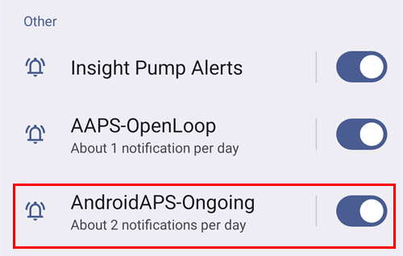

# Android Auto

**AAPS**能够将您当前状态的信息作为消息直接发送到汽车中的Android Auto显示屏上。

## 要求

**AAPS**使用Android Auto的一项功能，该功能允许将手机上的应用程序消息路由到Auto Audio的汽车显示屏上。

这意味着：

* Android must allow **AAPS** to show notifications and
* 由于**AAPS**是非官方应用程序，因此请允许Android Auto使用“未知来源”。

(androidauto-check-that-aaps-can-show-notifications)=

## Check that AAPS can show notifications

**AAPS** always shows a status notification with your current glucose, IOB and COB. This is the notification that Android Auto displays in the car. There is nothing to switch on in **AAPS**, but Android must allow **AAPS** to show notifications.

On your phone, open **Settings** > **Apps** > **AAPS** > **Notifications** and make sure **All AAPS notifications** is on.

Scroll down and make sure **Ongoing status** is on: this is the channel of the status notification.

Please check now that you see the **AAPS** status notification on the phone before you walk to your car!

(androidauto-allow-the-use-of-unknown-sources-with-android-auto)=

## 允许Android Auto使用“未知来源”

由于**AAPS**不是Android Auto的官方应用程序，因此必须在Android Auto中为“未知来源”激活通知。我们将通过开发者模式向您展示如何操作。

上车并将手机与汽车音响系统连接。

您现在应该会看到一个与此屏幕类似的屏幕。

点击**setting**（设置）图标开始配置。

向下滚动到页面底部，并选择**在手机上查看更多**。

现在，我们将在手机上激活开发者模式。

第一个屏幕如下所示。向下滚动到页面底部。

在那里，您会看到列出的Android Auto版本。连续点击Android Auto版本10次（按字面意思理解，十次）。通过此隐藏组合，您现在已启用开发者模式。

在模态对话框“Allow development settings?”（允许开发设置？）中，确认您要启用开发者模式。 

在**developer settings**（开发者设置）中启用“Unknown sources”（未知来源）。

现在，如果您想退出开发者模式，可以点击右上角的三个点菜单进行操作。

## 在汽车中显示通知

在汽车中的Android Auto上，点击右下角的**number icon**（数字图标）。

您的CGM数据将如下所示显示：

(android-auto-troubleshooting)=

## 故障排除:

* If you don't see the notification, check if you [allowed AAPS to show notifications](#androidauto-check-that-aaps-can-show-notifications) in Android and if [Android Auto has access rights to notifications](#androidauto-allow-the-use-of-unknown-sources-with-android-auto).