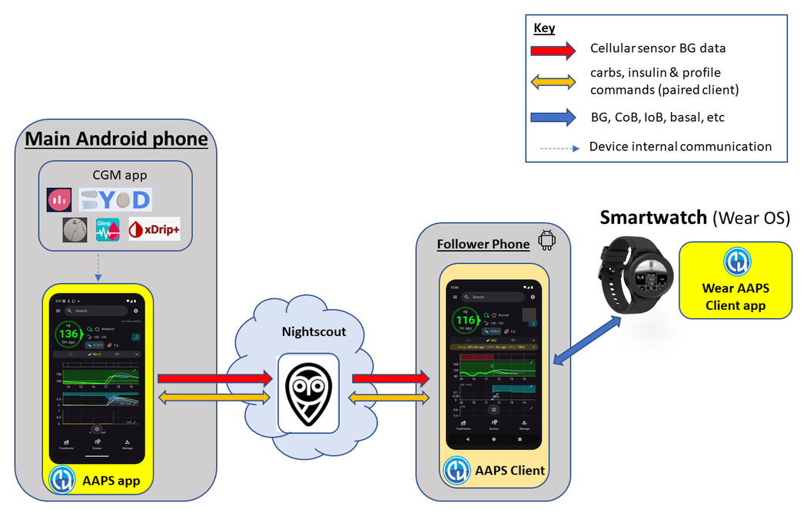

# 远程控制AAPS

```{contents} In this page
:backlinks: entry
:depth: 2
```

有四种高度有效的工具可用于远程管理**AAPS**：

1) [SMS commands](#RemoteControl_SMS-Commands) (follower phone can be either Android or iOS), 2) [AAPSClient](#RemoteControl_aapsclient) (follower phone is Android; an iPhone version is in development) 3) [Nightscout](#RemoteControl_nightscout) (Android, iOS or other computer/device), mainly for following: see the note on [client control](#client-master-control) in that section.  
4) [Smartwatches](#RemoteControl_smartwatches) (Android)

前三种大多适用于护理人员/家长，但智能手表对护理人员/家长以及成人糖尿病患者本身都非常有用。


(RemoteControl_SMS-Commands)=

## 1) 短信命令

请参见专门的[短信命令](../RemoteFeatures/SMSCommands.md)页面。

(RemoteControl_aapsclient)=
## 2) AAPSClient

**AAPSClient** looks very similar in appearance to **AAPS** itself, offering the caregiver the same screens and buttons to send commands remotely to **AAPS**:


(remotecontrol-aapsclient-versions)=
### About AAPSClient, AAPSClient2 and AAPSClient3

There are 3 versions of the client app: **AAPSClient**, **AAPSClient2** and **AAPSClient3**. They work the same way. The only difference is that they can be installed side by side on the same follower phone.

A caregiver who follows one person needs only **AAPSClient**. To follow and remote control a second person (with their own **Nightscout** site and their own **AAPS** phone), install **AAPSClient2** as well, and **AAPSClient3** for a third person. Each app is set up and [paired](#aapsclient-pairing-with-the-master) on its own, with the **Nightscout** site and the **AAPS** phone of the person it follows.

To tell the apps apart, some elements have a different color: yellow for **AAPSClient**, blue for **AAPSClient2** and green for **AAPSClient3**. Those elements are the app icon, the widget background, and the **AAPS** status section on the home screen of the app. <br/> Note: the opacity of the widget background can be set in the widget configuration. At a low opacity the color is hard to see.


### 下载与安装

**AAPSClient**可以安装在单个手机或多个跟随者手机上（即家长1的跟随者手机和家长2的跟随者手机），以便两位护理人员都能获得访问权限并远程控制患者的**AAPS**手机。

To download **AAPSClient**, navigate to the [Github repository](https://github.com/nightscout/AndroidAPS/releases/) and click on the asset **“app-AAPSClient-release_x.x.x.x”** (it may be a newer version to that shown in the screenshot below):


然后转到计算机上的_downloads_。在Windows上，-downloads_将显示右侧功能区：


下载完成后，点击_在文件夹中显示_以定位文件。

**AAPSClient** apk现在可以通过以下方式传输：

通过USB数据线传输到跟随者手机上；或者， 拖动到Google Drive文件夹中，然后点击“app-AAPSClient-release”文件将其添加到跟随者手机。

若您需自行使用**AAPS**，并需通过**AAPSClient**监测他人，必须自行构建**AAPSClient**而非按前述方式从GitHub仓库下载。原因是您无法在同一部手机上安装由不同密钥签名的**AAPS**与**AAPSClient**应用。<br/>自行构建**AAPSClient**时，请遵循与[常规AAPS构建](../SettingUpAaps/BuildingAaps.md)相同的流程。在**生成已签名的应用捆绑包或APK**页面时，请选择**aapsclientRelease**而非**fullRelease**。

The same rule applies when you install several client apps (**AAPSClient**, **AAPSClient2**, **AAPSClient3**) on one follower phone: they must all be signed with the **same key**. Otherwise Android refuses to install the second one (error `INSTALL_FAILED_DUPLICATE_PERMISSION`).

### Synchronization: AAPSClient and AAPS set up

Once the __AAPSClient__ apk is installed on the follower phone, make sure **NSClientV3** is set up the same way on both phones for Nightscout 15 (see the [update notes](../Maintenance/UpdateToNewVersion)). The example below shows the synchronization set-up with NSClientV3 and Nightscout 15; other data sources are available in __AAPS__ (e.g. xDrip).

In **Configuration** > **Communication**, the user synchronizes their data with Nightscout through __NSClientV3__ (using the v3 API), set up the same way for both __AAPS__ and the follower phone.


The user must ensure that __both__ the AAPS and AAPS Client phones are synched together by setting up NSClientV3 on each. On the follower phone this can be done by scanning a QR code shown by **AAPS** instead, see [Pairing AAPSClient with AAPS](#remotecontrol-pairing) below:

- Enter your **Nightscout URL** in the NSClientV3 **Settings**

- Enter your **Nightscout access token** in the same settings. Please follow the notes [here](https://nightscout.github.io/nightscout/security/#create-a-token). On the **AAPS** phone use an **admin token**: with it **AAPS** makes a token of its own for each follower phone.

- Enable **Use websockets** on **both** phones. On the **AAPS** phone websockets are **required** for remote control: without them, **AAPS** cannot receive commands from **AAPSClient**. On both phones they also make synchronization faster, at the cost of slightly higher battery use.


The user should ensure that both __AAPSClient__ and __AAPS__ are showing  ‘connected’ in the **NSClientV3** screen of each phone. At this point **AAPSClient** follows **AAPS** (BG, treatments, profile), but it cannot control it yet: pair the two phones as described below.

(remotecontrol-pairing)=
### Pairing AAPSClient with AAPS (remote control)

From **AAPS** version 4, **AAPSClient** controls **AAPS** through a secure, **paired** connection. Synchronization alone is not enough: until the phones are paired, **AAPSClient** only shows **Manage** with a view-only **Profile** and **Pair with master**.

1. On the **AAPS** phone, open **Manage → Authorized clients** and turn on **Allow client control** (it is off by default, and always on in Simple Mode).
2. Tap **+**, enter a name for the follower phone, choose how it is set up and choose its **role**:
   - **QR code: Nightscout and pairing** — **AAPS** shows a QR code that sets up Nightscout on the follower phone and pairs it, in one scan. This needs an admin token in the **AAPS** phone's NSClientV3 settings.
   - **PIN** — for a follower phone without a camera, already connected to Nightscout: note the one-time **PIN** (valid for about two minutes).
3. On the **AAPSClient** phone, scan the code (in the Setup Wizard, or **Manage → Pair with master → Scan QR code**), or open **Manage → Pair with master** and enter the PIN. Confirm.

The follower phone then appears as **Active** in the **Authorized clients** list, and **AAPSClient** shows **Treatments**, **Scenes** and **Manage**. The follower phone gets a Nightscout token of its own, with only the rights it needs. The full procedure, with screenshots and troubleshooting, is on [Master ↔ Client control](#client_master_master_setup).

Check that the set-up works: enter carbs on **AAPSClient**, confirm the amount shown, and check that the entry appears in **Treatments** on both phones.

(remotecontrol-nightscout-access-token)=

### Troubleshooting 'Nightscout access token' configuration issues

The precise 'Nightscout access token' configuration may differ depending upon whether your Nightscout provider is a paid for hosted site or not.

If you are struggling with **AAPS** to accept the 'Nightscout access token' and using a paid for hosted Nightscout site, you may wish to first liaise with your Nightscout provider on how to resolve the 'Nightscout access token' difficulties. 否则，请联系**AAPS**小组，但在这样做之前，请仔细检查您是否已正确按照[此处](https://nightscout.github.io/nightscout/security/#create-a-token)的说明操作。

### What AAPSClient offers

Once paired, **AAPSClient** offers the caregiver almost the same screens as **AAPS** itself:

- **Treatments**: insulin bolus, carbs and the bolus wizard.
- **Scenes**: start and stop [scenes](../DailyLifeWithAaps/Scenes.md).
- **Manage**: profiles, insulin settings, temporary targets, QuickWizard, automation, food, site rotation, pairing and the running temp basal.
- **Main menu**: treatments history, history browser, statistics, maintenance, configuration.

There is no pump and no objectives on **AAPSClient**. See [The AAPSClient app](AapsClient.md) for a detailed description.

**AAPSClient** lets the caregiver make most of the adjustments allowed directly in **AAPS**, **including insulin boluses**, remotely over the mobile or internet network. Every command is signed and sent through Nightscout to the **AAPS** phone, which checks it against its own data, caps it, shows you its own confirmation, and only then executes it. **AAPSClient** _can_ be much faster than [SMS Commands](../RemoteFeatures/SMSCommands.md), especially for commands that would need authentication.

Treatments entered in Nightscout by other means (for example the Nightscout website) are not applied while client control is on: **AAPS** is then in [hardened mode](#client-master-control-hardened-mode) and takes changes only from paired clients. With client control off, they are applied only if the matching **Receive** options are enabled in the [Synchronization section of NSClient preferences](#Preferences-nsclient-synchronization).

Remote control through **AAPSClient** is only recommended if your synchronization is working well (_i.e._ you don’t see unwanted data changes like self-modification of TT, TBR etc).

### AAPSClient与智能手表选项

智能手表是帮助管理孩子**AAPS**的非常有用的工具。有几种不同的配置可选。 If **AAPSClient** is installed on the caregiver's phone, the [**AAPSClient WearOS** app](https://github.com/nightscout/AndroidAPS/releases/) can be downloaded and installed on a compatible smartwatch which is connected to the parent's phone. This will show current BG and loop status. Once **AAPSClient** is paired with **AAPS**, the watch actions (including boluses, carbs, temp targets and profile changes) are relayed through **AAPSClient** to **AAPS**, which confirms and executes them: see [Wear OS on a client](#clientmastercontrol-wear-os-on-a-client). You can read more about Smartwatches [here](#remotecontrol-smartwatches).

(RemoteControl_nightscout)=
## 3) Nightscout

Nightscout不仅是“云”中的服务器，还有专用的**Nightscout**应用，可以直接从iPhone的App Store下载。如果您有Android跟随者手机，则没有专用的Nightscout应用，最好使用[**AAPSClient**](#2-aapsclient)，或者，如果您只想跟随而不发送治疗，可以从Playstore下载并安装[Nightwatch](https://play.google.com/store/apps/details?id=se.cornixit.nightwatch)应用。

在iPhone上安装**Nightscout**应用后，打开应用并按照设置提示操作，输入您的Nightscout地址（见下方左侧）。此形式可能因您的Nightscout托管方式而异。（_例如_ http://youraddresshere.herokuapp.com） 然后输入您的Nightscout API密钥（见下方右侧）。如果没有提示您输入API密码，则需要点击应用顶部的挂锁来输入：


有关设置的更多信息可直接从[Nightscout](https://nightscout.github.io/nightscout/discover/)获取

首次登录时，您将看到一个非常简单的显示。通过选择右上角的“汉堡菜单”并向下滚动来自定义显示选项：


向下滚动到“设置”。您可能希望将“刻度”更改为“线性”，因为BG显示的坐标轴默认值刻度是对数刻度，并在“使用基础率”下选择“default”，以便显示泵基础量。


选择您所需的选项。如果您使用其他应用进行警报，请取消选中警报。


继续向下滚动，直到到达“显示插件。

您需要确保选中了“护理面板（careportal）”，并且还可以选择各种其他指标（最有用的是：IOB、care portal、pump、cannula age、insulin age、basal profile和OpenAPS）。

重要的是，您现在需要点击底部的“保存”以使这些更改生效。


点击“保存”后，应用将返回您的主Nightscout屏幕，看起来像这样：

1. 当前血糖值
2. AAPS系统状态信息- 点击屏幕上的各个选项卡以显示更多详细信息。使用汉堡菜单添加或删除这些显示选项。
3. 最近的血糖轨迹，显示治疗情况（碳水化合物、推注）
4. 较长期的血糖轨迹
5. “汉堡菜单”用于设置显示选项、生成报告、编辑配置文件和Nightscout管理工具
6. "**+**" menu for entering treatments (see [below](#RemoteControl_nightscout-treatments) for when **AAPS** applies them).
7. 选择不同的时间段进行显示
8. 基础胰岛素配置文件
9. 绿色线=历史血糖 蓝色线=预测血糖


详细查看Nightscout应用右上角的菜单：

1. Careportal回顾性编辑？
2. 打开/关闭警报
3. 汉堡菜单-用于设置首选项
4. Careportal - Log treatment (see [below](#RemoteControl_nightscout-treatments) for when **AAPS** applies these)


灰色选项卡（如果您点击选项卡，则会显示更多信息）上的屏幕上有大量关于**AAPS**系统状态的信息：

1. 5分钟血糖趋势
2. 大剂量向导预览
3. 点击“基础率”查看当前配置文件和基础信息
4. 距离AAPS最新一次CGM读数的时间
5. **泵**：胰岛素、电池电量和AAPS最后一次连接到它的时间
6. AAPS最后一次刷新时间- 如果超过5分钟，可能表明AAPS手机与泵/CGM之间的连接存在问题
7. 点击“IOB”查看基础和推注胰岛素的分配
8. 储液器中的胰岛素使用时长
9. 管路使用时间
10. AAPS手机的电池状态
11. 数据库大小。如果它变得太大（仅限DIY Nightscout-托管服务会忽略），您可能会开始遇到连接问题。您可以通过汉堡菜单中的管理工具菜单删除数据来清理数据库。


点击页面底部的“刷新”以关闭弹出窗口。

(RemoteControl_nightscout-treatments)=
### 通过Nightscout应用向AAPS发送治疗

In **AAPS** 4 the supported way to control **AAPS** remotely is a **paired AAPSClient**, see [Master ↔ Client control](#client-master-control): each client has a [role](#client-master-control-roles) that limits what it may do, and every command is signed, checked and confirmed by the **AAPS** phone. While client control is on, the **AAPS** phone is in [hardened mode](#client-master-control-hardened-mode): treatments, temporary targets and profile switches entered on the Nightscout website or in the Nightscout app are **not** applied. The Nightscout app is then a tool for following only.

```{admonition} Only when client control is off
:class: warning
If **Allow client control** is off in **Manage → Authorized clients** (and Simple Mode is off), **AAPS** applies careportal entries from Nightscout only for the data types you turned on under **Receive** in the [Synchronization section of the NSClientV3 settings](#Preferences-nsclient-synchronization): carbs, temporary targets, profile switches and the other careportal entries. Insulin is never delivered this way: a "Correction bolus" entered in Nightscout is only *announced*, and **AAPS** counts it as insulin on board without delivering it. This set-up is not recommended for remote control; use a paired **AAPSClient** instead.
```

阅读[此处](https://nightscout.github.io/)有关**Nightscout**选项的更多信息

### 充分利用Nightscout应用的技巧

1). 如果您停留在某个页面并希望再次看到主屏幕，只需点击“refresh”（底部中间），这将带您回到显示BG图的**Nightscout**主页。

要查看当前在手机上运行的配置文件，请点击屏幕上方图表上的各种图标。通过点击“basal”可以查看更多信息（当前的碳水化合物比例、敏感性和时区等）。 “OpenAPS”提供了有关配置文件和当前目标等信息。还可以监控手机和泵的电池。 BWP提供了有关算法根据IOB和COB对未来情况的看法的信息。

#### 菜单中的其他图标：铅笔（编辑）是什么意思？

您可以使用编辑铅笔（从技术上讲）来移动或删除过去48小时内的大剂量或校正治疗。

有关此功能的更多信息请见[此处](https://nightscout.github.io/nightscout/discover/#edit-mode-edit)

虽然这在删除宣布的（但未推注的）碳水化合物时可能很有用，但实际上它与**AAPS**配合得并不好，我们建议您直接通过**AAPS**应用进行此类更改。

(RemoteControl_smartwatches)= (remotecontrol-smartwatches)=

## 4) 智能手表

### 选项1) 从Wear OS手表控制AAPS


一旦您在手表上[设置了**AAPS**](../WearOS/BuildingAapsWearOS.md)，您可以在[智能手表上操作Wear AAPS的详细信息](../WearOS/WearOsSmartwatch.md)中找到有关智能手表表盘及其功能的广泛信息。

简而言之，可以从智能手表触发以下功能：

* 设置临时目标

* 使用大剂量计算器（计算变量可以在手机设置中定义）

* 管理eCarbs

* 管理大剂量（胰岛素+碳水化合物）

* 手表设置

* 状态

* 检查泵状态

* 检查闭环状态

* 检查和更改配置文件、CPP（Circadian Percentage Profile=时间偏移+百分比）

* 显示TDD（每日总剂量=推注+每日基础量）

* 远程推注，其中护理人员和1型糖尿病儿童位于不同位置（如果手表和手机都连接到网络，这对于AAPS手表和AAPS手机是可能的）

#### 使用其他应用（如WhatsApp）从护理人员到手表的通信

可以在手表上添加其他应用，如WhatsApp，用于（例如）护理人员和孩子之间的消息通信。重要的是，手机只能关联一个Google账户，否则手表将无法传输这些数据。您需要年满13岁才能拥有Samsung账户，并且这需要在与Android手机相同的电子邮件地址中设置。

一个视频展示了如何在Galaxy 4手表上设置WhatsApp进行消息传递（你无法获得WhatsApp的全部功能），[点击此处](https://gorilla-fitnesswatches.com/how-to-get-whatsapp-on-galaxy-watch-4/)查看。

通过在手机上的**Galaxy 可穿戴**应用和手表上进行调整，可以实现WhatsApp消息以轻微震动提醒，并可在当前表盘上显示WhatsApp消息。

### 选项2）手表上的**AAPS**，用于远程控制手机上的**AAPS**

Similarly to using a follower phone with **AAPSClient** or SMS commands (see the sections above), a smartwatch can be used to remotely control **AAPS** and provide full profile data. A key difference to using a follower phone is that the smartwatch to **AAPS** phone link is via Bluetooth and needs neither Nightscout nor an authentication code. As a side-note, if both smartwatch and **AAPS** phone linked by Bluetooth are also on a Wi-Fi/Cellular data network, the watch will also interact with the **AAPS** phone, giving a longer range of communication. This includes remote delivery of a bolus where the caregiver with the **AAPS** watch and T1D child (with **AAPS** phone) are in different locations, which can be useful in circumstances where the T1D child is in school.

因此，遥控智能手表在以下任何情况下通常都很有用：

a)  **AAPSClient** or **SMS** commands cannot work; or

b)  The user wishes to avoid typing an authentication code (as required for SMS commands).

A smartwatch needs **Wear OS 3 or newer** to be able to control **AAPS**. Please check the technical specifications of the watch, and see the [Smartwatches page](../Getting-Started/Watches.md). 如果不确定，请在**AAPS**的Facebook/Discord群组中搜索或询问。

关于在流行的[Samsung Galaxy Watch 4（40mm）上设置**AAPS**的具体操作指南见下文。[佳明（Garmin）](https://apps.garmin.com/en-US/apps/a2eebcac-d18a-4227-a143-cd333cf89b55?fbclid=IwAR0k3w3oes-OHgFdPO-cGCuTSIpqFJejHG-klBTm_rmyEJo6gdArw8Nl4Zc#0)手表也是一个受欢迎的选择。如果您有设置其他智能手表的经验，并且认为这对其他人有帮助，请将这些信息添加到这些页面中[编辑文档](../SupportingAaps/HowToEditTheDocs.md)，以便与更广泛的**AAPS**社区分享您的发现。

### 选项3）手表上的AAPSClient用于远程控制手机上的**AAPS**



手表的软件，即**AAPSClient** Wear apk，可以直接从[Github](https://github.com/nightscout/AndroidAPS/releases/)下载。

To download the software, click on the watch app that matches the client app on the phone: **wear-aapsclient-release_**_version_ goes with **AAPSClient**, **wear-aapsclient2-release_**_version_ goes with **AAPSClient2** (see [About AAPSClient, AAPSClient2 and AAPSClient3](#remotecontrol-aapsclient-versions)):


然后点击“另存为”，并将文件保存到计算机上的方便位置：


**AAPSClient** wear apk可以通过与**AAPS** Wear应用相同的方式传输到您的手机并传输到手表上，具体操作详见[将手机上的AAPS Wear应用传输到您的AAPS手机](#remote-control-transferring-the-aaps-wear-app-onto-your-aaps-phone)。  


