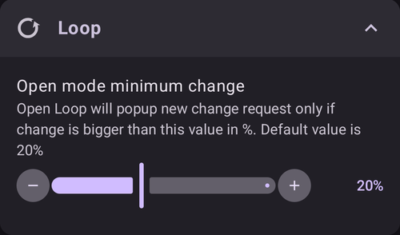

# 完成目标

**AAPS**有一系列必须完成的**目标**，以帮助用户从基础开环控制进步到混合闭环控制，并最终实现**AAPS**的全部功能。完成**目标**旨在确保您具备：

* 在您的**AAPS**设置中正确配置了所有内容；
* 了解了**AAPS**的基本功能；以及
* 对你的系统能力有一个基本了解，将有助于增强你使用 **AAPS** 的信心。

当 **AAPS** 首次安装时，你必须完成每个目标后才能继续下一个。随着每个**目标**的完成，新的功能将逐渐解锁。

**目标1至8** 将引导你从在智能手机上配置 **AAPS** 开始，直至实现“基础”混合闭环操作。这将需要大约6周的时间来完成。你可以使用一个虚拟泵（同时采用其他胰岛素输送方式）来完成至 **目标5**。 **Objectives 9 and 10** are designed to test more advanced **AAPS** features with the aim of better control of your diabetes, and will take up to 3 months to complete, possibly longer. 关于预计时间分配的更多详细信息，可在此处获取：[需要多长时间？ ](#preparing-how-long-will-it-take)

在逐步完成目标的同时，如果你需要，也可以移除你的进度并[回到早期的目标](#go-back-in-objectives)。

## 备份你的设置

```{admonition} Note
:class: 注意

建议在完成每个**目标**后导出你的**AAPS**设置！
```

强烈建议在完成每个目标后[导出你的设置](../Maintenance/ExportImportSettings.md)，以避免在 **AAPS** 中丢失任何进度。此导出过程会创建一个**设置文件**（.json），应将其备份在一个或多个安全的位置（例如Google Drive、硬盘、电子邮件附件_等_）。这可以确保你在 **AAPS** 中的任何进度都被保存。如果你的手机丢失或你不小心删除了进度，可以使用json文件重新加载到 **AAPS** 中，通过导入最近的设置文件来恢复。如果需要新的 **AAPS** 智能手机（由于升级、丢失、手机损坏_等_原因），也需要有备份的**设置文件**。

**设置**文件不仅会保存您在**目标**中的进度，还会保存您的所有**AAPS**设置，例如**最大餐前大剂量**等。

如果您没有备份您的设置，并且您的**AAPS**智能手机发生任何问题，那么您将需要从头开始重新完成**目标**。完成**目标**需要花费时间，因此，如果因为丢失智能手机等原因而不得不重新完成这些目标，那最好是避免这种情况的发生。

(objectives-objective1)=
## 目标1：设置可视化和监测，分析基础率和比例

**目标1**要求用户在**AAPS**中设置其基本的技术配置。在完成这一步之前，无法取得任何进展。

- Select the correct CGM/FGM in [Configuration → BG Source](#Config-Builder-bg-source). 有关更多信息，请参阅[血糖数据源](../Getting-Started/CompatiblesCgms.md)。
- Select the correct Pump in [Configuration → Pump](#Config-Builder-pump) to ensure your pump can communicate with **AAPS**. 如果你使用的泵型号没有适配 **AAPS** 的驱动程序，或者你想在完成早期**目标**时使用其他胰岛素输送系统，请选择**虚拟泵**。有关更多信息，请参阅[胰岛素泵](../Getting-Started/CompatiblePumps.md)。
- 如果使用Nightscout：
  - 按照[Nightscout](../SettingUpAaps/Nightscout.md)页面上的说明进行操作，以确保**Nightscout**能够接收并显示**AAPS**的数据。
  - Note that the URL in **NSClientV3** must be **_without_ "/api/v1/"** at the end - see [Settings → NSClientV3](#Preferences-nsclient).
- 如果使用Tidepool:
  - 按照[Tidepool](../SettingUpAaps/Tidepool.md)页面上的说明进行操作，以确保**Tidepool**能够接收并显示**AAPS**的数据。

Note - *You may need to wait for the next sensor glucose reading to arrive before **AAPS** will recognize it.*

(objectives-objective2)=
## 目标2：学习如何控制AAPS

**Objective 2** requires several ‘tasks’ to be actioned as shown in the screenshot below. Each task shows its status (**1**): the orange "**Not completed yet**" turns into "**Completed, well done!**" as soon as **AAPS** has registered the action. Tap **Hint** (**2**) underneath a task to open the related documentation, in case you are not familiar with a specific action yet.


完成**目标2**的任务包括：
- 将你的**配置文件**设置为90%，持续时间为10分钟。
  - _Hint_: Tap your Profile name on the main screen to open the **Profile** screen, then use the **Activate** (▶) button and set percentage and duration. 更多信息请参阅[配置文件切换&配置文件百分比](../DailyLifeWithAaps/ProfileSwitch-ProfilePercentage.md)。
  - _注意_：**AAPS** 不接受低于0.05U/hr的基础率。如果你的**配置文件**包含0.06U/hr或更低的基础率，你需要在完成此任务之前创建一个临时**配置文件**，其中包含更高的基础率。在完成任务后切换回你的正常**配置文件**。
- Simulate "taking a shower" by [disconnecting your pump](#AapsScreens-loop-status) in **AAPS** for a duration of 1h.
  - _Hint_: press the loop icon on the main screen to open the Loop dialog, then choose a duration under **Disconnect pump**.
- 通过重新连接你的胰岛素泵来结束“淋浴”状态。
  - _Hint_: press the "disconnected"-icon to open the loop dialog again and choose **Reconnect Pump**.
- 设置一个自定义的[**临时目标**](../DailyLifeWithAaps/TempTargets.md)，持续时间为10分钟。
  - _Hint_: press the target range on the main screen to bring up the temporary target screen.
- 展示**闭环**插件的内容。
  - _Hint_: open **Configuration → Loop** and tap "**Open plugin**".
- Use scroll or zoom on the BG chart to look at larger or smaller time frames.


(objectives-objective3)=
## 目标3：证明您的知识

**目标3**要求用户通过一项多项选择题考试，该考试旨在测试您对**AAPS**的了解程度。

有些用户发现 **目标3** 是最难完成的目标。请结合 **AAPS** 文档仔细阅读问题。如果您在研究了 **AAPS** 文档后仍然感到困惑，请在 [Facebook](https://www.facebook.com/groups/AndroidAPSUsers) 或 [Discord](https://discord.gg/4fQUWHZ4Mw) 群组中搜索“目标3”（因为很可能您的问题已经被问过并得到解答了）。这些群组可以提供友好的提示，或将您重定向到 **AAPS** 文档的相关部分。

在此期间：
- To reduce the number of notifications / decisions you are asked to make (temporary basal rates) while in Open Loop, set a wide target range in your **Profile** _e.g._ 90 - 150 mg/dL or 5.0 - 8.5 mmol/L.
- 你可能想要在晚上设置一个更宽的上限值，甚至禁用开环模式。

To proceed with **Objective 3**, tap a question row to open it. 请仔细阅读每个问题，并选择你的答案。

对于每个问题，可能有一个以上的答案是正确的！如果选择了错误的答案，该问题将在1小时内被锁定，之后你才能返回去重新回答。请注意，当你下次再尝试回答时，答案的顺序可能已经改变，这是为了确保你仔细阅读并真正理解了每个答案的有效性（或无效性）。

```{admonition} __What happens if new question(s) are added to an Objective when I update to a newer version of AAPS?__
:class: note
From time to time, new features are added to **AAPS** which may require a new question to be added to the **Objectives**, particularly **Objective 3**. 因此，任何添加到 **目标3** 的新问题都将被标记为“未完成”，因为 **AAPS** 要求您对此进行操作。不用担心，因为每个 **目标** 都是独立的，只要其他 **目标** 已完成，您**不会失去现有的 **AAPS** 功能**。
```

## 目标4：开始开环操作

The purpose of **Objective 4** is to recognize how often **AAPS** will evaluate the user's basal rate against glucose levels, and recommend temporary basal rate adjustments. 作为此 **目标** 的一部分，您将首次激活开环操作，并接受20个提出的临时基础率更改建议，如果需要，请手动在您的泵上应用这些更改。您还将观察[**临时目标**](../DailyLifeWithAaps/TempTargets.md)的影响。 If you are not familiar with setting a temporary basal rate change in **AAPS** yet, see the pump actions in the **Manage** sheet ([Where did the Actions tab go?](#screens-action-tab)).

完成此目标的最短时间：**7天**。这是一个强制性的等待时间。即使已经执行了所有基础率更改，也不可能在此之前进入下一个 **目标**。

- Select Open Loop by pressing the [Loop icon](#AapsScreens-loop-status) on the main screen and choosing **Open Loop** as running mode.
- 在7天内，至少手动执行20次临时基础率建议；将它们输入到你的（实体）胰岛素泵中，并在AAPS中确认你已接受这些建议。确保这些基础率调整在**AAPS**和**Nightscout**中都能显示出来。
- 必要时使用[**临时目标**](../DailyLifeWithAaps/TempTargets.md)。在治疗低血糖后，使用预定义的“低血糖临时目标”来防止系统在血糖回升时出现过度校正。
- 若您此刻仍处于[简易模式](#preferences-simple-mode)，现在可能是关闭该模式的最佳时机。

为了减少在开环模式下提出的基础率更改建议的数量，您仍然可以使用 **目标3** 中描述的技巧。 Additionally, you can change the minimum percentage for recommended basal rate changes with the "**Open mode minimum change**" setting in **Settings → Loop**. 值越高，你收到的更改通知就越少。



```{admonition} Note
:class: note

You don't need to action each and every system recommendation!
```
(objectives-objective5)=
## 目标5：了解你的开环系统，包括其临时基础率建议。

作为 **目标5** 的一部分，您将开始了解临时基础率建议是如何得出的。 This includes the [determination of basal logic](#aaps-screens-how-predictions-become-a-dosing-decision), analyzing the impact by observing [prediction lines in **AAPS Overview**](#aaps-screens-prediction-lines) (or Nightscout) and looking at the detailed calculations shown on the **OpenAPS SMB** plugin screen (**Configuration → APS → Open plugin**).

预计完成此目标的时间：**7天**。

此 **目标** 要求您确定并设置您的“每小时可设置的临时基础量最大值”（max-basal）值，如 [OpenAPS 功能](#Open-APS-features-max-u-h-a-temp-basal-can-be-set-to) 中所述。 This value can be set in [Settings → OpenAPS SMB](#Preferences-openaps-smb-settings). In [simple mode](#preferences-simple-mode), **AAPS** sets this value automatically and you don't need to change it. 如果您仍在使用虚拟泵，请确保在 **AAPS** 和您的胰岛素泵中都设置了此安全设置。

在您对**AAPS**的计算和设置感到满意之前，您可能会希望将[**配置文件**中的血糖目标值](#profile-glucose-targets)设定得比平时高一些。 You may wish to experiment with adjusting your **BG target** in your **Profile** being in a tighter range (say, 1 or less mmol/L [20 mg/dL or less] wide) and observe the resulting behavior.


```{admonition} If you have been using a virtual pump, change to a real insulin pump now!
:class: 注意
如果您正在使用虚拟泵进行开环操作，请**在此处停止**。只有在切换到使用实际胰岛素泵（用于输送胰岛素）后，才能在完成此 **目标** 时点击验证。

```


(objectives-objective6)=
## 目标6：使用低血糖暂停功能开始闭环操作


```{admonition} Closed loop will not correct high **BG** values in **Objective 6** as it is limited to **Low Glucose Suspend** only!
:class: note
You will still need to correct high BG values by yourself (manually with corrections by pump or pen)!
```

作为**目标6**的一部分，您将关闭闭环系统并激活其**低血糖暂停**（LGS）模式，同时将[最大活性胰岛素](#Open-APS-features-maximum-total-iob-openaps-cant-go-over)（max IOB）设置为零。您必须保持在低血糖暂停（LGS）模式下5天，以完成这个**目标**。您应该利用这段时间来检查您的**配置文件**是否准确，以及低血糖暂停（LGS）事件是否没有被过于频繁地触发。

完成此目标的最短时间：**5天**。这是一个强制性的等待时间。在此之前，您无法进入下一个 **目标**。

在您将闭环系统置于**低血糖暂停（LGS）**模式之前，至关重要的是您当前的**个人设置**（基础率、胰岛素敏感系数ISF、碳水系数IC）已经过充分测试。错误的**个人设置**可能会导致您出现低血糖情况，而这些情况需要手动处理。一个准确的**配置文件**将有助于减少在5天期间对低血糖治疗的需求。

**If you still observe frequent or severe low glucose episodes consider refining your [insulin type's DIA](#Config-Builder-insulin-dia), basal, ISF and carb ratios.** Please refer to the [Facebook](https://www.facebook.com/groups/AndroidAPSUsers) or [Discord](https://discord.gg/4fQUWHZ4Mw) group which has much discussion on this.


在**目标6**期间，**AAPS**会将最大活性胰岛素（maxIOB）设置覆盖为零。**当进入目标7时，此覆盖设置将结束。**

这意味着，在 **目标6** 期间，如果传感器血糖水平下降，**AAPS** 将为您减少基础胰岛素输送。 But, if sensor glucose levels are rising, **AAPS** will increase the basal rate above your **Profile** value only if **basal IOB** is negative as a result of a previous **LGS**. 否则，即使血糖水平上升，**AAPS** 也不会将基础率提高到当前配置文件值以上。这个提醒是为了避免在您学习使用**AAPS**的过程中出现低血糖。

**因此，您必须通过手动注射胰岛素来进行高血糖的校正。**

- If your IOB is negative (see screenshot below) a temporary basal rate (TBR) > 100% can be triggered in **Objective 6**.


- 将你的目标范围设置得比你通常的目标稍高一些，只是为了安全起见，并增加一个安全缓冲区。
- Enable 'Low Glucose Suspend' mode by pressing the Loop icon on the main screen and choosing **Low Glucose Suspend** as running mode.
- 通过查看“概览”屏幕上的青绿色基础率文本，或作为“概览”图表一部分的青绿色基础率渲染图，来观察活动的临时基础率。
- 在治疗低血糖后，你可能会暂时出现血糖升高的情况，而此时却无法通过增加基础率来使血糖反弹回落。

(objectives-objective7)=
## 目标7：调整闭环系统，将最大胰岛素在板（maxIOB）上调至0以上，并逐步降低血糖目标值

要完成 **目标7**，您必须完成闭环并将 [max IOB](#Open-APS-features-maximum-total-iob-openaps-cant-go-over) 提高到 0 以上。 **maxIOB** was zeroed out automatically in **Objective 6**, due to the Low Glucose Suspend mode. This is no longer the case. **AAPS** 将开始使用您定义的 maxIOB 值来纠正高血糖值。 In [simple mode](#preferences-simple-mode), **AAPS** sets maxIOB automatically and you don't need to change it.

完成此目标的最短时间：**1天**。这是一个强制性的等待时间。在此时间段结束之前，无法继续进行下一个**目标**。

- Select **Closed Loop** by pressing the [Loop icon](#AapsScreens-loop-status) on the main screen and choosing **Closed Loop** as running mode. 在闭环模式下保持1天。

- 慢慢地将你的“OpenAPS不能超过的最大总胰岛素在板量”（在OpenAPS中称为“max-iob”）提高到0以上，直到你找到最适合自己的设置。

此设置的默认建议是“**平均餐时大剂量 + 3 倍最大每日基础率**”，其中“最大每日基础率”是每天任何时间段内的最大每小时值。


这个建议应该被视为一个起点。如果你遵循这个规则，但发现AAPS在血糖水平上升时输送了过多的胰岛素，你可能需要：
* 降低“OpenAPS不能超过的最大IOB”的值；
* 逐一检查您的**配置文件**，并每次只进行一项调整。

另外，如果您非常胰岛素抵抗，请非常谨慎地提高 **maxIOB** 值。

一旦您对 **maxIOB** 适合您的闭环模式的程度有信心，就将您的 **血糖目标**降低到所需水平。

(objectives-objective8)=
## 目标8：如有需要，调整基础率和比例，然后启用Autosens

作为此**目标**的一部分，您将重新评估您的**配置文件**的性能，并将使用[Autosens](#Open-APS-features-autosens)功能作为错误设置的指示器。

完成此目标的最短时间**：7天**。这是一个强制性的等待时间。在此时间段结束之前，无法继续进行下一个**目标**。

Enable [Autosens](../DailyLifeWithAaps/KeyAapsFeatures.md) over a period of 7 days (in [simple mode](#preferences-simple-mode) it is enabled by default) and watch [**Overview**'s graph white line](#AapsScreens-section-g-additional-graphs) showing your insulin sensitivity rising or falling due to exercise or hormones etc. Keep an eye on the **OpenAPS SMB** plugin screen (**Configuration → APS → Open plugin**) which shows **AAPS** adjusting the sensitivity, basals and targets accordingly.

This is a good time to review your settings for [Sensitivity Detection](#Config-Builder-sensitivity-detection). You can view your sensitivity on the main screen in an [additional graph](#AapsScreens-section-g-additional-graphs).

Additionally, you can use [Autotune](#autotune-how-autotune-calculates-adjustments) as a one off to check your basals remain accurate or do a traditional basal test.

(objectives-objective9)=
## 目标9：为日间使用启用oref1的额外功能，如超微大剂量（SMB）

在 **目标9** 中，您将解决并使用**“超级微型大剂量（SMB）”**作为核心功能之一。在完成必读书籍的阅读后，你将很好地理解超级微量输注（SMB）是什么，它们是如何工作的，以及为什么在给予SMB后会将基础率暂时设置为零（零临时基础率）。

完成此目标的最短时间**：28天**。这是一个强制性的等待时间。在达到这个时间之前，你不能继续下一个目标。

- 本文档中的[SMB部分](#Open-APS-features-super-micro-bolus-smb)和[openAPS文档中的oref1介绍](https://openaps.readthedocs.io/en/latest/docs/Customize-Iterate/oref1.html)是理解**SMB**和**零临时基础率**概念的必读内容。
- 完成后，您可以提高 [max IOB](#Open-APS-features-maximum-total-iob-openaps-cant-go-over) 以使 **SMB** 更有效地工作。现在，maxIOB 包括了所有 **IOB**，而不仅仅是累积的基础量。此阈值将在 IOB 降至此值以下时暂停 **SMB**（_例如_，如果 **maxIOB** 设置为 7U，并且给予 8U 的推注来覆盖一餐：除非 **IOB** 降至 7U 以下，否则将暂停SMB）。一个良好的起点是将**maxIOB（最大胰岛素在板量）**设置为**平均餐时大剂量 + 3倍最大日基础率**，其中“最大日基础率”是指一天中任何时间段内的最大每小时值。请参阅 [目标7](#objective-7-tuning-the-closed-loop-raising-maxiob-above-0-and-gradually-lowering-bg-targets) 作为参考。
- Evaluate your carb absorption rate and consider changing the “min_5m_carbimpact”-parameter in [Settings → Absorption settings → min_5m_carbimpact](#Preferences-min_5m_carbimpact) if you find it too slow or too fast.

(objectives-objective10)=
## 目标10：自动化

当**目标10**启动时，**自动化功能**将变得可用。

完成此目标的最短时间**：28天**。这是一个强制性的等待时间。在达到这个时间之前，你不能继续下一个目标。

首先阅读文档页面 [Automation](../DailyLifeWithAaps/Automations.md)。

Set up the most basic automation rule; for example trigger an Android notification in a few minutes:
- Open **Manage → Automation** and tap the **+** button (**Add rule**).
- Enter a **Task name**, for example "My first automation notification".
- Under **Condition**, tap "**EDIT**".
  - Tap "**Add trigger**" and select "**Time**". **AAPS** creates an entry for today at the current time.
  - Change the time so that it triggers in a few minutes.
  - Tap the **Save** icon (top right) to go back to the rule.
- Under **Action**, tap "**ADD**" and select "**Notification**".
  - Enter a message in the action card, for example "My first automation".
- Tap the **Save** icon (top right) and make sure the rule is **Enabled**.
- 等待时间到达以触发通知（请注意，根据你的手机情况，可能会有几分钟的延迟）

然后，您可以尝试设置更有用的**自动化**。文档页面给出了几个示例，您还可以在 [Facebook](https://www.facebook.com/groups/AndroidAPSUsers) 群组中搜索“自动化”截图。 [Discord](https://discord.gg/4fQUWHZ4Mw) 社区中也有一个专用频道。

例如，如果您每天早上在上学/上班前都吃同样的早餐，您可以创建一个**自动化**，如“早餐前目标”，以在早餐前30分钟设置一个稍低的**临时目标**。在这种情况下，你的条件可能包括“重复时间”，这包括选择一周中的特定几天（星期一、星期二、星期三、星期四、星期五）和特定时间（早上6:30）。动作将包括“开始临时目标”，该目标的值低于平常，并持续30分钟。

## When all objectives are completed

Once you have accomplished all the **Objectives**, the list shows each of them with a tick and the date it was accomplished. The **Objectives** item disappears from the bottom navigation; you can still open the list with **Configuration → Constraints → Objectives → Open plugin**.


Press "**More**" under an objective to see its tasks again:


(CompletingTheObjectives-go-back-in-objectives)=
## 回顾目标

If you wish to go back in the **Objectives** for whatever reason, open the finished **Objective** with "**More**" and tap "**Reset finished state**":


In the same way, the **Objective** you are currently working on can be restarted with "**Reset started state**".
