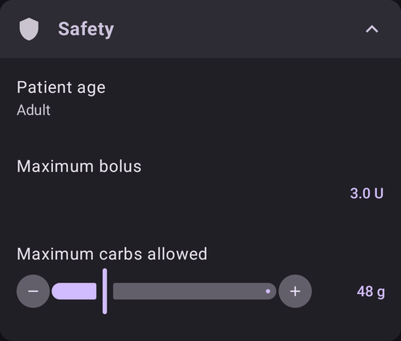
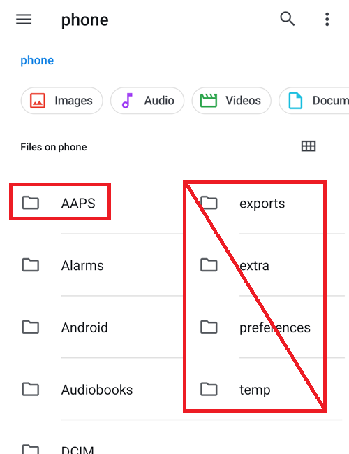

# Settings (Preferences)

In **AAPS** v4 the preferences are found on the **Settings** screen. There are three routes to reach them — see [Making changes to your AAPS' configuration](../SettingUpAaps/ChangeAapsConfiguration.md) for details:

1. Tap the **Settings** (gear) icon in the top-right corner of the main screen: all settings, grouped into expandable sections.
2. In **Configuration**, tap "**Settings**" underneath an active plugin: only that plugin's settings.
3. Use the **search bar** on top of the main screen: just start typing part of the text you are looking for. This finds individual settings (even those not visible in the Settings screen), dialogs and documentation.


- **Sections** are opened and closed by tapping them. The sections you see depend on the plugins you have enabled and on [Simple mode](#preferences-simple-mode).


```{contents}
:backlinks: entry
:depth: 2
```

(Preferences-general)=
## 常规


**单位**

- Set units to mmol/L or mg/dL depending on your preferences.

**语言**

- 新选项：使用手机默认语言（推荐）。

- 如果你想让**AAPS**使用与手机标准语言不同的语言，你可以从多种语言中选择。

- When you change the language, the texts of **AAPS** switch to the new language straight away. If some texts still show the old language, restart **AAPS**.
- 该设置在[简单模式](#preferences-simple-mode)下被隐藏。

(preferences-simple-mode)= **简单模式**

**简单模式**在首次安装**AAPS**时默认启用。在**简单模式**下，大量设置项将被隐藏，用户偏好配置将替换为预设值。当您熟悉**AAPS**界面及设置后，应关闭简单模式。

**Insulin concentration support**

- Enables support for different insulin concentrations (U50, U200, ...). Only enable this if you really use a concentration other than U100, and read the warnings carefully.
- 该设置在[简单模式](#preferences-simple-mode)下被隐藏。

**保持屏幕常亮**

- Forces Android to keep the screen on at all times. 这对于演示等场景很有用但它会消耗大量电池电量。因此，建议将手机连接到充电线。

**Instance name**

- The name of the person using this phone. It tells this **AAPS** instance apart in reports and synchronization, for example if two children with type 1 diabetes in your family use **AAPS**.
- Used in the names of exported settings files.
- 显示于[双表盘](../WearOS/WearOsSmartwatch.md)界面。

(Preferences-skin)=
### 皮肤

The skin selection from **AAPS** 3.x (Original, Low resolution, Large display...) no longer exists in **AAPS** 4. The new interface adapts to your screen automatically, and the color scheme can be changed in [Appearance](#preferences-appearance).

(preferences-appearance)=
## Appearance


(Preferences-range-for-visualization)=
### 可视化范围

Choose the high and low marks for the BG-graph on **AAPS** main screen and smartwatch. 这只是可视化，不是你的血糖目标范围。 Example: 70 - 180 mg/dL or 3.9 - 10 mmol/L

(Preferences-show-notes-field-in-treatments-dialogs)=
### Show notes in dialogs

允许您为自己的治疗方案（大剂量向导、碳水、胰岛素...）添加简短的文本备注。

该设置在[简单模式](#preferences-simple-mode)下被隐藏。

### App Color Scheme

Choose between the light theme, the dark theme, or following the phone's system setting.

(Preferences-protection)=
## 保护（Protection）


(Preferences-master-password)=
### 主密码

必须设置主密码才能[导出设置](../Maintenance/ExportImportSettings.md)，因为从版本2.7开始，设置是加密的。

**生物识别保护功能可能在一加手机上无法正常工作。这是一些一加手机上已知的问题。**


(Preferences-settings-protection)=
### 设置保护

- 使用密码或手机的生物识别身份验证（例如，[孩子正在使用**AAPS**](../RemoteFeatures/RemoteMonitoring.md)）来保护你的设置。 If you enable this feature, you will be prompted for authentication each time you want to access any Settings related view.

- The management screens (**Profile**, **Insulin settings**, **Temp Target**, **QuickWizard**) then open **read-only**. You can still activate or use an entry, but adding, editing, cloning and deleting are hidden until you unlock your settings. See [Settings protection now also locks the management screens](#v4changes-read-only-management).

- Custom password should be used if you want to use master password just for securing [exported settings](../Maintenance/ExportImportSettings.md), and use a different one for editing the settings.

- 如果使用自定义密码，请点击“设置密码”这一行，按照[上面](#Preferences-master-password)的说明设置主密码。

### 应用保护

If the app is protected, you must enter the password or use the phone's biometric authentication to open **AAPS**, and again when you come back to it after the [protection timeout](#Preferences-password-and-pin-retention).

如果输入的密码错误，**AAPS**将立即关闭，但如果之前已成功打开，它仍将在后台运行。

### 大剂量安全验证

- 如果**AAPS**由小孩使用，并且你通过[短信输注大剂量](../RemoteFeatures/SMSCommands.md)，大剂量安全验证可能很有用。

- **Bolus protection** can only be selected once **Settings protection** (Level 2) is set.

- In the example below, bolus protection uses the **Master password**: **AAPS** asks for it before opening a treatment dialog such as **Insulin**. With **Biometric**, if biometric authentication does not work, you can enter the master password instead.


(Preferences-password-and-pin-retention)=
### 密码和PIN保留时间

**Protection timeout** defines how long (in seconds) the settings or bolus functionalities remain unlocked after you successfully enter the password.

## 治疗安全



(preferences-patient-type)=
### Patient age

- 安全限制是根据你在这里选择的年龄来设置的。
- 如果你开始触及这些硬性限制（比如最大剂量），那就是时候更进一步了。
- 选择高于实际年龄是不明智的，因为如果在胰岛素对话框中输错数值（例如跳过小数点）可能会导致用药过量。
- 要了解这些硬性安全限制的具体数值，请在[此页面](../DailyLifeWithAaps/KeyAapsFeatures.md)上按您正在使用的算法来找。

(Preferences-maximum-bolus)=
### Maximum bolus

- 定义**AAPS**一次输注所允许的最大胰岛素量（以胰岛素单位计算）。
- 此设置作为安全限制存在，以防止因意外输入或用户错误而注入大量胰岛素。
- 建议将此设置为一个合理的数值，该数值大致对应于您一餐或校正剂量所需的最大胰岛素量。
- 此限制也适用于大剂量计算器的结果。

### Maximum carbs allowed

- 定义**AAPS**大剂量计算器计算结果所允许覆盖的最大碳水化合物量（以克计算）。
- 此设置作为安全限制存在，以防止因意外输入或用户错误而注入大量胰岛素。
- 建议将其设置为一个合理的量，大致对应于你一顿饭可能摄入的最大碳水化合物量。

## BG source

The settings of your selected [BG source](#Config-Builder-bg-source) appear as their own section. For example with **xDrip+ BG**:


- **Upload BG data to NS**: let **AAPS** upload the received BG values to Nightscout. Only enable this if the CGM app itself is not already uploading them.
- **Log sensor change**: create a sensor change therapy event automatically when the sensor is inserted.

## The main screen

In **AAPS** 3.x these settings were grouped in an "Overview" section. In **AAPS** 4 they are configured directly from the main screen elements they belong to.

(Preferences-buttons)=
### QuickLaunch buttons

Define which action buttons are visible on the main screen: tap the small **gear** at the bottom center of the main screen ("Configure QuickLaunch") and **Add** the actions you want quick access to (treatments, CGM actions, careportal entries...).


(Preferences-quick-wizard)=
### 快速向导

Create customized buttons for certain standard meals or snacks which will be displayed on the main screen. 适用于经常吃的标准餐食。

对于每个按钮，你定义碳水化合物和计算大剂量的方法。 Then, you define during which time period the button will be visible on your main screen - just one button per period. 如果当前时间不在指定的时间范围内，或者你的体内活性胰岛素（IOB）足以覆盖快速向导按钮中定义的碳水化合物，则按钮将不会显示。 If different times are specified for the different meals you will always have the appropriate standard meal button on the main screen, depending on the time of day.

To manage your Quick Wizard presets, type "QuickWizard" in the main screen search bar and open **QuickWizard - Manage quick wizard presets**.

如果你点击快速向导按钮，**AAPS**将根据当前比率计算并给出一个大剂量建议（参考血糖值和设置的活性胰岛素IOB）。

点OK确认之后才会按照建议进行输注。

(Preferences-default-temp-targets)=
### 默认临时目标

[临时目标（TT）](../DailyLifeWithAaps/TempTargets.md)允许你为特定的时间段更改血糖目标。设置默认TT时，你可以轻松地更改活动、即将进食等情况下的目标。

Tap the **target range** on the main screen to open the **Temp Target** screen. Swipe through the preset cards (Eating Soon, Activity, Hypo) and change the target and the duration of each preset under **Preset Settings**. 预设值为：

* Eating soon: target 90 mg/dL / 5.0 mmol/L, duration 45 min
* Activity: target 140 mg/dL / 7.8 mmol/L, duration 90 min
* Hypo: target 160 mg/dL / 8.9 mmol/L, duration 60 min


在这里了解如何[启用临时目标](#TempTargets-where-can-i-select-a-temp-target)。

### 输注/充盈标准胰岛素剂量

If you want to fill the tube or prime the cannula through **AAPS** you can do this with the **Prime/Fill** buttons in the expanded status panel of the main screen.

The default amounts of the three fill buttons can be defined in the **Prime/Fill** settings, depending on the length of your catheter. Type "prime" in the main screen search bar to open them.


(Preferences-status-lights)=
### 状态指示灯

状态指示灯为以下情况提供视觉警告：

- 探头使用时间
- 胰岛素使用时间（储液器使用天数）
- 储液器药量（单位）
- 管路使用时间
- 泵电池使用时间
- 泵电池电量（%）

如果超过警告阈值，数值将以黄色显示。如果超过临界阈值，数值将以红色显示。

To change the thresholds, expand the status panel on the main screen (chevron on the right of the status row) and tap the small **Settings** icon next to "Status":


Tap an item (**Cannula**, **Insulin**, **Sensor** or **Pump battery**) to open its warning and critical thresholds:


最后一个选项允许您从Nightscout导入那些设置（如果在Nightscout中已定义）。更多信息请参阅[Nightscout文档](https://nightscout.github.io/nightscout/setup_variables/#age-pills)。

(Preferences-deliver-this-part-of-bolus-wizard-result)=
### Bolus wizard settings

Type "bolus" in the main screen search bar to open the **Bolus wizard** settings:


**Bolus percentage** sets the [default percentage](#AapsScreens-section-j) of the bolus calculated when using the bolus wizard.

默认值为100%：不进行校正。即使在这里设置了不同的值，你每次使用大剂量向导时仍然可以更改它。如果这里设置为75%，并且你需要输注10U，大剂量向导将仅建议7.5单位的餐时大剂量。

在使用[SMB](#objectives-objective9)时，许多人不会输注所需胰岛素的100%，而只是其中的一部分（例如75%），并让SMB与UAM（无人值守用餐检测）完成其余部分。下面这些情况使用低于100%的值可能很有用：
* 对于消化缓慢的人：提前输送所有大剂量可能会导致低血糖，因为胰岛素的作用比消化快。
* 为**AAPS**自己处理**血糖升高**留下更多空间。在这两种情况下，如果认为合适，**AAPS**将通过SMB补偿缺失的部分大剂量。

**Use bolus advisor**

When enabled, if you use the bolus wizard while you are in hyperglycemia, you will get a warning, prompting you if you wish to pre-bolus and eat later, when your **BG** gets back in range.

(Preferences-advanced-settings-overview)=
### 超级大剂量Superbolus

The Superbolus option of **AAPS** 3.x is not available as a setting in **AAPS** 4.

## 闭环（Loop）

See [AAPS screens > The main screen > Loop status](#AapsScreens-loop-status) to change loop mode now.

(Preferences-minimal-request-change)=
### Open mode minimum change

在**开环**模式下，每次**AAPS**建议调整基础率，你都会收到通知。 To reduce the number of notifications you can either use a [wider bg target range](#profile-glucose-targets) or increase the percentage of the "**Open mode minimum change**" setting. 这定义了触发通知所需的相对变化量（如果建议的基础率变化低于这个值，AAPS会忽略掉，也就不会通知你）。


## 高级膳食助手（AMA）或超级微小大剂量（SMB）

Depending on your settings in [Configuration > APS](../SettingUpAaps/ConfigBuilder.md) you can choose between two algorithms:

- [高级膳食助手（OpenAPS AMA）](#Open-APS-features-advanced-meal-assist-ama) - 发布于2017年的算法
- [超级微小大剂量（OpenAPS SMB）](#Open-APS-features-super-micro-bolus-smb) - 推荐给初学者的最新算法

自[**AAPS** 3.3版本起](#version3300)，[动态ISF](../DailyLifeWithAaps/DynamicISF.md)功能已作为OpenAPS SMB的组成部分整合。

### OpenAPS AMA（高级膳食助手）

OpenAPS AMA的所有设置均在[AAPS关键功能>高级膳食助手（AMA）](#Open-APS-features-advanced-meal-assist-ama)中有专栏描述。

(Preferences-openaps-smb-settings)=
### OpenAPS SMB（超级微小大剂量）

OpenAPS SMB的所有设置均在[AAPS关键功能>超级微小大剂量（SMB）](#Open-APS-features-super-micro-bolus-smb)中有专栏描述。

The list of settings you see depends on your progress in the [Objectives](../SettingUpAaps/CompletingTheObjectives.md) and on [Simple mode](#preferences-simple-mode). On a new installation only **Use dynamic sensitivity** is shown. Once the objectives are completed, the section looks like this:


**Advanced Settings** at the bottom of the section holds values that you normally do not have to change:


## 碳水吸收率设置


(Preferences-min_5m_carbimpact)=
### SMB min 5m carbs impact (min_5m_carbimpact)

该设置在[简单模式](#preferences-simple-mode)下被隐藏。

该算法使用BGI（血糖影响）来确定[碳水化合物何时被吸收](../DailyLifeWithAaps/CobCalculation.md)。

有时，基于血糖反应无法动态计算出碳水化合物的吸收情况，**AAPS**会为你的碳水化合物插入一个默认衰减。基本上，它是一个故障保护机制。这个值只在两种情况下起效，一是**CGM**读数缺失时，二是运动“消耗了”本该由**AAPS**的COB来覆盖的血糖时。

简而言之：算法“知道”在当前剂量胰岛素等的影响下，你的血糖*应该*如何变化。 Whenever there is a positive deviation from the expected behavior, some carbs are absorbed/decayed. 数值越大=吸收越多的碳水化合物。

min_5m_carbimpact定义了每5分钟的默认碳水化合物吸收影响。 For the full parameter reference see [OpenAPS's preferences and safety settings documentation](https://openaps.readthedocs.io/en/latest/docs/While%20You%20Wait%20For%20Gear/preferences-and-safety-settings.html?highlight=carbimpact#min-5m-carbimpact).

Standard value for AMA is 3, for SMB it's 8.

The COB graph on the main screen indicates when min_5m_carbimpact is being used by putting orange dots along the top of the COB curve.


### Absorption cutoff

Time at which any meal is considered absorbed; remaining carbs will be cut off. 如果你经常吃高脂肪或高蛋白膳食，则需要增加膳食吸收时间。

### 高级设置 - 自动灵敏度比率（autosens ratio）


- 定义最小和最大[自动灵敏度（autosens）](#Open-APS-features-autosens)比率。
- 通常，不应更改标准值（最大1.2，最小0.7）。

## 胰岛素泵


### 蓝牙看门狗

如有必要请激活蓝牙看门狗（例如，对于Dana泵）。 It switches off Bluetooth for one second if no connection to the pump is possible. This may help on some phones where the Bluetooth stack freezes.

## 泵设置

The options here will vary depending on which pump driver you have selected in [Configuration > Pump](#Config-Builder-pump). Pair and set up your pump according to the [pump-related instructions](../Getting-Started/CompatiblePumps.md).

For example with the **Virtual Pump**, the section is called **Virtual pump settings**. You choose the **Pump type** the virtual pump imitates, and whether its status is uploaded to Nightscout:


## Tidepool

在[Tidepool](../SettingUpAaps/Tidepool.md)页面上有更多信息。

(Preferences-nsclient)=
## NSClient


The NSClient plugin (shown as **NSClientV3** in the configuration menu) synchronizes your data with Nightscout. It uses the Nightscout API v3.

```{admonition} Data uploaders
:class: warning

When using NSClientV3, all uploaders must use the Nightscout API v3. If another uploader (for example your CGM app) is not API v3 compliant, **let **AAPS** upload all data** (BG, treatments, ...) to Nightscout and disable that uploader.
```

- 设置您的*Nightscout网址*（例如<https://yoursitename.yourplaform.dom>）。
- **确保网址末尾没有 /api/v1/。**
- In Nightscout, create an *[Admin token](https://nightscout.github.io/nightscout/security/#create-a-token)* (requires [Nightscout 15](https://nightscout.github.io/update/update/) to use the V3 API) and enter it in the **Nightscout access token** (not your API Secret!). On **AAPSClient** you can scan the main phone's QR code instead, which sets up a token of the client's own. A client paired with the PIN gets its own token from the main phone after pairing. See [The client's own Nightscout token](#client-master-control-own-token).
- 这使得数据能够在Nightscout网站和**AAPS**之间读取和写入。
- 如果您在目标1中遇到了问题，请仔细检查此处是否有拼写错误。
- Leave "Use websockets" enabled (recommended).

(Preferences-nsclient-synchronization)=
### 同步


同步选项将取决于您希望使用**AAPS**的方式。

您可以选择您想要[从Nightscout上传和下载哪些数据](#Nightscout-aaps-settings)。

While client control is on (always in Simple Mode), these settings are hidden: **AAPS** is then in [hardened mode](#client-master-control-hardened-mode), takes no changes made directly in Nightscout and uploads all its data.

### 报警选项


- “警报选项”允许您选择要通过该应用程序使用的Nightscout警报。当Nightscout警报触发时，**AAPS**将会发出警报。
- 为了使警报响起，您需要在您的[Nightscout变量](https://nightscout.github.io/nightscout/setup_variables/#alarms)中设置紧急高血糖、高血糖、低血糖和紧急低血糖警报值。
- They will only work while you have a connection to Nightscout and are intended for parent/caregivers.
- If you have the **CGM** source on your phone (i.e. xDrip or BYODA) then use those alarms instead of Nightscout Alarms.
- NS announcements will echo Nightscout [announcements](https://nightscout.github.io/nightscout/discover/#announcement) in the **AAPS** notifications.
- 当一段时间没有从Nightscout接收到数据时，您可以更改数据超时警报和紧急数据超时警报的阈值。

### 远程控制

The switch "**Allow client control**" is no longer in these settings: it is at the top of **Manage → Authorized clients**, where the paired clients are managed. See the dedicated [Client / Master control](../RemoteFeatures/ClientMasterControl.md) page, including [hardened mode](#client-master-control-hardened-mode), which this switch turns on.

### 连接设置


- 连接设置定义了何时启用与Nightscout的连接。
- 将Nightscout上传限制为仅通过Wi-Fi进行，甚至限制为特定的Wi-Fi SSID。
- 如果您只想使用特定的Wi-Fi网络，可以输入其Wi-Fi SSID。
- 多个SSID可以用分号分隔。
- 要在字段中删除所有SSID，请输入一个空格。

(Preferences-advanced-settings-nsclient)=
### 高级设置（NSClient）


高级设置中的选项都是一看就能明白。

## SMS短信通讯器

有关更多信息，请访问专门的[SMS命令](../RemoteFeatures/SMSCommands.md)页面。

(preferences-wear)=
## 手表

This section is shown when the **Wear** plugin is enabled in [Configuration > Communication](#Config-Builder-wear). More information on the dedicated [Wear OS smartwatch](../WearOS/WearOsSmartwatch.md) and [Operation of AAPS via your Wear OS smartwatch](../RemoteFeatures/RemoteControlWearOS.md) pages.


- **Wear control**: allow treatments and other actions to be sent from the watch. Without it, the watch only displays data: the phone refuses any command from the watch, and tapping a complication that would open a control screen opens the **AAPS** menu on the watch instead.

**Wear Wizard Settings** defines which calculations are included in the result of the bolus wizard on the watch. On the watch you only enter the carbs; these switches replace the choices you would make in the bolus wizard on the phone:

- **Include BG in wizard**: add a correction for the difference between your current glucose and your target.
- **Include temp target in wizard**: use the running temp target instead of the profile target for this correction.
- **Include trend in wizard**: take the current glucose trend into account.
- **Include COB in wizard**: add insulin for the carbs that are still on board.
- **Include IOB in wizard**: subtract the insulin that is still on board.


**Custom Watchface Settings** contains **Authorize custom watchfaces**. A custom watchface file can include values for some watch settings. When this switch is on, loading such a watchface is allowed to change those settings on the watch; when it is off, the watchface is loaded but the settings stay as they are:


**General Settings** contains **Notify on SMB**, to get a notification on the watch each time an SMB is delivered:


## Autotune

This section is shown when the **Autotune** plugin is enabled in [Configuration > General](#Config-Builder-autotune). The settings are described on the dedicated [Autotune](../AdvancedOptions/Autotune.md) page.


## 自动操作


选择要使用的定位服务：

- 使用被动位置：只有当其他应用请求时，**AAPS**才会获取位置信息。
- 使用网络位置：您的Wi-Fi位置
- 使用GPS位置（注意！可能会导致电池电量飞降！）

## 本地警报


设置一看就能明白。

(preferences-maintenance-settings)=
## 维护设置


**邮件接收地址**：日志的标准接收地址为<logs@aaps.app>。

**Number of logs to send**: how many of the most recent log files are attached when you send logs.

**数据选择**


您可以通过向开发者发送崩溃报告来帮助**AAPS**进一步发展。

**无人值守设置导出**<br/> 启用此功能后，您将允许**AAPS**自动执行设置导出操作，无需用户手动干预。为此，主密码将在下次手动导出时安全地存储在您的手机上（仅限于此）。存储的密码将有效期长达4周。 4周后，您将收到密码即将到期的通知。在为期1周的宽限期内，您可以通过从维护菜单手动导出设置来刷新密码。

1周的宽限期过后，存储的密码将过期，任何自动化设置导出都将中止，并通知用户重新输入密码。 [(**Automated settings exports**)](../DailyLifeWithAaps/Automations.md#automating-preference-settings-export) will be logged to the **AAPS** 'Careportal' and 'User entry' lists under Treatments.

启用此功能后，需立即执行一次手动设置导出操作。此时系统将要求您输入密码，**AAPS**会加密存储该密码以实现后续自动导出。

### Log files

AAPS will save logs for troubleshooting.

Do not disable this feature: it will help understanding the reasons if something goes wrong.

If you need to send the logs to the developers, make sure you accurately describe the issue in the email. It is preferable to send logs only after being requested to do so, following an [issue report in GitHub](https://github.com/nightscout/AndroidAPS/issues).

You can find AAPS logs in your phone memory -> Android -> data -> info.nightscout.androidaps -> files.

Log handling (log settings, sending and deleting logs) and file management are found on the **Maintenance** screen, opened from the **menu** (☰) in the top-left corner of the main screen:


(preferences-maintenance-logdirectory)=

### Setting the local AAPS directory

The **Maintenance** screen also includes the **AAPS directory**. 此设置允许用户在手机上选择一个目录，供**AAPS**存储偏好设置、日志及其他文件。 Once a directory is chosen, its path (for example `Documents/AAPS`) is shown below **AAPS directory**, so you can always see where your files are saved.

It is strongly recommended to use a directory directly in the main entry of your phone memory. Default is AAPS.



If you select a subdirectory of AAPS, you will see an error message. Tap "OK" and retry, selecting the correct directory (one above). Do not select "DISMISS" unless you clearly know what you are doing.


Android can silently take the directory permission away, for example after you reinstall **AAPS** or clear its storage. When that happens, **AAPS** shows a persistent **Access to the AAPS directory was lost** notification and local settings export stops working until you come back here and select the directory again. Do this promptly, otherwise your backups on the phone are no longer refreshed.

(preferences-maintenance-cloud)=

### Setting a cloud directory

You can export your settings, logs and CSV data to a cloud service.

1. Open the **menu** (☰), select **Maintenance** and tap **Cloud Directory** (under **File management**).

   

2. In **Select Storage Type**, select **Google Drive**.

   

3. A Google sign-in page opens. Choose the Google account that will hold your backups (you can use a [dedicated Google account](../UsefulLinks/DedicatedGoogleAccountForAaps.md)).

   

4. Check that the account is the right one and tap **Continue** to give **AAPS** access. If you set up the cloud directory before, the page says that **AAPS** already has some access.

   

5. Back in **AAPS**, the message **Cloud storage authentication successful** appears at the bottom of the main screen:

   

   In the **Maintenance** menu, **Cloud Directory** now has a green dot, and the **Cloud** buttons next to **Send logs**, **Export settings**, **Import settings** and **Export User Entries to Excel (csv)** are available.

   

To stop exporting to the cloud, tap the **✕** (**Clear Settings**) icon at the end of the **Cloud Directory** row in the **Maintenance** menu (it is shown once a cloud service is set up) and confirm **Clear Cloud Settings**. This switches back to local storage and clears the authorization.

## 开源人类项目（Open Humans）

您可通过向研究项目捐献数据来助力科研社区！详细信息在[Open Humans页面](../SupportingAaps/OpenHumans.md)上有描述。

In **Settings → Open Humans**, you can define when data shall be uploaded
- 仅在连接到Wi-Fi时
- 仅在充电时
