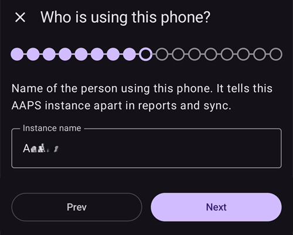
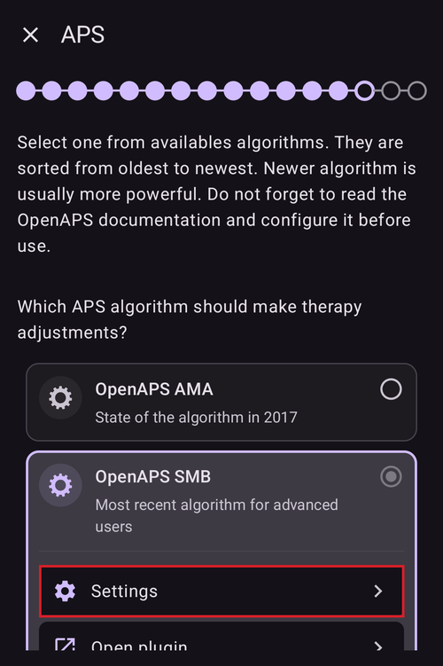

# AAPS 设置向导

```{contents} In this page
:backlinks: entry
:depth: 2
```

当您首次启动 **AAPS** 时，**设置向导** 会引导您一次性快速完成应用程序所有的基本配置。**设置向导** 的目的是为了避免遗漏关键步骤。例如，**权限设置** 对于正确设置 **AAPS** 至关重要。

然而，在首次使用 **设置向导** 时，并不一定要完全配置所有内容，您可以轻松退出向导并在稍后返回。 There are three routes available after the **Setup Wizard** to further optimize/change the configuration. 这些内容将在下一节中进行解释。所以，如果您在设置向导中跳过了一些步骤，也没关系，您稍后可以轻松地进行配置。

在使用 **设置向导** 期间和之后，您可能发现**AAPS** 没啥明显的变化。要启用您的 **AAPS** 循环，您必须按照 **目标** 启用各个功能。您将在 设置向导 结束时开始**目标 1**。您是 **AAPS** 的主人，别搞反了。

```{admonition} Preview Objectives
:class: 注意
如果您急于了解“目标（Objectives）”都是有哪些，请阅读 [完成目标](../SettingUpAaps/CompletingTheObjectives.md)，但之后请先返回这里运行 设置向导。

```

根据以往经验，我们了解到新用户往往急于尽快设置 **AAPS**，这可能会导致挫败感，因为学习曲线可能很陡峭。

因此，请花点时间配置您的闭环，运行良好的 **AAPS** 闭环将带来巨大的好处。

```{admonition} Ask for Help
:class: 注意
如果文档中有错误，或者您有更好的解释方法，您可以按照 [联系其他用户](../GettingHelp/WhereCanIGetHelp.md) 中的说明向社区寻求帮助。
```
## 欢迎信息

When the Setup Wizard opens, it greets you with a short welcome message and immediately shows a "**Permissions Required**" panel at the bottom of the screen (see next section).

Once you have granted the permissions, the panel closes and the welcome screen shows a "**Next**" button. Press "**NEXT**" to continue:


## 所需权限

**AAPS** needs a few permissions to operate correctly. The Wizard groups them on a single "**Permissions Required**" panel, each with its own "**Grant**" button. Grant them one by one — the icon next to each item turns into a tick once it is done.


### Battery optimization

Battery consumption on smartphones is a consideration, as the performance of batteries is still quite limited. Therefore, the Android operating system on your smartphone is restrictive about allowing applications to run and consume CPU time, and therefore battery power.

然而，**AAPS** 需要定期运行，例如，每几分钟接收一次血糖读数，然后根据您设定的参数来应用算法，以决定如何调整您的血糖。 Therefore it must be excluded from battery optimization.

Press "**Grant**" next to "**Battery Optimization**", then select "**Allow**" on the "Let app always run in background?" dialog:


(SetupWizard-StoragePermission)=

### AAPS Directory

**AAPS** needs to store its settings and log information on the permanent storage of your smartphone. 永久存储意味着即使在重新启动智能手机后，信息仍然可用。（PC硬盘的概念）其他信息只是丢失了，因为它们没有被保存到永久存储中。

Press "**Grant**" next to "**AAPS Directory**". This opens the file system on your phone and lets you choose where **AAPS** stores its information.

```{tip}
Choosing the default AAPS directory is recommended.</br>
Do **not** select a subdirectory of AAPS.
```

默认目录为**AAPS**，但您可使用任意专用目录。 Create the directory if necessary, enter it and choose "**USE THIS FOLDER**":


Confirm with "**ALLOW**" that you wish to grant access to **AAPS** to the selected directory:


### Notifications

如果应用程序想要向您发送通知，Android 需要特殊权限。

While it is a good feature to disable notifications _e.g._ from social media apps, it is essential that you allow **AAPS** to send you notifications.

Press "**Grant**" next to "**Notifications**" and select "**Allow**" at the system prompt:


### Alarms and reminders

On **Android 14 and newer**, **AAPS** needs the "**Alarms and reminders**" permission so that alarms can wake the screen while **AAPS** is in the background, and so that reminders (for example from an **Automation**) ring on time.

This item is only shown while it is needed. Once **AAPS** is excluded from battery optimization (see above), Android grants exact alarms automatically and the item disappears. If it is still listed, press "**Grant**" next to "**Alarms and reminders**". This opens a system settings screen for **AAPS**; enable the toggle and return to **AAPS**. On Android 13 and older this item does not appear and no action is needed.

Once all the permissions show a tick (three, or four on Android 14 and newer), the "**Permissions Required**" panel closes by itself and you can press "**NEXT**" on the welcome screen to continue.

(setup-wizard-bluetooth-battery-optimisation)=
### Bluetooth battery optimization

```{admonition} Extra Android setting, not part of the Wizard
:class: note
The following is additional Android configuration done outside of the Setup Wizard. It is not one of the "Grant" buttons above, but it is important for a reliable pump connection.
```

Newer versions of Android have added battery optimization to the system Bluetooth application too.

As well as disabling battery optimization for **AAPS**, you will likely need to also disable this for the Bluetooth system app. Failure to do this may lead to pump connection dropouts and issues.

***NOTE: The xDrip documentation covers how to do this here: [xDrip documentation](https://navid200.github.io/xDrip/docs/BluetoothBatteryOpt.html)***

Follow these steps on Android 16; other versions will vary slightly from the provided screenshots:

1. Open Android settings and search for **Apps**, and open the Apps settings.

   

2. You will see the App settings, however we need to expand to see all apps, click on **See all apps** to expand.

   

3. As the Bluetooth app is a system app, it's hidden by default, so we need to show system apps. Click on the **three dots** (⋮) on the top right (1). Then click on **Show system** (2).

   

4. Search for the `Bluetooth` app and click on `Bluetooth` and/or `Legacy Bluetooth` if both are present ensure the procedure is followed for both.

   ***NOTE: It's safe to ignore the `Bluetooth MIDI Service` this is not used by AAPS***

           

   1. On Android 12 Click on `Battery`, Android 13+ Click on `App battery usage`,

   )   

5. On Android 12+ select the `Unrestricted` option, on Android 15+ you need to expand the `Allow background usage` setting, click on the section highlighted in red to do this then follow step 6 to complete.

       

6. On Android 16 Select `Unrestricted`

   

## 许可协议

在最终用户许可协议中，有关于使用 **AAPS** 的法律方面的重要信息。请仔细阅读。

如果您不理解或不能同意最终用户许可协议，请不要使用 **AAPS**！

If you understand and agree, please press the "**I UNDERSTAND AND AGREE**" button and follow the Setup Wizard:


A "**Next**" button appears once you have agreed. Press "**NEXT**".

The next screen, "**Permissions**", lists the permissions again. They should all show a tick, as you granted them at the start. If one is missing, press "**Grant**" next to it. Press "**NEXT**" to continue:


## 主密码

As the configuration of **AAPS** contains some sensitive data (_e.g._ the access token for your Nightscout server) it is encrypted by a password you set here.

The Wizard shows "**Password not set**". Press "**Set**":


This opens the "**Protection**" screen. Press "**Master password**" (shown as "Password not set"):


Enter the same password in both fields and press "**OK**":


Go back with the arrow in the top left corner. The Wizard now shows "**Password set!**":


```{admonition} Do not lose your Master Password
:class: danger
Please **DO NOT LOSE YOUR MASTER PASSWORD**. Make a note of it _e.g._ on Google Drive, which is a good place as it is backed up by Google for you. 您的智能手机或电脑可能会崩溃，而您可能没有实际备份。如果您忘记了主密码，以后可能会很难恢复您的配置文件和进度，尤其是在完成目标的过程中。
```

When you are done, press "**NEXT**" to go to the next screen.

(setup-wizard-import-settings)=
## 导入配置

This screen is only shown when **AAPS** finds settings exported earlier in the **AAPS** directory ("Stored settings found"), for example when you reinstall the app or move to a new phone.

- To restore your previous configuration, press "**Import settings**" — see [Export & import settings](../Maintenance/ExportImportSettings.md).
- To start with a new configuration, press "**NEXT**" and continue with the Wizard.


## 单位（mg/dL <-> mmol/L）

Please select if your glucose values are in mg/dL or mmol/L, then press the "**NEXT**" button:


## Display Settings

Here you set the "**LOW mark**" and "**HIGH mark**" for the sensor glucose display. Glucose values between these two marks are shown as "in range". You can leave the default values (72 and 180 mg/dL) for now, and edit them later.

您选择的值仅影响图表的图形表示，而不影响其他内容。

您的血糖目标（例如）在您的配置文件中单独配置。

用于分析 TIR（入框时间）的范围在您的报告服务器上单独配置。

Adjust the marks with the "−" / "+" buttons if needed, then press the "**NEXT**" button:


(SetupWizard-synchronization-with-the-reporting-server-and-more)=
## Communication

The "**Communication**" screen lists the plugins used to upload, synchronize and broadcast your data:

- **SMS Communicator** – remote control of **AAPS** using SMS commands
- **NSClientV3** – synchronizes your data with Nightscout using the v3 API
- **Tidepool** – uploads data to Tidepool
- **xDrip** – sends data to xDrip
- **Open Humans** – upload and donate your diabetes data to scientific projects
- **Wear** – monitor and control **AAPS** from a WearOS watch
- **External Companion Apps** – data broadcasting to various external apps
- **Garmin** – connection to a Garmin device


Scroll down to see the rest of the list:


You could configure several of these now, but for the first run we will just focus on the reporting server. If you are not able to set it up at the moment, skip it for now — you can configure it later.

In this example we use Nightscout as reporting server. Tick the box on the right of "**NSClientV3**" to enable it. 对于 Tidepool 来说更简单，因为您只需要个人登录信息。

Once enabled, press "**Settings**" below NSClientV3 to configure it:


Here you configure the Nightscout reporting server. The NSClientV3 settings are shown as one scrollable page:


Press "**Nightscout URL**" and enter your personal Nightscout server address (the URL you set up yourself, or were given by your service provider). Confirm with "**OK**".

Press "**Nightscout access token**" and enter the access token for your Nightscout server. 没有这个令牌，将无法访问。 If you don't have it yet, please check the documentation for setting up the reporting server.

Leave "**Use websockets**" enabled for real-time communication with Nightscout.

The remaining sections can be left at their defaults for now. They are described here so you know where to find them later:

**Alarm options** — Nightscout alarms, announcements and stale-data thresholds. Leave the switches off for now; we only open them so you are aware of the options.

**Connection settings** — choose how data is transferred. Caregivers must enable "**Use cellular data**", otherwise the phone of the person they care for (_e.g._ a child) cannot upload outside Wi-Fi range, _e.g._ on the way to school. Other users can disable cellular transfer to save data or battery. If in doubt, leave everything enabled.


**Advanced Settings** — enable "**Log app start event**" if you want to see in Nightscout when the app restarts (useful for caregivers). Keep "**Create announcements from errors**" and "**Create announcements from carbs required**" enabled. Leave "**Use slow sync**" off; you would only use it if the Nightscout server is slow to process a large amount of data.


Go back to the list of plugins and press "**NEXT**" to go to the next screen.

## Client control

From **AAPS** version 4, client devices running **AAPSClient** can be **paired** with this phone (the **master**) and control it with signed commands sent over Nightscout. This is the new recommended way to control **AAPS** remotely — see [Master ↔ Client control](../RemoteFeatures/ClientMasterControl.md) for the full explanation and setup.

There is nothing you have to configure on this screen now; you can pair clients at any time later from **Manage → Authorized clients**. There you add a client with a **QR code** (it sets up Nightscout on the client too) or with a **PIN**, and give it a **role**.

- "**Authorized clients**" — manage the paired client devices allowed to control this master.
- "**Nightscout data acceptance**" — accepting treatments and data entered directly in Nightscout (the old, less secure way) is now turned off by default. Only open these settings if you still need it, _e.g._ to enter data through Nightscout or third-party apps.

When client control is already on — always in [Simple Mode](#preferences-simple-mode) — this phone is in [hardened mode](#client-master-control-hardened-mode): it takes changes only from paired clients, so the screen explains hardened mode instead of offering the "**Nightscout data acceptance**" settings.


"**Nightscout data acceptance**" opens the "**Synchronization**" settings, where each kind of data received from Nightscout has its own switch:


Press "**NEXT**" to go to the next screen.

(setup-wizard-instance-name)=
## Who is using this phone?

Here you enter the name of the person using this phone. It tells this **AAPS** instance apart from others in reports and when synchronizing, for example if two children in your family use **AAPS**. It is also used in the names of exported settings files and shown on the watch.

这可能是任何原因。 You can change it later in **Settings → General → Instance name**.

Press "**NEXT**" to go to the next screen.



## 患者类型

在这里，您选择“患者类型”，这很重要，因为 **AAPS** 根据患者的年龄有不同的限制。出于安全和保护隐私的原因，这一点非常重要。

在这里，您还可以配置**餐时大剂量的最大上限**。也就是说，这是你需要用来应对日常餐食的最大剂量。 It's a security feature to help avoid accidentally overdosing when you are bolusing for a meal.

第二个限制在概念上类似，但与您预期的最大碳水化合物摄入量有关。

After setting these values, press "**NEXT**" to go to the next screen:


## 胰岛素

Here you configure the insulin used in your pump. New insulin profiles require a **DIA of at least 5 h**.

Press the "**Insulin**" button to open the insulin editor:


In the editor you can give the insulin a **nickname** and set its **Peak** (in minutes) and **DIA** (in hours). The quickest way is to load a preset with "**Load peak from**" — choose **Novorapid**, **Fiasp** or **Lyumjev** — and the peak is filled in for you. The graph at the bottom previews the resulting insulin activity curve.


Pick the preset that matches your insulin, for example **Fiasp**:


```{admonition} Use your insulin brand's preset peak
:class: danger
Please don't change the peak unless you are an expert — usually the preset values work well for each branded insulin.
```

If you are a new **AAPS** user, set **DIA** to 9 hours — see [Duration of insulin action (DIA) and peak](#Config-Builder-insulin-dia) to understand why.

```{admonition} "Insulin configuration changed" dialog
:class: note
If a paired client (_e.g._ another phone) has changed the insulin configuration, a dialog appears. Press **OK** to load their changes, or **Cancel** to keep editing (your next save will overwrite theirs).
```


Press the save icon (top right), then press "**NEXT**" to go to the next screen.

## 血糖数据来源

Here you select where **AAPS** gets its glucose data from. 请阅读您 [血糖数据源](../Getting-Started/CompatiblesCgms.md) 的文档。

Many sources are available — scroll through the list and select the one you use:


Once you select a source, its card expands and shows two buttons: "**Settings**" to adjust how the data is received, and "**Open plugin**" to open the source's own screen. In the example below, **BYODA** is selected. Some sources have nothing to configure at this stage, so you can usually go straight to the next screen:


After making your selection, press "**NEXT**" to go to the next screen.

(setup-wizard-profile)=
## 配置文件

现在，我们进入设置向导的一个非常重要的部分。

在接下来的屏幕上输入您的配置文件详细信息之前，请先阅读有关 [配置文件](../SettingUpAaps/YourAapsProfile.md) 的文档。

```{admonition} Working profile required - no exceptions here !
:class: 危险
准确的配置文件是确保**AAPS**安全运行的必要条件。

您必须与医生共同制定并讨论您的治疗方案，且通过基础率、胰岛素敏感系数（ISF）及碳水化合物比率（IC）测试验证其有效性！

如果机器人输入错误，它将始终无法正常工作。 **AAPS** 只能根据给定的信息工作。如果您的配置方案太猛，您可能会面临低血糖的风险；而如果方案太柔，则可能会面临高血糖的风险。 
```

Press the "**Profile**" button to open the profile editor:


The editor opens empty ("No records available"). Press the "**+**" button at the bottom to create a new profile:


如果需要，长期来看你可以拥有多个配置文件。我们在这里只创建一个。

```{admonition} Profile only for tutorial - not for your usage
:class: note
The example profile here is only to show you how to enter data.

It is not intended to be an accurate profile or something very well optimized, because each person's needs are so different.

不要用它来实际配置闭环！
```

The new profile (for example "**LocalProfile1**") has four tabs: **IC**, **ISF**, **BAS** and **TARG**. Press the pencil next to the profile name to rename it. Fill in every tab — a tab stays red and shows an error message until it contains valid values:


Press "**IC**" and enter your [IC](#your-aaps-profile-insulin-to-carbs-ratio) values. Use the "**+**" button to add more time blocks:


Press "**ISF**" and enter your [ISF values](#your-aaps-profile-insulin-sensitivity-factor):


Press "**BAS**" and enter your [basal values](#your-aaps-profile-basal-rates):


Press "**TARG**" and enter your blood sugar target values.

对于开环，这里的目标范围可以设置得宽一些，否则**AAPS**会不断提示您更改临时基础率或其他设置，有时候可能挺烦人。

之后，对于闭环系统，你通常只会有一个上限值和下限值。这样，**AAPS**更容易达到目标值，并为您提供更好的糖尿病整体控制。


When all four tabs are valid, the **save icon** (top right) becomes active. Press it to save the profile:


Close the editor with the "**X**" in the top left corner. The profile summary then shows its name, its total daily basal (∑), the units and the IC and ISF values with their graphs:


```{admonition} Several defined but only one active profile
:class: note
You can have several profiles defined, but only one activated profile running at any given time.
```

Press the "**▶**" (activate) button at the bottom right. The "**Activate**" screen opens. As no insulin is in use yet, it first asks you to select the insulin you are using, so that the profile switch can record it. The "**Activate**" button stays greyed out until you do:


Press "**Select Insulin**" and choose the insulin you configured earlier. Leave the percentage at 100 % and press "**Activate**":


A profile switch dialog appears. In this case let it stay as preset and confirm with "**OK**":

```{admonition} Profile switch dialog
:class: note
You will learn later how to use this general dialog to handle situations like illness or sport, where you need to change your profile to suit the circumstances.
```


Your profile is now active. Press "**NEXT**" to go to the next screen.

## 胰岛素泵

Now you select your insulin pump. 请阅读您的[胰岛素泵](../Getting-Started/CompatiblePumps.md)文档。

Scroll the list and select your pump. In this example we use the "**Virtual Pump**", which is useful while you are still learning and have not connected a real pump yet:


Many pumps are supported — scroll down to find yours:


When you select a real pump, **AAPS** asks for a confirmation, because it will copy the basal rates of your profile to the pump and overwrite the basal rates stored there. Press "**OK**" only if the basal rates in your **AAPS** profile are correct; otherwise press "**Cancel**" and switch to the pump later:


If the pump you select communicates over Bluetooth, **AAPS** asks for permission to connect to nearby devices once you finish the Wizard (see [Bluetooth permission](#bluetooth-permission)).

If you have already set up your profile and know how to connect your pump, feel free to connect it now. Otherwise leave it on **Virtual Pump** for the moment — you can change it anytime, or leave the Setup Wizard using the arrow in the top left corner and let **AAPS** first show you some blood glucose values.

Press "**NEXT**" to go to the next screen.

## APS算法

使用OpenAPS SMB算法作为您的APS算法。 Despite the name, the SMB feature of the algorithm is disabled until you are familiar with AAPS and have worked through the first objectives. OpenAPS SMB is newer and generally better than OpenAPS AMA anyway.

SMB is disabled at the start because the SMB feature reacts faster to a blood sugar increase, using a Super Micro Bolus instead of increasing the basal rate percentage. Because your profile is generally not as good in the beginning as it is after some experience, the feature is disabled at first.

```{admonition} Only use the older algorithm **OpenAPS AMA** if you know what you are doing
:class: note
OpenAPS AMA is the most basic algorithm which does not support micro boluses to correct high values. 在某些情况下，使用此算法可能更好，但它不是推荐选项。
```

Select "**OpenAPS SMB**", then press "**Settings**" to see the details:



The only option here is "**Use dynamic sensitivity**". Leave it off and change nothing for now — just read the text.

由于**目标（Objectives）**所带来的限制，您目前反正无法使用“闭环”或“SMB功能”。

Go back and press "**NEXT**" to go to the next screen:


## 灵敏度检测

Leave "**Sensitivity Oref1**" selected as the standard sensitivity plugin:


If you press "**Settings**" you can review the absorption settings; the defaults (_e.g._ a 6 h absorption cutoff) are fine for now.


Press "**NEXT**" to go to the next screen.

## 开始目标1

You are now entering the Objectives — the qualification for access to further **AAPS** features.

Press "**Open Objectives**":


在这里，我们开始目标1，即使目前我们的设置还没有完全准备好成功完成这个目标。但这是开始。

Press the "**Start**" button next to "**1. Objective**":


The objective expands to show its individual checks. You can see that you already made some progress, while other items are still to be done:


Go back, then press "**FINISH**" to complete the Setup Wizard:


After pressing "**FINISH**" you arrive at the main screen of **AAPS**. A "**Notification**" panel may open with information messages, for example about the profile switch you just made — press "**Dismiss**" below each message to clear it.

如果您在任何时候意外退出了设置向导，您可以简单地重新启动向导，或者手动更改[AAPS闭环的配置](../SettingUpAaps/ChangeAapsConfiguration.md)。

## Bluetooth permission

If you select a pump that connects over Bluetooth (for example **Omnipod Dash**), a banner reminds you that **AAPS** needs Bluetooth permission. You can press "**Dismiss**" for now — the permission is granted after you finish the Wizard:


Once the Setup Wizard is finished, the **AAPS** main screen shows a "**Permissions Required**" panel. The other permissions are already granted; press "**Grant**" next to "**Bluetooth**":


Select "**Allow**" so **AAPS** can find and connect to your pump:


如果您的**AAPS**闭环已经全部设置完成，请继续阅读下一节[“完成目标”](../SettingUpAaps/CompletingTheObjectives.md)。
