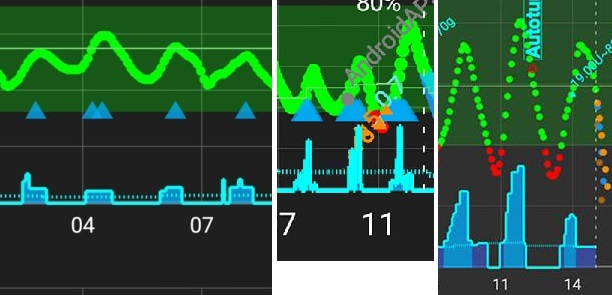

# 你的AAPS配置文件

Your **AAPS Profile** is a set of four key parameters which define how **AAPS** should deliver insulin in response to your sensor glucose levels. 这些参数是AAPS运行的基础。随着你完成各个**目标**，你将解锁额外的可修改参数（如SMB设置），但这些功能的性能依赖于你的底层**配置文件**是否正确。配置文件包括：
* [glucose targets](#profile-glucose-targets),
* [basal rates](#your-aaps-profile-basal-rates) (BR),
* [insulin sensitivity factors](#your-aaps-profile-insulin-sensitivity-factor) (ISF) and
* [insulin-to-carb ratios](#your-aaps-profile-insulin-to-carbs-ratio) (IC or ICR).

```{admonition} Where did DIA go?
:class: note
The **duration of insulin action (DIA)** is no longer part of your **Profile**. It is set per insulin instead — see [Manage → Insulin settings](#Config-Builder-insulin-dia).
```

As part of **AAPS**’ management, users should continually assess and scrutinize the accuracy of their **Profile** settings. 建议按照这里提供的顺序调整设置。在更改另一个设置之前，确保一个设置正确。以小步骤进行更改，而不是一次性进行大幅更改。不要忘记在每次更改后激活新的配置文件。 Regularly [back up your **Profile**](#YourAapsProfile_Profile-backup) settings by exporting your settings.

**配置文件**的设置会相互影响——有时候虽然设置有问题但运行起来没问题，但多数情况下不会这样。例如，如果基础率过高恰好与碳水化合物比例过高同时发生。这意味着你需要单独考虑每个设置，并检查它们在各种情况下是否和谐工作。

你可以使用[Autotune](https://autotuneweb.azurewebsites.net/)来指导你的思考，但不应盲目跟随：它可能不适用于你或所有情况。

```{admonition} Your diabetes may vary
:class: note
**Profiles** vary significantly from person-to-person.

对于基础率（BR）、胰岛素敏感因子（ISF）和碳水系数（IC或ICR），胰岛素需求的绝对值和趋势因个人的生物学特征、性别、年龄、健康状况等因素而异，还受到短期因素如疾病和近期运动的影响。有关此方面的更多指导，Adam Brown的书籍[“亮点与雷区（Brights Spots and Landmines）”](https://diatribe.org/bright-spots-and-landmines/)是一本值得一读的优秀书籍。

```

最后四个参数（血糖目标、基础率、胰岛素敏感因子和碳水系数）可以设置为不同的值，如果需要，可以每小时更改一次，持续24小时。


以下是AAPS中**示例**配置文件的屏幕截图。请注意，下面的示例配置文件显示了大量时间点。当你刚开始使用**AAPS**时，你的配置文件可能非常简单。


(profile-glucose-targets)=
## 血糖目标

### 描述

你的**BG目标**是一个核心参数，AAPS的所有计算都基于它。这不同于您通常努力使血糖值保持的目标范围。目标用于**AAPS**计算：如果**AAPS**预测你的**BG**将落在目标范围之外，那么它将采取行动将你带回到该范围内。

目标可以在以下范围内定义：

|     | _Low_ target           | _High_ target            |
| --- | ---------------------- | ------------------------ |
| 最小值 | 4.4 mmol/L or 80 mg/dL | 5 mmol/L or 90 mg/dL     |
| 最大值 | 10 mmol/L or 180 mg/dL | 11.1 mmol/L or 200 mg/dL |

### 影响

If the target in your **Profile** is very wide (say, 3 or more mmol/L [50 mg/dL or more] wide), you will often find little **AAPS** action. 这是因为预测**BG**水平将位于该宽范围内，因此**AAPS**不太可能采取临时基础率。

### 如何设置

**下图**显示了如何在**AAPS**中设置目标的示例。


**血糖（Blood Glucose，BG）**目标是根据您的个人偏好和需求来设定的。例如，如果你担心夜间低血糖，你可以在晚上9点至早上7点将目标稍微设置高一些，如117 mg/dL（6.5 mmol/L）。如果你想确保在早上注射早餐前有足够的胰岛素在体内（IOB），你可以在早上7点至8点将目标设置低一些，如81 mg/dL（4.5 mmol/L）。

When In [Open Loop](#KeyAapsFeatures-OpenLoop), especially when progressing through [the first objectives](../SettingUpAaps/CompletingTheObjectives.md), using a wide range target can be a good option while you are learning how **AAPS** behaves and adjusting your **Profile**.<br/> When In [Closed Loop](#KeyAapsFeatures-ClosedLoop) (starting at **[Objective 6](#objectives-objective6)**), it is recommended to reduce the range until you have a single target for each time of the day (_Low_ target = _High_ target), to make sure that **AAPS** reacts promptly to **BG** fluctuations.

(your-aaps-profile-basal-rates)=

## 基础率

### 描述

你的基础胰岛素率（单位/小时）提供背景胰岛素，在没有食物或运动的情况下保持你的血糖水平稳定。

胰岛素泵每隔几分钟就会输送少量的速效胰岛素，以防止肝脏释放过多的葡萄糖，并将葡萄糖转移到体细胞中。基础胰岛素通常占您每日总剂量（total daily dose，TDD）的40%至50%，具体取决于您的饮食，并且通常遵循昼夜节律，在24小时内胰岛素需求有一个高峰和一个低谷。 For more information, chapter 6 of [“Think like a Pancreas”](https://amzn.eu/d/iVU0RGe) by Gary Scheiner is very useful.

Most type 1 diabetes educators (and people with type 1 diabetes!) agree that you should work on getting your basal rates correct, before attempting to optimize your ISF and ICR.

### 影响

准确的基础率可以让你醒来时血糖在范围内，并且可以跳过餐食——或者在一天中更早或更晚进食，而不会升高或降低血糖。

基础率过高可能导致低血糖。反之亦然。

AAPS以默认基础率为“基线”。如果基础率设置得太高，那么“零临时基础率”状态对活性胰岛素（IOB）数值的减低量会比实际的大。这将导致AAPS给出更多的后续纠正，以最终将IOB降至零。

因此，过高的基础率不仅会在使用默认速率时导致**低血糖**，而且在**AAPS**进行目标校正的几个小时内也会导致低血糖。

相反，基础率过低可能导致高血糖，并且无法将血糖水平降低到目标范围内。

### 如何设置

**下图**显示了如何在**AAPS**配置文件中设置基础率。


正确设置基础率需要通过反复试验来确定，并且应该与您的糖尿病治疗团队协商进行。

There are basal testing methods which usually entails observing your basal rates and insulin needs during an <u>intermittent</u> fasting over a 24-hour period. 虽然你需要测试一整天的基础率，但不建议连续24小时禁食。这是因为身体会触发激素等机制进行补偿。 A recommended way is to fast over 3 different days for a period of 8 hours.

The recommended method is to suspend the loop (for safety you can set AAPS to [**LGS**](#KeyAapsFeatures-LGS) to avoid lows, as done for achieving [objective 6](#objectives-objective6)), which will revert to your default background basal rate. 观察你的**BG**如何变化：如果它在下降，基础率就过高。反之亦然。<br/> 另一种方法（可能更棘手）是让闭环系统持续运行，并观察**活性胰岛素（IOB）**的变化情况。如果IOB为负，你的基础率就过高。反之亦然。请注意，这种方法依赖于**ISF**来纠正**BG**，因此取决于其他变量设置得是否合理才能成功。 <br/>另一种调整基础率的方法是观察夜间循环操作，当所有碳水化合物都已消耗时。这种方法对儿童特别有用，当禁食困难或胰岛素需求经常变化时。 [Dr Saleh Adi from Tidepool](https://www.youtube.com/watch?v=-fpWnGRhLSo) provides useful ways on how to analyze overnight BG lines in order to optimize your basal rates.

See [here](../GettingHelp/ProfileTuning.md) how to tweak your basal profile, analyzing patterns in closed loop.

When taking action on the result of your basal testing, changes in the **Profile** should be done 1 to 2 hours (depends on your insulin type) before the rise/drop. 根据需要重复测试，直到你对基础率设置感到满意。

(your-aaps-profile-basal-not-compatible)=
#### Message: "Basal rate is not compatible with the current pump"

Each pump has limits: a lowest and a highest basal rate it can deliver and, for some pumps (for example Dana, Accu-Chek Combo, Medtronic and Diaconn G8), basal rates that can only change on the full hour. **AAPS** checks your profile against the pump you use, **after** applying the percentage you choose.

If a basal rate is outside these limits, the **Activate** screen shows this message and the **Activate** button stays grey:


For example, with a basal rate of 0.10 U/h in the night and a profile percentage of 35 %, **AAPS** would have to deliver 0.035 U/h. This is less than a Dana pump can deliver (0.04 U/h).

To solve it, either:

* choose another percentage: a **higher** one if a basal rate becomes too low, a **lower** one if a basal rate becomes too high, or
* [edit the profile](#your-aaps-profile-create-and-edit-profiles) and change the basal rate.

The profile editor only lets you start basal rates on a full hour. A basal rate starting at e.g. 06:30 can only come from an older profile, for example after you change to a pump that does not support it.

(your-aaps-profile-insulin-sensitivity-factor)=

## 胰岛素敏感因子（ISF）

### 描述

胰岛素敏感因子（有时称为校正因子）是衡量每单位胰岛素将降低多少血糖水平的指标。

**以mg/dL单位**： 如果你的ISF为40，每单位胰岛素将使你的血糖降低约40 mg/dL（例如，你的血糖将从140 mg/dL降至100 mg/dL）。

**以mmol/L单位**： 如果你的ISF为1.5，每单位胰岛素将使你的血糖降低约1.5 mmol/L（例如，从8 mmol/L降至6.5 mmol/L）。

从这些例子中你可以看出，**ISF**值<1>越小</1>，你对胰岛素的敏感性就越低。 So if you reduce your ISF from 40 to 35 (mg/dL) or 1.5 to 1.3 (mmol/L), this is often called strengthening your **ISF**. Conversely, increasing the **ISF** value from 40 to 45 (mg/dL) or 1.5 to 1.8 mmol/L) is weakening your **ISF**.

### 影响

**较低/较强的ISF**（即40而不是50）意味着每单位胰岛素降低的**BG**较少。这会导致循环进行更激进/更强的纠正，**输注更多胰岛素**。如果你的ISF过强（值较小），这可能导致低血糖。

**较高/较弱的ISF**（即45而不是35）意味着每单位胰岛素降低的BG更多。这会导致循环进行不那么激进/较弱的纠正，**输注较少胰岛素**。如果你的ISF过弱（值较大），这可能导致高血糖。

**示例：**
* BG为190 mg/dL（10.5 mmol/L），目标为100 mg/dL（5.6 mmol/L）。
* 因此，你需要纠正`190 - 110 = 90 mg/dL`或`10.5 - 5.6 = 4.9 mmol/L`
* 如果`ISF = 30` -> `90 / 30 = 3`或`ISF = 1.63` -> `4.9 / 1.63 = 3`：3单位胰岛素
* 如果`ISF = 45` -> `90 / 45 = 2`或`ISF = 2.45` -> `4.9 / 2.45 = 2`：2单位胰岛素

**ISF**设置过低（因此更激进，这并不罕见）可能导致“过度纠正”，因为**AAPS**计算出用户需要比实际更多的胰岛素来纠正高血糖。这可能导致“过山车”式的BG水平（尤其是在禁食时），如下图所示。在这种情况下，应增加**ISF**值，以使**AAPS**不那么激进。这将确保**AAPS**输送更小的纠正剂量，并避免过度纠正**高血糖**导致**低血糖**。



相反，如果设置的**胰岛素敏感系数（ISF）**过高，可能会导致校正不足，即你的**血糖（BG**）会保持在目标水平之上——尤其在夜间更为明显。

### 如何设置

**下图**显示了如何在**AAPS**配置文件中设置ISF值。


确定日间ISF的一个基本起点是根据你的每日总剂量（TDD）使用1700（94）规则。 Gary Scheiner的[“像胰腺一样思考（Think like a Pancreas）”](https://amzn.eu/d/iVU0RGe)第7章提供了更多详细信息。

| 1700 (if measuring in mg/dL) or 94 (mmol/L)/ TDD = approx ISF.<br/><br/>Example: TDD = 40 U<br/>Approx ISF (mg/dL) = 1700/40 = 43<br/>Approx ISF (mmol/L) = 94/40 = 2.4 |
| ----------------------------------------------------------------------------------------------------------------------------------------------------------------------------------------------- |
|                                                                                                                                                                                                 |

假设你的基础率正确，你可以通过暂停循环、检查**IOB**是否为零，并服用一些葡萄糖片来达到稳定的“高血糖”水平来测试这一点。

然后服用根据当前1/ISF估算的胰岛素量以达到目标BG。

请小心，因为这通常设置得过低。过低意味着1U将使BG下降得比预期快。

(your-aaps-profile-insulin-to-carbs-ratio)=

## 胰岛素与碳水化合物比例（ICR）

### 描述

**ICR**是衡量每单位胰岛素覆盖多少克碳水化合物的指标。

有些人也使用**I:C**作为**ICR**的缩写，或者谈论碳水化合物比例：**CR**。

例如，1比10（1:10）的胰岛素与碳水化合物比例意味着每吃10克碳水化合物，就需要注射1单位的胰岛素。一顿含有25克碳水化合物的餐食需要2.5单位的胰岛素。

如果你的**ICR**较弱（值较高），比如1:20，你只需要0.5U胰岛素就可以覆盖10克碳水化合物。一顿含有25克碳水化合物的餐食需要25/20=1.25单位的胰岛素。

由于激素水平和身体活动，一天中不同时间段的**ICR**通常不同。许多人发现他们在早餐时段的ICR最低/最强，因为他们往往更胰岛素抵抗。因此，例如，一个成年用户的**ICR**可能在早餐时为1:8，午餐和晚餐时为1:10，但这些模式并非普遍，有些人在晚餐时更胰岛素抵抗，并且需要更强/更小的ICR。

> **注意：**
> 
> 在一些欧洲国家，使用面包单位（BU）来确定需要多少胰岛素来摄取食物。最初1个面包单位等于12克碳水化合物，后来一些国家改为10克碳水化合物。
> 
> 在这个模型中，碳水化合物的量是固定的，而胰岛素的量是可变的。（“需要多少胰岛素来覆盖一个面包单位？”）
> 
> 在使用**ICR（Insulin to Carb Ratio，胰岛素与碳水比例）**时，胰岛素的量是固定的，而碳水化合物的量是变化的。（“一单位胰岛素可以覆盖多少克碳水化合物？”）
> 
> 示例：
> 
> 面包单位因子（BU = 12g碳水化合物）：2.4 U/BU -> 你吃一个面包单位时需要2.4单位胰岛素。
> 
> 相应的**ICR**：12g / 2.4 U = 5.0 g/U -> 5.0克碳水化合物可以用一单位胰岛素覆盖。
> 
> BU因子 2.4 U / 12g ===> IC = 12g / 2.4 U = 5.0 g/U
> 
> 转换表可在网上找到，例如[此处](https://www.mylife-diabetescare.com/files/media/03_Documents/11_Software/FAS/SOF_FAS_App_KI-Verha%CC%88ltnis_MSTR-DE-AT-CH.pdf)。

### 影响

**较低/更强的ICR**意味着每单位胰岛素覆盖的碳水化合物更少，即你固定量的碳水化合物获得了较多胰岛素。也可以称为“更激进”。如果你的胰岛素敏感系数（IC）过强，就会注射过多的胰岛素，这可能会导致**血糖**过低。

一个**较高/更弱的ICR（胰岛素与碳水比例）**意味着每单位胰岛素可以对应更多的食物，即对于固定量的碳水化合物，你所需的胰岛素会更少。也可以称为“不那么激进”。如果你的胰岛素敏感系数（IC）过弱，那么你得到的胰岛素就会少于你所需，这可能会导致**血糖**过高。

### 如何设置

**下图**显示了一个用户的**ICR**以及如何在**AAPS配置文件**中设置它。 When entering these values, we enter the final part of the ratio, so an insulin-to-carb ratio of 1:3.5 is entered simply as “3.5”.


如果在消化完一顿饭并且IOB已恢复到零后，你的**BG**仍然高于餐前水平，那么你的**ICR**可能太弱（_即_数字太高，应逐渐降低）。相反，如果你的**BG**低于餐前水平，**ICR**可能太强（_即_数字太小，应逐渐增加）。

假设你的基础率是正确的，你可以通过检查**IOB（活性胰岛素）**是否为零，并且你的血糖处于正常范围内，吃已知确切数量的碳水化合物，并根据当前的胰岛素与碳水比例（IRC）估算所需的胰岛素量来进行测试。最好是吃你每天那个时间段通常会吃的食物，并精确计算其碳水化合物含量。

## 与配置文件相关的常见问题

```{contents} Common questions related to the Profile
:depth: 1
:local: true
```

### 关于正确设置你的配置文件的重要性

**为什么我应该努力调整我的Profile设置？闭环系统不能自己处理吗？**

A hybrid closed loop _can_ attempt to make insulin delivery adjustments to minimize poor glycemic control that results from having incorrect **Profile** values. 它可以通过在你即将出现低血糖时暂停胰岛素输注来实现这一点。然而，如果你的**配置文件**设置已经尽可能接近你的身体需求，你可以实现更好的血糖控制。这是先进**AAPS**采用分阶段目标，从开环输注向混合闭环系统过渡的原因之一。此外，有时你需要打开闭环（如传感器预热、传感器故障等），有时甚至在半夜，这时你需要确保你的设置是正确的。

如果您在使用不同的开环或闭环输注系统后开始使用**AAPS**，那么您对于基础率（**BR**）、胰岛素敏感系数（**ISF**）和胰岛素与碳水比例（**ICR**）等参数的设置值应该已经有了一个合理的认识。

如果你从每日多针（MDI）转到AAPS，那么最好先阅读关于如何从MDI转到泵疗的信息，并与你的糖尿病团队仔细计划和进行转换。 John Walsh和Ruth Roberts的《[Pumping insulin（用泵输注胰岛素）](https://amzn.eu/d/iaCsFa2)》&Gary Scheiner的《Think like a Pancreas》都是非常有用的书籍。

### 在闭环系统中，导致餐后高血糖峰值的原因有哪些？
首先，检查你的基础率，并进行无碳水基础率测试。如果它是正确的，并且你的**血糖**在碳水完全吸收后下降到目标范围内，尝试在**AAPS**中设置“即将进食”的临时目标，或与内分泌医生讨论合适的等时。 <br/> 如果你的**血糖**在饭后仍然过高，并且在碳水完全吸收后仍然过高，考虑与内分泌医生讨论减少你的**ICR**。如果你的**血糖**在碳水吸收过程中过高，而在碳水完全吸收后过低，考虑增加你的**ICR**，并与内分泌医生讨论合适的等时。

### I'm stuck high and the loop does not bring me down
**AAPS**没有给予足够胰岛素的可能原因包括：
* 胰岛素敏感系数（ISF）不够强
* Basal rate might not be strong enough
* 安全设置可能启动，如最大IOB限制。或者根据你的设置，**SMB（超微大剂量）**此时被禁用。
* 自动化设置已启用并已覆盖**AAPS**。

See also [Tweaking the AAPS Profile](../GettingHelp/ProfileTuning.md).

### 我有负IOB，这是问题吗？
负**IOB**意味着你体内的绝对胰岛素量（基础+大剂量）少于基础量。这会导致**AAPS**在**血糖**开始升高时立即输送更多胰岛素，因为它认为胰岛素不足，这可能会导致后期低**血糖**。

以下是你可能出现负IOB的一些原因以及应对措施：
* 基础率过强：调整你的**配置文件**
* 上一餐的大剂量过多：调整你的**配置文件**或检查你是否在正确的时间注射。
* DIA set too short on your insulin type, resulting in insulin stacking: tweak it in [Manage → Insulin settings](#Config-Builder-insulin-dia)
* 体力活动：下次活动时，考虑使用较低的[配置文件百分比](../DailyLifeWithAaps/ProfileSwitch-ProfilePercentage.md)来增加敏感度。

## 管理你的配置文件

```{contents} Operations that you can perform on your **Profiles** in **AAPS**
:depth: 1
:local: true
```
(your-aaps-profile-create-and-edit-profiles)=
### 创建和编辑配置文件

In **AAPS** v4 your profiles live on the **Manage** screen (bottom navigation) → **Profile**, shown as a swipeable card carousel with an action bar (**➕ Add**, **✏️ Edit**, **⧉ Clone**, **🗑️ Delete**, **▶ Activate**). For managing and activating a profile, see [Managing and activating profiles](#ProfileSwitch-manage-v4). Coming from **AAPS** v3, where profiles had their own tab? See [What changed in AAPS v4](#v4changes-manage).

Tapping **✏️ Edit** opens the editor. Set the profile **name** and **units**, then fill in the four schedules using the tabs:

- **IC** — insulin-to-carb ratio (g/U)
- **ISF** — insulin sensitivity factor
- **BAS** — basal rates
- **TARG** — target range


Each schedule is a list of **time blocks**: add a block, set its start time and value, then **Save**.

If you make any changes to your **Profile**, make sure you are editing the correct **Profile**: the card of the profile in use is marked **ACTIVE**, but the card selected on screen may be another one.

(your-aaps-profile-profile-from-scratch-for-a-kid)=
### 为孩子从头开始构建配置文件

The [Profile Helper](#aaps-screens-profile-helper) (menu ☰ → **Profile helper**) may help you to create a profile for a child (up to 18 years).

**重要提醒：**

**“配置文件助手”旨在帮助你为你的孩子找到初始Profile。尽管它基于两家不同医院的数据集，但在使用新Profile之前，一定要与你的医疗团队讨论！**

配置文件助手为儿童提供了两家不同医院的数据集，以找到适合你孩子的初始配置文件（18岁以下）。


1. Make sure you are on the **Profile 1** tab.
2. 在“配置文件类型”中，确保已选择“默认配置文件”。
3. 根据医院数据集调整默认配置文件（输入孩子的年龄和总日剂量**或**体重）。
4. Change to the **Profile 2** tab.
5. 点击“配置文件类型”并选择“DPV Default profile”。
6. Adjust DPV Default profile (based on another hospital data set) by entering kids age, TDD Total and percentage of basal. Note that the DPV data set provides **basal rates** only, so IC and ISF are shown as zero for this profile.
7. Open the **Comparation** tab. 将显示两个调整后的配置文件的比较（见下方截图）。
8. If you want to start tweaking your profile based on one of these suggestions, use the **Clone** button at the bottom of the comparison.


### 配置文件切换

请参阅[Profile切换&Profile百分比](../DailyLifeWithAaps/ProfileSwitch-ProfilePercentage.md)。

(your-aaps-profile-clone-profile-switch)=
### 将配置文件克隆并切换至新配置文件


The [Treatments history](#aaps-screens-treatments) shows all past **Profile Switches**. When going to the **Profile switch** tab, you can use a past **Profile Switch** as a base to create a new **Profile**. 在这种情况下，时间偏移和百分比将应用于新的本地配置文件。 Use the **Clone** button shown on line **2**.

You can now go to the [Profile screen](#your-aaps-profile-create-and-edit-profiles) (**Manage → Profile**) to edit the newly created Profile.

(YourAapsProfile_Profile-backup)=
### 配置文件备份

作为您循环系统的核心设置，您的**配置文件**非常敏感，是您绝不想丢失的重要数据。

* 你的**配置文件**存储在**AAPS**数据库中。
* When **NSClientV3** is set up (see [Synchronization](#SetupWizard-synchronization-with-the-reporting-server-and-more)), your **Profiles** are also uploaded to Nightscout automatically.
* 它们也是[导出的设置](../Maintenance/ExportImportSettings.md)的一部分。因此，请确保在安全的地方有备份。

### 从Nightscout编辑Profile

If enabled, **Profile** changes made directly in Nightscout can be received in **AAPS**. The setting is called "**Receive profile store from NS**" and is part of the **Nightscout data acceptance** options (accepting data from Nightscout is turned off by default, see the [Client control step of the Setup Wizard](../SettingUpAaps/SetupWizard.md)); you can find it quickly with the **search bar** on the main screen. While client control is on, the setting is hidden and **AAPS** takes no profile changes from Nightscout ([hardened mode](#client-master-control-hardened-mode)); edit the profile on a paired client instead, or load it once with **Full sync**.

当您要对一个更广泛的**配置文件**进行重大更改时，这可能会很有帮助。它们可以更容易地通过网页界面输入，_例如_手动从电子表格复制数据。

然而，要执行此操作，重要的是在Nightscout编辑器中克隆由多个配置文件组成的整个**数据库记录**（见下方截图中的蓝色箭头）。新的数据库记录将包含当前日期。保存后，可以在AAPS中通过常规的[配置文件切换](../DailyLifeWithAaps/ProfileSwitch-ProfilePercentage.md)激活更改/新的配置文件。


(your-aaps-profile-compare-profiles)=
### 比较两个Profile

You can also use the [Profile Helper](#aaps-screens-profile-helper) (menu ☰ → **Profile helper**) to compare two different profiles or profile switches (percentage of one of your profiles used in a [profile switch](../DailyLifeWithAaps/ProfileSwitch-ProfilePercentage.md) before).


1. Make sure you are on the **Profile 1** tab.
2. 在**配置文件类型（Profile type）**中，选择“可用配置文件（Available profile）”以在所有存储的**配置文件**中进行选择。
3. 选择您想要进行比较的**配置文件**。
4. Change to the **Profile 2** tab.
5. In **Profile type**, select "Profile switch" to choose in the history of all your **Profile Switches**.
6. 选择您想要与之比较的**配置文件切换**。
7. Open the **Comparation** tab. Comparison of the two profiles will be displayed (see screenshot below).


