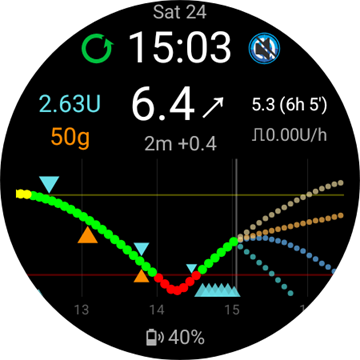
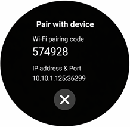
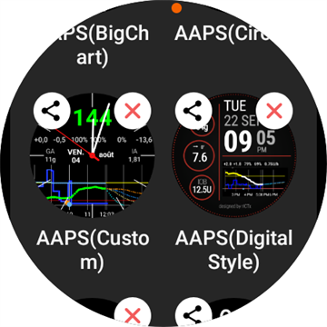

# Set up AAPS on your Wear OS watch

The instructions below apply to the **AAPS Wear** apk that you need to build. If you haven’t built it yet, see the linked guide [here](../WearOS/BuildingAapsWearOS.md). When building, make sure to use the same keystore file that you used for the phone **AAPS** apk.

You can also use some of the information for the **AAPSClient** and **PumpControl** **Wear** apk. Each **Wear** app will communicate with it's matching phone app. 例如：AAPSClient Wear应用可用于显示AAPSClient数据，而不是AAPS数据。 When several client flavors (**AAPSClient**, **AAPSClient2**, **AAPSClient3**) are installed side by side, each one's tiles carry a small header in that flavor's accent colour so you can tell them apart while swiping.

## Wear OS版本与兼容性

(wearos-watchface-changes)=

### Wear OS watch face changes (impact on AAPS watchfaces)

```{admonition} Why newer Wear OS watches break AAPS watchfaces
:class: warning

In June 2025 Google [announced changes](https://android-developers.googleblog.com/2025/06/upcoming-changes-to-wear-os-watch-faces.html) that phase out the legacy watch face engine (the AndroidX / Wearable Support Library, or "WSL", engine) in favour of the newer declarative **Watch Face Format**. The **AAPS** custom watchfaces are built on the legacy engine, so the newer the Wear OS version, the more likely an AAPS watchface is to misbehave or stop working.

This affects the **watchfaces** specifically — AAPS **complications**, tiles and remote-control functions are not impacted. It is also why **a firmware/system update on a Wear OS watch can break AAPS watchfaces**, and a watch cannot be rolled back to an older Wear OS version afterwards. If your AAPS watchface currently works, **disable automatic watch updates**.
```

The table below summarises how Google's change affects the AAPS (legacy-engine) watchfaces by Wear OS version:

| Wear OS version         | Base Android | API level | Impact on AAPS (legacy) watchfaces                                                                                                                                                          |
| ----------------------- | ------------ | --------- | ------------------------------------------------------------------------------------------------------------------------------------------------------------------------------------------- |
| Wear OS 6               | Android 16   | 36        | **Legacy watchfaces no longer available** — AAPS installs a [Watch Face Format watchface](#wearos-aaps-v4-watchface) instead: your custom watchface, or the AAPS V4 complications watchface |
| Wear OS 5               | Android 14   | 34        | **Severe** — active (interactive) mode often fails, complications freeze, animations stop                                                                                                   |
| Wear OS 4               | Android 13   | 33        | **Moderate** — throttling, missed updates, partial failures                                                                                                                                 |
| Wear OS 3.0 / 3.2 / 3.5 | Android 11   | 30        | **Low** — legacy engine still supported                                                                                                                                                     |

If your watch runs a version where AAPS watchfaces are unreliable, you can instead display AAPS data through **complications** on a compatible watchface, or use [GlucoDataHandler](https://play.google.com/store/apps/details?id=de.michelinside.glucodatahandler) with a complication, fed by the [External Companion Apps](#external-companion-apps) plugin of **AAPS**. On **Wear OS 6 and newer**, AAPS installs a replacement watchface built in the new format — see below.

(wearos-aaps-v4-watchface)=

### Wear OS 6 and newer — the watchface AAPS installs

Watches running **Wear OS 6 or newer** cannot run the classic AAPS watchfaces as watchfaces. For these watches the AAPS watch app brings two watchfaces built in Google's new **Watch Face Format**. Wear OS lets an app install only **one** watchface, so you choose which of the two is on the watch:

- **Custom watchface** (default): shows the custom watchface you loaded from the phone with **Load Watchface** (see [Changing to an AAPS Watchface](#WearOS_changing-to-AAPS-watchface)). The watch draws your design as a picture, so every existing custom watchface works. The complication slots a custom watchface may define are **not available** in this picture, because Wear OS only delivers complication data to a real watchface. Long-press the face to reach its one setting: whether the always-on display shows a plain clock or your own design, dimmed.
- **Complications watchface** (the **AAPS V4** watchface): its **seven complication slots** come **preconfigured with AAPS data**: BG value, IOB, COB, the [BG Graph complication](#Watchfaces-complications), basal rate / temp target, and the **Running Mode** icon in the top-left slot (tap it to change the loop mode from the watch). Tap the time at the top to open the watch's alarm app. You can change what each slot shows in the watch face editor.

You choose on the phone: open the **Wear** plugin and, under **Watchface installed on watch**, select one of the two. This card is only shown while a Wear OS 6 or newer watch is connected. **AAPS** asks you to confirm, because the watch replaces its face immediately. Switching away from the **Complications watchface** also resets the complications you changed in the watch face editor back to the defaults, and the confirmation says so. While the **Complications watchface** is selected, the custom watchface buttons are hidden and a preview of the face is shown instead. If you load a custom watchface while the **Complications watchface** is selected, **AAPS** reminds you to switch to **Custom watchface** to see it on the watch.

- The selected watchface is **installed and activated automatically** the first time the AAPS watch app runs on such a watch, and it is **updated automatically** together with the watch app.
- If you removed the watchface, an **Install watchface** entry appears at the bottom of the watch's AAPS **main menu** — tap it to reinstall.

While a watch running Wear OS 5 or older is connected, the **Watchface installed on watch** card is not shown at all (the mechanism it relies on requires Wear OS 6); the classic watchfaces run there as before.

(wearos-complications-watchface-setup)=

### Complications watchface — recommended setup

The **Complications watchface** has seven complication slots. Long-press the watchface, tap **Customize**, and pick a data source for each slot. The slots are numbered as in the watch face editor: **1** left, **2** centre, **3** right, **4** the graph, **5** bottom, **6** top-left and **7** top-right.

| Default setup                                                                                   | Alternative setup                                                                                       |
| ----------------------------------------------------------------------------------------------- | ------------------------------------------------------------------------------------------------------- |
|  |  |

| Slot | Position  | Default                                                             | Alternative                           |
| ---- | --------- | ------------------------------------------------------------------- | ------------------------------------- |
| 1    | Left      | IoB Icon                                                            | CoB & IoB                             |
| 2    | Centre    | Blood Glucose                                                       | Blood Glucose                         |
| 3    | Right     | CoB Icon                                                            | BR & Target                           |
| 4    | Graph     | BG Graph                                                            | BG Graph                              |
| 5    | Bottom    | BR & Target                                                         | Uploader/Phone Battery                |
| 6    | Top-left  | Running mode                                                        | Running mode                          |
| 7    | Top-right | Uploader/Phone Battery, or an app shortcut to **AAPS Snooze Alert** | App shortcut to **AAPS Snooze Alert** |

The **AAPS Snooze Alert** shortcut is picked from the watch's own **App shortcut** complications. Tapping it snoozes the alarm that is sounding on the phone.

```{tip}
Turn on **Always-on display** on the watch (**Settings** > **Display**). The watchface then keeps showing your glucose when the wrist is down, instead of a blank or a plain clock.
```

```{admonition} No complication data while the watch is locked
:class: note
If a **Lock type** is set under **Settings** > **Security and privacy**, the watch hides complication data while it is locked, and the watchface shows empty slots until you unlock it. To keep the data visible, turn off **Hide information** in the same menu.
```

### Wear OS 3

使用[Wear Installer 2](https://youtu.be/abgN4jQqHb0?si=5L7WUeYMSd_8IdPV)、Easy Fire Tools（下文介绍）或ADB安装**AAPS Wear​** APK。  
**AAPS Wear**功能无限制。

(BuildingAapsWearOs-WearOS5)=

### Wear OS 4 and Wear OS 5

Example: Galaxy Watch 4, 5, 6, 7 and Ultra or Pixel Watch that have **not** been updated to Wear OS 6 yet. Check the version under **Settings** > **About watch** > **Software**.

Install the **AAPS Wear** apk using [Wear Installer 2](https://youtu.be/abgN4jQqHb0?si=5L7WUeYMSd_8IdPV) (for Wear OS 5 follow [this video](https://www.youtube.com/watch?v=yef_qGvcCnk)). All **AAPS Wear** functions work, but the classic **AAPS** watchfaces are limited as described in the table above: throttled on Wear OS 4, often failing on Wear OS 5.

```{admonition} Wear OS 5
:class: warning
On Wear OS 5 the AAPS watchface has to be selected with Wear Installer 2 right after installing the Wear app: the installer offers the **AAPS (Custom)** watchface at the end of the installation. If you accidentally switch to another watchface, repeat the installation. Changing the watchface settings (Dark, Watchdivider, etc.) may not be possible.

If the classic watchface currently works for you, **disable automatic watch updates**: the next firmware update is likely to break it. If you update to Wear OS 6 anyway, read the section above: **AAPS** then installs its own watchface in the new format.
```

If the watchface is too unreliable, consider [GlucoDataHandler](https://play.google.com/store/apps/details?id=de.michelinside.glucodatahandler) with a complication instead. It needs the [External Companion Apps](#external-companion-apps) plugin enabled in **AAPS**.

### Wear OS 6 and newer

Example: Galaxy Watch 4 and newer with One UI 8 Watch, Pixel Watch after the 2025 update. Most Galaxy and Pixel watches have received this update.

Install the **AAPS Wear** apk using [Wear Installer 2](https://youtu.be/abgN4jQqHb0?si=5L7WUeYMSd_8IdPV). The classic watchfaces are not available; **AAPS** installs the watchface selected on the phone automatically, see [the watchface AAPS installs](#wearos-aaps-v4-watchface). No limitation in **AAPS Wear** operations.

## 如何在Samsung Galaxy 4智能手表上设置AAPS

本节假设您完全不了解智能手表，并为您提供有关热门手表**Galaxy Watch 4**的基本指导，随后是逐步在手表上安装**AAPS**的指南。

_This guide was written for a Galaxy Watch running Wear OS 3._ On Wear OS 4 and later the watch asks for a **pairing code** when a phone or computer connects over ADB. Wear Installer 2 and the terminal procedure [below](#BuildingAapsWearOs-WearOS5-TShoot) both support it.

这里是针对[Galaxy Watch 5](https://www.youtube.com/watch?v=Y5upzOIxwTU)和[Galaxy Watch 6](https://www.youtube.com/watch?v=D6bq20KzPW0)的基本设置指南。

## 智能手表基本操作

在根据上面的视频完成手表的基本设置后，请转到手机上的Play商店并下载以下应用：“Galaxy Wearable”、“Samsung”以及“Easy Fire tools”或“Wear Installer 2”。

YouTube上有许多第三方视频可以帮助您熟悉新智能手表，例如：

[https://www.youtube.com/watch?v=tSVkqWNmO2c](https://www.youtube.com/watch?v=tSVkqWNmO2c)

“Galaxy Wearable”应用中也包含有说明手册部分。在手机上打开Galaxy Wearable，搜索手表，尝试将手表与手机配对。根据您的版本，这可能会提示您从Play商店安装进一步的第三方应用“galaxy watch 4 plugin”（下载需要一些时间）。在手机上安装此应用，然后再次尝试在Wearable应用中配对手表和手机。完成一系列菜单并勾选各种偏好设置。

## 设置Samsung账户

您需要确保用于设置Samsung账户的电子邮件账户的出生日期表明用户年满13岁，否则Samsung权限将非常难以批准。如果您为未满13岁的孩子提供了一个Gmail账户，并且正在使用该电子邮件地址，则不能简单地将其更改为成人账户。一种解决方法是修改当前出生日期，使其当前年龄为12岁363天。第二天，账户将转换为成人账户，您可以继续设置Samsung账户。

(remote-control-transferring-the-aaps-wear-app-onto-your-aaps-phone)=

## 将**AAPS** Wear应用传输到您的**AAPS**手机上。

您可以通过以下方式之一将Wear.apk从Android Studio加载到手机上：

a) 使用USB电缆将AAPS Wear apk文件放到手机上，然后“侧载”到手表上。将Wear.apk通过USB传输到手机的下载文件夹中；或

b) 将Wear.apk从Android Studio剪切并粘贴到您的Gdrive上。


To side-load AAPS onto the watch You can use either: 1) Wear Installer 2 2) Easy Fire tools 3) Android Debug Bridge (ADB) Here we recommend Wear Installer 2, because the instructions and process in the video are so clear and well-explained. If Wear Installer 2 does not work for you, try Easy Fire Tools or ADB, both described below.

### Using Wear Installer 2 to side-load **AAPS** Wear from the phone onto the watch

 

Wear Installer 2由[Malcolm Bryant](https://www.youtube.com/@Freepoc)开发，可以从Google Play下载到您的手机上，并可用于将AAPS Wear应用侧载到手表上。该应用包含一个方便的“如何侧载”的[视频](https://youtu.be/abgN4jQqHb0?si=5L7WUeYMSd_8IdPV)。

```{tip}
对于Wear OS 5手表，请参考[此视频](https://www.youtube.com/watch?v=yef_qGvcCnk)。故障排查见[下文](#BuildingAapsWearOs-WearOS5-TShoot)。
```

This provides all the necessary detail (best to open the video on a separate device so you can watch it while setting up the phone).

如视频中所述，完成后，请关闭手表上的ADB调试，以避免耗尽智能手表的电池。

Wear OS 5以下设备可选方案：

### Use Easy Fire tools to side-load the **AAPS** wear on the watch

1)   Download _[Easy Fire Tools](https://play.google.com/store/apps/details?id=de.agondev.easyfiretools&hl=en)_ from the Play Store onto phone


2)  Make yourself a developer in the watch (once set up and connected to phone):

Go to **Settings** > **System** > **About** > **Versions** (the menu names vary between watch brands — on some watches it is **About watch** > **Software info** > **Software version**).


Rapidly tap on **Build number** (or **Software version**) several times until a message tells you that you are now a developer.


Go back to **Settings** > **System**: a new **Developer options** menu is now shown.

In **Developer options**, turn on **ADB debugging** and **Wireless debugging**, and confirm the prompts. Wireless debugging then shows the watch's **IP address & Port**, something like: **192.168.1.214** : 5555. You only need the IP address (here **192.168.1.214**), not the port number after the colon. Note that the IP address can change, for example every time you change to a new phone handset for AAPS.


STEP 3)     Enter IP address _e.g._ **192.168.1.214** into Easy Fire tools on the phone (go into the left hamburger, settings and enter the IP address).


然后点击右上角的插头插座图标。 It will turn green when connected.


STEP 4) Follow the instructions [here](https://wearablestouse.com/blog/2022/01/04/install-apps-apk-samsung-galaxy-watch-4/?utm_content=cmp-true) to side-load (i.e. transfer)  aaps-wear.apk onto the smartwatch using Easy Fire tools


(BuildingAapsWearOs-WearOS5-TShoot)=

### Using the terminal
Connect your smartwatch and computer to the same Wi-Fi network.

- To install ADB download it from: https://developer.android.com/tools/releases/platform-tools
- Open a terminal.
- For Windows, create a new folder named `adb` under your disk `C:`. Open the `platform-tools-latest-windows.zip` file you downloaded above. Copy all files inside `platform-tools` to `C:\adb` and open this folder with a command prompt (right click and Open in Terminal). Type the command below to set the path to the folder where ADB is located: `setx PATH "%PATH%;C:\adb"`
- For Mac instead of installing manually you can use homebrew: `brew install android-platform-tools`

On the watch:
- Go to Settings → About watch → **Software Information**
- Tap Software version 7 times until you see Developer mode enabled.
- Go to Settings → Developer options. Enable **ADB debugging**
- Go to Settings → Developer options → Wireless debugging → **Pair new device**

You will see a Wi-Fi pairing code and IP address and port appearing:



- In the terminal: `adb pair ipaddress:port` E.g. `adb pair 10.10.1.125:36299`
- You will be asked for the pairing code. Enter it.
- You will see a response:<br> `Successfully paired to 10.10.1.125:36299 [guid=adb-RXXXW20LMKJY-eh5zBj]`<br>
- In the terminal type: <br>`adb devices`.<br> You should see something like:<br> `List of devices attached`<br> `10.10.1.125:36299  offline`<br> `adb-RFAW20LMKJY-eh5zBj._adb-tls-connect._tcp   device`<br>

- Now go to the folder on your computer where the Wear apk is and type<br> `adb install wear-full.apk` <br>with wear.apk replaced by the name of your apk file.
- You will see:<br> `Performing Streamed Install`<br> `Success`


(wear-os-5-troubleshooting)=

### Wear OS 5通用故障排查

- 请勿使用Wi-Fi热点共享。该方式无法使用。
- 无需在手机上启用ADB调试（仅需在手表端开启）。请在手机设置中关闭ADB调试功能。
- 确保设备处于同一局域网（避免使用访客网络）
- 请确保手表和手机处于同一Wi-Fi网络下，特别注意使用Wi-Fi中继器或接入点可能引发连接问题。
- 确保设备靠近主路由器，必要时重启设备。

**配对流程:**

- 手表端：记录无线调试显示的IP地址
- Wear Installer：输入IP地址
- 选择"新配对"，记录配对码与端口号
- Wear Installer: enter the pairing code + space + port number.
- Wear Installer应显示"配对成功"。若未显示，请退出Wear Installer后重新尝试。

完成配对后即可安装AAPS wear apk：

- 退出/关闭后重新启动Wear Installer。
- 进行无线调试时，请记录IP地址与端口号，并确保在Wear Installer中核对并输入该IP地址及端口号。
- 注：此端口号与配对所用端口号不同！

## 从**AAPS**设置手表与手机的连接

The final step is to configure **AAPS** on the phone to interact with **Wear.apk** on the watch. To do this, enable the Wear plugin:

* 打开手机上的**AAPS**

* Open the **menu** (☰) in the top-left corner and go to **Configuration** > **Communication**

* Tick the **Wear** box


To bolus or take other actions from the watch, also turn on **Wear control** in [Settings > Wear](#preferences-wear).

要更改为不同的**AAPS**表盘，请按手表的主屏幕，它将转到“自定义”。然后向右滑动，直到您看到所有**AAPS**表盘。

如果已成功将**AAPS** Wear.apk侧载到智能手表上，它将如下所示：


For certain smart watches, like the Samsung Galaxy, 'Remote Connection' under Samsung Galaxy's Advanced Features must be switched **on** to use **Wear.apk** & **AAPS** remotely via Wi-Fi.


(wear-os-watch-phone-communication)=

### 排查**AAPS**手表与**AAPS**手机之间的通信问题

1.  如果EasyFire tools无法连接或您收到“授权失败”>检查IP地址是否正确输入。
2.  检查智能手表是否已连接到互联网（而不仅仅是通过蓝牙连接到手机）。
3.  检查**AAPS**手机和智能手表是否已在Samsung应用中配对或链接。
4.  重启手机和智能手表（即关闭并重新打开）也可能有所帮助。
5.  Assuming you have managed to download the Wear.apk onto your phone but you are not receiving any BG data, _check_ that you have side-loaded the correct **AAPS** Wear apk onto the watch: the watch app of a browser build is the `aaps-wear-….apk` file, see [Building the Wear app](../WearOS/BuildingAapsWearOS.md). If the file you installed is any of the following: a) an **AAPSClient** Wear apk (while the phone runs **AAPS**); b) a `.aab` file; or c) a file with the word ‘debug’ in its name, you have not selected the correct Wear OS apk during the build.
6.  检查您的路由器是否将设备彼此隔离。

更多故障排除提示可在此处找到[here](https://freepoc.org/wear-installer-help-page/#:~:text=If%20you%20are%20having%20problems,your%20phone%20and%20your%20watch.)

(WearOS_changing-to-AAPS-watchface)=

## 在您的WearOS手表上更改为AAPS表盘

在标准构建的AAPS Wear OS APK中有多个表盘可供选择。一旦您在手表上安装了AAPS Wear APK，它们将可用。以下是选择表盘的步骤：

1. 在您的手表上（假设是WearOS），长按当前表盘以调出表盘选择器屏幕，并一直向右滚动，直到您看到“添加表盘”按钮并选择它


2. Scroll through the list until you find "AAPS (Custom)" (depending on the watch, the watch faces of installed apps are listed under a "Downloaded" section or grouped by app) and click the middle of the image to add it to your shortlist of current watchfaces. 不用担心“AAPS（自定义）”表盘的当前外观，我们将在下一步中选择您喜欢的皮肤。



3. Now open AAPS on your phone and open the Wear plugin: **Configuration** > **Communication** > **Wear** > **Open plugin** (tick **Wear** first if it is not enabled).


4. 点击“加载表盘”按钮，并选择你喜欢的表盘。


5. 检查您的手表，“AAPS（自定义）”表盘现在应该显示您选择的皮肤。给它几秒钟刷新。 The **Wear** screen on the phone now shows the name of the loaded watchface and a preview of it. **Infos Watchface** lists its details and the fields it contains, and **More watchfaces** opens the [exchange site](../ExchangeSiteCustomWatchfaces/index.md) where you can download other custom watchfaces. 您现在可以通过长按表盘，然后点击表盘图像上的“自定义”按钮来自定义小部件等。

```{admonition} Complications on a custom watchface
:class: note
Custom watchfaces made with version 3.0 or newer of the custom watchface format can contain up to five complication slots, with their position and size defined by the watchface (**Complication layout**). On the watch, long-press the watchface, tap **Customize** and tap **Complication 1** to **Complication 5** to choose the data source shown in each slot. The same rows are listed in the watch's AAPS app under **Settings** > **AAPS(Custom)**; tapping one there opens the same picker. **Complication type priority** decides whether a slot prefers a value or gauge, text, or an icon when the data source offers several. A changed priority only applies the next time you pick a data source for that slot.

These slots only work on watches running **Wear OS 5 or older**, where the custom watchface runs as a real watchface. On **Wear OS 6 and newer**, the custom watchface is shown as a picture without its complication slots, and steps 1 and 2 above are not needed: make sure **Custom watchface** is selected under **Watchface installed on watch** in the phone's **Wear** plugin (see [the watchface AAPS installs](#wearos-aaps-v4-watchface)).
```

## APSv2 watchface - Legend


A - 上次闭环运行以来的时间

B - 持续葡萄糖监测（CGM）读数

C - 自上次CGM读数以来的分钟数

D - change compared to last CGM reading (in mmol or mg/dL)

E - 过去15分钟内CGM读数的平均变化

F - 手机电量

G - 基础率（标准速率期间以U/h显示，临时基础率（TBR）期间以%显示）

H - 血糖互动（BGI）-> 仅基于胰岛素活性，血糖“应该”上升或下降的程度。

I - 碳水化合物（活性碳水化合物|未来的e-carbs）

J - 活性胰岛素（来自大剂量|来自基础量）
